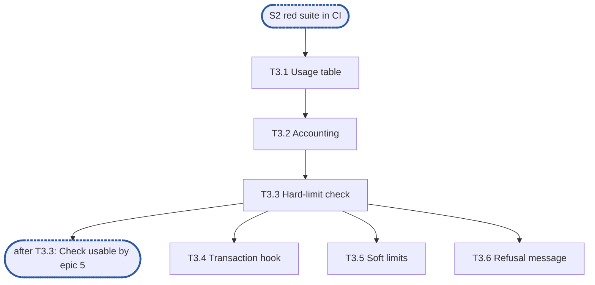

<!--
Example for the epic-breakdown skill. RFC 90, its quota component and every name below are
invented: the document shows the shape, the depth and the fixed lines an epic document has.
Do not copy its content.
-->

# Epic 3: quota v2 usage index and limit checks

**Sources:** [RFC 90](../rfcs/rfc-90-quota.md) §3.1–§3.4 and §6.2;
[RFC 16](../rfcs/rfc-16-metadata-store.md) §4.3, for the transaction hook only.
**Track:** B.
**Epic 3 estimate: 6 subtasks, 11.25 man-days.**
**Depends on:** sync point **S2, red suite in CI**: epic 1's `quotav2.Checker` interface
and error set, and epic 2's fake clock and reference model.
**Blocks:** epic 5, which calls `Check` on every write, and epic 6, which rebuilds the
usage index at start.

---

## 1. Goal

Epic 3 gives the quota component its in-memory usage index and the checks that refuse a
write over a limit. It is pure logic over the metadata store's transaction hook: no I/O of
its own.

**At the end of the epic:**

- usage per (share, principal) equals a recomputed walk after every operation of a random
  sequence;
- a write that would cross a hard limit is refused before any byte is stored;
- a soft-limit crossing is reported once per grace period;
- `Check` costs O(1) and two principals never contend on one lock.

### 1.1 In scope

Usage accounting for create, extend, truncate, remove and chown; hard and soft limits;
the refusal error; the memory bound per entry.

### 1.2 Out of scope

- Rebuilding the index at start (RFC 90 §3.5): epic 6.
- The API and CLI that set limits (RFC 90 §5): epic 7.
- Group quotas (RFC 90 §3.6): deferred by the RFC.

### 1.3 Names used here

- **E1**, epic 1, interfaces: the public surface, including `quotav2.Checker` and the error
  set.
- **E2**, epic 2, red e2e suite and test foundations: the registered suite with every test
  listed as a known failure, the fake clock and the reference model.
- **S1**, interfaces frozen: E1's exported surface no longer changes.
- **S2**, red suite in CI: E2's suite runs in CI from every pull request.
- **The integration epic**, epic 7: wires quota v2 into the node, including the API and
  CLI that set limits.

## 2. General rules for each epic

<!-- The general rules, copied here word for word. Shortened in this example. -->

1. **Independent unit tests.** Each epic carries its own unit tests. …
2. **Fuzz tests where relevant.** …
3. **Observability follows RFC 25.** …

### 2.1 How the rules apply

| Rule | Subtasks | How |
| --- | --- | --- |
| 1 Unit tests | all | every R-number has a test that can fail |
| 2 Fuzz | none | no parser: the index reads only values the store already decoded |
| 3 Observability | T3.1, T3.3, T3.5 | `Deps.Metrics` and `Deps.Logger` taken in T3.1; `quota_refusals_total` and `quota_soft_crossings_total` resolved at construction and recorded with an atomic add. No span: `Check` runs inside the VFS's service span, and its wait on a shard lock is too short to be a span event |
| … | | |

## 3. Requirements and invariants

Every MUST and MUST NOT that RFC 90 and RFC 16 place on this epic, numbered so that
subtasks and tests can cite them.

**Accounting and limits**

| # | Requirement | Kind | Source | Subtasks |
| --- | --- | --- | --- | --- |
| R1 | Usage per (share, principal) equals the sum of the sizes of the files it owns, after every operation | MUST | RFC 90 §3.1 | T3.2 |
| R2 | A write the check admitted never takes usage over the hard limit | MUST NOT | §3.2 | T3.3 |
| R3 | The check and the usage update happen in the same metadata transaction | MUST | §3.2, RFC 16 §4.3 | T3.4 |
| R4 | Usage never goes negative; an underflow is reported as corruption, never clamped | invariant | §3.1 | T3.2 |
| R5 | A chown moves the file's bytes from the old owner to the new one in one step | MUST | §3.3 | T3.4 |
| R6 | A soft-limit crossing is reported once per grace period, not once per write | SHOULD | §3.4 | T3.5 |
| R7 | A refused write returns `ErrQuotaExceeded`, naming the limit and the principal | MUST | §3.2 | T3.3, T3.6 |

**Cost and concurrency**

| # | Requirement | Kind | Source | Subtasks |
| --- | --- | --- | --- | --- |
| R8 | A check costs O(1) | bound | §6.2 | T3.1, T3.3 |
| R9 | Checks for different principals never contend on one lock | MUST NOT | §6.2 | T3.1 |
| R10 | At most 64 bytes per (share, principal) entry at 10⁶ entries | bound | §6.2 | T3.1 |

## 4. Decisions this epic takes

- **D1, lock sharding.** RFC 90 §6.2 forbids contention between principals but does not say
  how. The index uses 256 shards keyed by a hash of the principal. A `ponytail:` marker at
  the shard table names the ceiling: two hot principals in one shard still contend; move
  to per-entry locks if a profile shows it.
- **D2, soft-limit clock.** The grace period runs on the injected clock, so tests drive it.
  A `decision:` marker says a restart resets it, because RFC 90 does not persist it, and
  that it should be withdrawn if RFC 90 starts persisting the grace period, or if restarts
  ever let a principal stay over its soft limit unreported for longer than one period.

## 5. Target tree

```text
pkg/quotav2/internal/usage/
  table.go        T3.1  sharded usage table
  account.go      T3.2  create, extend, truncate, remove
  check.go        T3.3  hard-limit check
  hook.go         T3.4  transaction hook and chown
  soft.go         T3.5  soft limits and grace
```

## 6. Subtasks

### T3.1 Usage table and lock sharding

**Subtask T3.1 estimate: 1.5 man-days.**

- **Track:** B. **Depends on:** S2.
- **Covers:** R8, R9, R10.
- **Deliverables:** `table.go`: `Table`, `Get`, `Add`, 256 shards (D1); `New(Deps)` taking
  the logger and metrics registry RFC 25 §8 provides.
- **Acceptance criteria:**
  - `Get` and `Add` cost O(1) and allocate nothing.
  - Readers and writers of different principals run in parallel.
- **Tests:** a test that holds one principal's shard lock through a test hook and checks
  that `Add` for a principal in another shard still returns (catches a global lock, which
  would block it); the `-race` run with writers on 64 principals (catches a data race); a
  memory check at 10⁶ entries that fails when one field is added (catches R10).

### T3.2 Usage accounting

**Subtask T3.2 estimate: 2.5 man-days.**

- **Track:** B. **Depends on:** T3.1.
- **Covers:** R1, R4.
- **Deliverables:** `account.go`: one function per operation that changes a file's size
  or existence.
- **Acceptance criteria:**
  - Usage equals a walk of epic 2's reference model after every step.
  - An underflow returns `ErrCorrupt` and leaves usage unchanged.
- **Tests:** a property test of random create, extend, truncate and remove against the
  model; a truncate below zero (catches a clamp).

### T3.3 Hard-limit check

**Subtask T3.3 estimate: 2 man-days.**

- **Track:** B. **Depends on:** T3.2.
- **Covers:** R2, R7, R8.
- **Deliverables:** `check.go`: `Check(share, principal, delta) error`; the
  `quota_refusals_total` counter.
- **Acceptance criteria:**
  - A write exactly at the limit passes; one byte over is refused.
  - The error names the limit and the principal.
- **Tests:** the at-limit and over-limit cases; comparisons per check at most constant
  from 10³ to 10⁶ entries.

### T3.4 Transaction hook and chown

**Subtask T3.4 estimate: 3 man-days.**

- **Track:** B. **Depends on:** T3.3.
- **Covers:** R3, R5.
- **Deliverables:** `hook.go`: the RFC 16 §4.3 pre-commit hook; chown as one move.
- **Acceptance criteria:**
  - A transaction that aborts after the check leaves usage untouched.
  - No reader sees a chown's bytes counted twice or not at all.
- **Tests:** an abort injected after the check; a `-race` test that reads both owners'
  usage during chowns and checks the sum never changes.

### T3.5 Soft limits and grace

**Subtask T3.5 estimate: 2 man-days.**

- **Track:** B. **Depends on:** T3.3.
- **Covers:** R6.
- **Deliverables:** `soft.go`: soft limit, grace timer on the injected clock (D2), the
  `quota_soft_crossings_total` counter.
- **Acceptance criteria:**
  - A thousand writes over the soft limit inside one grace period report one crossing.
- **Tests:** writes over the soft limit across two grace periods, driven by the fake
  clock: two crossings, not one and not a thousand.

### T3.6 Refusal message and limits table

**Subtask T3.6 estimate: 0.25 man-days.**

- **Track:** B. **Depends on:** T3.3.
- **Covers:** R7.
- **Deliverables:** the wording of `ErrQuotaExceeded`, and the limits table in the
  package doc.
- **Acceptance criteria:**
  - The message matches RFC 90 §3.2's example.
- **Tests:** the existing T3.3 test asserts the message.

## 7. Order of work



Checkpoint after T3.3: epic 5 can start calling `Check` against the in-memory index.

## 8. Suggested pull requests

| PR | Subtasks | Man-days | After | Why together |
| --- | --- | --- | --- | --- |
| 1 | T3.1, T3.2 | 4 | — | the usage index, correct and fast, with nothing calling it yet |
| 2 | T3.3, T3.4, T3.5, T3.6 | 7.25 | PR 1 | the checks, end to end through the transaction hook |

A suggestion only: one pull request per subtask works as well.

## 9. Open points

- RFC 90 §3.3 does not say whether a chown across shares moves usage between shares. This
  epic assumes it does not (a chown never crosses shares); confirm with the RFC's author.
