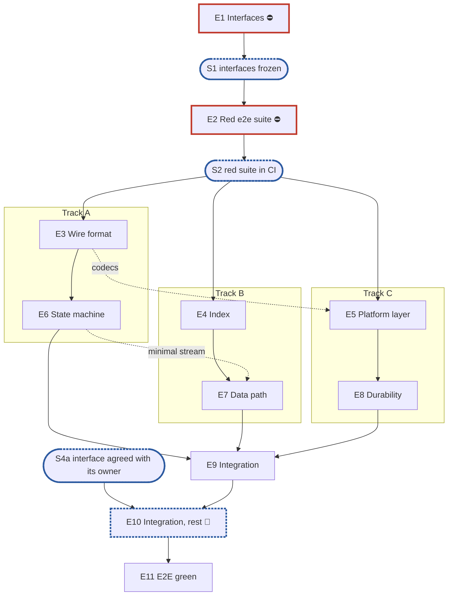

# From an RFC to an epic plan

The output is one Markdown plan that a small team can pick up and work in parallel.

Naming used below: **v1** is the component that exists today, and **v2** is the one the
RFC describes. When the RFC builds something new, there is no v1 and every v1 clause
below is dropped.

## Terminology: epic and subtask, nothing else

The plan has two kinds of unit of work: an **epic**, and the **subtasks** it is split into.
No other word names them: not task, ticket, story, step, phase, stage, milestone, work
package or work item. That holds in headings, table columns, ids and prose. A subtask's id
is `T<epic>.<n>` (`T4.3`), never `E4-3`, `4-3` or `T3`. The `T` only marks the id as a
subtask's, beside `E` for epics, `S` for synchronisation points and `R` for requirements; it
does not make "task" a word for the unit. Pull requests cite that form, and progress is
tracked by mapping pull requests to those ids. `T4.3` and a bare `4.3` name the same
subtask, so ids cited before the prefix existed stay valid.

Two other words keep their own meaning because they are not units of work. A **track** (A, B or C) is
one line of work through the epics. A **synchronisation point** (S1, S2, …) is where the
team converges. If the programme (Step 0 #8) names its own units, such as "stage 3", quote
them as the programme's, and never use that word for this plan's epics or subtasks. The
Steps of this skill are its procedure, not units of the plan.

## Step 0 — Gather the inputs, and stop if any required one is missing

Read the RFC's frontmatter first (`rfc`, `title`, `component`, `status`, `depends_on`).
Then fill the checklist below. Take an answer from the user's request or from the repo
where you can. Where you cannot, **ask** with `AskUserQuestion`, in one batch; if you
cannot ask (for example when running as a subagent), stop and report the missing inputs
rather than guess. **Do not start planning while a required item is still open.** Defaults are only for the items
marked as having one, and the plan's header states each default that was used.

| # | Input | Required? | How to fill it |
| --- | --- | --- | --- |
| 1 | RFC path | **required** | from the request |
| 2 | Does the RFC replace an existing component? If so, v1's paths (packages, config keys, on-disk dirs) | **required** | propose candidates found with `rg`, then confirm with the user |
| 3 | Transition policy from v1 | **required if 2 = yes** | offer these options: offline switch refused while v1 holds uncommitted state / fresh installs only, no upgrade / migration tool / other |
| 4 | Related RFCs and how far each is in scope | **required** | propose the `depends_on` list, then ask, for each: *in scope*, *only the parts this RFC cannot work without*, or *constraints only* |
| 5 | Where v2 lives (package path and name) | default: proposed by you in §4 of the plan, flagged as an open point | |
| 6 | Tracks | fixed: three tracks named **A, B and C** (Step 2), with no owner | do not ask; who works which track is decided outside the plan |
| 7 | Target branch and external dependencies (PRs or other plans that must land first) | default: none known, listed as an open point | check `docs/internals/planning/` for plans this RFC depends on |
| 8 | The programme this RFC belongs to: an umbrella issue or plan that stages the work, assigns owners, and says which existing code is being replaced | **required** | ask for the link, then read its latest decisions; if there is none, say so in the header |
| 9 | Dashboards | default: **no**, unless the RFC asks for them | the RFC's named alerts are alert rules (RFC 25 §7) in the integration epic, not a dashboard epic |
| 10 | Output path | default: `docs/internals/planning/rfc-<n>-<slug>-plan.md` | |
| 11 | RFC `status: deferred` | **ask** | plan the whole RFC, or only the hooks the RFC says must exist before it is built? |

## Step 1 — Read

- Read the RFC in full, not just its headings.
- For each related RFC, read the sections that the in-scope answer from Step 0 covers.
- If there is a v1, read its package's exported surface and its callers. You need this to
  write the v1/v2 comparison and to scope the integration epic. You do **not** need it to
  design v2: v2 ignores v1 (rule 7).
- Read the existing plans in `docs/internals/planning/` that this RFC touches, and align
  with them. Where you diverge, say so as an open point.
- Read the programme from Step 0 #8: its stages, who owns each, and what each stage
  replaces. Never plan integration against code a later stage deletes.
- Read RFC 25 (`docs/internals/rfcs/rfc-25-observability.md`) §2, §3.9, §5, §6 and §8:
  the observability contract every component follows (rule 3). Find the RFC's prefix in
  §2.1's table, and check whether the RFC states an exception of its own.

## Step 2 — Carve the epics

### Fixed epics

E1 and E2 always open the plan, and E2E green always closes it, followed only by the
optional dashboards epic (Step 0 #9). The integration epics sit just before E2E green: one,
or one per programme stage that needs its own (Step 0 #8), including any "planned after" a
synchronisation point (Step 3). Number every epic by position: E1, E2, the N middle epics
(E3 to E(N+2)), the integration epics from E(N+3), then E2E green, then dashboards. With
one integration epic, E2E green is E(N+4); with two, E(N+5).

| Role | Content |
| --- | --- |
| **E1 Interfaces** | The public surface only: the exported symbols with their exact signatures, the error set, and the injection points: options and the `Deps` fields RFC 25 §8 names (logger, metrics registry, tracer), or the RFC's own observability surface where rule 3's exception applies. Stub bodies. No behaviour, except where a type's encoding *is* the contract. An internal interface belongs here only if it has two consumers before any implementation exists (for example a storage seam that both an option and E2's crash-simulating fake consume). Every other internal package — codecs, index, state machines — is created by the middle epic that implements it, as concrete types, with its first caller (rule 12). |
| **E2 Red e2e suite and test foundations** | E2E tests for every use case and scenario that can be named: from the RFC, from the in-scope related RFCs, and from other sources (protocol specs, past issues, v1's own bug history). Every test starts red and is listed as a known failure. **E2 registers the suite with the harness**, not E2E green, so CI runs it from the first pull request and a test pinned green stays green; registered at the end, a test an epic turned green could go red again unseen. Concretely, E2 registers the red tests where the RFC's suites paragraph (RFC 29 R11) puts them: a suite of its own only when the paragraph calls for one, as an entry in `test/suites.yaml` behind its own build tag so `unit` does not turn red on it, in a component group named for the component (RFC 29 §4.9); otherwise the existing suites the paragraph names. Each red test is one entry in its suite's `known.yaml`, which `dt` grades, so a listed test that passes fails the run and the epic that turns it green removes its entry. A suite that keeps no `known.yaml` (`unit`, `e2e`) cannot hold a red test: a test the paragraph puts there lands green, with the epic that makes it pass. A new suite and group join the paragraph in the pull request that registers them, held to the registry by `dt docs --check` where that check exists. The small test components that everything else needs (fakes for clocks and faults, a reference model, a profiling harness) also go here. **A test lands with the epic that creates the packages it imports:** at S2 only E1's packages exist, so a test that needs a middle epic's package (an encoder, a platform layer) belongs to that epic and is listed there. Format checks in E2 write their bytes by hand from the RFC, which also makes them an oracle independent of the encoder. **The catalogue holds only what can run:** a scenario that needs a host nobody provisions is parked in §6, and a system-level scenario that a component-level fake already covers is dropped. |
| **Integration** | Wire v2 into the system as the programme (Step 0 #8) stages it, not into code a later stage replaces. Typical shape changes: one instance per share becomes one per disk; a value read once at start becomes reloadable; an owner-local decision becomes cluster-wide. Also: the transition policy from Step 0 #3, config keys, observability wiring (the component's `Deps` from the root's logger, registry and tracer; its `health.Source` added to the evaluator; its conditions in RFC 25 §3.9's registry and its alert rules per RFC 25 §7 — or, under rule 3's exception, the bridge to them), error mapping, API and CLI. **If it depends on an interface not yet agreed** (owned by another team or stage), add a synchronisation point for that agreement, keep in this epic only what is already decided, and put the rest in a following epic that is **planned after** that point and not estimated (Step 3). |
| **E2E green** | Burn down the suite's `known.yaml` to empty. Also soak tests, the benchmarks the RFC names, and the suite's tiers past `pr`; the suite itself was registered in E2. |
| **Dashboards** (optional) | Only if Step 0 #9 said yes: a small number of dashboards, each with an automated test and a consumer before release. |

### Middle epics

The middle epics implement the RFC. Cut them **along the RFC's own seams**: on-disk format,
index, data path, recovery, protocol state machine, API, controller loop, and so on. Each
one must be buildable and unit-testable on its own, under rule 1: against E1's public
surface, E2's test components, another epic's pure in-memory implementation, or the
implementation of an epic it depends on once that has landed.

**How many.** Start from the estimate `N = round(wc -l RFC / 400)`, clamped to 3..8, so
that each of the three tracks owns at least one. A 2,800-line RFC gives 7 middle epics; a
450-line one gives 1, raised to the floor of 3.

The estimate is a **sanity check, not a quota**:
1. First, list the RFC's cohesive work areas **without looking at N**. Map each one to the
   RFC sections it owns.
2. Merge areas that share most of their state, or split areas too big for one epic.
3. Only then compare the result with N. If they differ by more than one, write one line
   in §2 of the plan saying why. Never split a cohesive area just to reach N, and never
   merge unrelated areas just to stay under it.

The coverage table (§7 below) is the check. Two epics citing the same sections mean an
artificial split. A section with no epic means a gap.

**Three tracks.** The plan always splits the work into exactly three tracks, A, B and C,
named by letter only, with no owner. Every middle epic belongs to one track (a fixed epic may
be the team's). Assign epics so that each track is a coherent line of work — one area of
the RFC, its own packages, few hand-offs to the others — and busy from S2 to integration.
If the RFC's areas do not divide into three, split a track's area along a seam it already
has (for example the platform layer away from the codecs) rather than leave a track empty.
This does not conflict with "never split a cohesive area just to reach N": a split along an
existing seam is not an artificial one, and an area with no such seam stays whole. If that
leaves a track with too little, say so in §3.4 and name what fills it.

**Subtask size.** A subtask is one coherent piece of work for one engineer, landing with its
tests, ideally up to 5 man-days. Cut subtasks by what makes sense: one logical change,
readable on its own, following the dependencies, delivering a piece of functionality that
can be named. There is no target number of subtasks per epic; the count follows from the
work. Give it as a number; the detailed breakdown is written when the epic starts, with the
`epic-breakdown` skill. How subtasks become pull requests is under "Subtasks and pull
requests" below.

**Man-days.** The plan estimates **epics, not subtasks**. Its subtasks are candidates, and
the per-subtask estimate belongs to the epic's breakdown, so the plan's figure is a first,
higher-level one. An epic that is "planned after Sx" gets no figure. Reach it like this,
with the scale under "Estimating in man-days" below:

1. Place the epic's candidate subtasks roughly on the scale; most land at 1–3 man-days. Do
   not write per-subtask figures into the plan.
2. Add the work the candidate list does not name but the epic owns (see the scale's last
   paragraph).
3. Weight the sum as the scale says.

## Estimating in man-days

This section is the one place the estimating rules live. The `epic-breakdown` skill uses it
for its per-subtask figures, so a plan's figure and its epics' refined figures share one
scale.

**Unit.** Man-days of one engineer, in multiples of 0.25. This is effort, not calendar time:
no parallelism, no waiting on reviews, other epics or external dependencies. An estimate
includes the work's tests, doc comments, review fixes and whatever the plan's general rules
require of it (fuzzing, metrics, profiling, known-failure bookkeeping). Numbers are plain:
no `~`, no ranges, no comma, no unit inside the number.

| Man-days | Typical work |
| --- | --- |
| 0.25 | a very small change: wording or a comment, a minor visual tweak, a one-line default |
| 0.5 | a type or constant set with tests; a doc table; a config key |
| 1 | a small codec, or one well-specified function with edge-case tests |
| 2 | a component with a few interacting rules, or about five conformance checks |
| 3 | concurrency, crash safety or on-disk ordering in one component |
| 5 | a subsystem's core algorithm under race or crash testing; the ceiling for one subtask |

Weight upward for crash or durability semantics, lock ordering, per-OS code, anything
verified only with fault injection, and burn-down work whose size cannot be known in advance
(estimate it, and name it as an open point). Weight downward for pure declaration work:
signatures, stubs, types the RFC already states. Do not drop work because no subtask names
it: tests and fuzz targets, CI wiring, metrics, docs, the review or freeze step and
per-platform variants each belong somewhere. Size test-catalogue work by the number of
checks the RFC names, not by the number of bullet families.

### Subtasks and pull requests

A subtask is not a pull request, and the plan does not decide how subtasks ship. Some
engineers open one pull request per subtask, others group several; both are fine, and
neither is the default. The epic breakdown **suggests** a grouping, to keep pull requests
readable: a suggested pull request is ideally up to 15 man-days, a ceiling to aim under
rather than a target, grouped by logic, readability, dependencies and a deliverable that can
be named. The owner may follow it, regroup, or open one pull request per subtask.

## Step 3 — Write the plan

**The plan records decisions, not progress.** Nobody edits it to track how the work is
going. It is revised, through a pull request, only when the decisions change: an epic's
scope, a dependency, an estimate adjusted after an epic's breakdown, subtasks moving between
epics. So it has none of the following:

- status columns or progress markers;
- checkboxes;
- "to be updated when…" or "TBD" placeholders;
- tables of issue numbers that fill in later;
- decisions deferred with no pointer: settle them, or list them in §6 with the options and
  the issue or pull request where they are being decided (`pending #NNN`). A link to the
  open thread is what an open point needs; an issue number in a plan is fine (the rule
  against them is about source comments).

The one exception is an epic that cannot be broken down yet because it waits on an
interface someone else owns: give it "planned after Sx" in place of an estimate (subtasks
and man-days alike), and name the synchronisation point and what it waits for.

§6 lists the open points as they stood when the plan was written. Each is resolved in an
epic or an issue. The plan is revised only if the answer changes the breakdown, not to
record that the point was settled.

Use this structure. Section numbers are fixed so plans can be compared.

```
# RFC <n> — <component> v2: implementation plan
Header: scope (the RFC + related RFCs with their in-scope level), tracks (A, B,
        C), the programme it belongs to, naming (v1/v2),
        defaults used from Step 0.

## 1. Introduction
### 1.1 What we are building    — v1 vs v2 table (if there is a v1); dependency limits
### 1.2 How the plan is organised
### 1.3 What epic 1 must deliver — concrete: which RFC sections' symbols, which seams
### 1.4 What epic 2 must deliver — the scenario catalogue by source, the known-failure
                                   mechanism, the test components
### 1.5 General rules for each epic — the rules below, adapted to this RFC

## 2. Epics at a glance          — table: # | Epic | Content | Subtasks | Man-days | Track | Blocks
                                   with a total row, then the plan estimate line (below),
                                   the line on N vs the estimate, and a legend
## 3. Synchronisation points, blockers and the split
### 3.1 Dependency graph        — Mermaid (see below)
### 3.2 Synchronisation points  — S1..Sk: what is true at each, and what it unblocks
### 3.3 Blockers                — epic → what it blocks, and why
### 3.4 Splitting the work      — per track (A, B, C): its path, plus where the team
                                   converges; no per-person subtask arithmetic, which goes
                                   stale at the first change
## 4. Directory layout proposed for epic 1 — a tree, each entry tagged with its epic
## 5. The epics in detail       — per epic, under `### Epic <n> — <title>`: the epic
                                   estimate line (below), a paragraph, the RFC sections
                                   owned, and the candidate subtasks with `T<n>.<k>` ids
## 6. Risks and open points
## 7. RFC coverage              — table: RFC section → epic(s); related-RFC sections too
```

Mark blockers with ⛔ and synchronisation points with 🔀, in the headings and in the table.

### Estimate lines: one fixed form, so `grep` can read them

Each epic in §5 opens with exactly one line, on a line of its own, in one of these two forms:

```markdown
**Epic 4 estimate: 11 subtasks, 17.5 man-days.**
**Epic 11 estimate: planned after S4a.**
```

§2 carries the total, right under the table:

```markdown
**Plan estimate: 120 subtasks, 190 man-days.**
**Plan estimate: 108 subtasks, 172 man-days, not counting epic 11.**
```

Use the second form when some epic is "planned after", and list every such epic. Numbers
are plain multiples of 0.25: no `~`, no ranges, no `+ E11`, no comma, no unit inside the
number. Compute the total with this check, never by hand. Save it as `plan-check.awk` in
the scratchpad and run `awk -f plan-check.awk <plan>`:

```awk
/^## /                                   { in5 = ($0 ~ /^## 5\./); cur = "" }
in5 && /^### /                           { cur = "" }
in5 && /^### Epic [0-9]+ /               { cur = $3; head[$3]++; order[++k] = $3
                                           if (head[$3] > 1) print "duplicate heading for epic " $3 }
/(Epic [0-9]+|Plan) estimate:/ {
  if ($0 ~ /^\*\*Epic [0-9]+ estimate: [0-9]+ subtasks, [0-9]+(\.(25|5|75))? man-days\.\*\*$/) {
    est[$2]++; n += $4; d += $6
    if ($2 != cur) print "estimate line for epic " $2 " (line " NR ") sits under " (cur == "" ? "no epic heading" : "epic " cur)
  } else if ($0 ~ /^\*\*Epic [0-9]+ estimate: planned after S[0-9]+[a-z]?\.\*\*$/) {
    est[$2]++; later[$2] = 1; nl++
    if ($2 != cur) print "estimate line for epic " $2 " (line " NR ") sits under " (cur == "" ? "no epic heading" : "epic " cur)
  } else if ($0 ~ /^\*\*Plan estimate: [0-9]+ subtasks, [0-9]+(\.(25|5|75))? man-days(, not counting epics? [0-9]+((, | and )[0-9]+)*)?\.\*\*$/) {
    if (seen++) { print "a second plan estimate line, line " NR; next }
    pn = $3; pd = $5
    clause = $0; sub(/^.*man-days/, "", clause); gsub(/[^0-9]+/, " ", clause)
    nc = split(clause, c, " "); for (i = 1; i <= nc; i++) if (c[i] != "") listed[c[i]] = 1
  } else print "malformed, line " NR ": " $0
}
END {
  for (i = 1; i <= k; i++) if (est[order[i]] != 1) print "epic " order[i] ": " est[order[i]] + 0 " estimate lines"
  for (id in est) if (!(id in head)) print "estimate line for epic " id " has no ### heading in §5"
  printf "TOTAL %d subtasks, %g man-days", n, d
  sep = ", not counting epic"; for (i = 1; i <= k; i++) if (order[i] in later) { printf "%s %s", sep, order[i]; sep = "," }
  print ""
  if (!seen) { print "no plan estimate line in §2"; exit }
  if (pn != n || pd != d) printf "plan line says %d subtasks, %g man-days\n", pn, pd
  for (id in later) if (!(id in listed)) print "plan line does not name epic " id " as not counted"
  for (id in listed) if (!(id in later)) print "plan line names epic " id ", which has a figure"
}
```

Only the `TOTAL` line may print. Anything else is a defect to fix: a malformed line (`21,5`,
`~20`, an indented or bulleted line, a missing word) is reported rather than summed; an
epic heading in §5 without exactly one estimate line, or an estimate line without a
heading or under another epic's heading, is reported, so a deleted or misplaced line cannot
go unnoticed; a `**Plan estimate:**` line that differs from the sum, a second one, and a
"not counting epic …" clause that does not name exactly the "planned after" epics are
reported. Make the §2 table's total row agree with the
`TOTAL` line.

`grep -E '^\*\*(Epic [0-9]+|Plan) estimate:' <plan>` then lists the whole estimate.

### Names follow the transition policy

The `v2` suffix lives in Go package and import paths only. Every name a user sees —
metric and span names, log attribute keys, config keys, dashboard queries — says the
component's plain name. Whether a version is exposed at all follows Step 0 #3: when v1 and
v2 never run in the same binary (fresh installs only, or a cutover), there is no version
label, because it would always read `v2`.

### Graphs are Mermaid, never ASCII art

Every graph (dependencies, the per-track path, any state machine you need to explain)
is a fenced `mermaid` block. GitHub and Obsidian render these natively. In VS Code's
preview, use the *Markdown Preview Mermaid Support* extension. Conventions:

````markdown

````

- Quote every label (`["..."]`). Parentheses, slashes and `§` otherwise break the parser.
- Style with stroke only, never `fill`. A light fill makes the text unreadable in a dark
  theme.
- The dependency graph in §3.1 has exactly **three** track `subgraph`s, A, B and C, labelled
  `Track A`, `Track B` and `Track C`, with no names. Epics that belong to the team (E1, E2, integration, E2E green)
  sit outside them. Show synchronisation points as stadium nodes `([...])`.
  Draw partial dependencies, such as "needs only the minimal X", as dotted edges with a
  label.
- The directory layout in §4 is a tree, not a graph, so it stays a `text` block.

### 1.5 General rules for each epic

Put these rules in §1.5. Make each one concrete for this RFC: name its parsers, its hot
paths, its counters, its v1 package. Drop a rule only by writing that it does not apply,
and why. Write each rule so that it stands alone once copied into an epic: no references
to sections of the plan ("§3.1", "§1.4"), only to the RFC, to `CLAUDE.md` or to other
rules by number, and never "this plan", "the plan" or "see the plan", which become false
once the rule sits in an epic document. Name the thing itself instead: not "this plan's
simplifications carry theirs" but "each simplification carries its own marker: …".

Open §1.5 with this instruction, verbatim. It is written **into the plan itself**, so that
whoever later asks for an epic to be created from the plan, in any session, finds the rule to
use `epic-breakdown` in the document they are reading:

> **Instruction for whoever expands an epic into its detailed description and subtasks,
> human or AI:**
>
> - **Creating an epic from this plan: use the `epic-breakdown` skill.** Whenever the user
>   asks to create an epic from this plan, or to expand, detail or break one down, run the
>   `epic-breakdown` skill (`.claude/skills/epic-breakdown/SKILL.md`) on this plan and that
>   epic, rather than writing the epic document freehand. It extracts the RFC's MUST and
>   MUST NOT into numbered requirements, estimates each subtask in man-days and suggests
>   the pull requests. A human doing it by hand follows the same skill.
> - **Epic and subtask, nothing else.** The units of work are the epic and its subtasks,
>   with subtask ids `T<epic>.<n>` (`T4.3`). No other word names them: not task, ticket,
>   story, step or phase, in headings, tables, ids or prose.
> - **The epic stands alone.** Copy the numbered rules below into the epic document word
>   for word, under their own heading — the rules only, not this instruction, which speaks
>   of "this plan". The epic document must not refer to this plan, link to it,
>   or say "see the plan". Everything a reader needs to do the epic is in the epic
>   document itself: the RFC sections it implements, the interfaces it builds on, the
>   rules, the subtasks, and a short legend of the names the rules borrow from this plan
>   (E1, E2, S1, the integration epic, …).
> - **The epic document records decisions, not progress, like this plan.** It has no
>   status fields, no checkboxes to tick and no sections to keep up to date as the work
>   goes on. It is revised through a pull request only when a decision changes.
> - **Subtasks are not pull requests.** A subtask is ideally up to 5 man-days. The owner
>   ships subtasks as they see fit, one pull request each or several together; the epic
>   document only suggests a grouping, each suggested pull request ideally up to 15
>   man-days. Cut and group by logic, readability, dependencies and a deliverable that can
>   be named, not to hit a number.
> - **Every subtask states how it meets each rule that applies to it.** A rule that does
>   not apply is named, with the reason.
> - **In the issue tracker, issues point at the epic document and copy nothing:** they
>   are created once the epic document has merged, and their bodies are a link to its
>   section with a line of context, so a revision of the document never leaves an issue
>   saying something else. The epic is one issue labelled `epic`. Each subtask is its own
>   issue, created as a sub-issue of the epic issue rather than as a checklist in its body.
>   All of them join the "DittoFS v1.0" project, each subtask with its man-days in the
>   `Estimate` field.

1. **Independent unit tests.** Each epic carries its own unit tests. It may use another
   epic's pure in-memory implementation, the implementation of an epic it depends on once
   that has landed, and E2's test components. E1 declares no internal interface for it to
   fake (rule 12).
2. **Fuzz tests where relevant.** Use Go native fuzzing on every parser of input the
   component did not just write itself: on-disk records, wire messages, config, API
   payloads. Where E2 has a reference model, also fuzz operation sequences against it.
   The property: an input is either accepted as valid or rejected, never a panic.
3. **Observability follows RFC 25.** The component takes what RFC 25 §8 says the root
   builds, as fields of its `Deps`: a `*slog.Logger` (narrowed with
   `With("component", <prefix>)`), the `*metrics.Registry` and the tracing API's `Tracer`.
   It implements `health.Source` for the conditions the RFC defines, and each long-running
   loop takes its `*health.Loop` from the watchdog. Metrics are the counters, gauges and
   histograms the RFC assigns to the epic's area, named under the RFC's prefix (RFC 25
   §2.1) with §2.2–§2.6's units, labels and buckets, resolved once at construction and
   recorded with an atomic add (§2.9); an event is counted once, by the component that
   decides it (§2.7). Spans follow §6.1 (constant `<prefix>.<Name>` names, a wait is a span
   event, background work opens a root span), and an unsampled span allocates nothing
   (§6.3). Logs follow §5, and nothing §5.4 forbids reaches a log, span or metric. Name
   the metrics, conditions and spans each epic owns. **Exception:** where the RFC itself
   restricts its dependencies (for example to the standard library) or defines its own
   observability surface, follow the RFC, state the exception in this rule, and put the
   bridge to RFC 25's registry, tracer and health evaluator in the integration epic.
4. **Profiling.** Tests and benchmarks run under E2's profiling harness, and fail on
   goroutine, descriptor or memory leaks and on anomalous resource growth. Name the hot
   paths that carry allocations-per-op assertions.
5. **Public interface and internals.** Tests cover both the internal package API and the
   public behaviour the epic enables, including concurrency under `-race`. Test at the
   layer that **consumes** a value (see `CLAUDE.md`, "Verifying a change").
6. **Known failures shrink.** An e2e test that turns green leaves the suite's `known.yaml`
   in the same change: `dt` fails the run if a listed test passes.
7. **v2 ignores v1.** No import of, copy from, or behavioural dependence on v1, enforced by
   an import test. The test checks every package on its own, so its allowlist names each
   package an exception applies to, test packages included. v1 is touched only as the
   transition policy says: at its callers in the integration epic, or not at all when v1
   is deleted at a cutover.
8. **Real dependencies for properties of those dependencies.** No fake stands in for a
   check about what the real thing does: a real disk for durability, a real object store or
   Localstack for remote semantics, a real kernel client for protocol behaviour. Fakes are
   for pure logic only.
9. **Code comment conventions** (`CLAUDE.md`, "Code comments"). A source comment describes
   the code's behaviour and references nothing outside it: no issue or pull request
   numbers, no CI, runner or OS names, no epic, subtask, plan, phase or decision ids. A
   `ponytail:` marker records a knowingly simple implementation, naming its ceiling and the
   upgrade path. A `decision:` marker records deliberate behaviour, naming the rule, why it
   holds and the evidence that would overturn it. Where the RFC carries such a note, its
   marker goes at the code site that implements it.
10. **A test must be able to fail.** Keep a test only if a plausible change would make it
    fail and nothing else would catch that change: not the compiler, not the diff, not a
    later epic's tests. A review rule that no test can check, such as "stubs never panic",
    stays a review rule.
11. **A symbol is exported only if the RFC's interface uses it.** Everything exported is
    frozen at S1. Helpers the internal packages need stay internal, for example in an
    `internal/core` package.
12. **Each subtask creates only what it declares.** No empty package and no stub without a
    caller. A package, an option or a test helper lands with its first consumer.

## Step 4 — Check before handing over

- Every in-scope RFC section appears in §7, and every middle epic cites sections no other
  epic owns.
- Every ⛔ and 🔀 in §2 also appears in §3, and the Mermaid graph has the same edges as
  §3.3.
- There are exactly three tracks, A, B and C: three `subgraph`s in the §3.1 graph, three
  paths in §3.4, and every middle epic in §2 owned by one of them.
- Each track's path in §3.4 is busy from S2 to integration. Name any
  idle stretch, and say what fills it. Joint work is the team's, never "both engineers".
- E1 declares no internal interface with fewer than two consumers before implementation,
  and no package that a middle epic creates.
- No E2 test imports a package that does not exist at S2; each such test is listed in the
  epic that creates the package.
- E2 registers the red tests in the suites the RFC's suites paragraph names, each in its
  suite's `known.yaml`; a suite of its own (`test/suites.yaml` entry, build tag, component
  group) only when the paragraph calls for one. E2E green adds only the tiers past `pr`,
  soak and benchmarks.
- The integration epic follows the programme's stages, and an epic waiting on someone
  else's interface says "planned after Sx" and names the point.
- There is a dashboards epic only if the RFC or the user asked for one.
- The §1.5 rules cite no section of the plan and never name the plan. This prints the
  numbered rules' lines that do, skipping the opening instruction, and must print nothing
  ("plan ids" in rule 9 is a kind of id, not a reference, and does not match):
  `awk '/^### 1\.5 /{f=1; next} /^##/{f=0} f && !/^>/' <plan> | rg -n -i "\b(this|the) plan\b|\bplan's\b"`
- Every Step 0 default and every divergence from an existing plan is listed in the header
  or in §6.
- No graph is in ASCII art.
- Units of work are called epics and subtasks everywhere, and subtask ids are `T<epic>.<n>`:
  `rg -n -i -w 'tasks?|tickets?|stor(y|ies)|phases?|milestones?|work items?' <plan>` turns
  up nothing that names this plan's units.
- `plan-check.awk` prints only its `TOTAL` line, which matches the `**Plan estimate: …**`
  line and the §2 total row; every epic without a figure is "planned after Sx" and named
  in the plan estimate line.
- Nothing in the plan tracks progress: no status, no checkboxes, no placeholders.
- §1.5 opens with the verbatim instruction: epics are expanded with `epic-breakdown`, the
  rules are copied into each epic, the epic
  stands alone and records decisions rather than progress, subtasks are not pull requests,
  and issues point at the epic document, with an `epic` label, sub-issues and the
  project's `Estimate` field.

Then report the output path, the epic count against the estimate, the plan estimate line
(subtasks and man-days), the epics whose man-days are least certain, and the open points,
in a few lines. End by saying that each epic is expanded with `epic-breakdown` when it
starts.
