# How the new metadata store fits together

A guided tour of the three packages built on `feat/kv-layer`: what each layer owns, how a request travels through them, how a file's content is recorded, removed and cloned, how concurrent writers are kept correct, and how the tests prove it. Read the steps in order; each one builds on the previous.

As of `5a6ee28c`, 15 Oct 2026 · tracked in [#3119](https://github.com/marmos91/dittofs/issues/3119) · branch on PR [#3120](https://github.com/marmos91/dittofs/pull/3120) · design in the storage RFCs, [#2894](https://github.com/marmos91/dittofs/pull/2894)

## 1. The layers

*Three packages, each depending only on the one below it.*

The new store is built bottom-up as three Go packages under `pkg/metadata/`. Nothing here is wired into the server yet: today's `pkg/metadata` store is untouched, and plugging the new one in is the last step of the plan.

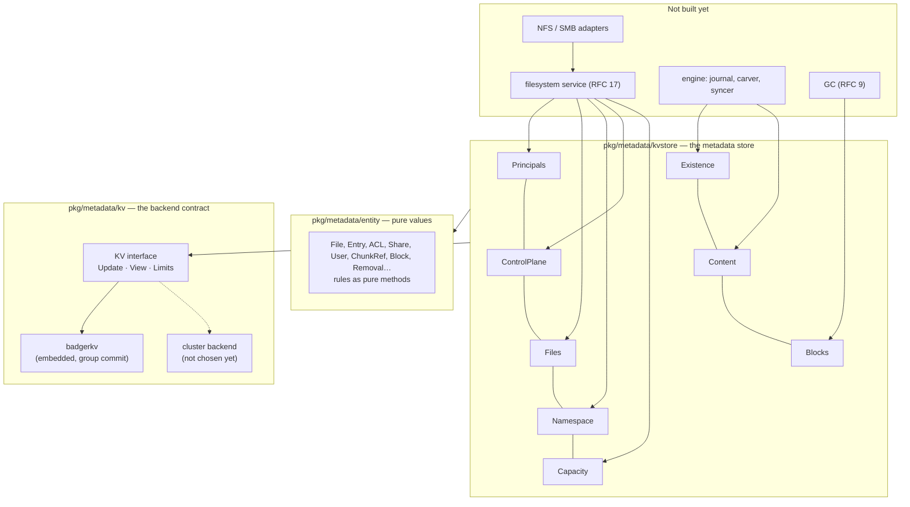

*Callers in the top box don't exist yet. The store is a leaf: it calls nothing above it.*

**kv/**

The interface every backend implements (`kv.go`), the Badger backend, key and value encoders, a cost-counting wrapper and the backend conformance suite.

**entity/**

Plain structs with pure methods only: identities, files, ACLs, shares, refs, blocks, removals. No I/O, so every rule here is testable in isolation.

**kvstore/**

The store itself: the records, their keys and codecs, eight views that each consumer holds a narrow slice of, and `kvstoretest`, a suite any backend runs.

## 2. The KV contract

*A small interface that any transactional key-value store can satisfy.*

Everything above the backend talks to `kv.KV` (`pkg/metadata/kv/kv.go`). It is optimistic: a transaction reads a snapshot, writes, and at commit the backend checks whether anything it depended on changed. If so, `Update` retries the whole function with backoff (`kv.Retry`), so callers write plain sequential code.

| Call | What it does | Tracked? |
|---|---|---|
| `Get(key)` | Read one key | Yes: a later write of it aborts this transaction |
| `Scan(prefix, after)` | Iterate keys in order, resuming after a key | No: never detects a new key |
| `Before(prefix, key)` | The last key below `key`, in one seek | No |
| `Versions(keys)` | Each key's commit sequence; a key this transaction set or deleted has none yet, so the call fails with `ErrUncommittedVersion` | No |
| `Set` / `Delete` | Write; two blind writers of one key conflict | Yes |
| `Guard(key)` | A read that returns nothing, just for the conflict | Yes, and two guards never conflict |
| `GuardRange(prefix)` | Guard every key under a prefix, present or not | Yes: an insert under it aborts this transaction |
| `Now()` | Store time: strictly increasing, survives a clock stepped back | — |

> **The rule that shapes everything:** a scan is untracked. Any invariant over a range ("this directory is empty", "no share lives under this path", "no durable open names this file") must either guard the range or be restated as a point key every writer also writes. You will see both forms throughout.

`Limits()` reports the backend's ceilings (key size, value size, bytes and entries per transaction, maximum age). The store derives its batch size *K* from them at open (`kvstore/budget.go`): on Badger in memory, K is 214 keys. Every operation over many records — an existence commit, a removal's batches, a usage fold — splits itself to stay under K.

`Close()` waits for the calls in flight, each of which completes as it would have. Every call after it fails with `kv.ErrClosed`, and a second `Close` does nothing.

## 3. Group commit

*Why many writers share one disk sync.*

RFC 16 requires the embedded backend to never acknowledge a commit before it is on disk, while still sharing one sync among concurrent commits. Badger syncs per transaction on its own, which capped throughput near one commit per device sync. So `badgerkv` turns Badger's own sync off and runs a syncer (`badgerkv/sync.go`):

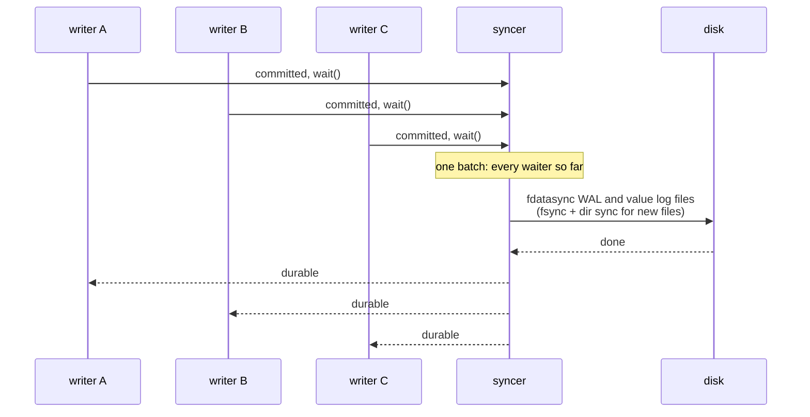

*One device sync answers every commit that finished before it. At 64 writers the benchmark reached about 57 commits per device sync.*

Two details matter. Readers also wait for durability (`durable(readTs)`), so nobody can read a commit that a crash could still lose. And the syncer covers rotated files too, because Badger's own `db.Sync` only syncs the active memtable and value log.

## 4. One keyspace

*Every record of every share in one sorted keyspace, laid out by RFC 16 §4.2.*

A key is its components concatenated with no separator. Each component encodes so that byte order equals tuple order (`kv/keys/keys.go`): integers are 8-byte big-endian, IDs are raw 16 bytes, strings escape `00` as `00 FF` and end with `00 01`. A journal version is 16 bytes, the epoch half then the counter half, so it sorts as one 128-bit number; a version with a nonzero epoch is refused rather than read as a smaller number. That is what makes prefix scans and "the record just below this offset" work.

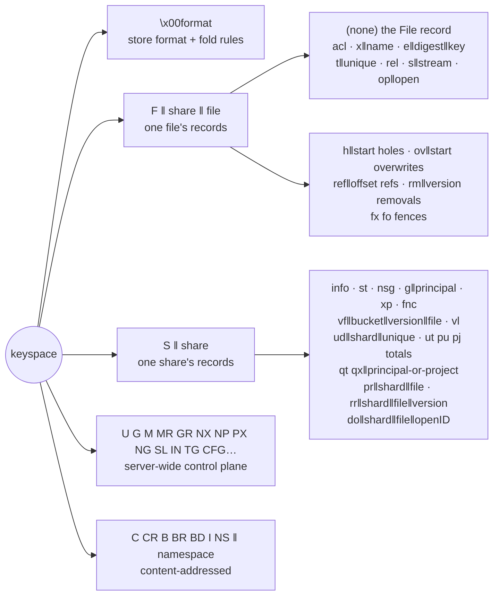

*Per-file records share one prefix, so a `GETATTR`, an existence commit or a file release touches one contiguous range.*

| Example key | Holds |
|---|---|
| F‖share‖dir‖e‖digest‖folded-name | One directory entry. The digest (keyed blake3 of the folded name) orders listings and is the NFS cookie. |
| F‖share‖file‖rm‖version | A removal: its extent, kind, cursor, done flag and the `charge` its batches gathered, keyed by the journal version that made it. |
| S‖share‖vf‖bucket‖version‖file | The version index: one entry per file at its stored `Version`, spread over 16 buckets. |
| S‖share‖ud‖shard‖unique | One transaction's usage change, folded later into the shard's totals. |
| S‖share‖qt‖01‖principal · qt‖02‖project · qt‖03 | A quota's limits on a user or group, a tree, or the whole share. Its twin under `qx` holds when usage first went above the soft limit. |
| S‖share‖pr‖shard‖file | The pending-release index: one empty key per `F‖file‖rel`, so recovery finds them without reading the share's files. |
| S‖share‖rr‖shard‖file‖version | The unfinished-removal index: one empty key per removal record not yet pruned. |
| NX‖share‖fold(name) | Share name index: two names equal under the Windows upcase fold collide. |
| C‖ns‖hash · CR‖ns‖hash‖share‖file‖off‖died | A chunk record and its reverse index: one empty key per ref naming the chunk. |

Values use one frame (`kv/codec`): a version byte, then fields in fixed order. Decoding refuses an unknown version, a truncated value and trailing bytes. Every codec has a golden vector test pinning its bytes.

## 5. The store's views

*One `*kvstore.Store`, eight narrow views, each for one consumer.*

`kvstore.Init(ctx, kv, install)` writes the format record, the installation identity it is given and the share-list counter in one transaction. `kvstore.Open` reads the format record before anything else and refuses a format or fold rule the binary does not implement. From the store you take views:

| View | For | Main calls | Files |
|---|---|---|---|
| `Principals` | authentication | `ByName(kind, name)`, `ByProtocolID`, `Groups` (transitive), `Grant` | `principals.go` |
| `ControlPlane` | management API | users, groups, memberships, shares (each with its journal tag), grants, export policies, netgroups, settings, quota limits (`SetQuota`, `Quotas`), `DeleteShare` | `users.go shares.go settings.go shareremove.go quota.go` |
| `Files` | filesystem service | `Resolve`, `Root`, `Get`, `SetAttrs`, ACLs, xattrs, `Authorize` | `files.go attrs.go auth.go` |
| `Namespace` | filesystem service | `Lookup`, `Create`, `Entries`, `Link`, `Unlink`, `Rename`, `PendingReleases`, `FoldDirectory` | `namespace.go listing.go remove.go rename.go dirfold.go` |
| `Capacity` | filesystem service | `Usage`, `PrincipalUsage`, `FoldUsage`, `Quota`, `SoftExceeded` | `usage.go quota.go` |
| `Existence` | engine, write path | `Commit`, `Remove`, `Clone`, `Applied`, `Overwrites`, `Allocation`, `PruneOverwrites` | `existence.go removal.go release.go clone.go allocation.go` |
| `Content` | engine, offload path | `Covering`, `Intend`, `Commit` (the offload commit), `Resume`, `PruneRemovals` | `covering.go offload.go removal.go` |
| `Blocks(ns)` | GC | `Due`, `MarkDeleted`, `Deleted`, `Prune`, `Abandon`, `Recount`, `Holders` | `blocks.go` |

The store itself answers `VersionFloor`, `VersionLimit` and `RaiseVersionLimit` (`versionfloor.go`), which the engine reads when a journal opens or attaches a share. All views share helpers in `tx.go` and the transaction-level functions in each file, so one operation that spans areas (a rename that also writes a pending release) stays a single transaction.

> **Authorization lives here, not in adapters.** Every namespace and file call runs `authorize` (`auth.go`) against the file it acts on: the share grant first, then the immutable and append-only flags, then the stored ACL or the mode. Privilege skips the mode and ACL but never the grant: a read-only grant refuses a privileged caller's attribute change as it does anyone's. Changing a directory's entries (create, link, unlink, rename) needs search on it as well as write, as POSIX asks. Removal needs *delete* on the file or *delete-a-child* on the directory, checked in `mayRemove`.
>
> A mode bit grants its whole mapped set to whoever it applies to, so a write bit grants write attributes and a group member's `GENERIC_WRITE` open of a 0664 file succeeds; a non-owner then sets times only through write attributes an ACL entry grants. A privileged caller skips the walk but executes only what an x bit makes executable. The well-known principals have fixed IDs (fifteen zero bytes and a number) and are matched by fields of the caller's identity, never by privilege: Authenticated Users and BUILTIN\Users by `Authenticated`, Administrators by `Admin`, NETWORK by everyone, SYSTEM and the CREATOR principals by no one; an owner-rights entry takes away what ownership implies. A deny naming an unknown special principal is refused when stored, since every walk would skip it.
>
> A new file inherits its directory's inheritable entries at create (RFC 8881 §6.4.3): CREATOR OWNER and CREATOR GROUP become its owner and group in the effective copy, while a new directory keeps them inherit-only for its own children, and the requested mode limits the result but adds nothing. With nothing inherited, the mode governs and `NewFile.Umask` applies to it.

## 6. A file's life

*Create, list, rename and unlink, record by record (RFC 7).*

A file is two kinds of record: the `File` under its own key, and an `Entry` under its *parent* directory. A handle (`entity.Handle`) is just share ID plus file ID, so resolving it is one point read and never touches a path.

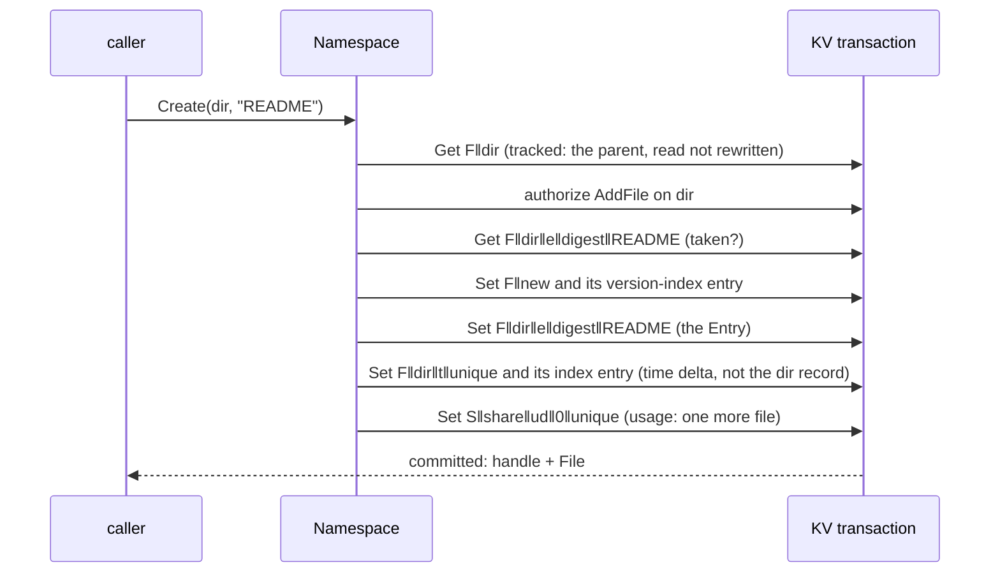

*A create writes six keys, every one either new or unique to the transaction, and never rewrites its directory. So 64 creates in one directory run in parallel.*

1. **Create** (`namespace.go`) takes a numeric file ID from a range reserved in the share's allocator (`numbers.go`), picks owner and group by RFC 7 §2.4 (setgid parent, credential group, primary group, or the creator itself), and refuses a name the share's rule rejects.

2. **Lookup** folds the name, computes its digest and reads one entry key and one file key.

3. **Entries** (`listing.go`) scans in digest order. The cookie after an entry is its digest, so a listing resumes on any node with no stored state, and a page never ends inside a collision chain.

4. **Rename** (`rename.go`) is one transaction, with the loop check walking the destination's ancestors inside it.

5. **Unlink** (`remove.go`) drops the entry and lowers `Nlink`. At zero it writes `F‖file‖rel`, the pending release, and its entry in the share's index, `S‖share‖pr‖shard‖file`. After a crash, each primary's recovery calls `PendingReleases(share, shard)` for its own shards, one row per pending release, however many files the share holds. The engine later runs the release itself (step 11), which deletes the file and drops its content.

6. **Directory times** are deltas under the directory, so creates never contend on its record. `Get` applies any unfolded ones; `FoldDirectory` folds them into the record in batches, and a `SetAttrs` on a directory folds first, so a time set explicitly holds.

7. **A directory's link count** is 2 plus `Subdirs`, its entries that name a directory. `Subdirs` changes the same way, by a signed ±1 on each time delta: a move writes −1 under the old parent and +1 under the new, a rename over an empty directory −1 for the one it replaces. A fold that would take it below zero stores it anyway and asks for `RecountSubdirs`, and reads report 2 meanwhile, so nothing wedges.

> **Names are never rewritten.** On a case-insensitive share the *key* is folded through a frozen upcase table identical to Windows' (`entity/upcase_table.go`), while the entry stores the name exactly as given. `Straße` and `STRASSE` stay two files, as on NTFS.

## 7. Racing writers

*How a rule holds when two transactions commit in either order.*

The hardest bugs in a filesystem are two operations that are each correct alone. Take "remove an empty directory" racing "create a file in it". The removal scans the directory (untracked), so on its own it cannot see a create that commits after its snapshot. Two mechanisms close it, one per commit order:

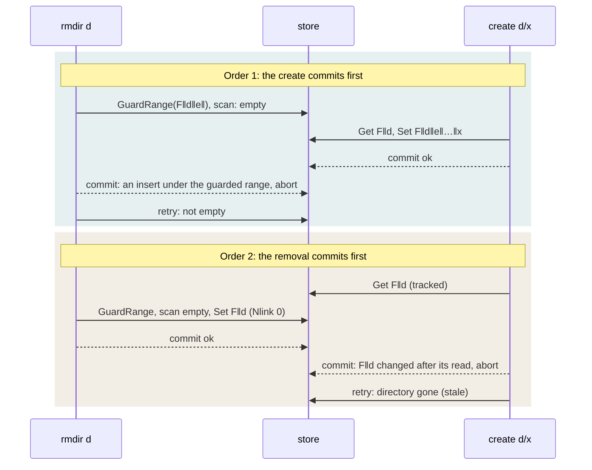

*The range guard covers one order, the write of the directory record the other. Remove either one and its order fails: the tests prove both by breaking the code on purpose.*

The same pattern appears throughout: share paths can't nest (point reads of every ancestor path plus a range guard below), a principal deleted while a membership is added (range guards over its `MR` and `GR` rows), two renames that would loop (each reads every ancestor), two offload commits of one file (both write the file's offload fence, step 08), and a release racing an open of the unlinked file (step 11).

## 8. Content: refs, chunks, blocks

*What a file's bytes are made of, and the offload commit that records it (RFC 6).*

Client writes land in a local journal first; later the engine cuts them into chunks, packs chunks into blocks, uploads each block, and only then records it. Block metadata is the ledger of that last step.

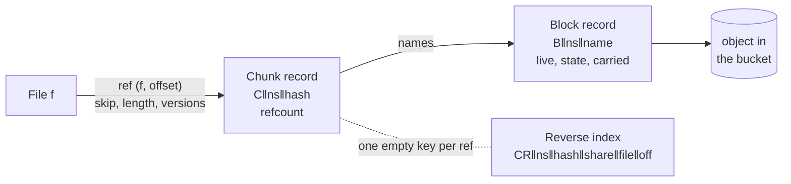

*Refs name chunks by hash, never blocks, so moving a chunk rewrites one chunk record instead of every ref.*

### What an offset holds

`Content.Covering` classes every offset below the file's size:

| Class | Meaning | If the journal lost it |
|---|---|---|
| `Hole` | never written, or deallocated | reads zeros |
| `Uncarved` | written, no current chunk; or an overwrite record newer than the ref covers it | fails as Lost, never old bytes |
| `Carved` | a current ref covers it | fetched from its block |

It finds the record covering the start with one `Before` seek per kind (holes, refs, overwrites), then scans forward. That keeps a lookup O(log n + results) whatever the file's size. While a removal is unfinished, masked holes and overwrite records may overlap newer ones, so for those two kinds the lookup scans from the file's `MaxSpan` below the offset instead, and then drops what the removal masks (step 10). Over the extent of an unfinished clone it answers `ErrDelay`: a half-copied extent is never served.

### The offload commit

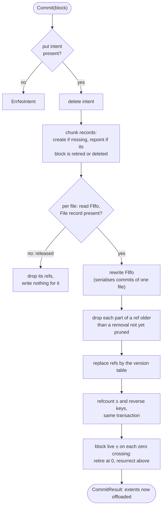

| New ref's newest version vs the existing ref | The commit |
|---|---|
| above the existing newest | replaces it, splitting what remains on either side |
| inside the existing [oldest, newest] | already committed: writes nothing, reports it offloaded |
| below the existing oldest | refused: older content never overwrites newer |

> **Why the fence matters.** Two commits of one file can touch different keys entirely. The test `TestCommitsSerialiseOnTheFence` holds an older commit while a newer one lands; without the fence write both commit and their refs overlap, so the older bytes cover the newer.

## 9. Existence

*What of a file exists, recorded at each stability point, before anything is offloaded (RFC 6 §3).*

A write is acknowledged once the journal holds it. Around a `COMMIT` or `fsync`, `Existence.Commit` records that its bytes exist, for many files in one transaction. Without that record, a lost journal would make written-but-not-offloaded bytes read back as zeros. Each journal operation carries the version the journal gave it:

| Operation | What the commit records |
|---|---|
| write past the end of file | `Size` grows; the gap `[old size, offset)` becomes a hole at the write's version |
| write into a hole | the hole shrinks or splits; nothing else, since no ref can cover bytes that were a hole |
| write over committed content | an overwrite record at the write's version, so a ref older than it reads as uncarved (Lost without the journal), never as the old bytes |
| truncate up | `Size` grows; the new tail is a hole, joined with a hole it touches |

- **Replays are harmless.** Every operation at or below the file's `Applied` is skipped, so recovery can re-apply the journal from `Applied` after a crash.

- **One file never fails another.** A file that is gone, holds no content or sends operations out of order is reported in the returned map; the rest commit.

- **The key budget is respected.** A file whose operations need more than K keys commits over several transactions in version order, `Applied` reaching only the newest operation each fully applied.

- **Overwrite records are split, never merged.** A merged record would hold back an extent already carved past its own version. `PruneOverwrites` deletes a record only once refs at or above its version cover all of it.

`Overwrites` answers a stability point's question (does this write cover committed content, so the reply must wait for its commit?), `Applied` tells recovery where to resume, and `Allocation` answers `SEEK_DATA` and `SEEK_HOLE`: a zero ref reads as a hole unless a newer overwrite record makes it data.

## 10. Removals in two phases

*Truncate and deallocate: an O(1) first transaction, then batches that resume from a cursor (RFC 6 §6.2).*

A removal can cover 10⁵ refs and holes, far past K. So `Existence.Remove` writes a removal record and changes size and holes in one small transaction, and `Content.Resume` drops what it removed in batches. Between the two, the removal *masks*: every ref, hole and overwrite record inside its extent that is older than the removal reads as absent.

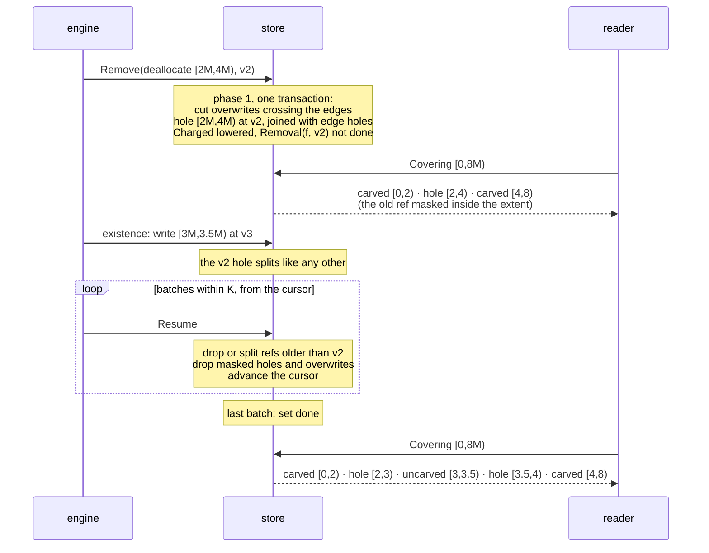

*The write at v3 survives because it is newer than the removal: phase 2 only ever touches content below the removal's version, so a re-run is harmless.*

- **A deallocate's merged hole is written in phase 1.** Written at the end of phase 2, it would cover a write that landed in between. Phase 1 also joins into it the at most two holes that touch or straddle its edges, read at the edges, so it stays O(1) and phase 2 has nothing left to join. A hole another removal still masks is never joined.

- **Phase 1 cuts the records that cross the edges.** Afterwards every overwrite record is either inside the extent, and masked, or outside it. A hole crossing a truncate's or a clone's edge keeps only its parts outside the extent: phase 1 counts the inside part itself, so no masked piece is left to account for later. Phase 2 then finds each batch's records with one seek, even for a release, where the File is already gone.

- **Two scan bounds, not one.** `MaxSpan` is the longest hole a file has had and `MaxOverwrite` its longest overwrite record. A lookup while a removal runs reaches back by each, so one long hole doesn't widen the overwrite scan. Each removal copies `MaxOverwrite` as its `ovSpan`, the bound phase 2's history scan will need once snapshots exist.

- **Phase 1 reads at most K holes.** A truncate or deallocate lowers `Charged` by the bytes its extent removes, which means reading the holes inside it. Past K holes, as in a TRIM-fragmented image, phase 1 charges off the whole extent less the edge holes it cuts or joins, which it reads whatever K, and sets the removal's `holeCredit`. Usage reads low, never high, until the removal is done.

- **A hole credit follows the hole.** A masked hole's bytes are owed back when the oldest unfinished removal masking it set `holeCredit`. Whatever drops or replaces it gives them back: a phase-2 batch, or a write, grow, deallocate or clone whose hole lands on its key.

- **Batches never write the File.** What a batch changes in `Charged` goes into the removal record's `charge`, and the transaction that sets `done` folds it into `Charged` and the usage once. A writer busy elsewhere in the file meets one transaction per removal, not every batch. A removal whose file was released meanwhile folds nothing: the release took the file's `Charged` off the usage as it stood, which cancels the owed bytes.

- **Holes carry their cut.** Each hole records `born`, the snapshot cut its transaction read, and every piece cut from it keeps it. Until cuts exist it is 0, except a clone's holes, born at the clone's cut.

- **An offload commit honours removals.** A pass offered before a truncate drops the parts of its refs past the cut, so a later truncate up reads zeros, not the old bytes.

- **Recovery finds unfinished removals by shard.** Each removal record has an entry `S‖share‖rr‖shard‖file‖version`, written with it and deleted by its prune, not when it is done, so a crash between the two still leaves the prune to resume. `UnfinishedRemovals(share, shard)` lists one shard's. The record carries the shard, because a release's prune runs after the File is gone.

- **Pruning waits for passes in flight.** `PruneRemovals` deletes done removals at or below the lowest version of the file's offloads in flight, reading the offload fence so a commit landing meanwhile orders against it.

## 11. Release and clone

*Two more removals: of a whole file, and of a destination extent that then adopts a source's refs.*

### Release

When an unlinked file has no open left, the engine calls `Remove` with a release. Its first transaction re-checks every holder inside itself, because an open can arrive between deciding and releasing:

1. refuse with `ErrHeld` unless `Nlink` is zero, the pending release is recorded, and no durable open names the file or one of its streams, with the open records range-guarded;

2. delete the File, its ACL, xattrs, stream links, delete-pending record and pending release, and give each stream a pending release of its own;

3. write the removal of `[0, ∞)`, which masks every ref until `Resume` drops them.

The removal also carries the File's last `Version` as `fileVersion`: the File's version-index entry stays at that version, and the record is the only thing left that names it. Pruning the removal deletes every key still under the file's prefix except history, in batches within K, since a removed directory can leave any number of unfolded time deltas, each with its own index entry. The last batch deletes the removal, both fences and the File's index entry, so no key of a released file outlives it.

### Clone

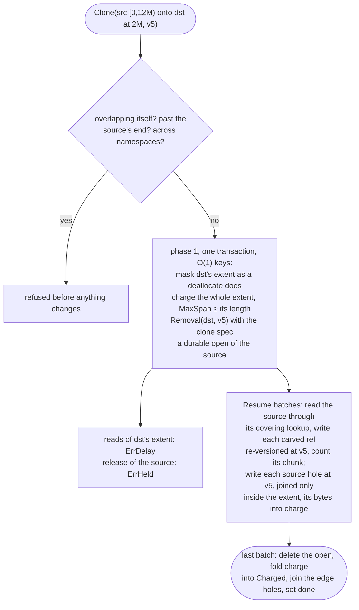

*A clone copies refs, not bytes. A destination ref written after the clone outranks the cloned one and is left alone.*

- **The source's holes are written by the batches.** A source fragmented by TRIM can hold 10⁵ holes, too many for one transaction, so phase 1 writes none of them and doesn't even read them. The source's holes count toward each batch's bound, like the refs it adopts.

- **Usage reads high until the clone is done.** Phase 1 charges the whole extent, and the batches gather the bytes of the holes they write in the removal's `charge`, which the last one folds in. Phase 1 also raises `MaxSpan` to the clone's length, so no batch needs to write the File for it. A `decision:` comment at `Clone` records this, and RFC 6 now says so too.

- **No write lands in the destination meanwhile.** The engine answers a write into the extent `ErrDelay` until the clone is done (RFC 8 §9.1), so a hole written by a later batch never covers newer bytes. The store holds the destination too: until the clone is done, a truncate, a deallocate or a clone onto it answers `ErrDelay`, its release counts the clone as a holder, and the release prune never deletes an unfinished clone removal.

### Open state that outlives a process

*The durable part of RFC 14: what a restart or a new primary needs to find. The open-state service itself, which holds opens, locks and grants in memory at the file's primary, is the next block.*

| Record | Key | Written |
|---|---|---|
| Client | `CL‖client`, its shards `CL‖client‖sh‖shard`, owner index `CLO‖protocol‖owner` | when a client is confirmed; rewritten only when a field changes, never on a renewal |
| Durable open | `F‖file‖op‖openID`, index `S‖share‖do‖shard‖file‖openID` | only when it keeps a file with no entry alive, is SMB-persistent, or is a clone's hold on its source |
| Durable lock | `F‖file‖op‖openID‖l‖offset‖lockID` | only beneath a persistent open, so closing the open drops it |
| Delete pending | `F‖file‖dp` | only while the file has a persistent open |
| NSM state number | `NSM` | raised, never lowered |

- **An unlink makes a file's opens durable.** `Unlink` and `Rename` take the file's opens, which live only in memory, and write them durable in the transaction that takes its last entry, so the release finds them. `Opens.Delete` reports a file left with no entry and no open, for the caller to release.
- **The release and an open race safely.** An open of a file with no entry reads the File record tracked, and the release range-guards the file's open records, so whichever commits second loses.
- **A clone's hold is a real open.** It has an issued ID and names the destination and the clone's version; the clone's last batch closes it.
- **IDs come from counters.** Client, open and lock IDs must be unique and never reused, but not random, so they come from server-wide counters reserved in ranges under `IDS‖kind`, a key the format didn't name yet.
- **`CREATE_SESSION` is sequenced in the client record.** A replay of the last one, after a restart too, gets its cached reply.

## 12. Version floor and counters

*Questions about a whole share, answered without a key that every commit rewrites (RFC 6 §8.3, RFC 16 §4.4).*

### The version floor

A journal restored from an old copy must not reissue a version metadata already holds, or a client's change attribute could go backwards. `VersionFloor` is the highest `Version` any file of the share stores. Every write of a File goes through one helper, `putFile`, which moves its entry in the version index in the same transaction; a directory delta writes its own entry. The floor then reads the highest key of each of 16 buckets per share. The share's version limit (`S‖share‖vl`) bounds what its own journal may issue, and is only ever raised.

### Usage

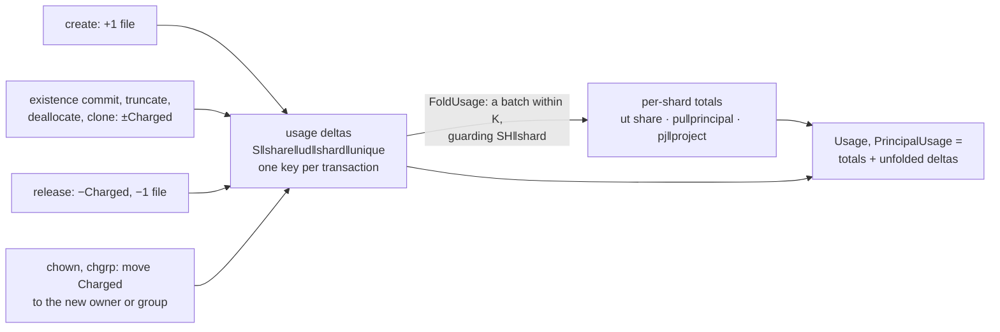

*A delta reads nothing and writes a key no other transaction writes, so charging bytes never makes two writers conflict.*

A file is charged its logical bytes, holes excluded, to its owner, its group and its project, in full however its chunks are shared. A delta written while a fold runs is not in that fold's scan and is folded by a later batch, exactly once.

### Quota limits

The store keeps the limits; the filesystem service enforces them (RFC 17 §5.6). `ControlPlane.SetQuota(share, q)` writes a share's hard, soft and advisory limits and the soft limit's grace, on a user, a group, a project, or the share itself when it names neither, and a quota that limits nothing deletes it. The service reads one with `Capacity.Quota`, and reports with `Capacity.SoftExceeded` whether usage is above the soft limit: the first time it is, the store records its own time, and falling back under clears it. A changed soft limit restarts the grace: the time is rewritten at the change if usage is above the new limit, and deleted otherwise; any other change leaves a running grace alone. Deleting a user or group deletes its quotas in every share.

## 13. A block's lifecycle

*From upload to prune, with the checks that keep referenced content safe.*

```mermaid
stateDiagram-v2
  [*] --> intended: Intend (before the put)
  intended --> live: Commit, live > 0
  intended --> retired: Commit, born dead (every chunk adopted)
  intended --> retired: Abandon (due after the put bound)
  live --> retired: last referenced chunk's count reaches 0<br/>not_before = now + 48h trash
  retired --> live: a count leaves 0 (resurrection)
  retired --> deleted: MarkDeleted, after not_before,<br/>only if no reverse key names its chunks;<br/>records marked_at
  retired --> live: MarkDeleted finds a ref: ErrReferenced, recount
  deleted --> pruned: Deleted (object gone), then Prune
  pruned --> [*]
```

*The block record's state lives on the record itself (`entity.BlockState`), and the trash index `BR‖ns‖not_before‖name` lets the deleter scan what is due in order.*

- **The counts are a cache.** A chunk's refcount must equal its reverse keys. The deleter trusts the reverse index, not the count: `MarkDeleted` scans it before the irreversible step and raises any count that was low.

- **A recount only raises.** Lowering a count is the audit's job, with stronger proof (RFC 9).

- **A restart abandons its own intents.** On a single node no writer survives a restart, so `AbandonShardIntents` retires every shard intent left behind instead of leaking its object.

- **Removals and clones move counts too.** Phase 2 decrements what it drops and increments a ref it splits or a clone adopts, so a block can retire or come back mid-removal.

## 14. How it is tested

*Each layer has its own suite, and every important rule has been broken on purpose to prove its test can fail.*

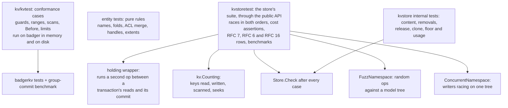

1. **Forcing a commit order.** The `holding` wrapper (`kvstoretest/races.go`) pauses an `Update` after its function and before its commit, and runs the competing operation to completion in that pause. That deterministically makes the paused one commit second, then the test swaps roles.

2. **Cost assertions.** `kv.Counting` counts what each operation touched, so tests assert "a create writes 6 keys and rewrites nothing", "a lookup reads 4 keys", "resolving a handle reads 1 key at any depth", "a folded directory's Get scans nothing". `NamespaceCosts` pins the reads, writes, scans and range guards of every namespace call, so a change to an operation's cost shows in review rather than in a profile.

3. **Invariant checks.** `Store.Check` asserts three things over the whole store, in one read transaction. Every refcount equals its reverse keys and refs, and every block is retired exactly when its live count is zero. The version index holds exactly one entry per file at its stored version, and no stray one. Folded usage plus unfolded deltas equals the files' `Charged` and count, for each share, every principal and every project. Every conformance case and every content test ends with it.

4. **A model to compare against.** `FuzzNamespace` reads its input as a stream of create, mkdir, link, unlink, rename and chmod over a few directories and colliding names. It applies each to the store and to a small model tree, and after each one compares whether it succeeded, every listing and every link count; at the end `Check` must pass. Its seeds run in a plain `go test`, in memory and on disk.

5. **Writers racing for real.** `ConcurrentNamespace` runs eight writers of random namespace operations over one tree, so they conflict and retry, the path no single sequence takes. Afterwards every file's `Nlink` must equal its entries, every directory's link count its subdirectories, and `Check` must pass.

6. **Mutation checks.** For each guard and rule, the code was edited to remove it and the test was run to confirm it fails on its assertion, then restored. Several tests passed even with their rule removed at first, and were fixed before they were committed.

7. **For other packages' tests.** `kvstoretest.NewFS` gives a store, a share, an administrator and the root in one call, and `NewHeldFS` the same over a held store, whose `Race` makes two operations commit in a chosen order. `kvstore.Regular`, `Dir`, `Symlink` and `Device` build a `NewFile`. `keys.Describe` renders a key by name, as `F‖share=3fa2c1d0‖file=9b1e44a7‖op‖9‖l‖100‖4`, and a namespace call's error is an `OpError` naming the operation, the directory and the name.

> **What waits on other work.** Snapshots: until cuts exist, nothing moves to history and nothing is dated by a cut. Open state (RFC 14): the store holds its durable records, but the service that holds opens, locks and grants in memory, with leases and grace, is not built. The engine: quota reservations, the scheduling of folds, and the journal's own version counter, which the store's `Version` stands in for today. Each place that waits has a `ponytail:` comment naming what it skips.
>
> **Open on #2894.** The RFC's eighth revision (`d2914f13`) settled the signed `Subdirs`, the pending-release and unfinished-removal indexes, the removal's `shard` and `charge`, and the usage of a removal whose file is gone, and the code follows it. Still open: how a call says "set the times to the server's time", which `Attrs` cannot express, so a writer without ownership cannot do it yet, and where the client, open and lock ID counters live (`IDS‖kind` here).
>
> **Waiting on step 9.** The open-state service (RFC 14), drawn versions and `ErrVersionBehind`, `File.Incomplete`, the health-condition sink, and deleting a user's secrets.

### Running them

`go test -race ./pkg/metadata/kv/... ./pkg/metadata/entity/... ./pkg/metadata/kvstore/...` runs everything; add `-short` to skip the on-disk Badger run. `go test -bench . ./pkg/metadata/kvstore/` runs the store's benchmarks, and `go test ./pkg/metadata/kvstore/ -run '^$' -fuzz '^FuzzNamespace$' -fuzztime 60s` fuzzes the namespace beyond its seeds.

## 15. Against today's store

*The new store next to `pkg/metadata/store/badger` and the metadata service the server runs today, measured on 13 and 15 Oct 2026.*

The new store is faster at almost everything a client does, most of all lookup, rename and parallel creates. A single client creating files on disk is slightly slower than the old store syncing every commit, and the old store's relaxed mode, which the server ships with, matches it on disk. It also lacks large parts of today's functionality: the open-state service, quota enforcement, backups, migration, credentials and the block engine's content model.

### Speed

A throwaway benchmark, not committed, ran the same operations through both on 13 Oct: the old metadata service over its Badger store, as the server runs it, and the new store over `badgerkv`. Both acted as an administrator, with directories of 10,000 entries. The disk runs used NVMe on ext4, with both stores syncing every commit. The new-store columns were measured again on 15 Oct with the store's own `BenchmarkStore`, after the review fixes, each disk figure in a run of its own. Figures are p50 latency, or throughput where marked.

| Operation | Old, memory | New, memory | Old, disk | New, disk |
|---|---|---|---|---|
| Create in a directory of 10k | 100 µs | **46 µs** | **1.3 ms** | 1.35–1.55 ms |
| Lookup in a directory of 10k | 71 µs | **7 µs** | 41 µs | **7 µs** |
| Getattr | 10 µs | **2 µs** | 33 µs | **9 µs**¹ |
| List 1,000 entries with attributes | 4.9 ms | **2.5 ms**¹ | 4.6 ms | not run |
| Rename between two directories of 10k | 6.9 ms | **53 µs** | 6.9 ms | **4.0 ms** |
| 64 clients creating in one directory | 32,200/s | **40,000/s** | 880/s | **11,800/s** |

¹ From 13 Oct; not measured again.

- **Reads are 5 to 10 times faster.** A lookup is one keyed read, where the old store goes through its service-layer caches and several lookups per call.
- **Rename is about 130 times faster in memory, but not for a reason of design.** The old rename spends its 4–7 ms, on memory and disk alike, in one scan: `anyOtherChildName` (`store/badger/transaction.go`) reads every child of the parent, values included. Fixing that scan would close most of the gap.
- **Parallel creates on disk are 13 times faster.** That is group commit: 64 concurrent creates share syncs, where the old store syncs each commit on its own.
- **The old store's relaxed mode matches the new store on disk.** The server ships with `relaxed_durability: true`, where the old store does not sync each commit: in a run on macOS it created in 35 µs and handled 38,700 creates/s with 64 clients. The new store has no such mode; it acknowledges a commit only once a sync covers it.

> **Where the new store is behind.**
>
> **A single client's create on disk is slightly slower:** 1.35–1.55 ms against 1.3 ms. A create is one commit and one sync, and the new store's sync flushes the write-ahead log (0.75–0.9 ms, the device flush), the value log (0.1–0.2 ms) and, for a new file, the directory, where the old store's flushes only its log. Skipping the value-log flush when that file has not changed would need Badger's internal write offset, since Badger preallocates the file and writes it through a memory mapping. It is not worth the code.
>
> **Right after a burst, the disk runs slow down.** Started straight after the 10,000-create fill, a single create took 3.4–4 ms in two runs of four; with a 3 s pause, none did. Badger is most likely still flushing or compacting the fill. A server under steady write load would meet that with either store, so each disk figure here comes from a run of its own.
>
> **On macOS every commit pays a full device flush.** Go's `File.Sync` there is `F_FULLFSYNC`, about 4.4 ms, where the old store's Badger sync is `msync`, which leaves the drive's cache. The figures above are from Linux.
>
> **The offload commit** of a 64-chunk block has no counterpart in the old store. Its target is 5 ms. With scan prefetching off (`a0739b57`) it went from 7.1 ms to 2.0 ms in memory and from 10.2 ms to 6.7 ms on disk. What is left on disk is mostly two synced commits per block, the intent and then the commit.
>
> **One lock change was measured and kept out.** Taking the commit lock shared for every commit without a range guard was 20% slower here (36,500 against 45,000 creates/s with 64 clients in memory, interleaved runs on 8 threads), so every commit still takes it exclusively.

### Design

|  | Today (`store/badger` and the metadata service) | New (`kv` and `kvstore`) |
|---|---|---|
| Storage engine | Badger only, used directly | A small KV interface: Badger now, a cluster backend later |
| Keys | Text prefixes such as `f:<uuid>` and `c:<parent>:<name>` | Binary keys, with a key budget per transaction |
| Durability | A sync per commit, or relaxed with a bounded lag | Group commit: a commit is acknowledged after a sync that covers it |
| File handles | `"shareName:uuid"` | Binary, with a numeric file ID per share |
| Directory listings | Pages over the children prefix | Digest order, with stateless cookies that resume correctly on any node |
| Content | Offset-keyed chunk lists and a global BLAKE3 index | Refs, chunks and blocks per namespace; holes, removals, release and clone |
| Usage counting | Counters kept per transaction | One delta record per transaction, folded per shard |
| Control plane | A separate GORM database | Users, groups, grants, netgroups and shares inside the store |
| Permission checks | In the service layer | Inside the store's own calls |
| Source size | About 10k lines of store, plus 12.8k of service | 10.1k of store, 2.5k of KV layer, 2.8k of entity types |
| Tests | About 6.6k lines, plus the shared `storetest` suite of 14.5k | About 10k lines: a KV conformance suite, a store conformance suite, a model-based fuzz target, a concurrent stress test, pinned key counts, internal checks of the main invariants, and benchmarks |

### What the new store doesn't have yet

| Area | Today | New |
|---|---|---|
| Byte-range locks, NLM and NSM, NFSv4 client recovery, grace | Yes | The durable records only; the open-state service is not built (RFC 14) |
| SMB durable handles | Yes | Records for persistent opens; no service uses them yet |
| Snapshots | Yes | No: RFC 12 |
| Quota limits and enforcement | Yes | Usage and user, group, project and share-wide limits are stored; enforcement is the filesystem service's, not built yet |
| Backup and restore | Yes, a raw Badger dump | No |
| Trash | Yes | No |
| The block engine's model: payload rows, synced hashes, block records | Yes | Replaced by refs, chunks and blocks; the engine is not ported yet (RFC 8) |
| Oplocks, leases, delegations, share reservations | Yes | No: the open-state service (RFC 14) |
| Migration of existing stores | — | None by design: new installations only, and a start on v1 state is refused |
| Credentials: password and NT hashes, roles | Yes, in the GORM database | No: `User.Secret` references a sealed credential that nothing stores or verifies yet, and there is no global admin role |
| SMB named streams | Yes, with xattrs spilling into streams | No: `Create` refuses a stream; xattrs are capped at 64 KiB a value and 128 a file |
| Case folding | Per call: NFS case-sensitive, SMB folding, on one share | Per share |
| WCC pre-operation attributes, FSSTAT, change notify, health and metrics | Yes | No |
| Share options: access-based enumeration, streams disabled, blocked operations, retention | Yes | No typed home yet |
| xattrs, ACLs, symlinks and special files, hard links, sticky bit | Yes | Yes |
| Squash, netgroups and export policy | Applied by the adapters, from the GORM database | Stored and validated in the store; the caller still applies them |

### Next

1. **The open-state service (RFC 14),** stage 1 of wiring the store in: opens, locks and grants held in memory at the file's primary, over the durable records above.
2. **The filesystem service (RFC 17),** stage 2: its call shapes, such as `Unlink` and the xattr calls taking an `OpenGrant`, and the engine interface agreed with the journal v2 work before stage 3.
