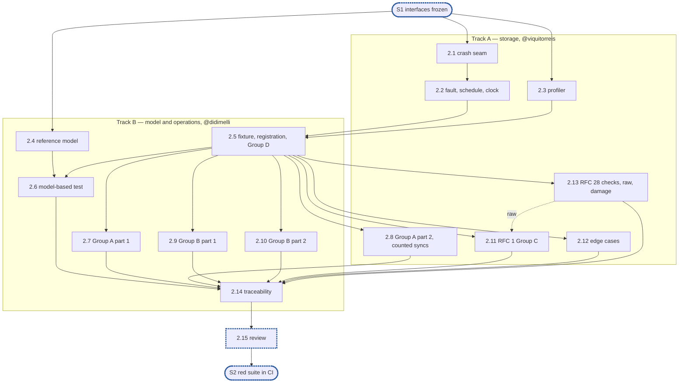

# Epic 2: journal v2 red end-to-end suite and test foundations

**Sources:** [RFC 1](../rfcs/rfc-1-journal.md) §1.3 and §9;
[RFC 28](../rfcs/rfc-28-journal-format.md) §2, §4.1, §4.2 and §4.4;
[RFC 8 §2.1](../rfcs/rfc-8-engine.md) for the clock and the fault interface;
[RFC 29](../rfcs/rfc-29-test-harness.md) §4.1, §4.3, §4.6 and §4.7 for registration and
grading; [the RFC index](../rfcs/rfc-index.md), "Test tiers" and "Test harness".
**Owners:** track A, storage (@viquitorreis), and track B, model and operations
(@didimelli), with the split given per subtask; @simonebaracchi coordinates and runs the
review at the end.
**Estimate:** 15 subtasks.
**Depends on:** epic 1's frozen public surface of `pkg/block/journalv2` (the end of
epic 1 is sync point **S1, interfaces frozen**).
**Blocks:** all testing in epics 3–12. The end of this epic is sync point **S2, red suite
in CI**.

---

## 1. Goal

Epic 2 makes "done" measurable before any journal behaviour exists. It delivers:

- **the test components** every later epic tests with: a crash-simulating storage seam on
  a real filesystem, the set's fault interface with a seeded schedule, the test clock, a
  reference model of the journal, and a profiling harness;
- **the red conformance suite**: one Go test per named check of RFC 1 §9.4 and RFC 28 §4.2
  that can be written against the public surface, the edge cases of RFC 1 §9.2 and
  RFC 28 §4.1, the systematic damage of RFC 28 §4.4, the model-based test of RFC 1 §9.1,
  and the counted sync checks of RFC 1 §9.7;
- **grading**: the suite registered with `dt`, every test listed in its known-failure
  file, so the run is green while every test fails;
- **traceability**: a map from every RFC check row to the test that implements it, or to
  the epic that owns it, checked by a test.

At the end of the epic:

- the suite compiles against epic 1's stubs and runs in CI through `dt`;
- every test fails, none skips, none panics, and every one is a listed known failure, so
  the cell is green;
- every row of RFC 1 §9.4 and RFC 28 §4.2 maps to a test or to a named owner;
- the seam, the fault schedule, the clock, the model and the profiler are implemented in
  full and their own tests are green, because they do not depend on the journal.

### 1.1 In scope

- `pkg/sim`: `TestClock`, `Fault`, `FaultAction` and the seeded `Schedule`.
- `pkg/block/journalv2/journalv2test`: the crash seam, the profiler, the fixture, the
  reference model and the hand-written byte builders.
- `pkg/block/journalv2/conformance`: the conformance tests, the model-based test and its
  seed corpus.
- `test/journalv2/`: the known-failure file and the traceability map with its check.
- `test/suites.yaml`: the `journal-conformance` suite, the `journal` group, and the new
  build tag added to `lint-go`'s vet line.
- The catalogue of system scenarios, as §7 of this file, for epics 10 and 11 to write.

### 1.2 Out of scope

- Any journal behaviour. A test never turns green in this epic.
- Checks that need a package this epic does not create (§2, rule 12): the encoders'
  golden vectors and the platform checks (epic 3), the index's comparison counters
  (epic 4), the lock-order recorder (epic 8). §6 lists each, with its owner.
- The allocations-per-operation assertion: it has no consumer until a hot path exists,
  and a threshold cannot be set against a stub. It lands with epic 4's index and epic 8's
  data path.
- The production clock `pkg/clock`, which lands with its first caller in epic 11.
- System e2e tests and their fixtures (D11).
- Tiers beyond `pr`, the many-seed and soak runs and the benchmarks: epic 12.

---

## 2. General rules for each epic

Every subtask states how it meets each rule that applies to it; a rule that does not apply
is named with the reason.

1. **Independent unit tests.** Each epic carries its own unit tests. It may use another
   epic's pure in-memory implementation (E4's index, E3's codecs), the implementation of
   an epic it depends on once that has landed (E8 on E5's segments and E6's `Sync`), and the test components from epic 2. Epic 1 declares no internal interface
   to fake (rule 12).
2. **Fuzz tests where relevant.** Use Go native fuzzing (`testing.F`) on every parser of
   bytes the journal did not just write: records, segment headers, seal markers, catalogs,
   trailers, the `format` file. Also fuzz-drive operation sequences against the reference
   model. The property is that any input is either accepted as valid or rejected: never a
   panic, and never an extent the bytes do not contain.
3. **Metrics, and tracing where relevant.** Every counter and gauge RFC 1 §3.7 and §3.9
   assigns to the epic's area is maintained, and exposed through `Stats` (served from
   maintained counters, never a walk). Spans go through epic 1's standard-library
   `Tracer` and logs through the injected `*slog.Logger`, never a metrics or tracing
   library. Operations worth a span:
   open and recovery, sync, offload pass, repack pass, fill, and a refused reservation.
4. **Profiling.** Tests and benchmarks run under epic 2's profiling harness and fail on
   goroutine, descriptor or memory leaks and on anomalous resource growth. Hot paths
   (`WriteAt`, `ReadAt`, `Stats`, `report`, index lookup and insert) carry
   allocations-per-op assertions and the counted checks of RFC 1 §9.7. Allocation and
   heap assertions run outside `-race` only, because `-race` changes both.
5. **Public interface and internals.** Tests cover the epic's internal package API and the
   public v2 interface behaviour it enables, including concurrency under `-race`. Per the
   project rules, test at the layer that **consumes** a value, not the one that produces
   it. A regression test is validated by reverting the fix and watching it fail **on its
   assertion**.
6. **Known failures shrink.** Every e2e test an epic turns green is removed from the
   known-failure list in the same change. The runner fails if a listed test passes.
7. **v2 ignores v1.** No import of, copy from, or behavioural dependence on
   `pkg/block/journal`. The import test enforces it. v1 code is neither ported nor
   bridged: it is deleted with the rest of v1 at the cutover (stage 7 of #3119). v2
   checks only whether v1 state exists, to refuse it at start (E10), and never reads
   v1's format.
8. **Real storage for storage properties.** No in-memory filesystem stands in for a check
   about durability, torn tails, unlink durability or corruption (RFC 1 §9.5). In-memory
   stand-ins are allowed only for pure logic (index, codecs).
9. **Code comment conventions** (`CLAUDE.md`). No epic, issue or plan IDs in source
   comments. Use `ponytail:` for knowingly-simple implementations and `decision:` for
   deliberate behaviour. Where the RFC already carries a ponytail or decision note, its
   marker goes at the code site that implements it.
10. **A test must be able to fail.** Every test is code maintained for the life of the
    project. Keep a test only if a plausible change would make it fail and nothing else
    would catch that change: not the compiler, not the PR diff, not a later epic's tests.
    A test that checks two `errors.New` values differ, that the standard library's
    `errors.As` works, or that a stub returns zero does not qualify. A test that a
    little-endian `Version.Bytes` would fail does. Review rules that no test can check
    (for example, stubs never panic) stay review rules.
11. **A symbol is exported only if RFC 1 §3 uses it.** Everything exported is frozen at
    S1, so a helper exported for convenience becomes a contract. Helpers the internal
    packages need (`Less`, `IsZero`, `End`, `Overlaps`, `Seq`, the proposed constants)
    stay in `internal/core`.
12. **Each subtask creates only what it declares.** No empty package and no stub without
    a caller. A package, an option or a test helper lands with its first consumer.

### 2.1 How the rules apply to this epic

| Rule | Applies to epic 2 as |
| --- | --- |
| 1. Unit tests | **Applies to the components.** The seam, the schedule, the clock, the model, the profiler and the byte builders each carry unit tests that are green at landing, since none of them depends on the journal. The conformance tests are the red suite, not unit tests. |
| 2. Fuzz | **Applies to the model.** A fuzz target drives operation sequences against the reference model alone, with the property that the model never panics and never reports bytes it was not given. Fuzzing the journal's parsers is epic 3's, where the parsers are. |
| 3. Metrics and tracing | **Applies as checks, not as code.** RFC 1 §9.4 Group D's checks assert each `Stats` field and counter from the public surface (2.5). Nothing here maintains a counter. |
| 4. Profiling | **This epic builds it.** Every conformance test runs under the profiler through the fixture (2.3, 2.5). The allocations-per-op assertion is out of scope (§1.2). |
| 5. Public and internals | **Applies.** Conformance tests drive only the public surface of `journalv2` and observe the disk only through the seam and the byte builders: they test the consumer of every value. The components test their own APIs. |
| 6. Known failures | **This epic builds it.** Every conformance test lands with its entry in `test/journalv2/known.yaml` (D1). No test turns green here. |
| 7. v2 ignores v1 | **Applies.** The import test covers `journalv2test` and `conformance`. Nothing in this epic reads v1's code or format, and v1's test helpers (its fake clock) are not reused. |
| 8. Real storage | **Applies, and is the reason for the seam.** The seam wraps a real directory. The reference model is in memory but stands in only for the expected answer, never for storage. |
| 9. Comments | **Applies.** Each conformance test's doc comment states the check in terms of the journal's behaviour, with no RFC section or epic number; the map from test to RFC row lives in `test/journalv2/trace.yaml` (D3). `decision:` markers for D5–D8 and D12 sit at their code sites. |
| 10. Tests must be able to fail | **Applies, with D4's limit.** Every conformance test asserts the specific outcome its RFC row names, through `errors.Is` or `errors.As` against the named sentinel where it expects a refusal, so a stub's `ErrNotImplemented` never satisfies it. |
| 11. Export only what RFC 1 §3 uses | **Applies to `journalv2` only.** This epic adds no exported symbol to the journal's public package. The segment-cap override is an unexported field reached through `internal/core` (D8). `pkg/sim` and `journalv2test` are test packages and export what their callers use. |
| 12. Create only what is declared | **Applies.** Each component lands with its first consumer: the clock with the schedule's delay, the schedule with the seam, the seam and profiler with the fixture's first tests, the byte builders with the RFC 28 checks (2.13). No system e2e scaffolding lands without a test (D11). |

---

## 3. Decisions this epic takes

Each decision is recorded at its code site with a `decision:` marker where it has one, and
is reviewed in 2.15.

**D1. Known failures are graded by `dt`, from a YAML list. Epic 2 writes no Go
known-failure reader.**
RFC 29 §4.7 replaces the Markdown lists with one `known.yaml` per suite, and `dt` already
reads and grades it (`test/harness/known`). A second matcher would drift from it.

- *The file:* `test/journalv2/known.yaml`, named by the suite's `known:` field.
- *One entry per test, never a pattern.* `dt` judges a pattern on every result it matched
  and calls it an unexpected pass only when all of them pass, so a pattern would let one
  test turn green without its entry leaving the list.
- *Each entry:* `status: fail`, `fix: planned`, `category: feature`, a reason naming
  what is missing (for example "no data path yet"), and `issue:` naming the issue of the
  epic expected to turn it green.
- *What it gives:* a listed test that fails is graded `known`; a listed test that passes
  fails the cell (exit 1), so the epic that turns it green removes its entry in the same
  change; a test that skips, or does not run, is not run (exit 2, RFC 29 R10).

**D2. The conformance suite sits behind a build tag and is its own `dt` suite.**
The `unit` suite runs `go test ./pkg/...`, which would otherwise run every red test and
turn `unit` red.

- *The tag:* `journal_conformance`, on every file of `conformance/`.
- *The suite*, in `test/suites.yaml`:

  ```yaml
  journal-conformance:
    format: go-json
    cmd: go test -race -tags=journal_conformance -timeout=30m ./pkg/block/journalv2/conformance/...
    known: test/journalv2/known.yaml
    tier: pr
  ```

  and a `journal` group naming it, as RFC 29 §4.9 asks of a component.
- *Vetting:* `journal_conformance` is added to `lint-go`'s `go vet -tags=...` line, so the
  tagged files are compiled on every PR.
- *Tiers beyond `pr`* (many seeds, a non-race leg) are epic 12's.

**D3. Test names carry the RFC group; the map to RFC rows is a file, checked by a test.**

- *Names:* `TestRFC1A_NoZeroFill`, `TestRFC1B_ReserveAhead`, `TestRFC28C_SourcesAgree`,
  `TestEdge_WriteCrossesSegment`, `TestModel`, `TestCounted_SyncsPerWrite`. One file per
  group: `rfc1_a_test.go`, …, `rfc28_c_test.go`, `edge_test.go`, `model_test.go`,
  `counted_test.go`, `clock_test.go`.
- *The map:* `test/journalv2/trace.yaml`. Its key for a row is the RFC, the group and the
  row's requirement label as written in the table (`rfc1 / A / "no zero-fill"`). Each row
  maps to a list of tests, or to `owner: epic N` with a reason, or both when a row is
  split (D9 shows how).
- *The check:* `test/journalv2/trace_test.go`, run by `unit`. It parses the check tables of
  RFC 1 §9.4 and RFC 28 §4.2 straight from the RFC files, and the conformance package's
  test functions with `go/parser`. It fails when a row has no entry, when an entry names a
  row that no longer exists, when a named test does not exist, or when a test of the
  suite is in no entry. A row added to an RFC therefore fails CI until it is mapped.
- *"Did not run"* is `dt`'s: in a suite with a known file, a test that skips or yields no
  result is exit 2. Together with the existence check, a mapped check that did not run
  fails CI.

**D4. Until `Open` works, every test fails in the fixture, not on its own assertion.**
Every conformance test opens a journal through the fixture, and `Init` and `Open` are
stubs until epics 7 and 8 land, so every test fails at the fixture's first step.

- *What S2 can check:* every test compiles, runs, fails without a panic or a skip, and is
  listed. The fixture reports its own failures with the prefix `fixture:`, so a fixture
  failure is never mistaken for the check's.
- *What it cannot check:* that each test fails on its own assertion. That is verified per
  test by the epic that turns it green, by the project rule: revert the implementing
  change and watch the test fail on its assertion.
- *What review checks instead:* each test against its RFC row, and that each refusal is
  asserted against its named sentinel, never as "any error".

**D5. The fault interface is RFC 8's, in `pkg/sim`, with the action kinds RFC 8 lists.**

```go
type Fault interface {
    At(op string, key []byte) FaultAction
}

type FaultAction struct {
    Kind  FaultKind     // Pass, Fail, Delay, Drop, Tear, Reorder
    Err   error         // Fail: the error returned
    Delay time.Duration // Delay: waited on the schedule's clock
    N     int64         // Tear: bytes kept
}
```

- *Why declared here:* RFC 8 §2.1 lists the kinds but declares no `FaultAction`, and
  `Fault` lands with its first consumer, the seam (rule 12).
- *The seam's operation names:* `create`, `open`, `allocate`, `write`, `read`,
  `read_direct`, `sync`, `truncate`, `close`, `rename`, `remove`, `list`, `sync_dir`. The
  key is the file name. These names are the seam's contract with every schedule, and are
  documented on the seam.
- *`Schedule`* implements `Fault` from a seed and a list of rules (an op, a key pattern,
  a call count or probability, an action). The same seed gives the same actions in the
  same order of calls.

**D6. A hold is test choreography in the seam, not a fault.**
Many checks stop the journal at one call and act while it waits ("hold a `Fill` at the
storage seam after it has found the extent absent"). A `Delay` on the test clock cannot do
this, because advancing the clock to release it also fires the journal's own timers.

- *The API:* `seam.Hold(op, key) *Hold`, with `Reached() <-chan struct{}`, `Waiting() int`
  and `Release()`. A held call blocks until `Release`, on no clock.
- *Counted checks* use `Waiting()`: the syncs-per-write check holds each sync until all 16
  writers are waiting, so scheduling cannot decide the result (RFC 1 §9.7).

**D7. Seeds are deterministic, and a failing seed is kept, never retried into green.**
The index forbids retrying or quarantining a failing seeded test, while `dt` retries
failures on develop (RFC 29 §4.7).

- *Source of the seed:* `DITTOFS_SEED` when set, otherwise a fixed seed per test. A retry
  inherits the same environment, so it replays the same seed and cannot pass by drawing
  another.
- *Corpus:* the model-based test first replays every seed in
  `conformance/testdata/model/`. A failing seed is shrunk to the shortest failing
  sequence, written to `t.ArtifactDir()` as a ready-to-commit corpus file, and printed;
  the fix that resolves it commits the file.
- *Random seeds* run only where a tier sets `DITTOFS_SEED` from a fresh draw, which epic 12
  registers.

**D8. The segment cap is overridden by an unexported setting reached only inside the
journal's tree.**
Checks over many segments (1,000 segments for pinned-segment bounds, recycling, the
descriptor bound) are unrunnable at 256 MiB per segment in a temporary directory. The cap
is not a setting, and no exported symbol may be added for it (rule 11).

- *How:* `core.Settings` gains an unexported field, set only through
  `core.SetSegmentCap(*Settings, int64)` in `internal/core`. The fixture, inside the
  journal's tree, sets it and passes the settings through the public `WithSettings`.
  Code outside `pkg/block/journalv2/...` cannot reach `internal/core`, so the public
  surface does not change. The field is honoured once epic 5 implements segments.
- *Default in the fixture:* 1 MiB. A check that names a size in the RFC (a 1 MiB record,
  a 64 KiB extent) keeps that size and states the cap it needs.

**D9. RFC 28's bytes are written by hand from RFC 28 §2, in `journalv2test/raw`.**

- *Why:* the format checks need on-disk bytes before the encoder exists, and an encoder
  checked against itself proves nothing. `raw` is written from the RFC tables alone, with
  the standard library's CRC32C (`hash/crc32`, Castagnoli), and never imports
  `internal/format`. Epic 3's golden-vector tests compare the encoders' output with
  `raw`'s, which makes `raw` an independent oracle.
- *What it builds:* the `format` file, a segment header, a record header of any kind with
  its payload, a seal marker, catalog entries and a trailer, plus a parser for the
  `format` file and the segment header so a test can read the identity of the journal it
  plants into.
- *Split rows.* "Kind values", "segment header and seal marker" and "`format` file" each
  have an encoding half (epic 3) and a refusal half (here). `trace.yaml` lists both.

**D10. Conformance tests reach the clock only through the fixture.**
The import rule allows `pkg/sim` in `journalv2test` only. `conformance` imports
`journalv2` and `journalv2test`, and the fixture exposes `Advance`, `SetRate` and `Now`.
The import rule stays as epic 1 wrote it.

**D11. No system e2e scaffolding lands in this epic. Its catalogue does.**
No `dfs` can run journal v2 before epic 11, and there is no configuration key to select
it, so a system test written now could only fail at start. What a system test needs
already exists: the `e2e` suite and its framework start a real `dfs`, mount NFS and SMB,
and `dt` grades the suite against a known file once e2e opts in (RFC 29 §9). The fixtures
specific to the journal (several journal devices, a full device, a moved disk) would have
no caller here, so they land with epic 10's first test (rule 12). The catalogue is §7 of
this file.

**D12. The profiler uses the standard library only.**
The import rule forbids third-party packages in the journal's tree, test files included,
so `goleak` is not available.

- *Goroutines:* a snapshot of `runtime.Stack` before the test, compared after it, with
  the test runner's own goroutines filtered. The check retries for up to 2 s of real time,
  because goroutines a closed journal has joined can still be exiting. This is the one
  real-time wait in the suite.
- *Descriptors:* the entries of `/proc/self/fd` on Linux and `/dev/fd` on macOS. On other
  platforms the descriptor check does not run, and the profiler logs that it did not.
- *Heap:* `HeapAlloc` after `runtime.GC()`, against a threshold the fixture sets per test
  with slack. Skipped under `-race`, which changes it.
- *On failure:* goroutine, heap and allocation profiles go to `t.ArtifactDir()`, which `dt`
  collects with the cell's results.

---

## 4. Target tree

```text
pkg/sim/                         TestClock, Fault, FaultAction, Schedule        (2.2)
  clock.go  fault.go  schedule.go  *_test.go
pkg/block/journalv2/
  internal/core/settings.go      unexported segment-cap field, SetSegmentCap    (2.5, D8)
  journalv2test/                 test components, inside the journal's tree
    seam.go  hold.go             crash-simulating seam, holds                    (2.1, 2.2)
    prof.go                      profiler                                        (2.3)
    model/                       reference model                                 (2.4)
    fixture.go                   journal on a temporary directory, two shares    (2.5)
    raw/                         RFC 28 bytes written by hand                    (2.13)
  conformance/                   //go:build journal_conformance
    rfc1_a_test.go  rfc1_b_test.go  rfc1_c_test.go  rfc1_d_test.go
    rfc28_a_test.go  rfc28_b_test.go  rfc28_c_test.go  damage_test.go
    edge_test.go  model_test.go  counted_test.go  clock_test.go
    testdata/model/              committed failing seeds                         (2.6)
test/journalv2/
  known.yaml                     one entry per conformance test                  (2.5 onwards)
  trace.yaml  trace_test.go      RFC row → test or owner                         (2.14)
test/suites.yaml                 journal-conformance suite, journal group, vet tag (2.5)
```

`new-package-tests.sh` requires a `_test.go` in every new directory. Each one above has its
own tests; `conformance/` is the tests.

---

## 5. Subtasks

Each subtask lists:

- **Owner**, and **Depends on**: the subtasks that must land first;
- **Deliverables**;
- **Done when**: the acceptance criteria;
- **Rules**: how each applicable general rule is met. A rule the subtask does not mention
  falls under §2.1's reading for this epic.

Every conformance subtask also:

- adds one entry per test to `known.yaml` (D1) and to `trace.yaml` (D3);
- asserts each refusal against its named sentinel or typed error (D4);
- runs every test at least on two files across two append streams and, where the check
  involves shares, two shares on one journal (RFC 1 §9.3), through the fixture's defaults;
- simulates storage loss only at the seam, never by killing the process (RFC 1 §1.3).

### 2.1 Crash-simulating storage seam

- **Owner:** A. **Depends on:** epic 1's storage seam (`storage.FS`, `storage.File`).
- **Deliverables:** in `journalv2test`, a `storage.FS` over a real directory that:
  - records, per file, every write, allocation and truncate since that file's last sync,
    and every create, rename and remove since the last directory sync;
  - on `Crash()`, discards exactly those: a file allocated and never synced comes back
    short or unallocated, an unsynced create disappears, an unsynced rename or remove is
    undone. It then closes every handle, so the journal can be reopened on the same
    directory;
  - supports the variants RFC 28 §4.4 names: *lost writes* (the default), *torn* (the
    last unsynced write kept up to byte n), and *reordered* (a seeded subset of the
    unsynced writes kept, in any order). The seam cannot know which orders a
    filesystem allows, so it allows all of them: outside data-journaling modes, unsynced
    writes have no order;
  - counts calls per operation and per file, and exposes the durable image of a file
    (what a crash would leave) for stale-read checks;
  - can serve reads of a named file from its durable image instead of the page cache
    (`StaleReads(name)`), which the "re-append trusts no page cache" checks need.
- **Done when:**
  - its unit tests, on a real temporary directory, show each discard rule: a synced write
    survives a crash, an unsynced one does not, a renamed file's directory entry survives
    only after `SyncDir`, a torn write keeps exactly n bytes, a reordering can keep a
    later unsynced write without an earlier one, and no variant loses a synced write;
  - each test reverts the matching rule in the seam and watches the test fail.
- **Rules:**
  - 1, 10: the seam is fully implemented and its tests can fail.
  - 8: wraps a real directory; nothing is in memory but the record of unsynced operations.
  - 12: its first consumer within the epic is 2.2's fault wiring; its tests use it at once.

### 2.2 Fault, schedule and the test clock

- **Owner:** A. **Depends on:** 2.1.
- **Deliverables:**
  - **`pkg/sim`:**
    - `TestClock`: `Now`, `Elapsed`, `After` (the journal's `Clock`), plus `Advance(d)`
      and `SetRate(r)`; `After` fires only on `Advance`;
    - `Fault`, `FaultAction`, `FaultKind` (D5);
    - `Schedule`: seeded, rule-driven, implementing `Fault`; `Delay` waits on the
      schedule's clock.
  - **The seam consults its `Fault`** before every operation and applies the action:
    `Fail` returns the error (`EIO`, `ENOSPC` or any given), `Drop` reports success and
    discards the effect, `Tear` keeps the first n bytes, `Delay` waits, `Reorder` marks the
    write for 2.1's reordering.
  - **A disk that loses a confirmed write:** a `Drop` on a `write` followed by a
    successful `sync` of the same file. The journal sees the write and the sync succeed,
    and a crash leaves the write's slot as it was before.
  - **Holds** (D6): `Hold`, `Reached`, `Waiting`, `Release`.
- **Done when:**
  - the same seed and rules give the same actions over the same calls, and a different
    seed gives a different sequence;
  - `After` never fires without `Advance`, and with `SetRate(1.05)` an `Advance` of 100 s
    fires timers due by 105 s;
  - each action kind is observable through the seam on a real file, including a failed
    `sync`, a failed `sync_dir` and a failed `read_direct`, the three RFC 1 §1.3 names;
  - a `Drop`ped write followed by a successful `sync` is absent from the durable image
    and gone after `Crash()`;
  - a held call blocks until `Release`, and `Waiting` counts the blocked calls.
- **Rules:**
  - 1, 10: each property above is a test that a plausible bug fails.
  - 9: `decision:` markers for D5 at `FaultAction` and for D6 at `Hold`.
  - 12: `TestClock` lands with `Delay`, its first consumer; `Fault` with the seam.

### 2.3 Profiling harness

- **Owner:** A. **Depends on:** nothing.
- **Deliverables:** in `journalv2test`, `prof.Watch(t, opts)` registering a cleanup that
  checks goroutines, descriptors and heap growth, and writes profiles on failure (D12).
- **Done when:**
  - a planted leaked goroutine, a planted open descriptor and a planted retained 64 MiB
    buffer each fail it, with the profile written to `t.ArtifactDir()`;
  - a test that leaks nothing passes it 100 times in a row under `-race` (the heap check
    off) and without (on), so it does not flake.
- **Rules:**
  - 4: this subtask is the profiling harness. The allocation assertion is not here (§1.2).
  - 9: `decision:` marker for D12's real-time retry.
  - 12: its consumer is the fixture (2.5); its tests exercise it on planted leaks.

### 2.4 Reference model

- **Owner:** B. **Depends on:** epic 1's value types.
- **Deliverables:** `journalv2test/model`, a pure in-memory model of RFC 1 §2–§3 as the
  journal's caller sees it:
  - per share tag, per file: each byte held or absent, its version, its offloaded bit,
    and the removal markers with their versions and settled state;
  - the operations the model-based test drives: `WriteAt`, `Fill`, `Offload` and its
    report, `Release`, `Truncate`, `Deallocate`, `Delete`, `Settle`, `Since`, `Repack`
    (a no-op on content), `Crash` with the set of operations a returned `Sync` covered,
    and `Reopen`;
  - after a crash, the model holds exactly what RFC 28 §4.4 allows: everything a returned
    `Sync` covered, and for every other write either all of it or none of it, as a set of
    acceptable states the comparison accepts;
  - `Compare(j)`: reads every file of the model through a journal handle and reports the
    first difference in bytes, `missing` extents, offloaded bits or `Since` output.
- **Done when:**
  - table tests cover each operation's effect, written from RFC 1's text, including
    "fill below a removal's version is excluded" and "a release keeps the bytes absent";
  - a fuzz target drives random sequences through the model alone, never panicking and
    never reporting bytes it was not given.
- **Rules:**
  - 1, 2, 10: table tests and the fuzz target.
  - 8: the model is the expected answer only; it never stands in for storage.
  - 12: `Compare` lands here with its first caller in 2.6.

### 2.5 Fixture, suite registration, and RFC 1 Group D

- **Owner:** B. **Depends on:** 2.1, 2.2, 2.3, epic 1.
- **Deliverables:**
  - **The fixture**, `journalv2test.New(t, opts...)`: a temporary directory on the real
    filesystem, the seam with an empty schedule, a `TestClock`, the profiler, `Init` and
    `Open` with `WithStorage`, `WithClock` and settings of two append streams and a 1 MiB
    segment cap (D8). It attaches two shares on request and offers `Crash()` (seam crash,
    then reopen with the recorded identity and floor), `Reopen()`, `Advance`, `SetRate`
    and `Now`. Every failure of its own starts with `fixture:` (D4).
  - **`internal/core`:** the unexported segment-cap field and `SetSegmentCap` (D8).
  - **Registration** (D1, D2): the `journal_conformance` tag, the `journal-conformance`
    suite and `journal` group in `test/suites.yaml`, the tag on `lint-go`'s vet line, and
    `test/journalv2/known.yaml`.
  - **RFC 1 §9.4 Group D**, eleven checks: wedge is visible, accounting follows the cap
    (on the test host's filesystem; the speculative-preallocation leg is parked, §6),
    generation never repeats, stats are cheap (the part the public surface can show:
    `Stats` returns while a write is held at the seam, and its cost is flat from 10³ to
    10⁵ held extents), named inequalities hold, backlog age, clean bytes count as
    occupancy, metrics are reachable, loss events, segment held-bytes (against a walk of
    `Inspect().All()`), verification reports.
  - **Clock checks** (RFC 0 §1.4, through the fixture): a jump of the wall clock moves
    `OldestDirty` but no timer, and with the journal's clock 5% fast the bounded sync
    still syncs within its bound by a slow clock.
- **Done when:**
  - `dt run journal-conformance` is green, with every test graded `known`;
  - removing any one entry from `known.yaml` makes the run fail with that test as new;
  - a fixture test that does not open a journal (the seam and clock wiring) is green.
- **Rules:**
  - 3: Group D asserts the observability contract from `Stats` only.
  - 4: every test runs under the profiler through the fixture.
  - 6: the known list exists from this subtask on.
  - 11: no exported symbol is added to `journalv2` (D8).
  - 12: the fixture lands with its first tests; the tag and suite with the first tagged
    file.

### 2.6 Model-based test

- **Owner:** B. **Depends on:** 2.4, 2.5.
- **Deliverables:** `TestModel`: random sequences of write, fill, offload, release,
  truncate, deallocate, delete, settle, repack, crash and reopen, over at least two files
  on two streams and two shares on one journal, compared with the model after every step
  (RFC 1 §9.1, §9.3). Crashes use the seam's three variants. Faults are steps too: a
  write that fails with `EIO`, an `ENOSPC` from the filesystem, and a failed sync, after
  which the sequence keeps running, because failure-path bugs show when work continues
  after the fault, not at the fault. Seeds, shrinking and the corpus follow D7.
- **Done when:**
  - the corpus in `testdata/model/` replays before any random seed;
  - a planted model divergence (the journal wrapper reporting one wrong byte) is caught
    and shrunk to a sequence of at most a few steps, and the corpus file is written to
    `t.ArtifactDir()`;
  - the test is listed as a known failure.
- **Rules:**
  - 2: the operation-sequence fuzzing of rule 2 is this test, seeded.
  - 9: `decision:` marker for D7 where the seed is chosen.
  - 10: the planted divergence shows it can fail on its assertion.

### 2.7 RFC 1 Group A, part 1: read, fill, offload, release and removals

- **Owner:** B. **Depends on:** 2.5.
- **Deliverables:** fourteen checks of RFC 1 §9.4 Group A: no zero-fill, write during
  offload, fill safety, fill sets the bit, refusal, partial release keeps the record whole
  (by catalog and by scan), release frees nothing inside a segment, unlink under read,
  removals survive to `Since`, no resurrection, removal during offload, neighbours are
  frozen, offered bytes verified, no pin on a segment under repack.
- **Done when:** each test performs the RFC row's steps in order and asserts each outcome
  the row names. Corruption is introduced through the seam's durable image.
- **Rules:**
  - 5: the checks observe the disk only through the seam's call counts and images, never
    through internal packages.
  - 8: every "crash and reopen" is the seam's.

### 2.8 RFC 1 Group A, part 2: repack, sync windows and losses; counted sync checks

- **Owner:** A. **Depends on:** 2.5.
- **Deliverables:**
  - twenty checks of RFC 1 §9.4 Group A: repack copies the live part, crash mid-repack,
    repack under read, removal outlives its segment, removal records carried forward,
    copy loses to a newer write, loss raises the loss generation, a recycled segment keeps
    its new records, a policy change applies live, failed sync window, repack verifies the
    whole source, retained extents survive repack, removal dropped by version, drops
    decided after the pass's copies, carried release keeps its sequence, re-append trusts
    no page cache, loss by exact record, a synced loss masks what it superseded, a failed
    window is reported once, a re-append keeps its numbers;
  - **removal outlives its segment** also crashes in the window its rule protects (a
    removal record is dropped only once the unlink it stands for is durable): the old
    segment's `sync_dir` after its unlink is held, reclaim tries to drop the removal
    record, and the seam crashes. After reopen, the removed file does not exist;
  - the counted checks of RFC 1 §9.7 that need only the seam: **syncs per write** (16
    writers held at the seam until all wait, at most one sync per four writes) and
    **mixed durability** (bytes each small writer's sync waited for stay within one
    sync's interval of the streaming writer's appends).
- **Done when:** as 2.7. The counted checks use holds (D6), never timing.
- **Rules:**
  - 4: the counted checks are rule 4's for the sync path; they assert counts, not time.
  - 8: failed syncs and stale reads come from the seam on a real directory.

### 2.9 RFC 1 Group B, part 1: capacity, refusals and versions

- **Owner:** B. **Depends on:** 2.5.
- **Deliverables:** fifteen checks of RFC 1 §9.4 Group B: reservation, reserve ahead,
  handle close, named refusal, share limit, repack at capacity, repack beside a share at
  its limit, headroom is allocated, offloaded records below half the headroom, records
  without bytes at the limit, no version repeats, floor buckets, segment and record
  accounting, freed means freed, storage returned.
- **Done when:** as 2.7. "No I/O through the storage seam" is asserted from the seam's
  call counts; "returns without waiting" with a hold that is never released.
- **Rules:**
  - 10: each refusal is asserted with `errors.As` on `NoSpaceError` and its `Limit`, so a
    refusal naming the wrong limit fails.

### 2.10 RFC 1 Group B, part 2: reclamation, bounds and concurrency

- **Owner:** B. **Depends on:** 2.5.
- **Deliverables:** thirteen checks of RFC 1 §9.4 Group B: descriptors, coalescing, index
  bound refuses, pinned segments bounded, pins bounded across offers, a failed window does
  not wedge, sync failure, reclaim not starved, removals do not wait on offload, no
  deadlock (the public half: concurrent readers, writers, fills, repack and release finish
  under `-race` with no call blocked past a bound of virtual time), background joined,
  removal records dropped per extent, repack aimed at a share.
- **Not here:** "bounds" (comparison counts per lookup, epic 4) and the lock-order recorder
  half of "no deadlock" (epic 8). Both need internal instrumentation (§6).
- **Done when:** as 2.7. Checks at 10⁴–10⁶ extents or 1,000 segments use the 1 MiB cap
  and say so in their doc comment.
- **Rules:**
  - 4: the descriptor bound is read from `Stats` and from the profiler's descriptor count.
  - 5: concurrency runs under `-race`.

### 2.11 RFC 1 Group C: recovery

- **Owner:** A. **Depends on:** 2.5; 2.13's `raw` for the planted record.
- **Deliverables:** seventeen checks of RFC 1 §9.4 Group C: reseed after repack, release
  survives restart, release record lost, fill beats an older write, stale `Fill`,
  incremental report, epoch half is zero (a record with a non-zero epoch planted with
  `raw`), monotonicity (including shuffled segment order, by renaming segment files at the
  seam before reopen), attached share raises the counter, unclaimed tags are the caller's
  to name, restamp after a lost store, forget leaves nothing to settle, unclaimed tag
  reported, a file is its share's (the planted record under a second tag built with
  `raw`), clone target survives a crash, header-only records are never failed, a loss
  survives restart.
- **Not here:** "stranded tag salvaged after serving" needs the store, a recovery import
  and the master key: epic 11 (§6).
- **Done when:** as 2.7.
- **Rules:**
  - 8: every crash is the seam's; planted bytes are written to the real directory.

### 2.12 Edge cases

- **Owner:** A. **Depends on:** 2.5.
- **Deliverables:** one test per edge case of RFC 1 §9.2 and RFC 28 §4.1:
  - **extent shape:** a zero-length write; a write near the largest offset; a three-way
    split; an overwrite over several whole extents and parts of two; one extent overwritten
    many times with flat held bytes; a write across a segment boundary; a record exactly
    filling a segment; a file whose first held byte is far from zero; a write larger than
    the rest of its segment and one larger than a whole segment, with a crash between the
    pieces;
  - **lifecycle:** truncate inside an extent, to zero and write again, down and back up;
    deallocate inside and across extents; `Fill` over held, dirty and absent parts; an
    `Offload` whose `fn` reports extents it was not offered, or none; a partly offloaded
    `Release`; releasing the middle, one end, and every part in separate calls; a segment
    whose records are all released becoming reclaimable without a read;
  - **capacity and storage:** a reservation of exactly the remaining space and one byte
    over, against the share and the journal; `ENOSPC` from the filesystem below the
    journal's maximum, distinct from `ErrNoSpace`; a sync that fails then succeeds on the
    same stream; truncate, delete, release, mark and seal at the maximum; one segment
    retired by eviction and by repack, footprint falling once and never below zero; an
    unlink of a retired segment that fails with `EIO`, after which `UsedBytes` is
    unchanged, the unlink is retried, and nothing is attached twice after reopen;
  - **opening:** an empty directory, one holding only a `format` file, one from an older
    format, and `Init` on each.
- **Done when:** as 2.7. Each test's name says its case (`TestEdge_ThreeWaySplit`).
- **Rules:**
  - 10: each case asserts the outcome its RFC section defines, not merely "no error".

### 2.13 RFC 28 checks and systematic damage

- **Owner:** A. **Depends on:** 2.5.
- **Deliverables:**
  - **`journalv2test/raw`** (D9), with tests that its bytes match the RFC 28 §2 tables
    field by field (offsets, magics, sizes, checksum coverage);
  - **RFC 28 §4.2 Group A**, nine checks: corrupt dirty, corrupt offloaded, directory
    entry survives, footer is not authoritative, unmark clears, write carries its mtime,
    unproven tail verified at open, failed directory sync is a failed window, a zero slot
    is not the end. (Directory flush on NTFS is epic 3's.) "Unproven tail verified at
    open" also runs on a segment whose sync failed: the process stops before the window
    is resolved, with the seam serving the window from a stale cache, and the reopened
    journal verifies it with direct reads, then re-appends it or records a loss.
  - **Group B**: segment reclaimable.
  - **Group C**, the 22 rows that need no encoder, plus the refusal halves of three
    split rows (D9): rebuild, sources agree, synced damage is not a torn tail, bits
    survive restart, reseed by version, trailer torn, truncated sealed segment, foreign
    segment, version floor, stale extent, unidentified directory, journal gone, spares are
    re-adopted, a spare is whole or absent, retired segments are recycled, a recycled
    segment's old catalog is never read, interrupted `Init`, unknown version, neighbours
    survive, a scan resynchronises, torn tail cut off, a bad copy does not mask a good one;
    and the refusal halves of kind values (kinds 15 and 128 fail the open), segment header
    and seal marker (a foreign header is foreign, not damaged; a seal marker copied into a
    payload does not stop a scan), and `format` file (55 or 57 bytes, a bad checksum and
    version 2 fail the open; a crash on either side of the `format.tmp` rename leaves old
    or new whole). "Record layout" and "trailer" are encoder goldens, epic 3's.
  - **"A spare is whole or absent" with a leftover temporary file:** spare A is held
    after its file sync and before its rename, another operation's directory sync lands,
    and the seam crashes, so `A.spare.tmp` survives. After reopen, `A.spare.tmp` is
    unlinked, the next spare's id is above A's, and the pool is refilled.
  - **RFC 28 §4.4, injected systematically:** a bit flipped in turn in every region (record
    header and payload, catalog entry, footer, trailer, segment header, seal marker,
    `format`), each with its required outcome; runs of junk of 64 KiB and 1 MiB across
    several records and the catalog, after which only the records the run covers are
    dropped and a scan resynchronises; lost writes at every sync point of every operation
    that syncs, `Open`'s own recovery included (truncate, seal, re-append, spare zeroing),
    where the journal reopened after a crash inside `Open` holds the same index as after a
    clean open; torn writes cut at every byte of the final record and of the trailer;
    reordered unsynced writes. After each, the reopened journal is compared with the
    reference model. Plus the table of edits from outside, one test per row.
- **Done when:** as 2.7, and `raw`'s own tests are green.
- **Rules:**
  - 1, 10: `raw`'s tests fail on a wrong offset or checksum range.
  - 7: `raw` is written from RFC 28, not from v1's segment code.
  - 8: every flipped bit and every crash is applied to a real file.
  - 12: `raw` lands with its first consumers, these checks.

### 2.14 Traceability

- **Owner:** B. **Depends on:** 2.5; filled as 2.6–2.13 land, finished after them.
- **Deliverables:** `test/journalv2/trace.yaml` with every row of RFC 1 §9.4 and RFC 28
  §4.2, and `test/journalv2/trace_test.go` (D3).
- **Done when:**
  - every row maps to a test, to an owner, or to both;
  - deleting a row's entry, renaming a mapped test, or adding a conformance test with no
    entry each fails `trace_test.go`.
- **Rules:**
  - 1, 10: the check fails on each of the three plants above.
  - 6: the map and the known list are kept together: a test leaving `known.yaml` stays in
    `trace.yaml`.

### 2.15 Review and S2

- **Owner:** the team. **Depends on:** 2.1–2.14.
- **Deliverables:** the joint review. It walks each conformance test against its RFC row
  and checks the review rules: refusals asserted against named sentinels (D4), no
  `t.Skip`, no panic, no real-time wait outside the profiler's teardown (D12), every
  check on two files, two streams and, where relevant, two shares.
- **Done when:**
  - `dt run journal` is green on `develop`'s CI, with every conformance test graded
    `known`;
  - `trace_test.go` and the components' tests are green in `unit`;
  - the team has approved, and S2 is reached.
- **Rules:**
  - 6: from S2 on, each implementation epic removes the entries it turns green.

---

## 6. Rows owned outside this epic

Every other row of RFC 1 §9.4 and RFC 28 §4.2 lands as a test in this epic (§5). These do
not, and `trace.yaml` names their owner:

| Row | Owner | Why |
| --- | --- | --- |
| RFC 1 B "bounds" | epic 4 | comparison counts per lookup need the index's counters |
| RFC 1 B "no deadlock", lock-order half | epic 8 | the lock-order recorder is internal to the data path |
| RFC 1 C "stranded tag salvaged after serving" | epic 11 | needs the store, a recovery import, `salvage.path` and the master key |
| RFC 1 D "accounting follows the cap", speculative-preallocation leg | parked | needs a filesystem host nobody provisions (XFS); the leg on the test host's filesystem is here |
| RFC 28 A "directory flush on NTFS" | epic 3 | real NTFS and a power cut |
| RFC 28 C "record layout", "trailer" | epic 3 | golden vectors of the encoders |
| RFC 28 C "kind values", "segment header and seal marker", "`format` file", encoding halves | epic 3 | golden vectors of the encoders, compared with `raw` (D9) |

The RFC 1 §9.7 counted checks outside the sync path (index cost, report cost, index
memory, allocations per operation) need internal counters or a hot path, and land with
epics 4, 8 and 9.

---

## 7. System scenario catalogue

These run a real `dfs` on journal v2 under `test/e2e`, with kernel NFS and SMB clients.
They cover what only the composed system shows. **Epic 10 writes the start-check and
initialisation rows; epic 11 writes the rest**, each listed as a known failure in the
`e2e` suite's known file until it passes. The journal-specific fixtures land with the
first test that uses them (D11).

- **Several shares, one journal per device** (RFC 15 §2.2, §2.4; RFC 8 §2.3): N devices
  give N independent journals; shares on one device keep their own limits, so one share at
  its limit leaves the other writing; corruption or loss of one device affects only its
  shares; start is refused with `storage` but no journal devices.
- **Durability through the protocols:** NFS COMMIT and SMB flush survive a host crash
  (simulated at the seam or in a VM); an unflushed write survives process death; under
  `bounded`, unflushed data is lost by at most the bound on power loss; a failed sync
  changes the NFS write verifier, so the client resends.
- **Cold reads:** evict, restart, read: bytes come back from the remote tier, never zeros;
  a read of a truly lost extent fails, never returning zeros (RFC 0 I1).
- **Reference workloads** (the RFC index): an FSLogix-style 30 GB container with random
  overwrites behind one long-lived SMB handle; a sign-in storm of concurrent cold opens;
  sign-out compaction, a single large truncate; read-mostly ingestion of about 7,000 small
  files.
- **Capacity:** a journal filled past its maximum gives retry-later with no data loss; a
  full underlying filesystem gives `ENOSPC`, distinct from the journal's own refusal; the
  descriptor bound under `ulimit -n`.
- **Lifecycle:** share create, remove and re-create on one device, with no resurrection
  and a new tag; share removal forgets its tag; restart with a removal pending; a disk
  moved to another installation, or a journal directory swapped, refused by `expect` and
  the installation ID.
- **Start and initialisation (epic 10):** each row of the start check (normal start, the
  two refusals with their messages); a refused start writes nothing, leaving stores,
  devices and any v1 state byte-identical; a crash between journal init and the store's
  init, after which a start reports the store lost and a re-run of initialisation wipes
  the devices and succeeds; a crash after the store's init, after which the next start
  completes the journal records.
- **Process death against power loss:** `SIGKILL` and a power cut kept distinct, and a
  long soak with capacity below the data written (the soak itself is epic 12's).

---

## 8. Order of work



**Parallelism.** Track A starts with 2.1 → 2.2 and 2.3; track B with 2.4. They meet at
2.5, which track B writes on track A's components. After 2.5 the conformance subtasks
are independent of one another, except that 2.11 takes `raw` from 2.13, so track A writes
2.13's `raw` first. Track B closes with 2.14; the team meets at 2.15.

**Allowed imports.** Arrows point at the imported package.

```text
pkg/sim        ──► standard library
journalv2test  ──► journalv2, internal/core, internal/storage, pkg/sim
conformance    ──► journalv2, journalv2test, journalv2test/model, journalv2test/raw
test/journalv2 ──► standard library (reads the RFCs and the conformance sources)
```

---

## 9. Open points

- **Epic 3 and the planted record.** "A file is its share's" plants its second-tag record
  with `raw` here, so epic 3 does not write that check; it only adds the encoder halves of
  §6.
- **Suite budget on PRs.** The suite runs on `pr` from S2. Against stubs it is fast; once
  checks at 10⁶ extents pass, its duration is measured with `dt history`, and epic 12
  moves the heavy checks to `merge` or `nightly` with expected-skip entries if the `pr`
  budget needs it.
- **The `e2e` known file.** The system tests of epics 10 and 11 need the `e2e` suite to
  have opted in to a known file (RFC 29 §9). If it has not by then, epic 10 creates it.
- **Failure modes waiting on a decision.** Each test below is written once its rule is
  decided, in the subtask named:
  - *a disk that loses a confirmed write and leaves zeros.* Today the journal reads the
    zeros as a write that failed and was never acknowledged, and steps over them
    silently. Whether the loss is reported changes the on-disk format, which freezes in
    epic 3. The seam can already produce it (2.2); the assertion waits (2.13).
  - *a record written to another offset of its own segment.* It verifies, so a rebuild by
    scan can attach it in the wrong place. Rejecting it means storing the record's own
    offset in the header, also a format change (2.13).
  - *a read that fails with `EIO`.* RFC 28 §3.3 defines an action only for a record that
    does not verify. Retry, treat as corruption, or both, on `ReadAt`, offload, repack and
    the scan at open (2.8, 2.13).
  - *a filesystem that turns read-only.* No rule names this state, and each failure takes
    a fresh spare, so repeated failures can drain the spares and the headroom. The seam's
    schedule gains a rule failing every call from a given call on with `EROFS` together
    with this check, its first consumer (2.2, 2.12).
  - *a spare whose directory sync failed.* RFC 28 §4.2 A "failed directory sync is a
    failed window" still has the stream create a segment at roll, but a roll only takes a
    spare. The check is rewritten with the RFC (2.13).
  - *a recycle rename that fails.* Nothing says whether the segment is kept or unlinked;
    it must never be half adopted (2.12).
  - *errors that reach the wrong caller.* ext4 mounted with `data=journal` can report a
    sync's failure on a later sync, and a descriptor reopened after a writeback error may
    not see it. Refusing the mount mode is a platform check (epic 3); keeping an active
    segment's descriptor open until its writes are synced is a rule for RFC 1 §7.4 (2.10).
  - *crash tests below the filesystem.* The seam simulates a crash above the filesystem,
    so a filesystem's own bug after a rename or a directory sync never shows. RFC 1 §9.3
    asks for every supported filesystem; CI runs ext4 only.
