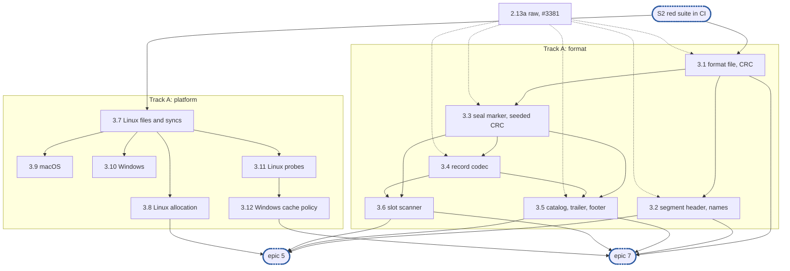

# Epic 3: journal v2 on-disk format and platform layer

**Sources:** [RFC 28](../rfcs/rfc-28-journal-format.md) §2 and Appendix A, with the parts of
§3.1, §3.3, §3.4 and §4 they feed; [RFC 1](../rfcs/rfc-1-journal.md) §1.1, §1.3, §3.9,
§4.3, §5.2, §6, §7.4, §9.1, §9.3 and §9.5; [the plan](rfc-1-journal-plan.md) §1.5 and §5,
epic 3; the [epic 1](rfc-1-journal-epic1.md) and [epic 2](rfc-1-journal-epic2.md) plans.
**Owner:** track A, storage (@viquitorreis). Subtasks 3.9 and 3.10 may move to track B if
it runs ahead (plan §3.4).
**Estimate:** 12 subtasks, against the plan's `rfc-1-journal-plan.md` §5, epic 3: "≈12
subtasks". The Windows cache-policy refusal and the XFS and ext4 barrier rows, missing from
the plan's list, are added; the `format` replace, the direct reads, the storage-agnostic
leg and the device fixtures leave this epic (P21).
**Depends on:** sync point **S2, red suite in CI**; epic 1's storage seam (`storage.FS`,
`storage.File`) and `internal/core` types; epic 2's `journalv2test/raw` (2.13a, #3381).
**Blocks:** epic 5 (segments are made of this epic's records) and epic 7 (recovery parses
this epic's bytes and calls its probes).

---

## Ground rules

- **Sources are the RFCs, the planning documents, and the code epics 1 and 2 landed.**
  Unlike epic 4, this epic builds on existing code: epic 1's `storage.FS` and `storage.File`
  (`internal/storage`), its `core` types (`Version`, `FileID`, `Extent`, `ShareTag`), and
  the hand-built bytes of `journalv2test/raw`. No code of v1 (`pkg/block/journal`) is read
  or reused (rule 7).
- **`raw` is the independent oracle.** The encoders here never import `raw`, and `raw`
  never imports `internal/format` (E2-D9). A golden vector is checked against both where
  `raw` builds its structure, and against its hand-written hex file alone where it does not
  yet (P18).
- **Test first.** Each subtask starts with failing tests for the requirements it lists.
- **Citations** name the section and quote the sentence relied on. Bare `D` numbers are this
  plan's; another plan's carry its epic, as `E1-D6` or `E2-D9`.

---

## 1. Goal

Epic 3 turns RFC 28's byte tables and its platform profile into two internal packages that
later epics write and read through:

- **`internal/format`:** an encoder, a decoder and a fuzz target for every on-disk
  structure of RFC 28 §2, CRC32C plain and seeded, the segment file name rules, the footer
  reader, the slot scanner with resynchronisation, and golden vectors;
- **`internal/platform`:** the operating system's `storage.FS` and `storage.File` on Linux,
  macOS and Windows, the default the `WithStorage` option names ("Without it the journal
  uses the operating system's files"), and the Appendix A probes that `Init` and `Open` use
  to refuse an unsuitable directory.

At the end of the epic:

- every structure of RFC 28 §2 encodes to its committed golden bytes, agrees with `raw`
  where `raw` builds it, and decodes back;
- every parser has a fuzz target whose property holds on its seed corpus (RFC 1 §9.1: "the
  property is that any input is either accepted as valid or rejected, never panics and never
  yields an extent the bytes do not contain");
- the platform layer passes its tests on a real filesystem on each OS that runs `go test`
  (P22 for macOS), and each test asserts which system call is issued;
- every platform row of RFC 28 and of the plan names the test of this epic that covers it,
  or is parked with its reason, in the table of §6; the rows get their `trace.yaml` entries,
  pointing at those tests, when epic 2's 2.14 adds the file.

Until epics 5 and 7 consume them, the packages' tests are their only consumer (D8). Epic 3
turns no conformance test green and adds none to `known.yaml`.

### 1.1 In scope

- `pkg/block/journalv2/internal/format`: the `format` file, segment header, seal marker,
  record (header, 14 kinds and their bodies), catalog entry and trailer codecs; CRC32C;
  segment file names; the footer reader; the slot scanner.
- `pkg/block/journalv2/internal/platform`: files, sync, directory sync and allocation per
  OS; the barrier, copy-on-write, Btrfs subvolume and Windows cache-policy probes; the
  `E1-D6` `decision:` marker.

### 1.2 Out of scope

- The `format` file's whole-file replace: epic 7, with `Init` and `Restamp`, its only
  callers (rule 12). RFC 28 §2.1: "**The file is replaced whole, never edited in place.**"
  The plan lists it under epic 3 (`rfc-1-journal-plan.md` §5, epic 3: "**The `format`
  file's atomic replace**"); P21.
- Direct reads: `ReadAtDirect` reads through the page cache in this epic (3.7, `ponytail:`),
  and `O_DIRECT`, `F_NOCACHE` and `FILE_FLAG_NO_BUFFERING` arrive with the open-time tail
  check of epic 7, their first caller (RFC 28 Appendix A: "Reading past the page cache, for
  the open-time tail check"); P12 and P21.
- The storage-agnostic leg, which runs the crash-free conformance tests on `platform.OS`:
  every such test fails until `Open` works, so it lands with the first epic whose tests can
  pass on it, after epics 5 and 7 (P21).
- Loop-mounted ext4, XFS and Btrfs, and any other device fixture: no runner has `root`,
  loop devices or `btrfs-progs`, so the rows that need them are parked
  (P21).
- Checking a record header against the catalog entry that sent a read to it: epic 8, with
  the read that uses it (RFC 28 §2.4: "A read **MUST** check the record header it finds
  against the catalog entry that sent it there").
- Thin-provisioning detection, until its report channel is settled (P7; RFC 1 §6: "a device
  the platform names as thin-provisioned is reported as a health condition, never
  refused").
- Writing segments: streams, spares, seal order, footer write, recycle, unlink,
  descriptors, accounting (epic 5).
- Failed sync windows and loss records (epic 6).
- Torn tail against corruption, rebuild, spare re-adoption, the open-time tail check,
  `Init`, `Open`, `Restamp`, the `expect` rules, orphans, the `torn_tails` count (epic 7).
- Verifying a payload before a read serves it (epic 8); before an offer or a repack copy
  (epic 9).
- The refusal halves of the split rows, RFC 28 §4.4, and RFC 1 §9.4 Group C "epoch half is
  zero" (epic 2, 2.13b and 2.11).
- The platform query for unallocated or unwritten extents of a re-adopted spare: epic 7,
  its first consumer (RFC 28 §3.1: "where the platform reports it, that no extent is left
  unallocated or unwritten").
- The data-only sync through asynchronous I/O, a **MAY**: skipped, no consumer (RFC 1 §5.2:
  "An implementation **MAY** submit the data-only sync through the platform's asynchronous
  I/O interface where it offers one").
- Compressing the `FileID` column, a **MAY**: skipped, layout version 1 defines no
  compressed form (RFC 28 §2.5: "An implementation **MAY** compress or dictionary-encode the
  `FileID` column").
- Fuzzing beyond the seed corpus: RFC 29 defines no fuzz tier; epic 12 or a new tier.
- Scrub (RFC 28 §5: "**Scrub.** Verification on read never checks content that is never
  read"): after v1, with RFC 10's replication work (#3392).

### 1.3 Every MUST of RFC 28 §2 and Appendix A, and its owner

Every **MUST** and **MUST NOT** of the sections this epic covers, quoted from RFC 28, with
the subtask or epic that owns it. Where two owners are named, this epic supplies the bytes
or the check and the later epic acts on it.

| RFC 28 | Requirement | Owner |
| --- | --- | --- |
| §2.1 | "An unrecognised version, or a checksum that does not verify, **MUST** fail the open, not be upgraded or repaired silently." | 3.1 (decoder outcome); epic 7 (the open fails) |
| §2.1 | "An implementation **MUST NOT** require any other file to reconstruct its state" | epic 5 (what a segment holds); epic 7 (rebuild reads segments alone) |
| §2.1 | "A file it does not recognise **MUST** be left alone, not deleted." | 3.2 (name classifier); epic 7 (open leaves it) |
| §2.2 | "A sealed segment **MUST NOT** be appended to again." | epic 5 |
| §2.2 | "Writes to one `FileID` **MUST** be serialised" | epic 5; epic 8 |
| §2.2 | "It **MUST** identify:" "the segment's own id" and "its **predecessor**: the id of the segment its append stream sealed before opening this one, or none" | 3.2 |
| §2.2 | "after creating a segment, or the `format` file, the journal **MUST** sync the directory before any `Sync` covering a record in that file returns" | epic 6 (segments); epic 7 (the `format` file, with its replace) |
| §2.2 | "A removal record whose retention counted a segment as still on disk" … "**MUST NOT** be dropped until that segment's unlink is durable, by a directory sync" | epic 9 |
| §2.2 | "Before unlinking a segment, the journal **MUST** close every descriptor it caches for it" | epic 5 |
| §2.2 | "on platforms where an open file cannot be unlinked, segments **MUST** be opened with sharing that permits deletion" | 3.10 |
| §2.2 | "Sealing writes a **seal marker** after the last record." "It **MUST** be durable before a successor naming the segment is taken." | epic 5 |
| §2.3 | "The header **MUST** identify:" "the stream's **synced-through offset**", "a checksum of the payload" and "a checksum of the header" | 3.4 |
| §2.3 | "The header checksum **MUST** cover every other header field, the payload checksum included" "An implementation **MUST NOT** exclude any header field from coverage." | 3.4 |
| §2.3 | "**MUST** first read that record's whole payload and verify its payload checksum, and **MUST NOT** hand out or copy any part of a record that does not verify" | 3.4 (the verify function); epics 6, 8 and 9 (the paths) |
| §2.3 | "A record whose payload checksum does not verify **MUST NOT** be used to serve a read." | epic 8 |
| §2.3 | "recovery **MUST NOT** verify or report its payload" | epic 7 |
| §2.4 | "It **MUST** be reconstructible from the segments alone, and a persisted copy of it **MUST NOT** be authoritative" | epic 7 |
| §2.4 | "The footer **MUST** be written and made durable **after** the records it describes, and a segment whose footer is absent or does not verify **MUST** be scanned instead." | epic 5 (order); epic 7 (scan) |
| §2.4 | "The footer **MUST** carry its own checksum, and **MUST** identify the extent of the segment it describes" | 3.5 |
| §2.4 | "The active, unsealed segment has no footer and **MUST** be scanned." | epic 7 |
| §2.4 | "The footer is part of the segment file and **MUST** be accounted in capacity with it" | epic 5 |
| §2.4 | "The footer **MUST** be findable without scanning. A segment that carries one **MUST** end with a fixed-size trailer" and “A trailer that does not verify, or a length that does not fit within the file, **MUST** be treated as "no footer" and the segment scanned.” | 3.5 |
| §2.4 | "the 32 bytes just before the footer it names **MUST** be a seal marker that verifies for this segment's id and that offset" | 3.5 |
| §2.4 | "appending the footer is the one write permitted to a sealed segment, and it **MUST** happen at most once." | epic 5 |
| §2.4 | for a segment sealed by a previous process, "**MUST** verify by scanning before doing so" and "**MUST NOT** rewrite or extend a footer that already verifies" | epic 5, if it takes the **MAY** |
| §2.4 | "An implementation **MUST NOT** place this index in a separate file or keep any second durable log of it" | epic 5; epic 7 |
| §2.4 | "A read **MUST** check the record header it finds against the catalog entry that sent it there" | epic 8 |
| §2.5 | "it **MUST NOT** do so in a way that prevents the whole footer being validated by the single CRC in the trailer" | not applicable: layout version 1 has no compressed form (§1.2) |
| §2.5 | "an `entryCount` that does not fit between `footerOffset` and the trailer" and “**MUST** be treated as "no footer" and the segment scanned” | 3.5 |
| §2.5 | "The trailer **MUST NOT** be written before the entries it describes are durable" | epic 5 (P1) |
| Appendix A | "The journal's directory **MUST** have copy-on-write disabled before any file is created in it" | 3.11 (the directory and every file in it); epic 7 (refusal at `Init` and open) |
| Appendix A | "**MUST** be excluded from filesystem snapshots" | 3.11 for Btrfs ("On Btrfs the journal's directory is excluded by making it its own subvolume"); skipped for "a snapshot taken of that subvolume itself by an operator is not detectable" |
| Appendix A | "An implementation **MUST** check the attribute at `Init` and at open and refuse a directory without it on such a filesystem" | 3.11; epic 7 |
| Appendix A | "**MUST** refuse, on Btrfs, a directory that is not a subvolume's root" | 3.11; epic 7 |
| Appendix A | "Open **MUST** refuse a copy-on-write filesystem mounted without cache flushes (`nobarrier` on Btrfs)" | 3.11; epic 7 |
| Appendix A | "Open **MUST** refuse a filesystem mounted without cache flushes where the mount options say so (`nobarrier` or `barrier=0` on ext4, `nobarrier` on older XFS)" | 3.11; epic 7 |
| Appendix A | "Open **MUST** refuse a volume whose write-cache buffer flushing is turned off by policy, where the platform reports it" | 3.12; epic 7 |

---

## 2. General rules for each epic

Copied verbatim from [the plan](rfc-1-journal-plan.md) §1.5, as its instruction asks.

> **Instruction for whoever expands an epic into its detailed description and subtasks,
> human or AI:** copy this section so that the resulting epic is self-contained and does
> not depend on this file.
> Every subtask must state how it meets each rule that applies to it.
> A rule that does not apply is named with the reason.

1. **Independent unit tests.** Each epic carries its own unit tests. It may use another
   epic's pure in-memory implementation (E4's index, E3's codecs), the implementation of
   an epic it depends on once that has landed (E8 on E5's segments and E6's `Sync`), and the test components from epic 2. Epic 1 declares no internal interface
   to fake (rule 12).
2. **Fuzz tests where relevant.** Use Go native fuzzing (`testing.F`) on every parser of
   bytes the journal did not just write: records, segment headers, seal markers, catalogs,
   trailers, the `format` file. Also fuzz-drive operation sequences against the reference
   model. The property is that any input is either accepted as valid or rejected: never a
   panic, and never an extent the bytes do not contain.
3. **Metrics, and tracing where relevant.** Every counter and gauge RFC 1 §3.7 and §3.9
   assigns to the epic's area is maintained, and exposed through `Stats` (served from
   maintained counters, never a walk). Spans go through epic 1's standard-library
   `Tracer` and logs through the injected `*slog.Logger`, never a metrics or tracing
   library. Operations worth a span:
   open and recovery, sync, offload pass, repack pass, fill, and a refused reservation.
4. **Profiling.** Tests and benchmarks run under epic 2's profiling harness and fail on
   goroutine, descriptor or memory leaks and on anomalous resource growth. Hot paths
   (`WriteAt`, `ReadAt`, `Stats`, `report`, index lookup and insert) carry
   allocations-per-op assertions and the counted checks of RFC 1 §9.7. Allocation and
   heap assertions run outside `-race` only, because `-race` changes both.
5. **Public interface and internals.** Tests cover the epic's internal package API and the
   public v2 interface behaviour it enables, including concurrency under `-race`. Per the
   project rules, test at the layer that **consumes** a value, not the one that produces
   it. A regression test is validated by reverting the fix and watching it fail **on its
   assertion**.
6. **Known failures shrink.** Every e2e test an epic turns green is removed from the
   known-failure list in the same change. The runner fails if a listed test passes.
7. **v2 ignores v1.** No import of, copy from, or behavioural dependence on
   `pkg/block/journal`. The import test enforces it. v1 code is neither ported nor
   bridged: it is deleted with the rest of v1 at the cutover (stage 7 of #3119). v2
   checks only whether v1 state exists, to refuse it at start (E10), and never reads
   v1's format.
8. **Real storage for storage properties.** No in-memory filesystem stands in for a check
   about durability, torn tails, unlink durability or corruption (RFC 1 §9.5). In-memory
   stand-ins are allowed only for pure logic (index, codecs).
9. **Code comment conventions** (`CLAUDE.md`). No epic, issue or plan IDs in source
   comments. Use `ponytail:` for knowingly-simple implementations and `decision:` for
   deliberate behaviour. Where the RFC already carries a ponytail or decision note, its
   marker goes at the code site that implements it.
10. **A test must be able to fail.** Every test is code maintained for the life of the
    project. Keep a test only if a plausible change would make it fail and nothing else
    would catch that change: not the compiler, not the PR diff, not a later epic's tests.
    A test that checks two `errors.New` values differ, that the standard library's
    `errors.As` works, or that a stub returns zero does not qualify. A test that a
    little-endian `Version.Bytes` would fail does. Review rules that no test can check
    (for example, stubs never panic) stay review rules.
11. **A symbol is exported only if RFC 1 §3 uses it.** Everything exported is frozen at
    S1, so a helper exported for convenience becomes a contract. Helpers the internal
    packages need (`Less`, `IsZero`, `End`, `Overlaps`, `Seq`, the proposed constants)
    stay in `internal/core`.
12. **Each subtask creates only what it declares.** No empty package and no stub without
    a caller. A package, an option or a test helper lands with its first consumer.

### 2.1 How the rules apply to this epic

This table is the epic-wide reading of each rule. Each subtask in §5 lists only the rules it
applies differently.

| Rule | Applies to epic 3 as |
| --- | --- |
| 1. Unit tests (each epic its own) | **Applies.** Every codec has table-driven unit tests in memory (RFC 1 §9.1: "table-driven, in memory; the only place an in-memory stand-in is allowed"); every platform function has tests on a real temporary directory. |
| 2. Fuzz (every parser of bytes) | **Applies to `internal/format`.** One `testing.F` target per parser: `format` file, segment header, seal marker, record, footer, scanner. The seed corpus runs in `unit`; longer runs have no tier yet (§1.2). **Does not apply to `internal/platform`**: it parses no bytes the journal wrote. |
| 3. Metrics and tracing | **Applies to the scanner only.** It returns its `scan_resyncs` contribution (RFC 1 §3.9: "scans that found a record by resynchronising past a bad one") for epic 7 to fold into `Stats`. No span: none of rule 3's span-worthy operations is a codec or a probe. |
| 4. Profiling (leaks, allocations per op) | **Applies.** Every test runs under epic 2's profiler and fails on a leaked descriptor. Allocations per op are asserted, outside `-race`, only on `WriteAt`'s path: the record encoder (3.4). |
| 5. Public and internals (test the consumer, `-race`) | **Applies.** The internal APIs are tested directly until epics 5 and 7 consume them (D8). Probes and the OS storage run under `-race` with concurrent callers. |
| 6. Known failures shrink | **Does not apply.** Epic 3 turns no conformance test green and adds none (§1.2). |
| 7. v2 ignores v1 | **Applies.** Nothing is read from `pkg/block/journal`; the import test covers both new packages. |
| 8. Real storage for storage properties | **Applies to the platform.** Every sync, rename and allocation test runs on a real directory. Codecs are pure logic and test in memory. Probes test on recorded mount tables and device answers (3.11, 3.12). |
| 9. Comment conventions | **Applies.** No epic, issue or plan ID in source. The markers each subtask places are listed in it. |
| 10. A test must be able to fail | **Applies.** Golden bytes are literal offsets copied from the RFC tables, with field values whose bytes do not repeat, so a field moved, swapped or written big-endian fails. Each platform test asserts the call issued through D6's table, command included, and a table test pins each production entry to its `x/sys` function. |
| 11. Export only what RFC 1 §3 uses | **Applies.** `journalv2` gains no symbol. Both packages are internal; their outcome classes are unexported or internal (D2, D7). |
| 12. Create only what is declared | **Applies with D8.** Each package lands with its first subtask; no stub without a caller. |

---

## 3. Decisions this epic takes

Each decision is recorded at its code site with a `decision:` marker where it has one.

**D1. Golden vectors are written by hand, committed, and checked against both the encoder
and `raw`.**
RFC 28's rows ask for committed bytes (RFC 28 §4.2: "assert the committed 56 bytes");
E2-D9 asks that the encoders be compared with `raw` (`rfc-1-journal-epic2.md` §3, E2-D9:
"Epic 3's golden-vector tests compare the encoders' output with `raw`'s, which makes `raw`
an independent oracle"). A vector generated from `raw` would make `raw` the only oracle, so
each vector is a hex file in `internal/format/testdata/golden/`, written from the RFC table,
and its test asserts encoder bytes = file bytes = `raw` bytes. Where `raw` cannot build a
structure, or hard-codes a field (the synced-through offset, the segment version and
stream), the vector is checked against its hand-written hex file alone until 2.13a extends
`raw` (P18): the hex file is the independence E2-D9 asks for.

**D2. Encoders append; decoders return a struct and an outcome class.**

- *Encode:* `AppendX(dst []byte, x X) []byte`, so the write path allocates nothing (rule 4).
- *Decode:* returns the struct and nil, or an internal error whose class is one of: damaged
  (bad magic or checksum), wrong place (segment id or own offset not where it was read),
  foreign (header verifies under another identity), unknown kind, non-zero epoch, unknown
  version. Recovery (epic 7) decides what each class does to the open; the classes are
  the only contract between the two.
- *Strictness* on reserved bytes and zero fields is open (P9); until settled the decoder
  refuses them, the stricter reading, behind one `decision:` marker so the choice is one
  change. Two fields are exempt because the RFC says they are never read: the `format`
  file's generation (RFC 28 §2.1: "zero, and never read, below the replication extension's
  version") and a record's padding (RFC 28 §2.3: "which no checksum covers and a reader
  ignores").

**D4. On Linux, `Allocate` allocates and writes the zeros itself.**
The plan lists "preallocate plus zero-fill" as one platform item (`rfc-1-journal-plan.md`
§5, epic 3), and `storage.File.Allocate`'s contract says "Bytes no write has reached read as
zeros". On Linux `Allocate` is `fallocate` followed by writing zeros over the range (RFC 28
Appendix A: "on Linux, `fallocate` then writing zeros over the whole segment and syncing
it"); on macOS it is `F_PREALLOCATE` then setting the size (RFC 28 Appendix A:
"`fcntl(F_PREALLOCATE)` then setting the size on macOS"); on Windows it follows P2. There is
no per-OS fill-required fact. RFC 28 §4.2 crashes "after create, allocation, zero-fill,
sync, rename" as separate steps; one call is one seam operation, so allocation and
zero-fill are one crash point: every crash before the rename leaves a `.spare.tmp` that open
unlinks, and the seam drops unsynced allocations at a crash (`storage.File`'s contract: "A
file allocated and never synced comes back short or unallocated."). The RFC 28 §4.2 row "a
spare is whole or absent" is amended to say so (#3409).

**D6. System calls go through an unexported per-OS table.**
A test replaces the table and asserts which call was made and on which descriptor: `fdatasync`
on a file and `fsync` on the directory on Linux, `F_FULLFSYNC` on both on macOS,
`FlushFileBuffers` on the file and on the directory handle opened with backup semantics on
Windows. This is what makes the macOS and Windows legs able to fail (rule 10) without a power
cut. A second test pins the production table itself: each entry is compared, by function
pointer, with the `golang.org/x/sys` function the RFC's call goes through. Entries are
never wrappers: the command is passed as data, so `Sync` calls
`calls.fcntl(fd, unix.F_FULLFSYNC, 0)` and the recording fake asserts the command. A
wrapper that calls `unix.Fsync` would pass a pin on the wrapper; it fails a pin on the
`x/sys` function:

```go
func TestSyscallTableIsReal(t *testing.T) {
	// One case per entry: each is the x/sys function itself, never a wrapper.
	if reflect.ValueOf(realTable.fcntl).Pointer() != reflect.ValueOf(unix.FcntlInt).Pointer() {
		t.Fatal("fcntl is not unix.FcntlInt")
	}
}
```

**D7. Probes are a separate function, not part of `storage.FS`.**
`platform.Check(dir string) error`: the error refuses (barrier, copy-on-write, Btrfs
subvolume, Windows cache policy). `Init` and `Open` already take `dir`, so the probe needs
nothing from the seam. How a refusal reaches the caller is P3.

**D8. The internal packages' tests are their consumer until epics 5 and 7.**
As epic 4 reads rule 12 for `internal/index`: the packages are pure logic or the OS
implementation of an existing interface, tested on their own (rule 1), not placeholders.
`Check` is wired into `Init` and `Open` by epic 7. This is the same reading of rule 12 (each
subtask creates only what it declares) that epic 4 uses for `internal/index`.

**D9. On-disk integers are unsigned; values that do not fit `core` are refused.**
RFC 28 states 64-bit fields without a sign (RFC 28 §2.3: "the file offset it begins at, and
its length, both 64-bit"); `core.Extent` is `{Off, Len int64}`. The decoder refuses a file
offset or length above `MaxInt64`, and an offset plus length that overflows it, as damage.
The footer reader applies the same bound to a catalog entry's file offset and length, and
reads an entry outside it as "no footer" (3.5): the entry carries both as 64-bit fields
(RFC 28 §2.5), and since P23 reads no `release`'s length, nothing else bounds it there.
To confirm (P19).

**D10. Copy-on-write is detected on Btrfs only; barriers by one mount-option table.**
RFC 28 Appendix A lists the suitable filesystems ("Suitable journal filesystems: ext4, XFS
or Btrfs on Linux; APFS on macOS; NTFS on Windows."), and Btrfs is the copy-on-write one it
names ("**On a copy-on-write filesystem**, such as Btrfs"). The probe identifies the
filesystem by its type (Linux `statfs` magic); on Btrfs it requires the no-copy-on-write
attribute and the subvolume root, and refuses otherwise. APFS is never probed (P5).
Mount options are checked against one `{fstype, option}` table, each row an RFC **MUST**:

| Filesystem | Option refused | RFC 28 Appendix A |
| --- | --- | --- |
| Btrfs | `nobarrier` | "Open **MUST** refuse a copy-on-write filesystem mounted without cache flushes (`nobarrier` on Btrfs)" |
| ext4 | `nobarrier` or `barrier=0` | "Open **MUST** refuse a filesystem mounted without cache flushes where the mount options say so (`nobarrier` or `barrier=0` on ext4" |
| older XFS | `nobarrier` | "`nobarrier` on older XFS): there no sync reaches the device, and a synced record does not survive power loss." |

**D11. Stray spare files: open unlinks only `<20 digits>.spare.tmp`. Proposed, to confirm on
the RFC PR.**
RFC 28 §2.2 says "open unlinks any `.spare.tmp` it finds", while RFC 28 §2.1 says "A file it
does not recognise **MUST** be left alone, not deleted." and RFC 28 §3.4 says the journal
"**MUST NOT** unlink a file whose name it could not itself have produced". The name
classifier (3.2) recognises a spare only as exactly twenty decimal digits followed by
`.spare.tmp`, the width `.seg` names use (RFC 28 §2.1: "in 20 decimal digits, zero-padded,
so names sort as ids do"); any other name ending in `.spare.tmp` is unrecognised and left
alone. The unlink itself is epic 7's. Kept as P4 until the RFC says so.

---

## 4. Target tree

```text
pkg/block/journalv2/
  internal/format/                    imports core; stdlib only
    crc.go                            CRC32C plain and seeded                       (3.1, 3.3)
    formatfile.go                     format file codec                              (3.1)
    names.go  segheader.go            segment file names, segment header             (3.2)
    seal.go                           seal marker                                    (3.3)
    record.go  kinds.go               record header, kinds and bodies, verify        (3.4)
    catalog.go                        catalog entry, trailer, footer reader          (3.5)
    scan.go                           slot scanner                                   (3.6)
    *_test.go  fuzz_test.go
    testdata/golden/*.hex             hand-written vectors (D1)
    testdata/fuzz/Fuzz*/              seed corpora
  internal/platform/                  imports storage, core, golang.org/x/sys
    doc.go                            E1-D6 decision marker                          (3.7)
    os.go  calls.go                   storage.FS on the OS, syscall table (D6)       (3.7)
    sync_linux.go  alloc_linux.go                                                    (3.7, 3.8)
    sync_darwin.go  alloc_darwin.go                                                  (3.9)
    sync_windows.go  alloc_windows.go                                                (3.10)
    check.go  check_linux.go  check_windows.go                                       (3.11, 3.12)
    cachepolicy.go                    portable: device answer → refuse or pass          (3.12)
    *_test.go
```

`new-package-tests.sh` requires a `_test.go` in every new directory; each has its own.
`journalv2test/open_windows.go` already opens files with `FILE_SHARE_DELETE` under a
`decision:`; 3.10 does the same for segments and cites the same reason.

---

## 5. Subtasks

Each subtask lists **Owner** and **Depends on**, **Deliverables**, **Requirements**,
**Done when**, and **Rules**: only where it departs from §2.1. Every codec subtask also
commits its fuzz target with a seed corpus, and every golden vector follows D1.

### 3.1 The `format` file codec, with plain CRC32C

- **Owner:** A. **Depends on:** S2; `raw.Format` (2.13a).
- **Deliverables:** `internal/format/crc.go` (plain CRC32C over `hash/crc32` Castagnoli),
  `formatfile.go` (encode and decode the 56-byte file), `golden/format_v1.hex`,
  `FuzzFormatFile`.
- **Requirements:**
  - RFC 28 §2.1: "An unrecognised version, or a checksum that does not verify, **MUST**
    fail the open, not be upgraded or repaired silently." (codec half: the decoder returns
    unknown version or damaged);
  - RFC 28 §2.1: "Every on-disk structure in §2 is packed without padding, with integers
    little-endian." and "**CRC32C** is the Castagnoli CRC of RFC 3720 §B.4";
  - RFC 28 §2.1: "for version 1 a file of any length but 56 bytes fails the open like a bad
    checksum";
  - RFC 28 §4.2, row "`format` file", encoding half: "Golden vector for a version-1
    `format` file: assert the committed 56 bytes."
- **Done when:**
  - the encoder writes the golden 56 bytes, equal to `raw.Format.Bytes()`, and the decoder
    reads them back;
  - 55 and 57 bytes, a flipped bit anywhere, and version 2 each return their class, and a
    non-zero generation decodes as version 1;
  - CRC32C matches the RFC 3720 §B.4 vectors.
- **Rules:** 9: `decision:` that the generation is written zero and not read (RFC 28 §2.1:
  "zero, and never read, below the replication extension's version").

### 3.2 Segment header codec and segment file names

- **Owner:** A. **Depends on:** 3.1 (CRC).
- **Deliverables:** `segheader.go` (48 bytes, unseeded CRC, identity returned so foreign is
  told from damaged), `names.go` (`<20 digits>.seg`, `<20 digits>.spare.tmp`, `format`,
  `format.tmp`, everything else unrecognised, per D11), goldens with and without a
  predecessor, `FuzzSegmentHeader`. Names are covered by table cases, not a fuzz target: a
  fixed-width digit classifier has no state for a fuzzer to find.
- **Requirements:**
  - RFC 28 §2.1: "a segment: its id" "in 20 decimal digits, zero-padded, so names sort as
    ids do";
  - RFC 28 §2.1: "A file it does not recognise **MUST** be left alone, not deleted." (name
    half);
  - RFC 28 §2.2: "It **MUST** identify:" "the segment's own id" and "its **predecessor**";
  - RFC 28 §2.2: "CRC32C over bytes `[0, 44)`, **not seeded**" and "A segment whose version
    this binary does not recognise, or that is newer than the `format` file's, fails the
    open." (codec half);
  - RFC 28 §3.4: "**MUST NOT** unlink a file whose name it could not itself have produced"
    (name half);
  - RFC 28 §4.2, row "segment header and seal marker", encoding half: "Golden vectors for a
    segment header with and without a predecessor".
- **Done when:**
  - both goldens match the encoder and their hex files, and `raw.SegmentHeader` for every
    field but the version and stream `raw` fixes (P18); a header under another identity
    decodes as foreign, not damaged, and version 2 returns unknown version;
  - names round-trip for ids 1 and 2^64-1; id 0, 19 or 21 digits, a sign, and any other
    `*.spare.tmp` name are unrecognised.
- **Rules:** 9: `decision:` for D11 at the classifier.

### 3.3 Seal marker codec, with seeded CRC32C

- **Owner:** A. **Depends on:** 3.1.
- **Deliverables:** seeded CRC32C in `crc.go`, `seal.go`, `golden/seal.hex`, `FuzzSeal`.
- **Requirements:**
  - RFC 28 §2.1: "Where a checksum is **seeded with the journal identity**, it is the CRC32C
    of the 16 identity bytes followed by the bytes it covers";
  - RFC 28 §2.2: "The marker is not a record and has no kind" and "Bytes after a seal marker
    belong to the footer, never to records.";
  - RFC 28 §2.2: "A seal marker verifies only if its checksum does under this journal's
    identity and its segment id and own offset are the segment and offset it was read at";
  - RFC 28 §4.2, row "segment header and seal marker", encoding half: "and for a seal
    marker: assert the committed bytes."
- **Done when:**
  - the golden matches the encoder and `raw.SealMarker`;
  - a marker read at another offset, in another segment, or under another identity does not
    verify, each with its class.
- **Rules:** 9: no marker needed.

### 3.4 Record codec: header, kinds, bodies and whole-payload verification

- **Owner:** A. **Depends on:** 3.3 (seeded CRC). `raw` builders for every body (2.13a) are
  not a gate: until they land, a kind's golden is checked against its hex file alone (P18).
- **Deliverables:** `record.go` and `kinds.go`: the 96-byte header, both seeded checksums,
  verification (magic, header checksum, segment id), kind classification, epoch check,
  D9's bounds; the 14 kinds with their field rules, the `write` modification time, the
  fixed bodies of `loss` (16 bytes), `clone target` (56), `hold`, `unhold` and `stamp` (8),
  padding; the whole-payload verify function; one golden per kind; `FuzzRecord`. Each
  per-kind golden contains a full header, so there are no separate header goldens and no
  separate header fuzz target: `FuzzRecord` and `FuzzScan` reach the same parser.
- **Requirements:**
  - RFC 28 §2.3: "The header **MUST** identify:" "the stream's **synced-through offset**",
    "a checksum of the payload" and "a checksum of the header";
  - RFC 28 §2.3: "The header checksum **MUST** cover every other header field, the payload
    checksum included" and "An implementation **MUST NOT** exclude any header field from
    coverage.";
  - RFC 28 §2.3: "**One payload checksum covers the whole payload**" and "**MUST** first
    read that record's whole payload and verify its payload checksum, and **MUST NOT** hand
    out or copy any part of a record that does not verify" (this subtask supplies the only
    verify function; the paths are epics 6, 8 and 9);
  - RFC 28 §2.3: "The kind is read only once the header verifies" and "It is never skipped
    by its length";
  - RFC 28 §2.1: "A content version" "is stored as two 64-bit integers, the epoch then the
    counter, each little-endian, not as one little-endian 128-bit integer";
  - RFC 28 §2.3: "Values are stable: a value is never reassigned, nor reused once its kind
    is retired. 0 is never a kind, so a zero slot never reads as one." and "No other kind
    carries the field.";
  - RFC 28 §2.3: "A record starts at a multiple of 8 bytes within its segment" and "A
    header verifies only if its magic matches, its checksum verifies under this journal's
    identity, and its segment id is the segment it was read from.";
  - RFC 1 §4.3: "**In this format version the epoch half MUST be zero**, on every record
    and in the floor" (decode half);
  - RFC 28 §4.2, row "record layout": "Encode a record of every kind; assert the bytes
    match the committed golden headers, a header checksummed under another journal identity
    does not verify, and every record starts at a multiple of 8.";
  - RFC 28 §4.2, row "kind values", encoding half: "Golden vectors, one per kind of the
    kinds table" "assert each encodes to the committed bytes and decodes back, that the
    kind byte is the table's value, and that every payload and zero field is as the table
    gives."
- **Done when:**
  - 14 goldens match the encoder and their hex files, and `raw.Record` for every kind
    2.13a builds, and decode back; the non-zero synced-through offset is checked against
    the hex file alone until 2.13a extends `raw` (P18);
  - another identity, another segment id, kinds 0, 15 and 128, a non-zero epoch, and a
    flipped byte of a `write`'s modification time each return their class, and a verifying
    unknown kind is never stepped over;
  - the verify function refuses a payload with any one byte changed and never returns part
    of it, and every encoded record ends on a multiple of 8;
  - a record with non-zero padding verifies and decodes.
- **Rules:** 4: zero allocations per encode, asserted outside `-race`. 5: in this epic the
  consumer of the verify function is 3.6's scanner, which attaches a resynchronised record
  on its own checksums (RFC 28 §3.3: "A record found so is attached on its own checksums
  like any other."). 9: `decision:` for D2's strictness and D9; `ponytail:` from RFC 28
  §2.3 at the verify function ("A read of 4 KiB from a 1 MiB record reads and checks the
  whole megabyte."). 10: a version written as one 128-bit integer fails.

### 3.5 Catalog entry, trailer and footer reader

- **Owner:** A. **Depends on:** 3.3, 3.4.
- **Deliverables:** `catalog.go`: the 72-byte entry, the 32-byte trailer, the footer CRC, the
  reader (last 32 bytes, trailer CRC, magic, layout version and flags, seal marker before
  `footerOffset`, `entryCount` fits, footer CRC, D9's bounds on each entry, the last
  entry's record end as P23 computes it); `golden/trailer_two_entries.hex`;
  `FuzzFooter`.
- **Requirements:**
  - RFC 28 §2.4: "The footer **MUST** carry its own checksum, and **MUST** identify the
    extent of the segment it describes";
  - RFC 28 §2.4: "The footer **MUST** be findable without scanning. A segment that carries
    one **MUST** end with a fixed-size trailer";
  - RFC 28 §2.4: "the 32 bytes just before the footer it names **MUST** be a seal marker
    that verifies for this segment's id and that offset";
  - RFC 28 §2.5: “**MUST** be treated as "no footer" and the segment scanned” and
    “**An unrecognised format version is also "no footer", not an error**”;
  - RFC 28 §2.5: "flags; none defined, so a nonzero value is read as an unrecognised
    version";
  - RFC 28 §4.2, row "trailer": "Golden vector for a trailer over two entries: assert magic
    `DJT1`, version 1, and `footerOffset` equal to the seal marker's offset plus 32."
- **Done when:**
  - the golden matches the encoder and `raw.Trailer`;
  - a short file, a bad magic, either CRC wrong, no verifying seal marker, an `entryCount`
    that does not fit, layout version 2 and non-zero flags each yield no footer, one case
    each; so do a seal marker at `footerOffset − 32` that verifies for the previous segment
    id (a recycled segment's old trailer), a last entry whose record ends, padded to 8,
    before or after `footerOffset − 32` (P23), no entry with the seal marker past 48 (P23),
    a last entry of kind 0, 15 or 128 (P23), an entry whose file offset or length is above
    `MaxInt64` or whose sum overflows it (D9), and an entry with a non-zero epoch (P11); a
    footer whose last entry is of each kind in RFC 28 §2.3's table is read, not refused,
    each with a non-zero length where its kind has one and its seal marker at a literal
    offset: from 48, a `write` of length 5 ends at 160, and a `release`, a `loss` and a
    `clone target` of length 4096 end at 144, 160 and 200; so is a footer with no entry
    and its seal marker at 48.
- **Rules:** none beyond §2.1.

### 3.6 Slot scanner with resynchronisation

- **Owner:** A. **Depends on:** 3.3, 3.4.
- **Deliverables:** `scan.go`: walks slots from offset 48; tells `DJR1`, `DJS1`, zeros and
  anything else apart; on a bad slot or a zero slot searches forward at each 8-byte boundary
  for a verifying header, to the end of the segment; stops at a verifying seal marker; stops
  with its class on a verifying unknown kind or a non-zero epoch; reports each record with
  its offset and synced-through offset, each refused range, and its resync count. It decides
  nothing about torn tails (P8). `FuzzScan`.
- **Requirements:**
  - RFC 28 §2.2: "A scan tells a slot by its first four bytes" and "so a copy of one inside
    a payload never ends a scan";
  - RFC 28 §2.3: "It is never skipped by its length";
  - RFC 28 §3.3: "**A zero header slot ends a scan only where no verifying header follows
    it.**";
  - RFC 28 §3.3: "a scan that meets a record that does not verify **MUST** refuse that
    record and **resynchronise**" and "Bytes from the damaged record to the next verifying
    header are refused; the records after it are not.";
  - RFC 28 §2.2: "Its old records and seal marker name the old segment id, so none verifies
    here" and "the old life's bytes past its newest record are a torn tail at recovery";
  - RFC 1 §3.9: "scans that found a record by resynchronising past a bad one" (the
    contribution; P8);
  - RFC 1 §9.1: "never yields an extent the bytes do not contain".
- **Done when:**
  - a corrupted length field refuses that record as damage, attaches every record after it
    and counts one scan that resynchronised; two resyncs in one scan count one, and a
    stepped-over zero slot or a bad record with no verifying header after it counts none
    (RFC 1 §3.9: "scans that found a record by resynchronising past a bad one"); a zero slot
    followed by a verifying record is stepped over, reported as neither damage nor a torn
    tail, and the later record is attached;
  - a seal marker copied into a payload does not stop the scan, and no record inside a
    payload holding a segment of this journal is attached; in a recycled segment no record
    or seal marker of the old life (it names another segment id) is attached or ends the
    scan, and a new-life record past an earlier new-life slot that still holds old bytes is
    found by the forward search and attached (RFC 28 §4.2);
  - `FuzzScan` holds the property over random and mutated segments, checked against the
    records that were planted.
- **Rules:** 2: `FuzzScan` is the main target. 3: returns the resync count; `torn_tails` is
  epic 7's. 9: `ponytail:` of
  RFC 28 §3.3 ("The forward search reads the whole unwritten remainder of each newest
  segment at open, up to one segment cap per stream.").

### 3.7 Platform, Linux: files, sync and directory sync

- **Owner:** A. **Depends on:** epic 1's seam.
- **Deliverables:** `internal/platform` with `doc.go` (the `E1-D6` `decision:`), `OS`
  implementing `storage.FS` and `storage.File` (create, open, rename, remove, list, close,
  size, truncate, `WriteAt`, `ReadAt`), a contract test of `storage.FS` run on both
  `platform.OS` and the seam, one case per sentence of `storage.go`'s contract, `Sync` as
  `fdatasync`, `SyncDir` as `fsync` on the directory, the syscall table (D6).
  `ReadAtDirect`, which the seam declares, reads through the page cache for now:

  ```go
  // ponytail: reads through the page cache; O_DIRECT, F_NOCACHE and
  // FILE_FLAG_NO_BUFFERING arrive with the open-time tail check, the first
  // caller that must not trust the cache.
  func (f *file) ReadAtDirect(p []byte, off int64) (int, error) { return f.ReadAt(p, off) }
  ```
- **Requirements:**
  - RFC 28 Appendix A: "`fdatasync` on the file" "and `fsync` on the directory's
    descriptor after a create, a rename or an unlink";
  - RFC 1 §5.2: "a failure to sync **MUST** be reported to the caller, and **MUST NOT** be
    recorded as success and retried silently";
  - RFC 1 §5.2: "On Linux, a data-only sync (`fdatasync`) is enough" and "A sync of a byte
    range alone (`sync_file_range`) is not";
  - the seam's contract (`storage.File`): "Sync makes every WriteAt, Allocate and Truncate
    that returned before it durable."
- **Done when:**
  - the contract test of `storage.FS` passes on `platform.OS` in a real directory and on
    the seam;
  - in `TestSyncCalls`, the recording table sees `fdatasync` per `Sync` and `fsync` on the
    directory per `SyncDir`, and `TestSyscallTableIsReal` pins each production entry to its
    `x/sys` function (D6);
  - an injected sync error is returned once and the next `Sync` issues a new call, never a
    hidden retry.
- **Rules:** 2: does not apply, no parser. 5: `-race` with concurrent `WriteAt` on one file.
  9: the `E1-D6` marker at the package, and the `ponytail:` at `ReadAtDirect`.
  12: `internal/platform` lands here with `OS`, whose consumer is the default storage.

### 3.8 Platform, Linux: allocation

- **Owner:** A. **Depends on:** 3.7; D4.
- **Deliverables:** `Allocate` as `fallocate` (mode 0) followed by writing zeros over the
  range (D4).
- **Requirements:**
  - RFC 28 Appendix A: "on Linux, `fallocate` then writing zeros over the whole segment and
    syncing it, so no extent is left unwritten";
  - RFC 28 Appendix A: "decision: zero-filled on Linux because `fallocate` alone leaves
    unwritten extents on ext4 and XFS";
  - RFC 28 §2.2: "An allocated region no record has reached reads as zeros."
- **Done when:**
  - its allocated size covers the cap, and the table records `fallocate` then zero writes
    over the whole range;
  - the linux case of `TestSyscallTableIsReal` pins the allocation's entries to their
    `x/sys` functions, `fallocate` to `unix.Fallocate` (D6).
- **Rules:** 2: does not apply, no parser. 9: RFC 28's zero-fill `decision:` at the Linux
  allocation.

### 3.9 Platform, macOS: `F_FULLFSYNC` and `F_PREALLOCATE`

- **Owner:** A (may move to B). **Depends on:** 3.7.
- **Deliverables:** the darwin files: `Sync` and `SyncDir` as `F_FULLFSYNC`, `Allocate` as
  `F_PREALLOCATE` then setting the size.
- **Requirements:**
  - RFC 1 §5.2: "the journal **MUST** use the call that does (a full sync)";
  - RFC 28 Appendix A: "the journal uses `fcntl(F_FULLFSYNC)` for every sync, the
    directory's included";
  - RFC 28 Appendix A: "`fcntl(F_PREALLOCATE)` then setting the size on macOS".
- **Done when:**
  - where a Mac runs `go test` (P22), the darwin case of `TestSyncCalls` sees
    `fcntl(fd, F_FULLFSYNC, 0)` for every `Sync` and `SyncDir`, and the darwin case of
    `TestSyscallTableIsReal` pins `fcntl` to `unix.FcntlInt` (D6);
  - the recording table sees `F_PREALLOCATE`, its `Fstore_t` asking for the whole range with
    `F_ALLOCATEALL`, then the size set, for every `Allocate`; the darwin case pins
    `fcntlFstore` to `unix.FcntlFstore` and the size set to `unix.Ftruncate` (D6);
  - the contract test of `storage.FS` (3.7) passes on APFS.
- **Rules:** 2: does not apply, no parser. 8: real APFS only where a Mac runs the tests
  (P22); power-loss durability is not provable here (§8).

### 3.10 Platform, Windows: share-delete, `FlushFileBuffers`, directory flush, allocation

- **Owner:** A (may move to B). **Depends on:** 3.7.
- **Deliverables:** the windows files: open with `FILE_SHARE_DELETE`, `Sync` as
  `FlushFileBuffers`, `SyncDir` by opening the directory with backup semantics and flushing
  it, allocation (allocation size, end of file, then valid data length or zeros, per P2).
- **Requirements:**
  - RFC 28 §2.2: "on platforms where an open file cannot be unlinked, segments **MUST** be
    opened with sharing that permits deletion";
  - RFC 28 Appendix A: "segments are opened with `FILE_SHARE_DELETE`" and "a create, rename
    or unlink is made durable by opening the directory with backup semantics and calling
    `FlushFileBuffers` on it";
  - RFC 28 Appendix A: "setting the file's allocation size, then its end of file, then its
    valid data length to the end (or writing zeros where that call is not permitted), on
    Windows".
- **Done when:**
  - on the Windows runner a file open for reading is renamed and removed;
  - the table records `FlushFileBuffers` on the file and on the directory handle opened
    with backup semantics, and the windows case of `TestSyscallTableIsReal` pins each
    production entry to its `x/sys/windows` function: `FlushFileBuffers` to
    `windows.FlushFileBuffers`, the directory open to `windows.CreateFile` (D6);
  - once P2 is settled, the table records the allocation calls it chooses for every
    `Allocate`, and the same case pins their entries (D6);
  - the contract test of `storage.FS` (3.7) passes on NTFS.
- **Rules:** 2: does not apply, no parser. 9: the `FILE_SHARE_DELETE` `decision:` as in
  `journalv2test/open_windows.go`.

### 3.11 Probes, Linux: mount options, copy-on-write and Btrfs subvolume

- **Owner:** A. **Depends on:** 3.7; D7, D10.
- **Deliverables:** `Check(dir)` on Linux: the mount options of the directory's mount
  against D10's three-row table, the filesystem type (D10), the no-copy-on-write attribute on
  the directory and on every file already in it (RFC 28 Appendix A: "it does not apply to a
  file that already holds data"), and the Btrfs subvolume root. Tests run on recorded mount
  tables and `statfs` results; real mounts are parked (§1.2).
- **Requirements:**
  - RFC 28 Appendix A: "The journal's directory **MUST** have copy-on-write disabled before
    any file is created in it";
  - RFC 28 Appendix A: "An implementation **MUST** check the attribute at `Init` and at open
    and refuse a directory without it on such a filesystem";
  - RFC 28 Appendix A: "**MUST** refuse, on Btrfs, a directory that is not a subvolume's
    root";
  - RFC 28 Appendix A: "Open **MUST** refuse a copy-on-write filesystem mounted without
    cache flushes (`nobarrier` on Btrfs)";
  - RFC 28 Appendix A: "Open **MUST** refuse a filesystem mounted without cache flushes
    where the mount options say so (`nobarrier` or `barrier=0` on ext4, `nobarrier` on
    older XFS)";
- **Snapshots:** the Btrfs half of "**MUST** be excluded from filesystem snapshots" (RFC 28
  Appendix A) is the subvolume-root refusal above (RFC 28 Appendix A: "since a snapshot does
  not descend into a nested one"). Only "a snapshot taken of that subvolume itself by an
  operator is not detectable", and that half is skipped.
- **Done when:**
  - against recorded mount tables and `statfs` results, each row of D10's table refuses and
    the same filesystem without the option passes, with the directory under a nested
    mount whose options differ from its parent's;
  - a Btrfs directory without `+C`, a `+C` directory holding a file without the attribute,
    and a directory that is not a subvolume root are each refused, and the accepted form
    passes;
  - `TestCheckMountOptions` covers the barrier rows and `TestCheckCopyOnWrite` the
    copy-on-write and subvolume rows (§6).
- **Rules:** 2: does not apply (the mount table is the kernel's, not the journal's bytes).
  8: does not apply in CI: recorded mount tables. 9: `decision:` for D10.

### 3.12 Probes: Windows cache-flush policy

- **Owner:** A. **Depends on:** 3.11.
- **Deliverables:** `Check` on Windows refusing a volume whose write-cache buffer flushing is
  turned off by policy. The verdict from a device answer is portable, in `cachepolicy.go`,
  so its recorded-answer test runs on Linux CI; only the device query is Windows-only.
- **Requirements:**
  - RFC 28 Appendix A: "Open **MUST** refuse a volume whose write-cache buffer flushing is
    turned off by policy, where the platform reports it".
- **Done when:**
  - in `TestCheckWriteCachePolicy`, against recorded device answers, the policy-off case
    refuses, and the policy-on and not-reported cases pass (RFC 28 Appendix A: "where the
    platform reports it").
- **Rules:** 2: does not apply, the answers are the platform's. 8: does not apply in CI:
  recorded answers.

---

## 6. Rows owned outside this epic

Epic 3 owns, of RFC 28 §4.2: "directory flush on NTFS" (parked, §8), "record layout"
(3.4), "trailer" (3.5), and the encoding halves of "kind values" (3.4), "segment header and
seal marker" (3.2, 3.3) and "`format` file" (3.1). Every other row is owned elsewhere:

| RFC row | Owner | Why not here |
| --- | --- | --- |
| RFC 28 §4.2 Group A, all rows but "directory flush on NTFS" | epic 2 (2.13b), green in epics 5 to 8 | they drive the public surface; written red with `raw` |
| RFC 28 §4.2 Group B "segment reclaimable" | epic 2 (2.13b), green in epic 9 | reclamation |
| RFC 28 §4.2 Group C, all rows but the five above | epic 2 (2.13b), green in epics 5 and 7 | recovery behaviour |
| RFC 28 §4.2 Group C, refusal halves of "kind values", "segment header and seal marker", "`format` file" | epic 2 (2.13b) | E2-D9's split |
| RFC 28 §4.4 | epic 2 (2.13b) | systematic damage on the public surface |
| RFC 1 §9.4 Group C "epoch half is zero" | epic 2 (2.11) | planted with `raw` |
| RFC 1 §9.4 Group C "a file is its share's" | epic 2 (2.11) | P21 |
| RFC 1 §9.4 Group D "accounting follows the cap", speculative leg | parked | `rfc-1-journal-epic2.md` §6: "needs a filesystem host nobody provisions (XFS)" |
| RFC 28 §3.1 spare allocation check | epic 7 | its platform query lands with its consumer |

**Platform rows and the tests that cover them.** Until 2.14 adds `trace.yaml`, this table is
the map; each row then gets its entry, pointing at the same test.

| Platform row | Test | Subtask |
| --- | --- | --- |
| RFC 28 Appendix A, ext4, XFS and Btrfs mounted without cache flushes | `TestCheckMountOptions` | 3.11 |
| RFC 28 Appendix A, copy-on-write disabled, and the Btrfs subvolume root | `TestCheckCopyOnWrite` | 3.11 |
| RFC 28 Appendix A, `F_FULLFSYNC` for every sync | `TestSyncCalls` and `TestSyscallTableIsReal`, their darwin cases | 3.7, 3.9 |
| RFC 28 Appendix A, Windows write-cache flushing off by policy | `TestCheckWriteCachePolicy` | 3.12 |
| RFC 28 §4.2, "directory flush on NTFS" | parked, needs host: real NTFS and a power cut (§8) | |
| `rfc-1-journal-plan.md` §5, epic 3, "on epic 2's device fixtures" | parked, needs host: no runner has loop devices (§8) | |
| RFC 1 §9.3, "every filesystem the deployment supports" | parked, needs host: CI has each runner's own filesystem only (§8) | |

---

## 7. Order of work



**Risk first.** 3.9 to 3.12 depend on runners and facts nobody has checked (§8), so they
start right after 3.7, in parallel with the codecs, not after them.

**Synchronisation points.** Epic 5 can start once 3.2, 3.5, 3.6 and 3.8 land; epic 7 once
3.1, 3.2, 3.5, 3.6, 3.11 and 3.12 land. With direct reads deferred (§1.2), epic 7's gate
needs only 3.7 of the per-OS storage subtasks, through 3.11. P1, P2 and P3 must be settled by RFC changes
before epics 5 and 7 start.

**Allowed imports.** Arrows point at the imported package.

```text
internal/format    ──► internal/core, standard library
internal/platform  ──► internal/storage, internal/core, golang.org/x/sys
```

---

## 8. Open points

Each open point says what is asked, who decides it, and what it blocks.

### Need an RFC change before epics 5 and 7 start

- **P1. Is the seal one sync or two?** RFC 28 §2.5: "At seal: make every record durable;
  append the seal marker, the footer and the trailer; make those durable" (one sync for all
  three), and in the same paragraph: "The trailer **MUST NOT** be written before the entries
  it describes are durable" (two syncs). Options: (a) entries and marker synced, then
  trailer written and synced: two syncs per seal; (b) one sync, relying on the footer CRC
  in the trailer to reject a trailer over unwritten entries, and the **MUST** is reworded.
  The trailer carries a CRC32C over the footer entries (RFC 28 §2.5: "CRC32C over the
  footer entries"), so a trailer made durable over entries that are not reads as no footer
  and the segment is scanned. The claim that this is "the one failure this layout cannot
  detect" (RFC 28 §2.5) looks contradicted by the layout itself, which favours option (b).
  **Decides:** RFC 28 owner. **Blocks:** epic 5's seal, the counted syncs, and RFC 28
  §4.4's lost-write points.
- **P2. How does Windows allocate without exposing old bytes?** RFC 28 Appendix A sets "its
  valid data length to the end" on Windows. RFC 28 §2.2 says "An allocated region no record
  has reached reads as zeros.", and the zero-slot rule depends on it (RFC 28 §3.3: "**A
  zero header slot ends a scan only where no verifying header follows it.**"). Microsoft's
  documentation for `SetFileValidData` states that it skips zero-filling, so reads return
  whatever the allocated clusters held, possibly other users' data; it needs the
  `SE_MANAGE_VOLUME_NAME` privilege, and the exposed bytes are readable by other users if
  the file is opened with a sharing mode that admits readers, as segments are
  (`FILE_SHARE_READ`; segments also take `FILE_SHARE_DELETE`, RFC 28 §2.2: "segments
  **MUST** be opened with sharing that permits deletion")
  ([SetFileValidData](https://learn.microsoft.com/windows/win32/api/fileapi/nf-fileapi-setfilevaliddata)).
  Options: (a) always write zeros on Windows; (b) set the valid data length and amend the
  zero-slot rule for Windows; (c) set it only where the allocation is known zeroed. Option
  (a) is the only one that keeps the zero-slot rule and does not expose old data; it is
  also the smallest change, since it shares D4's code. **Decides:** RFC 28 owner.
  **Blocks:** 3.10's allocation.
- **P3. Which error does a platform refusal return?** RFC 28 Appendix A requires `Init` and
  `Open` to refuse ("Open **MUST** refuse a volume whose write-cache buffer flushing is
  turned off by policy"), but RFC 1 §3 names no error for it, and the public errors of
  `errors.go` have none. Options: (a) RFC 1 §3 adds a sentinel, for example
  `ErrUnsuitableStorage`, which epic 1's freeze log then records; (b) the refusal wraps an
  existing sentinel, which names the wrong cause; (c) a typed error carrying the probe's
  reason. Rule 11 forbids exporting one before the RFC names it. **Decides:** RFC 1 owner.
  **Blocks:** D7's error, and epic 7's refusal tests.

### Resolved here, to confirm

- **P4. Which stray `.spare.tmp` files does open unlink?** RFC 28 §2.2: "open unlinks any
  `.spare.tmp` it finds", against RFC 28 §2.1: "A file it does not recognise **MUST** be
  left alone, not deleted." and RFC 28 §3.4: "**MUST NOT** unlink a file whose name it
  could not itself have produced"; the `.spare.tmp` id width is unstated (RFC 28 §2.2: "it
  is created as `<id>.spare.tmp`") against 20 digits for `.seg` (RFC 28 §2.1). **Proposed:**
  open unlinks only names matching `<20 digits>.spare.tmp`; anything else is left alone
  (D11). **Decides:** RFC 28 owner, on the RFC PR. **Blocks:** nothing; 3.2 follows D11.
- **P5. Does Appendix A's copy-on-write rule cover APFS?** D10 detects Btrfs only, the
  copy-on-write filesystem RFC 28 Appendix A names ("**On a copy-on-write filesystem**,
  such as Btrfs"). APFS is on the suitable list ("APFS on macOS") and is never probed. XFS
  reflink and APFS copy only shared blocks; that APFS overwrites data in place otherwise is
  **unverified**. **Decides:** RFC 28 owner. **Blocks:** nothing in this epic.

### Other open points

- **P7. Where is thin provisioning reported?** RFC 1 §6: "a device the platform names as
  thin-provisioned is reported as a health condition, never refused";
  `rfc-1-journal-plan.md` §5, epic 3: "report a thin-provisioned device as a `Warn` log
  line". `Stats` has no field for it, and RFC 1 §3.8 says "The journal calls out to nothing
  to report." Rule 11 forbids a new `Stats` field the RFC does not name. **Decides:** RFC 1
  owner. **Blocks:** thin-provisioning detection, not planned until settled (§1.2).
- **P8. What does the scanner count?** `rfc-1-journal-plan.md` §5, epic 3, had the scanner
  return "the `torn_tails` and `scan_resyncs` contributions", but a torn tail is decided
  "In the newest segment of a stream" (RFC 28 §3.3), with synced-through proof only
  recovery has, so the scanner returns only `scan_resyncs` (counted per scan, RFC 1 §3.9)
  and epic 7 owns `torn_tails`. This plan changes epics 3 and 7 of
  `rfc-1-journal-plan.md` §5 to say so. **Decides:** plan owner. **Blocks:** nothing.
- **P9. Are reserved bytes and zero fields refused on read?** RFC 28 §2.1: "Reserved bytes
  are written as zero and covered by their structure's checksum"; RFC 28 §2.3: "A field
  this table gives as 0 is written as zero."; only trailer flags have a reader rule (RFC 28
  §2.5: "a nonzero value is read as an unrecognised version"). The same holds for unknown
  loss reasons and a zero `FileID` outside `forget` and `unhold`. D2 refuses until settled.
  **Decides:** RFC 28 owner. **Blocks:** 3.4's decoder, which refuses meanwhile.
- **P11. Does a non-zero epoch in a catalog entry fail the open?** RFC 1 §4.3 covers "every
  record and in the floor", not catalog entries. Fails the open, or no footer?
  **Decides:** RFC 28 owner. **Blocks:** nothing; 3.5 reads it as "no footer": the footer
  is never authoritative, and the scan then checks each record's epoch.
- **P12. What does a direct read do where the filesystem refuses it?** RFC 28 Appendix A:
  "`O_DIRECT` on Linux, `F_NOCACHE` on macOS, `FILE_FLAG_NO_BUFFERING` on Windows";
  `O_DIRECT` is refused on some filesystems, and `F_NOCACHE` may still serve cached pages
  (both not verified). Refuse at open, fall back, or count? **Decides:** RFC 28 owner.
  **Blocks:** epic 7's open-time tail check; nothing here (§1.2).
- **P13. Is `mtime` signed?** RFC 28 §2.3: "nanoseconds since the Unix epoch, UTC", no
  sign; `raw.WriteBody.MTime` is an `int64` written as a `uint64`. **Decides:** RFC 28
  owner. **Blocks:** nothing; 3.4 decodes as `int64`, the bytes are the same either way.
- **P18. Does 2.13a cover every kind and the fields `raw` hard-codes?** `raw.Record` builds
  only a `Write` body, and its synced-through offset, like `raw.SegmentHeader`'s version
  and stream, is fixed (`raw.Record`: "the synced-through offset is written as 0";
  `raw.SegmentHeader`: "Bytes writes format version 1 and stream number 0"). D1 and RFC 28
  §4.2, row "kind values" ("Golden vectors, one per kind of the kinds table") need every
  kind. 2.13a extends `raw` to every kind. Until it does, a kind's golden is checked
  against its hand-written hex file alone, and so are the fields `raw` hard-codes
  (synced-through offset, segment version and stream). **Decides:** 2.13a's owner.
  **Blocks:** nothing; the hex files carry the check meanwhile.
- **P19. Is D9's bound right?** RFC 28 §2.3: "the file offset it begins at, and its length,
  both 64-bit", no sign, against `core.Extent`'s `int64` fields (D9). **Decides:** RFC 28
  owner. **Blocks:** nothing; D9 is the default.
- **P20. Two wording slips in RFC 28.** RFC 28 §2.1: "covered by their structure's
  checksum, which every structure puts last", but a catalog entry has none; RFC 28 §2.4
  lists what the catalog gives per record ("for each, the `FileID`, file offset, length,
  kind, sequence number and content version, and the record's offset within the segment")
  without the share tag the entry layout has (RFC 28 §2.5: "share tag"). **Decides:** RFC 28 owner. **Blocks:** nothing.
- **P21. The edits this plan makes to the plan's epic 3 list** (`rfc-1-journal-plan.md`
  §5, epic 3). **Decides:** plan owner. **Blocks:** nothing in this epic; epic 7 gains the
  replace and the direct reads.
  - *Leave:* the `format` file's replace moves to epic 7 ("**The `format` file's atomic
    replace**"); direct reads are deferred to epic 7 ("direct-I/O reads (`O_DIRECT`,
    `F_NOCACHE`, `FILE_FLAG_NO_BUFFERING`)"); the storage-agnostic leg waits until a
    conformance test can pass ("**The storage-agnostic leg:**"), and how it keeps one
    known-failure entry per test (`rfc-1-journal-epic2.md` §3, E2-D1) is decided by whoever
    lands it.
  - *No device fixtures:* the list runs the platform rows "on epic 2's device fixtures",
    while `rfc-1-journal-plan.md` §1.4 says "the fixtures specific to the journal land with
    the first test that uses them" and E2-D11 sends them to "epic 10's first test". This
    epic builds none (§1.2).
  - *No planted second-tag record:* the list has epic 3 plant "a record of a file under a
    second tag through the encoders"; `rfc-1-journal-epic2.md` §9 plants it with `raw`, so
    this epic writes no such test.
  - *Three refusals added:* the list names `nobarrier` on ext4 and Btrfs, copy-on-write
    without `+C` and a non-subvolume Btrfs directory, but not the Windows cache policy, XFS
    `nobarrier` or ext4 `barrier=0` (RFC 28 Appendix A: "`nobarrier` or `barrier=0` on
    ext4, `nobarrier` on older XFS"). This plan includes them (3.11, 3.12).
  - *Metrics:* the scanner returns `scan_resyncs` only, and `torn_tails` moves to epic 7's
    metrics (P8); this edit is made in `rfc-1-journal-plan.md` itself.
- **P22. Where do the macOS tests run?** CI has no macOS runner that runs `go test`, so
  3.9's done-when cannot run in CI. Either a macOS job is added, or the table check runs
  only on developer Macs. The only `windows-latest` job runs `net use`, not `go test`, so
  3.10's done-when cannot run in CI either; 3.12's verdict is portable and runs on Linux.
  **Decides:** track A with the CI owner. **Blocks:** 3.9's and 3.10's done-when.
- **P23. Is a footer that ends before the segment's last record "no footer"?** RFC 28 §2.4:
  "**MUST** identify the extent of the segment it describes, so that a footer describing
  fewer records than the segment holds is detectable rather than silently truncating".
  The trailer gives the extent: the last entry's record end must equal `footerOffset − 32`.
  The end is the entry's `recordOffset`, plus the 96-byte header, plus what RFC 28 §2.3 puts
  after it: the modification time and `length` bytes for `write`, `length` bytes for `fill`,
  16 bytes for `loss`, 56 for `clone target`, 8 for `hold`, `unhold` and `stamp`, and none
  otherwise, padded to 8; with no entry it is 48, the first record slot. A last entry of a
  kind §2.3 does not define has no end, so it is "no footer" too, and the scan then meets
  its header and fails the open (RFC 28 §2.3: "An unrecognised record kind fails the open").
  RFC 28 §2.5's reading list does not name this check. **Decides:** RFC 28 owner.
  **Blocks:** nothing; 3.5 treats anything else as "no footer".

### Checks that need hardware or a runner nobody provisions

- **NTFS directory flush with a power cut** (RFC 28 §4.2, row "directory flush on NTFS":
  "on real storage with a power cut"): no host and no `needs` entry. Parked with this
  reason (§6); its `trace.yaml` entry comes with 2.14.
- **macOS `F_FULLFSYNC`:** where a Mac runs the tests, they prove the call is issued (D6),
  never survival of a power loss (P22).
- **Btrfs, XFS and ext4 barrier refusals on real mounts:** need `linux` and `root` plus
  loop devices, `btrfs-progs` and `xfsprogs` on the runner; no runner has them, and no such
  need is registered. 3.11 tests recorded mount tables; the real-mount rows are parked
  (§6).
- **Windows cache-flush policy, on a real volume:** needs a disk policy change on a hosted
  VM; not verified. 3.12 tests recorded answers only.
- **`F_FULLFSYNC` on a directory descriptor on APFS** (RFC 28 Appendix A: "for every sync,
  the directory's included"): not verified that the call is accepted on a directory.
- **Opening a directory with backup semantics for `FlushFileBuffers`** (RFC 28 Appendix A:
  "opening the directory with backup semantics and calling `FlushFileBuffers` on it"): not
  verified whether it needs a privilege the Windows runner's account lacks.
- **Every supported filesystem** (RFC 1 §9.3: "every filesystem the deployment supports,
  not one representative"; ext4, XFS, Btrfs, APFS, NTFS): CI has each runner's own
  filesystem only.
