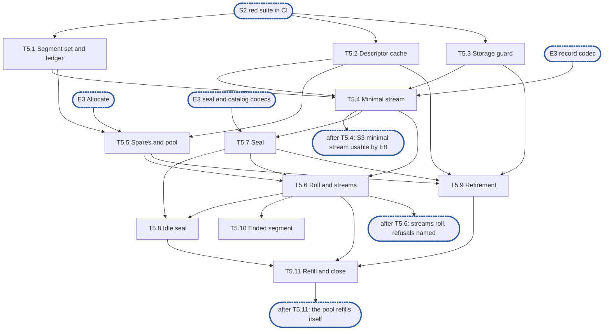

# Epic 5: journal v2 segments, streams and accounting

**Sources:** [RFC 28](../rfcs/rfc-28-journal-format.md) §2.2, §2.3 (the header's synced-through field), §2.4 and §2.5
(the writing side), §3.1 (idle seal) and Appendix A (allocation); [RFC 1](../rfcs/rfc-1-journal.md) §3.7, §3.9, §5.1,
§5.3, §6 (allocation, spares, refusals), §7.1, §7.3, §7.4 and §8.2–§8.7; the descriptor and
stream settings of [RFC 13](../rfcs/rfc-13-configuration.md) Appendix B.
**Track:** A.
**Epic 5 estimate: 11 subtasks, 35 man-days.**
**Depends on:** sync point **S2, red suite in CI**; epic 1's `core` types and settings, and its
storage seam (`storage.FS`, `storage.File`); epic 2's crash-simulating seam, fixture and
profiler; epic 3's segment header and names, record, seal marker, catalog entry and trailer
codecs, and the OS `Allocate`; epic 4's per-segment byte accounting.
**Blocks:** epic 6 (`Sync` works on this epic's streams), epic 7 (recovery reads the segments
this epic writes, and re-adopts its spares), epic 8 (the data path appends and reads through
this epic's streams; its integration tests wait for the minimal stream) and epic 9 (reclamation
retires segments through this epic's executor).

---

## 1. Goal

Epic 5 is the writing side of the journal's files: the segments, the append streams that fill
them, the spare pool that supplies them, the seal that closes them, the retirement that
returns them, and the accounting that keeps count of every byte they occupy. It does no
durability policy (epic 6), no recovery (epic 7) and no index (epic 4).

**At the end of the epic:**

- a stream appends records to a segment at positions reserved in order, splits a write at the
  segment cap, rolls to a spare and reads back what it wrote, on real storage;
- a spare is made whole or not at all, at every crash point of the crash-simulating seam;
- a seal writes its marker, footer and trailer in the order the format requires, in two
  syncs for a full seal and three for an early one;
- a retired segment is unlinked or recycled by the pool's level at that moment, never
  readable by a reader that still holds its old location, and leaves the accounted footprint
  exactly once;
- descriptors are bounded per process and reopened on a miss;
- `Segments`, `Sealed`, `UsedBytes`, `HeadroomBytes`, `RepackReserveBytes`, `OpenDescriptors`,
  `DescriptorLimit`, `spare_refusals`, `segment_reopens`, `freed_bytes` and the double-retire count are
  served from maintained counters.

### 1.1 In scope

- The segment set, ids and the footprint ledger, including per-share record bytes (T5.1).
- The descriptor cache and the per-process descriptor budget (T5.2).
- The per-segment storage guard (T5.3).
- Append streams: position reservation, the split at the cap, the synced-through value a
  record carries, the positioned read (T5.4), the roll and several streams (T5.6).
- The spare pool, its classes and its refusals (T5.5, T5.6).
- The seal, the catalog and the free tail, and the idle seal (T5.7, T5.8).
- Retirement by unlink or recycle, and the executor behind it (T5.9).
- Ending a segment after a failed append (T5.10).
- Refilling the pool from retirements, and closing the set (T5.11).

### 1.2 Out of scope

- Byte layouts, checksums and the slot scanner: epic 3. This epic calls the encoders.
- `Sync`, group commit, the sync timer, failed-sync windows, loss records: epic 6. This epic
  provides the stream's synced-through value, the end of a segment, and the records a window
  holds; epic 6 decides what a window does.
- `Init`, `Open`, rebuild, torn tails, unlinking a stray `.spare.tmp`, re-adopting spares
  (this epic's pool accepts one, T5.5), orphans and the footer's use at recovery: epic 7. Sealing the newest segment of a stream at
  recovery (RFC 28 §2.5, §3.1) is epic 7's too: it calls T5.7's seal writer on the entries it
  scanned. The platform refusals of RFC 28 Appendix A (copy-on-write, subvolume, cache-flush
  policy) are epic 3's probes, applied by epic 7 at `Init` and open. This epic takes the
  largest id the directory names as an input at open, for its id allocator.
- The file append serialisation point, reservations and `Reserve` (this epic's pool lets a
  reservation hold spares, R80), the share limit, the index bound, the headroom half rule,
  the order in which refusals are named, never evicting to satisfy a reservation, `Stats`
  aggregation, publishing an extent only after its record is written and the other atomicity
  rules of RFC 1 §8.4, the order of the six lock domains and its recorder (this epic owns two
  of them: the segment append domain and the storage guard), `Handle.Close` and the
  journal-level refusal of operations after close: epic 8.
- When a segment is not held and when its removal records may be dropped, `Repack`, pins,
  `Release`, and handing a segment over for retirement only once the records that left it not
  held (its release records included) are durable: epic 9. This epic provides what they call:
  the retirement executor, the claim and the durable-unlink signal.
- Wiring the pool target, the stream count and the descriptor limit to configuration: epic 11.
- A footer for a segment sealed by a previous process (a MAY): not taken (D4).
- Compressing the `FileID` column of the footer (a MAY): not taken, the layout defines none.

### 1.3 Names used here

- **E1**, epic 1, interfaces: the `core` types and settings, the storage seam.
- **E2**, epic 2, red e2e suite and test foundations: the crash-simulating seam, fixture,
  reference model and profiler.
- **E3**, epic 3, on-disk format and platform layer: the codecs, names and the OS storage.
- **E4**, epic 4, placement index and versions: the per-segment held and retained bytes.
- **E5**, this epic.
- **E6**, epic 6, durability and loss: `Sync`, failed windows.
- **E7**, epic 7, recovery and identity: `Init`, `Open`, rebuild, spare re-adoption.
- **E8**, epic 8, data path and capacity: `WriteAt`, `ReadAt`, reservations, `Stats`.
- **E9**, epic 9, offload, reclamation, holds and tags: `Release`, `Repack`, pins.
- **E10**, epic 10, start and initialisation: the start check and the device configuration.
- **E11**, epic 11, the engine on the RFC 16 store: the wiring of configuration.
- **S1**, interfaces frozen: E1's exported surface no longer changes.
- **S2**, red suite in CI: E2's suite runs in CI from every pull request.
- **S3**, walking skeleton: a minimal append stream from this epic, one stream with no pool
  and no seal, plus E8's `WriteAt` and `ReadAt`, so the first conformance tests turn green.
  **T5.1–T5.4 are this epic's half, about 11.5 man-days.**
- **S4**, core complete: E3–E9 done.

## 2. General rules for each epic

1. **Independent unit tests.** Each epic carries its own unit tests. It may use another
   epic's pure in-memory implementation (E4's index, E3's codecs), the implementation of
   an epic it depends on once that has landed (E8 on E5's segments and E6's `Sync`), and the test components from epic 2. Epic 1 declares no internal interface
   to fake (rule 12).
2. **Fuzz tests where relevant.** Use Go native fuzzing (`testing.F`) on every parser of
   bytes the journal did not just write: records, segment headers, seal markers, catalogs,
   trailers, the `format` file. Also fuzz-drive operation sequences against the reference
   model. The property is that any input is either accepted as valid or rejected: never a
   panic, and never an extent the bytes do not contain.
3. **Metrics, and tracing where relevant.** Every counter and gauge RFC 1 §3.7 and §3.9
   assigns to the epic's area is maintained, and exposed through `Stats` (served from
   maintained counters, never a walk). Spans go through epic 1's standard-library
   `Tracer` and logs through the injected `*slog.Logger`, never a metrics or tracing
   library. Operations worth a span:
   open and recovery, sync, offload pass, repack pass, fill, and a refused reservation.
4. **Profiling.** Tests and benchmarks run under epic 2's profiling harness and fail on
   goroutine, descriptor or memory leaks and on anomalous resource growth. Hot paths
   (`WriteAt`, `ReadAt`, `Stats`, `report`, index lookup and insert) carry
   allocations-per-op assertions and the counted checks of RFC 1 §9.7. Allocation and
   heap assertions run outside `-race` only, because `-race` changes both.
5. **Public interface and internals.** Tests cover the epic's internal package API and the
   public v2 interface behaviour it enables, including concurrency under `-race`. Per the
   project rules, test at the layer that **consumes** a value, not the one that produces
   it. A regression test is validated by reverting the fix and watching it fail **on its
   assertion**.
6. **Known failures shrink.** Every e2e test an epic turns green is removed from the
   known-failure list in the same change. The runner fails if a listed test passes.
7. **v2 ignores v1.** No import of, copy from, or behavioural dependence on
   `pkg/block/journal`. The import test enforces it. v1 code is neither ported nor
   bridged: it is deleted with the rest of v1 at the cutover (stage 7 of #3119). v2
   checks only whether v1 state exists, to refuse it at start (E10), and never reads
   v1's format.
8. **Real storage for storage properties.** No in-memory filesystem stands in for a check
   about durability, torn tails, unlink durability or corruption (RFC 1 §9.5). In-memory
   stand-ins are allowed only for pure logic (index, codecs).
9. **Code comment conventions** (`CLAUDE.md`). No epic, issue or plan IDs in source
   comments. Use `ponytail:` for knowingly-simple implementations and `decision:` for
   deliberate behaviour. Where the RFC already carries a ponytail or decision note, its
   marker goes at the code site that implements it.
10. **A test must be able to fail.** Every test is code maintained for the life of the
    project. Keep a test only if a plausible change would make it fail and nothing else
    would catch that change: not the compiler, not the PR diff, not a later epic's tests.
    A test that checks two `errors.New` values differ, that the standard library's
    `errors.As` works, or that a stub returns zero does not qualify. A test that a
    little-endian `Version.Bytes` would fail does. Review rules that no test can check
    (for example, stubs never panic) stay review rules.
11. **A symbol is exported only if RFC 1 §3 uses it.** Everything exported is frozen at
    S1, so a helper exported for convenience becomes a contract. Helpers the internal
    packages need (`Less`, `IsZero`, `End`, `Overlaps`, `Seq`, the proposed constants)
    stay in `internal/core`.
12. **Each subtask creates only what it declares.** No empty package and no stub without
    a caller. A package, an option or a test helper lands with its first consumer.

### 2.1 How the rules apply

| Rule | Subtasks | How |
| --- | --- | --- |
| 1 Unit tests | all | every R-number has a test that can fail. Subtasks use E3's codecs, E4's per-segment accounting and E2's crash-simulating seam, and fake nothing of their own |
| 2 Fuzz | T5.1 | there is no parser of bytes here: the footer reader is E3's, and this epic only writes. T5.1 fuzz-drives sequences of create, shrink, claim and retire against an oracle of the footprint |
| 3 Metrics and tracing | T5.1, T5.2, T5.5, T5.6, T5.9 | `Segments`, `Sealed`, `UsedBytes`, `HeadroomBytes`, `RepackReserveBytes`, `OpenDescriptors`, `DescriptorLimit`, `segment_reopens`, `spare_refusals`, `freed_bytes`, the double-retire count and, once RFC 1's `Stats` gains it, the `Spares` gauge are maintained at the event that changes them and read without a walk. The double retire logs at `Warn` through the injected logger. **No span:** a refused reservation, the one span-worthy operation near this area, is traced by E8, which names the limit that refused. A seal, a recycle and a spare's making are not on the list |
| 4 Profiling | all | every test runs under E2's profiler. T5.2, T5.8 and T5.9 are where descriptors and goroutines could leak (the cache, the idle sealer, the retirement worker). T5.4 asserts zero allocations per position reservation, outside `-race` |
| 5 Public and internals, `-race` | T5.1, T5.2, T5.3, T5.4, T5.5, T5.6, T5.7, T5.8, T5.9, T5.11 | internal API now: the public `WriteAt`, `ReadAt` and `Stats` behaviour is tested in E8, their consumer. Concurrency is exercised under `-race` where subtasks list it |
| 6 Known failures | none | every conformance test needs `Open`, which E7 and E8 wire. This epic turns none green and adds none |
| 7 v2 ignores v1 | all | enforced by the import test. Nothing of `pkg/block/journal` is read |
| 8 Real storage | T5.2, T5.4–T5.11 | every test of a sync, a rename, an unlink or a crash runs on a real directory through E2's seam. T5.1 and T5.3 are pure logic and test in memory |
| 9 Comment markers | T5.4, T5.5, T5.6, T5.7, T5.8, T5.9 | see §4: each decision names its marker and where it goes. The RFC's `ponytail:` on the constant segment size goes at the cap in T5.6, and its `decision:` on zero-filling goes where T5.5 calls `Allocate`. The `decision:` on the 30 s idle time and `journal.idle_seal_bytes` goes at the idle constants in T5.8 |
| 10 A test can fail | all | each test in §6 names the bug it catches |
| 11 Exports | all | `journalv2` gains no symbol: everything is in `internal/segment`, and the one exception, `core.DescriptorBudget`, is already declared by E1 |
| 12 Created with its consumer | all | `internal/segment` lands with T5.1, and each file lands with the subtask that uses it. Until E8, tests are the only consumer: the package is logic over the storage seam tested on its own (rule 1), not a placeholder |

## 3. Requirements and invariants

Every **MUST** and **MUST NOT** that RFC 1 and RFC 28 place on this epic, the SHOULDs it
adopts, and the bounds and test rows that name its area, numbered so that subtasks and tests
can cite them. Obligations that another epic carries out are not listed: §1.2 names the
epic. A mechanical search for the key words over the owned sections found every one of them
below or in §1.2.

**Segment layout and streams**

| # | Requirement | Kind | Source | Subtasks |
| --- | --- | --- | --- | --- |
| R1 | A sealed segment is never appended to again | MUST NOT | RFC 28 §2.2 | T5.7, T5.10 |
| R2 | A write that does not fit what remains of the current segment is split at the cap into records, one per segment, each carrying its own file offset and the write's version. No record spans two segments | invariant | RFC 28 §2.2 | T5.4, T5.6 |
| R3 | A segment is created at its cap and allocated whole, by the platform's allocation call or by writing zeros. The file never grows | invariant | RFC 28 §2.2, Appendix A | T5.5 |
| R4 | Bytes of an allocated segment that no record has reached read as zeros | invariant | RFC 28 §2.2 | T5.5 |
| R5 | Concurrent appends to one stream write at positions reserved in order. A write that fails returns its error and is never acknowledged, and its slot is left as it is | invariant | RFC 28 §2.2 | T5.4 |
| R6 | Appends of different `FileID`s proceed concurrently, on one stream and across streams. The number of independent streams is the configured stream count | invariant | RFC 28 §2.2, RFC 13 App. B | T5.4, T5.6 |
| R7 | A bounded number of segments per stream is open for append at one time. Every other segment is sealed | invariant | RFC 28 §2.2 | T5.6 |
| R8 | Every segment begins with a header, written once when a stream takes it, naming the journal identity, the segment's own id, its predecessor (or none) and the stream number. The stream's next sync makes it durable | MUST | RFC 28 §2.2 | T5.4, T5.6 |
| R9 | Segment ids start at 1 and ascend across all streams in the order segments are created | invariant | RFC 28 §2.2 | T5.5 |
| R10 | The synced-through offset a record carries is the offset in its segment up to which a sync had completed when the record was written. It never advances past a slot whose write failed or has not completed | MUST | RFC 28 §2.3, §2.2 | T5.4, T5.10 |
| R11 | A stream seals a segment while what remains still holds the seal marker, a footer entry for every record in it and the trailer | invariant | RFC 28 §2.5 | T5.4, T5.7 |
| R12 | Of the lock domains only the file append domain is held across I/O. Reserving a position in a segment takes the segment append domain for the reservation alone, and the record write happens outside it | invariant | RFC 1 §8.2 | T5.4 |
| R87 | Records, once written, are immutable: a record is written once at its reserved slot and never rewritten, and a recycle's zeroing touches only a retired segment's header and trailer slots | invariant | RFC 28 §2.2 | T5.4, T5.9 |

**The spare pool**

| # | Requirement | Kind | Source | Subtasks |
| --- | --- | --- | --- | --- |
| R13 | A spare is made as `<id>.spare.tmp`: created, allocated (zero-filled where Appendix A requires it), synced, renamed to `<id>.seg`, then the directory synced. A crash leaves no `<id>.seg` or a whole one | MUST | RFC 28 §2.2 | T5.5 |
| R14 | A spare's id is drawn when it is made, and its header slot is zeros until a stream takes it | invariant | RFC 28 §2.2 | T5.5 |
| R15 | Making a segment happens off the write path. A roll costs only the take | invariant | RFC 28 §2.2, RFC 1 §5.2 | T5.5, T5.6 |
| R16 | The id of a new spare or of a recycle exceeds the id of every `.seg` and `.spare.tmp` file in the directory, those found at open included | MUST | RFC 28 §2.2 | T5.5, T5.9 |
| R17 | The spares that back the headroom and the repack reserve are not in the content pool. A content roll and a `Reserve` never take one, and one that finds only those is refused `spare` | invariant | RFC 1 §6 | T5.5, T5.6 |
| R18 | Creating a spare reserves its cap against the journal's maximum, atomically with every other reservation. The pool grows only at `Init`, when the maximum is raised, or when no full-size retired segment is to hand | MUST | RFC 1 §6, RFC 28 §2.2 | T5.5, T5.11 |
| R19 | A directory sync follows the creation of a segment before any `Sync` covering its records returns | MUST | RFC 28 §2.2, RFC 1 §5.1 | T5.4, T5.5 |
| R20 | A roll that finds no spare ready is refused at once, with no I/O and without waiting, as `ErrNoSpace` naming the limit `spare`, never the journal's maximum | MUST | RFC 28 §2.2, RFC 1 §6 | T5.6 |
| R21 | Once making a spare has failed with `ENOSPC` and no full-size retired segment is to hand, a roll that finds no spare is refused with `ENOSPC`, until a spare is made again | MUST | RFC 28 §2.2 | T5.6, T5.11 |
| R22 | `spare_refusals` counts each refusal naming `spare` | MUST | RFC 28 §2.2, RFC 1 §3.9 | T5.6 |
| R23 | Header-only records go on drawing on the allocated headroom when no spare is ready: the pool offers them the headroom's spares. A repack copy that needs a new segment draws on the repack reserve's spares, never a content spare | invariant | RFC 28 §2.2, RFC 1 §6 | T5.5, T5.6 |
| R80 | A reservation holds spares ahead of need: spares held for it are not available to unreserved rolls, a reserved roll takes one of them, and an unreserved roll that would leave an open reservation short of its spares is refused `spare`. So a reserved write never meets the no-spare refusal while the pool can be refilled | invariant | RFC 1 §6 | T5.5, T5.6 |
| R83 | A spare whose making fails at any step is never taken. Whatever the attempt left under either name is unlinked and stays accounted at its cap until the unlink has happened, and only then is its reservation returned | invariant | RFC 28 §2.2, RFC 1 §3.7, §7.3 | T5.5 |
| R84 | A spare found at open is accepted into a class, accounted at its cap and counted toward the headroom, the repack reserve or a stream's next segment. (The scan that finds it and the decision that it is a spare are epic 7's) | MUST | RFC 28 §3.1 | T5.5 |

**Seal, catalog and free tail**

| # | Requirement | Kind | Source | Subtasks |
| --- | --- | --- | --- | --- |
| R24 | Sealing writes a seal marker at the slot just past the last record. It is durable before a successor naming the segment is taken | MUST | RFC 28 §2.2 | T5.6, T5.7 |
| R25 | Bytes after a seal marker belong to the footer, never to records | invariant | RFC 28 §2.2 | T5.7 |
| R26 | Seal order: every record durable first, then the marker, footer and trailer written and durable, then, for an early seal, the file truncated past the trailer and that made durable | MUST | RFC 28 §2.5 | T5.7 |
| R27 | A full seal needs as few as two syncs and an early seal three, and a step may be split into more. The RFC states a floor, not a count: D11 fixes what this epic issues | bound | RFC 28 §2.5 | T5.7 |
| R28 | A sealed segment carries a catalog footer: one entry per record in it | SHOULD, adopted | RFC 28 §2.4 | T5.7 |
| R29 | The footer is written and made durable after the records it describes | MUST | RFC 28 §2.4 | T5.7 |
| R30 | The footer carries its own checksum and identifies the extent of the segment it describes. Epic 3 owns the bytes, this epic supplies the entries and the offsets | MUST | RFC 28 §2.4, §2.5 | T5.7 |
| R31 | A segment that carries a footer ends with the fixed-size trailer in its last 32 bytes: at the cap's end for a full seal, just after the footer for an early one | MUST | RFC 28 §2.4, §2.5 | T5.7 |
| R32 | The footer is never appended twice, and a footer that already verifies is never rewritten or extended | MUST NOT | RFC 28 §2.4 | T5.7 |
| R33 | A failed sync in the first two seal steps leaves the segment never sealed, and its successor names none | MUST | RFC 28 §2.5, RFC 1 §5.3 | T5.6, T5.7 |
| R34 | A failed truncation sync does not end the segment. It is sealed, a successor may be taken, and it stays accounted at its cap | MUST | RFC 28 §2.5 | T5.6, T5.7 |
| R35 | A segment sealed full is never truncated and keeps its cap, so it can be recycled as a full-size spare. A segment sealed early always returns its free tail | MUST | RFC 28 §2.2, RFC 1 §7.3 | T5.7 |
| R36 | The catalog is not placed in a separate file, and no second durable log of it is kept | MUST NOT | RFC 28 §2.4 | T5.7 |
| R37 | An active segment that has taken no append for 30 s is sealed once the bytes it holds beyond its last catalogued point pass `journal.idle_seal_bytes`. Below the threshold it stays open | MUST | RFC 28 §3.1 | T5.8 |
| R38 | No byte range inside a segment is freed, zeroed or deallocated while the segment remains, except the free tail at seal. (The torn tail cut at recovery is epic 7's. A recycle's zeroing of two slots is RFC 28 §2.2's own step, and an open point in §9) | MUST NOT | RFC 1 §7.1 | T5.7, T5.9 |
| R85 | A seal closes the segment to new reservations, waits for every slot reserved before it and places the marker just past the last completed record. A concurrent append lands before the marker or rolls to the next segment, and none lands after it | invariant | RFC 28 §2.2, §2.5 | T5.7, T5.8 |

**Retirement: unlink and recycle**

| # | Requirement | Kind | Source | Subtasks |
| --- | --- | --- | --- | --- |
| R39 | Before a segment is unlinked, every descriptor cached for it is closed. Where an open file cannot be unlinked, segments are opened with sharing that permits deletion | MUST | RFC 28 §2.2, RFC 1 §7.4 | T5.2, T5.9 |
| R40 | Recycle order: close the descriptors, rename to a fresh `<id>.seg`, sync the directory, then overwrite the header slot and the trailer slot with zeros and sync. Never zero first. No zero-fill | MUST | RFC 28 §2.2 | T5.9 |
| R41 | A recycle that fails at any step is an unlink, under whichever of its two names the journal finds. The segment is never a spare | MUST | RFC 28 §2.2 | T5.9 |
| R42 | Whether a full-size segment is recycled is decided at its retirement: recycled while the pool is below its target then, unlinked otherwise. Never decided at seal | MUST | RFC 28 §2.2, RFC 1 §7.3 | T5.9 |
| R43 | A segment sealed early is unlinked when retired, never recycled. A segment ended by a failed sync, by a failed append, or by recovery without a seal is unlinked, never recycled, and only once repack has carried its synced records forward | MUST | RFC 28 §2.2, RFC 1 §5.3 | T5.9, T5.10 |
| R44 | A segment's records are durable before it is unlinked or recycled: the executor refuses a segment with unsynced bytes, except one ended by a failure (R43), whose window the caller has resolved. That a release record is durable before the segment holding the record it released is retired is the caller's: epic 9 hands a segment over only once the records that left it not held are durable | MUST | RFC 1 §5.1 | T5.9 |
| R45 | An unlink or a recycle is made durable by a directory sync, and the retirement reports when it is. A removal record whose retention counted the segment is dropped only after (epic 9 applies the rule) | MUST | RFC 28 §2.2, RFC 1 §5.1 | T5.9 |
| R46 | A segment that is not held is retired by the journal on its own, once the records that left it not held are durable, without waiting for a repack to select it. This epic provides the executor and its background worker. Epic 9 decides when a segment is not held | MUST | RFC 1 §7.1 | T5.9 |
| R47 | Unlink and recycle take the storage guard exclusively, and freeing storage is the last step, after no reader can hold the old resolution | MUST | RFC 1 §8.5 | T5.3, T5.9 |
| R82 | A segment is retired only once its stream has left it: sealed, or ended by a failure. An active segment and a spare in the pool are never retired | invariant | RFC 28 §2.2, RFC 1 §5.3, §7.1 | T5.9 |

**A failed append ends its segment**

| # | Requirement | Kind | Source | Subtasks |
| --- | --- | --- | --- | --- |
| R48 | A failed append ends its segment, fresh or recycled: no further append, not even a seal marker. The stream continues in a new segment naming no predecessor, and the segment is never sealed | MUST | RFC 28 §2.2, RFC 1 §5.1, §5.3 | T5.10 |
| R49 | The records written to the ended segment since its last successful sync are handed to the failed-window resolution (re-append or fail: epic 6). This epic hands them over and decides nothing about them | MUST | RFC 28 §2.2, RFC 1 §5.3 | T5.10 |
| R50 | An ended segment stays accounted at its cap to the journal until it is unlinked | MUST | RFC 1 §5.3, §7.3 | T5.1, T5.10 |

**Accounting**

| # | Requirement | Kind | Source | Subtasks |
| --- | --- | --- | --- | --- |
| R51 | Accounted footprint reflects the storage the journal's files allocate: a segment at its cap from creation to unlink, and a segment shortened by a torn-tail truncation or at seal at its size afterwards | MUST | RFC 1 §7.3 | T5.1 |
| R52 | `UsedBytes` is raised before an allocation happens and lowered only after an unlink has happened, and it moves only when a segment is created, unlinked or shortened | invariant | RFC 1 §3.7, §6 | T5.1, T5.5, T5.9 |
| R53 | Every file the journal creates is accounted, each segment's footer included, and every such file is bounded by live state, not by history | MUST | RFC 1 §7.3, RFC 28 §2.4 | T5.1, T5.7 |
| R54 | The spares of the headroom and of the repack reserve are accounted to the journal, never to a share | MUST | RFC 1 §7.3, §6 | T5.1, T5.5 |
| R55 | A record's bytes (header, payload, padding) are accounted to the share whose tag the record carries when it is written, and released when the segment holding it is unlinked or recycled | MUST | RFC 1 §6 | T5.1 |
| R56 | An unlink is idempotent: the segment's bytes leave the footprint exactly once, in the step that removes it from the set of segments the journal owns, and only if that step found it there. An unlink that finds the file gone or the segment out of the set subtracts nothing. A recycle subtracts nothing at all (R78) | MUST | RFC 1 §7.3 | T5.1, T5.9 |
| R57 | A claim taken on a segment is never released after the segment is retired | MUST NOT | RFC 1 §7.3 | T5.1 |
| R58 | A retire that subtracts nothing is counted and logged at `Warn` | MUST | RFC 1 §7.3 | T5.1 |
| R59 | The accounted footprint is checkable against the sum of the segment set's sizes, and a mismatch is reported (the check is called by epic 7's verification) | SHOULD, adopted | RFC 1 §7.3 | T5.1 |
| R60 | The counters of this area are served from maintained state, never from a walk of the segment set | MUST | RFC 1 §3.7 | T5.1, T5.2, T5.5, T5.6 |
| R78 | A recycle does not return the segment's cap: the recycled segment stays accounted at its cap, now as a spare under its new id, and only an unlink lowers the footprint | MUST | RFC 1 §6, §7.3 | T5.1, T5.9 |
| R79 | `freed_bytes` counts storage actually returned by unlinking segments, raised only after the unlink has happened | invariant | RFC 1 §3.9, §6 | T5.9 |

**Descriptors**

| # | Requirement | Kind | Source | Subtasks |
| --- | --- | --- | --- | --- |
| R61 | Open segment descriptors are bounded by `DescriptorLimit`, independently of the number of segments. The bound is per process: every journal of the process draws on one budget | MUST | RFC 1 §7.4 | T5.2 |
| R62 | A read of a segment whose descriptor is not open reopens it | MUST | RFC 1 §7.4 | T5.2 |
| R63 | The count, the bound and the reopens are reported through `Stats` | MUST | RFC 1 §7.4, §3.9 | T5.2 |
| R64 | The default `DescriptorLimit` is a quarter of the process's open-file limit | bound | RFC 13 App. B | T5.2 |

**Storage guard, lock order and shutdown**

| # | Requirement | Kind | Source | Subtasks |
| --- | --- | --- | --- | --- |
| R65 | A read either observes the location it resolved, intact, or discovers that it must retry or report the extent missing. It never returns bytes from storage that has been freed or reused | MUST | RFC 1 §8.5 | T5.3, T5.9 |
| R66 | The mechanism is a shared/exclusive guard per segment: readers hold it shared, an unlink or recycle takes it exclusively and waits for in-flight reads of that segment only | MUST | RFC 1 §8.5 | T5.3 |
| R67 | A continuous stream of readers never prevents reclamation from acquiring a segment exclusively: the guard is not reader-preferring | MUST NOT | RFC 1 §8.6 | T5.3 |
| R68 | Reclamation never holds a segment exclusively for longer than one unit of work | MUST NOT | RFC 1 §8.6 | T5.3, T5.9 |
| R69 | Nothing is acquired while the storage guard is held: it is the last lock in the order. Reclamation takes it only to unlink or recycle, holding no other lock, and no two locks of one domain are held at once | MUST NOT | RFC 1 §8.3 | T5.3, T5.4, T5.9 |
| R70 | On close, background work (idle seal, the retirement worker) is stopped and joined before the segments it touches are closed, and no storage a reader may still hold is freed | MUST | RFC 1 §8.7 | T5.8, T5.11 |
| R81 | After close, an append or a read through the segment set fails with the closed error, and in-flight ones complete or fail cleanly. The journal-level close and its refusal of new operations are epic 8's | MUST | RFC 1 §8.7 | T5.11 |
| R86 | Every piece of mutable state this epic adds names the lock domain that guards it (D13) | MUST | RFC 1 §8.2 | T5.1, T5.2, T5.4, T5.5 |

**Test rows of the RFCs for this area**

| # | Requirement | Kind | Source | Subtasks |
| --- | --- | --- | --- | --- |
| R71 | A spare is whole or absent: crash at every step of making one, dropping unsynced allocations and directory changes. Every `<id>.seg` is at its cap and fully allocated, and the next spare's id is above any `.spare.tmp` id. (The unlink of a stray `.spare.tmp` at open is epic 7's) | test row | RFC 28 §4.2 | T5.5 |
| R72 | Retired segments are recycled: the seam sees a rename, then a zeroed header slot and trailer slot per recycle, and no zero-fill. A recycle happens exactly when the pool is below its target at retirement. Every segment sealed early is truncated and none sealed full is. A segment whose sync or append failed is unlinked | test row | RFC 28 §4.2 | T5.7, T5.9, T5.10 |
| R73 | Descriptors: create more segments than the bound, reads still succeed and open descriptors stay bounded | test row | RFC 1 §9.4 | T5.2 |
| R74 | Two paths retire one segment, one after the other: accounted footprint falls by its size exactly once and never goes below zero | test row | RFC 1 §9.2 | T5.1, T5.9 |
| R75 | Accounting follows the cap: the journal's `UsedBytes` does not move when records are written into an allocated segment, and is never below what the segment files allocate, including on a filesystem that allocates speculatively past the end of a growing file. (The share's counters in the same row are epic 8's) | test row | RFC 1 §9.4 | T5.4, T5.5 |
| R76 | Unlink under read: a read of a segment concurrent with its unlink returns the pattern it should, or retries, or reports the extent missing, never other bytes | test row | RFC 1 §9.4 | T5.3, T5.9 |
| R77 | A zero slot is not the end, the write half: a failed middle write returns an error, no append reserved after the failure lands in that segment, and the stream's next append goes to a new segment. (The reopen half is epic 7's) | test row | RFC 28 §4.2 | T5.10 |

## 4. Decisions this epic takes

- **D1, one package of concrete types.** `internal/segment` holds the set, the cache, the
  guard, the streams, the pool and the retirement as concrete types, with no interface
  between them (rule 12). The storage seam is the only interface they touch.
- **D2, the synced-through value comes from an ordered-completion tracker.** RFC 28 §2.2
  says only that it never passes a slot whose write failed or has not completed. The
  stream tracks, per segment, which reserved slots have completed and which sync has
  returned, and a record carries the highest offset below which every slot completed and a
  sync covered. A `decision:` marker at the tracker states why a plain "last synced offset"
  is wrong: a later slot can complete and sync while an earlier one is still in flight.
- **D3, three spare classes in one pool.** The pool holds spares of three classes: content,
  headroom and repack reserve. Only content spares serve a roll (R17). Sizes come from the
  settings (`SpareTarget` for content, the headroom and reserve sizes from the capacity
  rules of RFC 1 §6, given to the pool by the caller). A `ponytail:` marker at the target
  says the target is static: it names the ceiling (a burst longer than one segment's fill
  time refuses `spare`) and the upgrade (a target that follows the roll rate) once
  `spare_refusals` shows it.
- **D4, no footer for a segment sealed by a previous process.** RFC 28 §2.4 permits it
  (a MAY) and a segment sealed at a crash legitimately has none. This epic does not take
  it: recovery scans such a segment. Sealing the newest segment of a stream at recovery (RFC 28 §2.5) is a different case: epic 7 does it through this epic's seal writer (T5.7). A `decision:` marker at the seal says the exemption
  holds while a scan of the tail is cheap, and what overturns it: a time to first read
  dominated by scans of such segments.
- **D5, one retirement executor, two entry points.** `Retire` runs one retirement now.
  A queue and a worker run those that epic 9 hands over once their records are durable.
  Epic 9 decides that a segment is not held, so the executor never calls the index to
  decide it; it checks only what it owns (sealed or ended, no unsynced bytes unless ended, nothing claimed).
- **D6, a spare's directory entry is synced when it is made.** So taking one costs no
  directory sync. This is the rule of an open RFC 28 change (#3500); the merged text says a
  failed directory sync of a new segment is a failed sync window. Under either text no record
  is written into a segment whose directory entry is not yet durable (D10 included), so there
  is no window to re-append. A spare whose making fails at any step, a failed directory sync
  included, is never taken (R83): the file may exist under `<id>.spare.tmp` or `<id>.seg`, so
  it is unlinked under either name and stays accounted until the unlink has happened. A file
  that cannot be unlinked stays in the set, accounted, and the retirement worker retries it.
- **D7, a file's appends go to one stream.** The stream is chosen by a hash of the
  `FileID`, so one file's records stay ordered on one stream and epic 8's file append
  serialisation needs no cross-stream order. A `ponytail:` marker names the ceiling: one hot
  file cannot use more than one stream.
- **D8, a descriptor in use is never evicted, and a retired segment cannot be reopened.** A
  read takes a reference on the descriptor first, then the segment's guard shared, reads, drops
  the guard, then drops the reference, so the cache's mutex is never taken while the guard is
  held (R69). `Close(id)` marks the segment gone in the cache, waits for its references and
  closes its descriptors; a later acquire of that segment fails, and the read reports the
  extent missing. The cache opens a file on a miss outside its mutex. A `ponytail:` marker at
  the cache says it is one mutex around an LRU, and what would make it worth sharding:
  contention on that mutex in a profile of the mixed read soak.
- **D9, the segment cap in tests.** Tests shorten the cap through `core.SetSegmentCap`
  and never through a second constant, so every size check of this epic runs at the
  production code path.
- **D10, the skeleton creates its first segment on the write path.** T5.4 makes a segment
  at its cap on the spot, whole and with its directory entry synced before any record is
  written into it, so the minimal stream works before the pool exists. If that directory sync
  fails the segment is not taken and is unlinked (D6). A `ponytail:` marker says so, and T5.6
  replaces it with the pool's take.
- **D11, a seal issues the minimum syncs.** RFC 28 §2.5 gives a floor (two for a full seal,
  three for an early one) and permits more. This epic issues exactly the floor, so a roll
  costs no extra flush. The tests pin the floor as this epic's choice, and a merged step is
  caught by the order assertions of T5.7, not by the count.
- **D12, a header-only roll takes a headroom spare, which then becomes an ordinary
  segment.** The stream finishes it with whatever records follow, content included, and the
  worker refills the headroom class to its size, so `HeadroomBytes` dips until the refill. A
  `ponytail:` marker at the roll names the ceiling: a burst of content landing in such a
  segment spends headroom space until the refill. The upgrade, keeping the rest of that
  segment for header-only records, waits for `headroom_draws` to show it. Open point in §9.
- **D13, which domain guards each piece of state.** RFC 1 §8.2 names six domains and asks
  that every piece of mutable state name one. The segment set, the footprint ledger and the
  pool's counters sit under the capacity domain (store-wide counters, no I/O under it). A
  segment's write position, its catalog entries and its completion tracker sit under that
  segment's append domain, held for the reservation only (R12). The guard is the storage
  guard. The descriptor cache is none of the six: it takes a leaf mutex of its own, never
  held across I/O and never while another lock is held. A `decision:` marker at each type
  names its domain. Open point in §9.

## 5. Target tree

```text
pkg/block/journalv2/internal/
  segment/
    set.go          T5.1   segment set, footprint ledger, claims, per-(segment, tag) bytes
    descriptors.go  T5.2   descriptor cache over one per-process budget
    guard.go        T5.3   per-segment shared/exclusive guard
    stream.go       T5.4   append stream, position reservation, synced-through tracker, read
    pool.go         T5.5   spare making, ids, classes, refill worker
    roll.go         T5.6   take a spare, predecessor, several streams, refusals
    seal.go         T5.7   seal marker, footer, trailer, truncation
    idle.go         T5.8   idle seal worker
    retire.go       T5.9   unlink, recycle, executor and worker
    end.go          T5.10  ending a segment after a failed append
    close.go        T5.11  refill from the retirement queue, closing the set
    *_test.go
  core/
    config.go       T5.2   DescriptorBudget implemented (declared by E1)
  index/
    files.go        T5.1   the retire pair (segmentGone, retireSegment), exported for this package
```

## 6. Subtasks

### T5.1 Segment set and footprint ledger

**Subtask T5.1 estimate: 2.75 man-days.**

- **Track:** A. **Depends on:** S2; E4's per-segment held and retained bytes.
- **Covers:** R50–R60, R74, R78, R86.
- **Deliverables:** `internal/segment/set.go`: the set of segments the journal owns, each with
  an id, a state (spare, active, sealed, ended), the size it is accounted at and its record
  bytes per share tag; the footprint (`UsedBytes`), raised when a segment is created and
  lowered only after its unlink; `Retire(id)` that removes the segment from the set and
  subtracts only if it found it there (an unlink); `Recycle(old, new)` that moves a
  segment to its new id as a spare, footprint unchanged, releasing its per-tag record bytes once and raising the spare count;
  `Claim` and its release, a no-op after retirement;
  `Check()` that compares the footprint with the sum of the set's sizes; the `Segments`,
  `Sealed` and double-retire counters (and the `Spares` gauge once RFC 1's `Stats` has it); a
  `Warn` log on a retire that subtracts nothing. In `internal/index/files.go` the existing
  retire pair is exported for this package: `segmentGone` for each file that held a record in
  the segment, then `(*files).retireSegment`, which wraps `segments.retire`. Nothing else of
  the index changes. A `decision:` marker at each type names the lock domain that guards it
  (D13).
- **Acceptance criteria:**
  - Retiring a segment twice, or from two goroutines at once, lowers the footprint once and
    counts and logs the second.
  - A claim released after retirement changes nothing.
  - `Check()` reports a mismatch when the footprint and the sum differ.
  - A segment shortened at seal is accounted at its new size; a failed or ended one keeps
    its cap.
  - A recycle leaves the footprint unchanged: the old id is gone from the set and the new one
    is in it at its cap.
  - Record bytes of one tag leave with the segment that held them.
- **Tests:** a property test and a `testing.F` target of random create, shrink, claim and
  retire against an oracle of the footprint (catches a path that forgets to subtract, or
  subtracts twice); two goroutines retiring one segment under `-race` (catches a
  check-then-act retire); `Check()` after a deliberately skipped subtract (catches a check
  that compares the footprint with itself); a test that `UsedBytes` is raised before a
  create's allocation and lowered only after its unlink, against a hook between the two; a recycle's footprint before and after (catches a recycle
  that returns the cap while the file stays allocated).

### T5.2 Descriptor cache and per-process budget

**Subtask T5.2 estimate: 2.75 man-days.**

- **Track:** A. **Depends on:** S2.
- **Covers:** R39, R60–R64, R73, R86.
- **Deliverables:** `core.DescriptorBudget` implemented: the limit (0 means a quarter of the
  process's open-file limit where the platform reports one, and a fixed default where it does
  not, behind a `ponytail:`), the shared count and an acquire that refuses past the limit.
  `internal/segment/descriptors.go`: a cache that opens a segment's file on a miss, counts
  the reopen, hands out a reference per read, evicts the least recently used descriptor nothing
  references (D8), and, on `Close(id)`, marks the segment gone, waits for its references and
  closes its descriptors, so that a later acquire fails. It exports `OpenDescriptors`, `DescriptorLimit` and
  `segment_reopens`.
- **Acceptance criteria:**
  - Two journals of one process, each over its own directory, draw on one budget: the sum of
    their open descriptors never passes the limit.
  - Reading more segments than the limit succeeds, and the open count stays at or below it.
  - A read of a segment whose descriptor was evicted reopens it and counts one reopen.
  - After `Close(id)`, the storage seam shows no open descriptor of that segment, and a later
    read of it fails instead of reopening.
  - A descriptor a reader references is never evicted, and `Close(id)` waits for that reader.
- **Tests:** two caches on one budget with a bound of 4 and 16 segments each (catches a
  per-journal bound); a reader holding a descriptor while 16 others are read (catches an
  eviction under a reader); the seam's open-file count after `Close` (catches a leaked
  descriptor that would keep an unlinked file allocated); a read loop at a bound of 1 counts
  one reopen per miss and no more; a read that arrives after `Close(id)` fails and opens
  nothing (catches a reopen between the close and the unlink); `-race` with 32 readers and a
  `Close`.

### T5.3 Per-segment storage guard

**Subtask T5.3 estimate: 1.75 man-days.**

- **Track:** A. **Depends on:** S2.
- **Covers:** R47, R65–R69, R76.
- **Deliverables:** `internal/segment/guard.go`: a shared/exclusive guard per segment, with
  a shared hold for a reader, an exclusive hold for an unlink or a recycle, and the exclusive
  hold run as one callback so it cannot outlive one unit of work. A `decision:` marker says it
  wraps `sync.RWMutex`, whose pending writer blocks new readers, and a test pins that
  property, since the guard must not be reader-preferring. A test-only recorder of acquisition
  order over this epic's locks lands here, and T5.4 and T5.9 reuse it.
- **Acceptance criteria:**
  - An exclusive request waits only for in-flight readers of its own segment.
  - With readers arriving continuously, an exclusive request acquires within a bounded
    number of reader turns.
  - Nothing is acquired while the guard is held: a recording wrapper over this epic's locks
    (the cache reference, the guard, the append domain, the capacity domain) fails a test that
    takes any of them inside a shared or exclusive hold.
- **Tests:** a reader loop on one segment and an exclusive request that must complete (catches
  a reader-preferring guard replacing the wrapper); a reader on segment A and an exclusive
  request on segment B that does not wait (catches a store-wide guard); the recorder with a
  lock taken inside a hold (catches R69, which a callback signature cannot); `-race` with
  readers and writers.

### T5.4 Minimal append stream and positioned read

**Subtask T5.4 estimate: 4.25 man-days.**

- **Track:** A. **Depends on:** T5.1, T5.2, T5.3; E3's record codec and segment header.
- **Covers:** R2, R5, R6, R8, R10–R12, R19, R69, R75, R86, R87.
- **Deliverables:** `internal/segment/stream.go`: `Stream` with one active segment, created
  on the write path (D10) with a directory sync before the first `Sync` of its records can
  return, the header written once when the stream takes it, and
  `Append(record)` that reserves a position under the segment append lock without I/O (R12),
  writes the record outside it, and splits at the cap by reporting how many bytes fit so the
  caller continues in the next segment (T5.6). The ordered-completion tracker (D2) and the
  synced-through value a record carries. `ReadAt(location, p)`: a reference on T5.2's descriptor, then T5.3's guard shared, the read,
  the guard dropped, the reference dropped (D8). The stream keeps its write position, entries
  and tracker under that segment's append domain (D13).
- **Acceptance criteria:**
  - Sixteen concurrent appends of different files land at distinct, increasing, non-overlapping
    positions, each record reading back byte for byte.
  - A write that straddles the cap is cut into pieces that each carry their own file offset
    and the write's version.
  - A write that fails returns its error and is never acknowledged. Records reserved after it
    carry a synced-through value below its slot.
  - The reservation allocates nothing, outside `-race`.
  - A record that exactly fills what remains is one piece.
  - The directory entry of the segment the stream creates on the spot is synced before any
    record is written into it. If that sync fails, nothing is written and the segment is
    unlinked.
  - Each byte range of a segment is written once, and the files' allocated size and the
    accounted size agree after the appends (R75, R87).
  - `Append` returns a record's location only after its bytes are written, so a caller can
    publish it as its last step.
  - The stream stops short of the cap by the room the seal still needs (R11).
- **Tests:** the tracker with a later slot completing and syncing first while an earlier one
  is held (catches a "last synced offset" implementation, D2); the split at the cap with
  the pieces' offsets and versions asserted; a record that exactly fills what remains of the
  segment (the edge of RFC 1 §9.2: no empty piece, no early roll); a failed write at the seam followed by two
  appends, asserting both synced-through values; the allocation count of the reservation; a
  lock-held-during-I/O check on the segment append lock (catches R12); the order recorder over
  `ReadAt` (catches a cache lock taken under the guard); the seam's write log and the
  allocated size against the accounted one (catches a record written twice, R87, and
  accounting that trails the filesystem, R75); `-race` with 16 appenders and a reader.

### T5.5 Making spares and the pool

**Subtask T5.5 estimate: 4.5 man-days.**

- **Track:** A. **Depends on:** T5.1, T5.2; E3's `Allocate` and names.
- **Covers:** R3, R4, R9, R13–R19, R23, R52, R54, R60, R71, R75, R80, R83, R84, R86.
- **Deliverables:** `internal/segment/pool.go`: `Make(class)` that creates `<id>.spare.tmp`,
  allocates the cap, syncs, renames to `<id>.seg` and syncs the directory, reserving the cap
  against the journal's maximum atomically (through T5.1); the id allocator, seeded by the
  largest id the directory names (supplied at open, zero for a new journal) and drawing above
  it; the three classes (D3) with `Take(class)`; a refill worker that makes spares off the
  write path when a class falls below its target; `Hold(n)` and its return, which keep spares
  for a reservation ahead of need (R80); `Adopt(id, class)`, which accepts a spare found at
  open into a class and the set at its cap (R84); the repair of a failed `Make` (R83); the
  `HeadroomBytes` and `RepackReserveBytes` figures, each as allocated now, and the `Spares`
  gauge once RFC 1's `Stats` has it; the state "making
  a spare failed with `ENOSPC`" that T5.6 reads.
- **Acceptance criteria:**
  - After a crash at any step the durable directory holds no `<id>.seg`, or one at its cap and
    fully allocated, and a `.spare.tmp` at most.
  - The next id is above every id the directory held, a `.spare.tmp` included.
  - A fresh spare reads as zeros past its header slot, and its header slot is zeros.
  - A content `Take` never returns a headroom or reserve spare.
  - Two concurrent `Make` calls near the maximum reserve atomically: together they never
    exceed it.
  - A failure at any step of making a spare (create, allocate, sync, rename, directory sync,
    with `ENOSPC` and with `EIO`) leaves no usable spare: whatever it left is unlinked under
    either name, stays accounted until the unlink has happened, and the reservation is then
    returned. A file that cannot be unlinked stays in the set and is retried.
  - A spare found at open and adopted counts toward its class and is accounted at its cap.
  - Spares held for a reservation are not taken by an unreserved roll, and `HeadroomBytes`
    and `RepackReserveBytes` report the allocated size of their classes.
- **Tests:** the crash seam at each of create, allocate, sync, rename and directory sync,
  listing the directory after each drop (the RFC 28 spare row, R71); an id allocator started
  from a directory holding a `.spare.tmp` with the highest id; concurrent `Make` calls at
  the maximum (catches a read-then-decide reservation); `Take(content)` with only headroom
  spares ready (catches R17); the footprint after a failed `Make` at each step with each error, the unlink succeeding
  and failing (catches a leaked reservation, and an uncounted file left at its cap); an
  `Adopt` followed by the class counts (catches R84); a
  `Hold` followed by an unreserved `Take` (catches R80); the two bytes figures after a
  `Make`; `UsedBytes` unchanged by writes into the spare (R75).

### T5.6 Roll and several streams

**Subtask T5.6 estimate: 4.75 man-days.**

- **Track:** A. **Depends on:** T5.4, T5.5, T5.7.
- **Covers:** R2, R6–R8, R15, R17, R20–R24, R33, R34, R60, R80.
- **Deliverables:** `internal/segment/roll.go`: when a record does not fit, seal the active
  segment (T5.7), take a content spare, write its header naming the predecessor it sealed,
  and continue the split write there; the configured number of streams, the stream of a file
  chosen by a hash of its `FileID` (D7); a content roll that finds no spare ready returns
  `ErrNoSpace` naming `spare` at once, or `ENOSPC` when making a spare has failed with it
  and no full-size retired segment is to hand (T5.11 supplies that fact; until then none
  is), with `spare_refusals` counted; header-only records are offered the headroom's spares
  (D12) and a repack copy the repack reserve's, each roll naming its class; an unreserved roll that would leave an open
  reservation short of its spares is refused `spare` in its place (R80). The skeleton's creation on the write path
  (D10) is removed. A `ponytail:` marker at the cap states the RFC's note on the constant
  segment size.
- **Acceptance criteria:**
  - A write straddling the cap lands in two segments, the second naming the first as its
    predecessor, and the first's seal is durable before the second is taken.
  - A record that exactly fills what remains is written in place, and the next append rolls.
  - After an injected failed sync in a seal's first two steps the next segment names no
    predecessor. After a failed truncation sync it names the sealed segment, which stays
    accounted at its cap.
  - A repack copy rolls onto a repack-reserve spare and is never refused `spare` while one is
    ready.
  - A refusal performs no I/O: the seam sees no call.
  - With no content spare but a headroom spare, a content roll is refused `spare` and a
    header-only record proceeds.
  - Two files whose hashes differ use two streams and never block each other.
  - `spare_refusals` rises by one per refused roll.
  - With a reservation holding the last content spare, an unreserved roll is refused `spare`
    and the reserved write's roll succeeds.
- **Tests:** the straddling write across a roll, asserting the predecessor and the seal's
  order against the roll in the seam's call log (catches a successor taken before the seal is
  durable); a pool emptied, then the refusal with the seam's call count unchanged; the
  `ENOSPC` variant after a failed `Make`, with nothing queued for retirement (T5.11 adds
  the queue); `-race` with 16 appenders over 4 streams and a
  refill; the spare-refusal counter; a reserved and an unreserved roll with one spare left
  (catches R80); the failed seal syncs and the failed truncation sync, each followed by a
  roll (R33, R34); a repack-class roll with only reserve spares ready.

### T5.7 Seal, catalog and free tail

**Subtask T5.7 estimate: 4.25 man-days.**

- **Track:** A. **Depends on:** T5.4; E3's seal marker, catalog entry and trailer codecs.
- **Covers:** R1, R11, R24–R36, R38, R53, R72, R85.
- **Deliverables:** `internal/segment/seal.go`: the stream keeps one catalog entry per
  record it appended; `Seal(early)`, which takes its entries as data so that epic 7 can seal a
  scanned segment through the same writer, makes every record durable, appends the marker, the
  footer and the trailer and makes them durable, then, for an early seal, truncates past the
  trailer and makes that durable; a full seal puts the trailer at the cap's last 32 bytes and
  returns no tail. A seal closes the segment to new reservations under its append domain,
  waits for every slot reserved before it and places the marker just past the last completed
  record (R85). A segment is sealed at most once and its footer written at most once.
  A `decision:` marker for D4 sits here.
- **Acceptance criteria:**
  - A full seal issues two syncs on the segment and an early seal three.
  - After a full seal the file is at its cap and its trailer is the last 32 bytes; after an
    early seal the file ends at its trailer and the ledger shows its new size.
  - A failed sync in the first two steps leaves the segment unsealed and ended (the state T5.1
    holds, so no append or seal follows; T5.10 adds the hand-off of its window). A failed
    truncation sync leaves it sealed and accounted at its cap. Which segment follows each is
    T5.6's.
  - A second `Seal` writes nothing.
  - An append racing a seal lands before the marker or is refused and rolls to the next
    segment. None lands after the marker.
  - The directory holds no file besides the format file and the segments.
  - E3's footer reader accepts the footer of a sealed segment, and reports "no footer" for the
    state after a crash that kept only part of the second step.
- **Tests:** the seam's sync count for both seals (pins the floor D11 chose, and catches an extra
  flush on the roll path; a merged step is caught by the order assertions that follow); a
  crash after each step and E3's reader on each durable state; an append racing a seal
  under `-race` (catches a record after the marker, R85); a torn second step; the failure
  injections of both steps and of the truncation; a second seal's call log; a directory
  listing (catches a side file).

### T5.8 Idle seal

**Subtask T5.8 estimate: 1.5 man-days.**

- **Track:** A. **Depends on:** T5.6, T5.7.
- **Covers:** R37, R70, R85.
- **Deliverables:** `internal/segment/idle.go`: one worker per journal that, on the injected
  clock, seals early a stream's active segment once it has taken no append for the idle time
  and holds more than the idle-seal bytes beyond its last catalogued point; the stream
  takes a spare only when its next append arrives. The worker has a `Stop` that joins it,
  and T5.11 calls it before the segments close. A `decision:` marker at the idle time and the threshold says both are
  unmeasured constants, and what overturns them: a time to first read dominated by scans of
  active tails, or a trickle workload whose early seals show up in footer writes.
- **Acceptance criteria:**
  - After 30 s of virtual time with more than the threshold written, the segment is sealed
    early and its tail returned.
  - Below the threshold, the segment stays open for any idle time.
  - No spare is taken by an idle seal.
  - `Stop` returns with no worker goroutine left.
- **Tests:** the test clock advanced just below and just past the idle time, and just below
  and past the threshold (catches an off-by-one on either bound); a spare count unchanged
  across an idle seal; an append racing an idle seal under `-race` (catches a record after
  the marker); the profiler's goroutine check after `Stop`.

### T5.9 Retirement: unlink and recycle

**Subtask T5.9 estimate: 4.5 man-days.**

- **Track:** A. **Depends on:** T5.1, T5.2, T5.3, T5.5, T5.7.
- **Covers:** R16, R38–R47, R52, R56, R65, R68, R69, R72, R74, R76, R78, R79, R82, R87.
- **Deliverables:** `internal/segment/retire.go`: `Retire(id, reason)`. It accepts only a
  segment its stream has left: sealed, or ended (R82). An active segment and a spare in the
  pool are refused, whether or not they have unsynced bytes, and so is a sealed segment with
  unsynced bytes or a live claim. That its release records are durable is the caller's: epic 9
  hands a segment over only once the records that left it not held are durable (R44). A
  segment ended by a failure is retirable with the reason `Ended`, once the caller says its
  window is resolved and repack has carried its synced records forward; its unsynced bytes
  were then re-appended elsewhere or dropped. The order is: `Close(id)` on T5.2's cache (the
  segment is marked gone, its references drain, its descriptors close); then T5.3's guard
  exclusively around the one filesystem call, an unlink or the rename of a recycle, and
  nothing else (R68, R69); then, outside the guard, the rest. The choice between the two is
  made now: a segment sealed full is recycled while the pool is below its target, and every
  other segment is unlinked. A recycle renames to a fresh `.seg` name, then syncs the
  directory, zeroes the header slot and the trailer slot through a fresh descriptor, syncs,
  and hands the segment to the pool as a spare under its new id; the ledger moves it without
  changing the footprint (T5.1, R78). Any failed step is an unlink under whichever of the two
  names exists, and the footprint is lowered then. A failed unlink leaves the segment in the
  set, accounted, and the worker retries it. After an unlink, or after a recycle's rename,
  the directory is synced and the retirement reports whether that is durable. `freed_bytes`
  is raised after an unlink has happened. A queue and a worker retire the segments epic 9
  hands over (D5); the worker has a `Stop` that joins it, which T5.11 calls.
- **Acceptance criteria:**
  - The seam sees, per recycle, a rename, a directory sync, two zero writes and one sync,
    and no allocation and no zero-fill. `UsedBytes` does not move across a recycle.
  - A segment sealed early is unlinked and never recycled. An ended segment is retired only
    with `Ended`, is unlinked and never recycled.
  - An active segment, and a spare in the pool, is refused whether or not it has unsynced
    bytes. A sealed segment with unsynced bytes is refused.
  - A read racing a retirement returns its pattern or finds the segment gone. The guard's
    exclusive hold wraps one filesystem call, and no lock is taken inside it.
  - A failed unlink leaves the segment in the set, accounted, and the worker retries it.
  - A failure injected at each of the four recycle steps leaves the file gone under both
    names, the pool unchanged and the footprint lowered once.
  - A crash between the rename and the zeroing leaves a file under the new name that holds
    the old life's bytes, and the old name absent.
  - Eviction and repack retiring one segment lower the footprint once and never below zero.
  - A reader holding the guard makes the retirement wait, and the reader returns its pattern.
  - The retirement reports not-durable when its directory sync fails.
- **Tests:** the seam's call log for a recycle, and the footprint around it (R72, R78); the
  four failure injections; the pool target moved across the retirement (catches a decision
  made at seal); a reader of a segment while a retirement waits (R76); two goroutines
  retiring one segment (R74); an ended segment retired with and without `Ended`; `freed_bytes`
  after an unlink and unchanged after a recycle (R79); a crash at each durable state with the
  directory listing; the order recorder over a retirement (catches a lock taken under the
  guard); a write log showing a recycle writes only the two slots (R87); an unlink that fails
  and is retried; an active segment and a pooled spare refused (R82); the profiler after the
  worker's `Stop`.

### T5.10 Ending a segment after a failed append

**Subtask T5.10 estimate: 2.5 man-days.**

- **Track:** A. **Depends on:** T5.6.
- **Covers:** R1, R10, R43, R48–R50, R72, R77.
- **Deliverables:** `internal/segment/end.go`: `End` marks the active segment ended after a
  failed append (a short write, fewer bytes than asked with no error, is one), or at the request of the durability code after a failed sync: it accepts no
  further append and no seal, the stream's next roll takes a spare whose header names no
  predecessor, the synced-through value stays below the failed slot, and the records
  written since the last successful sync are handed to a registered consumer, which epic 6
  fills in. The ledger keeps the segment at its cap, and T5.9 treats it as never recyclable. The ended state itself is T5.1's, and T5.7 already sets it on a failed seal sync: this subtask adds the append-failure trigger, the predecessor-free next segment and the hand-off.
- **Acceptance criteria:**
  - After a failed append the segment takes no further append and no seal marker.
  - A short write, with no error, ends the segment the same way.
  - The next append goes to a new segment whose predecessor is zero.
  - Every record reserved after the failed slot carries a synced-through value below it.
  - The unsynced records of the window reach the consumer exactly once, each with its
    sequence number, version and location.
  - An ended segment that was itself recycled from the pool behaves the same.
- **Tests:** three concurrent appends, the middle one failed at the seam and a third completed
  (the RFC 28 zero-slot row, write half, R77); the fourth append's segment and predecessor; a
  recycled segment's failed append; the window records handed over once; the footprint of the
  ended segment at its cap until its unlink.

### T5.11 Refill from retirements, and closing the set

**Subtask T5.11 estimate: 1.5 man-days.**

- **Track:** A. **Depends on:** T5.5, T5.6, T5.8, T5.9.
- **Covers:** R18, R21, R70, R81.
- **Deliverables:** `internal/segment/close.go`: the pool's refill worker consults the
  retirement queue before it makes a spare, so the pool grows only when no full-size retired
  segment is to hand (R18). A roll's `ENOSPC` refusal asks the same question (R21).
  `Set.Close` stops accepting appends and reads (the closed error), lets in-flight ones
  finish, calls the `Stop` of the idle, refill and retirement workers, and only then closes
  the segments and their descriptors (R70, R81).
- **Acceptance criteria:**
  - With a full-size sealed segment queued for retirement and the pool below its target, the
    worker makes no new spare, and the segment is recycled into the pool instead.
  - A roll that finds no spare after a failed `Make` with `ENOSPC` is refused `spare` while a
    retirement is queued, and with `ENOSPC` once none is.
  - After `Set.Close`, an append and a read fail with the closed error, in-flight ones
    complete or fail cleanly, and no worker goroutine is left.
- **Tests:** a full-size sealed segment queued with the pool below target, counting `Make`
  calls at the seam (catches R18); the queued and unqueued `ENOSPC` pair (R21); an append and
  a read racing `Set.Close` under `-race`; a reader holding a reference at `Close`, asserting
  nothing is freed under it (R70); the profiler's goroutine and descriptor checks after
  `Close`.

## 7. Order of work

Two lanes can run side by side after the first three subtasks. **Lane 1**, the stream path:
T5.1, T5.4, T5.7, T5.6, T5.8, T5.10. **Lane 2**, the file lifecycle: T5.2, T5.3, T5.5, T5.9.
They meet at T5.6, which needs the spare pool, and at T5.11, which needs the retirement and
the idle worker. T5.4 reads through T5.2's cache under T5.3's guard, so both should land first
in lane 2. The S3 skeleton therefore needs T5.1–T5.4, about 11.5 man-days.



Checkpoints:

- After T5.4: the minimal stream exists, and E8 can start its integration tests against
  `Append` and `ReadAt`.
- After T5.6: a stream rolls across segments and refuses a roll by name.
- After T5.11: retired segments return to the pool and the set closes cleanly, which closes
  the capacity loop that E9 and the engine drive.

## 8. Suggested pull requests

| PR | Subtasks | Man-days | After | Why together |
| --- | --- | --- | --- | --- |
| 1 | T5.1, T5.2, T5.3 | 7.25 | | the ledger, the descriptor cache and the guard: pure logic over the storage seam that every later subtask uses, with no format dependency |
| 2 | T5.4 | 4.25 | PR 1, E3 records | the minimal stream, which is the S3 half this epic owes |
| 3 | T5.5 | 4.5 | PR 1, E3 `Allocate` | making spares and the pool, which can be open beside PR 2 |
| 4 | T5.7 | 4.25 | PR 2, E3 seal and catalog | the seal and its crash matrix |
| 5 | T5.6, T5.8, T5.10 | 8.75 | PR 2, PR 3, PR 4 | the roll, the idle seal and the end of a segment, which share the stream's next-segment path |
| 6 | T5.9, T5.11 | 6 | PR 1, PR 3, PR 4, PR 5 | retirement, the refill from it and the close: the loop that returns space |

A suggestion only: one pull request per subtask works as well.

## 9. Open points

- **The pool target has no value in any RFC.** RFC 28 §2.2 says a retired segment becomes a
  spare "while the pool is below its target" and names no number. D3 takes `SpareTarget` for
  the content pool, whose default is one spare per stream. Confirm with the RFC's author, and
  put the value in the RFC.
- **A failed directory sync.** Merged RFC 28 §2.2 says a failed directory sync of a new
  segment is a failed sync window, and its §4.2 has a row for it. An open RFC 28 change
  (#3500) replaces both with "a spare whose directory sync fails is not taken", and has open
  sync the directory once before any re-adopted spare is taken. This epic follows the open
  change (D6), and D10's segment on the write path syncs its directory entry before any record
  is written into it, which is right under either text. If #3500 does not merge, a segment
  whose directory sync fails after records were written needs the failed-window path, and
  T5.10's hand-off would take it. This point goes away when #3500 merges.
- **Descriptors with unsynced writes.** An open RFC 1 §7.4 change (#3502) never closes a
  descriptor that has written until a sync covers its writes, and counts such descriptors
  against `DescriptorLimit`. If it merges, T5.2 adds a dirty bit, set by a write and cleared
  by the sync that covers it, and the limit must exceed the dirty descriptors of every stream,
  seal and spare fill at once.
- **A headroom spare becomes an ordinary segment (D12).** RFC 1 §6 keeps the headroom outside
  every limit, but a stream that rolls onto a headroom spare may then fill it with content.
  Confirm that the refill of the class is the intended answer, or that the rest of that
  segment is kept for header-only records.
- **Lock domains of the cache, the set and the pool (D13).** RFC 1 §8.2 lists six domains
  and none names a descriptor cache. This epic puts the set, the ledger and the pool under the
  capacity domain and gives the cache a leaf mutex. Confirm with epic 8's owner, whose lock
  recorder will see them.
- **A recycle zeroes two slots of a segment that remains.** RFC 1 §7.1 allows exactly two
  exceptions to "no byte range inside a segment is freed, zeroed or deallocated" (the torn
  tail and the free tail at seal), and RFC 28 §2.2 requires a recycle to overwrite the header
  slot and the trailer slot with zeros. This epic reads the recycle as retiring one segment
  and creating a spare, so the rule is not broken (R38). Confirm that reading with the RFC's
  author, and say so in RFC 1 §7.1.
- **A recycle keeps the cap accounted.** RFC 1 §6 returns a segment's cap only at its unlink,
  and RFC 28 §2.2 turns a recycled segment into a spare. R78 follows both: the footprint does
  not move across a recycle, and the spare count rises. Confirm that the RFC says so in one
  place.
- **Who triggers the automatic retirement.** This epic provides the executor and the worker
  (D5); epic 9 decides that a segment is not held and that its release records are durable.
  Confirm with epic 9's owner that it hands segments over, rather than the executor polling
  the index.
- **The retire pair of `internal/index` is not exported.** T5.1 exports `segmentGone` and
  `(*files).retireSegment`. If epic 4's owner would rather expose a different shape, T5.1
  follows.
- **Two items an earlier outline of this epic carried have moved.** The file-append
  serialisation point is epic 8's (the stream is safe under it). A failed or short append is
  kept here: a failed one ends the segment, and a short write counts as failed (T5.10).
- **Recovery's seal is epic 7's, through this epic's writer.** `Seal` takes its entries as
  data (T5.7), so epic 7 can seal a scanned segment. Confirm with epic 7's owner that it will
  call it rather than write its own.
- **Epic 3 has not landed what this epic writes through.** The record, seal marker, catalog
  entry and trailer codecs and the share-delete segment open for Windows are epic 3's. The
  OS storage is not on the integration branch yet, and its `Allocate` is a stub in an open
  change (#3520). T5.4, T5.5 and T5.7 cannot finish before them, and the PR table names the
  wait.
- **RFC 28 changes in review.** The proposals that bind a record header to its own offset and
  that report a bad segment header or seal marker as damaged may change the codecs this epic
  calls. Re-check T5.4 and T5.7 when they merge.
- **The default descriptor limit on Windows.** RFC 13 gives "a quarter of the process's
  open-file limit", and Windows has no such limit to read. T5.2 uses a fixed default there
  behind a `ponytail:`; confirm the value with the platform owner.
- **No conformance test turns green here.** They all need `Open`. The exit check of this epic
  is its own tests, and the S3 skeleton turns the first conformance tests green only with
  epic 8's `WriteAt` and `ReadAt`.
