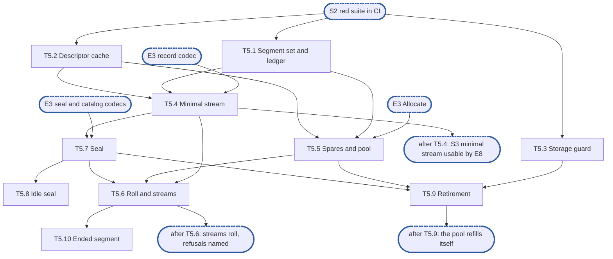

# Epic 5: journal v2 segments, streams and accounting

**Sources:** [RFC 28](../rfcs/rfc-28-journal-format.md) §2.2, §2.4 and §2.5 (the writing side),
§3.1 (idle seal) and Appendix A (allocation); [RFC 1](../rfcs/rfc-1-journal.md) §3.7, §3.9, §5.1,
§5.3, §6 (allocation, spares, refusals), §7.1, §7.3, §7.4 and §8.2–§8.7; the descriptor and
stream settings of [RFC 13](../rfcs/rfc-13-configuration.md) Appendix B.
**Track:** A.
**Epic 5 estimate: 10 subtasks, 30 man-days.**
**Depends on:** sync point **S2, red suite in CI**; epic 1's `core` types and settings, and its
storage seam (`storage.FS`, `storage.File`); epic 2's crash-simulating seam, fixture and
profiler; epic 3's segment header and names, record, seal marker, catalog entry and trailer
codecs, and the OS `Allocate`; epic 4's per-segment byte accounting.
**Blocks:** epic 6 (`Sync` works on this epic's streams), epic 7 (recovery reads the segments
this epic writes, and re-adopts its spares), epic 8 (the data path appends and reads through
this epic's streams; its integration tests wait for the minimal stream) and epic 9 (reclamation
retires segments through this epic's executor).

---

## 1. Goal

Epic 5 is the writing side of the journal's files: the segments, the append streams that fill
them, the spare pool that supplies them, the seal that closes them, the retirement that
returns them, and the accounting that keeps count of every byte they occupy. It does no
durability policy (epic 6), no recovery (epic 7) and no index (epic 4).

**At the end of the epic:**

- a stream appends records to a segment at positions reserved in order, splits a write at the
  segment cap, rolls to a spare and reads back what it wrote, on real storage;
- a spare is made whole or not at all, at every crash point of the crash-simulating seam;
- a seal writes its marker, footer and trailer in the order the format requires, in two
  syncs for a full seal and three for an early one;
- a retired segment is unlinked or recycled by the pool's level at that moment, never
  readable by a reader that still holds its old location, and leaves the accounted footprint
  exactly once;
- descriptors are bounded per process and reopened on a miss;
- `Segments`, `Sealed`, `UsedBytes`, `HeadroomBytes`, `RepackReserveBytes`, `OpenDescriptors`,
  `DescriptorLimit`, `spare_refusals`, `segment_reopens` and the double-retire count are
  served from maintained counters.

### 1.1 In scope

- The segment set, ids and the footprint ledger, including per-share record bytes (T5.1).
- The descriptor cache and the per-process descriptor budget (T5.2).
- The per-segment storage guard (T5.3).
- Append streams: position reservation, the split at the cap, the synced-through value a
  record carries, the positioned read (T5.4), the roll and several streams (T5.6).
- The spare pool, its classes and its refusals (T5.5, T5.6).
- The seal, the catalog and the free tail, and the idle seal (T5.7, T5.8).
- Retirement by unlink or recycle, and the executor behind it (T5.9).
- Ending a segment after a failed append (T5.10).

### 1.2 Out of scope

- Byte layouts, checksums and the slot scanner: epic 3. This epic calls the encoders.
- `Sync`, group commit, the sync timer, failed-sync windows, loss records: epic 6. This epic
  provides the stream's synced-through value, the end of a segment, and the records a window
  holds; epic 6 decides what a window does.
- `Init`, `Open`, rebuild, torn tails, unlinking a stray `.spare.tmp`, re-adopting spares,
  orphans and the footer's use at recovery: epic 7. This epic exposes how large the biggest
  id in the directory is as an input it is given at open.
- The file append serialisation point, reservations and `Reserve`, the share limit, the index
  bound, the headroom half rule, the order in which refusals are named, `Stats` aggregation,
  the five lock domains and their recorder, `Handle.Close`: epic 8.
- When a segment is not held and when its removal records may be dropped, `Repack`, pins,
  `Release`: epic 9. This epic provides what they call: the retirement executor, the claim and
  the durable-unlink signal.
- Wiring the pool target, the stream count and the descriptor limit to configuration: epic 11.
- A footer for a segment sealed by a previous process (a MAY): not taken (D4).
- Compressing the `FileID` column of the footer (a MAY): not taken, the layout defines none.

### 1.3 Names used here

- **E1**, epic 1, interfaces: the `core` types and settings, the storage seam.
- **E2**, epic 2, red e2e suite and test foundations: the crash-simulating seam, fixture,
  reference model and profiler.
- **E3**, epic 3, on-disk format and platform layer: the codecs, names and the OS storage.
- **E4**, epic 4, placement index and versions: the per-segment held and retained bytes.
- **E5**, this epic.
- **E6**, epic 6, durability and loss: `Sync`, failed windows.
- **E7**, epic 7, recovery and identity: `Init`, `Open`, rebuild, spare re-adoption.
- **E8**, epic 8, data path and capacity: `WriteAt`, `ReadAt`, reservations, `Stats`.
- **E9**, epic 9, offload, reclamation, holds and tags: `Release`, `Repack`, pins.
- **E10**, epic 10, start and initialisation: the start check and the device configuration.
- **E11**, epic 11, the engine on the RFC 16 store: the wiring of configuration.
- **S1**, interfaces frozen: E1's exported surface no longer changes.
- **S2**, red suite in CI: E2's suite runs in CI from every pull request.
- **S3**, walking skeleton: a minimal append stream from this epic, one stream with no pool
  and no seal, plus E8's `WriteAt` and `ReadAt`, so the first conformance tests turn green.
  **T5.4 is this epic's half.**
- **S4**, core complete: E3–E9 done.

## 2. General rules for each epic

1. **Independent unit tests.** Each epic carries its own unit tests. It may use another
   epic's pure in-memory implementation (E4's index, E3's codecs), the implementation of
   an epic it depends on once that has landed (E8 on E5's segments and E6's `Sync`), and the test components from epic 2. Epic 1 declares no internal interface
   to fake (rule 12).
2. **Fuzz tests where relevant.** Use Go native fuzzing (`testing.F`) on every parser of
   bytes the journal did not just write: records, segment headers, seal markers, catalogs,
   trailers, the `format` file. Also fuzz-drive operation sequences against the reference
   model. The property is that any input is either accepted as valid or rejected: never a
   panic, and never an extent the bytes do not contain.
3. **Metrics, and tracing where relevant.** Every counter and gauge RFC 1 §3.7 and §3.9
   assigns to the epic's area is maintained, and exposed through `Stats` (served from
   maintained counters, never a walk). Spans go through epic 1's standard-library
   `Tracer` and logs through the injected `*slog.Logger`, never a metrics or tracing
   library. Operations worth a span:
   open and recovery, sync, offload pass, repack pass, fill, and a refused reservation.
4. **Profiling.** Tests and benchmarks run under epic 2's profiling harness and fail on
   goroutine, descriptor or memory leaks and on anomalous resource growth. Hot paths
   (`WriteAt`, `ReadAt`, `Stats`, `report`, index lookup and insert) carry
   allocations-per-op assertions and the counted checks of RFC 1 §9.7. Allocation and
   heap assertions run outside `-race` only, because `-race` changes both.
5. **Public interface and internals.** Tests cover the epic's internal package API and the
   public v2 interface behaviour it enables, including concurrency under `-race`. Per the
   project rules, test at the layer that **consumes** a value, not the one that produces
   it. A regression test is validated by reverting the fix and watching it fail **on its
   assertion**.
6. **Known failures shrink.** Every e2e test an epic turns green is removed from the
   known-failure list in the same change. The runner fails if a listed test passes.
7. **v2 ignores v1.** No import of, copy from, or behavioural dependence on
   `pkg/block/journal`. The import test enforces it. v1 code is neither ported nor
   bridged: it is deleted with the rest of v1 at the cutover (stage 7 of #3119). v2
   checks only whether v1 state exists, to refuse it at start (E10), and never reads
   v1's format.
8. **Real storage for storage properties.** No in-memory filesystem stands in for a check
   about durability, torn tails, unlink durability or corruption (RFC 1 §9.5). In-memory
   stand-ins are allowed only for pure logic (index, codecs).
9. **Code comment conventions** (`CLAUDE.md`). No epic, issue or plan IDs in source
   comments. Use `ponytail:` for knowingly-simple implementations and `decision:` for
   deliberate behaviour. Where the RFC already carries a ponytail or decision note, its
   marker goes at the code site that implements it.
10. **A test must be able to fail.** Every test is code maintained for the life of the
    project. Keep a test only if a plausible change would make it fail and nothing else
    would catch that change: not the compiler, not the PR diff, not a later epic's tests.
    A test that checks two `errors.New` values differ, that the standard library's
    `errors.As` works, or that a stub returns zero does not qualify. A test that a
    little-endian `Version.Bytes` would fail does. Review rules that no test can check
    (for example, stubs never panic) stay review rules.
11. **A symbol is exported only if RFC 1 §3 uses it.** Everything exported is frozen at
    S1, so a helper exported for convenience becomes a contract. Helpers the internal
    packages need (`Less`, `IsZero`, `End`, `Overlaps`, `Seq`, the proposed constants)
    stay in `internal/core`.
12. **Each subtask creates only what it declares.** No empty package and no stub without
    a caller. A package, an option or a test helper lands with its first consumer.

### 2.1 How the rules apply

| Rule | Subtasks | How |
| --- | --- | --- |
| 1 Unit tests | all | every R-number has a test that can fail. Subtasks use E3's codecs, E4's per-segment accounting and E2's crash-simulating seam, and fake nothing of their own |
| 2 Fuzz | T5.1 | there is no parser of bytes here: the footer reader is E3's, and this epic only writes. T5.1 fuzz-drives sequences of create, shrink, claim and retire against an oracle of the footprint |
| 3 Metrics and tracing | T5.1, T5.2, T5.5, T5.6, T5.9 | `Segments`, `Sealed`, `UsedBytes`, `HeadroomBytes`, `RepackReserveBytes`, `OpenDescriptors`, `DescriptorLimit`, `segment_reopens`, `spare_refusals` and the double-retire count are maintained at the event that changes them and read without a walk. The double retire logs at `Warn` through the injected logger. **No span:** a refused reservation, the one span-worthy operation near this area, is traced by E8, which names the limit that refused. A seal, a recycle and a spare's making are not on the list |
| 4 Profiling | all | every test runs under E2's profiler. T5.2, T5.8 and T5.9 are where descriptors and goroutines could leak (the cache, the idle sealer, the retirement worker). T5.4 asserts zero allocations per position reservation, outside `-race` |
| 5 Public and internals, `-race` | T5.2, T5.3, T5.4, T5.6, T5.9 | internal API now: the public `WriteAt`, `ReadAt` and `Stats` behaviour is tested in E8, their consumer. Concurrency is exercised under `-race` where subtasks list it |
| 6 Known failures | none | every conformance test needs `Open`, which E7 and E8 wire. This epic turns none green and adds none |
| 7 v2 ignores v1 | all | enforced by the import test. Nothing of `pkg/block/journal` is read |
| 8 Real storage | T5.2, T5.4–T5.10 | every test of a sync, a rename, an unlink or a crash runs on a real directory through E2's seam. T5.1 and T5.3 are pure logic and test in memory |
| 9 Comment markers | T5.4, T5.5, T5.6, T5.7, T5.9 | see §4: each decision names its marker and where it goes. The RFC's `ponytail:` on the constant segment size goes at the cap in T5.6, and its `decision:` on zero-filling goes where T5.5 calls `Allocate` |
| 10 A test can fail | all | each test in §6 names the bug it catches |
| 11 Exports | all | `journalv2` gains no symbol: everything is in `internal/segment`, and the one exception, `core.DescriptorBudget`, is already declared by E1 |
| 12 Created with its consumer | all | `internal/segment` lands with T5.1, and each file lands with the subtask that uses it. Until E8, tests are the only consumer: the package is logic over the storage seam tested on its own (rule 1), not a placeholder |

## 3. Requirements and invariants

Every **MUST** and **MUST NOT** that RFC 1 and RFC 28 place on this epic, the SHOULDs it
adopts, and the bounds and test rows that name its area, numbered so that subtasks and tests
can cite them. Obligations that another epic carries out are not listed: §1.2 names the
epic. A mechanical search for the key words over the owned sections found every one of them
below or in §1.2.

**Segment layout and streams**

| # | Requirement | Kind | Source | Subtasks |
| --- | --- | --- | --- | --- |
| R1 | A sealed segment is never appended to again | MUST NOT | RFC 28 §2.2 | T5.7, T5.10 |
| R2 | A write that does not fit what remains of the current segment is split at the cap into records, one per segment, each carrying its own file offset and the write's version. No record spans two segments | MUST | RFC 28 §2.2 | T5.4, T5.6 |
| R3 | A segment is created at its cap and allocated whole, by the platform's allocation call or by writing zeros. The file never grows | MUST | RFC 28 §2.2, Appendix A | T5.5 |
| R4 | Bytes of an allocated segment that no record has reached read as zeros | invariant | RFC 28 §2.2 | T5.5 |
| R5 | Concurrent appends to one stream write at positions reserved in order. A write that fails returns its error and is never acknowledged, and its slot is left as it is | invariant | RFC 28 §2.2 | T5.4 |
| R6 | Appends of different `FileID`s proceed concurrently, on one stream and across streams. The number of independent streams is the configured stream count | MAY, adopted | RFC 28 §2.2, RFC 13 App. B | T5.4, T5.6 |
| R7 | A bounded number of segments per stream is open for append at one time. Every other segment is sealed | invariant | RFC 28 §2.2 | T5.6 |
| R8 | Every segment begins with a header, written once when a stream takes it, naming the journal identity, the segment's own id, its predecessor (or none) and the stream number. The stream's next sync makes it durable | MUST | RFC 28 §2.2 | T5.4, T5.6 |
| R9 | Segment ids start at 1 and ascend across all streams in the order segments are created | invariant | RFC 28 §2.2 | T5.5 |
| R10 | The synced-through offset a record carries is the offset in its segment up to which a sync had completed when the record was written. It never advances past a slot whose write failed or has not completed | MUST | RFC 28 §2.3, §2.2 | T5.4, T5.10 |
| R11 | A stream seals a segment while what remains still holds the seal marker, a footer entry for every record in it and the trailer | invariant | RFC 28 §2.5 | T5.4, T5.7 |
| R12 | Of the lock domains only the file append domain is held across I/O. Reserving a position in a segment takes the segment append domain for the reservation alone, and the record write happens outside it | invariant | RFC 1 §8.2 | T5.4 |

**The spare pool**

| # | Requirement | Kind | Source | Subtasks |
| --- | --- | --- | --- | --- |
| R13 | A spare is made as `<id>.spare.tmp`: created, allocated (zero-filled where Appendix A requires it), synced, renamed to `<id>.seg`, then the directory synced. A crash leaves no `<id>.seg` or a whole one | MUST | RFC 28 §2.2 | T5.5 |
| R14 | A spare's id is drawn when it is made, and its header slot is zeros until a stream takes it | invariant | RFC 28 §2.2 | T5.5 |
| R15 | Making a segment happens off the write path. A roll costs only the take | invariant | RFC 28 §2.2, RFC 1 §5.2 | T5.5, T5.6 |
| R16 | The id of a new spare or of a recycle exceeds the id of every `.seg` and `.spare.tmp` file in the directory, those found at open included | MUST | RFC 28 §2.2 | T5.5, T5.9 |
| R17 | The spares that back the headroom and the repack reserve are not in the content pool. A content roll and a `Reserve` never take one, and one that finds only those is refused `spare` | MUST NOT | RFC 1 §6 | T5.5, T5.6 |
| R18 | Creating a spare reserves its cap against the journal's maximum, atomically with every other reservation. The pool grows only at `Init`, when the maximum is raised, or when no full-size retired segment is to hand | MUST | RFC 1 §6, RFC 28 §2.2 | T5.5 |
| R19 | A directory sync follows the creation of a segment before any `Sync` covering its records returns. A spare's entry is synced when it is made, so taking one needs none, and a failed directory sync means the spare does not exist | MUST | RFC 28 §2.2, RFC 1 §5.1 | T5.5 |
| R20 | A roll that finds no spare ready is refused at once, with no I/O and without waiting, as `ErrNoSpace` naming the limit `spare`, never the journal's maximum | MUST | RFC 28 §2.2, RFC 1 §6 | T5.6 |
| R21 | Once making a spare has failed with `ENOSPC` and no full-size retired segment is to hand, a roll that finds no spare is refused with `ENOSPC`, until a spare is made again | MUST | RFC 28 §2.2 | T5.6 |
| R22 | `spare_refusals` counts each refusal naming `spare` | MUST | RFC 28 §2.2, RFC 1 §3.9 | T5.6 |
| R23 | Header-only records go on drawing on the allocated headroom when no spare is ready. The pool offers them the headroom's spares | invariant | RFC 28 §2.2, RFC 1 §6 | T5.5, T5.6 |

**Seal, catalog and free tail**

| # | Requirement | Kind | Source | Subtasks |
| --- | --- | --- | --- | --- |
| R24 | Sealing writes a seal marker at the slot just past the last record. It is durable before a successor naming the segment is taken | MUST | RFC 28 §2.2 | T5.6, T5.7 |
| R25 | Bytes after a seal marker belong to the footer, never to records | invariant | RFC 28 §2.2 | T5.7 |
| R26 | Seal order: every record durable first, then the marker, footer and trailer written and durable, then, for an early seal, the file truncated past the trailer and that made durable | MUST | RFC 28 §2.5 | T5.7 |
| R27 | A full seal costs two syncs and an early seal three. A step may be split into more | bound | RFC 28 §2.5 | T5.7 |
| R28 | A sealed segment carries a catalog footer: one entry per record in it | SHOULD, adopted | RFC 28 §2.4 | T5.7 |
| R29 | The footer is written and made durable after the records it describes | MUST | RFC 28 §2.4 | T5.7 |
| R30 | The footer carries its own checksum and identifies the extent of the segment it describes. Epic 3 owns the bytes, this epic supplies the entries and the offsets | MUST | RFC 28 §2.4, §2.5 | T5.7 |
| R31 | A segment that carries a footer ends with the fixed-size trailer in its last 32 bytes: at the cap's end for a full seal, just after the footer for an early one | MUST | RFC 28 §2.4, §2.5 | T5.7 |
| R32 | The footer is appended at most once. A footer that already verifies is never rewritten or extended | MUST, MUST NOT | RFC 28 §2.4 | T5.7 |
| R33 | A failed sync in the first two seal steps leaves the segment never sealed, and its successor names none | MUST | RFC 28 §2.5, RFC 1 §5.3 | T5.7 |
| R34 | A failed truncation sync does not end the segment. It is sealed, a successor may be taken, and it stays accounted at its cap | MUST | RFC 28 §2.5, RFC 1 §7.3 | T5.7 |
| R35 | A segment sealed full is never truncated and keeps its cap, so it can be recycled as a full-size spare. A segment sealed early always returns its free tail | MUST | RFC 28 §2.2, RFC 1 §7.3 | T5.7 |
| R36 | The catalog is not placed in a separate file, and no second durable log of it is kept | MUST NOT | RFC 28 §2.4 | T5.7 |
| R37 | An active segment that has taken no append for 30 s is sealed once the bytes it holds beyond its last catalogued point pass `journal.idle_seal_bytes`. Below the threshold it stays open | MUST | RFC 28 §3.1 | T5.8 |
| R38 | No byte range inside a segment is freed, zeroed or deallocated while the segment remains, except the free tail at seal. (The torn tail cut at recovery is epic 7's.) A recycle's slot zeroing is part of retiring the whole segment, not of a segment that remains | MUST NOT | RFC 1 §7.1 | T5.7, T5.9 |

**Retirement: unlink and recycle**

| # | Requirement | Kind | Source | Subtasks |
| --- | --- | --- | --- | --- |
| R39 | Before a segment is unlinked, every descriptor cached for it is closed. Where an open file cannot be unlinked, segments are opened with sharing that permits deletion | MUST | RFC 28 §2.2, RFC 1 §7.4 | T5.2, T5.9 |
| R40 | Recycle order: close the descriptors, rename to a fresh `<id>.seg`, sync the directory, then overwrite the header slot and the trailer slot with zeros and sync. Never zero first. No zero-fill | MUST | RFC 28 §2.2 | T5.9 |
| R41 | A recycle that fails at any step is an unlink, under whichever of its two names the journal finds. The segment is never a spare | MUST | RFC 28 §2.2 | T5.9 |
| R42 | Whether a full-size segment is recycled is decided at its retirement: recycled while the pool is below its target then, unlinked otherwise. Never decided at seal | MUST | RFC 28 §2.2, RFC 1 §7.3 | T5.9 |
| R43 | A segment sealed early is unlinked when retired, never recycled. A segment ended by a failed sync, by a failed append, or by recovery without a seal is unlinked, never recycled, and only once repack has carried its synced records forward | MUST | RFC 28 §2.2, RFC 1 §5.3 | T5.9, T5.10 |
| R44 | A segment's records are durable before it is unlinked or recycled. A release record is durable before the segment holding the record it released is retired | MUST | RFC 1 §5.1 | T5.9 |
| R45 | An unlink is made durable by a directory sync, and the retirement reports when it is. A removal record whose retention counted the segment is dropped only after (epic 9 applies the rule) | MUST | RFC 28 §2.2, RFC 1 §5.1 | T5.9 |
| R46 | A segment that is not held is retired by the journal on its own, once the records that left it not held are durable, without waiting for a repack to select it. This epic provides the executor and its background worker. Epic 9 decides when a segment is not held | MUST | RFC 1 §7.1 | T5.9 |
| R47 | Unlink and recycle take the storage guard exclusively, and freeing storage is the last step, after no reader can hold the old resolution | MUST | RFC 1 §8.5 | T5.3, T5.9 |

**A failed append ends its segment**

| # | Requirement | Kind | Source | Subtasks |
| --- | --- | --- | --- | --- |
| R48 | A failed append ends its segment, fresh or recycled: no further append, not even a seal marker. The stream continues in a new segment naming no predecessor, and the segment is never sealed | MUST | RFC 28 §2.2, RFC 1 §5.1, §5.3 | T5.10 |
| R49 | The records written to the ended segment since its last successful sync are handed to the failed-window resolution (re-append or fail: epic 6). This epic hands them over and decides nothing about them | MUST | RFC 28 §2.2, RFC 1 §5.3 | T5.10 |
| R50 | An ended segment stays accounted at its cap to the journal until it is unlinked | MUST | RFC 1 §5.3, §7.3 | T5.1, T5.10 |

**Accounting**

| # | Requirement | Kind | Source | Subtasks |
| --- | --- | --- | --- | --- |
| R51 | Accounted footprint reflects the storage the journal's files allocate: a segment at its cap from creation to unlink, and a segment shortened by a torn-tail truncation or at seal at its size afterwards | MUST | RFC 1 §7.3 | T5.1 |
| R52 | `UsedBytes` is raised before an allocation happens and lowered only after an unlink has happened, and it moves only when a segment is created, unlinked or shortened | invariant | RFC 1 §3.7, §6 | T5.1, T5.5, T5.9 |
| R53 | Every file the journal creates is accounted, each segment's footer included, and every such file is bounded by live state, not by history | MUST | RFC 1 §7.3, RFC 28 §2.4 | T5.1, T5.7 |
| R54 | The spares of the headroom and of the repack reserve are accounted to the journal, never to a share | MUST | RFC 1 §7.3, §6 | T5.1, T5.5 |
| R55 | A record's bytes (header, payload, padding) are accounted to the share whose tag the record carries when it is written, and released when the segment holding it is unlinked or recycled | MUST | RFC 1 §6 | T5.1 |
| R56 | Retiring a segment is idempotent: its bytes leave the footprint exactly once, in the step that removes it from the set of segments the journal owns, and only if that step found it there. A retire that finds the file gone or the segment out of the set subtracts nothing | MUST | RFC 1 §7.3 | T5.1, T5.9 |
| R57 | A claim taken on a segment is never released after the segment is retired | MUST NOT | RFC 1 §7.3 | T5.1 |
| R58 | A retire that subtracts nothing is counted and logged at `Warn` | MUST | RFC 1 §7.3 | T5.1 |
| R59 | The accounted footprint is checkable against the sum of the segment set's sizes, and a mismatch is reported (the check is called by epic 7's verification) | SHOULD, adopted | RFC 1 §7.3 | T5.1 |
| R60 | The counters of this area are served from maintained state, never from a walk of the segment set | MUST | RFC 1 §3.7 | T5.1, T5.2, T5.5, T5.6 |

**Descriptors**

| # | Requirement | Kind | Source | Subtasks |
| --- | --- | --- | --- | --- |
| R61 | Open segment descriptors are bounded by `DescriptorLimit`, independently of the number of segments. The bound is per process: every journal of the process draws on one budget | MUST | RFC 1 §7.4 | T5.2 |
| R62 | A read of a segment whose descriptor is not open reopens it | MUST | RFC 1 §7.4 | T5.2 |
| R63 | The count, the bound and the reopens are reported through `Stats` | MUST | RFC 1 §7.4, §3.9 | T5.2 |
| R64 | The default `DescriptorLimit` is a quarter of the process's open-file limit | bound | RFC 13 App. B | T5.2 |

**Storage guard, lock order and shutdown**

| # | Requirement | Kind | Source | Subtasks |
| --- | --- | --- | --- | --- |
| R65 | A read either observes the location it resolved, intact, or discovers that it must retry or report the extent missing. It never returns bytes from storage that has been freed or reused | MUST | RFC 1 §8.5 | T5.3, T5.9 |
| R66 | The mechanism is a shared/exclusive guard per segment: readers hold it shared, an unlink or recycle takes it exclusively and waits for in-flight reads of that segment only | MUST | RFC 1 §8.5 | T5.3 |
| R67 | A continuous stream of readers never prevents reclamation from acquiring a segment exclusively: the guard is not reader-preferring | MUST NOT | RFC 1 §8.6 | T5.3 |
| R68 | Reclamation never holds a segment exclusively for longer than one unit of work | MUST NOT | RFC 1 §8.6 | T5.3, T5.9 |
| R69 | The storage guard is the last lock in the order and nothing is acquired while it is held. Reclamation takes it only to unlink or recycle, holding no other lock. No two locks of one domain are held at once | MUST, MUST NOT | RFC 1 §8.3 | T5.3, T5.4 |
| R70 | On close, background work (idle seal, the retirement worker) is stopped and joined before the segments it touches are closed, and no storage a reader may still hold is freed | MUST | RFC 1 §8.7 | T5.8, T5.9 |

**Test rows of the RFCs for this area**

| # | Requirement | Kind | Source | Subtasks |
| --- | --- | --- | --- | --- |
| R71 | A spare is whole or absent: crash at every step of making one, dropping unsynced allocations and directory changes. Every `<id>.seg` is at its cap and fully allocated, and the next spare's id is above any `.spare.tmp` id. (The unlink of a stray `.spare.tmp` at open is epic 7's) | test row | RFC 28 §4.2 | T5.5 |
| R72 | Retired segments are recycled: the seam sees a rename, then a zeroed header slot and trailer slot per recycle, and no zero-fill. A recycle happens exactly when the pool is below its target at retirement. Every segment sealed early is truncated and none sealed full is. A segment whose sync or append failed is unlinked | test row | RFC 28 §4.2 | T5.7, T5.9, T5.10 |
| R73 | Descriptors: create more segments than the bound, reads still succeed and open descriptors stay bounded | test row | RFC 1 §9.4 | T5.2 |
| R74 | Two paths retire one segment, one after the other: accounted footprint falls by its size exactly once and never goes below zero | test row | RFC 1 §9.2 | T5.1, T5.9 |
| R75 | Accounting follows the cap, including on a filesystem that allocates speculatively past the end of a growing file, and a record write moves the share's `UsedBytes` and not the journal's | test row | RFC 1 §9.4 | T5.1, T5.5 |
| R76 | Unlink under read: a read of a segment concurrent with its unlink returns the pattern it should, or retries, or reports the extent missing, never other bytes | test row | RFC 1 §9.4 | T5.3, T5.9 |
| R77 | A zero slot is not the end, the write half: a failed middle write returns an error, no append reserved after the failure lands in that segment, and the stream's next append goes to a new segment. (The reopen half is epic 7's) | test row | RFC 28 §4.2 | T5.10 |

## 4. Decisions this epic takes

- **D1, one package of concrete types.** `internal/segment` holds the set, the cache, the
  guard, the streams, the pool and the retirement as concrete types, with no interface
  between them (rule 12). The storage seam is the only interface they touch.
- **D2, the synced-through value comes from an ordered-completion tracker.** RFC 28 §2.2
  says only that it never passes a slot whose write failed or has not completed. The
  stream tracks, per segment, which reserved slots have completed and which sync has
  returned, and a record carries the highest offset below which every slot completed and a
  sync covered. A `decision:` marker at the tracker states why a plain "last synced offset"
  is wrong: a later slot can complete and sync while an earlier one is still in flight.
- **D3, three spare classes in one pool.** The pool holds spares of three classes: content,
  headroom and repack reserve. Only content spares serve a roll (R17). Sizes come from the
  settings (`SpareTarget` for content, the headroom and reserve sizes from the capacity
  rules of RFC 1 §6, given to the pool by the caller). A `ponytail:` marker at the target
  says the target is static: it names the ceiling (a burst longer than one segment's fill
  time refuses `spare`) and the upgrade (a target that follows the roll rate) once
  `spare_refusals` shows it.
- **D4, no footer for a segment sealed by a previous process.** RFC 28 §2.4 permits it
  (a MAY) and a segment sealed at a crash legitimately has none. This epic does not take
  it: recovery scans such a segment. A `decision:` marker at the seal says the exemption
  holds while a scan of the tail is cheap, and what overturns it: a time to first read
  dominated by scans of such segments.
- **D5, one retirement executor, two entry points.** `Retire` runs one retirement now.
  A queue and a worker run those that epic 9 hands over once their records are durable.
  Epic 9 decides that a segment is not held, so the executor never calls the index to
  decide it; it checks only what it owns (no unsynced bytes, nothing claimed).
- **D6, a spare's directory entry is synced when it is made.** So taking one costs no
  directory sync (R19). A directory sync that fails while making a spare means the spare
  does not exist and is made again: there is no window to re-append, because no record was
  ever written to it.
- **D7, a file's appends go to one stream.** The stream is chosen by a hash of the
  `FileID`, so one file's records stay ordered on one stream and epic 8's file append
  serialisation needs no cross-stream order. A `ponytail:` marker names the ceiling: one hot
  file cannot use more than one stream.
- **D8, the cache never evicts a descriptor that a reader holds.** A descriptor is in
  use while a guard hold on its segment is open. A `ponytail:` marker at the cache says it
  is one mutex around an LRU, and what would make it worth sharding: contention on that
  mutex in a profile of the mixed read soak.
- **D9, the segment cap in tests.** Tests shorten the cap through `core.SetSegmentCap`
  and never through a second constant, so every size check of this epic runs at the
  production code path.
- **D10, the skeleton creates its first segment on the write path.** T5.4 makes a segment
  at its cap on the spot so the minimal stream works before the pool exists. A `ponytail:`
  marker says so, and T5.6 replaces it with the pool's take.

## 5. Target tree

```text
pkg/block/journalv2/internal/
  segment/
    set.go          T5.1   segment set, footprint ledger, claims, per-(segment, tag) bytes
    descriptors.go  T5.2   descriptor cache over one per-process budget
    guard.go        T5.3   per-segment shared/exclusive guard
    stream.go       T5.4   append stream, position reservation, synced-through tracker, read
    pool.go         T5.5   spare making, ids, classes, refill worker
    roll.go         T5.6   take a spare, predecessor, several streams, refusals
    seal.go         T5.7   seal marker, footer, trailer, truncation
    idle.go         T5.8   idle seal worker
    retire.go       T5.9   unlink, recycle, executor and worker
    end.go          T5.10  ending a segment after a failed append
    *_test.go
  core/
    config.go       T5.2   DescriptorBudget implemented (declared by E1)
  index/
    segments.go     T5.1   the per-segment retire hook, exported for this package
```

## 6. Subtasks

### T5.1 Segment set and footprint ledger

**Subtask T5.1 estimate: 2.5 man-days.**

- **Track:** A. **Depends on:** S2; E4's per-segment held and retained bytes.
- **Covers:** R50–R60, R74, R75.
- **Deliverables:** `internal/segment/set.go`: the set of segments the journal owns, each with
  an id, a state (spare, active, sealed, ended), the size it is accounted at and its record
  bytes per share tag; the footprint (`UsedBytes`), raised when a segment is created and
  lowered only after its unlink; `Retire(id)` that removes the segment from the set and
  subtracts only if it found it there; `Claim` and its release, a no-op after retirement;
  `Check()` that compares the footprint with the sum of the set's sizes; the `Segments`,
  `Sealed` and double-retire counters; a `Warn` log on a retire that subtracts nothing. In
  `internal/index/segments.go`, the existing per-segment retire hook is exported for this
  package, and nothing else of the index changes.
- **Acceptance criteria:**
  - Retiring a segment twice, or from two goroutines at once, lowers the footprint once and
    counts and logs the second.
  - A claim released after retirement changes nothing.
  - `Check()` reports a mismatch when the footprint and the sum differ.
  - A segment shortened at seal is accounted at its new size; a failed or ended one keeps
    its cap.
  - Record bytes of one tag leave with the segment that held them.
- **Tests:** a property test and a `testing.F` target of random create, shrink, claim and
  retire against an oracle of the footprint (catches a path that forgets to subtract, or
  subtracts twice); two goroutines retiring one segment under `-race` (catches a
  check-then-act retire); `Check()` after a deliberately skipped subtract (catches a check
  that compares the footprint with itself); a test that `UsedBytes` is raised before a
  create's allocation and lowered only after its unlink, against a hook between the two.

### T5.2 Descriptor cache and per-process budget

**Subtask T5.2 estimate: 2.5 man-days.**

- **Track:** A. **Depends on:** S2.
- **Covers:** R39, R60–R64, R73.
- **Deliverables:** `core.DescriptorBudget` implemented: the limit (0 means a quarter of the
  process's open-file limit where the platform reports one, and a fixed default where it does
  not, behind a `ponytail:`), the shared count and an acquire that refuses past the limit.
  `internal/segment/descriptors.go`: a cache that opens a segment's file on a miss, counts
  the reopen, evicts the least recently used descriptor nothing holds (D8), and closes every
  descriptor of one segment on demand. It exports `OpenDescriptors`, `DescriptorLimit` and
  `segment_reopens`.
- **Acceptance criteria:**
  - Two journals of one process, each over its own directory, draw on one budget: the sum of
    their open descriptors never passes the limit.
  - Reading more segments than the limit succeeds, and the open count stays at or below it.
  - A read of a segment whose descriptor was evicted reopens it and counts one reopen.
  - After `Close(id)`, the storage seam shows no open descriptor of that segment.
  - A descriptor held by a reader is never evicted.
- **Tests:** two caches on one budget with a bound of 4 and 16 segments each (catches a
  per-journal bound); a reader holding a descriptor while 16 others are read (catches an
  eviction under a reader); the seam's open-file count after `Close` (catches a leaked
  descriptor that would keep an unlinked file allocated); a read loop at a bound of 1 counts
  one reopen per miss and no more; `-race` with 32 readers.

### T5.3 Per-segment storage guard

**Subtask T5.3 estimate: 1.5 man-days.**

- **Track:** A. **Depends on:** S2.
- **Covers:** R47, R65–R69, R76.
- **Deliverables:** `internal/segment/guard.go`: a shared/exclusive guard per segment, with
  a shared hold for a reader, an exclusive hold for an unlink or a recycle, and the exclusive
  hold run as one callback so it cannot outlive one unit of work. A `decision:` marker says it
  wraps `sync.RWMutex`, whose pending writer blocks new readers, and a test pins that
  property, since the guard must not be reader-preferring.
- **Acceptance criteria:**
  - An exclusive request waits only for in-flight readers of its own segment.
  - With readers arriving continuously, an exclusive request acquires within a bounded
    number of reader turns.
  - The guard offers no way to hold it across a call that takes another lock of the journal:
    the exclusive hold is a callback that receives no handle to anything else.
- **Tests:** a reader loop on one segment and an exclusive request that must complete (catches
  a reader-preferring guard replacing the wrapper); a reader on segment A and an exclusive
  request on segment B that does not wait (catches a store-wide guard); `-race` with readers
  and writers.

### T5.4 Minimal append stream and positioned read

**Subtask T5.4 estimate: 4 man-days.**

- **Track:** A. **Depends on:** T5.1, T5.2; E3's record codec and segment header.
- **Covers:** R2, R5, R6, R8, R10–R12, R69.
- **Deliverables:** `internal/segment/stream.go`: `Stream` with one active segment, created
  on the write path (D10), the header written once when the stream takes it, and
  `Append(record)` that reserves a position under the segment append lock without I/O (R12),
  writes the record outside it, and splits at the cap by reporting how many bytes fit so the
  caller continues in the next segment (T5.6). The ordered-completion tracker (D2) and the
  synced-through value a record carries. `ReadAt(location, p)` through T5.2's cache under a
  shared hold of T5.3's guard.
- **Acceptance criteria:**
  - Sixteen concurrent appends of different files land at distinct, increasing, non-overlapping
    positions, each record reading back byte for byte.
  - A write that straddles the cap is cut into pieces that each carry their own file offset
    and the write's version.
  - A write that fails returns its error and is never acknowledged. Records reserved after it
    carry a synced-through value below its slot.
  - The reservation allocates nothing, outside `-race`.
  - The stream stops short of the cap by the room the seal still needs (R11).
- **Tests:** the tracker with a later slot completing and syncing first while an earlier one
  is held (catches a "last synced offset" implementation, D2); the split at the cap with
  the pieces' offsets and versions asserted; a failed write at the seam followed by two
  appends, asserting both synced-through values; the allocation count of the reservation; a
  lock-held-during-I/O check on the segment append lock (catches R12); `-race` with 16
  appenders and a reader.

### T5.5 Making spares and the pool

**Subtask T5.5 estimate: 3.5 man-days.**

- **Track:** A. **Depends on:** T5.1, T5.2; E3's `Allocate` and names.
- **Covers:** R3, R4, R9, R13–R19, R23, R52, R54, R60, R71, R75.
- **Deliverables:** `internal/segment/pool.go`: `Make(class)` that creates `<id>.spare.tmp`,
  allocates the cap, syncs, renames to `<id>.seg` and syncs the directory, reserving the cap
  against the journal's maximum atomically (through T5.1); the id allocator, seeded by the
  largest id the directory names (supplied at open, zero for a new journal) and drawing above
  it; the three classes (D3) with `Take(class)`; a refill worker that makes spares off the
  write path when a class falls below its target and is joined at shutdown; the state "making
  a spare failed with `ENOSPC`" that T5.6 reads.
- **Acceptance criteria:**
  - After a crash at any step the durable directory holds no `<id>.seg`, or one at its cap and
    fully allocated, and a `.spare.tmp` at most.
  - The next id is above every id the directory held, a `.spare.tmp` included.
  - A fresh spare reads as zeros past its header slot, and its header slot is zeros.
  - A content `Take` never returns a headroom or reserve spare.
  - Two concurrent `Make` calls near the maximum reserve atomically: together they never
    exceed it.
  - A failed directory sync leaves no spare and one reservation returned.
- **Tests:** the crash seam at each of create, allocate, sync, rename and directory sync,
  listing the directory after each drop (the RFC 28 spare row, R71); an id allocator started
  from a directory holding a `.spare.tmp` with the highest id; concurrent `Make` calls at
  the maximum (catches a read-then-decide reservation); `Take(content)` with only headroom
  spares ready (catches R17); the footprint after a failed `Make` (catches a leaked
  reservation); `UsedBytes` unchanged by writes into the spare (R75).

### T5.6 Roll and several streams

**Subtask T5.6 estimate: 4 man-days.**

- **Track:** A. **Depends on:** T5.4, T5.5, T5.7.
- **Covers:** R2, R6–R8, R15, R17, R20–R24, R60.
- **Deliverables:** `internal/segment/roll.go`: when a record does not fit, seal the active
  segment (T5.7), take a content spare, write its header naming the predecessor it sealed,
  and continue the split write there; the configured number of streams, the stream of a file
  chosen by a hash of its `FileID` (D7); a content roll that finds no spare ready returns
  `ErrNoSpace` naming `spare` at once, or `ENOSPC` when making a spare has failed with it
  and no full-size retired segment is to hand, with `spare_refusals` counted; header-only
  records are offered the headroom's spares. The skeleton's creation on the write path
  (D10) is removed. A `ponytail:` marker at the cap states the RFC's note on the constant
  segment size.
- **Acceptance criteria:**
  - A write straddling the cap lands in two segments, the second naming the first as its
    predecessor, and the first is sealed durably before the second exists.
  - A refusal performs no I/O: the seam sees no call.
  - With no content spare but a headroom spare, a content roll is refused `spare` and a
    header-only record proceeds.
  - Two files whose hashes differ use two streams and never block each other.
  - `spare_refusals` rises by one per refused roll.
- **Tests:** the straddling write across a roll, asserting the predecessor and the seal's
  order against the roll in the seam's call log (catches a successor taken before the seal is
  durable); a pool emptied, then the refusal with the seam's call count unchanged; the
  `ENOSPC` variant after a failed `Make`; `-race` with 16 appenders over 4 streams and a
  refill; the spare-refusal counter.

### T5.7 Seal, catalog and free tail

**Subtask T5.7 estimate: 4 man-days.**

- **Track:** A. **Depends on:** T5.4; E3's seal marker, catalog entry and trailer codecs.
- **Covers:** R1, R11, R24–R36, R38, R53, R72.
- **Deliverables:** `internal/segment/seal.go`: the stream keeps one catalog entry per
  record it appended; `Seal(early)` makes every record durable, appends the marker, the
  footer and the trailer and makes them durable, then, for an early seal, truncates past the
  trailer and makes that durable; a full seal puts the trailer at the cap's last 32 bytes and
  returns no tail. A segment is sealed at most once and its footer written at most once.
  A `decision:` marker for D4 sits here.
- **Acceptance criteria:**
  - A full seal issues two syncs on the segment and an early seal three.
  - After a full seal the file is at its cap and its trailer is the last 32 bytes; after an
    early seal the file ends at its trailer and the ledger shows its new size.
  - A failed sync in the first two steps leaves the segment unsealed and never accepts a
    successor naming it; a failed truncation sync leaves it sealed and accounted at its cap.
  - A second `Seal` writes nothing.
  - The directory holds no file besides the format file and the segments.
  - E3's footer reader accepts the footer of a sealed segment, and reports "no footer" for the
    state after a crash that kept only part of the second step.
- **Tests:** the seam's sync count for both seals (catches a merged or extra sync, R27); a
  crash after each step and E3's reader on each durable state; the marker durable before the
  successor is taken, with the seam holding the marker's sync; a torn second step; the failure
  injections of both steps and of the truncation; a second seal's call log; a directory
  listing (catches a side file).

### T5.8 Idle seal

**Subtask T5.8 estimate: 1.5 man-days.**

- **Track:** A. **Depends on:** T5.7.
- **Covers:** R37, R70.
- **Deliverables:** `internal/segment/idle.go`: one worker per journal that, on the injected
  clock, seals early a stream's active segment once it has taken no append for the idle time
  and holds more than the idle-seal bytes beyond its last catalogued point; the stream
  takes a spare only when its next append arrives. The worker is stopped and joined before
  the segments close.
- **Acceptance criteria:**
  - After 30 s of virtual time with more than the threshold written, the segment is sealed
    early and its tail returned.
  - Below the threshold, the segment stays open for any idle time.
  - No spare is taken by an idle seal.
  - Close returns with no worker goroutine left.
- **Tests:** the test clock advanced just below and just past the idle time, and just below
  and past the threshold (catches an off-by-one on either bound); a spare count unchanged
  across an idle seal; the profiler's goroutine check after close.

### T5.9 Retirement: unlink and recycle

**Subtask T5.9 estimate: 4 man-days.**

- **Track:** A. **Depends on:** T5.1, T5.3, T5.5, T5.7.
- **Covers:** R16, R38–R47, R52, R56, R65, R68, R70, R72, R74, R76.
- **Deliverables:** `internal/segment/retire.go`: `Retire(id, reason)` that refuses a segment
  with unsynced bytes or a live claim; takes T5.3's guard exclusively as one unit of work,
  closes the segment's descriptors (T5.2), and then either unlinks it or recycles it. The
  choice is made now: a segment sealed full is recycled while the pool is below its target,
  and every other segment is unlinked. A recycle renames to a fresh `.seg` name, syncs the
  directory, zeroes the header slot and the trailer slot, syncs, and hands the segment to the
  pool; any failed step is an unlink under whichever of the two names exists. After an unlink
  the directory is synced and the retirement reports whether its unlink is durable. The
  ledger subtracts once (T5.1). A queue and a worker retire the segments epic 9 hands over
  (D5), joined at shutdown.
- **Acceptance criteria:**
  - The seam sees, per recycle, a rename, a directory sync, two zero writes and one sync,
    and no allocation and no zero-fill.
  - A segment sealed early, ended by a failed append or by a failed sync, is unlinked and
    never recycled.
  - A failure injected at each of the four recycle steps leaves the file gone under both
    names, the pool unchanged and the footprint lowered once.
  - A crash between the rename and the zeroing leaves a file under the new name that holds
    the old life's bytes, and the old name absent.
  - Eviction and repack retiring one segment lower the footprint once and never below zero.
  - A reader holding the guard makes the retirement wait, and the reader returns its pattern.
  - The unlink reports not-durable when its directory sync fails.
- **Tests:** the seam's call log for a recycle (R72); the four failure injections; the pool
  target moved across the retirement (catches a decision made at seal); a reader of a
  segment while a retirement waits (R76); two goroutines retiring one segment (R74); a crash
  at each durable state with the directory listing; the profiler after the worker joins.

### T5.10 Ending a segment after a failed append

**Subtask T5.10 estimate: 2.5 man-days.**

- **Track:** A. **Depends on:** T5.6.
- **Covers:** R1, R10, R43, R48–R50, R72, R77.
- **Deliverables:** `internal/segment/end.go`: `End` marks the active segment ended after a
  failed append, or at the request of the durability code after a failed sync: it accepts no
  further append and no seal, the stream's next roll takes a spare whose header names no
  predecessor, the synced-through value stays below the failed slot, and the records
  written since the last successful sync are handed to a registered consumer, which epic 6
  fills in. The ledger keeps the segment at its cap, and T5.9 treats it as never recyclable.
- **Acceptance criteria:**
  - After a failed append the segment takes no further append and no seal marker.
  - The next append goes to a new segment whose predecessor is zero.
  - Every record reserved after the failed slot carries a synced-through value below it.
  - The unsynced records of the window reach the consumer exactly once, each with its
    sequence number, version and location.
  - An ended segment that was itself recycled from the pool behaves the same.
- **Tests:** three concurrent appends, the middle one failed at the seam and a third completed
  (the RFC 28 zero-slot row, write half, R77); the fourth append's segment and predecessor; a
  recycled segment's failed append; the window records handed over once; the footprint of the
  ended segment at its cap until its unlink.

## 7. Order of work

Two lanes can run side by side after the first three subtasks. **Lane 1**, the stream path:
T5.1, T5.4, T5.7, T5.8, T5.6, T5.10. **Lane 2**, the file lifecycle: T5.2, T5.3, T5.5, T5.9.
They meet at T5.6, which needs the spare pool, and at T5.9, which needs the seal. T5.4 reads
through T5.2's cache, so T5.2 should land first in lane 2.



Checkpoints:

- After T5.4: the minimal stream exists, and E8 can start its integration tests against
  `Append` and `ReadAt`.
- After T5.6: a stream rolls across segments and refuses a roll by name.
- After T5.9: retired segments return to the pool, which closes the capacity loop that E9
  and the engine drive.

## 8. Suggested pull requests

| PR | Subtasks | Man-days | After | Why together |
| --- | --- | --- | --- | --- |
| 1 | T5.1, T5.2, T5.3 | 6.5 | | the ledger, the descriptor cache and the guard: pure logic over the storage seam that every later subtask uses, with no format dependency |
| 2 | T5.4 | 4 | PR 1, E3 records | the minimal stream, which is the S3 half this epic owes |
| 3 | T5.5 | 3.5 | PR 1, E3 `Allocate` | making spares and the pool, which can be open beside PR 2 |
| 4 | T5.7, T5.8 | 5.5 | PR 2, E3 seal and catalog | the seal and the idle seal, one logic, one crash matrix |
| 5 | T5.6, T5.10 | 6.5 | PR 2, PR 3, PR 4 | the roll and the end of a segment, which share the stream's next-segment path |
| 6 | T5.9 | 4 | PR 1, PR 3, PR 4 | retirement, which can be open beside PR 5 |

A suggestion only: one pull request per subtask works as well.

## 9. Open points

- **The pool target has no value in any RFC.** RFC 28 §2.2 says a retired segment becomes a
  spare "while the pool is below its target" and names no number. D3 takes one spare per
  stream for the content pool, the settings' default. Confirm with the RFC's author, and put
  the value in the RFC.
- **A failed directory sync is a failed window, but no segment is created off the pool.**
  RFC 28 §2.2 says the failed directory sync of a new segment fails the window, and RFC 28
  §4.2's check has a stream creating the next segment. Every segment here comes from a spare
  whose entry was synced when it was made (D6), so nothing is written before its entry is
  durable and there is no window. If the check is meant to run, it needs a path that creates a
  segment on the write path; confirm which reading holds.
- **Who triggers the automatic retirement.** This epic provides the executor and the worker
  (D5); epic 9 decides that a segment is not held and that its release records are durable.
  Confirm with epic 9's owner that it hands segments over, rather than the executor polling
  the index.
- **The retire hook of `internal/index` is not exported.** T5.1 exports it. If epic 4's owner
  would rather expose a different shape, T5.1 follows.
- **Epic 3 has not landed what this epic writes through.** The record, seal marker, catalog
  entry and trailer codecs, the OS `Allocate` (a stub today) and the share-delete segment open
  for Windows are epic 3's. T5.4, T5.5 and T5.7 cannot finish before them, and the PR table
  names the wait.
- **RFC 28 changes in review.** The proposals that bind a record header to its own offset and
  that report a bad segment header or seal marker as damaged may change the codecs this epic
  calls. Re-check T5.4 and T5.7 when they merge.
- **The default descriptor limit on Windows.** RFC 13 gives "a quarter of the process's
  open-file limit", and Windows has no such limit to read. T5.2 uses a fixed default there
  behind a `ponytail:`; confirm the value with the platform owner.
- **No conformance test turns green here.** They all need `Open`. The exit check of this epic
  is its own tests, and the S3 skeleton turns the first conformance tests green only with
  epic 8's `WriteAt` and `ReadAt`.
