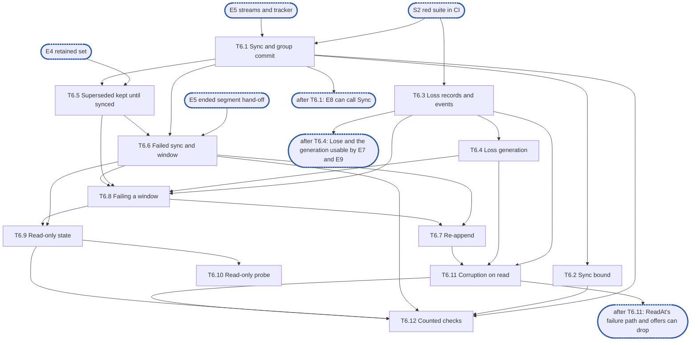

# Epic 6: journal v2 durability and loss

**Sources:** [RFC 1](../rfcs/rfc-1-journal.md) §5.1–§5.4, §3.8, §3.1 (`Sync`), §3 (the context rules), §3.7 and §3.9
(the fields and counters of this area), §9.4 and §9.7 (the rows on sync, loss, failed windows,
read-only and mixed durability); [RFC 28](../rfcs/rfc-28-journal-format.md) §2.2 (a failed
append, a failed segment, the spare's directory entry) and §3.3 (the read-time half: "The response
is to stop holding the extent" and "Scope of the refusal").
**Track:** A.
**Epic 6 estimate: 12 subtasks, 35 man-days.**
**Depends on:** sync point **S2, red suite in CI**; epic 1's `core` types, errors, `Stats` shapes and
tracer; epic 2's test clock, fault schedule, crash-simulating seam and fixture; epic 3's record
codec (the loss kind) and the `platform` sync and platform checks; epic 4's retained-extent set
and its failed-window operation; epic 5's append streams and their synced-through tracker, the
ended-segment state and its hand-off of a window's records (its T5.10), the spare pool and
the headroom.
**Blocks:** epic 7 (`Open` appends and applies this epic's loss records and calls its corruption
handler), epic 8 (`Handle.Sync` and `ReadAt`'s failure path call this epic, and every
appending call asks it whether the journal is read-only), epic 9 (offer and repack verification
call the corruption handler; `report` reads the read-only state; release, repack and retirement
ask which records are durable) and epic 11.

---

## 1. Goal

Epic 6 makes the journal's records durable, and accounts for the ones that are not. It is
`Sync` and its group commit, the time bound that syncs what no one asks to sync, what a
failed sync does to the records it was to cover (re-append them or fail them), the read-only
state a journal falls into when it cannot write, the loss records and events that tell the caller
what the journal stopped holding, the loss generation, and what a read does when a record does not
verify. It writes no segment, seals none and recovers nothing: it asks epic 5's streams to
sync and to end a segment, and epic 4's index to drop and re-hold extents.

**At the end of the epic:**

- `Sync(ctx, ids...)` returns once every record of the named files that returned before the call
  is durable, one sync covering every writer waiting on a stream, with no directory sync in its
  path, and a cancelled `Sync` stops waiting without stopping the sync;
- a record no one syncs is synced within one second, by a timer per stream on the virtual clock,
  and every share gets that one behaviour;
- a failed sync ends its segment, reports the window once to each file that had a write in it,
  and resolves the window by re-appending its records under their own numbers or by failing them
  with unsynced loss records; a later success of the failed segment's sync satisfies no `Sync` for
  a write made before the failure;
- a superseded record stays retained until its superseding write is synced, so a failed window
  hands the last synced write back;
- a journal that cannot write turns read-only, refuses every appending call at once with
  `ErrJournalReadOnly`, keeps serving reads, and tries a spare every 30 seconds until a reopen can
  succeed;
- every loss of content is a loss record and a loss event in a bounded, numbered ring, and the loss
  generation rises exactly for the losses of content the remote tier does not hold;
- a record that does not verify when it is read is dropped from the index, never served and never
  zero-filled, reported as a loss that tells an offloaded extent from a dirty one, and its segment
  is reported damaged, unless another copy of it verifies;
- `LastSyncError`, `SyncDuration`, `ReadOnly`, `Losses`, `LossGeneration`, `DamagedSegments`, and
  the counters `syncs`, `sync_failures`, `sync_reappended_bytes`, `corrupt_extents` and
  `stale_extents` are served from maintained state, and the `sync` span is emitted.

### 1.1 In scope

- `Sync`, group commit on a stream, the sync reaching the device, the durable watermark other
  epics ask (T6.1).
- The sync bound, its timer, and the one behaviour for every share (T6.2).
- Loss records, loss events, the numbered ring and its counters (T6.3).
- The loss generation (T6.4).
- Retaining a superseded record until its superseding write is synced (T6.5).
- A failed sync: the ended segment, the window, the per-file report, no wedge (T6.6).
- Resolving a window by re-append (T6.7) or by failing it (T6.8).
- The read-only state and the probe that ends it (T6.9, T6.10).
- A record that does not verify when read (T6.11).
- The counted checks of RFC 1 §9.7 for sync, and the metrics sweep (T6.12).

### 1.2 Out of scope

- Writing segments, the streams, the spare pool, sealing, the synced-through tracker, ending a
  segment after a failed append, retirement and the accounting of segments: epic 5. This epic
  calls the stream's sync and its end, and takes the records the stream hands over.
- Byte layouts, checksums, the loss record's encoding and the platform's sync call: epic 3. This
  epic calls them.
- The index, retained extents, precedence and what a synced or an unsynced loss record reaches
  when a file is rebuilt: epic 4. This epic writes the flag; epic 4's rules and epic 7's rebuild
  apply it.
- `Init`, `Open`, rebuild, torn tails, telling a torn slot from corruption, resynchronising a
  scan, confinement by the catalog while scanning, corruption found while rebuilding, placing the
  loss records found at open into the ring, appending a recovery loss record once, dropping at
  open the failed records this epic keeps (R34), re-verifying an unproven tail at open: epic 7.
  Epic 7 calls this epic's handler (T6.11) for every record it drops as corrupt or stale.
- `WriteAt`, `ReadAt`, `Fill`, reservations, the removals, `Handle.Close`, the version assigned in
  the file's serialised append, `Stats` aggregation and the lock recorder: epic 8. Epic 8 calls
  `Sync`, registers each written record with this epic, asks whether the journal is read-only
  before it appends, and reports to the caller what the handler returns.
- When a release record, a removal record or a segment's records must be durable before an
  unlink, and when a segment is not held: epics 5 and 9. This epic publishes which records are
  durable (R12); it applies none of those rules.
- Selecting a segment for repack, and refusing to select a damaged one that still backs held
  extents it cannot produce: epic 9. This epic reports the damage and clears it (R60).
- `Offered`'s whole-record verification, repack's verification, and `report`'s in-memory-only
  offloaded bits in a read-only journal: epic 9. They call this epic's handler and read its
  state.
- Closing the journal after a refused reopen, answering retry-later to a share's writes and to
  reads of content only this journal held, and the engine's write verifier: epic 11 and the
  engine (RFC 8). This epic names the refusal in `journal_read_only` (R36).
- Wiring the loss generation and the loss events into the engine's verifier and logs: epic 11.

### 1.3 Names used here

- **E1**, epic 1, interfaces: the `core` types, the errors, the `Stats` shapes, the tracer and the
  public surface this epic amends (D2, D8).
- **E2**, epic 2, red e2e suite and test foundations: the test clock, the fault schedule, the
  crash-simulating seam, the fixture and the profiler.
- **E3**, epic 3, on-disk format and platform layer: the codecs and the OS sync and checks.
- **E4**, epic 4, placement index and versions: the held and retained sets and the failed-window
  operation.
- **E5**, epic 5, segments, streams and accounting: the streams and their tracker, the spare pool,
  the ended segment.
- **E6**, this epic.
- **E7**, epic 7, recovery and identity: `Init`, `Open`, rebuild, torn tails and the open-time
  loss records.
- **E8**, epic 8, data path and capacity: `WriteAt`, `ReadAt`, reservations, `Stats`, the lock
  recorder.
- **E9**, epic 9, offload, reclamation, holds and tags: `Offered`, `report`, `Release`, `Repack`.
- **E10**, epic 10, start and initialisation: the start check and the device configuration.
- **E11**, epic 11, the engine on the RFC 16 store: the wiring of configuration, the write
  verifier and the reopen of a read-only journal.
- **S1**, interfaces frozen: E1's exported surface no longer changes (D2 and D8 are the two
  amendments this epic makes to it).
- **S2**, red suite in CI: E2's suite runs in CI from every pull request.

## 2. General rules for each epic

1. **Independent unit tests.** Each epic carries its own unit tests. It may use another
   epic's pure in-memory implementation (E4's index, E3's codecs), the implementation of
   an epic it depends on once that has landed (E8 on E5's segments and E6's `Sync`), and the test components from epic 2. Epic 1 declares no internal interface
   to fake (rule 12).
2. **Fuzz tests where relevant.** Use Go native fuzzing (`testing.F`) on every parser of
   bytes the journal did not just write: records, segment headers, seal markers, catalogs,
   trailers, the `format` file. Also fuzz-drive operation sequences against the reference
   model. The property is that any input is either accepted as valid or rejected: never a
   panic, and never an extent the bytes do not contain.
3. **Metrics, and tracing where relevant.** Every counter and gauge RFC 1 §3.7 and §3.9
   assigns to the epic's area is maintained, and exposed through `Stats` (served from
   maintained counters, never a walk). Spans go through epic 1's standard-library
   `Tracer` and logs through the injected `*slog.Logger`, never a metrics or tracing
   library. Operations worth a span:
   open and recovery, sync, offload pass, repack pass, fill, and a refused reservation.
4. **Profiling.** Tests and benchmarks run under epic 2's profiling harness and fail on
   goroutine, descriptor or memory leaks and on anomalous resource growth. Hot paths
   (`WriteAt`, `ReadAt`, `Stats`, `report`, index lookup and insert) carry
   allocations-per-op assertions and the counted checks of RFC 1 §9.7. Allocation and
   heap assertions run outside `-race` only, because `-race` changes both.
5. **Public interface and internals.** Tests cover the epic's internal package API and the
   public v2 interface behaviour it enables, including concurrency under `-race`. Per the
   project rules, test at the layer that **consumes** a value, not the one that produces
   it. A regression test is validated by reverting the fix and watching it fail **on its
   assertion**.
6. **Known failures shrink.** Every e2e test an epic turns green is removed from the
   known-failure list in the same change. The runner fails if a listed test passes.
7. **v2 ignores v1.** No import of, copy from, or behavioural dependence on
   `pkg/block/journal`. The import test enforces it. v1 code is neither ported nor
   bridged: it is deleted with the rest of v1 at the cutover (stage 7 of #3119). v2
   checks only whether v1 state exists, to refuse it at start (E10), and never reads
   v1's format.
8. **Real storage for storage properties.** No in-memory filesystem stands in for a check
   about durability, torn tails, unlink durability or corruption (RFC 1 §9.5). In-memory
   stand-ins are allowed only for pure logic (index, codecs).
9. **Code comment conventions** (`CLAUDE.md`). No epic, issue or plan IDs in source
   comments. Use `ponytail:` for knowingly-simple implementations and `decision:` for
   deliberate behaviour. Where the RFC already carries a ponytail or decision note, its
   marker goes at the code site that implements it.
10. **A test must be able to fail.** Every test is code maintained for the life of the
    project. Keep a test only if a plausible change would make it fail and nothing else
    would catch that change: not the compiler, not the PR diff, not a later epic's tests.
    A test that checks two `errors.New` values differ, that the standard library's
    `errors.As` works, or that a stub returns zero does not qualify. A test that a
    little-endian `Version.Bytes` would fail does. Review rules that no test can check
    (for example, stubs never panic) stay review rules.
11. **A symbol is exported only if RFC 1 §3 uses it.** Everything exported is frozen at
    S1, so a helper exported for convenience becomes a contract. Helpers the internal
    packages need (`Less`, `IsZero`, `End`, `Overlaps`, `Seq`, the proposed constants)
    stay in `internal/core`.
12. **Each subtask creates only what it declares.** No empty package and no stub without
    a caller. A package, an option or a test helper lands with its first consumer.


### 2.1 How the rules apply

| Rule | Subtasks | How |
| --- | --- | --- |
| 1 Unit tests | all | every R-number has a test that can fail, except R45, checked in review. Subtasks use E5's streams and tracker, E4's index and E3's codecs as they stand, and E2's seam, clock and fault schedule. Until E7 and E8 wire `Open` and `WriteAt`, a test drives the streams and the index directly and writes the records itself through E5's `Append` |
| 2 Fuzz | T6.1, T6.6, T6.7, T6.11 | there is no parser of bytes here. T6.1 and T6.6 fuzz-drive interleavings of write, sync, failed sync and cancel against an oracle of what each `Sync` may return (R14, R17). T6.7 fuzz-drives the window's content (kinds, sizes, a failed re-read) against the rule that a record is either re-appended whole or failed. T6.11 drives a flipped byte at every offset of a record through the handler, and the property is that the extents are dropped or another copy is used, and never a served byte (R54) |
| 3 Metrics and tracing | T6.1, T6.3, T6.4, T6.6, T6.7, T6.9, T6.11 | `syncs`, `SyncDuration`, `LastSyncError`, `sync_failures`, `sync_reappended_bytes`, `Losses`, `LossGeneration`, `corrupt_extents` (labelled `outcome`), `stale_extents`, `DamagedSegments` and `ReadOnly` are maintained at the event that changes them and read without a walk. The `sync` span wraps a sync that is issued, with no journal lock held. A refused reservation, `fill`, offload and repack passes are E8's and E9's; open and recovery are E7's |
| 4 Profiling | T6.1, T6.2, T6.6, T6.9, T6.10 | every test runs under E2's profiler. The sync leader, the timer goroutines and the probe are where goroutines could leak. T6.6 asserts the window ledger shrinks to zero when syncs succeed and holds nothing after a window is resolved. T6.1 asserts zero allocations per `Track` outside `-race` |
| 5 Public and internals, `-race` | T6.1, T6.2, T6.3, T6.4, T6.6, T6.7, T6.8, T6.9, T6.11 | internal API now; `Handle.Sync`, `ReadAt` and `Stats` behaviour is tested in E8, their consumer, and the loss rows that need `Open` in E7. T6.9 also tests the public errors and the `ReadOnly` field, which it adds. Concurrency is exercised under `-race` where subtasks list it |
| 6 Known failures | none | every conformance row of this area needs `Open`, which E7 and E8 wire. This epic turns none green and adds none. §6 names, for each subtask, the conformance rows that stay red until `Open` exists, so the epic that wires it removes them from the list |
| 7 v2 ignores v1 | all | enforced by the import test. Nothing of `pkg/block/journal` is read |
| 8 Real storage | T6.1, T6.2, T6.6–T6.11 | every test of a sync, a failed sync, a re-append, a read-only state or a corrupt record runs on a real directory through E2's seam. T6.3, T6.4 and T6.5 are logic over the index and the ring and test in memory, with one real-storage test each for the loss record's append |
| 9 Comment markers | T6.1, T6.2, T6.3, T6.4, T6.5, T6.6, T6.7, T6.9, T6.10, T6.11 | see §4. The RFC's `ponytail:` on the sync bound and its `ponytail:` on mixed durability go at the timer in T6.2 and at the shared sync in T6.1. Its `decision:` on header-only records in a read-only journal goes in T6.9, its `decision:` on a closed journal's retry-later answer at the refusal in T6.10 (the answer itself is E11's), and its `ponytail:` on the 30 s probe in T6.10 |
| 10 A test can fail | all | each test in §6 names the bug it catches |
| 11 Exports | T6.2, T6.9 | `journalv2` loses `SyncPolicy`, `SetSyncPolicy` and `Share`'s policy argument (D2), and gains `ErrJournalReadOnly` and the `ReadOnly` field of `Stats` (D8). RFC 1 §3.7 and §5.4 name both. Everything else is in `internal/durability` |
| 12 Created with its consumer | all | `internal/durability` lands with T6.1, and each file lands with the subtask that uses it. Until E7 and E8, tests are the only consumer: the package is logic over E5's streams and E4's index, tested on its own (rule 1), not a placeholder |

## 3. Requirements and invariants

Every **MUST** and **MUST NOT** that RFC 1 and RFC 28 place on this epic, the SHOULDs it
adopts, and the bounds and test rows that name its area, numbered so that subtasks and tests
can cite them. Obligations that another epic carries out are not listed: §1.2 names the
epic. A mechanical search for the key words over the owned sections found every one of them
below or in §1.2: the rules on `WriteAt`, the version and capacity (RFC 1 §3.1) and on `Stats`
being cheap and safe (§3.7) are epic 8's; the durability orderings of RFC 1 §5.1 on release,
offload, segment unlink and removal records are epics 5 and 9's, with R12 as this epic's part;
the segment rules of RFC 28 §2.2 (the seal marker, the header, the spare's directory entry,
descriptors) are epic 5's; the rules on `Offered`'s verification (§3.3) and repack's selection
are epic 9's; and the scan's resynchronisation (RFC 28 §3.3) is epic 7's.

**Sync and group commit**

| # | Requirement | Kind | Source | Subtasks |
| --- | --- | --- | --- | --- |
| R1 | A record is written before `WriteAt` returns, and synced by a `Sync` naming its file or within the sync bound, whichever comes first. `Sync` returns only once every operation on the named files that returned before the call is durable | MUST | RFC 1 §5.1, §3.1 | T6.1, T6.2 |
| R2 | The journal is on durable local storage: a synced record survives a process crash, a host crash and power loss. No setting declares a journal not durable | MUST | RFC 1 §5.2 | T6.1, T6.2 |
| R3 | A sync reaches the device. Where the plain file-sync call does not flush the device's write cache, the call that does is used. A data-only sync suffices on Linux; a sync of a byte range alone never does | MUST | RFC 1 §5.2 | T6.1 |
| R4 | One sync covers every writer waiting on the stream (group commit), and it covers the stream's whole active segment, every share's records on it alike. With 16 concurrent writers on one stream, each syncing after every write, at most one sync is issued per four writes | MUST | RFC 1 §5.2, §9.7 | T6.1, T6.12 |
| R5 | A `Sync` touches one segment only, the stream's active one. No `Sync` waits on a directory sync, because every segment records go to is a spare whose entry was synced before it was taken | invariant | RFC 1 §5.2, RFC 28 §2.2 | T6.1 |
| R6 | A cancelled `Sync` stops waiting, not the sync: the sync runs on for the other writes it covers, and its outcome reaches the next `Sync` of the file. A `Sync` that returns the context's error clears no file's mark of an unreported failure | MUST | RFC 1 §3 | T6.1, T6.6 |
| R7 | The journal states its sync bound, one constant of one second, and the bound is in time, not only in bytes | MUST | RFC 1 §5.2 | T6.2 |
| R8 | The timer that keeps the bound is per stream, runs on the injected clock, and the sync it issues covers the stream's whole active segment | invariant | RFC 1 §5.2, §1.3 | T6.2 |
| R9 | Every record is synced the same way on every share. There is no per-share sync mode and no setting that weakens the bound | invariant | RFC 1 §5.2 | T6.2 |
| R10 | A failure to sync is reported to the caller. It is never recorded as success and never retried silently | MUST NOT | RFC 1 §5.2 | T6.1, T6.6 |
| R11 | Mixed durability: on one stream, the bytes a writer that syncs every 4 KiB waits for stay at or below what another writer appended within one sync's interval, and never grow with that writer's file size | MUST | RFC 1 §9.7, §5.2 | T6.12 |
| R12 | A completed sync advances the stream's synced-through value and publishes which records are durable, so that epics 5, 7 and 9 can apply the rules that a release record, a segment's records and a removal's retention are durable before an unlink or a drop. This epic applies none of those rules | invariant | RFC 1 §5.1 | T6.1 |

**A failed sync window**

| # | Requirement | Kind | Source | Subtasks |
| --- | --- | --- | --- | --- |
| R13 | After a failed sync of a segment, everything written to it since its last successful sync is not durable. The segment takes no further append, not even a seal marker, and is never sealed while the journal runs. The stream continues in a new segment whose header names no predecessor | MUST NOT | RFC 1 §5.1, §5.3, RFC 28 §2.2 | T6.6 |
| R14 | A sync that failed never satisfies, by a later success, a `Sync` for writes made before the failure | MUST NOT | RFC 1 §5.1, §5.3 | T6.6 |
| R15 | A failed append ends its segment the same way. The records written to it since its last successful sync are resolved as a failed window | MUST | RFC 28 §2.2, RFC 1 §5.3 | T6.6 |
| R16 | For a failed window the journal does one of two things: re-appends its records and syncs them, or fails them. A read-only journal fails the window whole | MUST | RFC 1 §5.3, §5.4 | T6.7, T6.8, T6.9 |
| R17 | A failed window is reported once to each file that had a write in it. The next `Sync` naming the file, whether it was waiting when the sync failed or arrives later, returns the error and clears the file's mark; the `Sync` after it reports only what happened since. A file with no write in the window is not told. The marks live in memory | invariant | RFC 1 §5.3 | T6.6 |
| R18 | A failed window ends and does not wedge the file: once its records are dropped or re-appended, a later `Sync` of the file waits only for writes made after the failure and succeeds when they are synced in the new segment | invariant | RFC 1 §5.3 | T6.6, T6.8 |
| R19 | A failed segment is a repack candidate only once its window is resolved. Until then its window's records are still held from it. This epic signals that a window is resolved; epic 9 selects | invariant | RFC 1 §5.3 | T6.7, T6.8 |
| R20 | A re-appended record keeps the original's sequence number and content version: it is the same record in a new place. The `Sync` calls of its writes wait for the new sync | invariant | RFC 1 §5.3, §4.3 | T6.7 |
| R21 | The bytes of a re-appended record come from a copy the journal kept in its own memory, or from a read of the failed segment that verifies against the payload checksum computed when the record was written and kept in memory, never against the checksum read back with it. A read that does not verify fails that record's part of the window. The page cache of a failed segment is not evidence | invariant | RFC 1 §5.3 | T6.7 |
| R22 | A header-only record (a removal, release, offloaded, unmark, loss, hold, unhold, stamp or forget record) is always re-appended and never failed, outside a read-only journal. The journal keeps every one of a window in memory until it is synced | MUST | RFC 1 §5.3 | T6.7 |
| R23 | Re-appending loses nothing: it writes no loss record and publishes no loss event | MUST NOT | RFC 1 §5.3, §3.8 | T6.7 |
| R24 | A re-append whose own sync fails makes the new segment a failed segment, with the same rules. The chain ends when a stream's sync or append fails in the spare it took to leave a failed segment before any sync in it succeeded, which turns the journal read-only (R28) | invariant | RFC 1 §5.3, §5.4 | T6.7, T6.9 |
| R25 | Failing a window drops exactly its records from the index. Each is a loss event with an unsynced loss record, appended to the new segment, naming it by sequence number | invariant | RFC 1 §5.3 | T6.8 |
| R26 | The content a failed record superseded is held again, with its own version, record and offloaded bit. A read serves the last synced write, not a gap | invariant | RFC 1 §5.3, §3.8 | T6.5, T6.8 |
| R27 | A superseded record is kept until its superseding write is synced, in the index as a retained extent. Release, repack and unlinking treat it as live meanwhile (epic 9 applies that). Once the superseding record is synced the retained extent leaves the index, unless a snapshot hold keeps it | invariant | RFC 1 §3.8, §3.11 | T6.5 |

**A journal that cannot write**

| # | Requirement | Kind | Source | Subtasks |
| --- | --- | --- | --- | --- |
| R28 | The journal turns read-only when any call it makes fails with `EROFS`, or when a sync or an append fails in the spare a stream took to leave a failed segment before any sync in that spare has succeeded | MUST | RFC 1 §5.4 | T6.9 |
| R29 | The state is sticky: the journal is not written again until it is closed and reopened | invariant | RFC 1 §5.4 | T6.9 |
| R30 | While read-only, every call that would append a record (`WriteAt`, `Fill`, a removal, `Release`, `Hold` and the rest) fails at once with `ErrJournalReadOnly`, reserves nothing and takes no spare | MUST | RFC 1 §5.4 | T6.9 |
| R31 | While read-only, `ReadAt` serves every held extent, dirty ones included. Offload goes on uploading, and `report` sets offloaded bits in memory only, so nothing is evicted. (This epic holds the state; epics 8 and 9 act on it) | invariant | RFC 1 §5.4 | T6.9 |
| R32 | The window that was open is failed whole, raising the loss generation as a failed window does, with no loss record appended | invariant | RFC 1 §5.4 | T6.9 |
| R33 | The window's header-only records are failed too: each is undone in memory, and every `Sync` that waits on one fails with `ErrJournalReadOnly`. Only a loss record's drop stands | invariant | RFC 1 §5.4 | T6.9 |
| R34 | The sequence number of every record failed this way is kept per journal directory in the process, as the loss generation is, for the next open of that directory in the process to drop. That open publishes no event and raises neither the loss generation nor a file's loss sequence. (The drop at open is epic 7's) | invariant | RFC 1 §5.4 | T6.9 |
| R35 | While read-only the journal probes every 30 s. A probe first runs the checks open makes of the mount and the directory, not recovery, and only once they pass tries to make a spare, which it keeps as the reopen's first. A probe whose checks fail creates nothing, and the probes hold at most one spare | invariant | RFC 1 §5.4 | T6.10 |
| R36 | A device that takes writes again but that open would refuse stays read-only, and `journal_read_only` names the failed check | invariant | RFC 1 §5.4 | T6.10 |
| R37 | Once a spare is made, the journal reports the device writable again, and its caller closes and reopens it. The state ends only with a reopen | invariant | RFC 1 §5.4 | T6.10 |
| R38 | `Stats.ReadOnly` says whether the journal is read-only, the error that made it so, and whether a spare has since been made | MUST | RFC 1 §3.7, §5.4 | T6.9, T6.10 |

**Loss records and loss events**

| # | Requirement | Kind | Source | Subtasks |
| --- | --- | --- | --- | --- |
| R39 | A loss event is an extent the journal stopped holding without being asked: dropped as corrupt, as stale, or because a failed window was failed. It names the share, the file, the extent, the content version, the reason, and whether the offloaded bit was set | invariant | RFC 1 §3.8 | T6.3 |
| R40 | `Stats` keeps the most recent loss events in a bounded ring, each with a sequence number, and counts them all, so a poller sees every new event or knows how many it missed | invariant | RFC 1 §3.8, §3.9 | T6.3 |
| R41 | A loss is a record. The journal appends a loss record for each record piece a loss event drops, before it publishes the event, naming the file, extent, version and reason, and carrying in its payload the sequence number of the record it drops and whether that record was synced when it was dropped | invariant | RFC 1 §3.8 | T6.3 |
| R42 | An unsynced loss record (a record of a failed window, or one found corrupt before its sync) reaches nothing else: it names the exact record, never "at or below this version inside the extent" | invariant | RFC 1 §3.8 | T6.3 |
| R43 | A synced loss record (a record found corrupt or stale after its sync) also outranks every record of the extent below its version, as a release record does. This epic sets the flag; epics 4 and 7 apply it | invariant | RFC 1 §3.8 | T6.3 |
| R44 | Each loss event and each failed-window report names the file of every record it drops | MUST | RFC 1 §3.8 | T6.3, T6.6 |
| R45 | The journal calls out to nothing to report. `Stats` is the one channel. Checked in review, not by a test: an import or a callback no test could assert on fails nothing without the diff showing it (rule 10) | invariant | RFC 1 §3.8 | T6.3 |
| R46 | A loss record found on disk at open is placed in the ring, marked as found at open, so a restart does not hide a loss nobody read. This epic gives the ring a place for them; epic 7 supplies them | invariant | RFC 1 §3.8 | T6.3 |
| R47 | A loss record is appended once for a record: a record a loss record already names is not named again, so the next open does not report the same loss twice | invariant | RFC 1 §3.8 | T6.3 |

**The loss generation**

| # | Requirement | Kind | Source | Subtasks |
| --- | --- | --- | --- | --- |
| R48 | The loss generation is raised by one on every loss event of a corrupt extent whose offloaded bit was unset, and on every failed sync window, once per window, not once per record | MUST | RFC 1 §3.8 | T6.4, T6.8 |
| R49 | It does not rise for a loss of content the remote tier holds: a corrupt extent whose offloaded bit was set, or a stale one whatever its bit. The event still reports the bit as it was | MUST NOT | RFC 1 §3.8 | T6.4 |
| R50 | A failed sync resolved by re-appending does not raise it | MUST NOT | RFC 1 §3.8, §5.3 | T6.4, T6.7 |
| R51 | It is raised before the event is published and before any `Sync` the failure fails returns | invariant | RFC 1 §3.8, §5.3 | T6.4, T6.8 |
| R52 | Within one process it is monotonic across reopens of the journal: it is drawn from a counter the process keeps per journal directory, so a journal closed and opened again in the same process continues above every value it exposed before | MUST | RFC 1 §3.8 | T6.4 |
| R53 | Each journal has its own generation, exposed as `Stats.LossGeneration`. Nothing merges two journals' generations | invariant | RFC 1 §3.8, §3.7 | T6.4 |

**A record that does not verify when it is read**

| # | Requirement | Kind | Source | Subtasks |
| --- | --- | --- | --- | --- |
| R54 | When a record is found not to verify, the journal removes the extents it backs from the placement index and serves no byte from that record | MUST | RFC 28 §3.3 | T6.11 |
| R55 | The journal does not tell the offloaded outcome from the dirty one itself, and never substitutes zeros in either case: it drops what it cannot produce | MUST NOT | RFC 28 §3.3 | T6.11 |
| R56 | Corruption of an offloaded extent and of a dirty one are reported distinguishably as loss events: a refetch against destroyed content | MUST | RFC 28 §3.3, RFC 1 §3.8 | T6.3, T6.11 |
| R57 | The refusal is confined to the records that do not verify: one bad record says nothing of its neighbours | MUST | RFC 28 §3.3 | T6.11 |
| R58 | Each record dropped as corrupt is a loss event with a loss record, unless another copy of it verifies. Among copies with equal numbers the one that verifies is used, and a copy that does not verify while another with its sequence number does is not a loss and gets no loss record | invariant | RFC 28 §3.3 | T6.11 |
| R59 | A record found corrupt before its sync is dropped with an unsynced loss record, and one found corrupt after its sync with a synced one | invariant | RFC 1 §3.8 | T6.11 |
| R60 | A segment holding one or more unreadable records is reported, in `DamagedSegments` and its per-segment row, and is not selected by a reclamation pass while it still backs held extents it cannot produce. Once those extents are dropped it may proceed. (Selection is epic 9's; this epic reports and clears the damage) | MUST | RFC 28 §3.3, RFC 1 §3.7 | T6.11 |
| R61 | A read that fails with an I/O error, not a verification failure, drops nothing and reports no loss. What the journal does with such a read is open (D11) | invariant | RFC 28 §3.3 | T6.11 |

**Stats and metrics of this area**

| # | Requirement | Kind | Source | Subtasks |
| --- | --- | --- | --- | --- |
| R62 | `LastSyncError`, `SyncDuration`, `ReadOnly`, `Losses`, `LossGeneration`, `DamagedSegments` and the counters `syncs`, `sync_failures`, `sync_reappended_bytes`, `corrupt_extents` and `stale_extents` are served from maintained counters: no walk of the index or the segment set, and no lock a write needs | MUST | RFC 1 §3.7, §3.9 | T6.1, T6.3, T6.4, T6.6, T6.7, T6.9, T6.11 |
| R63 | What an operator needs to tell a wedged journal from a slow one, when syncing is failing or the journal is read-only, is readable from one `Stats` call | MUST | RFC 1 §3.8 | T6.6, T6.9 |
| R64 | `LastSyncError` is the most recent sync failure, and when it happened | invariant | RFC 1 §3.7 | T6.6 |

**Test rows of the RFCs for this area**

| # | Requirement | Kind | Source | Subtasks |
| --- | --- | --- | --- | --- |
| R65 | Metrics are reachable: each condition a metric of this area names is driven and its metric moves | test row | RFC 1 §9.4 D | T6.12 |
| R66 | Failed sync window: write A and B to one segment, fail the sync, let a later sync of the segment succeed. `Sync` for A and B failed or returned only after A and B were synced in another segment, and after a crash both read back or `Sync` reported the failure | test row | RFC 1 §9.4 A | T6.6, T6.7, T6.8 |
| R67 | Re-append trusts no page cache: reads of the failed segment return stale bytes, and the re-append carries the checksummed bytes or fails the part | test row | RFC 1 §9.4 A | T6.7 |
| R68 | A re-append keeps its numbers: a truncate over a re-appended record still outranks it, before and after a reopen | test row | RFC 1 §9.4 A | T6.7 |
| R69 | Loss by exact record: v5 synced, v10 unsynced and failed with its window. A read serves v5 and the loss record names v10's sequence number | test row | RFC 1 §9.4 A | T6.3, T6.8 |
| R70 | A synced loss masks what it superseded: v5 synced, v10 synced, v10 corrupt, v5 still on disk. The extent reads `missing`, never v5 | test row | RFC 1 §9.4 A | T6.3, T6.11 |
| R71 | A failed window is reported once: file F with no `Sync` waiting, the timer's sync failed. The next `Sync(F)` fails, the one after succeeds, and `Sync(G)` of a file not in the window succeeds throughout | test row | RFC 1 §9.4 A | T6.6 |
| R72 | A failed window does not wedge: A written, its sync failed and the window failed, B written and synced. The first `Sync` failed, the second succeeds, A reads `missing` with a loss event and an offload of the file proceeds | test row | RFC 1 §9.4 B | T6.6, T6.8 |
| R73 | Sync failure: a failed sync is seen by the caller, and subsequent writes through the same journal take a new segment and succeed | test row | RFC 1 §9.4 B | T6.6 |
| R74 | Header-only records are re-appended outside a read-only journal: a truncate and a release in one failed window are both re-appended, no loss event names either, and the failed segment carries no seal marker | test row | RFC 1 §9.4 C | T6.7 |
| R75 | Read-only stops the drain: the journal turns read-only on `EROFS` and on a second refusal in a row, takes no further spare, appending calls and a waiting `Sync` fail at once with `ErrJournalReadOnly`, reads still serve, a spare is tried every 30 s, and a probe whose checks fail creates nothing and `journal_read_only` names the check | test row | RFC 1 §9.4 B | T6.9, T6.10 |
| R76 | A loss raises the loss generation: it rises by one for a corrupt dirty extent and for a failed window resolved by failing it, before the failing `Sync` returns, and not for a corrupt offloaded extent, a stale one, or a window resolved by re-appending | test row | RFC 1 §9.4 A | T6.4, T6.8, T6.11 |
| R77 | The generation never repeats: raised to 3, the journal closed and opened again in the same process continues above 3 | test row | RFC 1 §9.4 D | T6.4 |
| R78 | Loss events: a corrupt dirty extent and a stale one each appear in `Losses` with their file, extent, version, reason and offloaded bit, and each is counted | test row | RFC 1 §9.4 D | T6.3 |
| R79 | A loss survives restart, the write half: the loss record of a dropped corrupt dirty extent is durable before the event is read, and a record a loss record names stays dropped. (The reopen is epic 7's) | test row | RFC 1 §9.4 C | T6.3 |
| R80 | Corrupt dirty and corrupt offloaded: after the record is corrupted, a read reports the extent `missing`, the sentinel in `p` is untouched, and the event names the file and extent as data loss for a dirty extent and as repairable for an offloaded one | test row | RFC 28 §4.2 A | T6.11 |
| R81 | Neighbours survive: with a catalog present, one corrupt record leaves every other record of its segment readable | test row | RFC 28 §4.2 C | T6.11 |
| R82 | A cancelled `Sync`: a `Sync` cancelled while it waits returns the context's error, and after the sync fails the next `Sync` of the file reports the failure; a `Sync` with a done context does not clear a pending failure | test row | RFC 1 §9.4 C | T6.1, T6.6 |

## 4. Decisions this epic takes

- **D1, one package of concrete types, and the surface the other epics call.**
  `internal/durability` holds one `Durability` per journal over E5's streams, E4's index, the
  injected clock, logger and tracer. Its methods are the whole surface of this epic, and no
  interface sits between its parts (rule 12):
  - `Track(Written)`: a record's bytes are written, and its location, sequence number, version,
    file, kind and payload checksum are registered; E8 calls it after `Append` returns, for every
    record it appends, and E9 for the ones it appends;
  - `Sync(ctx, ids ...core.FileID) error`, and `SyncBound() time.Duration`;
  - `Durable(at segment.Location) bool`: whether the record at a location is covered by a
    completed sync (R12);
  - `Admit() error`: nil, or `core.ErrJournalReadOnly`; every call that appends asks it first
    (R30);
  - `ReadOnly() ReadOnlyState`, and `Observe(storage.FS) storage.FS`, which wraps the storage
    seam so that an `EROFS` from any call turns the journal read-only (D12);
  - `Lose(ctx, Loss) (core.LossEvent, error)`: append the loss record, then publish the event and
    raise the generation by the rules of R39–R51; the one entry point for every loss, whoever
    found it (D6);
  - `Corrupt(ctx, Corruption) (CorruptOutcome, error)`: the handler for a record that does not
    verify (T6.11), whose outcome is `Dropped` or `UseCopy` with the other copy's location;
  - `Generation() uint64` and `Stats() Part`, the fields of R62 for E8's `Stats` aggregation;
  - `Stop()`, which joins the timers and the probe before E5's segments close.
- **D2, one sync behaviour, so `SyncPolicy` goes.** RFC 1 §5.2 says every record is synced the
  same way on every share, keeps the bound a constant and names a per-share mode only as an
  upgrade behind a `ponytail:`. RFC 1 §3's `Share` takes no policy. E1 declared `SyncPolicy`
  (`Bounded`, `Standard`), `Handle.SetSyncPolicy` and a policy argument of `Share` from an
  earlier text of the RFC. T6.2 removes the three from the public surface and from `internal/core`,
  and the signature test follows the RFC. A `ponytail:` marker at the timer says there is
  one behaviour, names its ceiling (a bulk writer that never syncs pays at most one flush per
  stream per second) and the upgrade (a per-share mode that syncs only on request) once J1's case
  without a `Sync` shows that flush costing real throughput. Open point in §9: it amends a
  signature frozen at S1.
- **D3, a sync leader per stream.** The first writer to wait on a stream with no sync in flight
  issues the sync; every writer that arrives while it runs waits on it or, if its slot completed
  after the sync began, on the next one. A sync covers every slot that had completed when it
  began (E5's tracker, D2 of epic 5), so a slot still in flight is never reported synced. One
  sync of one segment is one `platform` call (R3) and one `sync` span. A `decision:` marker at the
  leader says why a sync per waiter is wrong (R4) and why waiting on "whatever sync is running"
  is too (a slot that completed after it began would be told it is durable).
- **D4, a ledger of unsynced records per stream, and no copy of content.** `Track` appends one
  entry per record: its file, location, length, sequence number, version, kind and payload
  checksum, and, for a header-only record only, its bytes (at most a header and a 32-byte payload,
  R22). A completed sync drops the entries it covered. A failed sync's window is the entries
  since the last success. Content bytes are never copied at write time: they would add an
  allocation and a copy to every `WriteAt` (RFC 1 §9.7 counts allocations per operation), and R21
  allows the verified re-read instead. A `ponytail:` marker at the ledger names the cost, one
  entry per unsynced record, bounded by what a stream accepts in the sync bound, and a `decision:`
  marker at the re-append names the ceiling of the re-read: a record whose bytes the failed
  segment's pages do not reproduce fails its part of the window (R21). The upgrade is a bounded
  copy of recent content when `sync_failures` and the failed parts show it matters.
- **D5, a window is resolved record by record.** A re-append that cannot proceed for one record
  (its re-read does not verify) fails that record through T6.8's drop and re-appends the rest. A
  window may therefore end part re-appended and part failed. The failed part raises the loss
  generation once for the window (R48) and marks the files of the failed records (R17); the
  re-appended part does neither (R23, R50).
- **D6, one entry point for every loss.** `Lose` is called by T6.8 (a failed window), by T6.11
  (a corrupt read), by E7 (a record dropped as corrupt or stale at open) and by E9 (a stale
  extent at `MarkOffloaded`, a record that does not verify at an offer or a repack). It appends
  the loss record (R41), publishes the event (R39, R40) and raises the generation by its rules
  (R48, R49), so no caller can forget one of the three. A loss whose record is already named is
  not appended again (R47). A `decision:` marker at `Lose` says the generation's rule is decided
  by the reason and the offloaded bit, never by the caller.
- **D7, per-directory state outlives the journal in the process.** The loss generation and the
  failed sequence numbers of a read-only journal (R34, R52) live in a map keyed by the cleaned,
  absolute journal directory, behind one leaf mutex, and are never reset while the process runs.
  A `decision:` marker says why (a reopen in one process must not hand a client a verifier it has
  seen) and a `ponytail:` marker names the ceiling, one small entry per directory ever opened in
  the process, never freed, and the upgrade, freeing an entry on `Forget` of a directory, if a
  process ever opens thousands of directories.
- **D8, the public surface gains `ErrJournalReadOnly` and `Stats.ReadOnly`.** RFC 1 §3.7 and §5.4
  name both, and E1 declared neither. T6.9 adds them, with `ReadOnlyState` (the error, the time,
  whether a spare has since been made and the check a probe or refused reopen named), and rule 11
  allows it because RFC 1 §3 uses them. Open point in §9: it amends E1's surface after S1.
- **D9, the corruption handler lives in this epic.** E7 is in a later release and E8's `ReadAt`
  and E9's offers call the rule outside recovery, so the read-time half of RFC 28 §3.3 is built
  here as `Corrupt`, over E4's index and `Lose`. E7 keeps the torn-versus-corrupt decision, the
  confinement by catalog or by a scan's resynchronisation and the corruption found while
  rebuilding, and calls `Corrupt` for each record it drops. A record at a known location is
  already a confined unit, which is why R57 needs no catalog here.
- **D10, another copy of a record is known only where this epic made one.** RFC 28 §3.3 spares a
  record when another copy with its sequence number verifies. At read time the index holds one
  location per extent, so the only other copies the journal knows are the failed segment's
  originals of a re-append (T6.7), until that segment is retired. `Durability` keeps those in a
  table by sequence number. A `ponytail:` marker names the ceiling (copies a repack carried are
  not registered, so a corrupt carried copy is a loss even if its source is still on disk) and the
  upgrade (epic 9 registering the source of a carry) once a loss is seen that a surviving copy
  would have spared. Open point in §9.
- **D11, an I/O error is not a verification failure.** A read that fails with `EIO` has not shown
  that the record is bad: the device may fail again or succeed. `Corrupt` is called only for a
  checksum or a header-against-catalog mismatch, and returns an I/O error to the caller without
  dropping anything. This holds under the answer of #3511 (an `EIO` read is retried a bounded
  number of times and the segment counted suspect) and is the cautious one under any other. A
  `decision:` marker at `Corrupt` records it and what overturns it: #3440's answer being that an
  `EIO` read drops the extent. Open point in §9.
- **D12, `EROFS` is seen at one choke point.** "Any call it makes fails with `EROFS`" cannot be
  checked at every call site, so `Observe` wraps the storage seam once, when the journal is built
  (E7's `Open` and E8's construction pass it to E5), and turns the journal read-only on the first
  `EROFS` from any call, create, allocate, rename, unlink, truncate, directory sync and sync
  included. The second condition (R28) is seen where T6.8 or T6.7 resolves a window onto the
  spare a stream took to leave a failed segment.
- **D13, which domain guards each piece of state.** RFC 1 §8.2 names six domains. The window
  ledger, a stream's sync leader state and the file marks sit under a leaf mutex of this package,
  per stream, never held across I/O, a sync, a read or another lock. A re-append takes each file's
  append domain in turn, as a repack copy does, and never two at once; the index changes it
  makes go through E4's file index domain. The loss ring, the generation registry (D7) and the
  read-only state sit under their own leaf mutexes. The sync itself runs with no lock held. A
  `decision:` marker at each type names its guard. Open point in §9.
- **D14, the probe reuses what open and the pool already have.** The probe calls E3's platform
  checks and E5's `Make` for its one spare, and leaves the spare in the directory as an
  ordinary spare, which E7's open re-adopts. The 30 s interval is a constant of `internal/core`
  beside the idle-seal time, on the injected clock, so it is tested in virtual time.
- **D15, tests drive the streams and the index directly until `Open` exists.** E7 and E8 wire
  `Open`, `WriteAt` and `ReadAt`, so the conformance rows of this area stay red until they land.
  Each subtask of §6 states its tests at the layer that consumes the data (the stream's
  tracker, the index's held set, the seam's call log), and the rows that become green when `Open`
  exists are named so the epic that wires it removes them from the known-failure list.

## 5. Target tree

```text
pkg/block/journalv2/
  errors.go          T6.9   ErrJournalReadOnly
  stats.go           T6.9   ReadOnly (ReadOnlyState)
  handle.go          T6.2   SetSyncPolicy removed; Share loses its policy argument
  internal/
    core/
      policy.go      T6.2   removed
      limits.go      T6.2   SyncBound kept; T6.10 adds the probe interval
    durability/
      sync.go        T6.1   Sync, the leader, Durable, Track's entry point
      timer.go       T6.2   the sync bound's timer per stream
      loss.go        T6.3   Lose, the loss record's append, the event, the ring
      generation.go  T6.4   the loss generation and the per-directory registry
      retain.go      T6.5   release of retained extents when the superseder syncs
      window.go      T6.6   the ledger's failed window, the file marks, the ended segment
      fail.go        T6.8   failing a window
      reappend.go    T6.7   re-appending a window
      readonly.go    T6.9   the read-only state, Admit, Observe, the failed-sequence list
      probe.go       T6.10  the probe
      corrupt.go     T6.11  the corruption handler and the copy table
    index/
      window.go      T6.8   the failed-window operation exported for this package
    *_test.go
```

## 6. Subtasks

### T6.1 Sync and group commit

**Subtask T6.1 estimate: 4 man-days.**

- **Track:** A. **Depends on:** S2; E5's `Append` and tracker (T5.4b); E3's `platform` sync.
- **Covers:** R1–R6, R10, R12, R62, R82.
- **Deliverables:** `internal/durability/sync.go`: `Durability` with `Track(Written)`, which
  registers a written record in the stream's ledger (D4); `Sync(ctx, ids...)`, which finds the
  highest unsynced record of each named file, waits until its stream's synced-through value
  covers it, and issues the stream's sync when it is the leader (D3), checking the context first
  and again on each wait; `Durable(at)`; and the completion of a sync, which advances the
  stream's synced-through value in E5's tracker and drops the ledger entries it covered. The sync
  is `platform`'s device-flushing call on the active segment's descriptor, issued with no lock
  held. A failed sync is returned as E1's `SyncError` and is never retried by this subtask (T6.6
  reads it). `SyncDuration` and `syncs` are maintained; the `sync` span wraps each sync issued.
  A `decision:` marker at the leader (D3). A `ponytail:` marker at the shared sync carries the
  RFC's note on mixed durability: a sync covers the stream's whole active segment, so a frequent
  syncer waits for what another writer appended; bounded by what one stream accepts in one
  sync's latency; upgrade to a stream of its own for a frequently flushing file when T6.12's
  check and J1's mixed case show the latency rising.
- **Acceptance criteria:**
  - A `Sync` of a file returns only after a sync that covers its last record completed; one
    naming a file with nothing unsynced returns at once.
  - 16 writers syncing after every write on one stream cause at most one sync per four writes
    (the counted check is T6.12's; here the leader's bookkeeping is asserted).
  - A slot that completed after a sync began is not reported durable by it.
  - A `Sync` touches only the stream's active segment, and no `Sync` issues or waits on a
    directory sync.
  - A cancelled `Sync` returns the context's error and the sync runs on for the other writers.
  - `Durable` answers true exactly for records a completed sync covered.
  - A sync that fails returns an error to every waiter on it and is counted.
  - `Track` allocates nothing, outside `-race`.
- **Tests:** a seam that holds each sync until 16 waiters are queued, counting the syncs issued
  (catches one sync per waiter, and one per 16, which would leave a late writer waiting); a
  slot held open at the seam while a later one completes and syncs, asserting the earlier
  record's `Sync` waits for the next sync (catches "whatever sync is running", D3); the seam's
  call log across a stream of writes, asserting no directory sync inside a `Sync`; a `Sync`
  cancelled while the sync is held, then the sync released, asserting the other waiters
  succeed and the cancelled caller's error is the context's (catches a cancel that abandons the
  sync); the device-flushing call is the one the seam sees on each supported platform's fake
  (catches a range-only sync, R3); a fuzz-driven interleaving of write, sync, cancel and failed
  sync against an oracle of the states a `Sync` may return in; an allocation count of `Track`.
  Conformance rows that stay red until `Open`: the cancelled-call row (R82's call half).

### T6.2 The sync bound

**Subtask T6.2 estimate: 2 man-days.**

- **Track:** A. **Depends on:** T6.1.
- **Covers:** R1, R2, R7–R9.
- **Deliverables:** `internal/durability/timer.go`: one timer per stream on the injected clock,
  armed when a stream holds a record no sync has covered and fired `SyncBound` after the write;
  the sync it issues is T6.1's, so it covers the active segment and every share's records on it.
  `SyncBound() time.Duration`. The removal of `SyncPolicy`, `Handle.SetSyncPolicy` and
  `Share`'s policy argument from `journalv2` and `internal/core`, with the signature test and
  E1's doc comments following RFC 1 §3 (D2). The `ponytail:` marker of D2 sits at the timer.
- **Acceptance criteria:**
  - A record that no `Sync` names is synced after `SyncBound` of virtual time, not before, and
    not later than one bound after the write.
  - A timer armed by one write covers every record written before it fires.
  - Two shares on one stream get the same behaviour, and the package declares no per-share mode.
  - A timer that fires with nothing unsynced issues no sync.
  - The signature test fails if `SetSyncPolicy` or a policy argument reappears.
  - After `Stop`, no timer goroutine is left.
- **Tests:** the test clock advanced just below and just past the bound with one record written
  (catches a bound that is off by a tick or counted from the wrong event); two shares' records
  on one stream, one sync (catches a per-share timer); a firing with nothing unsynced (catches a
  sync per tick); `rfc_signatures_test.go` against RFC 1 §3's `Share`; the profiler on `Stop`
  (catches a leaked timer). Conformance rows that stay red until `Open`: none.

### T6.3 Loss records and loss events

**Subtask T6.3 estimate: 3 man-days.**

- **Track:** A. **Depends on:** S2; E5's `Append` and the headroom (T5.4b, T5.6); E3's loss
  record encoder; E1's `LossEvent`.
- **Covers:** R39–R47, R56, R62, R69, R70, R78, R79.
- **Deliverables:** `internal/durability/loss.go`: `Lose(ctx, Loss) (core.LossEvent, error)`
  (D6) with `Loss` naming the share, file, extent, version, sequence number, reason (corrupt,
  stale, failed window), the extent's offloaded bit as it was, and whether the record was synced.
  It appends the loss record through E5's `Append`, drawing on the headroom where no spare is
  ready, with the flag R42 and R43 describe, then publishes the event, then (T6.4) raises the
  generation. The ring: bounded, oldest first, every event numbered, a count of all of them
  including those that fell out, and `Place(found at open)` for E7 (R46). The counters
  `corrupt_extents` (labelled `outcome` = `data_loss` or `repairable`) and `stale_extents`. A
  record already named by a loss record, in the ring or appended in this process, is not named
  again (R47). `Lose` calls nothing outside the journal (R45).
- **Acceptance criteria:**
  - The loss record is appended, and has reached the stream's write, before the event appears in
    `Stats`.
  - An unsynced loss record names its one record by sequence number; a synced one carries the
    synced flag, and neither carries a version range the index could read as "at or below".
  - Each event names the file, extent, version, reason and the bit as it was, including a stale
    extent whose bit was unset.
  - A ring of capacity n holding n+5 losses shows the newest n, with sequence numbers that let a
    poller count the 5 it missed, and a total of n+5.
  - `Lose` for a sequence number a loss record already names appends nothing and publishes
    nothing.
  - `corrupt_extents` is labelled `data_loss` when the bit was unset and `repairable` when set,
    and a stale loss moves `stale_extents`.
  - With the journal at its maximum, a loss record is appended from the headroom and no `ErrNoSpace`
    is returned.
- **Tests:** a hook between the record's append and the event, asserting the ring is empty
  there (catches an event published first, R41); the loss record's bytes decoded through E3:
  the sequence number, the flag and the absence of a range (catches a loss keyed on version,
  the RFC's own example, R42); the v5/v10 scenario at the index level, in which an unsynced loss
  of v10 leaves v5 held (R69's logic half); the synced one that leaves the extent `missing`
  (R70's logic half); the ring overflow case; the headroom case on a seam that refuses `ENOSPC`
  for content; a second `Lose` of one sequence number; the record's durability through the
  crash seam (R79, write half). Conformance rows that stay red until `Open`: loss by exact
  record, a synced loss masks what it superseded, loss events, a loss survives restart.

### T6.4 The loss generation

**Subtask T6.4 estimate: 1.5 man-days.**

- **Track:** A. **Depends on:** T6.3.
- **Covers:** R48–R53, R62, R76, R77.
- **Deliverables:** `internal/durability/generation.go`: the per-directory registry of D7 and
  the generation drawn from it, `Generation() uint64`, and its raising inside `Lose`: by one for
  a corrupt extent whose bit was unset, never for a corrupt extent whose bit was set or a stale
  one; and `RaiseWindow()` for a failed window, once per window, which T6.8 and T6.9 call. The
  raise happens before the event is published and before a failing `Sync` returns. The
  `decision:` and `ponytail:` markers of D7 sit here.
- **Acceptance criteria:**
  - One corrupt dirty extent raises it by one; one corrupt offloaded extent and one stale extent
    leave it where it was.
  - A window with 50 records raises it once, and one resolved by re-appending not at all.
  - At the moment the event is readable in `Stats`, the generation already includes it; at the
    moment a failing `Sync` returns, it does.
  - Raised to 3, closed and reopened in the same process, a journal on the same directory
    continues above 3; a second directory in the process starts on its own count.
  - Two journals' generations are never merged.
- **Tests:** the four loss reasons in a table, asserting the generation after each; the order
  hooks (generation before event, before the failing `Sync`; catches a generation raised late,
  which lets a client keep a verifier the loss invalidated); close and reopen on one directory
  and on two (catches a restart at zero, R52); a window of many records (catches a raise per
  record). Conformance rows that stay red until `Open`: a loss raises the loss generation,
  generation never repeats.

### T6.5 A superseded record is kept until its superseder is synced

**Subtask T6.5 estimate: 2 man-days.**

- **Track:** A. **Depends on:** T6.1; epic 4's retained-extent set.
- **Covers:** R26, R27.
- **Deliverables:** `internal/durability/retain.go`: when a sync completes, for each record it
  covered, the retained extents that record superseded are dropped from the index through E4's
  drop-by-superseder operation, unless a snapshot hold keeps them; the ledger entry already holds
  the superseder's version (D4). In `internal/index`, the exported wrapper of the drop that E4 has
  as an unexported method. Re-holding a superseded extent is T6.8's, which calls E4's failed-window
  operation.
- **Acceptance criteria:**
  - Overwriting a synced extent leaves the old content retained until the overwrite's sync
    completes, then no retained extent remains.
  - A retained extent a snapshot hold keeps survives the sync.
  - A sync that covers a record that superseded nothing changes nothing in the index.
  - Retained bytes count toward the segment of the old record until they leave (E4's accounting,
    asserted, not changed).
- **Tests:** write v1, sync, write v2 over it, assert v1 retained and unread, sync, assert it
  gone (catches a retained extent that never leaves, which would hold segments forever, and one
  dropped before the sync, which would lose the last synced write when the window fails); the same
  with a hold (catches an unconditional drop); the per-segment counters before and after (catches
  an accounting that trails). Conformance rows that stay red until `Open`: none owns this
  alone; it is the half of loss by exact record that keeps v5 held.

### T6.6 A failed sync: the ended segment, the window and the report

**Subtask T6.6 estimate: 4.5 man-days.**

- **Track:** A. **Depends on:** T6.1, T6.5; E5's `End` and its hand-off (T5.10).
- **Covers:** R6, R10, R13–R15, R17, R18, R44, R62–R64, R66, R71–R73, R82.
- **Deliverables:** `internal/durability/window.go`: on a failed sync, `End` the active segment
  (E5), take the window from the ledger (the entries since the last successful sync), and record
  `LastSyncError` and `sync_failures`; the consumer E5's T5.10 expects, receiving the records of a
  segment ended by a failed append (R15); a per-file mark of an unreported failure (R17) kept in
  memory, set when a window's record of that file fails (T6.8), consulted by `Sync` before it
  waits, returned as `SyncError` and cleared, and never cleared by a `Sync` that returns the
  context's error (R6); the rule that the failed segment's later sync success satisfies nothing
  before the failure (R14); the window's state, so a window that is resolved is announced to the
  stream's retirement as a repack candidate (R19). A window left unresolved fails every later
  flush of its files, which is why T6.6 and T6.8 ship together (§8).
- **Acceptance criteria:**
  - After a failed sync the segment takes no append and no seal marker, the next record goes to a
    new segment whose header names no predecessor, and the segment is never sealed.
  - A `Sync` for a write made before the failure fails or waits for the new sync, even when the
    failed segment's next sync succeeds.
  - A write after the failure syncs in the new segment and its `Sync` succeeds.
  - `LastSyncError` names the cause and the time; `sync_failures` counts the failure.
  - A failed append's records arrive at the same resolution as a failed sync's (R15).
  - A window failed with no `Sync` waiting still fails the next `Sync` of each file with a
    failed record, once, and a file with no record in it is not told.
  - Every report names the files of the records it drops (R44).
- **Tests:** the RFC's row, A and B in one segment, the sync failed at the seam and a later sync
  of the same segment succeeding (catches a later success that satisfies an earlier write, R14);
  a timer-failed window with no `Sync` waiting, then `Sync(F)`, `Sync(F)`, `Sync(G)` (catches a
  report that reaches only waiters, R17); write A, fail, write B, `Sync` (catches a wedged file,
  R18); a cancelled `Sync` followed by a failing sync, then a `Sync` with a done context, then
  one with a live context (catches a mark cleared by a cancelled call, R6); a failed middle
  append at the seam (E5's zero-slot row, write half), asserting the records written since the last
  successful sync reach this epic's consumer; a fuzz-driven interleaving of writes, syncs and
  failures against the oracle of R14 and R17; `Stats` after each failure. Conformance rows that
  stay red until `Open`: failed sync window, a failed window is reported once, a failed window
  does not wedge, sync failure.

### T6.7 Re-appending a failed window

**Subtask T6.7 estimate: 4 man-days.**

- **Track:** A. **Depends on:** T6.6, T6.8; E4's index (re-pointing a record's location).
- **Covers:** R16, R19–R24, R50, R62, R66–R68, R74.
- **Deliverables:** `internal/durability/reappend.go`: for each record of a window, append it to
  the stream's new segment under its original sequence number and version through E5's `Append`;
  for a header-only record, from the bytes the ledger kept (R22); for a content record, by a
  read of the failed segment that verifies against the payload checksum the ledger kept, never the
  checksum read back (R21), the record whose read does not verify failing its part through T6.8's
  drop (D5); sync the new segment and let the writes' `Sync` calls wait on it; the index
  repointed to the new location through E4; the original's location registered in the copy table
  (D10); `sync_reappended_bytes` counted. A re-append whose sync fails is a failed window of the
  new segment (T6.6) and, when it is the second refusal in a row, turns the journal read-only
  (T6.9). Each file's append domain is taken in turn (D13). A `decision:` marker at the re-read
  (D4).
- **Acceptance criteria:**
  - A re-appended record carries the original's sequence number and version, in a new location.
  - A truncate drawn over the original still outranks the re-appended record, before and after a
    reopen.
  - A record whose re-read of the failed segment returns stale bytes is not re-appended with
    them: its part is failed and the others are re-appended.
  - A window of header-only records is re-appended whole and no loss event names any.
  - Re-appending raises no generation, writes no loss record and publishes no event.
  - A re-append's failed sync starts a new window in the new segment, with the same rules.
  - The failed segment is announced as resolved only after the last record is re-appended or
    failed.
  - Two files are never locked at once.
- **Tests:** the RFC's re-append row with the seam returning stale bytes for the failed segment
  (catches a re-append that trusts the page cache, R21, R67); a truncate over a re-appended record,
  then a crash and reopen at the index level (catches a record that took a new sequence number,
  R68); a mixed window with one record whose re-read fails (D5); a window of removal, release and
  unmark records (R74); the generation and the loss ring before and after (R23, R50); a second failed
  sync during the re-append; the lock recorder's order across a window of many files. Conformance
  rows that stay red until `Open`: re-append trusts no page cache, a re-append keeps its numbers,
  header-only records are re-appended outside a read-only journal.

### T6.8 Failing a window

**Subtask T6.8 estimate: 3 man-days.**

- **Track:** A. **Depends on:** T6.3, T6.4, T6.5, T6.6; E4's failed-window operation.
- **Covers:** R16, R18, R19, R25, R26, R48, R51, R66, R69, R72, R76.
- **Deliverables:** `internal/durability/fail.go`: failing a window drops exactly its records
  from the index through E4's failed-window operation, exported in `internal/index/window.go`,
  which holds again the extents those records superseded with their own version, record and
  offloaded bit (R26); calls `Lose` once per record, with the unsynced flag, in the new segment;
  raises the generation once for the window before any `Sync` it fails returns (R48, R51); sets
  the file marks (T6.6); lets the waiters of the window's `Sync` calls return `SyncError`; and
  announces the window resolved (R19).
- **Acceptance criteria:**
  - Only the window's records leave the index; an unrelated record of the same file stays.
  - Content a failed record superseded is held again, and a read serves the last synced write.
  - Each dropped record has an unsynced loss record naming its sequence number and an event
    naming its file.
  - The generation rises once for the window, before the failing `Sync` returns.
  - After the one failed `Sync`, a later `Sync` of the file waits only for later writes.
  - A file that was in the window and a file that was not behave as R17 says.
- **Tests:** v5 synced, v10 written over it and failed (the RFC's row): a read serves v5, and the
  loss record names v10's sequence number (catches a loss keyed on version, which drops v5 too,
  R69); a window of 50 records (generation once); the order hooks for R51; two files, one in the
  window (R17); a failed `Sync` followed by a write and a `Sync` (R72); a window that held a record
  a later write covered (E4's part-handover, asserted through the index). Conformance rows that
  stay red until `Open`: loss by exact record, a failed window does not wedge, a loss raises the
  loss generation.

### T6.9 The read-only state

**Subtask T6.9 estimate: 3.5 man-days.**

- **Track:** A. **Depends on:** T6.6, T6.8.
- **Covers:** R16, R24, R28–R34, R38, R62, R63, R75.
- **Deliverables:** `internal/durability/readonly.go`: the state, the error and the time that
  entered it; `Observe(storage.FS)` (D12), which turns the journal read-only on the first
  `EROFS` from any call; the second condition of R28, called from T6.7 and T6.8 when a stream's
  sync or append fails in the spare it took to leave a failed segment before any sync in it
  succeeded; `Admit() error` returning `core.ErrJournalReadOnly`, which E8 calls first in every
  appending call, and which reserves nothing and takes no spare; the window open at entry failed
  whole, raising the generation as a failed window does, with no loss record; its header-only
  records undone in memory, each waiting `Sync` failed with `ErrJournalReadOnly`, a loss record's
  drop left standing; the failed records' sequence numbers kept per directory (D7) for E7's open;
  `ReadOnlyState` for E8's `Stats` and E9's `report`. In `journalv2`: `ErrJournalReadOnly`,
  `Stats.ReadOnly` and `ReadOnlyState` (D8). The RFC's `decision:` on failing header-only
  records in a read-only journal sits here.
- **Acceptance criteria:**
  - An `EROFS` from a write, a sync, a create, an allocate, a rename, an unlink, a truncate or a
    directory sync turns the journal read-only, each in turn.
  - A sync that fails, then the first sync in the spare that fails too, turns it read-only; a
    spare whose first sync succeeded does not.
  - Once read-only, `Admit` fails at once, no spare is taken and nothing is reserved.
  - The open window is failed whole with no loss record, the generation rises once, a truncate
    in it is undone in memory and its `Sync` fails with `ErrJournalReadOnly`.
  - The sequence numbers of every record failed are readable per directory by a later journal in
    the process, and a journal in a new process does not have them.
  - The state is not left except by closing the journal.
  - `Stats.ReadOnly` says whether, why and since when.
- **Tests:** every call kind failing with `EROFS` at the seam, one at a time (catches a call site
  that does not feed the choke point); the two-refusals sequence and the one-refusal sequence
  (catches an entry that is too early, which turns a transient fault into a read-only journal, and
  one that is too late, which drains the spares); `Admit` before and after; the window with a
  truncate (catches a header-only record kept in memory, which hides content the metadata still
  names); the list across two journals on one directory in one process (D7); `Stats` after each
  step. Conformance rows that stay red until `Open`: read-only stops the drain.

### T6.10 The read-only probe

**Subtask T6.10 estimate: 2 man-days.**

- **Track:** A. **Depends on:** T6.9; E3's platform checks; E5's `Make`.
- **Covers:** R35–R38, R75.
- **Deliverables:** `internal/durability/probe.go`: while the journal is read-only, a probe every
  30 s of the injected clock (the constant in `internal/core`, D14) runs the checks open makes of
  the mount and the directory, and only if they pass makes one spare through E5's `Make`, which it
  keeps for the reopen (at most one at a time); once a spare is made, `ReadOnlyState` says the
  device is writable again; a failing check is named in `journal_read_only` (a `Stats` value
  beside `ReadOnly`), and a probe whose checks fail creates nothing. `Stop` joins the probe. A
  `decision:` marker at the refusal of a reopen (E11) names the retry-later answer and what
  overturns it (RFC 1 §5.4); a `ponytail:` marker names the fixed 30 s and the upgrade to a
  `Resume` with a backoff.
- **Acceptance criteria:**
  - Nothing happens before 30 s of virtual time, and a probe happens every 30 s after.
  - A probe whose checks fail creates no file and `journal_read_only` names the check.
  - A probe whose checks pass makes one spare, and the next one makes none while it exists.
  - After the spare exists `ReadOnlyState` reports it, and the journal stays read-only until
    closed.
  - `Stop` leaves no goroutine.
- **Tests:** the test clock advanced in steps of 29 s and 1 s (catches an interval off by one
  tick); the seam's call log across a failed probe (catches a spare created on a mount that may
  still be read-only); the checks failing as on a mount without cache flushes, then passing
  (catches a probe that tries a spare without them); two probes with the first spare still there;
  the profiler on `Stop`. Conformance rows that stay red until `Open`: read-only stops the drain
  (its recovery half).

### T6.11 A record that does not verify when it is read

**Subtask T6.11 estimate: 4 man-days.**

- **Track:** A. **Depends on:** T6.3, T6.4, T6.7 (the copy table); E3's record codec; E4's index.
- **Covers:** R54–R62, R70, R76, R80, R81.
- **Deliverables:** `internal/durability/corrupt.go`: `Corrupt(ctx, Corruption) (CorruptOutcome,
  error)` (D9). Given the record a reader found not to verify (checksum, or header against its
  catalog entry), it first looks for another copy of it with the same sequence number in the copy
  table (D10) and verifies it, returning `UseCopy` with its location; otherwise it removes
  exactly the extents that record backs from the index (E4), calls `Lose` with the reason
  corrupt, the bit as it was and the synced flag from `Durable` (R59), marks the segment damaged
  for `DamagedSegments` and its per-segment row, and returns `Dropped`, after which the caller
  reports the extent missing. A read that failed with an I/O error is returned as such and drops
  nothing (D11). `Stats().DamagedSegments` and the row; a call that clears the damage once the
  segment backs no extent it cannot produce. The `decision:` of D11 and the `ponytail:` of D10 sit
  here.
- **Acceptance criteria:**
  - A record with one flipped byte at any offset leaves its extents out of the index, serves no
    byte of it, and puts no zero in the caller's buffer.
  - A corrupt dirty extent is reported `data_loss` and raises the generation; a corrupt offloaded
    one `repairable` and does not.
  - A neighbouring record of the same segment still reads.
  - A record found corrupt before its sync gets an unsynced loss record, and after its sync a
    synced one, which masks what it superseded.
  - When a verifying copy exists (a re-append's original, still on disk), the handler returns it
    and appends no loss record.
  - The segment is counted damaged while it backs an extent it cannot produce, and a repack-ready
    signal is given once none remains.
  - A read that fails with `EIO` drops nothing and reports no loss.
- **Tests:** a fuzz-driven flip at every byte of a record's header and payload, asserting no byte
  of the record is ever served (R54); the dirty and offloaded rows through the index and the ring
  (R80); a catalog-present segment with one corrupt record and its neighbours read (R81); v5, v10
  synced, v10 corrupt, v5 still on disk: the extent reads `missing`, never v5 (R70); a re-append's
  original that verifies while the new copy is corrupt, and the reverse (catches a loss reported
  for a record another copy could serve, R58); the damage count before and after the extents are
  dropped (R60); an `EIO` at the seam (D11). Conformance rows that stay red until `Open`: corrupt
  dirty, corrupt offloaded, a synced loss masks what it superseded, neighbours survive, a loss
  raises the loss generation.

### T6.12 The counted checks and the metrics sweep

**Subtask T6.12 estimate: 1.5 man-days.**

- **Track:** A. **Depends on:** T6.1, T6.2, T6.6, T6.9, T6.11.
- **Covers:** R4, R11, R65.
- **Deliverables:** the two counted checks of RFC 1 §9.7 for this area, as tests under E2's
  profiler and seam: syncs per write (16 writers on one stream, each syncing after every write,
  the seam holding each sync until all 16 wait, at most one sync per four writes) and mixed
  durability (one writer syncing every 4 KiB beside one streaming 1 MiB writes synced only at the
  end of each 256 MiB file, the seam counting the bytes each of the first writer's syncs waited
  for, which must stay at or below what the second appended within one sync's interval). A
  metrics test that drives each condition a metric of this area names (a sync, a failed sync, a
  re-append, a loss of each reason, a corrupt extent of each outcome, a read-only entry) and
  reads each metric through the exporter's name.
- **Acceptance criteria:**
  - The syncs-per-write check passes at the bound and fails at one sync per write and at none.
  - The mixed-durability check passes, and does not grow when the second writer's file is made
    four times larger.
  - Every metric of this area moves for the condition it names.
- **Tests:** each check run against the real leader (D3), and against a deliberately broken
  copy that syncs per waiter and one that syncs once per 16, asserting the check fails on each
  (catches a check that cannot fail, rule 10); the metrics test. Conformance rows that stay red
  until `Open`: metrics are reachable (the part of it that is this area's).

## 7. Order of work

T6.1 comes first: epic 8 consumes `Sync`, and everything else here is a way a sync fails or
what a sync leaves out. Two lanes then run side by side. The **sync lane**: T6.2, then T6.5,
T6.6, T6.8, T6.7, T6.9 and T6.10, which turn a failed sync into a resolved window and a
read-only state. The **loss lane**: T6.3, then T6.4, then T6.11, which give every loss a record,
an event and a generation and build the handler epic 8's `ReadAt` and epic 9's offers call.
The lanes meet at T6.8, which needs the loss API and the generation, and at T6.11, which needs
T6.7's copy table. T6.8 comes before T6.7 although its number is higher: failing a window is the
resolution T6.7 falls back on for one record. T6.12 closes the epic.



Checkpoints:

- After T6.1: `Sync` and `Durable` exist, so E8 can wire `Handle.Sync` and E5's rules on
  durable records can ask a question.
- After T6.4: any epic can report a loss through `Lose`, with its record, its event and its
  generation, which is what E7 and E9 need to start their corruption paths.
- After T6.8: a failed sync ends in a resolved window, which closes the failed-sync half of the
  epic.
- After T6.11: `ReadAt`'s failure path and the offers of E9 have the handler they call.

## 8. Suggested pull requests

| PR | Subtasks | Man-days | After | Why together |
| --- | --- | --- | --- | --- |
| 1 | T6.1, T6.2 | 6 | E5 tracker, E3 platform sync | the sync and its bound, with `SyncPolicy` removed: what E8 wires first |
| 2 | T6.3, T6.4 | 4.5 | E5 headroom, E3 loss record | the loss record, the event, the ring and the generation: one entry point for every loss |
| 3 | T6.5, T6.6, T6.8 | 9.5 | PR 1, PR 2, E4 retained set, E5 hand-off | a failed sync and its resolution by failing, so no window is left pending |
| 4 | T6.7 | 4 | PR 3 | the re-append that replaces failing where the bytes can be proven |
| 5 | T6.9, T6.10 | 5.5 | PR 3 | the read-only state and its probe, with the two public additions |
| 6 | T6.11, T6.12 | 5.5 | PR 2, PR 4, PR 5 | the corruption handler and the checks that close the epic |

PR 4 and PR 5 can be open side by side once PR 3 has merged. A suggestion only: one pull request
per subtask works as well.

## 9. Open points

- **E1's surface and the RFC disagree on the sync policy.** RFC 1 §5.2 gives one behaviour and
  `Share` takes no policy; E1 declared `SyncPolicy`, `SetSyncPolicy` and a policy argument. D2
  follows the RFC and T6.2 removes them, which amends a surface frozen at S1. Confirm with
  E1's owner and the RFC's author, and say in the RFC that a per-share mode is an upgrade only.
  If the policy is kept, T6.2 becomes a smaller subtask and the timer must honour `Standard`.
- **`ErrJournalReadOnly` and `Stats.ReadOnly` were never declared.** D8 adds them after S1.
  Confirm the shape of `ReadOnlyState` with E8's owner, who aggregates `Stats`.
- **A read that fails with `EIO`.** #3440 asks what the journal does with it, and #3511 would
  keep the extent held, retry a bounded number of times and count the segment suspect. D11 drops
  nothing and returns the error, which holds under #3511 and is not decided for #3440. If the
  RFC's answer is that an `EIO` read drops the extent, T6.11 gains a branch.
- **A header that does not verify.** #3449 asks whether a loss is named when a record's header
  fails to verify in a scanned segment. At read time the index already names the record, so
  T6.11 names it; the scanned case is E7's, and the two should agree.
- **Another copy of a record at read time (D10).** Only a re-append's original is registered.
  A copy a repack carried is not. Confirm with E9's owner whether it will register the source of
  a carry, or whether the RFC's "unless another copy verifies" is meant for recovery alone.
- **Content is re-read, not copied (D4).** RFC 1 §5.3 allows either. The re-read costs a failed
  part when the failed segment's pages are not reproduced, and keeps `WriteAt` free of a copy.
  Confirm that the allocation bound of RFC 1 §9.7 is the reason that matters here.
- **Lock domains of the ledger, the ring and the registry (D13).** RFC 1 §8.2 names six domains
  and none names these. This epic gives each a leaf mutex. Confirm with E8's owner, whose lock
  recorder will see them.
- **Who registers a record.** `Track` is called by E8 after `Append` returns, and by E9 for the
  records it appends. If a record is appended and not tracked, a `Sync` cannot wait for it.
  Confirm with E8's and E9's owners that the call sits in each appending path, or move it into
  E5's `Append`.
- **A window left pending until T6.8 lands.** T6.6 alone leaves a failed window unresolved,
  which the RFC says wedges the file. §8 puts T6.6 and T6.8 in one pull request for that reason.
- **The 30 s probe and the 1 s bound are constants.** Both are proposals in the RFC, and both
  carry the `ponytail:` or `decision:` the RFC attaches to them.
- **Where the failed records' list is read.** R34's list is kept here and read by E7's open.
  Confirm the shape with E7's owner: a sorted slice of sequence numbers per directory is assumed.
