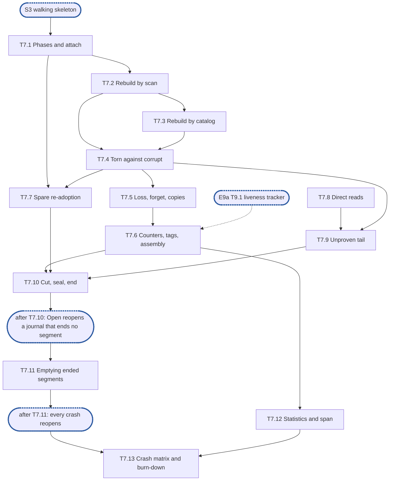

# Epic 7a: journal v2 recovery and identity, reopening a journal

**Sources:** [RFC 28](../rfcs/rfc-28-journal-format.md) §2.1 (what open reads of the `format`
file and the directory), §2.2 (the `.spare.tmp` an open unlinks, the fresh id above every id the
directory names, a recycled segment's old life and a failed append's slot as an open finds them),
§2.3 (the kinds and coverage rules a rebuild reads), §2.4 and §2.5 (reading a catalog), §3.1,
§3.3, §3.4 (the open's half), §4.2 and §4.4 (the rows that reopen a journal);
[RFC 1](../rfcs/rfc-1-journal.md) §3 (`Open`, its `floor` and `expect`, the context rule for
`Open`, a file's tag rebuilt from its records, forget records applied at recovery), §3.7
(`Recovery`, `RejectedSegments`, `DamagedSegments`, `TagConflicts`, `Shares`, `Files` and
`DirtyFiles` rebuilt), §3.8 (loss records at open), §3.9 (`torn_tails`, `scan_resyncs`), §4.2 (an
index over its bound at open), §4.3 (the counters at recovery, the epoch half and the largest
values, any segment order), §5.4 (the failed records an open drops), §7.1 (the torn-tail
exception), and the rows of §9.4 Groups C and D that reopen a journal.
**Track:** A.
**Epic 7a estimate: 13 subtasks, 43.5 man-days.**
**Depends on:** sync point **S3, the walking skeleton**; E3's `format` file, segment header, seal
marker, record and catalog codecs, its name classifier (3.2), its slot scanner with
resynchronisation (3.6) and the platform layer whose `ReadAtDirect` reads through the page cache
until this epic (3.7); E4's rebuild builder (E4-11), which takes records in any order and
concurrently, applies precedence, markers, floor buckets, drop ranges, offloaded and unmark
records and fills, and rebuilds a file under two tags as rivalled; E5's segment set and footprint
ledger (T5.1), descriptor cache (T5.2), spare pool with `Adopt` (T5.5), seal writer that takes its
entries as data (T5.7), retirement (T5.9) and its id allocator seeded at open; E6's loss records,
ring with `Place(found at open)` and per-directory registry of the generation and the failed
sequence numbers (T6.2), read-only state (T6.6) and corruption handler `Corrupt` (T6.7); E8's
`datapath.New(deps, state)` and the minimal `Init` and `Open` it extends (T8.15), the dirty-file
list (T8.9), the conflict flag (T8.4) and `Stats` aggregation (T8.13); E9a's liveness tracker
(T9.1), which the rebuild fills with the header-only records it attaches.
**Blocks:** E9a (its crash tests reopen through this `Open`, and its liveness tracker, drop
ranges and per-segment counters start from what this rebuild hands it), E10 (the start opens
every journal through this `Open`), the engine's start of
RFC 8 §2.5 (opening each journal with its floor and `expect`, then `Since` replay over what this
epic rebuilt), E7b (which extends this `Open`), and E12 (every conformance row that reopens a
journal).

---

## 1. Goal

Epic 7a makes a journal that has run open again. A directory a process wrote — closed cleanly,
killed, or cut off by a power loss at the storage seam — reopens through `Open(ctx, dir, floor,
expect)` to the index its segments support, with every write a returned `Sync` covered held and
reading its bytes, nothing served that the segments do not hold, and the counters above every
number on disk and the floor. It is the part of recovery the engine's start needs to serve a
share after a restart, and the part a crash test exercises. It writes no new on-disk structure:
it reads what epics 3 to 6 write, and writes only what RFC 28 §3 asks an open to write (a
truncation, a seal, an ended segment's emptying, a loss record, a spare's zeroed slots and one
directory sync).

**At the end of the epic:**

- `Open` of a directory holding segments attaches every segment of this journal, reports and
  leaves alone a foreign one or a file it does not recognise, unlinks every `.spare.tmp`, fails on
  a `format` file or a segment version it does not recognise, and keeps T8.15's identity,
  `expect` and platform refusals for such a directory;
- the index is rebuilt from catalogs where they verify and by scan otherwise, in any segment
  order and concurrently, and both give the same index; the active segments are always scanned;
- a torn tail and a torn slot are never reported, synced damage always is, and a scan steps over
  zeros a later verifying record follows;
- loss records, forget records, equal-numbered copies and the records a read-only journal failed
  earlier in the process are applied as RFC 1 §3.8, §3 and §5.4 say;
- the next sequence number and content version exceed every one on disk and the floor; a file's
  tag is rebuilt, and a file under two tags is refused through either; `Files`, `DirtyFiles`,
  the offloaded bits and the per-share accounting are what the running journal had;
- every segment that passes as a spare is re-adopted after one directory sync, with its slots
  zeroed where a recycle left them dirty;
- the tail no sync is proven to have reached is synced and re-read past the page cache before
  the journal serves; a torn tail is cut and its segment sealed, and a segment that must be ended
  is ended and emptied into a spare before the journal serves;
- `Stats` reports `Recovery`, `RejectedSegments`, `DamagedSegments`, `torn_tails` and
  `scan_resyncs`, and the open runs under an `open` span with a child span per phase;
- the crash checks of RFC 28 §4.4 pass over `Open`, and every conformance test this epic turns
  green has left `test/journal/known.yaml`.

### 1.1 In scope

- The open's phases, the context check between them, and the attach pass over the directory
  (T7.1).
- Rebuild by scan (T7.2) and by catalog (T7.3), fed to E4's builder.
- Telling torn from corrupt, and the damage an open reports (T7.4).
- The record kinds E4's builder leaves to recovery: loss and forget records, equal-numbered
  copies, and the records a read-only journal failed (T7.5).
- Counters above the disk and the floor, tags, the derived lists and accounting, and the
  journal's assembly through E8's constructor (T7.6).
- Spare re-adoption and the open's directory sync (T7.7).
- Reads past the page cache on Linux, macOS and Windows (T7.8), and the unproven tail's proof
  (T7.9).
- Cutting a torn tail, sealing or ending a segment, and recording the records dropped as corrupt
  (T7.10).
- Emptying the segments the open ends (T7.11).
- The open's statistics and span (T7.12).
- The crash and damage matrix over `Open`, and the known-failure burn-down (T7.13).

### 1.2 Out of scope

- `Init`, and `Open` of a directory holding a `format` file and no segment: E8's T8.15, which
  this epic extends without changing (D1). `Init` makes no spare: the pool fills when the journal
  is assembled (E5's T5.5).
- `Restamp` (RFC 1 §3, RFC 28 §3.4, "A lost store") and its row "restamp after a lost store": E7b.
- Inspection's index read-out (`File`, `All`) and report-only `Verify` with its footprint
  mismatch check (RFC 1 §4.4): E7b. The per-segment accounting, `Inspector.Segments`, is E9a's
  T9.8, since repack's segment scope reads it; this epic marks each segment it reports damaged,
  and each damaged one it empties or retires, so that read-out keeps its row until close (T7.12).
- The J6, J7 and J9 benchmarks (RFC 28 §4.3): E7b.
- Retained extents rebuilt from hold, unhold and stamp records (RFC 28 §3.1, RFC 1 §3.11): E7b.
  Nothing writes those records before E9b's holds; an open that finds one refuses (D6).
- Re-appending an unproven tail's record that fails its re-read, or every record of a tail whose
  sync fails (RFC 28 §3.1): E7b. This epic refuses the open instead (D4).
- The exact set of records repack carries forward, used when an ended segment is emptied, and the
  exact test of a segment that is not held, used to retire segments before the emptying: E9a
  owns that liveness test; this epic uses a safe superset until it lands (D7).
- Unlinking an orphan, a **MAY** of RFC 28 §3.4: not adopted (D2).
- Writing a footer for a segment a previous process sealed without one, a **MAY** of RFC 28 §2.4:
  not adopted (D3).
- The stale rule and `MarkOffloaded`'s and `Unmark`'s semantics (RFC 28 §3.2): E9b. This epic
  rebuilds the bits from the records on disk, through E4's builder.
- Writing segments, seals, catalogs, spares, recycles and unlinks, and the idle seal: E5. Byte
  layouts, checksums and the slot scanner: E3. Sync, failed windows, loss records, the loss ring
  and generation, the read-only state and the corruption rule at read time: E6. This epic calls
  them.
- The caller's side of RFC 28 §3.4 and RFC 1 §3: recording an interrupted `Init`'s identity,
  a recovery import opening adopted journals first, naming unclaimed tags to `Strand` and
  `Forget`, retrying a refused reopen: the engine's start (RFC 8 §2.5) and E10.

### 1.3 Names used here

- **E1**, epic 1, interfaces: the public types, the error set, `Stats` and the storage seam.
- **E2**, epic 2, red e2e suite and test foundations: the fixture, the reference model, the
  test clock, the fault schedule, the crash-simulating seam, the profiler and the conformance
  suite with its `known.yaml`.
- **E3**, epic 3, on-disk format and platform layer: the codecs, the name classifier (3.2), the
  slot scanner (3.6), the platform layer (3.7) and the platform checks (3.11, 3.12). Its subtasks
  are numbered 3.1 to 3.12 in its document.
- **E4**, epic 4, placement index and versions. Its subtasks are numbered E4-1 to E4-12 in its
  document; E4-11 is the order-independent rebuild builder.
- **E5**, epic 5, segments, streams and accounting.
- **E6**, epic 6, durability and loss.
- **E7a**, this epic: the part of epic 7, recovery and identity, that reopens a journal.
- **E7b**, the rest of epic 7: `Restamp`, the index read-out and `Verify`, the recovery benchmarks,
  retained extents from hold records, and the re-append of an unproven tail. It has no document
  yet.
- **E8**, epic 8, data path and capacity: the journal's constructor, the minimal `Init` and
  `Open` (T8.15), `Stats` aggregation.
- **E9a**, the part of epic 9, offload, reclamation, holds and tags, that the engine without
  offload needs: repack, auto-retire, `Forget` and `Strand`, `Inspector.Segments`, and the
  liveness tracker of its T9.1, which says whether a header-only record and a segment are live.
- **E9b**, the rest of epic 9: `Offload`, `report`, pins, `MarkOffloaded`, `Unmark`, `Release`,
  snapshot holds and `Stamp`.
- **E10**, epic 10, start and initialisation: the start check and the device configuration.
- **E11**, epic 11, the engine on the RFC 16 store: the caller that opens each journal at
  start.
- **E12**, epic 12, e2e green: the burn-down of the known-failure list.
- **S1**, interfaces frozen: E1's exported surface no longer changes.
- **S2**, red suite in CI: E2's suite runs in CI from every pull request.
- **S3**, walking skeleton: E5's streams with the spare pool, seal, roll and end event, E6's
  `Sync`, loss records, failed windows and corruption rule, and E8's `WriteAt`, `ReadAt` and
  minimal `Init` and `Open`.
- **S4**, core complete: every component conformance test of the journal is green.

## 2. General rules for each epic

1. **Independent unit tests.** Each epic carries its own unit tests. It may use another
   epic's pure in-memory implementation (E4's index, E3's codecs), the implementation of
   an epic it depends on once that has landed (E8 on E5's segments and E6's `Sync`), and the test components from epic 2. Epic 1 declares no internal interface
   to fake (rule 12).
2. **Fuzz tests where relevant.** Use Go native fuzzing (`testing.F`) on every parser of
   bytes the journal did not just write: records, segment headers, seal markers, catalogs,
   trailers, the `format` file. Also fuzz-drive operation sequences against the reference
   model. The property is that any input is either accepted as valid or rejected: never a
   panic, and never an extent the bytes do not contain.
3. **Metrics, and tracing where relevant.** Every counter and gauge RFC 1 §3.7 and §3.9
   assigns to the epic's area is maintained, and exposed through `Stats` (served from
   maintained counters, never a walk). Spans go through epic 1's standard-library
   `Tracer` and logs through the injected `*slog.Logger`, never a metrics or tracing
   library. Operations worth a span:
   open and recovery, sync, offload pass, repack pass, fill, and a refused reservation.
4. **Profiling.** Tests and benchmarks run under epic 2's profiling harness and fail on
   goroutine, descriptor or memory leaks and on anomalous resource growth. Hot paths
   (`WriteAt`, `ReadAt`, `Stats`, `report`, index lookup and insert) carry
   allocations-per-op assertions and the counted checks of RFC 1 §9.7. Allocation and
   heap assertions run outside `-race` only, because `-race` changes both.
5. **Public interface and internals.** Tests cover the epic's internal package API and the
   public v2 interface behaviour it enables, including concurrency under `-race`. Per the
   project rules, test at the layer that **consumes** a value, not the one that produces
   it. A regression test is validated by reverting the fix and watching it fail **on its
   assertion**.
6. **Known failures shrink.** Every e2e test an epic turns green is removed from the
   known-failure list in the same change. The runner fails if a listed test passes.
7. **v2 ignores v1.** No import of, copy from, or behavioural dependence on
   `pkg/block/journal`. The import test enforces it. v1 code is neither ported nor
   bridged: it is deleted with the rest of v1 at the cutover (stage 7 of #3119). v2
   checks only whether v1 state exists, to refuse it at start (E10), and never reads
   v1's format.
8. **Real storage for storage properties.** No in-memory filesystem stands in for a check
   about durability, torn tails, unlink durability or corruption (RFC 1 §9.5). In-memory
   stand-ins are allowed only for pure logic (index, codecs).
9. **Code comment conventions** (`CLAUDE.md`). No epic, issue or plan IDs in source
   comments. Use `ponytail:` for knowingly-simple implementations and `decision:` for
   deliberate behaviour. Where the RFC already carries a ponytail or decision note, its
   marker goes at the code site that implements it.
10. **A test must be able to fail.** Every test is code maintained for the life of the
    project. Keep a test only if a plausible change would make it fail and nothing else
    would catch that change: not the compiler, not the PR diff, not a later epic's tests.
    A test that checks two `errors.New` values differ, that the standard library's
    `errors.As` works, or that a stub returns zero does not qualify. A test that a
    little-endian `Version.Bytes` would fail does. Review rules that no test can check
    (for example, stubs never panic) stay review rules.
11. **A symbol is exported only if RFC 1 §3 uses it.** Everything exported is frozen at
    S1, so a helper exported for convenience becomes a contract. Helpers the internal
    packages need (`Less`, `IsZero`, `End`, `Overlaps`, `Seq`, the proposed constants)
    stay in `internal/core`.
12. **Each subtask creates only what it declares.** No empty package and no stub without
    a caller. A package, an option or a test helper lands with its first consumer.

### 2.1 How the rules apply

| Rule | Subtasks | How |
| --- | --- | --- |
| 1 Unit tests | all | every R-number has a test that can fail. Subtasks use E3's codecs and scanner, E4's builder, E5's segment set, pool and seal writer, E6's `Durable`, `Lose` and `Corrupt`, E8's `New` as they stand, and E2's seam, fault schedule and model. Until the checkpoint after T7.10 the public `Open` of a directory holding segments still answers T8.15's `ErrNotImplemented` once the attach pass is done, and tests drive the internal `recovery.Run` directly (§7) |
| 2 Fuzz | T7.4 | the codecs and the scanner are fuzzed by E3. This epic adds `FuzzOpen`: a small journal directory whose segment bytes the fuzzer mutates, opened through `recovery.Run`; the property is that the open either fails with a named error or yields only extents whose bytes some segment holds, never a panic. Seeded with the RFC 28 §4.4 regions |
| 3 Metrics and tracing | T7.4, T7.10, T7.12 | `Recovery` (segments read by catalog and by scan, and how long), `RejectedSegments`, `torn_tails` and `scan_resyncs` are set as the open finds each, and `DamagedSegments` is raised through E6's handler or the segment set's damage mark; `corrupt_extents` is E6's, raised by `Corrupt`. The `open` span wraps `Open`, with one child span per phase (attach, rebuild, tail proof, cut and seal, emptying, assembly) |
| 4 Profiling | T7.2, T7.3, T7.13 | every test runs under E2's profiler: an open that fails or is cancelled leaks no descriptor or goroutine; a rebuild's peak heap is recorded at 10⁶ records outside `-race` (the builder's own `ponytail:` names its ceiling). The hot paths of rule 4 are other epics'; the open has no counted check of RFC 1 §9.7 |
| 5 Public and internals, `-race` | all | the internal `recovery` package is tested directly, and the public `Open` once the checkpoint after T7.10 enables it. The concurrent rebuild runs under `-race` (T7.2). A value this epic rebuilds is checked where it is consumed: `ReadAt`, `Since`, `Files`, `DirtyFiles`, `Stats` and the refusals of E8, not the builder's state |
| 6 Known failures | T7.10, T7.11, T7.13 | the conformance tests that reopen a journal leave `known.yaml` as the subtask that turns them green lands; T7.13 removes the rest and re-points the entries this epic does not turn green to the epic that will |
| 7 v2 ignores v1 | all | nothing of the v1 journal is read; the open never looks for v1 state (that is E10's start check) |
| 8 Real storage | T7.4, T7.7, T7.9, T7.10, T7.11, T7.13 | every torn, crash, unlink and damage check runs on E3's `platform.OS` through E2's crash-simulating seam, never an in-memory filesystem. Direct reads (T7.8) are checked on a real file whose page cache holds bytes the device does not |
| 9 Comment markers | T7.1, T7.3, T7.4, T7.9, T7.11 | the RFC's markers at their code sites: RFC 28 §3.1's `decision:` on the idle seal is E5's; RFC 28 §3.3's `decision:` on emptying an ended segment whole (T7.11) and its two `ponytail:` notes on the failed slot and the forward search (T7.4); this epic's D2, D3, D4, D6, D7, D11 and D12 at theirs |
| 10 A test must be able to fail | all | §6 names, per test, the change that would make it fail |
| 11 Exported only if RFC 1 §3 uses it | all | nothing new is exported: `Open`, `Stats.Recovery`, `Stats.RejectedSegments`, `Stats.DamagedSegments`, `Stats.TagConflicts` and the counters `TornTails` and `ScanResyncs` exist since S1. The `recovery` package is internal |
| 12 Created with its consumer | all | `internal/recovery` lands with T7.1, called by `Open`; each file lands with the subtask that uses it. `ReadAtDirect`'s per-OS bodies land with T7.9, their first caller |

## 3. Requirements and invariants

Every MUST and MUST NOT that RFC 28 and RFC 1 place on this epic, numbered so that subtasks and
tests can cite them. Obligations E7b, E9a or E9b carry are in §1.2 and §4, not here.

**Attaching the directory**

| # | Requirement | Kind | Source | Subtasks |
| --- | --- | --- | --- | --- |
| R1 | `Open` never creates a journal. On a directory holding segments it keeps every refusal T8.15 makes: no `format` file is `ErrUnidentified`; an identity other than `expect` fails; `expect` zero fails naming the journal identity, the installation ID and that the directory holds segments; the platform checks run before the open writes anything | MUST | RFC 1 §3, RFC 28 §3.4 | T7.1 |
| R2 | A `format` file that does not verify, is not 56 bytes, or carries a version the binary does not recognise fails the open; it is never upgraded or repaired | MUST | RFC 28 §2.1 | T7.1 |
| R3 | Open ignores a `format.tmp` | invariant | RFC 28 §2.1 | T7.1 |
| R4 | A file the journal does not recognise is left alone, not deleted | MUST | RFC 28 §2.1 | T7.1 |
| R5 | Open unlinks every `.spare.tmp` it finds | invariant | RFC 28 §2.2 | T7.1 |
| R6 | The id of every spare or recycle made after open is above every id the directory named at open, `.seg` and `.spare.tmp` files included | invariant | RFC 28 §2.2 | T7.1 |
| R7 | Recovery reads only the `format` file and the segments, consults no component outside the journal, and does not require the process that wrote the segments to have exited cleanly | MUST NOT | RFC 28 §2.1, §3.1 | T7.2, T7.6 |
| R8 | A segment whose header verifies and names another journal identity contributes nothing to the index, is reported, and is left on disk untouched | MUST NOT | RFC 28 §3.1, §3.4 | T7.1, T7.7 |
| R9 | A segment whose format version the binary does not recognise, or that is newer than the `format` file's, fails the open | invariant | RFC 28 §2.2 | T7.1 |
| R10 | An orphan is never unlinked unless the journal is certain it wrote it and an age gate has passed, and a file whose name the journal could not have produced is never unlinked | MUST NOT | RFC 28 §3.4 | T7.1 |
| R11 | `Open` checks its context between recovery phases; a cancelled open returns the context's error and leaves the directory for a later `Open` to recover | invariant | RFC 1 §3 | T7.1 |

**Rebuilding the index**

| # | Requirement | Kind | Source | Subtasks |
| --- | --- | --- | --- | --- |
| R12 | On open the placement index is reconstructed, including a removal marker for every truncate, deallocate, delete and clone target record on disk and the fill floor buckets at the highest version on disk or in the floor; every rebuilt marker starts unsettled; precedence decides between two records covering one byte | MUST | RFC 28 §3.1 | T7.2, T7.6 |
| R13 | The mapping from extents to records is derived: a catalog is never authoritative, the segments win where they disagree, and no second durable index or log of the catalog is kept | MUST NOT | RFC 28 §2.4 | T7.3 |
| R14 | Recovery can rebuild by scan alone, and reads a sealed segment's catalog where it verifies | MUST, SHOULD adopted | RFC 28 §3.1 | T7.2, T7.3 |
| R15 | Catalogs and scan produce an identical index | MUST | RFC 28 §3.1 | T7.3 |
| R16 | A short file, a trailer whose magic or checksum fails, no verifying seal marker for this segment at `footerOffset` − 32, an `entryCount` that does not fit, a footer checksum that fails, or a catalog layout version not recognised is "no footer": the segment is scanned, and none is an error | MUST | RFC 28 §2.4, §2.5 | T7.3 |
| R17 | The active segments are always scanned, and a recycled segment's old trailer and footer are never read as its catalog | MUST | RFC 28 §2.4, §3.1 | T7.3 |
| R18 | A header-only record whose payload the index needs (`loss`, `clone target`) is read at its catalog entry's `recordOffset` and verified like any record, and its header checked against the entry; a mismatch is corruption | MUST | RFC 28 §2.4 | T7.3 |
| R19 | Recovery processes segments in any order, concurrently, and never depends on ascending segment order | MUST NOT | RFC 1 §4.3 | T7.2 |
| R20 | A record wholly covered by a release, truncate, deallocate, delete, clone target or synced loss record that outranks it, named by a loss record, or of a tag a later forget record names, is not held, and recovery does not verify or report its payload | MUST NOT | RFC 28 §2.3 | T7.2, T7.5 |
| R21 | A verifying header whose kind the segment's format version does not define fails the open in every range, the extension range included, and is never skipped by its length | invariant | RFC 28 §2.3 | T7.2 |
| R22 | A record or a floor whose version has a non-zero epoch half, or a record whose version counter or sequence number is the largest 64-bit value, fails the open | MUST | RFC 1 §4.3 | T7.2, T7.6 |
| R23 | An index over its extent bound at open still opens; `WriteAt` and `Fill` are then refused until the count drops below the bound | MUST | RFC 1 §4.2 | T7.6 |

**Losses, forgets, copies and the records a read-only journal failed**

| # | Requirement | Kind | Source | Subtasks |
| --- | --- | --- | --- | --- |
| R24 | No record carrying a sequence number a loss record names is held, the original or a copy, even where it verifies. An unsynced loss record reaches nothing else; a synced one also outranks, like a release record, every record of its extent below its version | MUST | RFC 1 §3.8, RFC 28 §3.1 | T7.5 |
| R25 | Every loss record still on disk at open is placed in the loss ring, marked as found at open, and a later open does not report it as new | invariant | RFC 1 §3.8 | T7.5 |
| R26 | A forget record is applied to every record of its tag with a lower sequence number: none of them is held, retained or rebuilt as a marker | MUST | RFC 1 §3, RFC 28 §3.1 | T7.5 |
| R27 | Each record a read-only journal failed earlier in this process, found on disk at the next open of its directory in the process, is dropped before the journal serves, with an unsynced loss record; the open publishes no event and raises neither the loss generation nor a file's loss sequence | invariant | RFC 1 §5.4 | T7.5 |
| R28 | Among copies with equal numbers, recovery uses one that verifies. A copy that does not verify while another verifies is not a loss and gets no loss record; it is damage reported with its segment where proven synced, and torn and unreported otherwise | MUST | RFC 28 §3.3 | T7.5 |

**Counters, tags and derived state**

| # | Requirement | Kind | Source | Subtasks |
| --- | --- | --- | --- | --- |
| R29 | A file's tag is rebuilt from its records and kept while any record of it is on disk; a `FileID` rebuilt under two tags has every call through either tag refused, and is named in `TagConflicts`, until one tag is forgotten | MUST | RFC 1 §3, §3.7 | T7.6 |
| R30 | The next sequence number exceeds every one on disk, and the next content version every one on disk and the floor, both taken from the maxima the rebuild observed, never from a persisted counter | MUST | RFC 1 §4.3, RFC 28 §3.1 | T7.6 |
| R31 | `Files`, `DirtyFiles`, the per-share accounting of `Stats().Shares` (every tag holding a record, attached or not), the footprint and the per-segment counters after open are those the segments describe | MUST | RFC 1 §3.7 | T7.6 |
| R70 | Every header-only record the open attaches is live by RFC 1 §7.2's rule as the running journal would have it: a forget record while any segment holding a record of its tag below its sequence number remains, an unsynced loss record while any segment holding the record it names remains, a removal, release or synced loss record while it may outrank a record in another segment or its marker is unsettled. The open hands each to the liveness tracker with what its rule reads, a forget record with that set of segments rather than a count | invariant | RFC 1 §3, §7.2, RFC 28 §3.1 | T7.6 |
| R32 | An extent's offloaded bit after open is set only where an offloaded record covering it decides it, by RFC 28 §3.2's rule, or where it was filled; it is never inferred from a record's age, its segment's seal state, or the absence of a crash | MUST NOT | RFC 28 §3.2 | T7.6 |

**Torn and corrupt**

| # | Requirement | Kind | Source | Subtasks |
| --- | --- | --- | --- | --- |
| R33 | In the newest segment of a stream, the torn tail (everything after the last verifying record) and a torn slot (a bad record before a later verifying one that nothing proves synced) are treated as never written and never reported as damage; a verifying record after a torn slot is attached | MUST, MUST NOT | RFC 28 §3.3 | T7.4 |
| R34 | A bad record, a zero slot included, below the synced-through offset of a later verifying record, or before a verifying seal marker, is corruption and is reported | MUST | RFC 28 §3.3 | T7.4 |
| R35 | A zero header slot ends a scan only where no verifying header follows it at any 8-byte boundary to the end of the segment; zeros stepped over are neither damage nor a torn tail | invariant | RFC 28 §3.3 | T7.4 |
| R36 | A scan that meets a record that does not verify refuses it and resynchronises at the next verifying header; the records after it are attached; each such scan is counted in `scan_resyncs` | MUST | RFC 28 §3.3, RFC 1 §3.9 | T7.2 |
| R37 | Where a catalog gives record boundaries, a refusal is confined to the records that do not verify | MUST | RFC 28 §3.3 | T7.3 |
| R38 | A seal marker that does not verify is part of the torn tail, cut with its footer and the segment sealed again, unless a successor names its segment, when it is damage and the segment is reported damaged | invariant | RFC 28 §3.3 | T7.4 |
| R39 | An unverifiable record or a missing seal marker in a segment named as another's predecessor is corruption, and the segment is reported damaged; a torn footer after the seal marker is only "no footer" | invariant | RFC 28 §3.3 | T7.4 |
| R40 | A segment header that does not verify is damage only where proven synced (a verifying record names a synced-through offset past it, a verifying seal marker follows it, or a successor names the segment), and torn otherwise; either way the segment's records are attached on their own checksums, it is treated as one that could have been open at a crash unless a successor names it, and a torn header ends the segment | invariant | RFC 28 §3.1 | T7.4 |
| R41 | A record found not to verify at open has the extents it backs left out of the index and serves no byte, never zeros; its loss is reported as data loss or repairable by its offloaded bit, and its loss record is appended once, unless another copy verifies | MUST | RFC 28 §3.3, RFC 1 §3.8 | T7.10 |
| R42 | `DamagedSegments` counts every segment the open reports damaged, never one with only a torn header, tail or slot, and keeps counting it until the journal closes, even once the open empties or retires it | invariant | RFC 1 §3.7 | T7.4, T7.12 |

**Tails and segments the open ends**

| # | Requirement | Kind | Source | Subtasks |
| --- | --- | --- | --- | --- |
| R43 | In the newest segment of each stream that no verifying seal marker ends, every record past the highest synced-through offset any verifying record names is verified in place before the journal serves: the segment is synced, then each such record is re-read past the page cache and checked against its checksums; one that verifies stays where it is | MUST | RFC 28 §3.1 | T7.8, T7.9 |
| R44 | A torn tail is truncated at its start, never below a verifying record and so never below the highest synced-through offset a verifying record names; the truncation is made durable and the segment sealed with its seal marker, footer and trailer after the last verifying record, before anything is appended; the stream continues in a new segment. This truncation and the seal's free tail are the only bytes inside a segment the journal frees | MUST | RFC 28 §3.3, RFC 1 §7.1 | T7.10 |
| R45 | A torn slot before a verifying record (zeros included), a torn segment header, or a failed append's slot found again ends the segment: it is truncated the same way and gets no seal marker, and the stream continues in a new segment naming no predecessor | invariant | RFC 28 §3.1, §3.3 | T7.10 |
| R46 | Once its tail is proven, a segment is sealed after its last verifying record, unless a sync of it failed in this open, which leaves it a failed segment that is never sealed, or the open ends it | invariant | RFC 28 §3.1 | T7.10 |
| R47 | Every segment the open ends is emptied before the journal serves: the loss records of records dropped as corrupt that no loss record on disk names are appended and synced first; then each ended segment's records that repack would carry forward are re-appended whole, never merged, keeping their numbers, with the loss record of each record that fails only when read for the copy and has no other verifying copy, into a spare that is sealed and synced; a record whose copy already verifies in a segment the open neither ends nor saw fail is skipped; then the ended segment is unlinked and the directory synced. A target whose sync fails is a failed segment and its records go once more to another spare; a second refusal in a row, or no spare to be had, fails the open and leaves the ended segment on disk. A crash part way leaves no record held twice | invariant | RFC 28 §3.3, RFC 1 §7.2 | T7.11 |
| R48 | The open's re-appends draw on the repack reserve, never on a share's limit, and its loss records on the headroom, so a journal opened at its maximum still opens | invariant | RFC 28 §3.1, §3.3 | T7.11 |

**Spares**

| # | Requirement | Kind | Source | Subtasks |
| --- | --- | --- | --- | --- |
| R49 | A segment under a name this journal produces, whose header slot is zeros, does not verify, or verifies naming this journal (with its file's segment id or another), in which no record header and no seal marker verifies and which no successor names, is re-adopted as a spare, counted toward the headroom, the repack reserve or a stream's next segment, and never treated as an orphan | MUST | RFC 28 §3.1 | T7.7 |
| R50 | The identity in a segment header is checked before the record-less test, so a foreign segment is never re-adopted or zeroed | invariant | RFC 28 §3.1 | T7.7 |
| R51 | A re-adopted spare's size is checked against the cap and, where the platform reports it, that no extent is unallocated or unwritten; one that fails is unlinked and made again | invariant | RFC 28 §3.1 | T7.7 |
| R52 | A re-adopted spare whose header slot or trailer slot is not zeros has both zeroed and synced before a stream may take it | invariant | RFC 28 §3.1, §2.2 | T7.7 |
| R53 | Open syncs the directory once before any re-adopted spare is taken; if that sync fails the open fails, takes no spare and unlinks none | invariant | RFC 28 §3.1, §2.2 | T7.7 |

**Observability**

| # | Requirement | Kind | Source | Subtasks |
| --- | --- | --- | --- | --- |
| R54 | `Stats().Recovery` reports how many segments the last open read by catalog and by scan, and how long it took | MUST | RFC 1 §3.7 | T7.12 |
| R55 | `Stats().RejectedSegments` counts the segments the open did not attach | MUST | RFC 1 §3.7 | T7.1, T7.12 |
| R56 | `torn_tails` counts the torn tails truncated at open | MUST | RFC 1 §3.9 | T7.10 |
| R57 | `scan_resyncs` counts the scans that found a record by resynchronising past a bad one | MUST | RFC 1 §3.9 | T7.2, T7.12 |
| R58 | Every field this epic sets is served by `Stats` from a maintained value, never a walk of the index or the segment set | MUST NOT | RFC 1 §3.7 | T7.12 |

**Test rows**

| # | Requirement | Kind | Source | Subtasks |
| --- | --- | --- | --- | --- |
| R59 | RFC 28 §4.2 C "foreign segment"; "segment header and seal marker" (its foreign half); the halves of "unidentified directory", "journal gone" and "interrupted `Init`" that hold a segment; the open-failure halves of "`format` file" and "kind values"; RFC 28 §4.4 "a file the journal did not name added" | test row | RFC 28 §4.2 C, §4.4 | T7.1, T7.2 |
| R60 | RFC 28 §4.2 C "sources agree", "trailer torn", "unknown version", "neighbours survive"; A "footer is not authoritative" (its rebuild half) | test row | RFC 28 §4.2 A, C | T7.3 |
| R61 | RFC 28 §4.2 C "synced damage is not a torn tail", "truncated sealed segment", "a scan resynchronises"; the scan half of "segment header and seal marker"; A "a zero slot is not the end" (its reopen half) | test row | RFC 28 §4.2 A, C | T7.4 |
| R62 | RFC 1 §9.4 C "a loss survives restart", "forget leaves nothing to settle", "header-only records are re-appended outside a read-only journal" (its reopen half); RFC 28 §4.2 C "a bad copy does not mask a good one" | test row | RFC 1 §9.4 C, RFC 28 §4.2 C | T7.5 |
| R63 | RFC 1 §9.4 C "monotonicity", "epoch half is zero", "clone target survives a crash", "unclaimed tag reported", "unclaimed tags are the caller's to name", "a file is its share's" (its planted half), "a cancelled call changes nothing or completes" (its reopen half); RFC 28 §4.2 C "version floor" (its first half), A "write carries its mtime" (its reopen half) | test row | RFC 1 §9.4 C, RFC 28 §4.2 A, C | T7.6 |
| R64 | RFC 28 §4.2 C "spares are re-adopted", A "directory entry survives", and the open halves of C "a spare is whole or absent" and "retired segments are recycled" | test row | RFC 28 §4.2 A, C | T7.7 |
| R65 | RFC 28 §4.2 A "unproven tail verified at open", its verified-in-place half | test row | RFC 28 §4.2 A | T7.9 |
| R66 | RFC 28 §4.2 C "rebuild", "torn tail cut off", "a recycled segment's old catalog is never read"; RFC 1 §9.4 D "metrics are reachable" (the torn tail) | test row | RFC 28 §4.2 C, RFC 1 §9.4 D | T7.10 |
| R67 | RFC 28 §4.2 C "an ended segment is emptied once", and the failed-append reopen of "a recycled segment's old catalog is never read" | test row | RFC 28 §4.2 C | T7.11 |
| R68 | RFC 1 §9.4 D "metrics are reachable" (the rejected segment) | test row | RFC 1 §9.4 D | T7.12 |
| R69 | RFC 28 §4.4 over `Open`: lost, torn and reordered writes at every sync point of every operation that syncs, `Open`'s own included, and a bit flipped in every region, each reopen agreeing with the reference model as §4.4 says; the model run with crashes | test row | RFC 28 §4.4, RFC 1 §9.1 | T7.13 |


## 4. Decisions this epic takes

- **D1, `Open` extends T8.15 through the same constructor.** T8.15 builds a fresh journal
  through `datapath.New(deps, state)`. This epic's `Open` runs `recovery.Run`, which returns the
  rebuilt state, and calls the same `New` with it, so there is one assembly. T8.15's refusals
  stay where they are, and run before the attach pass; the `ErrNotImplemented` T8.15 returns for
  a directory holding a segment is removed at the checkpoint after T7.10 (§7), and the `decision:`
  marker T8.15 put on it is removed with it.
- **D2, no orphan is unlinked.** RFC 28 §3.4 lets an implementation unlink an orphan it is
  certain it wrote, after an age gate. In this format version every `.seg` file this journal
  wrote either verifies as its own and is attached, or passes as a spare and is re-adopted (R49);
  what is left is foreign, or under a name it could not have produced, or a file it does not
  recognise, none of which it may unlink. So the open reports orphans in `RejectedSegments` and
  unlinks none. A `decision:` marker at the attach pass names the ceiling: orphans cost only
  their space and an operator's attention, and it is overturned by an orphan class this journal
  can prove it wrote that accumulates in the field.
- **D3, no footer is written for a segment sealed by a previous process.** RFC 28 §2.4 permits
  it (a **MAY**) after a verifying scan. Such a segment is one sealed at a crash after its marker
  and before its footer was durable; the open already seals a torn tail with a footer (R44), and
  any other is scanned at every open. A `ponytail:` marker at the catalog reader names the cost:
  one scan per such segment per open; upgrade to writing the footer once J6 shows these scans.
- **D4, a tail that cannot be proven refuses the open.** RFC 28 §3.1 re-appends, from the copy
  that verified at the first read, a record of an unproven tail that fails its re-read past the
  page cache, and every record of a tail whose sync fails. This epic stops before that: such an
  open fails with `ErrSyncFailed` naming the segment and the first record that did not verify,
  serves nothing, and appends nothing. It is safe — nothing that may not be on the device is ever
  served — and it is reached only when the device has lost or refused an acknowledged write, or
  refuses a sync at open, both of which a reopen after a clean exit, a process kill or a power
  loss without device damage never meets. A `decision:` marker at T7.9's check says so and names
  E7b's re-append as what replaces it; the caller retries the open as for a refused reopen
  (RFC 1 §5.4).
- **D5, offloaded and unmark records are fed to E4's builder as they are.** E4-11's builder
  already applies RFC 28 §3.2's rule (the highest sequence number among the marks at or above a
  piece's version decides its bit, a fill marks its own content) and nothing else sets a bit at
  rebuild. So the bits after open are rebuilt here at no extra cost (R32); only the stale rule and
  the reseed are E9b's.
- **D6, a hold, unhold or stamp record refuses the open.** Retained extents rebuilt from them
  (RFC 1 §3.11) are E7b's, and nothing appends them before E9b's holds. An open that finds one
  that verifies and is not covered fails with `ErrNotImplemented` naming the kind and the
  segment, rather than dropping a snapshot's retained content in silence. A `decision:` marker at
  the feed says so and that it is withdrawn with E7b. E9b's holds therefore ship no earlier than
  E7b (§9).
- **D7, an ended segment's emptying carries a safe superset until the liveness test exists.**
  RFC 28 §3.3 re-appends "the records of the segment that repack would carry forward" and first
  retires every attached segment that is not held. The exact liveness of a header-only record
  (RFC 1 §7.2) is E9a's. This epic carries every record that backs a held or retained extent and
  every header-only record that verifies, whatever its liveness: a carried header-only record keeps
  both numbers, so a dead one decides nothing differently from where it was. Before the emptying
  it retires only the segments that back no held or retained byte and hold no header-only record,
  which no liveness rule can keep. A `ponytail:` marker at the carry names the cost (dead
  header-only records copied, segments that could have been retired kept until repack) and the
  upgrade: E9a's `Held` and `Droppable` (its T9.1), which T7.6 already fills at open, called in
  both places.
- **D8, the rebuild feeds E4's builder from one goroutine per segment, bounded.** E4-11 chose
  concurrent feeders. The open runs at most `GOMAXPROCS` segment readers, each scanning or
  reading the catalog of one segment and feeding its records; a `ponytail:` marker names the
  ceiling (one segment per reader, so one huge active segment is read by one goroutine) and the
  upgrade (splitting a scan at catalogued offsets) when J6 shows it.
- **D9, a record dropped as corrupt at open goes through E6's handler after the journal is
  assembled.** During the rebuild such a record is left out of the builder's feed and noted with
  whether recovery proved it synced. Once `New` has assembled the journal, T7.10 calls E6's
  `Corrupt` for each, with that flag, so the loss record, the event, the generation and
  `DamagedSegments` follow the one rule the read path uses, and then waits until those loss
  records are durable before T7.11 empties anything. A record a loss record on disk already names
  is not handed over again (R25, R41).
- **D10, the open writes nothing until the rebuild has finished.** The attach pass and the
  rebuild only read (and unlink `.spare.tmp` files, which hold nothing). Every write — the
  directory sync, a spare's zeroing, the tail's sync, a truncation, a seal, a loss record, an
  emptying — comes after, so a cancelled or failed open before that point leaves the directory
  as it found it, and one after it leaves only states a later open recovers (R11).
- **D11, a direct read the filesystem refuses fails the open.** `O_DIRECT` is refused by some
  filesystems and `F_NOCACHE` is advisory (E3's open point P12). Until RFC 28 says otherwise, a
  direct read that fails with the platform's refusal fails the open naming the rule, as the
  platform checks do, rather than falling back to the page cache and trusting what R43 exists not
  to trust. A `decision:` marker at `ReadAtDirect` names the ceiling: a journal on such a
  filesystem cannot reopen after a crash that left an unproven tail.
- **D12, the allocation check of a re-adopted spare queries Linux only.** RFC 28 §3.1 checks
  "where the platform reports it". On Linux the open asks `FIEMAP` for unwritten or missing
  extents; on macOS and Windows it checks the size alone. A `ponytail:` marker names the gap and
  the upgrade (`F_LOG2PHYS_EXT` and `FSCTL_QUERY_ALLOCATED_RANGES`) when a short spare is seen on
  either.

## 5. Target tree

The journal's code lives at `pkg/block/journal` on the programme branch.

```text
pkg/block/journal/
  journal.go             T7.1, T7.10   Open runs recovery.Run, then datapath.New (D1)
  internal/
    recovery/
      run.go             T7.1    Run(ctx, dir, floor, expect): the phases, the context check, the open span
      attach.go          T7.1    the directory listing, .spare.tmp, the id high-water mark, headers, foreign, orphans (D2)
      scan.go            T7.2    scanning a segment and feeding the builder, the concurrent readers (D8)
      catalog.go         T7.3    reading a catalog, demotion to a scan, header-only payloads (D3)
      tail.go            T7.4    torn against corrupt, stream topology, the segment's fate
      kinds.go           T7.5    loss and forget records, copies, the read-only drops, the hold refusal (D6)
      assemble.go        T7.6    counters, tags, derived lists and accounting, New
      spares.go          T7.7    re-adoption, the slots' zeroing, the directory sync (D12)
      prove.go           T7.9    the unproven tail's sync and direct re-read (D4)
      seal.go            T7.10   cutting, sealing, ending, the corrupt drops handed to E6 (D9)
      empty.go           T7.11   emptying the ended segments (D7)
      stats.go           T7.12   Recovery, RejectedSegments, torn_tails, scan_resyncs
      *_test.go
    platform/
      direct_linux.go    T7.8    ReadAtDirect with O_DIRECT (D11)
      direct_darwin.go   T7.8    ReadAtDirect with F_NOCACHE
      direct_windows.go  T7.8    ReadAtDirect with FILE_FLAG_NO_BUFFERING
      alloc_linux.go     T7.7    the FIEMAP query (D12)
  conformance/
    rfc28_c_test.go      T7.11   the "ended segment is emptied once" row (§9)
test/journal/known.yaml  T7.10, T7.11, T7.13   entries removed and re-pointed
```

## 6. Subtasks

### T7.1 The open's phases and the attach pass

**Subtask T7.1 estimate: 3.5 man-days.**

- **Track:** A. **Depends on:** S3; T8.15; E3's name classifier (3.2), `format` and segment
  header codecs, platform checks.
- **Covers:** R1–R6, R8–R11, R55, R59.
- **Deliverables:** `internal/recovery/run.go`: `Run(ctx, dir, floor, expect) (State, error)`,
  which runs T8.15's identity and platform checks, then the phases in order, checking `ctx`
  before each (R11, D10), under the `open` span with one child span per phase. `attach.go`: lists
  the directory once; classifies every name through E3's classifier; ignores `format.tmp`;
  unlinks every `.spare.tmp` and syncs nothing yet (D10); records the highest id any `.seg` or
  `.spare.tmp` names, for E5's allocator (R6); reads each segment header and sorts the segments
  into *own* (header verifies and names this journal's identity), *foreign* (verifies, another
  identity: reported, counted in `RejectedSegments`, left on disk), *unverified header* and *zero
  header slot* (both decided by T7.4 and T7.7), and fails the open on a segment version the binary
  does not know or newer than the `format` file's (R9). Files the classifier does not recognise
  are left alone and logged once at `Debug`; orphans are reported and never unlinked (D2, with its
  `decision:` marker). `Open` calls `Run` and, until the checkpoint after T7.10, returns T8.15's
  `ErrNotImplemented` once the attach pass succeeds.
- **Acceptance criteria:**
  - A directory holding segments and no `format` file, one whose `format` names another identity,
    and `expect` zero each fail as T8.15 says, and the directory is byte-for-byte unchanged.
  - A 55- or 57-byte `format` file, a bad checksum and version 2 each fail the open.
  - A foreign segment is counted, left on disk with its bytes unchanged, and contributes nothing;
    an unrecognised file is left alone.
  - Every `.spare.tmp` is gone after the pass, and the allocator seed is above its id.
  - A segment of version 2, or of a version above the `format` file's, fails the open.
  - A context cancelled before any phase returns the context's error with nothing changed but the
    `.spare.tmp` unlinks.
- **Tests:** the rows of R59 (`TestRFC28C_ForeignSegment`, `TestRFC28C_ForeignHeaderIsForeignNotDamaged`, `TestDamage_UnnamedFileLeftAlone`, `TestRFC28C_UnidentifiedDirectory`, `TestRFC28C_JournalGone`, `TestRFC28C_InterruptedInit`, `TestRFC28C_FormatFile`, `TestRFC28C_KindValuesRefused`); a cancel injected at each phase boundary (catches a phase that
  ignores the context); a `.spare.tmp` with the highest id in the directory, then a spare made
  after open (catches an allocator seeded only from `.seg` names, R6); a file named
  `00000000000000000042.seg.bak` and one named `notes.txt` left in place (catches a classifier
  that deletes what it does not know).

### T7.2 Rebuild by scan

**Subtask T7.2 estimate: 3 man-days.**

- **Track:** A. **Depends on:** T7.1; E3's slot scanner (3.6); E4-11.
- **Covers:** R7, R12 (the feed), R14 (scan alone), R19, R20, R21, R22 (records), R36, R57 (the
  count), R59 (kind values).
- **Deliverables:** `internal/recovery/scan.go`: a segment reader that runs E3's scanner over one
  segment and turns each verifying record into E4's `Record` (the content and removal kinds,
  offloaded and unmark) or hands it to T7.5 (loss, forget, hold, unhold, stamp), with its
  synced-through offset kept for T7.4; at most `GOMAXPROCS` readers feed the builder concurrently
  (D8). A verifying header of a kind the segment's version does not define, a non-zero epoch, or
  a version counter or sequence number at the largest 64-bit value fails the open (R21, R22). The
  scanner's resync count is summed into `scan_resyncs` (R36, R57). A content record that a later
  record wholly covers is fed by header only: its payload is not read here (R20; the coverage is
  decided by the builder, so the scan reads no payload at all, and T7.9 and T7.11 read only the
  payloads they must).
- **Acceptance criteria:**
  - A journal written, closed and rebuilt by scan alone holds exactly the extents the reference
    model holds, with the same versions and records.
  - Feeding the segments in shuffled orders and with one to `GOMAXPROCS` readers gives an
    identical index each time.
  - A verifying header of kind 15 or 128, or a version with epoch 1, fails the open; neither is
    skipped.
  - A rebuild reads no payload byte (the seam counts reads).
- **Tests:** scan-alone rebuild against the model over a seeded workload; shuffled-order and
  reader-count variants under `-race` (catches an order dependence or a race in the feed, R19);
  the kind-values and epoch rows (catches a skip by length, R21); a seam read counter during
  rebuild (catches a payload read, R20).

### T7.3 Rebuild by catalog

**Subtask T7.3 estimate: 3 man-days.**

- **Track:** A. **Depends on:** T7.2; E3's catalog codec; E5's seal writer (T5.7), for the
  catalogs under test.
- **Covers:** R13, R14 (catalog), R15, R16, R17, R18, R37, R60.
- **Deliverables:** `internal/recovery/catalog.go`: for each sealed segment, reads the last 32
  bytes, checks the trailer, the seal marker at `footerOffset` − 32 for this segment and offset,
  the `entryCount` fit and the footer checksum, and feeds the entries; any failure or an
  unrecognised layout version demotes the segment to T7.2's scan (R16). The newest segment of
  every stream, and every segment no successor names, is scanned whatever its trailer says (R17).
  A `loss` or `clone target` entry is read at its `recordOffset`, verified, and its header checked
  against the entry; a mismatch is corruption confined to that record (R18, R37), handed to T7.4.
  Nothing is written (D3, with its `ponytail:` marker). A test-only switch makes every segment
  scan, so the two sources can be compared.
- **Acceptance criteria:**
  - The index built from catalogs equals the one built by scan, field for field, over a workload
    with every record kind E8 and E6 append.
  - A truncated footer, a flipped entry byte, a trailer of layout version 2 and a trailer with no
    seal marker before its footer each demote the segment to a scan with the same index.
  - A recycled segment whose old trailer survived is scanned and none of its old records attached.
  - A corrupt record in a catalogued segment leaves every neighbour readable.
- **Tests:** the rows of R60 (`TestRFC28C_SourcesAgree`, `TestRFC28C_TrailerTorn`, `TestRFC28C_UnknownVersion`, `TestRFC28C_NeighboursSurvive`, `TestRFC28A_FooterIsNotAuthoritative`); the both-ways equality over the model workload (catches a source
  that drops a kind, R15); a recycled segment with its zeroing dropped at the seam (catches a
  trailer accepted without its seal marker, R17); an entry whose header disagrees (catches an
  entry trusted over its record, R13).

### T7.4 Torn against corrupt

**Subtask T7.4 estimate: 4.5 man-days.**

- **Track:** A. **Depends on:** T7.2, T7.3.
- **Covers:** R33, R34, R35, R38, R39, R40, R42 (marking), R61.
- **Deliverables:** `internal/recovery/tail.go`: the stream topology (each segment's predecessor,
  the segments a successor names, the newest segment of each stream, the segments that could have
  been open at a crash); for every bad slot the scanner or the catalog reports, the decision torn,
  torn slot or corrupt by R33 to R40, using the highest synced-through offset a later verifying
  record names and whether a verifying seal marker follows; the zero-slot rule (R35); the seal
  marker rule (R38); the fate of each segment for T7.10: *intact*, *sealed*, *torn tail to cut
  at offset o*, or *ended at offset o*; and the list of records dropped as corrupt with the synced
  flag recovery proved (D9). Damage is marked on the segment for `DamagedSegments`. RFC 28 §3.3's
  two `ponytail:` notes (the failed slot no record proves; the forward search's cost) go at the
  forward search. `FuzzOpen` (rule 2).
- **Acceptance criteria:**
  - In the newest segment, A and B synced, C written, A's payload corrupted: A is corruption, B is
    held, C is cut as a torn tail.
  - A zero slot with a verifying record after it is stepped over and reported as nothing; the
    same zeros below a later record's synced-through offset are corruption.
  - A segment named as a predecessor and truncated mid-record is corruption; the newest segment of
    a stream truncated the same way is a torn tail.
  - A seal marker that does not verify is a torn tail when nothing names its segment and damage
    when a successor does.
  - A segment header that does not verify is damage when a seal marker follows it and torn
    otherwise; its records are attached either way, and a torn one ends its segment.
  - `DamagedSegments` is never raised by a torn header, tail or slot.
- **Tests:** the rows of R61 (`TestRFC28C_SyncedDamageIsNotATornTail`, `TestRFC28C_TruncatedSealedSegment`, `TestRFC28C_ScanResynchronises`, `TestRFC28C_SealMarkerCopiedIntoAPayload`, `TestRFC28A_AZeroSlotIsNotTheEnd`); one test per acceptance bullet, each with the seam writing the
  exact bytes (catches a rule applied to the wrong segment class); `FuzzOpen` (catches a panic or
  an extent the bytes do not hold).

### T7.5 Loss and forget records, copies, and the records a read-only journal failed

**Subtask T7.5 estimate: 3.5 man-days.**

- **Track:** A. **Depends on:** T7.2, T7.4; E6's T6.2 (the ring's `Place(found at open)` and the
  per-directory failed-sequence list).
- **Covers:** R20 (named and forgotten records), R24–R28, R62.
- **Deliverables:** `internal/recovery/kinds.go`: the kinds E4's builder leaves to recovery (its
  `decision:` on `RecordKind`). A loss record's payload is read (from the scan, or at its catalog
  entry), and the sequence number it names is withheld from the feed, original and every copy;
  a synced one is also fed as a release-like cut of its extent at its pair (R24). Every loss record
  is placed in the ring through `Place(found at open)` (R25). A forget record withholds every
  record of its tag below its sequence number (R26). Records with equal numbers are collapsed to
  one verifying copy, preferring one in a segment the open neither ends nor saw fail; a
  non-verifying copy while another verifies is no loss and is damage only where proven synced
  (R28). Each sequence number on E6's per-directory failed list found on disk is withheld and
  noted for an unsynced loss record with no event and no raise (R27), which T7.10 appends. A hold,
  unhold or stamp record that verifies and is not covered refuses the open (D6, with its
  `decision:` marker).
- **Acceptance criteria:**
  - A record a loss record names is not held after open even where its bytes were repaired on
    disk; an unsynced loss record re-holds what the dropped record superseded, and a synced one
    keeps it covered.
  - Every loss record on disk is in `Losses`, marked found at open; a second reopen adds none.
  - After `Forget(T)`, a crash and a reopen hold no extent or marker of `T`, and `Since` yields
    nothing of it; a write under `T` after the forget is held.
  - A re-appended copy and its corrupted original on a failed segment: the copy reads back, no
    loss record names it, and nothing is reported damaged.
  - A record failed by a read-only journal and found whole at the next open in the process is not
    held, gets an unsynced loss record, and neither `LossGeneration` nor `Losses` moves.
- **Tests:** the rows of R62 (`TestRFC1C_LossSurvivesRestart`, `TestRFC1C_ForgetLeavesNothingToSettle`, `TestRFC28C_BadCopyDoesNotMaskAGoodOne`, `TestRFC1C_HeaderOnlyRecordsReappended`); the repaired-bytes case (catches a loss applied by position rather
  than by sequence number); the synced-versus-unsynced pair (catches a loss keyed on "at or
  below", RFC 1 §3.8); the read-only drop with the registry's list (catches a reopen that serves a
  write its `Sync` was told failed).

### T7.6 Counters, tags, derived state and assembly

**Subtask T7.6 estimate: 3 man-days.**

- **Track:** A. **Depends on:** T7.5; E4-11 (`Finish(floor)`); E5's segment set and ledger
  (T5.1), pool (T5.5); E8's `New` (D2 of E8), conflict flag (T8.4), dirty-file list (T8.9) and
  `Stats` aggregation (T8.13); E9a's liveness tracker (T9.1).
- **Covers:** R7 (no outside input), R12 (markers and buckets), R22 (the floor), R23, R29–R32, R63,
  R70.
- **Deliverables:** `internal/recovery/assemble.go`: calls the builder's `Finish(floor)`, which
  refuses a floor with a non-zero epoch and sets the sequence and version counters above every
  number fed and the floor (R22, R30); turns the builder's rivalled files into E8's conflict flag
  (R29); rebuilds the dirty-file list, the files with an unsettled marker or synced loss, the
  per-share used, held, dirty and unreclaimed bytes for every tag that holds a record, and E5's
  ledger and per-segment counters from the attached segments (R31); registers every attached
header-only record with E9a's liveness tracker through its registration hook, a forget record
with the set of segments holding records of its tag below its sequence number (which the feed
collected per tag and segment), an unsynced loss record with the segments holding copies of the
record it names, and offloaded and unmark records under the tracker's always-live switch (R70);
hands the result to
  `datapath.New` (D1). Offloaded and unmark records reach the builder as fed (D5). An index over
  its bound is accepted (R23).
- **Acceptance criteria:**
  - After a crash, the next sequence number and the next content version exceed every one on
    disk; opened with a floor above them, the next version exceeds the floor.
  - A record of F planted under tag B beside A's: `TagConflicts` names F with both tags and every
    call on F through either is refused.
  - `Files`, `DirtyFiles`, `Stats().Shares` and `UsedBytes` after a reopen equal what the running
    journal reported before the crash, for every share, attached or not.
  - A journal reopened under a lower `ExtentLimit` opens, and `WriteAt` is refused naming the
    index.
  - A `CloneTarget` marker survives a crash with its spec, and `Since` yields it.
  - After `Forget(T)` and a reopen, the forget record stays live until the last segment that held
    a record of `T` below it is retired, and not after; a segment holding only settled, outranked
    removals reports not held without a read.
- **Tests:** the rows of R63 (`TestRFC1C_Monotonicity`, `TestRFC1C_EpochHalfIsZero`, `TestRFC1C_CloneTargetSurvivesCrash`, `TestRFC1C_UnclaimedTagReported`, `TestRFC1C_UnclaimedTagsAreTheCallersToName`, `TestRFC1C_FileIsItsSharesShare`, `TestRFC28C_VersionFloor`, `TestRFC28A_WriteCarriesItsMtime`, `TestRFC1C_CancelledCallChangesNothingOrCompletes`); the before-and-after comparison of `Stats`, `Files` and
  `DirtyFiles` (catches a derived value not rebuilt, R31, tested at its consumer); the floor case
  (catches a counter taken from disk alone); the forget record's liveness across a reopen,
checked through E9a's `Held` (catches a forget registered with a count, which a repack of one of
its segments and a later write under the tag would break).

### T7.7 Spare re-adoption

**Subtask T7.7 estimate: 3.5 man-days.**

- **Track:** A. **Depends on:** T7.1, T7.4; E5's pool `Adopt` (T5.5), retirement (T5.9) and
  making a spare (T5.4a).
- **Covers:** R8 (never zeroed), R49–R53, R64.
- **Deliverables:** `internal/recovery/spares.go`: the record-less test of R49 over the segments
  T7.1 sorted and T7.4 read (identity first, R50), including a recycle a crash interrupted after
  the rename; the size check and, on Linux, the `FIEMAP` allocation query in
  `platform/alloc_linux.go` (D12, with its `ponytail:` marker); a spare that fails is unlinked
  and left for the pool to make again (R51); the one directory sync before any re-adopted spare is
  taken, failing the open with its error and taking and unlinking nothing if it fails (R53); the
  zeroing and sync of a dirty header or trailer slot (R52); then `Adopt` into the pool's classes.
- **Acceptance criteria:**
  - Crashed with every spare untaken, and after a stream took one but before its first sync, the
    reopen re-adopts every record-less segment, the headroom and the repack reserve are whole with
    no new allocation, and nothing is reported as an orphan or as damage.
  - A recycle crashed between its rename and its zeroing sync is re-adopted with both slots zeroed
    before any stream takes it, and no record of its old life is attached.
  - A foreign segment with no record of this journal is never re-adopted and keeps its bytes.
  - A spare short of the cap is unlinked and made again.
  - With the open's directory sync failing at the seam, the open fails, no spare is taken or
    unlinked, and a later open with the fault cleared succeeds with its reserves whole.
- **Tests:** the rows of R64 (`TestRFC28C_SparesAreReAdopted`, `TestRFC28A_DirectoryEntrySurvives`, `TestRFC28C_SpareIsWholeOrAbsent`, `TestRFC28C_RetiredSegmentsAreRecycled`); the foreign record-less segment (catches the record-less test run
  before the identity check, R50); the failing directory sync (catches a spare taken whose name
  is not durable); a punched hole in a spare on Linux (catches a size-only check where the
  platform reports allocation).

### T7.8 Reads past the page cache

**Subtask T7.8 estimate: 2.5 man-days.**

- **Track:** A. **Depends on:** E3's platform layer (3.7).
- **Covers:** R43 (the read).
- **Deliverables:** `ReadAtDirect` in `internal/platform`: `O_DIRECT` with aligned buffers on
  Linux, `F_NOCACHE` on macOS, `FILE_FLAG_NO_BUFFERING` with sector-aligned buffers on Windows;
  E3's `ponytail:` on `ReadAtDirect` is removed. A refusal by the filesystem is returned as itself
  and fails the open (D11, with its `decision:` marker). The seam's `ReadAtDirect` returns the
  bytes the device holds, not those the simulated cache holds.
- **Acceptance criteria:**
  - On Linux, a direct read of a range whose page cache was changed under the file (through a
    second descriptor written and not synced, then the device copy checked) returns the device's
    bytes.
  - An unaligned record is read through an aligned window and returned exactly.
  - On a filesystem that refuses `O_DIRECT`, the open fails naming it.
- **Tests:** the device-versus-cache read on Linux (catches a read that still goes through the
  cache); the alignment cases at the first and last byte of a segment (catches an off-by-one in
  the window); macOS and Windows builds compile and run the alignment test where a runner exists
  (E3's open point P22).

### T7.9 The unproven tail

**Subtask T7.9 estimate: 2.5 man-days.**

- **Track:** A. **Depends on:** T7.4, T7.8.
- **Covers:** R43, R65.
- **Deliverables:** `internal/recovery/prove.go`: for the newest segment of each stream that no
  verifying seal marker ends, the records past the highest synced-through offset any verifying
  record in it names; one sync of the segment, then each record re-read through `ReadAtDirect` and
  checked against both checksums. A record that verifies stays. A record that does not, or a sync
  that fails, fails the open (D4, with its `decision:` marker naming E7b's re-append). Nothing is
  appended here.
- **Acceptance criteria:**
  - A and B written and not synced, the process killed with the seam keeping them as a dead
    process's cache would: the open syncs once, re-reads both past the cache, and both read back
    with their numbers, not re-appended.
  - The same with B's device copy damaged: the open fails naming the segment and B, and serves
    nothing.
  - A segment ended by a verifying seal marker is not re-read.
- **Tests:** the row of R65 (`TestRFC28A_UnprovenTailVerifiedAtOpen`); the damaged-device case (catches an open that trusts what verified
  through the cache); a sealed newest segment (catches a re-read nothing requires).

### T7.10 Cutting, sealing and ending, and the corrupt drops recorded

**Subtask T7.10 estimate: 4 man-days.**

- **Track:** A. **Depends on:** T7.6, T7.7, T7.9; E5's seal writer (T5.7) and its end of a
  segment (T5.10); E6's `Corrupt` (T6.7) and `Lose` (T6.2).
- **Covers:** R41, R44, R45, R46, R56, R66.
- **Deliverables:** `internal/recovery/seal.go`: for each *torn tail* segment, truncation at the
  start of the torn tail (never below a verifying record or the highest synced-through offset),
  a sync of the truncation, and a seal through T5.7's writer with the entries the scan gathered,
  counted in `torn_tails` (R44, R56); for each *ended* segment, the same truncation and no seal
  marker, the segment left as a failed one for T7.11 (R45); a sync that fails here leaves its
  segment failed and unsealed (R46). Every stream then continues in a new segment, naming no
  predecessor after an ended one. After `New` (D1), each record dropped as corrupt that no loss
  record on disk names goes to `Corrupt` with its synced flag, and each record of R27 to `Lose`
  with no event; the open waits until those loss records are durable (D9). `Open` now returns the
  journal for every directory whose open ends no segment; one that would end a segment is refused
  with `ErrNotImplemented` naming the segment until T7.11. The conformance tests this turns green
  leave `known.yaml`.
- **Acceptance criteria:**
  - A torn last record is cut, the segment sealed with a verifying catalog, `torn_tails` is one,
    and a write after the reopen synced and crashed again reads back.
  - A truncation never goes below a record that verifies.
  - A recycled segment's old bytes past its new records are cut as a torn tail, not reported.
  - A corrupt dirty record found at open is in `Losses` as data loss, raises the generation, and
    its loss record is durable before the open returns; a second reopen reports nothing new.
  - The public `Open` of a journal that was closed cleanly, or killed with only torn tails,
    returns a journal that serves.
- **Tests:** the rows of R66 (`TestRFC28C_Rebuild`, `TestRFC28C_TornTailCutOff`, `TestRFC28C_RecycledSegmentsOldCatalogIsNeverRead`, `TestRFC1D_MetricsAreReachable`); the second crash after the cut (catches an append after torn bytes,
  RFC 28 §3.3); the loss-record durability before return (catches a loss lost again at the next
  crash, R41); the runner after the `known.yaml` change (rule 6).

### T7.11 Emptying the segments the open ends

**Subtask T7.11 estimate: 5 man-days.**

- **Track:** A. **Depends on:** T7.10; E5's retirement (T5.9) and pool (T5.5).
- **Covers:** R47, R48, R67.
- **Deliverables:** `internal/recovery/empty.go`: once T7.10's loss records are durable, retires
  the segments D7 allows, never a spare, recycling or unlinking each as T5.9 decides; then, one
  ended segment at a time, re-appends whole and unmerged, keeping their numbers, the records D7
  carries (each payload verified whole before it is copied, RFC 28 §2.3), skipping a record whose
  copy already verifies in a segment the open neither ends nor saw fail, with a loss record for a
  record that fails only on this read and has no other verifying copy; draws on the repack
  reserve and the headroom, never a share's limit (R48); seals and syncs the target; on a failed
  target sync, marks it failed and copies again into another spare; on a second refusal or no
  spare, fails the open with that error and leaves the ended segment; then unlinks the ended
  segment and syncs the directory. RFC 28 §3.3's `decision:` on emptying whole, and D7's
  `ponytail:`, go here. The `ErrNotImplemented` of T7.10 is removed, and with it T8.15's marker
  (D1). Adds the conformance test of RFC 28 §4.2's row "an ended segment is emptied once" (§9).
- **Acceptance criteria:**
  - Every record an ended segment held reads back after the open, once, with its numbers; the
    ended segment is gone and the directory synced.
  - Crashed at every step of the emptying with writes reordered, and reopened twice (process
    killed, then power lost after the second open's unlink), no record is held twice and each
    corrupt record's loss is named by exactly one loss record.
  - A target whose sync fails sends its records to another spare and no loss record names them;
    a second failure fails the open with the sync error, takes no third spare, and leaves the
    ended segment on disk.
  - A journal at its maximum whose open ends a segment still opens.
  - A reopen of a journal whose ended segments were emptied syncs and re-reads no target.
- **Tests:** the rows of R67 (`TestRFC28C_RecycledSegmentsOldCatalogIsNeverRead`); the crash at every step (catches a copy skipped only because the
  page cache held it, or an unlink before the loss records were durable); the at-maximum open
  (catches re-appends charged to a share, R48); the second reopen (catches an emptying repeated).

### T7.12 The open's statistics and span

**Subtask T7.12 estimate: 2 man-days.**

- **Track:** A. **Depends on:** T7.6; E8's `Stats` aggregation (T8.13).
- **Covers:** R42 (kept until close), R54, R55, R57, R58, R68.
- **Deliverables:** `internal/recovery/stats.go`: `Recovery` (segments by catalog, by scan, the
  open's duration on the injected clock), `RejectedSegments`, the `TornTails` and `ScanResyncs`
  counters, set once at open and read by `Stats` without a walk; `DamagedSegments` keeps a segment
  the open emptied or retired counted until close, and the segment is marked damaged and retired
  in E5's set so E9a's `Inspector.Segments` keeps its row under its old id until close. The `open` span's phase children carry the
  segment counts as attributes.
- **Acceptance criteria:**
  - After an open that read k segments by catalog and m by scan, `Recovery` says k and m and a
    duration that the test clock set.
  - A foreign segment and a torn tail each move their field in one `Stats` call.
  - A damaged segment the open emptied still counts in `DamagedSegments` until `Close`.
  - `Stats` after open allocates and takes no lock as it did before this epic.
- **Tests:** the row of R68 (`TestRFC1D_MetricsAreReachable`); the emptied damaged segment (catches a gauge lowered at unlink);
  E8's `Stats` cost check rerun with these fields (catches a walk, R58).

### T7.13 The crash and damage matrix, and the known-failure burn-down

**Subtask T7.13 estimate: 3.5 man-days.**

- **Track:** A. **Depends on:** T7.11, T7.12.
- **Covers:** R69.
- **Deliverables:** the RFC 28 §4.4 matrix run over the public `Open`: lost, torn and reordered
  writes at every sync point of `WriteAt`, a seal, each directory sync and `Open`'s own (the tail's
  sync, the truncation and its seal, a re-append of the emptying, a spare's zeroing, the loss
  records' sync, the unlink), and a bit flipped in every region; each reopen compared with E2's
  reference model as §4.4 says; E2's model run with crashes from fixed seeds. Every conformance
  test this epic turns green leaves `known.yaml`; every entry it does not turn green and that
  waits only on E7b, E9a or E9b is re-pointed to that epic's issue (§9).
- **Acceptance criteria:**
  - Every case of the matrix ends with the reopened journal agreeing with the model, a fault
    excusing only what RFC 28 §4.4 lets it excuse.
  - The journal's own seam order holds whatever the faults: a successor taken only after its
    predecessor's seal sync, an ended segment unlinked only after its copies' sync, a segment
    retired at open only after the open's loss records' sync.
  - `known.yaml` names no test this epic turned green, and the runner passes.
- **Tests:** `TestDamage_LostWrites`, `TestDamage_TornWrites`, `TestDamage_ReorderedWrites`,
  `TestDamage_BitFlip`, `TestDamage_SegmentDeleted` and the model's crash seeds (each catches a
  recovery that comes back describing something other than what is on disk); the seam-order
  assertions (catch an ordering bug a fault would excuse).

## 7. Order of work



- **Until the checkpoint after T7.10**, the public `Open` of a directory holding segments still
  returns T8.15's `ErrNotImplemented` after the attach pass, and T7.2 to T7.9 are tested through
  `recovery.Run`, which writes nothing (D10).
- **After T7.10**, a journal closed cleanly or killed with only torn tails reopens; an open that
  would end a segment is refused naming it, which never serves wrong data.
- **After T7.11**, every crash the seam can make reopens, and the engine's start can rely on
  `Open`.
- T7.8 needs nothing of this epic and can start at once; T7.12 can run beside T7.7 to T7.11.
- T7.6's registration with E9a's liveness tracker waits for E9a's T9.1, which track B builds
  early; E9a's own crash tests wait in turn for the checkpoint after T7.10.

## 8. Suggested pull requests

| PR | Subtasks | Man-days | After | Why together |
| --- | --- | --- | --- | --- |
| 1 | T7.1, T7.2, T7.3 | 9.5 | — | the attach pass and both sources of the index, read-only and behind `ErrNotImplemented` |
| 2 | T7.4, T7.5, T7.6 | 11 | PR 1 | every decision the rebuild takes, ending in a state `New` assembles |
| 3 | T7.8 | 2.5 | — | the per-OS direct reads, open beside PR 1 and PR 2 |
| 4 | T7.7, T7.9, T7.10 | 10 | PR 2, PR 3 | the open's first writes: spares, the tail's proof, cuts and seals; `Open` turns on |
| 5 | T7.11, T7.12, T7.13 | 10.5 | PR 4 | the emptying, the open's statistics, and the crash matrix that proves the whole |

A suggestion only: one pull request per subtask works as well.

## 9. Open points

- **E6's handler at open.** D9 hands the records dropped as corrupt to `Corrupt` once `New` has
  assembled the journal, and needs to wait until the loss records the stream's worker appends for
  them are durable before T7.11 retires or empties anything (RFC 28 §3.3: "appends the loss record
  of each record it dropped as corrupt … and syncs them; then it retires"). `Corrupt` hands the
  loss to the worker and returns. **Decides:** E6's owner, whether `Corrupt` returns a handle to
  wait on or the open calls `Lose` directly with the synced flag. **Blocks:** T7.10.
- **The "ended segment is emptied once" row has no conformance test.** RFC 28 §4.2 lists it, and
  `pkg/block/journal/conformance` has no `TestRFC28C_` for it. T7.11 adds it. **Decides:** E2's
  owner, for the traceability matrix and a `known.yaml` entry if it lands before T7.11.
  **Blocks:** nothing.
- **`known.yaml` attributions.** Most conformance tests that need a reopen are attributed to the
  issues of epic 8 or epic 9, and four to epic 7's. The entries whose last missing piece is this
  epic should name E7a's issue once it exists, and the rest E7b's, E9a's or E9b's. **Decides:**
  whoever creates E7a's issue. **Blocks:** nothing.
- **Holds before E7b.** D6 refuses an open that finds a hold, unhold or stamp record. If E9b's
  holds ship before E7b, every journal that took a hold stops reopening. **Decides:** the owners
  of E7b and E9b, by ordering them. **Blocks:** nothing here.
- **Who replaces D7's superset.** E9a's `Held` and `Droppable` are the upgrade, and T7.6 fills
  their tracker at open (R70), so the swap is small; whether E9a or E7b makes it is open.
  **Decides:** the owners of E9a and E7b. **Blocks:** nothing.
- **The liveness hand-off with E9a.** E9a's D3 asks the rebuild for each forget record's set of
  segments, not a count; R70 and T7.6 do so, and also hand over unsynced loss records with the
  segments holding the record they name. The hook's exact signature is T9.1's. **Decides:** E9a's
  owner, with this epic's. **Blocks:** T7.6's registration, which lands after T9.1.
- **A direct read the filesystem refuses** (E3's P12). D11 fails the open until RFC 28 says
  whether to refuse, fall back or count. **Decides:** RFC 28's owner. **Blocks:** nothing; D11
  stands meanwhile.
- **Runners for macOS and Windows** (E3's P22). T7.8's per-OS bodies compile everywhere and are
  exercised only on Linux in CI until a runner exists. **Decides:** CI owner. **Blocks:** nothing.
