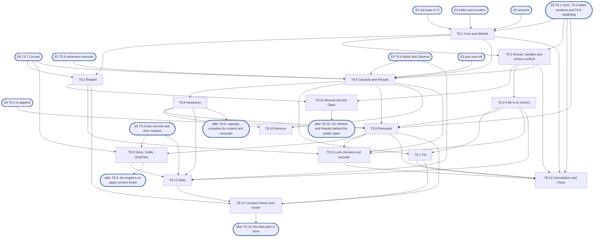

# Epic 8: journal v2 data path and capacity

**Sources:** [RFC 1](../rfcs/rfc-1-journal.md) §2, §3 (the shares and handles, and "a file is its
share's"), §3.1, §3.2, §3.4, §3.6, §3.7, §3.9 (the counters this epic increments), §3.10, §4.3
(`Draw`, `SetVersionLimit`, the version a share's floor raises), §6, §8, and the checks of §9.2,
§9.3, §9.4 and §9.7 that name this area; [RFC 28](../rfcs/rfc-28-journal-format.md) §2.1 and §3.4 (the
`format` file and `Open` with `expect` zero refused, which T8.15 implements), §2.2–§2.4 (the
parts the write and read paths touch: serialised appends, the record's fields, the whole-payload
check, the header checked against its catalog entry).
**Track:** B.
**Epic 8 estimate: 15 subtasks, 60.25 man-days.**
**Depends on:** sync point **S2, red suite in CI**; epic 1's public types, error set and
`Stats`; epic 2's reference model, fixture, profiler and test clock; epic 4's placement index
(the per-file index, version counters, change version and floor buckets, extent bound, markers,
retained set); epic 3's `format` file codec and platform checks (for T8.15); epic 5's append
streams, positioned read, spare pool, seal, roll and footprint ledger (its `Append` registers
every record with epic 6's ledger, its R88); epic 6's `Durability`, `Sync` and `WaitDurable`
(T6.1), loss records and their markers (T6.2), the retained-extent drop and the failed-window
resolution (T6.4), the re-append of header-only records (T6.5), the read-only state, `Admit` and
`Observe` (T6.6) and the corruption handler (T6.7). T6.1, T6.2, T6.3, T6.4 and T6.7 land before
S3, with the parts of epic 5 they need.
**Blocks:** epic 9 (offload, release and repack run on this epic's handles, locking and
capacity), epic 11 (the engine calls every operation here) and epic 12.

---

## 1. Goal

Epic 8 assembles the index (epic 4), the append streams (epic 5) and `Sync` (epic 6) into the
core of the public API: shares and handles, `WriteAt`, `ReadAt`, `Fill`, the removals, `Since`
and `Settle`, capacity and its named refusals, the lock domains, and `Stats`. It is the first
epic in which a client's bytes go in and come back out of the journal. It adds no on-disk
format, no recovery and no reclamation.

**At the end of the epic:**

- a share attaches through `Share`, raising the version counter above its floor, and the
  journal serves several shares at once; a file belongs to the share that first appended a
  record of it, and a call through another share's handle is refused naming both tags;
- `WriteAt` assigns its version inside the file's serialised append, writes its record and only
  then publishes its extent; `ReadAt` reports exactly what is not held, leaves those bytes
  untouched, verifies every record it serves and never serves one that fails;
- `Fill` writes only the absent sub-extents, atomically with a concurrent write, refuses a
  fill older than the file, and marks what it placed offloaded;
- `Truncate`, `Deallocate`, `Delete` and `CloneTarget` each leave a removal marker, are durable
  on return, and `Since`, `Settle`, `Extents`, `Files` and `DirtyFiles` report what the engine
  needs to re-apply uncommitted state after a crash;
- a write or a reservation that would pass a limit is refused at once, with no I/O, naming the
  limit that refused it, and `Reserve` takes everything a series of writes needs before the
  first of them starts;
- the six lock domains are acquired in their one order, which a recorder checks in tests;
- `Stats` is served from maintained counters, keeps its three inequalities, and reports the
  per-share breakdown;
- `Journal.Close` stops new calls, lets the ones in flight finish, joins background work and
  frees nothing a reader still holds;
- the walking skeleton of sync point **S3** exists: `WriteAt` and `ReadAt` on epic 5's streams,
  behind a minimal `Init` and `Open` for a fresh directory (T8.15), so the first conformance
  tests turn green and leave `known.yaml`.

### 1.1 In scope

- The journal's assembly of the index, the streams and the capacity counters, and the write and
  read paths (T8.1, T8.2).
- A minimal `Init`, and an `Open` of a directory that holds a `format` file and no segment, so the
  conformance suite runs against the public API from S3 (T8.15).
- Shares, handles, `Handle.Close`, the version counter's public surface (`Draw`,
  `SetVersionLimit`, the floor a share raises) and "a file is its share's" (T8.3, T8.4).
- Capacity: the reservation counters, the share limit, the index bound's refusal, the order in
  which refusals are named, the headroom's half rule, records without bytes, `Reserve` and
  `Reservation` (T8.5, T8.6, T8.10).
- `Fill` and the four removals (T8.7, T8.8).
- `Since`, `Settle`, `Extents`, `Files` and `DirtyFiles` (T8.9).
- The context rules of RFC 1 §3 across the data path (T8.12).
- The lock domains and the lock-order recorder, including the locks of epic 4's index and
  epic 5's segments, which adopt the recorder's types (T8.11).
- `Stats` aggregation and this epic's counters and spans (T8.13).
- `Journal.Close` and the refusal of operations after it (T8.12).
- The counted checks of RFC 1 §9.7 for `WriteAt`, `ReadAt` and `Stats`, a model-based run of this
  epic's operations, and the known-failure bookkeeping (T8.14).

### 1.2 Out of scope

- An `Open` of a directory that holds a segment, `Restamp`, rebuild, torn tails, the scan that
  finds a file under two tags, the version floor read from disk and the rebuild of `DirtyFiles`:
  epic 7. This epic provides the conflict state those calls set (T8.4), the list they rebuild
  (T8.9) and the minimal `Init` and `Open` epic 7 extends (T8.15).
- `Sync`, group commit, the sync bound and its timer, failed-sync windows, loss records, the loss
  ring and generation, the read-only state and its probe, and the rule for a record that does
  not verify when it is read: epic 6. This epic calls the rule from `ReadAt` (T8.2), consults
  the read-only state before every appending call (T8.5), and passes epic 6 the account function
  through which its index changes reach this epic's counters (D16) and the file append domain's
  table (D15), which this package owns. Registering each appended
  record with epic 6 is epic 5's `Append` (its R88), for every path here.
- Byte layouts and checksums: epic 3. Segments, the spare pool, streams, the descriptor cache
  and the read drain, the footprint ledger: epic 5. The index's own structures, bounds and
  counters: epic 4. This epic calls them.
- `Offload`, `OffloadMany`, `report`, `MarkOffloaded`, `Unmark`, `Release`, `Repack`, pins,
  holds, `Stamp`, `Forget`, `Strand` and salvage: epic 9. This epic provides what they call:
  the handle, the claim of a file's tag for a release, the file append domain and the lock
  order, the admission rule for a record without bytes and for a repack copy, and the update of
  the dirty-file list. RFC 1 §8.4's rows for `Release`, `report`, `MarkOffloaded`, repack and
  `Forget` are epic 9's.
- The caller's obligations in RFC 1 §3: a recovery import opening every adopted journal first,
  naming unclaimed tags to `Strand`, exporting salvage, a caller combining `Extents` with
  metadata, and passing no mark with a non-zero epoch to `SetVersionLimit`: the engine
  (epic 11). This epic refuses such a mark.
- Wiring settings (`MaxBytes`, `ExtentLimit`, `HeadroomRecords`, `Streams`) to configuration:
  epic 11.
- The `Metrics` export: epic 11 adapts `Stats`. This epic only maintains the fields.

### 1.3 Names used here

- **E1**, epic 1, interfaces: the public types, the error set, `Stats` and the storage seam.
- **E2**, epic 2, red e2e suite and test foundations: the fixture, the reference model, the
  test clock, the profiler and the conformance suite with its `known.yaml`.
- **E3**, epic 3, on-disk format and platform layer: the record codecs.
- **E4**, epic 4, placement index and versions. Its subtasks are numbered in its document as
  E4-1 to E4-12 (the index container E4-1, the held set E4-2, the file map and lock E4-3, the
  counters E4-4, markers E4-5, the retained set E4-6, the change version and floor buckets
  E4-7, the extent bound E4-8, per-segment bytes E4-9, drop ranges E4-10, rebuild E4-11,
  inspection E4-12).
- **E5**, epic 5, segments, streams and accounting: the append streams, positioned read, spare
  pool and footprint ledger.
- **E6**, epic 6, durability and loss: `Sync`, failed windows, loss records, read-only state and
  the corruption rule.
- **E7**, epic 7, recovery and identity: `Init`, `Open`, rebuild.
- **E8**, this epic.
- **E9**, epic 9, offload, reclamation, holds and tags.
- **E10**, epic 10, start and initialisation: the start check and the device configuration.
- **E11**, epic 11, the engine on the RFC 16 store: the caller of every operation here.
- **E12**, epic 12, e2e green: the burn-down of the known-failure list.
- **S1**, interfaces frozen: E1's exported surface no longer changes.
- **S2**, red suite in CI: E2's suite runs in CI from every pull request.
- **S3**, walking skeleton: E5's streams with the spare pool, the seal, the roll and the end
  event, E6's T6.1 to T6.4, T6.7 and T6.9, and this epic's `WriteAt`, `ReadAt` and minimal `Init` and
  `Open`, with `Share` for its handles. **T8.1, T8.2, T8.3 and T8.15 are this epic's half,
  16.75 man-days.**

## 2. General rules for each epic

1. **Independent unit tests.** Each epic carries its own unit tests. It may use another
   epic's pure in-memory implementation (E4's index, E3's codecs), the implementation of
   an epic it depends on once that has landed (E8 on E5's segments and E6's `Sync`), and the test components from epic 2. Epic 1 declares no internal interface
   to fake (rule 12).
2. **Fuzz tests where relevant.** Use Go native fuzzing (`testing.F`) on every parser of
   bytes the journal did not just write: records, segment headers, seal markers, catalogs,
   trailers, the `format` file. Also fuzz-drive operation sequences against the reference
   model. The property is that any input is either accepted as valid or rejected: never a
   panic, and never an extent the bytes do not contain.
3. **Metrics, and tracing where relevant.** Every counter and gauge RFC 1 §3.7 and §3.9
   assigns to the epic's area is maintained, and exposed through `Stats` (served from
   maintained counters, never a walk). Spans go through epic 1's standard-library
   `Tracer` and logs through the injected `*slog.Logger`, never a metrics or tracing
   library. Operations worth a span:
   open and recovery, sync, offload pass, repack pass, fill, and a refused reservation.
4. **Profiling.** Tests and benchmarks run under epic 2's profiling harness and fail on
   goroutine, descriptor or memory leaks and on anomalous resource growth. Hot paths
   (`WriteAt`, `ReadAt`, `Stats`, `report`, index lookup and insert) carry
   allocations-per-op assertions and the counted checks of RFC 1 §9.7. Allocation and
   heap assertions run outside `-race` only, because `-race` changes both.
5. **Public interface and internals.** Tests cover the epic's internal package API and the
   public v2 interface behaviour it enables, including concurrency under `-race`. Per the
   project rules, test at the layer that **consumes** a value, not the one that produces
   it. A regression test is validated by reverting the fix and watching it fail **on its
   assertion**.
6. **Known failures shrink.** Every e2e test an epic turns green is removed from the
   known-failure list in the same change. The runner fails if a listed test passes.
7. **v2 ignores v1.** No import of, copy from, or behavioural dependence on
   v1's journal (`pkg/block/journal` until #3645 deleted it). The import test enforced it. v1 code is neither ported nor
   bridged: it is deleted with the rest of v1 at the cutover (stage 7 of #3119). v2
   checks only whether v1 state exists, to refuse it at start (E10), and never reads
   v1's format.
8. **Real storage for storage properties.** No in-memory filesystem stands in for a check
   about durability, torn tails, unlink durability or corruption (RFC 1 §9.5). In-memory
   stand-ins are allowed only for pure logic (index, codecs).
9. **Code comment conventions** (`CLAUDE.md`). No epic, issue or plan IDs in source
   comments. Use `ponytail:` for knowingly-simple implementations and `decision:` for
   deliberate behaviour. Where the RFC already carries a ponytail or decision note, its
   marker goes at the code site that implements it.
10. **A test must be able to fail.** Every test is code maintained for the life of the
    project. Keep a test only if a plausible change would make it fail and nothing else
    would catch that change: not the compiler, not the PR diff, not a later epic's tests.
    A test that checks two `errors.New` values differ, that the standard library's
    `errors.As` works, or that a stub returns zero does not qualify. A test that a
    little-endian `Version.Bytes` would fail does. Review rules that no test can check
    (for example, stubs never panic) stay review rules.
11. **A symbol is exported only if RFC 1 §3 uses it.** Everything exported is frozen at
    S1, so a helper exported for convenience becomes a contract. Helpers the internal
    packages need (`Less`, `IsZero`, `End`, `Overlaps`, `Seq`, the proposed constants)
    stay in `internal/core`.
12. **Each subtask creates only what it declares.** No empty package and no stub without
    a caller. A package, an option or a test helper lands with its first consumer.


### 2.1 How the rules apply

| Rule | Subtasks | How |
| --- | --- | --- |
| 1 Unit tests | all | every R-number has a test that can fail. Subtasks use E4's index, E3's codecs, E5's streams over E2's crash-simulating seam, and E2's test clock. They fake no other epic's component: T8.2 (the corruption rule) and T8.8 (durable on return) are ordered after the E6 subtasks they call (§7), so neither needs a stand-in |
| 2 Fuzz | T8.14 | there is no parser of bytes here: E3 decodes records and E5 reads them. T8.14 fuzz-drives sequences of this epic's operations against E2's reference model (R101). T8.4 fuzz-drives claims from two handles against a one-entry-per-file oracle |
| 3 Metrics and tracing | T8.1, T8.4, T8.5, T8.6, T8.7, T8.13 | `written_bytes` (T8.1), `TagConflicts` (T8.4), `reservation_refused` and `index_refusals` (T8.5), `headroom_draws` (T8.6), `filled_bytes` and `fill_refused` (T8.7) are incremented at the event with an atomic add and served by `Stats` (T8.13), never from a walk. Spans through E1's `Tracer`: `fill` (T8.7) and `reserve_refused` (T8.5). Open and recovery, sync, offload and repack are other epics' |
| 4 Profiling | all | every test runs under E2's profiler. T8.14 asserts allocations per call for `WriteAt`, `ReadAt` and `Stats`, outside `-race` (R101), once for all three. T8.12 is where goroutines could leak: it checks that none outlives `Close` |
| 5 Public and internals, `-race` | T8.1 to T8.13, T8.15 | each subtask tests its internal package and the public `Handle` behaviour it enables, at the layer that consumes the value: a version is checked where `ReadAt` returns it, a refusal where the caller sees its `ErrNoSpace`. `-race` runs with two files on two streams and two shares, as RFC 1 §9.3 requires |
| 6 Known failures | T8.15 and every later subtask | once T8.15's `Open` exists, every subtask removes from `test/journal/known.yaml` the conformance tests it turns green, in the same change; the runner fails on a listed test that passes. Tests that reopen a journal holding segments stay listed until epic 7, and tests that call epic 9 operations until epic 9. No subtask adds an entry |
| 7 v2 ignores v1 | all | enforced by the import test. Nothing of v1's journal is read |
| 8 Real storage | T8.1, T8.2, T8.5 to T8.10, T8.12, T8.15 | every test of a record write, a read of stored bytes, a refusal that performs no I/O, a close, or an `Init` and `Open` runs on a real directory through E2's seam. T8.4's conflict logic, T8.12's context checks and T8.11's recorder are pure logic and test in memory |
| 9 Comment markers | T8.1, T8.2, T8.5, T8.6, T8.11 | see §4: each decision names its marker and where it goes. The RFC's `ponytail:` and `decision:` notes on headroom (half rule, default `journal.headroom_records`) go at the admission table in T8.6, the one on counting pieces as interleaved at the reservation in T8.10, the one on the version limit at the draw in T8.3, and the one on checking the tag per file at the claim in T8.4 |
| 10 A test can fail | all | each test in §6 names the bug it catches |
| 11 Exports | all | the public package gains no symbol this epic: `Share`, `Handle` and `Reservation` are already declared by E1, and every type this epic adds lives in `internal/datapath`, `internal/capacity` or `internal/lockorder`. `ErrJournalReadOnly` is E6's |
| 12 Created with its consumer | all | `internal/datapath` lands with T8.1, `open.go` with T8.15, `internal/capacity` with T8.5, `internal/lockorder` with T8.11. Each file lands with the subtask that uses it |

## 3. Requirements and invariants

Every **MUST** and **MUST NOT** that RFC 1 and RFC 28 place on this epic, the SHOULDs it adopts,
the bold rules the RFC states without a key word, the bounds, and the test rows that name its
area, numbered so that subtasks and tests can cite them. Obligations that another epic carries
out are not listed: §1.2 names the epic. A mechanical search for the key words over the owned
sections found every one of them below, in §1.2, or in the closing note of this section.

**Shares, handles and tags**

| # | Requirement | Kind | Source | Subtasks |
| --- | --- | --- | --- | --- |
| R1 | The handle's tag is written into every record the share appends. A file belongs to one share for its life | invariant | RFC 1 §3, RFC 28 §2.3 | T8.1, T8.3, T8.4 |
| R2 | A file's share is given by the handle a call goes through, never derived from its `FileID`: a `FileID` encodes no share | MUST NOT | RFC 1 §2 | T8.3, T8.4 |
| R3 | `Handle.Close` refuses new calls through the handle and returns once every call already in flight on it has returned. The handle's extents stay held, and a new handle for the same tag reads them | MUST | RFC 1 §3, §9.4 | T8.3 |
| R4 | Checking a file's tag and claiming it is one step under the file append domain, with the file index held for the write | MUST | RFC 1 §3, §8.2 | T8.4 |
| R5 | A call that appends a record of a file with no tag claims it for the handle's tag: a write, fill, clone target, truncate, deallocate, delete or release. A read appends nothing and claims nothing | MUST | RFC 1 §3 | T8.4 |
| R6 | Every call through a handle that names a `FileID` is refused with `ErrOtherShare`, naming both tags, when the file's entry carries another tag, and serves, appends, changes and offers nothing of that file | MUST | RFC 1 §3 | T8.4 |
| R7 | A file keeps its tag for as long as any segment holds a record of it, even after its index entry is dropped. Once none does, the next appending call claims the file afresh | invariant | RFC 1 §3 | T8.4 |
| R8 | A `FileID` that recovery rebuilt under two tags is refused on every call through either tag, and named in `Stats` (`TagConflicts`), until one of the two is forgotten | MUST | RFC 1 §3, §3.7 | T8.4, T8.13 |
| R9 | One journal serves several shares, each through its own handle. `Stats` is the journal's, not a handle's, and is readable before any share attaches | invariant | RFC 1 §3, §3.7 | T8.3, T8.13 |
| R10 | `Share` raises the journal's version counter above the share's floor before it returns the handle, and raises the floor buckets to it, never lowering one, so a `Fill` with an `asOf` from an earlier incarnation of the share is refused for a file with no entry | MUST | RFC 1 §3, §3.4, §4.3 | T8.3 |

**Context and cancellation**

| # | Requirement | Kind | Source | Subtasks |
| --- | --- | --- | --- | --- |
| R11 | A call that does I/O or can wait takes a context first (`WriteAt`, `Sync`, `ReadAt`, `Fill`, the removals, `Since`); a call that only reads or changes memory and never waits takes none (`Share`, `Reserve`, `Draw`, `SetVersionLimit`, `Settle`, `Extents`, `Files`, `DirtyFiles`, `Stats`, and every `Close`) | invariant | RFC 1 §3 | T8.12 |
| R12 | A call checks its context first, before any refusal check and before it changes any state. A done context returns the context's error having changed nothing, and takes no reservation | invariant | RFC 1 §3, §9.4 | T8.12 |
| R13 | Once a call has appended its record it completes and returns its result whatever the context says: a cancelled write is never half made | invariant | RFC 1 §3, §9.4 | T8.12 |
| R14 | A call past the context check that is refused returns the refusal at once, as itself | invariant | RFC 1 §3 | T8.12 |
| R15 | A wait for the file append domain is not abandoned when the context is done: the domain is held across one local record write and nothing remote | invariant | RFC 1 §8.2 | T8.1, T8.12 |
| R16 | `Since` ends its iteration with the context's error when the context is done | invariant | RFC 1 §3 | T8.9 |

**The write path**

| # | Requirement | Kind | Source | Subtasks |
| --- | --- | --- | --- | --- |
| R17 | On return with a nil error the written extent is held, Dirty, and survives process death: the record is written before `WriteAt` returns | MUST | RFC 1 §3.1, §5.1 | T8.1 |
| R18 | `WriteAt` assigns the write's version inside the file's serialised append, so for one file the versions the journal assigns are appended in the order they were assigned | MUST | RFC 1 §3.1, RFC 28 §2.2 | T8.1 |
| R19 | Writes to one `FileID` are serialised. Writes to different `FileID`s may proceed concurrently, on one stream and across streams | MUST | RFC 28 §2.2, RFC 1 §8.2 | T8.1, T8.11 |
| R20 | A write overlapping a held extent supersedes it wherever its version is newer, which for a version `WriteAt` assigns is everywhere. The newer bytes are served at once and the caller invalidates nothing | MUST, MUST NOT | RFC 1 §3.1 | T8.1 |
| R21 | A write split at a segment's cap returns only once every piece is written, each piece a record of its own carrying the write's version and its own file offset. A crash between the pieces leaves the write partly held | invariant | RFC 28 §2.2 | T8.1 |
| R22 | A write record carries the file, the share's tag, the version, a new sequence number and the `mtime` the caller gave, 0 when the open suspended it. No other kind carries a modification time | MUST | RFC 28 §2.3 | T8.1 |
| R23 | Publishing an extent is the last step of a write, after its record is written, so a reader never finds an index entry pointing at bytes not yet in the segment | MUST NOT | RFC 1 §8.4 | T8.1 |
| R24 | Publishing does not wait for the record to be durable | MUST NOT | RFC 1 §8.4 | T8.1 |
| R25 | Content a write supersedes is published as a retained extent, and stays one until the record that superseded it is synced. A read never serves a retained extent. Content whose superseder is already durable when it is published is not retained. (Epic 6 lifts the retention when the sync completes, and resolves a record only under its file's append domain, which the write holds until it has published, its R87) | invariant | RFC 1 §3.8 | T8.1 |
| R26 | Every record this epic appends (a write, a fill, a removal) is registered with epic 6's failed-window tracking as it is appended, so a failed window can re-append or fail it and a `Sync` waits for it. Epic 5's `Append` registers it (its R88); this epic asserts that each of its kinds reaches the ledger, and epic 6 decides what a window does | invariant | RFC 1 §5.3, §3.6 | T8.1, T8.7, T8.8 |
| R27 | While the journal is read-only every call that would append a record fails at once with `ErrJournalReadOnly`, reserves nothing and takes no spare. (Epic 6 owns the state and the error; this epic gates each appending path) | MUST | RFC 1 §5.4 | T8.5, T8.7, T8.8 |

**The read path**

| # | Requirement | Kind | Source | Subtasks |
| --- | --- | --- | --- | --- |
| R28 | `ReadAt` fills `p` from held extents. Every sub-extent of `(off, len(p))` the journal does not hold is reported in `missing`, and the matching bytes of `p` are left untouched | MUST | RFC 1 §3.2 | T8.2 |
| R29 | `ReadAt` never zero-fills an extent it does not hold, and never returns a short read in place of a `missing` entry | MUST NOT | RFC 1 §3.2 | T8.2 |
| R30 | `missing` is exact: it is never widened to a whole segment, record or block | MUST NOT | RFC 1 §3.2 | T8.2 |
| R31 | An extent never written, one released and one whose bytes were lost are reported identically, as missing | MUST | RFC 1 §2 | T8.2 |
| R32 | `held` names the content version of each sub-extent served | invariant | RFC 1 §3.2 | T8.2 |
| R33 | `asOf` is the file's change version at the moment of the read, taken under the file append domain no later than the read resolves its extents. A read waits out at most one record write of its file | MUST | RFC 1 §3.2, §8.4 | T8.2 |
| R34 | The offloaded bit is never consulted to answer a read, and the journal exposes it as no answer about whether content is offloaded | MUST NOT | RFC 1 §2 | T8.2, T8.13 |
| R35 | Before it hands out any byte of a record, a read reads the record's whole payload and verifies its payload checksum. It hands out no part of a record that does not verify | MUST, MUST NOT | RFC 28 §2.3 | T8.2 |
| R36 | A read checks the record header it finds against the entry that sent it there. A mismatch is corruption | MUST | RFC 28 §2.4 | T8.2 |
| R37 | A record that fails either check is never served and never replaced by zeros. The extent is handled by epic 6's rule for a record that does not verify, which drops it and reports the loss | MUST NOT | RFC 28 §2.3, §3.3 | T8.2 |
| R38 | A read resolves under the file index, copies the location and releases the index before it takes the segment reference. No I/O is done while the file index is held | MUST, MUST NOT | RFC 1 §8.3 | T8.2, T8.11 |
| R39 | A read observes the location it resolved, intact, or discovers that it must retry or report the extent missing. It never returns bytes from storage that was freed or reused | MUST | RFC 1 §8.5 | T8.2 |
| R40 | A read of one file never waits on a write to another file, on a sync, or on the reclamation of a segment it does not read | invariant | RFC 1 §8.1 | T8.2, T8.11 |

**Fill**

| # | Requirement | Kind | Source | Subtasks |
| --- | --- | --- | --- | --- |
| R41 | `Fill` never overwrites any part of an extent the journal already holds. It writes only the sub-extents that are currently absent | MUST NOT, MUST | RFC 1 §3.4 | T8.7 |
| R42 | `Fill`'s absence check and its write are atomic with respect to a concurrent `WriteAt` on the same file | MUST | RFC 1 §3.4, §8.4 | T8.7 |
| R43 | A `Fill` older than the file writes nothing and returns `ErrStaleFill`, and `fill_refused` counts it. The comparison is the index's (E4-7); the refusal and its counter are this epic's | MUST | RFC 1 §3.4, §3.9 | T8.7 |
| R44 | A filled extent's offloaded bit is set | MUST | RFC 1 §3.4 | T8.7 |
| R45 | A filled record carries `v`, the version of the ref the bytes came from, and a new sequence number. `Fill` draws no version and raises no file's change version | invariant | RFC 1 §3.4, §4.3 | T8.7 |
| R46 | `Fill` is not a write path: it has its own entry point and is never one entry point with `WriteAt` selected by a parameter. The two share their append machinery. Checked in review, not by a test: a signature that differs is a diff, and nothing a test could assert fails without the diff showing it (rule 10) | MUST NOT, SHOULD, adopted | RFC 1 §3.4 | T8.7 |

**The removals**

| # | Requirement | Kind | Source | Subtasks |
| --- | --- | --- | --- | --- |
| R47 | `Truncate`, `Deallocate`, `Delete` and `CloneTarget` each assign a version inside the file's serialised append, append a record carrying it and leave a removal marker. A truncate and a delete write length 0 and reach to the end of the file | MUST | RFC 1 §3.6, RFC 28 §2.3 | T8.8 |
| R48 | A `Deallocate` or `CloneTarget` of a zero-length extent is refused with `ErrZeroLength` and appends nothing | MUST | RFC 1 §3.6, RFC 28 §2.3 | T8.8 |
| R49 | A clone target's record and marker carry its `CloneSpec` unchanged | MUST | RFC 1 §3.6 | T8.8 |
| R50 | Each removal is durable on return and does not require the affected storage to be reclaimed first. It waits for its own record's sync, never through the public `Sync`, so it neither returns an older window's failure nor the context's error after appending (epic 6's R88) | MUST, MUST NOT | RFC 1 §3.6, §3, §5.3 | T8.8 |
| R51 | None of them is gated on the offloaded bit | MUST NOT | RFC 1 §3.6 | T8.8 |
| R52 | A removal never waits on an offload pass of its own file or another's: it takes no lock an offload callback holds | invariant | RFC 1 §8.1 | T8.8, T8.11 |

**Observing changes**

| # | Requirement | Kind | Source | Subtasks |
| --- | --- | --- | --- | --- |
| R53 | `Since(id, from)` yields every held extent, every unsettled removal marker and every synced loss record of `id` whose version is strictly above `from`, in version order. An unsynced loss is not yielded | invariant | RFC 1 §3.10 | T8.9 |
| R54 | A marker that runs to the end of the file is yielded with `Extent.Len = MaxInt64 - Extent.Off`, never with its record's length 0 | invariant | RFC 1 §3.10 | T8.9 |
| R55 | A held extent is reported as a write, whether `WriteAt` or `Fill` made it. A fill's version is at or below the caller's `applied`, so it is not yielded | invariant | RFC 1 §3.10 | T8.9 |
| R56 | `Since` reads a consistent view of the file and never blocks writes to it for longer than a read does | MUST NOT | RFC 1 §3.10 | T8.9 |
| R57 | A write's modification time is read from its record when `Since` yields it, verified like any record read, and is 0 for every other kind. A record that does not verify goes to epic 6's `Corrupt`, as a read's does | invariant | RFC 28 §2.3, §2.4, §3.3 | T8.9 |
| R58 | `Settle(id, v)` drops the markers of `id` at or below `v`, removal markers and synced loss records alike, every older unsettled one included (it works by version, not by record), and never a held extent, whatever its version. It appends nothing and is not persisted. A caller may also use it to discard a marker it will never apply; the removal's extent then reads lost wherever nothing offloaded holds it, and recovery yields the marker again after a crash (RFC 1 §3.10 as #3731 states it) | invariant | RFC 1 §3.10, RFC 8 §8.1 | T8.9 |
| R59 | `Files` lists a file with a held extent, an unsettled removal marker or an unsettled synced loss record, in this share. `Extents` lists a file's held extents in offset order and is an answer about what the journal holds, not about what exists | invariant | RFC 1 §3.7 | T8.9 |
| R60 | `DirtyFiles` is kept as a per-journal list of dirty files keyed by their oldest dirty byte's write time. A write that sets a file's first unset offloaded bit adds it. A removal that leaves a file no held or retained extent with an unset bit drops it, and a retained extent counts. It costs O(dirty files) | MUST | RFC 1 §3.7 | T8.9 |
| R61 | `DirtyFiles` never walks the placement index and never reads a record | MUST NOT | RFC 1 §3.7 | T8.9 |

**Versions**

| # | Requirement | Kind | Source | Subtasks |
| --- | --- | --- | --- | --- |
| R62 | Every version the journal assigns exceeds every version on disk and the floor given at `Open`, and a share's floor given at `Share`. (The version on disk is epic 7's input; the share's floor is this epic's) | MUST | RFC 1 §4.3 | T8.3 |
| R63 | `Draw` issues the next version and appends nothing. It takes no accept lock | invariant | RFC 1 §4.3 | T8.3 |
| R64 | No version is issued at or above the version limit, and none before the first `SetVersionLimit`. A `WriteAt`, `Draw` or version-drawing removal that would reach it fails with `ErrNoSpace` naming the version limit | MUST NOT | RFC 1 §4.3 | T8.3 |
| R65 | `SetVersionLimit` refuses a mark with a non-zero epoch with `ErrUnknownFormat` and leaves the limit as it was | MUST | RFC 1 §4.3 | T8.3 |

**Capacity and refusals**

| # | Requirement | Kind | Source | Subtasks |
| --- | --- | --- | --- | --- |
| R66 | `WriteAt` and `Fill` reserve their record bytes before accepting them, against the share's limit and the free space left in their stream's allocated segments, taking the next spare when the current segment cannot hold the record. They fail rather than exceed the configured limit | MUST | RFC 1 §6, §3.1 | T8.5 |
| R67 | A share's limit bounds the record bytes of its records on disk, counted when a record is written and released when its segment is unlinked or recycled. A header-only record is counted in its share's `UsedBytes` but never reserves against or is refused by the share's limit | invariant | RFC 1 §6 | T8.5, T8.6 |
| R68 | A reservation is atomic with respect to other reservations. A design that reads a counter and then decides is not conformant | MUST, MUST NOT | RFC 1 §6 | T8.5 |
| R69 | A refusal fails at once with `ErrNoSpace` carrying the limit that refused it (the share's, the journal's, the index's, the headroom's, the version limit or the spare pool's, each under its own name) and how many bytes or entries were missing | MUST | RFC 1 §6 | T8.5 |
| R70 | A refusal accepts no bytes past the maximum, does not wait, and performs no I/O | MUST NOT | RFC 1 §6 | T8.5 |
| R71 | A refusal names `spare` only when no other limit would refuse the write: a write that would also pass the share's limit, the journal's maximum, the index's bound, the headroom's threshold or the version limit is refused naming that limit | invariant | RFC 1 §6 | T8.5 |
| R72 | A full filesystem (`ENOSPC`) is reported as itself, never as `ErrNoSpace` | invariant | RFC 1 §6, §9.2 | T8.5 |
| R73 | The journal never evicts to satisfy its own reservation | MUST NOT | RFC 1 §6 | T8.5 |
| R74 | A write blocked on capacity fails rather than waiting indefinitely and does not hold the file index while it is refused | MUST, MUST NOT | RFC 1 §8.6 | T8.5, T8.11 |
| R75 | A `WriteAt` or `Fill` that would raise `ExtentCount` above `ExtentLimit` is refused at once, before any I/O, naming the index, and `index_refusals` counts it. A removal that splits a held extent is refused the same way once the count is at or above the limit plus an eighth. (E4-8 holds the predicate; this epic applies it at each call and names the refusal) | MUST | RFC 1 §4.2, §6 | T8.5, T8.8 |
| R76 | `ReservedBytes` is what in-flight reservations hold and their records have not yet filled. It is released only after the record it covered is written and counted in its share's `UsedBytes` | invariant | RFC 1 §3.7, §6 | T8.5, T8.13 |
| R77 | Records without bytes (release, truncate, deallocate, delete, clone target, offloaded, unmark, loss, hold, unhold, stamp, forget) are never refused with `ErrNoSpace` naming a share's limit, the journal's maximum or the spare pool. What can refuse them is the headroom, the version limit for a record that draws a version, and the index's cap for one that splits a held extent | MUST | RFC 1 §6, §3.6 | T8.6, T8.8 |
| R78 | A record without bytes draws on the reserved headroom, outside every share's limit, charged at 224 bytes: a 96-byte header, a payload of at most 56 bytes and a 72-byte footer entry | invariant | RFC 1 §6 | T8.6 |
| R79 | Once the headroom falls below half its size, a content write and a hold, stamp or clone target record are refused with `ErrNoSpace` naming the headroom; an offloaded record is not appended (the bit is set in memory only, which is epic 9's `report`); every other record without bytes draws on what remains. Both count the headroom without the open reserve of R111 | MUST | RFC 1 §6, §3.6 | T8.6 |
| R80 | A record of the last class that finds the headroom exhausted fails with `ErrNoSpace` naming the headroom rather than overrunning it. To every record but an open's own, the headroom is exhausted once only the open reserve is left | MUST | RFC 1 §6 | T8.6 |
| R81 | `headroom_draws` counts records without bytes appended from the reserved headroom while the journal was at its limit | invariant | RFC 1 §3.9 | T8.6, T8.13 |
| R82 | A repack copy draws on the repack reserve, outside every share's limit and separate from the headroom, and is never refused by a share's limit. It is accounted to its record's share once the source segment is unlinked. (Epic 9 owns repack; this epic owns the admission class) | MUST | RFC 1 §6 | T8.6 |

**Reserving ahead**

| # | Requirement | Kind | Source | Subtasks |
| --- | --- | --- | --- | --- |
| R83 | `Reserve(n, writes)` takes at once, refused as above, everything `writes` writes of `n` record bytes in all need: the bytes against the share's limit and the journal's maximum, a 72-byte footer entry per piece against the maximum and an index entry per piece against `ExtentLimit`, `writes` versions below the version limit, and the spare segments the bytes roll into | MUST | RFC 1 §6 | T8.10 |
| R84 | Pieces are counted as interleaved with the stream's other writes: `2 × writes` plus one per cap the `n` bytes can cross, spares one per cap they can cross plus one | invariant | RFC 1 §6 | T8.10 |
| R85 | A reserved write that rolls takes a replacement spare from the pool ahead of every unreserved write, and an unreserved roll that would leave an open reservation short of its spares is refused `spare`. A reserved write never meets the no-spare refusal while the pool can be refilled | invariant | RFC 1 §6 | T8.10 |
| R86 | `(*Reservation).WriteAt` draws a write's share of each held amount, and while the reservation holds enough, none of the limits nor the headroom's half rule refuses it. `Close` returns what is left | invariant | RFC 1 §6 | T8.10 |
| R87 | A reservation is in memory: a restart drops it | invariant | RFC 1 §6 | T8.10 |

**Lock domains and atomicity**

| # | Requirement | Kind | Source | Subtasks |
| --- | --- | --- | --- | --- |
| R88 | Every piece of mutable state names the domain that guards it, one of the six: file append, capacity, file index, file map, segment append, storage guard | MUST | RFC 1 §8.2 | T8.11 |
| R89 | Locks are acquired in one total order: file append, capacity, file index, file map, segment append, storage guard. No other order is used | MUST, MUST NOT | RFC 1 §8.3 | T8.11 |
| R90 | No two locks of one domain are held at once, so no two files' append locks are ever held together | MUST NOT | RFC 1 §8.3 | T8.11 |
| R91 | The storage guard is not acquired while the file index is held. A reader copies the resolved location and releases the index first | MUST NOT | RFC 1 §8.3 | T8.2, T8.11 |
| R92 | No lock is held across the `Offload` callback. (Epic 9 calls it; this epic's recorder asserts it) | MUST NOT | RFC 1 §8.3 | T8.11 |
| R93 | No I/O is done while the file index is held | MUST NOT | RFC 1 §8.3 | T8.11 |
| R94 | The file map domain is held only to find, add or remove one entry, and released before anything else is done. Nothing is acquired while it is held | invariant | RFC 1 §8.2 | T8.11 |
| R95 | The file append domain is the only domain held across I/O, and it guards one file | invariant | RFC 1 §8.2 | T8.1, T8.11 |

**`Stats`, metrics and shutdown**

| # | Requirement | Kind | Source | Subtasks |
| --- | --- | --- | --- | --- |
| R96 | `Stats` is served from maintained counters. It does not walk the placement index or the segment set, and does not block a write. A statistic only a walk can produce is omitted | MUST, MUST NOT | RFC 1 §3.7 | T8.13 |
| R97 | `Stats` is safe to call concurrently with every operation. It is not a consistent snapshot, and takes no lock a write needs to make it one | MUST, MUST NOT | RFC 1 §3.7 | T8.13 |
| R98 | `Stats` keeps three inequalities, each by the order in which counters are updated: `DirtyBytes` ≤ `HeldBytes` (a write raises held before dirty, a removal lowers dirty before held), `UsedBytes` ≥ what the segments allocate, and `ReservedBytes` ≥ 0 | MUST | RFC 1 §3.7 | T8.13 |
| R99 | Everything an operator needs to tell a wedged journal from a slow one is readable from one `Stats` call, and the per-share breakdown names every tag that holds a record | MUST | RFC 1 §3.7, §3.8 | T8.13 |
| R100 | The counters this epic owns live in `Stats`, reset on open, and are named as RFC 1 §3.9 names them: `written_bytes`, `filled_bytes`, `fill_refused`, `reservation_refused`, `headroom_draws`, `index_refusals` | invariant | RFC 1 §3.9 | T8.13 |
| R101 | `WriteAt`, `ReadAt` and `Stats` are measured in allocations per call, and an increase fails the check. `Stats` costs grow with the number of shares and never with extents or segments | bound | RFC 1 §9.7, §9.6 | T8.14 |
| R102 | On close the journal stops accepting new operations, lets in-flight ones complete or fail cleanly, and frees no storage a reader may still hold. An operation never observes a partially closed store, and a read that begins after close fails | MUST, MUST NOT | RFC 1 §8.7 | T8.12 |
| R103 | Background work is stopped and joined before the segments it touches are closed | MUST | RFC 1 §8.7 | T8.12 |

**Test rows of the RFC for this area**

| # | Requirement | Kind | Source | Subtasks |
| --- | --- | --- | --- | --- |
| R104 | The edge cases of RFC 1 §9.2 for extent shape (a zero-length write, a write near the largest offset, a three-way split, an overwrite covering several extents, the same extent overwritten many times, a write across a segment boundary, a record that exactly fills a segment, a first held byte far from offset zero), for truncate and deallocate, for `Fill` over partly held, dirty and absent extents, and for capacity (a reservation of exactly the remaining space and one byte over, `ENOSPC` against a refusal, records without bytes at the maximum) | test row | RFC 1 §9.2 | T8.1, T8.5, T8.7, T8.8 |
| R105 | Journals in tests carry at least two files on two streams and at least two shares, so that locking and per-share accounting are exercised | test row | RFC 1 §9.3 | T8.4, T8.11, T8.14 |
| R106 | The model-based run draws random sequences of this epic's operations and compares each file's bytes and the removal markers `Since` yields with the reference model after every step | test row | RFC 1 §9.1 | T8.14 |
| R107 | The rows of RFC 1 §9.4 that name this area, mapped test by test in §6: no zero-fill, fill safety, fill sets the bit, a read's `asOf` against a change in flight, removals survive to `Since`, no resurrection, a file is its share's, an attached share raises the counter, a cancelled call changes nothing or completes, a clone target survives a crash, reservation, reserve ahead, handle close, named refusal, share limit, index bound refuses, records without bytes at the limit, offloaded records below half the headroom, floor buckets, no version repeats, no deadlock, background joined, the wedge is visible, stats are cheap, the named inequalities hold, clean bytes count as occupancy, metrics are reachable. Each is scoped to the part that runs in this epic: a test that calls an epic 9 operation (`mark`, `MarkOffloaded`, `Release`, `Repack`, `repackAll`) or reopens a journal (`Reopen`, `Crash`) runs here only up to that call, and the rest stays in `known.yaml` until epic 9 or epic 7, with the entry's message narrowed by the subtask that turns its part green to where the test now stops (`stub: Release`, or a distinct fixture message for a reopen), since `Reopen` and `Crash` fail with the same `fixture:` prefix as a failed `Init` | test row | RFC 1 §9.4 | T8.2, T8.3, T8.4, T8.5, T8.6, T8.7, T8.8, T8.10, T8.11, T8.12, T8.13 |
| R109 | `UnreclaimedBytes`, journal-wide and per share, is a maintained counter: the share's record bytes still on disk less the whole of every record that still backs a held or retained extent (its header and footer entry with the bytes it backs) and of every live header-only record, so a journal of clean held content reads zero and `Stats` names released but unrepacked storage without a walk | invariant | RFC 1 §3.7 | T8.13 |
| R110 | `Init` creates a journal only in an empty directory (one holding at most a `format.tmp`), refusing any other with `ErrNotEmpty`, after the platform checks, which refuse with `ErrUnsuitableStorage`; it writes the `format` file with a fresh identity and the installation ID it is given and returns the identity. `Open` fails with `ErrUnidentified` on a directory holding a segment and no `format` file, refuses an identity other than `expect` and an `expect` of zero, the latter with an error naming the journal identity and installation ID its `format` file holds and whether the directory holds any segment, fails on a directory with neither a `format` file nor a segment as holding no journal, and creates no journal. (An `Open` that recovers segments is epic 7's) | MUST | RFC 1 §3, RFC 28 §2.1, §3.4 | T8.15 |
| R111 | The last 4,096 records of the headroom, or half of it where `HeadroomRecords` is below 8,192, are the open reserve: only the header-only records an open appends before it serves (the unsynced loss records of a read-only journal's failed records, then the loss records of the records it drops as corrupt) draw on it. No record appended while the journal serves does, and headroom the journal regains goes to the reserve first. A corrupt record's loss an open cannot fit in it is deferred, never refused (epic 7 and epic 6's `Loss.Deferred`). A record a read-only journal failed is never deferred: past the reserve the open leaves it out of the copy that empties its segment | MUST | RFC 1 §6 | T8.6 |
| R108 | Every change to held state, this epic's (a write's or a fill's publish, a removal) or epic 6's (a retained extent lifted on sync, a failed window's drop and re-hold, the read-only undo, a corrupt record's drop), reaches one function that updates held and dirty bytes, the per-share figures and the dirty-file list, so `Stats` stays served from maintained counters | invariant | RFC 1 §3.7 | T8.1, T8.9, T8.13 |

**Keyword hits that map to another epic or to no obligation.** The search of the owned sections
also finds: RFC 1 §3's rules on `Init` and `Open` (a refused non-empty or unsuitable directory),
on a recovery import opening every adopted journal first, on the caller stranding unclaimed
tags, on salvage, and on `Forget` being refused while a handle is open (epics 7, 9 and 11);
§2's rules that held extents need not be contiguous (E4-2) and that a `FileID` is a distinct type (E1); §3.4's rule that the caller passes `Fill` only bytes it fetched for that exact extent (the engine); §8.4's rules that an offer syncs the records it captures and that the engine syncs a file before committing its existence (epic 9, epic 11); §3.7's rule that a caller combines
`Extents` with metadata (the engine); §4.3's rules that an epoch half is zero, that sequence
numbers come from one counter, that a number is issued once, that recovery exceeds every number
on disk and may process segments in any order (E4-4, epic 6 for a re-append, epic 7); §8's
rules that reclamation repoints under the file index alone, divides its work and never starves a
reader (epic 9, E5); RFC 28 §2.2's rules on sealing, spares, descriptors, the segment header and
the directory entry (E5, E3); §2.3's header checksums and kinds (E3); §2.4's footer, trailer and
the rule that a persisted index is not authoritative (E3, E5, epic 7).

## 4. Decisions this epic takes

- **D1, three internal packages of concrete types.** `internal/datapath` holds the journal's
  core (the share registry, the file operations, `Stats` aggregation, close),
  `internal/capacity` the reservation counters and the admission rule, `internal/lockorder` the
  domain ranks and the recorder. The public `Journal`, `Handle` and `Reservation` delegate to
  `datapath`. There is no interface between them (rule 12); the storage seam stays the only
  interface the code touches. A `decision:` marker at each type names its lock domain (R88).
- **D2, the journal is assembled by an internal constructor, and a minimal `Open` calls it.**
  `datapath.New(deps, state)` takes the placement index and the segment set it assembles, and
  returns the journal's core. T8.15's `Open` calls it with a fresh, empty state for a directory
  that holds a `format` file and no segment; epic 7's `Open` calls the same constructor with the
  state it rebuilt. T8.1 and T8.2 test through `New` until T8.15 lands, and the conformance
  tests run through the public `Open` from then on. A `decision:` marker at T8.15's `Open` says it
  never recovers and returns `ErrNotImplemented` for a directory that holds a segment, and what
  overturns it: epic 7's recovery.
- **D3, a write holds its file's append domain from drawing its version until the index has the
  extent, and a read takes its `asOf` under that domain.** RFC 1 §8.4 allows two designs: this
  one, or an index that learns a version when it is drawn, before the record is written, with
  the read taking `asOf` under the file index. This epic takes the first: the version, the
  record write and the publish are one critical section, so there is no window in which the
  index knows a version whose record is not there. A `decision:` marker at the read's `asOf`
  names the cost, a read of a file waits out at most one record write of that file (R33), and
  what overturns it: J1's mixed case showing a reader's latency following its file's writer's.
- **D4, a read verifies the whole record, and no payload is cached.** `ReadAt` reads the whole
  payload of every record it touches through E5's positioned read and checks it with E3's
  codec, because RFC 28 §2.3 forbids handing out part of a record that was not verified. A
  `ponytail:` marker at the read copies the RFC's: a 4 KiB read of a 1 MiB record reads and
  checks the megabyte. It names the ceiling (J3's warm small-read rate over large records) and
  the upgrade (a payload checksum per 64 KiB, which is a format change and epic 3's). The read
  uses a pooled buffer, so its allocations stay flat (R101).
- **D5, "the catalog entry that sent a read there" is the index's entry.** RFC 28 §2.4 asks a
  read to compare the header it finds with the catalog entry. The running journal has no
  catalog in memory: it has the index entry, which holds the same fields (file, offset, length,
  kind, sequence number, version, record offset) and the segment id. The read compares the
  header it finds with them. A `decision:` marker at the comparison says so, and that a
  journal rebuilt from a catalog compares against the entries recovery placed in the index,
  which are the catalog's.
- **D6, one admission function, one order of refusals.** Every appending call asks
  `capacity.Take` once, under the capacity domain, before it takes a version or writes a byte.
  The call checks, in this order: its context, a closed journal, the file's tag, a read-only
  journal (R27, epic 6's `Admit`), then the limits; epic 6's D1 states the same order. The file's
  tag is checked before `Take`, under the file index held shared and
  released before the capacity domain is taken, since RFC 1 §8.3 orders file append, capacity,
  file index; so a call on another share's file is refused `ErrOtherShare` before any limit is
  consulted, and `Take` never runs with the file index held (D10). The RFC says only that `spare` is named last and that a write that would pass
  several limits is refused naming one. This epic names them in the order: the headroom's
  threshold, the version limit, the index's bound, the share's limit, the journal's maximum,
  `spare`. A `decision:` marker at the table gives the reason, which is that the first two clear
  only by an action of the engine's (reclaiming headroom, raising the limit), the next three by
  reclamation, and `spare` by itself. Open point in §9.
- **D7, what a refusal says is missing.** The share's limit and the headroom: bytes. The
  journal's maximum: the whole segments the write needs that no ready spare covers, k times the
  cap, `UsedBytes` plus that less `MaxBytes` (a ready spare is already in `UsedBytes`), not the
  record's bytes, where k is the number of spares its pieces need less the ready ones (RFC 1
  §9.4's named-refusal row). The index: entries. The version limit: versions. `spare`: the ready spares short of what its pieces need.
- **D8, the headroom is measured by epic 5's pool.** The RFC states the headroom's size and a
  half rule but not what is measured. This epic reads the headroom as E5's `HeadroomBytes`, the
  bytes of headroom-class spares allocated now, against the size the settings give: below half
  means below half of that size, and exhausted means no headroom spare is left and the record
  does not fit the active segment. A record without bytes counts in `headroom_draws` when the
  journal is at its limit, that is when `UsedBytes` plus a segment cap would pass `MaxBytes`.
  The open reserve (R111) is taken out of that size for every record but an open's own: the
  admission table has an `Open` class that only the open path may name, and every other class
  reads the headroom as exhausted once only the reserve is left, with the half rule computed
  without it. A `decision:` marker at the admission table says so. Open point in §9.
- **D9, the capacity counters sit under one mutex.** Share counters, `ReservedBytes` and the
  headroom check are updated in one short critical section, with no I/O under it (R68). A
  `ponytail:` marker names the ceiling, every write on the journal crosses one mutex for a few
  counter updates, and the upgrade, per-share atomics with a compare-and-swap loop on the
  journal-wide counter, once J2 at 64 files shows the mutex in a profile.
- **D10, the tag is checked before admission and claimed with the publish.** A call that appends
  takes the file append domain, then the file index shared, reads the file's tag, refuses with
  `OtherShareError` when it is another's or flagged as conflicted, and releases the index. Only
  then does it pass `Take` (D6), draw a version and write its record. The claim of an untagged
  file is made with the publish, under the file index held for the write, where the tag is read
  again, so the check and the claim are one step under the file append domain with the file
  index held for the write (R4). The file append domain is held throughout, so no other appender
  of the file runs between the pre-check and the claim. A call refused by the read-only state or
  a limit has claimed nothing, and recovery, which rebuilds a tag from the records on disk,
  reaches the answer the running journal had (RFC 1 §3). A read takes the file index shared and
  only compares. The conflict state for a
  file rebuilt under two tags is a flag on the file's entry, which epic 7's rebuild sets and
  this epic's refusal reads.
- **D11, the recorder wraps the locks of every package.** `lockorder` defines the six ranks and
  `Mutex` and `RWMutex` types that take a rank. A recorder pointer is nil in production and set
  by tests; each acquisition costs one atomic load. E4's file index and file map and E5's segment
  append lock adopt the types, which is an edit in their packages (T8.11). A `ponytail:` marker at
  the load names the ceiling, a load on every lock, and the upgrade, a build tag that compiles
  the check out of production, once a profile of J2 shows it.
- **D12, `DirtyFiles` is a map under a leaf mutex.** The list is a map from `FileID` to its
  oldest dirty byte's write time. A call copies it under the mutex and yields from the copy, so
  its cost is O(dirty files) and it never touches the index (R60, R61). It is none of the six
  domains: like E5's descriptor cache it takes a leaf mutex that is never held across I/O or while
  another lock is held, and a `decision:` marker names it. A `ponytail:` marker names the
  ceiling, one allocation per call proportional to the dirty files, and the upgrade, a
  time-ordered list that yields in place, once the engine's age tick shows it. Open point in §9.
- **D13, shares are a copy-on-write registry.** `Stats` reads the registry through an atomic
  pointer to an immutable slice, so it takes no lock a write needs (R97). Attaching a share
  replaces the slice under a mutex, which only `Share` and `Handle.Close` take. A `ponytail:`
  marker names the ceiling, a copy per attach and close, which is rare, and the upgrade, a
  persistent map, never expected.
- **D14, `Close` is a drain, then a join, then a close of the set.** The journal sets a closing
  flag so no new call starts, waits for the calls in flight through one wait group, stops the
  background workers that registered a stop function, in reverse order of registration, and only
  then closes E5's set. Calls made after the flag fail with `ErrClosed`. A handle's `Close`
  waits for its own calls only (R3).

- **D15, the file append domain is a sharded table of reference-counted mutexes keyed by
  `FileID`.** RFC 1 §8.2 makes it one lock per file, and E4's per-file lock is the file index
  domain, not this one. The table takes a shard lock only to find or create an entry and release
  it, never across the record write; an entry is dropped when no call holds or waits on it, so
  the table is bounded by the files in flight, not by the files the journal has seen. A
  `ponytail:` marker names the ceiling, a shard lock on every write's entry and exit, and the
  upgrade, the lock stored in E4's file entry, which needs E4's entry to outlive a file's last
  extent (R7).
- **D16, one function for every change to held state.** `datapath.Account(index.HeldDelta)` applies the
  delta epic 4's index mutators return, a type distinct from `Since`'s `index.Change`, which has no
  tag and no byte deltas: `HeldDelta{Tag, File, HeldBytes, DirtyBytes, RetainedBytes, the offloaded bit's transition}`.
  Epic 6's T6.9 changes epic 4's mutators to return it with their `error` (confirm in §9), so no
  caller computes a delta itself (R108). It applies the delta to this epic's counters and lists: held and dirty bytes, the
  per-share figures (T8.13) and the dirty-file list (T8.9). Every path that changes held state
  calls it: a write's and a fill's publish, a removal, and the drops and re-holds epic 6 makes,
  which reach it through the function `New` passes to epic 6's `Durability` (epic 6's D16).
  Epic 6 resolves a record only under its file's append domain, which every path here holds
  from its append to its publish, so `Account` needs no call back into epic 6 (epic 6's R87).
  T8.1 lands it with
  the write's publish; T8.9 adds the dirty list's update and T8.13 the counters. A `decision:` marker at the function says why the counters follow the index's change
  rather than each caller's own arithmetic: a caller that adjusts a counter itself is a caller
  that can forget one (R108).

## 5. Target tree

```text
pkg/block/journal/
  journal.go, handle.go, reservation.go   T8.1, T8.3, T8.10   bodies replaced: they delegate to datapath
  internal/
    datapath/
      core.go          T8.1    the journal's core, New(deps, state) (D2), the take-then-append skeleton
      open.go          T8.15   Init, and Open of a directory with no segment (D2)
      account.go       T8.1    Account, the one function every held-state change goes through (D16)
      filelock.go      T8.1    the file append domain's table (D15)
      write.go         T8.1    WriteAt, the version inside the file append, publish
      read.go          T8.2    ReadAt, the verification, the asOf (D3, D4, D5)
      shares.go        T8.3    the share registry, Handle.Close (D13)
      versions.go      T8.3    Draw, SetVersionLimit, the floor a share raises
      tags.go          T8.4    the claim and the refusal, the conflict flag (D10)
      fill.go          T8.7    Fill
      removals.go      T8.8    Truncate, Deallocate, Delete, CloneTarget
      since.go         T8.9   Since, Settle, Extents, Files
      dirty.go         T8.9   the dirty-file list (D12)
      ctx.go           T8.12   the context rules
      stats.go         T8.13   aggregation, the counters, the per-share breakdown, UnreclaimedBytes
      close.go         T8.12   Journal.Close (D14)
      *_test.go
    capacity/
      take.go         T8.5    counters, Take, the order and the names of refusals (D6, D7, D9)
      headroom.go      T8.6    the headroom classes, the half rule, records without bytes (D8)
      reserve.go       T8.10   Reserve, Reservation, the grant
    lockorder/
      lockorder.go     T8.11   the ranks, Mutex, RWMutex, the recorder (D11)
    index/
      files.go         T8.11   the file index and file map locks adopt lockorder's types
    segment/
      stream.go        T8.11   the segment append lock adopts lockorder's types
```

## 6. Subtasks

### T8.1 Journal core and `WriteAt`

**Subtask T8.1 estimate: 4.75 man-days.**

- **Track:** B. **Depends on:** S2; E4's file index, counters and retained set (E4-2, E4-3, E4-4,
  E4-6); E5's stream, ledger and descriptor cache (T5.1, T5.2, T5.4a, T5.4b); E3's record
  codec; T6.1 (`Durability`, `Sync`, the ledger E5's `Append` fills), T6.4 (the retained-extent
  drop on sync and the failed-window resolution) and T6.9 (epic 4's mutators returning `index.HeldDelta`, which `Account` takes, D16).
- **Covers:** R1, R15, R17–R26, R95, R104, R108.
- **Deliverables:**
  - `core.go`: `datapath.New(deps, state)` (D2), which assembles E4's index, E5's stream and
    ledger, builds epic 6's `Durability` over them with `Account` as its account function (D16) and the
    file append domain's table (D15), which satisfies the interface epic 6 declares,
    and returns the core; one share is registered by the test helper until T8.3, with the tag it
    names. T8.5 adds the wrapping of the storage seam by T6.6's `Observe`.
  - `account.go`: `Account(index.HeldDelta)` (D16), called by the write's publish and by epic 6.
  - `filelock.go`: the file append domain as a table of reference-counted mutexes (D15).
  - `write.go`: `WriteAt(ctx, h, id, off, p, mtime)`. It takes the file's append domain, draws
    the version from E4-4's counter, splits the write at the cap by looping on E5's `Append` (which
    reports how many bytes fit, T5.4b), writes each piece as a write record carrying the tag,
    version, `mtime` and a new sequence number (E5's `Append` registers each record with epic 6's
    ledger before it returns, its R88), and only then publishes the piece's extent in E4's index
    through `Account`, with the content it supersedes published as retained unless
    `Durable(at)` already holds for the piece's record; T6.4's drop on sync completion lifts it,
    and a sync or a failed window that came between the append and the publish is applied by
    epic 6's worker once this call releases the file's append domain (epic 6's R87). It releases
    the domain after
    the last piece is published. It adds the length to `written_bytes`.
- **Acceptance criteria:**
  - After a nil return the extent is held and Dirty, and a process-death simulation at the seam still has the
    record, written before the return, with no `Sync` called.
  - Two writes of one file are appended in the order their versions were assigned, whatever the
    goroutine scheduling.
  - A write over a held extent supersedes it at once, with no invalidation: a read of the
    overlap serves the new bytes; a write splitting one held extent into three leaves three.
  - A write across a segment's cap is two records with their own offsets and the write's
    version, and `WriteAt` returns after both are written.
  - A reader never finds an entry whose record is not yet written, and publishing waits for no
    sync.
  - A zero-length write and a write at an offset near the largest file offset behave as the
    RFC's edge cases ask: the first holds nothing and appends nothing, the second holds its
    extent.
  - Writes to different files on two streams run in parallel.
  - A sync that completes while a write is held after `Append` returned and before its publish
    leaves no retained extent once the write returns; a sync that fails there leaves the write's
    extent not held after the publish, with its loss record.
- **Tests:** a hook at the seam that holds the record write, with a reader of the same file
  started meanwhile: the reader finds the old state, never an entry pointing past the written
  bytes (catches a publish before the write, R23); a test that fails the sync of the first
  record and asserts the write had already returned, so publishing waited for no sync (catches R24);
  a race of 16 writers on one file asserting versions appended in assignment order, read back
  from the segment (catches a version drawn outside the file's append, R18); two writers on two
  files held at the seam at once (catches a lock shared by all files, R19); a write straddling the
  cap with the two records' offsets and versions asserted (R21); the `mtime` in the record read
  back and a second kind carrying none (R22); the superseded content visible as retained until the
  stream's sync completes (R25); each piece's record found in epic 6's ledger with its sequence number, location and file, and none missing (catches a write that never joins a window, R26); a write's publish and a sync that lifts its retained extent, each seen by `Account` with E4's change (R108); `TestEdge_ZeroLengthWrite`, `TestEdge_WriteNearLargestOffset`,
  `TestEdge_ThreeWaySplit`, `TestEdge_WriteCrossesSegment` and
  `TestEdge_RecordExactlyFillsSegment` driven through `New` (R104); a write returning with its record found after a process-death simulation and no `Sync` (R15, R17); an overwrite whose next read serves the new bytes with no invalidating call (R20); the tag of the handle read back from the record (R1); a probe at the seam that lists the locks held during the record write and finds the file's append domain alone (R95); the write held after `Append` returns and before its publish, by a hook in `write.go`, while the stream's sync completes, and again while it fails (catches a retained extent never lifted and a failed record brought back by the publish, R25; a hold at the seam comes before epic 6 has the record and never reaches the gap).

### T8.2 `ReadAt`

**Subtask T8.2 estimate: 4 man-days.**

- **Track:** B. **Depends on:** T8.1; E4's span query with exact gaps and the change version (E4-2, E4-7); E5's positioned read and read drain (T5.2, T5.4b); E3's record codec; T6.7's `Corrupt`, which lands before S3.
- **Covers:** R28–R40, R91, R107.
- **Deliverables:** `read.go`: `ReadAt(ctx, h, id, off, p)`. It takes the file's append domain
  only long enough to read `asOf` (D3), then the file index shared to resolve the span, copies
  the held pieces' locations, releases the index, and reads each distinct record through E5
  (one reference, one read, one release, R39). For every record it reads the whole payload,
  verifies its payload checksum with E3's codec, compares the header it found with the index
  entry (D5) and copies out only the bytes the caller asked for. It fills `held` with each
  piece's version, leaves the bytes of every missing piece untouched, and never widens
  `missing`. A record that fails either check is passed to T6.7's `Corrupt`, after the read releases its segment reference (`Corrupt` takes the file's append domain, which ranks above the storage guard, RFC 1 §8.3), and `Corrupt` decides itself whether the record was synced: on `UseCopy` the read continues from the verified copy's location, and on `Dropped` it reports the extent missing; the loss record, the raise and the event follow on epic 6's worker, so the read appends nothing and gets no error from it (epic 6's R90). A reference the drain has closed makes the read
  resolve again, or report the extent missing. An I/O error from the read is returned as itself and changes nothing (§9).
- **Acceptance criteria:**
  - A sentinel in `p` survives a read of a never-written extent and of a released one, and both
    appear in `missing` identically.
  - `missing` lists exactly the gaps, for a read starting in a gap, ending in one, and spanning
    many held extents.
  - `held` names each served piece's version.
  - `asOf` is the file's change version at the read, and never above a change the read did not
    see: a write held at the seam after its version is drawn leaves `asOf` below it or the
    read serving it.
  - A flipped byte in a payload, and a record whose header names another file or offset, are
    each handed to the corruption rule and never served or zero-filled.
  - With the headroom exhausted, a corrupt record is reported missing and the read returns no
    `ErrNoSpace`.
  - A read that races the retirement of its segment returns the pattern or reports the
    extent missing with `p` untouched.
  - The read holds no lock while it does I/O, and takes no lock a write to another file holds.
- **Tests:** `TestRFC1A_NoZeroFill` through `New` (R28 to R31, R37: the sentinel survives and no zeros are served); a test that reads a 1 MiB record
  through a 4 KiB request with one byte flipped at the record's end: the bytes before the flip
  are not served (catches a read that checks only what it returns, R35, R37); a header whose file ID
  was rewritten with its checksum recomputed, which only the index comparison catches (R36); `held` read back for a file with two versions (R32); the `asOf` row of RFC 1 §9.4, with a write held at the seam after its version is drawn, then a
  truncate held in the same place (R33); a read held after it resolved, with its record's
  segment retired by E5's executor (R39); a read of an extent whose bit is set and one whose bit is unset, the bit flipped in the
  index between two reads, returning the same bytes (catches a read that consults the bit, R34); a
  lock-held-during-I/O probe on the index (R38, R91); a
  read of file A while a write of file B is held at the seam (R40), repeated with a corrupt record
  in file A and the active segment's seal held at the seam (catches a read that rolls or waits on
  a sync through its loss record, R40, epic 6's R90); the headroom drawn to
  exhaustion, then a read of a corrupt record (catches an append refusal surfacing on a read,
  R37).

### T8.3 Shares, handles and the version counter's surface

**Subtask T8.3 estimate: 4.75 man-days.**

- **Track:** B. **Depends on:** T8.1; E1's `Handle` and `Share` declarations, as T6.1 leaves
  them (`Share(tag, limit, floor)`); E4's counters and version limit (E4-4) and floor buckets
  (E4-7).
- **Covers:** R1–R3, R9, R10, R62–R65, R107.
- **Deliverables:** `shares.go`: the registry of shares as a copy-on-write immutable slice
  (D13); `(*Journal) Share(tag, limit, floor)`, which registers the tag and returns a handle
  (the floor's effect is below); a handle that carries its tag into every record it appends;
  `Handle.Close`, which refuses new calls through the handle and waits for its own calls in
  flight, leaving its extents held; the public `Handle` methods delegate to the core, with the
  tag of the handle that was called. The tag of a handle is never taken from a `FileID`. In
  `versions.go`: `(*Journal) Draw()`, `(*Journal) SetVersionLimit(mark)` and the floor a share
  raises. `Share` raises the journal's counter above the share's floor under the counter's own
  atomicity, and raises E4-7's floor buckets to the floor (a raise, never a store that could
  lower one), before it returns the handle (R10): the buckets are seeded only at open, so without
  it a `Fill` carrying an `asOf` from an earlier incarnation of the share is accepted for a file
  with no entry. `Draw` issues a version and appends nothing. A
  draw, a write or a removal that would reach the limit fails with `ErrNoSpace` naming the
  version limit (the check itself is E4-4's; this epic names the refusal and its missing count
  in versions, D7). `SetVersionLimit` refuses a mark with a non-zero epoch with
  `ErrUnknownFormat` and leaves the limit as it was. The RFC's `ponytail:` on the limit goes at
  the draw.
- **Acceptance criteria:**
  - Two handles on one journal write different files and read only through their own handle's
    view: each record carries its handle's tag.
  - `Close` returns only after a `WriteAt` held at the seam has returned, a later call through
    the handle fails with `ErrClosed`, and the written extent is held and readable through a new
    handle for the same tag.
  - A call through one handle is unaffected by another handle's close.
  - Attaching a share while `Stats` is polled takes no lock `Stats` needs.
  - After `Share` with a floor of 9×10⁸ on a journal whose counter stands at 10³, the first
    write through the handle is assigned a version above the floor, and a `Fill` with an `asOf`
    below the floor for a file with no entry is refused; a second `Share` with a lower floor
    lowers no bucket.
  - `Draw` twice returns two increasing versions and leaves the segments untouched.
  - Nothing is issued before the first `SetVersionLimit`, and a write and a draw at the limit
    each fail naming it and succeed after the limit is raised.
  - A mark with a non-zero epoch is refused and the previous limit still binds.
- **Tests:** `TestRFC1B_HandleClose` (R3); the records of two handles read back from the segment
  with their tags (catches a tag taken from the wrong handle, R1); a `FileID` that two handles
  name resolving to the same file entry, with the share given by the handle alone (R2); a
  `-race` run attaching and closing shares while writers run (catches a registry mutated in
  place, D13); the registry read by a poller that blocks if `Share` holds its mutex (catches
  R9); and for the version surface, `TestRFC1C_AttachedShareRaisesCounter` (R10, R62);
  a share attached after open with a floor above the buckets, then a `Fill` of a file with no
  entry carrying an older `asOf` (catches buckets left at their open-time value, R10); a second
  attach with a lower floor (catches a store that lowers a bucket);
  `TestRFC1B_NoVersionRepeats` without the crash half, which is epic 7's (R62, R64); a refusal
  that names `LimitVersion` read through `errors.As` (catches an error that names the wrong
  limit, R64); the epoch refusal followed by a write under the old limit (catches a limit
  changed before the check, R65); two concurrent `Draw` calls and a write returning distinct
  versions under `-race` (R63).

### T8.4 A file is its share's

**Subtask T8.4 estimate: 3.5 man-days.**

- **Track:** B. **Depends on:** T8.1, T8.3; E4's file entry with its tag and the segment ranges
  that say when a tag may be dropped (E4-3, E4-10), and E4's rebuild builder (E4-11) to build a
  two-tag state without recovery.
- **Covers:** R1, R2, R4–R8, R105, R107.
- **Deliverables:** `tags.go` (D10): the check, the first thing a call that names a `FileID` does
  after the context check, under the file index held shared and released before T8.5's `Take`. A
  file with another tag, or flagged as conflicted, is refused with
  `OtherShareError{File, Tag, Owner}` before any state changes, and serves, appends, changes and
  offers nothing. And the claim, made with the publish under the file index held for the write,
  where the tag is read again: a write, fill, clone target, truncate, deallocate and delete
  through this epic's handles, and a release through epic 9's, claim an untagged file for the
  handle's tag there, so the check and the claim are one step (R4) and a call refused between
  them claims nothing; a read compares and claims nothing. The conflict flag is the one epic 7's rebuild sets
  and `Stats`' `TagConflicts` reads. A file keeps its tag while E4-10 reports a segment
  holding a record of it. The RFC's `decision:` on checking the tag per file goes at the claim.
- **Acceptance criteria:**
  - A call through handle B on a file owned by A is refused with `ErrOtherShare` naming both
    tags, `p` is untouched, no record is appended under B and A's extents, versions and bits
    are unchanged; this holds for `ReadAt`, `WriteAt`, `Fill`, `Truncate`, `Deallocate`,
    `Delete` and a clone into the file.
  - After A's `Forget` (epic 9's, simulated by clearing the file's tag in the test) a write
    through B succeeds.
  - A file whose every extent was released and whose entry was dropped keeps its tag while a
    segment holds a record of it, so a `Fill` of it through B is refused, and refused again after
    a rebuild; once no segment holds a record, B's write claims it.
  - The first writes of a new `FileID` through A and through B racing: exactly one succeeds.
  - A write to an untagged file refused by a limit or the read-only state leaves it untagged.
  - A file rebuilt under two tags is refused through either tag and `TagConflicts` names it with
    both tags, until one is forgotten.
- **Tests:** `TestRFC1C_FileIsItsSharesShare`, in the parts that need no recovery (R4 to R8); a file named through two handles, resolved by the handle alone (R1, R2); the race test above, run with two handles on two files and two streams, repeated under `-race` many times (R105), with a hook between the check and the claim
  (catches a claim that is not one step, R4); a read through B that must not claim: a later
  write through A succeeds (catches a read that claims, R5); a conflict planted through E4-11's
  builder, with every call refused through both tags (R8); a `testing.F` target driving claims
  from two handles against a one-owner-per-file oracle (R6); a write to an untagged file refused at
its share's limit, then a write through another share that must claim it (catches a claim made
before admission). The recorder's order across a tagged write is T8.11's test.

### T8.5 Capacity: counters, admission and named refusals

**Subtask T8.5 estimate: 5.25 man-days.**

- **Track:** B. **Depends on:** T8.1, T8.3; E4's extent bound (E4-8); E5's footprint ledger,
  per-tag record bytes, pool and roll (T5.1, T5.5, T5.6); T6.6's `Admit`; T6.7's `Retired` and E5's T5.9, whose retirement executor calls it.
- **Covers:** R27, R66–R76, R104, R107.
- **Deliverables:** `internal/capacity/take.go`: the counters, and `Take(request)` under the
  capacity domain (D9). Before it draws a version or writes a byte, `WriteAt` and `Fill` pass it
  once; it checks, in D6's order, a read-only journal (T6.6's `Admit`, which returns `ErrJournalReadOnly`, R27) and then
  the limits, and on success reserves the record bytes against the share's limit, the entries
  against `ExtentLimit` through E4-8's pre-check, and holds in the grant what the
  write's bytes need beyond their stream's room (R66: a spare is taken only when the current segment cannot hold
  the record). `Take` counts the room per stream under D9: a counter of the room bytes already granted and not yet appended. A write that
  fits the stream's room less what is promised is granted from it, holds no spare and never touches the pool. The bytes beyond
  that room hold ready spares with one `Pool.Hold(n)`, n being the spares those bytes need, one per cap they cross (so at least one, never the zero
  that panics), and a spare that is not ready is refused, never counted as one that can be made. `Take` tests the journal's maximum first, under D9,
  for the segments the bytes beyond the room need that no ready spare covers, so at the maximum the refusal is already the journal's maximum (R71), and a `Hold` refused
  below it names `spare`, which clears once the refill has served the demand the refusal recorded. Held, not only counted, so
  two writes on two files, on one stream or on two, cannot both be granted one spare or one room, and a write is never published
  in part (R70). `Take` calls `Pool.Hold` after its critical section under D9's mutex has ended, never inside it, because the pool's lock is of the same capacity domain and
  no two locks of one domain are held at once (RFC 1 §8.3): the bytes are reserved first, and a refused `Hold` gives them back before it returns. The
  append consumes the held spares piece by piece: the share's `UsedBytes` rises and
  `ReservedBytes` falls, in that order, only after each record is written (R76). A grant whose
  append fails (`EIO`, or `Draw` refusing after `Take`) returns what is unused: the pieces
  already written stay in `UsedBytes`, the rest are released from `ReservedBytes` and from the
  share's limit, and the unused spares go back to the pool, so `ReservedBytes` never leaks. A `decision:` marker at `Take` records that `Hold` runs outside D9's section and why that is safe: the reservation is visible while `Hold` runs, so a concurrent `Take` may be refused the share's limit by bytes a refused `Hold` then gives back, which fails closed and is accepted. A second `decision:` marker at `Take` names that T8.10's `Reserve` is the
  same holding over several writes. A refusal is an
  `ErrNoSpace` carrying the limit and the missing amount (D7), performs no I/O and does not wait;
  `ENOSPC` from the filesystem is passed through as itself. The refusal counts in
  `reservation_refused` (and `index_refusals` for the index) and opens the `reserve_refused`
  span. `WriteAt` and `Fill` consume the grant (T8.1's `WriteAt` calls `Take` from now on), and
  call it with no file index held, T8.4's check having released it. `New` now wraps E5's storage
  seam with T6.6's `Observe`, so an `EROFS` from any call turns the journal read-only, and passes
  T6.6's `Admit` to E5's pool, idle seal and retirement executor (E5's R89) and `Durability.Retired`
  to the retirement executor, which calls it after each retirement (E5's T5.9), so the copy table
  of epic 6's D10 is bounded in the assembled journal; a retirement through the executor leaves no
  copy table entry for its segment and marks its damaged row retired, keeping the row. Nothing here evicts.
- **Acceptance criteria:**
  - A write of 2.5 segment caps with one spare ready is refused in `Take` with no I/O and no
    version drawn.
  - More concurrent 4 KiB writes than there are ready spares, on one stream with room for all of them,
    are all granted from the room: none holds a spare and the pool is untouched, even at the journal's maximum.
  - A stream with half a cap of room and one ready spare, and the journal at its maximum, given two 1.5-cap writes on two files:
    the first takes the room and the spare and is written whole, the second gets neither and is refused the journal's maximum
    (R71, D6), with no I/O and no version drawn, and neither is published in part. The same on two streams.
  - Below the maximum, with no spare ready but one makeable: the write is refused `spare` and the retry succeeds once the refill has made it; with
    a spare ready, a write needing two is refused `spare`, and nothing is held by the refusal.
  - A write that crosses two caps beyond the room holds its spares in `Take` and never meets a refused roll after its
    first piece is published.
  - A retired segment through the executor leaves no copy table entry and its damaged row, retired, is
    still counted (epic 6's R60).
  - A write whose third piece fails returns the unused grant: `ReservedBytes` is zero after it and
    `UsedBytes` counts only the pieces written, and the unused spares are back in the pool.
  - A share at its limit refuses the next write naming the share's limit and the bytes
    missing, with no I/O at the seam and without waiting, while another share still writes; a
    release and repack that return those bytes (simulated by epic 5's retirement) make the
    retry succeed.
  - At the journal's maximum the missing bytes are those of the whole segments the write needs that no ready spare covers (k times the cap),
    and the retry succeeds once `UsedBytes` has fallen by at least them.
  - A reservation of exactly the remaining space succeeds and one byte more is refused, for the
    share and for the journal.
  - Concurrent writers at the limit never take the footprint past it.
  - A write that would also pass the share's limit and find no spare ready is refused naming the
    share's limit, not `spare`.
  - A full filesystem returns the platform's error, which does not match `ErrNoSpace`.
  - A read-only journal refuses a write at once with `ErrJournalReadOnly` and takes no spare.
  - A refusal changes no extent's offloaded bit and evicts nothing.
  - A write refused by capacity holds no lock on the file index and no domain after it returns.
- **Tests:** `TestRFC1B_Reservation` with 16 writers (R66, R68); `TestRFC1B_NamedRefusal`
  (R69, R70); the recorder asserting `Pool.Hold` runs with D9's mutex released (catches a capacity lock taken under another of its domain, RFC 1 §8.3); a test of many small writes on one stream against fewer ready spares, counting the pool's holds (catches a spare held for a write that fits, R66); a retirement through the executor with the copy table read back (catches a `Retired` left unwired); `TestRFC1B_ShareLimit` (R67); `TestEdge_ReservationExactFitShare` and
  `TestEdge_ReservationExactFitJournal` (R104); `TestEdge_FilesystemENOSPCIsNotErrNoSpace` (R72);
  a test that fills a share and the journal and asserts which limit is named for each
  combination, `spare` last (R71); a test that counts the seam's calls across a refusal and finds
  none (catches a refusal that does I/O, R70); a hook between a counter read and the decision
  that shows two admissions passing one slot, with the fix removed (catches a read-then-decide
  design, R68); a test that fills the journal with clean offloaded content and asserts the
  refusal and that nothing was evicted (R73); a probe that a refused write holds neither lock
  (R74); an `EROFS` from a segment create at the seam, after which `Take` refuses with
`ErrJournalReadOnly` (catches a seam left unwrapped, R27); the index refusal at the bound with
its counter (R75); `ReservedBytes` read at the
  point a record is written and before it is counted (R76); a read-only journal at the seam
  (R27).

### T8.6 Headroom and records without bytes

**Subtask T8.6 estimate: 3.5 man-days.**

- **Track:** B. **Depends on:** T8.5; E5's headroom and repack-reserve classes and the roll
  that takes them (T5.5, T5.6).
- **Covers:** R67, R77–R82, R107, R111.
- **Deliverables:** `headroom.go`: the admission classes for records without bytes. A record
  without bytes (release, truncate, deallocate, delete, clone target, offloaded, unmark, loss,
  hold, unhold, stamp, forget) is charged at 224 bytes against the headroom and never reserves
  against a share's limit, the journal's maximum or the spare pool (R77, R78). It is counted in
  its share's `UsedBytes` when written (R67). Below half the headroom (D8) a content write and a
  hold, stamp or clone target record are refused naming the headroom, an offloaded record is
  reported as not appendable so epic 9's `report` sets the bit in memory only, and every other
  record draws on what remains (R79), a loss record among them, which epic 6's `Lose` appends
  without a check of its own; a record of that class that finds the headroom exhausted
  fails naming the headroom (R80). The last 4,096 headroom records, or half the headroom where
  `HeadroomRecords` is below 8,192, are the open reserve: only an `Open`-class admission draws on
  it, and every other class finds the headroom exhausted once only the reserve is left, the half
  rule computed without it (R111). A repack copy is admitted from the repack reserve and never
  refused by a share's limit (R82). `headroom_draws` counts a record appended while the
  journal is at its limit (R81). The RFC's `ponytail:` and `decision:` on the half rule and on
  `journal.headroom_records` go at the table.
- **Acceptance criteria:**
  - At the journal's maximum a truncate, a deallocate, a delete, a release, an offloaded record
    and a seal's marker and footer all succeed without `ErrNoSpace`, and `headroom_draws`
    counts them.
  - A content write at the maximum whose new segment the filesystem refuses reports `ENOSPC`,
    not `ErrNoSpace`.
  - With the headroom below half, a hold and a stamp are refused naming the headroom, releases
    and removals still succeed, and no offloaded record is appended.
  - At the reserve's edge, a removal of content not held is admitted with one record more than the
    reserve left and refused naming the headroom with exactly the reserve left, and an
    `Open`-class record is admitted; a reserve of 4,096 records, or half the headroom
    below 8,192.
  - A header-only record counts in its share's `UsedBytes` but a share at its limit still takes
    it.
  - A repack-copy admission at a share's limit succeeds.
- **Tests:** `TestRFC1B_RecordsWithoutBytesAtTheLimit` and `TestEdge_RecordsWithoutBytesAtMaximum`
  (R77, R78, R81); `TestRFC1B_OffloadedRecordsBelowHalfTheHeadroom`, the admission half: the
  offload of 150,000 extents is epic 9's, here a loop of offloaded admissions appends nothing and
  moves no counter (R79); a test that draws the headroom to exhaustion with removals of content the
  journal does not hold and asserts the next fails naming the headroom while the reserve is left,
  and that an `Open`-class record still succeeds (R80, R111); a share at its limit
  admitting a header-only record (catches a record charged to the share's limit, R67); a repack-copy
  admission beside a share at its limit (`TestRFC1B_RepackBesideShareAtLimit`'s admission part,
  R82).

### T8.7 `Fill`

**Subtask T8.7 estimate: 3.25 man-days.**

- **Track:** B. **Depends on:** T8.1, T8.4, T8.5; E4's absence query, staleness predicate and
  floor buckets (E4-2, E4-7).
- **Covers:** R26, R27, R41–R46, R104, R107.
- **Deliverables:** `fill.go`: `Fill(ctx, h, id, off, p, asOf, v)`, a separate entry point from
  `WriteAt` that shares its append machinery (R46). Under the file append domain it asks E4-7
  whether the file changed after `asOf` and refuses with `ErrStaleFill`, writing nothing and
  counting `fill_refused` (R43). It asks E4-2 which sub-extents of `(off, len(p))` are absent,
  appends one fill record per absent piece carrying `v` and a new sequence number, publishes the
  pieces with the offloaded bit set (R44), and draws no version and raises no change version
  (R45). The absence check and the writes are one critical section (R42). It is admitted
  like a write, by every limit but the version limit (R27 as well), counts `filled_bytes`, and
  opens a `fill` span.
- **Acceptance criteria:**
  - A `Fill` over an extent that is partly held, partly dirty and partly absent writes only the
    absent parts and leaves the held bytes as they were.
  - A write that lands between a fill's absence check and its write is not overwritten: the fill
    is held at the storage seam after it found the extent absent, a `WriteAt` of the same
    extent completes, and the written bytes survive.
  - A `Fill` whose `asOf` is below the file's change version, or its bucket's for a file with no
    entry, writes nothing and returns `ErrStaleFill`.
  - A filled extent's offloaded bit is set, and a later write unsets it.
  - A fill draws no version and the file's change version is unchanged.
  - Fill and write are two entry points: `Fill` takes no parameter that selects a write.
- **Tests:** `TestRFC1A_FillSafety` (R41, R42); `TestRFC1C_StaleFill` and the stale half of
  `TestRFC1C_FillBeatsOlderWrite` that needs no recovery (R43, R45); `TestRFC1A_FillSetsTheBit`
  in the part that does not release (R44); `TestEdge_FillOverHeldDirtyAndAbsent` (R41, R104);
  `TestRFC1B_FloorBuckets` for the refusal and its counter, the buckets being E4-7's
  (R43); a probe that a fill reserves like a write and a read-only journal
  refuses it (R27); the fill record found in epic 6's ledger, and a `Sync` of the file waiting
  for it (catches a fill a failed window leaves held from the failed segment, R26).

### T8.8 The removals

**Subtask T8.8 estimate: 3.75 man-days.**

- **Track:** B. **Depends on:** T8.4, T8.5, T8.6; E4's markers and removal operations (E4-5); T6.1's `WaitDurable`; T6.5 (header-only records re-appended, never failed).
- **Covers:** R26, R27, R47–R52, R75, R77, R104, R107.
- **Deliverables:** `removals.go`: `Truncate`, `Deallocate`, `Delete` and `CloneTarget`. Each
  takes the file append domain, claims or checks the tag (T8.4), refuses a zero-length
  `Deallocate` or `CloneTarget` with `ErrZeroLength` before it appends anything (R48), draws a
  version inside the append, appends a record with the header values RFC 28 §2.3's table gives (a
  truncate and a delete write length 0), and publishes the removal through E4-5, leaving a marker
  (R47). A clone target's record and marker carry its `CloneSpec` unchanged (R49). The call
  releases the file's append domain once the marker is published, then returns only after
  T6.1's `WaitDurable(at)` covers its own record, with no context and no mark consulted or
  cleared; a failed window re-appends the record (T6.5) and the wait follows it, a read-only
  journal returns `ErrJournalReadOnly`, never `SyncError`; a removal parked in the wait when `Close` is called is a call in flight, which `Close` waits for (D14) and which returns once its sync is released or failed, since `Durability.Stop` runs only after the drain; it waits
  for no reclamation (R50). Holding the domain across the wait would deadlock with epic 6's
  worker, which resolves the file's window under it. It
  is admitted as a record without bytes (T8.6): refused by the headroom, the version limit, and the
  index's cap for a removal that splits a held extent, which it names with `index_refusals` (R75);
  a clone target below half the headroom is refused naming it. It never reads an offloaded bit
  (R51), and it takes no lock an offload callback holds (R52).
- **Acceptance criteria:**
  - After each removal the extent is no longer held, and `Since` from before it yields the marker
    with its version and, for a clone target, its spec.
  - Each is durable on return: a crash simulated at the seam straight after the return still
    has the record.
  - A removal after a timer-failed window of the same file, whose own record syncs, returns nil
    and leaves the file's mark for the next `Sync`; a removal whose context is cancelled after its
    record is appended returns its result, not the context's error.
  - A removal over non-offloaded content still drops it.
  - A zero-length deallocate or clone target is refused, appends nothing and draws no version.
  - A truncate to zero followed by a write, a truncate down and back up, a truncate inside an
    extent, and a deallocate inside and across extents give the RFC's results.
  - With the headroom exhausted, a removal of content the journal does not hold is refused naming
    the headroom, and one of held content is not refused by the share's limit or the maximum.
- **Tests:** `TestRFC1A_RemovalsSurviveToSince` and `TestRFC1A_NoResurrection` without the crash
  half (R47, R49); `TestRFC1C_CloneTargetSurvivesCrash` through the seam's crash with the
  state read back by `New`'s test helper and not by a recovery (R49); `TestEdge_TruncateInsideExtent`,
  `TestEdge_TruncateToZeroAndWriteAgain`, `TestEdge_TruncateDownAndBackUp` and
  `TestEdge_DeallocateInsideAndAcross` (R104); a test that crashes at the seam right after the
  call returns and asserts the record is on disk (catches a return before the sync, R50); a
  zero-length call that counts the draws (R48); a removal over unoffloaded bytes asserting the
  drop (R51); a removal issued while a held callback runs, which must return (R52); the index
  cap's refusal with its counter (R75); an ordering test for the headroom's refusal of a removal of content not held (R77); a read-only journal at the seam refusing a removal at once with no version drawn (R27); each removal's record found in epic 6's ledger, and a truncate in a failed window re-appended, not lost (catches a removal whose wait returns before its record is durable, R26, R50); a timer-failed window, then a truncate, then a `Sync` of the file (catches a removal that returns the old window's error and clears the mark, R50); a truncate whose context is cancelled while its sync is held at the seam (catches a removal returning the context's error after appending, R13, R50); a truncate waiting while the journal turns read-only (catches a removal that hangs, R50); the parked-removal case at `Close` is T8.12's;The recorder's check that the file's append domain is released before the wait is T8.11's test.

### T8.9 `Since`, `Settle`, `Extents`, `Files` and `DirtyFiles`

**Subtask T8.9 estimate: 4.75 man-days.**

- **Track:** B. **Depends on:** T8.1, T8.8; E4's `Since` side, markers and file map (E4-3,
  E4-5); E5's positioned read; T6.2's loss records; T6.7's `Corrupt`.
- **Covers:** R16, R53–R61, R108.
- **Deliverables:** `since.go`: `Since(ctx, h, id, from)` yields, in version order, every held
  extent as a write, every unsettled marker (a marker to the end of the file with
  `Len = MaxInt64 - Off`) and every synced loss of the file, which T6.2's `Lose` registers as a marker in E4's marker set (epic 6's R84), above `from`, none
  unsynced, from a view the index takes without blocking writes for longer than a read (R53 to
  R56); for a write it reads the record's modification time through E5 and verifies it as a
  read does, passing a record that does not verify to T6.7's `Corrupt` as `ReadAt` does and
  yielding the extent on `UseCopy`; on `Dropped` of a synced record it yields the loss in its
  place, since the loss marker `Lose` registers postdates the view and a later `Settle` above it
  would otherwise erase a loss `Since` never reported (R53, R57, RFC 1 §3.10, RFC 28 §3.3), and ends with the context's error when the context is done (R16).
  `Settle(id, v)` drops the markers at or below `v` through E4-5, every older one too, and no held
  extent, appending nothing (R58).
  `Extents` and `Files` report held extents in offset order and the share's files with a held
  extent, an unsettled marker or an unsettled synced loss (R59). `dirty.go`: the dirty-file list
  (D12), updated through `Account` (D16) for every change to held state: where a write sets a
  file's first unset bit, where a removal or one of epic 6's drops leaves no held or retained
  extent with an unset bit, and for epic 9's `Offload` and epic 7's rebuild (R60, R61, R108).
- **Acceptance criteria:**
  - `Since(id, 0)` yields each held extent and each marker at its version; `Since(id, v)` for a
    removal's own version does not yield it; after `Settle` it no longer does.
  - A marker running to the end of the file is yielded with `Len = MaxInt64 - Off`.
  - `Settle` at `v` drops every marker of the file at or below `v` in one call, and a held extent
    above a marker stays held and readable after a `Settle` above both.
  - A marker settled without its removal being applied leaves the removal's extent reading lost
    where nothing offloaded holds it, and recovery yields the marker again.
  - A fill's extent is not yielded above the caller's `applied`.
  - A write's `Mtime` is the one `WriteAt` was given, 0 when suspended, and 0 for every other
    kind; a record whose modification time bytes are flipped is not yielded as good.
  - A file whose only record is a synced loss is in `Files`.
  - `DirtyFiles` lists a file with a retained extent whose bit is unset, drops it when nothing
    unset remains, and a call costs O(dirty files) with no index walk and no record read.
  - A writer to the file during a `Since` is never blocked longer than a read would block it.
- **Tests:** `TestRFC1A_RemovalsSurviveToSince` and `RemovalMarkers` at zero after `Settle` (R53 to
  R58); a held extent written above a removal's marker, then a `Settle` above both, with the extent
  still held and read (catches a `Settle` that drops what is held, R58); two markers of one file
  and one `Settle` above both (R58); a marker discarded unapplied, a read of its extent, then a
  crash and reopen with the marker yielded again (R58); a marker to the end of file read back (R54); a fill below `applied` (R55); a lock-held
  probe on the file during iteration, with a writer measured against a reader (R56); a flipped
  modification-time byte and the record's verification, with the extent dropped, a loss event
  published and the loss yielded in the same pass, then a `Settle` above it (catches a bad record
  `Since` skips while it stays held, and a loss erased before it was reported, R53, R57); the loss-only file (R59);
  `TestRFC1D_BacklogAge` in the part `DirtyFiles` serves, with a retained extent counting and an
  index walk counted at zero (catches a walk, R60, R61); a failed window through epic 6 that
  drops a file's only unset extent, after which `DirtyFiles` no longer lists it (catches an epic 6
  drop the list misses, R108); a cancelled context ending the iteration (R16).

### T8.10 `Reserve` and `Reservation`

**Subtask T8.10 estimate: 4 man-days.**

- **Track:** B. **Depends on:** T8.5, T8.6; E5's pool holding spares for a reservation (T5.5,
  T5.6, R80 of E5).
- **Covers:** R83–R87, R107.
- **Deliverables:** `reserve.go`: `(*Handle) Reserve(n, writes)`, which takes under the capacity
  domain, at once and refused as `Take` refuses, the bytes against the share's limit and the
  maximum, a 72-byte footer entry and an index entry per piece (`2 × writes` plus one per cap the
  `n` bytes can cross, R84), `writes` versions below the limit, and the spares the bytes roll into
  (one per cap they can cross plus one) from E5's pool. `(*Reservation).WriteAt` draws a write's
  share from the grant and is refused by none of the limits nor the half rule while the grant
  lasts (R86); a roll takes a replacement spare ahead of every unreserved write, and an
  unreserved roll that would leave an open reservation short is refused `spare` (R85).
  `(*Reservation).Close` returns what is left to `ReservedBytes` and to the pool. A restart drops
  every reservation (R87). The RFC's `ponytail:` on counting pieces as interleaved goes at the
  count.
- **Acceptance criteria:**
  - After `Reserve(n)` and another writer filling the share to its limit, a reserved write within
    `n` succeeds and a plain write is refused; `Reserve` past the limit is refused naming it;
    `Close` returns the unused bytes.
  - A reservation for 10⁴ writes beside a writer holding the index one entry below `ExtentLimit`,
    and with the headroom below half, has every reserved write succeed while a plain one is
    refused.
  - A reservation for a 1 GiB copy in 1 MiB writes while other writers append 10 GiB to the same
    stream, with the pool at its target, sees no reserved write refused, the footer and index
    entries drawn staying within the reservation, and any `spare` refusal falling on an
    unreserved write.
  - Closing the journal and opening it leaves no reservation.
- **Tests:** `TestRFC1B_ReserveAhead` in its three parts (R83, R85, R86); a count of the pieces a
  write of any size can make against the reservation's count (catches under-reserving footer
  entries, R84); a reservation held across `Close` (R87); a reserved write that rolls beside an
  unreserved roll that would leave the reservation short (R85); a `-race` run of reserved and
  plain writers (R86).

### T8.11 Lock domains and the lock-order recorder

**Subtask T8.11 estimate: 4 man-days.**

- **Track:** B. **Depends on:** T8.1, T8.2, T8.4, T8.5, T8.8; E4's file index and file map locks (E4-3);
  E5's segment append lock and read drain (T5.4b, T5.2).
- **Covers:** R19, R38, R40, R50, R52, R74, R88–R95, R105, R107.
- **Deliverables:** `internal/lockorder`: the six ranks (file append, capacity, file index, file
  map, segment append, storage guard), `Mutex` and `RWMutex` types that take a rank, and a recorder
  that tests install, which fails on an acquisition in any other order, on two locks of one
  domain held together, on I/O performed while the file index is held, and on a lock held when
  epic 9's offload callback is entered (an assertion it exposes, R92). The locks of
  `internal/index` (file index, file map), `internal/segment` (segment append) and this epic's
  `datapath` and `capacity` adopt the types, and a `decision:` marker at each piece of state
  names its domain (R88); the leaf mutexes (the descriptor cache, the dirty list) are listed as
  outside the six, and the storage guard stays T5.2's reference drain (E5's D13, D8).
- **Acceptance criteria:**
  - Readers, writers, fills and removals run concurrently on the same segments under the
    recorder with no violation.
  - A planted acquisition in the wrong order, two locks of one domain, the storage guard taken
    under the file index, and a read of a segment under the file index are each reported.
  - The recorder is nil in production and its check costs one atomic load per acquisition.
  - No lock is held across the callback assertion's hook.
  - A write blocked by capacity holds no lock after it returns, and a refused write does not hold
    the file index.
- **Tests:** `TestRFC1B_NoDeadlock` with readers, writers, fills and removals under the race
  detector and the recorder (R88 to R93); one test for each planted violation, which fails if
  the recorder does not report it (catches a recorder that records nothing, R89 to R93); a
  `-race` run of two files on two streams (R19, R95); a probe that a read of file A does not take a
  lock a write of file B holds (R40); a removal while a held callback runs (R52); the refused-write
  probe of T8.5 under the recorder (R74); the read's index release before the segment reference
  (R38); the recorder asserting that the file map's lock is held only across a lookup, with nothing acquired under it (R94); the recorder's order across a tagged write, asserting the file index is not held when `Take` runs (catches a capacity lock taken under the file index, RFC 1 §8.3; T8.4's order, run here because the recorder lands here); a removal's wait asserting the file's append domain is released before it (catches the deadlock with epic 6's worker, R50; T8.8's); a journal of two files, two streams and two shares for every run above (R105); the import and domain table check that each piece of state names its domain (R88).

### T8.12 Cancellation and `Journal.Close`

**Subtask T8.12 estimate: 4 man-days.**

- **Track:** B. **Depends on:** T8.1, T8.3, T8.5, T8.7, T8.8, T8.11; T6.1's `Sync`; E5's close of
  the set (T5.11).
- **Covers:** R11–R15, R50, R102, R103, R107.
- **Deliverables:** `ctx.go`: one helper every data-path call starts with: it checks the context
  before any refusal check and before any state change, and returns its error, taking no
  reservation (R12). A call that has appended its record finishes publishing and returns its
  result whatever the context says (R13); a wait for the file append domain is not abandoned
  (R15); a refusal past the check returns at once as itself (R14). The calls that take no
  context are the ones R11 lists: nothing else gains or loses a context parameter, since E1
  declared them. In `close.go`: `(*Journal) Close()` as D14: a closing flag that fails new calls
  with `ErrClosed`, a wait for the calls in flight, a stop of every background worker that
  registered a stop function (E5's idle seal and retirement workers, epic 6's
  `Durability.Stop()`, which wakes every `WaitDurable` and joins its per-stream workers, timers
  and probe, epic 9's passes), in reverse order of
  registration, and only then the close of E5's set. A read that begins after close fails and no
  storage a reader may hold is freed first. An operation never observes a half-closed store.
- **Acceptance criteria:**
  - `WriteAt`, a removal and `Fill` called with a done context return the context's error, append
    no record and a crash and reopen at the seam finds nothing of them.
  - A `WriteAt` whose context is cancelled at the seam after its record is appended returns its
    version, and the extent reads back.
  - A share at its limit called with a done context returns the context's error and takes no
    reservation.
  - A write waiting on its file's append domain is not abandoned by a cancelled context.
  - A `WriteAt` and a `ReadAt` held at the seam when `Close` is called finish, and calls made
    after the flag fail with `ErrClosed`.
  - With a repack-like worker in flight (a registered stub), `Close` stops it before any segment
    is closed and nothing runs afterwards.
  - A removal parked in `WaitDurable` when `Close` is called is a call in flight: `Close` waits for it and returns once the held sync is released, with no hang and no `ErrClosed` for the removal.
  - No goroutine outlives `Close`.
- **Tests:** a write held at the seam, with `Extents`, `Files`, `DirtyFiles`, `Settle` and
  `Stats` each returning while it is held (catches a context-free call that waits, R11);
  `TestRFC1C_CancelledCallChangesNothingOrCompletes`, in its parts that do not call `Sync` or
  `Release`, which are epics 6 and 9 (R12, R13); the share-at-its-limit case, which would fail
  if the context were checked after the refusal (R12, R14); a cancelled waiter on a held file
  domain that must still be served (R15); and for the close, `TestRFC1B_BackgroundJoined` with a
  registered worker (R103); a read begun after `Close` that must fail, and a read in flight that
  must finish with its bytes (R102); a leak check under E2's profiler (rule 4); an order test:
  the set is closed after the last worker's stop returns (catches a join after the close, R103).

### T8.13 `Stats`

**Subtask T8.13 estimate: 5 man-days.**

- **Track:** B. **Depends on:** T8.4, T8.5, T8.6, T8.9; E4's counters (E4-8, E4-9); E5's counters (T5.1, T5.2, T5.5, T5.6); epic 6's `Durability.Stats()` and `ReadOnlyState` (T6.1, T6.2, T6.6).
- **Covers:** R8, R9, R34, R76, R81, R96–R100, R107–R109.
- **Deliverables:** `stats.go`: the aggregation of RFC 1 §3.7's table from maintained counters:
  this epic's own (held, dirty, reserved, `OldestDirty`, `Files`, `RemovalMarkers`, the version
  fields, `TagConflicts`, this epic's counters), E4's (`ExtentCount`, `ExtentLimit`,
  `DropRanges`), E5's (`UsedBytes`, `Segments`, `Sealed`, `Spares`, headroom, descriptors) and
  epic 6's `Durability.Stats()` (sync, loss and read-only fields). The registry's copy-on-write slice gives the
  per-share breakdown with no lock (D13), and names every tag that holds a record, attached or
  not (R99). Counters update in the order the three inequalities need (R98): a write raises
  `HeldBytes` before `DirtyBytes`, a removal lowers `DirtyBytes` before `HeldBytes`, a
  reservation is released only after the record is counted. Every update goes through `Account`
(D16), epic 6's drops and re-holds included. `UnreclaimedBytes`, journal-wide and per share, is
  maintained here (R109): `Account` keeps, per share, the whole size of every record that still
  backs a held or retained extent (header and footer entry included, counted once while the record
  backs any byte, which E4's change reports) and of every live header-only record, E5's
  per-(segment, tag) record bytes (T5.1) give the share's bytes on disk, and the gauge is their
  difference, updated at each change and at each unlink E5 reports; a
  `decision:` marker says why it is not E4-9's per-segment figure (that has no share). `Stats` is callable before any share
  attaches (R9), exposes no per-extent offloaded answer (R34) and resets this epic's counters on
  open (R100). The `Stats` field list is checked against RFC 1 §3.7 and §3.9 so a field cannot go
  unserved.
- **Acceptance criteria:**
  - `Stats` under concurrent writes, releases, truncates and repack keeps `DirtyBytes ≤
    HeldBytes`, `ReservedBytes ≥ 0` and `UsedBytes ≥` what the seam reports allocated in every
    sample.
  - `Stats` takes no lock a write needs, and its cost does not grow with the extents or the
    segments.
  - At capacity with nothing evictable, one call shows it and which share holds the dirty bytes;
    at capacity with everything released and unrepacked, `UnreclaimedBytes` names it, per share.
  - A journal filled with offloaded content has `UsedBytes` at the maximum while `DirtyBytes`
    and `UnreclaimedBytes` are zero.
  - Every condition a counter of this epic names moves it.
- **Tests:** `TestRFC1D_NamedInequalitiesHold` in a tight loop, with `ReservedBytes` sampled at the point a record is written and before it is counted (R76, R98); `TestRFC1D_StatsTakeNoWriteLock`
  and `TestRFC1D_StatsCostIsFlat` (R96, R97); `TestRFC1D_WedgeIsVisibleDirty` and its unreclaimed
  sibling's part this epic serves (R99); `TestRFC1D_CleanBytesCountAsOccupancy`;
  `TestRFC1D_MetricsAreReachable` for this epic's six counters, `headroom_draws` and `TagConflicts` included (R8, R81, R100); the same sample taken
  with the counter order swapped, which must fail (catches a swapped order, R98); a journal with
  no share attached read for `Shares` and for the tags that hold records (R9, R99); a test that no
  field reports an extent's offloaded bit (R34); a failed window, a sync lifting a retained extent
  and a corrupt read, each driven through epic 6, with `HeldBytes`, `DirtyBytes` and the share's
  figures read after each (catches an epic 6 change the counters miss, R108); a share's extents
  released with the segment's unlink held back, then the unlink, with `UnreclaimedBytes` read
  per share before and after (catches a gauge that ignores the share or never falls, R109); a
  journal of clean held content reading zero (catches headers left counted, RFC 1 §9.4's clean
  bytes row).

### T8.14 Counted checks, model run and known-failure bookkeeping

**Subtask T8.14 estimate: 2.5 man-days.**

- **Track:** B. **Depends on:** T8.2, T8.7, T8.8, T8.9, T8.13; E2's reference model.
- **Covers:** R101, R105, R106.
- **Deliverables:** the counted check for `WriteAt`, `ReadAt` and `Stats` allocations per call,
  outside `-race` (R101); a model-based run, `testing.F` operation sequences of this epic's
  operations (`WriteAt`, `ReadAt`, `Fill`, `Truncate`, `Deallocate`, `Delete`, `Settle`) against
  E2's reference model, comparing each file's bytes, the removal markers `Since` yields and the
  tags after every step, with a failing sequence shrunk and kept as a regression case (R106); a
  check that every journal built in this epic's tests has at least two files on two streams and
  two shares (R105); and the trace entries that name this epic's tests.
- **Acceptance criteria:**
  - An added allocation per call in `WriteAt`, `ReadAt` or `Stats` fails the check.
  - The model run finds a planted bug in the supersession of extents within a bounded number of
    sequences.
- **Tests:** the allocation check with a planted extra allocation (R101); the model run against
  a planted split bug, which it must find (R106); a fixture check that fails a test whose journal
  has fewer than two files, two streams or two shares (R105).

### T8.15 A minimal `Init` and `Open`

**Subtask T8.15 estimate: 3.25 man-days.**

- **Track:** B. **Depends on:** T8.2, T8.3 (`Share`, for the handles the conformance tests
  write through); E3's `format` file codec and platform checks; E2's
  fixture and `known.yaml` runner.
- **Covers:** R110.
- **Deliverables:** `open.go`: `Init(ctx, dir, install)`, which runs E3's platform checks before
  it creates any file (refusing with `ErrUnsuitableStorage`, an error met while checking returned
  as itself), refuses with `ErrNotEmpty` a directory holding any entry but a `format.tmp`, writes
  the `format` file through `format.tmp` and a rename with a fresh journal identity and the
  installation ID, syncs it and its directory, and returns the identity. `Open(ctx, dir, floor,
  expect)`, which runs the same checks before it writes anything, fails as on a directory holding
  no journal when `dir` does not exist or holds neither a `format` file nor a segment, fails
  with `ErrUnidentified` on a directory holding a segment and no `format` file, refuses an
  `expect` of zero and an identity other than `expect`, and for a directory that
  holds a `format` file and no segment builds the journal through `datapath.New` with a fresh
  state, the counter raised above `floor`. A directory holding a segment returns
  `ErrNotImplemented`: recovering it is epic 7's (D2). That includes every reopen, since a
  journal that has run leaves its spares as `.seg` files (RFC 28 §2.2); this is intended, and the
  conformance tests that reopen stay in `known.yaml` until epic 7, and those that call epic 9 operations until epic 9. The public `Init` and `Open` stop being
  stubs. The conformance tests this turns green leave `known.yaml` in the same change, and from
  here on every subtask removes the ones it turns green (rule 6).
- **Acceptance criteria:**
  - `Init` on an empty directory, and on one holding only a `format.tmp`, creates a journal whose
    `Open` with the returned identity succeeds, and a write and a read through a share's handle
    round-trip.
  - `Init` refuses a directory holding another entry with `ErrNotEmpty`, and a mount the platform
    checks refuse with `ErrUnsuitableStorage` before it creates any file.
  - `Open` with another identity, with `expect` zero, of a missing directory, of a directory with
    neither a `format` file nor a segment, and of a directory with a segment and no `format` file
    each fail as R110 says, and create nothing.
  - A second `Open` of a journal that has run returns `ErrNotImplemented`.
  - The conformance tests that need nothing but `Init`, `Open` of a fresh journal and this
    epic's and epic 6's code so far pass, and are gone from `known.yaml`.
- **Tests:** the `Init`/`Open` round trip with a write and a read (catches an `Open` that does
  not reach `New`); `Init` on a directory with `lost+found`, and with a `format.tmp` (catches a
  check that blocks a crashed `Init`'s leftovers, or lets anything else through); the unsuitable
  storage row of RFC 1 §9.4 in its `Init` and fresh-`Open` parts; `Open` with a wrong `expect`
  and with `expect` zero, asserting the error names the identity, the installation ID and that
  no segment is held (catches a check that accepts any identity, and an error the caller cannot
  act on, RFC 28 §3.4, including its interrupted-`Init` row); `Open` of an
  empty directory (catches an `Open` that creates a journal); a
  crash between `format.tmp` and the rename, then `Init` again (catches a `format` file that is not
  written atomically); the runner after the `known.yaml` change (rule 6).

## 7. Order of work

T8.1 comes first, then T8.2 and T8.3, then T8.15: with E5's streams and epic 6's T6.1 to T6.4,
T6.7 and T6.9 they are the S3 skeleton, 16.75 man-days of this epic's, and T8.15's `Open`, with T8.3's
`Share`, puts the conformance suite on the public API there. T8.1 needs T6.1 and T6.4, so the
skeleton's writes are tracked and synced and a failed sync resolves its window, and T8.2 needs
T6.7, so its failure path drops what does not verify from its first version. T8.3 then widens the one registered share into shares and the
version surface, and T8.4 adds the tag rule on top of them. Capacity (T8.5, then T8.6 and
T8.10) puts `WriteAt` and `Fill` behind admission. `Fill` and the removals (T8.7, T8.8) follow
the tag rule and capacity, and T8.8 waits for epic 6's `Sync`. T8.9 closes the
engine's surface. T8.11 to T8.14 are the cross-cutting closers: the lock order, cancellation
and close, `Stats` and the counted checks. T8.8 also waits for T6.5, so a removal in a failed
window is re-appended. T8.3 builds on T6.1's `Share(tag, limit, floor)`, T8.5 on T6.6's `Admit` and `Observe`, and
T8.12 joins T6.1's `Durability.Stop`.



Checkpoints:

- After T8.15: `WriteAt` and `ReadAt` run on E5's streams and epic 6's durability behind the
  public `Init` and `Open`, which is S3, and the first conformance tests are green.
- After T8.6: every limit refuses by name, and records without bytes draw on the headroom.
- After T8.9: the engine can write, fill, remove and re-apply after a crash, which is what
  epic 9 and epic 11 build on.
- After T8.14: the data path meets its counted checks, and what remains for the conformance
  tests is epic 7's recovering `Open` and the epic 9 operations some of them call.

## 8. Suggested pull requests

| PR | Subtasks | Man-days | After | Why together |
| --- | --- | --- | --- | --- |
| 1 | T8.1, T8.2 | 8.75 | E4, E5's streams, E3 records, E6's T6.1, T6.4 and T6.7 | the write and the read |
| 2 | T8.3, T8.15 | 8 | PR 1, E3 `format` | shares and the minimal `Open`: with PR 1, the S3 half this epic owes |
| 3 | T8.4, T8.5, T8.6 | 12.25 | PR 2, E5's pool, roll and T5.9, E6's T6.6 and T6.7 | the tag rule, capacity and its headroom: the checks every appending call makes before it appends, in D6's order |
| 4 | T8.7, T8.8 | 7 | PR 3, E6's T6.5 | the two paths that append beyond a plain write, which share the claim and the admission |
| 5 | T8.9 | 4.75 | PR 4, E6 loss markers | the engine's surface for re-applying |
| 6 | T8.10 | 4 | PR 3, E5's pool holding spares | reserving ahead, which can be open beside PR 4 and PR 5 |
| 7 | T8.11, T8.12 | 8 | PR 5, PR 6 | the lock order over every package, the context rules every call then obeys, and the close that joins background work, which edit the same locks |
| 8 | T8.13, T8.14 | 7.5 | PR 7 | `Stats` over every counter and the counted checks that read it |

A suggestion only: one pull request per subtask works as well.

## 9. Open points

- **`index.HeldDelta` is epic 4's to return (D16).** The counters can be exact only from a delta the mutator itself computes, and epic 4's mutators return only `error` on `feat/storage-v2`. Confirm with epic 4's owner that they return `HeldDelta`; epic 6's D16 cites the same type.
- **A minimal `Init` and `Open` here, not in epic 7 (T8.15).** The plan gives `Init` and `Open` to
  epic 7, in a later milestone, but S3 needs the public `Open` for the conformance suite to turn
  any test green. T8.15 takes `Init` and an `Open` of a directory with no segment into this epic,
  and epic 7 extends `Open` with recovery. Confirm with the plan's coordinator and epic 7's
  owner, or move T8.15 to epic 7 delivered early; its content does not change.
- **What this epic calls in epic 6.** `Retired(segment)` (T6.7), which it passes to E5's retirement
  executor (T8.5); `WaitDurable(at)` (T6.1) for the durability of a removal
  (T8.8), never the public `Sync`, with the file's append domain released; `Admit()` (T6.6), in D6's
  order in every appending call, and `Observe` around the storage seam (T8.5); `Corrupt` (T6.7),
  whose outcomes `Dropped` and `UseCopy` T8.2 and T8.9 handle;
  `Durability.Stats()`, `ReadOnlyState` and `Generation()` for `Stats` (T8.13); and it passes
  `Account` to `Durability` (D16). It registers no record itself: epic 5's `Append` does, for
  every path (epic 5's R88). A synced loss reaches `Since` and `Files` as a marker epic 6's
  `Lose` registers in epic 4's marker set (epic 6's R84). Confirm with epic 4's owner that the
  marker set takes a loss kind, which `Settle` drops like a removal's.
- **What this epic needs from epic 5 that its subtasks do not state.** `Take` (T8.5) counts room per
  stream and holds, with `Pool.Hold(n)`, the spares the bytes beyond that room need. It needs from epic 5 the active segment's
  room, as a read, which T5.5 and T5.6 do not export, and confirms that a refused `Hold` records the demand the refill serves. Epic 5's own open point asks for the same confirmation about the lock domains.
- **Epic 1's code lags the RFC.** The package on the integration branch declares
  `Share(tag, limit, floor, policy SyncPolicy)` and `Handle.SetSyncPolicy`, while RFC 1 §3 has
  `Share(tag, limit, floor)` and no policy. This breakdown follows the RFC: epic 6's T6.1 removes
  the policy from the code, and its T6.6 adds `ErrJournalReadOnly`. Epic 1's document is revised
  to match in the same change as this breakdown.
- **Floor buckets after open (R10).** RFC 1 §3.4 seeds the floor buckets only at open; T8.3 has
  `Share` raise them to the share's floor, which the RFC does not state. Confirm with the RFC's
  author and say it in RFC 1 §3.
- **The order in which refusals are named (D6) is this epic's.** RFC 1 §6 fixes only that `spare`
  is named last. Confirm the order with the RFC's author, and put it in the RFC.
- **The open reserve's size and who may draw it (R111).** RFC 1 §6 sets aside 4,096 records (a
  proposal) for an open's own records. This epic admits by class; epic 7 names the class when its
  open appends, and epic 6's `Lose` carries it. Confirm the figure with the RFC's author once it is
  measured.
- **What "the headroom" measures (D8) is this epic's reading.** RFC 1 §6 states its size, the
  half rule and the charge per record, not the counter. Confirm that the pool's headroom bytes
  against the configured size is the intended measure, and say so in the RFC.
- **Leaf mutexes and the six domains (D11, D12, D15).** RFC 1 §8.2 asks every piece of state to name
  a domain among six, and the dirty list, the file append table and the share registry are none
  of them. Epic 5 raised the same point for the descriptor cache. Confirm that leaf mutexes
  outside the six are acceptable, or name the domain.
- **The recorder edits locks in E4 and E5 (D11).** T8.11 changes the lock types in
  `internal/index` and `internal/segment`. Confirm with epic 4's and epic 5's owners that this
  epic may touch them in one change, and which change that is.
- **A read that fails with `EIO`.** #3440 and the open #3511 decide whether the extent stays held
  and the read retries, or the extent is dropped as a loss. Until they are decided T8.2 returns the
  I/O error as itself and changes nothing. If #3511 merges, T8.2's failure path follows it.
- **Open RFC changes that touch this epic.** The merged ones (#3509 binds a record header to its
  own offset, which T8.2's header comparison uses; #3512 turns a journal read-only on its first
  `EROFS`, which T8.5's gate follows) are in the RFCs. Merged: #3730 (RFC 1 §6's open reserve inside the headroom, which R79, R80 and D8 now measure without; T8.6 tests the reserve's edge, R111). Open: #3511, above, #3731 (RFC 1 §3.10: `Settle` never drops a
  held extent, settles every older marker, and discards one its caller will not apply, which R58
  and T8.9 state; RFC 8 §8.1's terminal failure that discards a marker has merged, in #3716), and
  #3502 (a descriptor that has written stays open until a sync covers it), which changes epic 5's
  cache, not this epic's code.
- **`DirtyFiles` order.** RFC 1 §3.7 keys the list by write time and states no order for the
  iteration. D12 yields in no order; the engine's age tick takes the oldest, so confirm it
  sorts, or ask for the order in the RFC.
- **Burn-down after `Open`.** The size of the work that turns the conformance tests green once
  `Open` works cannot be known before it does; this epic estimates only its own subtasks.
