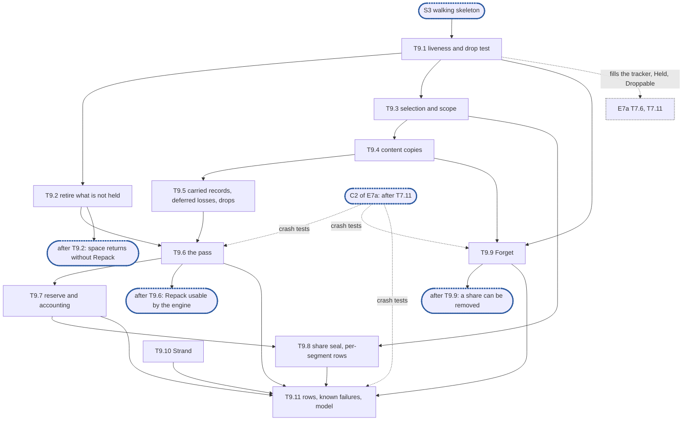

# Epic 9a: journal v2 reclamation and tags

**Sources:** [RFC 1](../rfcs/rfc-1-journal.md) §7.1 and §7.2 (whole), §7.3 (the copy's
accounting and the double retire, as far as this epic's two retirement paths meet), §3 (`Forget`,
`Strand`, the context rules for both, and a file's tag released by a forget), §3.7 and §3.9 (the
fields and counters of this area), §4.4 (the per-segment accounting), §5.1 (the rules on
durability before an unlink and before a removal record is dropped), §6 (the repack reserve and
what a capacity refusal is owed), §8.1 and §8.3–§8.7 (the parts on repack, reclamation and
`Forget`), §9.2 and §9.4 (the rows on repack, retirement and forget), §3.1 (an ended segment held
until its copies are proven), §6 (a deferred loss, written by the copy that retires its segment),
and §10 questions 5 and 6 (the two rules `Repack` owes a capacity refusal);
[RFC 28](../rfcs/rfc-28-journal-format.md) §2.2 (a failed segment's retirement, an unlink durable
before a removal record is dropped), §2.3 (no copy of a record that does not verify; the record
kinds a copy keeps), §3.2 (which records decide an offloaded bit after recovery) and §3.3 (a
segment holding unreadable records, copies with equal numbers, and "A read that fails is not a
record that does not verify": an unread record is neither dropped nor carried).
**Track:** B.
**Epic 9a estimate: 11 subtasks, 41 man-days.**
**Depends on:** sync point **S3, the walking skeleton**; epic 4's per-segment held and retained bytes
(E4-9), its drop ranges and the "any segment holds a record of this file" answer (E4-10), the
retained-extent set (E4-6), removal markers and `Settle` (E4-5) and the rebuild builder (E4-11),
used to plant states in tests; epic 5's segment set with its record bytes per share tag and its
claims (T5.1), the per-segment reader drain (T5.2), the repack-reserve class of the roll (T5.6),
the seal (T5.7) and the retirement executor, its queue and its durable-unlink report (T5.9); epic
6's `Durability` (`WaitDurable`, `Durable`, T6.1), loss records and the deferred losses an open
leaves owed (T6.2, its R92), the announcement that a failed segment's window is resolved (T6.3,
T6.4), the retained-extent lifting (T6.4), the read-only check `Admit` (T6.6) and the corruption
handler `Corrupt` (T6.7); the read path's unread state (a failed read retried as RFC 28 §3.3
bounds it, its record unread and its segment suspect), which E5's positioned read (T5.4b) and
E6's D11 leave to #3511's answer (§9); epic 8's share
registry (T8.3), the tag check and claim (T8.4), the admission classes for header-only records
and repack copies (T8.6), the removals and `Settle` (T8.8, T8.9), the lock-order recorder
(T8.11), `Journal.Close` and its stop registry (T8.12) and `Stats` with `UnreclaimedBytes`
(T8.13); epic 7a's `Open` with emptying, checkpoint **C2 of E7a** (after its T7.11), which
applies forget records and selects copies by precedence, for every test that reopens after a
crash.
**Blocks:** epic 7a's T7.6, whose rebuild fills T9.1's liveness tracker at open, and its T7.11,
whose emptying asks T9.1's `Held` and `Droppable`; epic 9b (offers, `report`, marks, `Release`
and holds run on this epic's liveness rule, selection and pass, and consult its stranded set);
the engine's capacity loop and share removal, which call `Repack`, `Forget` and `Strand` (E11);
epic 12.

---

## 1. Goal

Epic 9a gives the journal the half of reclamation that needs nothing from the remote tier: a
segment that holds nothing live leaves the disk on its own, and `Repack` carries the live records
of the segments it selects forward and retires them. It also gives the tag lifecycle its two
calls, `Forget` and `Strand`. With it, a journal that is never offloaded still gets its space
back: content an overwrite superseded, and extents a truncate, a deallocate or a delete removed,
return in whole segments, and a share's removal drops the share's bytes. Offers, `report`,
`MarkOffloaded`, `Unmark`, `Release` and snapshot holds are epic 9b's, and build on what this
epic leaves.

**At the end of the epic:**

- a segment that backs no held or retained extent, holds no live header-only record, holds no
  dropped record whose loss is deferred and is not an ended segment whose copies nothing proves
  yet is retired, unlinked or recycled, without a `Repack` call and without a read, once the
  records that left it so are durable;
- `Repack(ctx, budget, scope)` selects within its scope, without reading, the segments with the
  least live payload, verifies every source record whole, copies only its held and retained
  pieces, coalesced, carries the live header-only records with their numbers and each deferred
  loss as its loss record, decides its drops after its own copies, makes the copies durable,
  repoints the index and only then retires the sources, and returns `freed` once the retirements
  are durable;
- a source read that fails with an I/O error drops nothing and copies nothing: the record is
  unread, its segment suspect, and the segment is not selected while the record is live;
- a crash at any step of a pass leaves every held and retained extent reachable after reopen;
- a pass runs at the journal's maximum and beside a share at its limit, drawing only on the
  repack reserve, and never selects a segment another pass holds, an active one, a failed one
  whose window is open, or a damaged one that still backs extents it cannot produce;
- a pass scoped to a share seals that share's active segments itself, and the per-segment
  accounting names each segment's unreclaimed bytes;
- `Forget(ctx, tag)` appends one durable forget record and drops everything of the tag, is refused
  while a handle of the tag is open, is idempotent, and is never overtaken by a repack copy;
- `Strand(tag)` keeps a tag's extents from every other handle, appending nothing;
- `repacked_bytes`, `freed_bytes` and the `repack_pass` span move, and every conformance test
  this epic turns green has left the known-failure list.

### 1.1 In scope

- The liveness rule: when a segment is held (its extents, its live header-only records, a
  deferred loss, an ended segment's unproven copies), per header-only record kind, and the
  removal-drop test per extent by version (T9.1).
- Retirement of segments that are not held, without `Repack`, once the records that left them
  so are durable (T9.2).
- `Repack`: selection, scope and claims (T9.3), content copies (T9.4), carried header-only
  records and drops after copies (T9.5), ordering, repoint, `freed` and progress (T9.6), the
  repack reserve and the copy's accounting (T9.7), sealing a share's active segments and the
  per-segment accounting with its unreclaimed bytes (T9.8).
- `Forget` (T9.9) and `Strand` (T9.10).
- The counted rows, the known-failure bookkeeping and the model run of this area (T9.11).

### 1.2 Out of scope

- `Offload`, `OffloadMany`, the frozen `Offered` reader, `limit`, `widen`, `report` and its
  marking, partial success, unoffered reports, a removal during an offer: epic 9b.
- Pins: 64 per offer, 256 journal-wide, `PinnedSegments`, and the offer's refusal to pin a segment
  under repack. This epic gives the predicate an offer asks ("is this segment selected by a
  pass?", T9.3) and treats a pin as an exclusion selection reads (R21); epic 9b sets and clears
  pins.
- `MarkOffloaded`, `Unmark`, the below-half rule for offloaded records, `Release`, release
  records and their all-or-nothing rule, and `released_bytes`: epic 9b. The liveness rule for a
  release record is this epic's (it is the removal's, R10), so epic 9b only produces them.
- Snapshot holds: `Hold`, `Unhold`, `Stamp`, `Held`, retained lifetimes under a hold,
  `Superseded`: epic 9b. Their records are carried forward by this epic as always live (D4), and
  epic 9b narrows that to the RFC's rule.
- `Forget`'s drop of hold marks: there are none until epic 9b; epic 9b's holds hook into the drop
  this epic writes (T9.9).
- Stranded extents kept from eviction, offers and release: epic 9b's calls consult the stranded
  set this epic keeps (T9.10).
- Salvage of a stranded tag, choosing which tags to strand and to forget, and the start order:
  the engine (E11), never the journal (RFC 1 §3).
- Applying forget records, rebuilding drop ranges and the per-segment counters at open, and
  emptying a segment recovery ended: epic 7a. Inspection's index read-out (`File`, `All`) and
  `Verify` with its footprint check: epic 7b. This epic implements only `Inspector.Segments`
  (T9.8).
- The `reconcile` and `reconciled` records (RFC 28 §3.3): their liveness, and the re-append of a
  live `reconcile` record that fails to verify when a pass reads it, are epic 7b's with the
  reconcile itself. Until then an open that finds one refuses (epic 7a), so none is on disk;
  this epic carries one as live should it meet one (D4).
- `AcknowledgeUnreadable`, `Acknowledge` and the turning of an acknowledged unread record into a
  loss: epic 7b. This epic leaves an unread record held and its segment unselected (T9.3, T9.4).
- The re-append of a failed append's or failed sync's still-held records into the stream's next
  segment, `MarksRecorded`, and the seal that bounds the hold (RFC 1 §3.1): the write and sync
  path's, owned by no epic document yet (§9). This epic holds the ended segment until that path
  reports its copies proven (T9.1).
- Reading a segment, and retrying a failed read: the read path's (E5's positioned read, with the
  unread state of §9). This epic keeps no unread set of its own.
- The retirement executor itself (close, unlink or recycle, the directory sync, the double-retire
  count), the descriptor drain, the seal and the reserve-class roll: epic 5. This epic decides
  *when* a segment is retired and hands it over.
- Repack's write amplification (J8) and reclamation under load (J5): epic 12.
- The cluster parts of RFC 1 §3 (per-shard forget records, replicas, takeover): outside the
  journal's single-node scope.

### 1.3 Names used here

- **E1**, epic 1, interfaces: the public surface with stub bodies, among them `Repack`,
  `RepackScope`, `Forget`, `Strand` and `Inspector`.
- **E2**, epic 2, red suite and test foundations: the test clock, the fault schedule, the
  crash-simulating seam, the reference model, the profiler, the fixture and the known-failure
  list.
- **E3**, epic 3, on-disk format and platform layer: the record codecs, CRC32C and the platform
  checks.
- **E4**, epic 4, placement index and versions: the index, its retained set, markers, per-segment
  counters, drop ranges and rebuild builder. Its subtasks are cited as E4-6, E4-9, E4-10, E4-11.
- **E5**, epic 5, segments, streams and accounting: the segment set, streams, spare pool, seal,
  retirement executor and descriptor cache.
- **E6**, epic 6, durability and loss: `Sync`, loss records, failed windows, read-only state and
  the corruption handler.
- **E7a**, epic 7a, the part of epic 7 (recovery and identity) that lets a journal reopen after a
  restart or a crash: rebuild by catalog and by scan, torn tails, the unproven tail and its
  re-append, counters, spare re-adoption, the offloaded bits rebuilt from offloaded and unmark
  records, forget records applied at open, tag conflicts, and the emptying of the segments the
  open ends.
- **C2 of E7a**, E7a's checkpoint after its T7.11: `Open` recovers and empties what it ended, so
  a crash test can reopen through it.
- **E7b**, epic 7b, the rest of epic 7: `Restamp`, inspection's `File`, `All` and `Verify`,
  `RebuildFormat`, `AcknowledgeUnreadable` and `Acknowledge`, unread records held at open, the
  journal half of the metadata reconcile and its records, the recovery benchmarks, and retained
  extents rebuilt from hold records.
- **E8**, epic 8, data path and capacity: shares and handles, `WriteAt`, `ReadAt`, `Fill`, the
  removals, capacity and admission, lock domains, `Close` and `Stats`.
- **E9a**, this epic: the part of epic 9 (offload, reclamation, holds and tags) that needs no
  remote tier: retirement, `Repack`, `Forget` and `Strand`.
- **E9b**, epic 9b, the rest of epic 9: offers, `report`, pins, `MarkOffloaded`, `Unmark`,
  `Release` and snapshot holds.
- **E10**, epic 10, start and initialisation: the device configuration, the start check and the
  journal side of initialisation.
- **E11**, epic 11, the engine on the RFC 16 store: the caller of `Repack`, `Forget` and `Strand`.
- **E12**, epic 12, E2E green: the known-failure burn-down, soak and benchmarks.
- **S1**, interfaces frozen: E1's exported surface no longer changes.
- **S2**, red suite in CI: E2's conformance suite runs on every pull request, listed whole as
  known failures.
- **S3**, the walking skeleton: E5's append streams with the spare pool, the seal, the roll and
  the end event (its T5.1, T5.2, T5.4a, T5.4b, T5.5, T5.6, T5.7 and T5.10), E6's T6.1 to T6.4,
  T6.7 and T6.9, and E8's `WriteAt`, `ReadAt` and a minimal `Init` and `Open` of a directory with
  no segment, with `Share` for their handles (its T8.1, T8.2, T8.3 and T8.15), on top of E4's
  index.
- **S4**, core complete (E3–E9 done): all component conformance tests are green; only system e2e
  tests remain on the known-failure list.

## 2. General rules for each epic

1. **Independent unit tests.** Each epic carries its own unit tests. It may use another
   epic's pure in-memory implementation (E4's index, E3's codecs), the implementation of
   an epic it depends on once that has landed (E8 on E5's segments and E6's `Sync`), and the test components from epic 2. Epic 1 declares no internal interface
   to fake (rule 12).
2. **Fuzz tests where relevant.** Use Go native fuzzing (`testing.F`) on every parser of
   bytes the journal did not just write: records, segment headers, seal markers, catalogs,
   trailers, the `format` file. Also fuzz-drive operation sequences against the reference
   model. The property is that any input is either accepted as valid or rejected: never a
   panic, and never an extent the bytes do not contain.
3. **Metrics, and tracing where relevant.** Every counter and gauge RFC 1 §3.7 and §3.9
   assigns to the epic's area is maintained, and exposed through `Stats` (served from
   maintained counters, never a walk). Spans go through epic 1's standard-library
   `Tracer` and logs through the injected `*slog.Logger`, never a metrics or tracing
   library. Operations worth a span:
   open and recovery, sync, offload pass, repack pass, fill, and a refused reservation.
4. **Profiling.** Tests and benchmarks run under epic 2's profiling harness and fail on
   goroutine, descriptor or memory leaks and on anomalous resource growth. Hot paths
   (`WriteAt`, `ReadAt`, `Stats`, `report`, index lookup and insert) carry
   allocations-per-op assertions and the counted checks of RFC 1 §9.7. Allocation and
   heap assertions run outside `-race` only, because `-race` changes both.
5. **Public interface and internals.** Tests cover the epic's internal package API and the
   public v2 interface behaviour it enables, including concurrency under `-race`. Per the
   project rules, test at the layer that **consumes** a value, not the one that produces
   it. A regression test is validated by reverting the fix and watching it fail **on its
   assertion**.
6. **Known failures shrink.** Every e2e test an epic turns green is removed from the
   known-failure list in the same change. The runner fails if a listed test passes.
7. **v2 ignores v1.** No import of, copy from, or behavioural dependence on
   v1's journal (`pkg/block/journal` until #3645 deleted it). The import test enforced it. v1 code is neither ported nor
   bridged: it is deleted with the rest of v1 at the cutover (stage 7 of #3119). v2
   checks only whether v1 state exists, to refuse it at start (E10), and never reads
   v1's format.
8. **Real storage for storage properties.** No in-memory filesystem stands in for a check
   about durability, torn tails, unlink durability or corruption (RFC 1 §9.5). In-memory
   stand-ins are allowed only for pure logic (index, codecs).
9. **Code comment conventions** (`CLAUDE.md`). No epic, issue or plan IDs in source
   comments. Use `ponytail:` for knowingly-simple implementations and `decision:` for
   deliberate behaviour. Where the RFC already carries a ponytail or decision note, its
   marker goes at the code site that implements it.
10. **A test must be able to fail.** Every test is code maintained for the life of the
    project. Keep a test only if a plausible change would make it fail and nothing else
    would catch that change: not the compiler, not the PR diff, not a later epic's tests.
    A test that checks two `errors.New` values differ, that the standard library's
    `errors.As` works, or that a stub returns zero does not qualify. A test that a
    little-endian `Version.Bytes` would fail does. Review rules that no test can check
    (for example, stubs never panic) stay review rules.
11. **A symbol is exported only if RFC 1 §3 uses it.** Everything exported is frozen at
    S1, so a helper exported for convenience becomes a contract. Helpers the internal
    packages need (`Less`, `IsZero`, `End`, `Overlaps`, `Seq`, the proposed constants)
    stay in `internal/core`.
12. **Each subtask creates only what it declares.** No empty package and no stub without
    a caller. A package, an option or a test helper lands with its first consumer.

### 2.1 How the rules apply

| Rule | Subtasks | How |
| --- | --- | --- |
| 1 Unit tests | all | every R-number has a test that can fail. Subtasks build on E4's index and builder, E5's set and executor, E6's `Durability` and E8's journal core as landed, and plant states (a settled marker, a retained extent, a record of a tag below a forget) through E4-11's builder rather than a fake |
| 2 Fuzz | T9.1, T9.6 | no parser of foreign bytes here: a source record is read through E3's codec and verified by its checksum, which E3 fuzzes. T9.1 fuzz-drives sequences of writes, overwrites, removals, settles and retirements against an oracle of liveness; T9.6 fuzz-drives operation sequences with repack passes against the reference model |
| 3 Metrics and tracing | T9.2, T9.6, T9.8, T9.9 | `repacked_bytes` (T9.6) and the per-segment unreclaimed bytes (T9.8) are maintained at the event; `freed_bytes` is E5's, raised by its executor, and `Repack`'s `freed` is summed from the same reports (T9.6); `UnreclaimedBytes` is E8's counter, which T9.2, T9.6 and T9.9 feed through E8's account function; `DropRanges` is E4's. One span, `repack_pass`, per pass (T9.6). No span for `Forget` or for a retirement, which rule 3 does not name |
| 4 Profiling | all | every test runs under E2's profiler. T9.2's worker and T9.6's pass are where goroutines could leak; T9.1 asserts zero allocations per liveness update outside `-race`, since it runs on every index change. No hot path of rule 4 is this epic's |
| 5 Interface and internals | all | tests go through `Repack`, `Forget`, `Strand`, `Inspector.Segments` and `Stats`, and through `ReadAt` after a pass or a reopen: the read is the consumer of a repoint, a drop and a forget. `-race` on every concurrent case. Reverting a fix fails on its assertion |
| 6 Known failures | T9.11 | the rows of §6's T9.11 leave `test/journal/known.yaml` in the change that turns them green; the rows that need epic 9b's calls are re-pointed to it there |
| 7 v2 ignores v1 | none | nothing here reads anything outside v2 |
| 8 Real storage | T9.2, T9.6, T9.9, T9.11 | crash cases (mid-pass, an unlink not yet durable, a forget not yet synced) run on real storage through E2's crash-simulating seam, never an in-memory filesystem. T9.1, T9.3 and T9.5's drop test are pure logic and may run in memory |
| 9 Markers | T9.1, T9.2, T9.3, T9.4, T9.5, T9.6, T9.8, T9.9 | T9.1 places D2's and D4's `ponytail:` and D3's and D20's `decision:`; T9.2 the RFC's `ponytail:` on whole-segment freeing at the hand-over (D5); T9.3 RFC 28 §3.3's `decision:` that a dead unread content record pins nothing; T9.4 D7's and D18's `decision:`; T9.5 RFC 1 §6's `ponytail:` on a carried loss record's size; T9.6 D8's `decision:`; T9.8 D16's `ponytail:` and the share seal's `decision:`; T9.9 D10's `decision:`. T9.7 and T9.10 place none. §4 lists every marker with its ceiling |
| 10 A test can fail | all | each test names the bug it catches in §6 |
| 11 Exports | T9.8 | nothing new is exported: `Repack`, `RepackScope`, `Forget`, `Strand` and `Inspector.Segments` are E1's. The per-segment unreclaimed figure stays internal until RFC 1 §4.4 names it (D16) |
| 12 Creates only what it declares | all | `internal/reclaim` lands with T9.1, its first consumer being T9.2 in the same pull request; each later file lands with its subtask |

## 3. Requirements and invariants

**When a segment is held, and when it is retired**

| # | Requirement | Kind | Source | Subtasks |
| --- | --- | --- | --- | --- |
| R1 | A segment is held while it backs a held or retained extent, holds a live header-only record, holds a dropped record whose loss an open deferred, or was ended by a failure whose copies nothing on disk proves yet. A segment that is not held is retired, unlinked or recycled, by the journal on its own, without waiting for a repack to select it | MUST | RFC 1 §7.1, §7.2, §3.1, §6 | T9.1, T9.2 |
| R2 | Storage is freed in whole segments only: neither retirement nor repack frees, zeroes or deallocates any byte range inside a segment while it remains | MUST NOT | RFC 1 §7.1 | T9.2, T9.4 |
| R3 | A segment is handed to retirement only once the records that left it not held are durable, and a segment's own records are durable before reclamation unlinks or recycles it | MUST | RFC 1 §7.1, §5.1 | T9.2, T9.6 |
| R4 | A release record is durable before the segment holding the record it released is unlinked or recycled. (Epic 9b writes release records; the rule is applied by this epic's hand-over, R3) | MUST | RFC 1 §5.1 | T9.2 |
| R5 | A segment left by a failed sync, or ended by a failed append, is a repack candidate once its window, if any, is resolved, never before; it is unlinked, never recycled, only after repack carried forward the records synced into it before the failure. Whether it is resolved is re-read under the file index before its records are carried or it is handed over | MUST | RFC 1 §7.2, §5.3; RFC 28 §2.2 | T9.3, T9.6 |
| R6 | A segment in which every record has stopped holding anything becomes reclaimable without a read | test row | RFC 1 §9.2 | T9.1, T9.2 |
| R7 | One segment selected by two reclamation paths at once is retired by one of them; the accounted footprint falls by its size exactly once and never below zero | test row | RFC 1 §9.2, §7.3 | T9.2, T9.3 |
| R8 | An ended segment whose still-held records were re-appended into the stream's next segment stays held, and is never retired, until the caller reports through `MarksRecorded` a recorded mark of the copies' segment whose `Through` is past the last copy, or that segment is sealed | invariant | RFC 1 §3.1 | T9.1, T9.2 |
| R9 | A segment holding a dropped record whose loss is deferred is a repack candidate like any other, and is never retired without the copy that writes that loss record, even with nothing else live in it | invariant | RFC 1 §6, §7.2 | T9.1, T9.3, T9.5 |

**Which header-only records are live**

| # | Requirement | Kind | Source | Subtasks |
| --- | --- | --- | --- | --- |
| R10 | A release record, or a synced loss record, is live while it may still outrank a record of its file in another segment; a synced loss record, a `superseded` one excepted, also while `Settle` has not covered it | invariant | RFC 1 §7.2 | T9.1 |
| R11 | An unsynced loss record is live while any segment holds a copy of the record it names | invariant | RFC 1 §7.2, §3.8 | T9.1 |
| R12 | A truncate, deallocate, delete or clone target record is live while it may still outrank a record in another segment or its removal marker is unsettled | invariant | RFC 1 §7.2, §3.6 | T9.1 |
| R13 | A forget record is live while any other segment holds a record of its tag below its sequence number | invariant | RFC 1 §7.2, §3 | T9.1, T9.9 |
| R14 | An offloaded or unmark record is live while it decides the bit of a held or retained extent; a hold, unhold or stamp record while the hold or stamp it records is. This epic carries every one of them forward as live (D4); epic 9b, which writes them, applies the narrower rule | invariant | RFC 1 §7.2; RFC 28 §3.2 | T9.1 |
| R15 | A removal, release or synced loss record whose marker, if it has one, is settled, and below whose (content version, sequence number) pair no other segment holds a record of the same file overlapping its extent, can outrank nothing and is dropped. The test is per extent and by that pair: never by sequence number alone, never against every record of the file whatever its extent, never against the lowest pair journal-wide | MUST | RFC 1 §7.2, §4.3 | T9.1, T9.5 |
| R16 | Such a record is dropped only once every unlink or recycle it counted on is durable by a directory sync | MUST NOT | RFC 1 §7.2, §5.1; RFC 28 §2.2 | T9.5, T9.6 |
| R17 | The test reads the at most eight ranges per (file, segment) the index keeps, each with the lowest pair inside it: it may keep a removal longer than it must, never drop one it needs | bound | RFC 1 §7.2 | T9.1 |

**Selection**

| # | Requirement | Kind | Source | Subtasks |
| --- | --- | --- | --- | --- |
| R18 | Candidacy is decided from held and retained bytes per segment against the storage the segment still allocates; a pass never reads a segment to decide whether to repack it | MUST NOT | RFC 1 §7.2 | T9.3 |
| R19 | A pass takes the segments with the least live payload first | SHOULD | RFC 1 §7.2, §7.1 | T9.3 |
| R20 | Only segments inside the scope are candidates: a share's scope selects the segments holding that share's records, a segment-set scope only the named segments, and a zero scope any segment | MUST | RFC 1 §7.2 | T9.3 |
| R21 | A segment pinned by a running offer is not a candidate, and a segment a pass has selected takes no new pin until the pass ends with it. (Pins are epic 9b's; this epic reads the pin and answers the "selected" predicate) | MUST | RFC 1 §7.2 | T9.3 |
| R22 | A pass never runs on a segment while it backs a held or retained extent from a record that cannot be read. Once those extents are dropped or read, or the failed window resolved, it carries the readable live records forward and retires the segment | MUST NOT | RFC 1 §7.2; RFC 28 §3.3 | T9.3, T9.6 |
| R23 | Two passes never select the same segment, and a segment is never its own target | MUST NOT | RFC 1 §7.2, §8 | T9.3 |
| R24 | A segment recovery ended is never a candidate: open empties and unlinks it (epic 7a) | invariant | RFC 1 §7.2; RFC 28 §3.3 | T9.3 |
| R25 | Repack neither carries forward a live unread record nor selects the segment holding it, and no pass unlinks that segment while the record is live. A dead unread content record, one that backs no held or retained extent, pins nothing; an unread header-only record is never dead | MUST NOT | RFC 28 §3.3 | T9.3, T9.4 |

**Copies of content**

| # | Requirement | Kind | Source | Subtasks |
| --- | --- | --- | --- | --- |
| R26 | Repack preserves the set of held extents and of retained extents, the bytes they produce, and their offloaded bits: it neither resets nor sets a bit | MUST | RFC 1 §7.2; RFC 28 §3.2 | T9.4, T9.6 |
| R27 | A copy of content gets a new sequence number and keeps its content version | invariant | RFC 1 §7.2, §4.3 | T9.4 |
| R28 | Before copying any part of a source record, repack reads its whole payload and verifies its payload checksum. A record that does not verify is dropped as corrupt and nothing of it is copied | MUST | RFC 1 §7.2; RFC 28 §2.3, §3.3 | T9.4 |
| R29 | Repack copies only the held and retained extents of a record, each as a new record with its own payload checksum, never the released part; the original stays whole on disk until its segment is unlinked | invariant | RFC 1 §7.2, §7.1 | T9.4 |
| R30 | Adjacent held extents of one file that share a content version and an offloaded bit are copied as one record | invariant | RFC 1 §7.2, §4.2 | T9.4 |
| R31 | A copy is appended under its file's serialised append, and only if its source is still held or retained at that moment. A source a later write or removal turned retained is still copied, as retained; one neither held nor retained is skipped. The check and the append are one step against `WriteAt`, the removals and `Release` on that file | MUST | RFC 1 §7.2, §8.4 | T9.4 |
| R32 | A source read that fails with an I/O error is not a record that does not verify: repack drops none of its extents, appends no loss record for it and reports no corruption. The record is unread and its segment suspect; a read is started again only while fewer than 3 attempts have been made and less than 15 s has passed, and an access to a record already unread makes one attempt. A read that later returns bytes is checked as any record's | MUST NOT | RFC 28 §3.3 | T9.4 |

**Carried header-only records**

| # | Requirement | Kind | Source | Subtasks |
| --- | --- | --- | --- | --- |
| R33 | A carried header-only record keeps both its sequence number and its content version | invariant | RFC 1 §7.2; RFC 28 §3.3 | T9.5 |
| R34 | A pass decides its drops once its own copies are appended, and counts them, its target segments included | invariant | RFC 1 §7.2 | T9.5 |
| R35 | A pass whose source holds a dropped record whose loss is deferred writes that loss record into its target with the records it copies, under the repack reserve and never on the headroom. The deferral ends only once the target is synced, and the source is unlinked only after that sync | MUST | RFC 1 §6, §7.2 | T9.5, T9.6 |

**Ordering, `freed` and readers**

| # | Requirement | Kind | Source | Subtasks |
| --- | --- | --- | --- | --- |
| R36 | Copy the records, make the copies durable, repoint the placement index, and only then retire the source. A crash before the retirement leaves both, and precedence selects the copy; a crash after it is a completed repack. At no point is an extent unreachable | MUST | RFC 1 §7.2 | T9.6 |
| R37 | Repack's repoint is atomic for readers of the affected files: a read sees the old location or the new one, never neither | MUST | RFC 1 §8.4 | T9.6 |
| R38 | `Repack` returns `freed`, the storage its retirements returned to the filesystem or to the spare pool, only once they are durable; the storage in use, `UsedBytes` − `Spares` × the segment cap, falls at that moment, never earlier | MUST | RFC 1 §7.2, §6 | T9.6 |
| R39 | `repacked_bytes` counts the bytes repack moved, and `freed_bytes` the storage retirements returned, both served from counters | MUST | RFC 1 §3.9 | T9.6 |
| R40 | A read either observes the location it resolved, intact, or learns to retry or to report the extent missing; it never returns bytes from storage freed or reused. Repack frees storage only through epic 5's executor, after its repoint | MUST | RFC 1 §8.5 | T9.6 |

**Capacity**

| # | Requirement | Kind | Source | Subtasks |
| --- | --- | --- | --- | --- |
| R41 | Copies reserve against the repack reserve, never a share's limit, and a pass copies at most what the reserve holds before the segments it emptied are retired and the reserve is whole again | MUST | RFC 1 §7.2, §6 | T9.7 |
| R42 | A journal at its maximum, and a share at its limit, can still run a repack | MUST | RFC 1 §7.2 | T9.7 |
| R43 | A copy is accounted to its record's share once the source segment is unlinked; until then the share's usage may stand above its limit by that copy | invariant | RFC 1 §6 | T9.7 |
| R44 | A pass scoped to a share seals each active segment that holds the scope's unreclaimed bytes, at most one per stream until repack retires it, so repack can reach those bytes; the seal marker draws on the reserved headroom, so a journal at its limit still takes it | MUST | RFC 1 §10 question 5 | T9.8 |
| R45 | The per-segment accounting gives, for each segment, its id, seal state, allocated storage, held bytes, whether it is damaged, whether it is suspect and, for a suspect one, each unread range as an offset and a length, and its unreclaimed bytes; a damaged segment retired keeps its row, marked retired, until close; `Stats` is the total | MUST | RFC 1 §4.4, §10 question 6 | T9.8 |

**Locks and progress**

| # | Requirement | Kind | Source | Subtasks |
| --- | --- | --- | --- | --- |
| R46 | A pass takes each file's append lock in turn and never holds two; it repoints under the file index alone, and takes the storage guard only to unlink, holding no other lock | MUST | RFC 1 §8.3 | T9.4, T9.6 |
| R47 | No I/O is done while the file index is held: a source is read with the index released | MUST NOT | RFC 1 §8.3 | T9.4 |
| R48 | A continuous stream of readers never keeps reclamation from a segment; reclamation holds a segment exclusively for no longer than one unit of work, so a large repack is divisible | MUST | RFC 1 §8.6 | T9.6 |
| R49 | A read of one file never waits on reclamation of a segment it does not read | invariant | RFC 1 §8.1 | T9.6 |
| R50 | On close, passes and this epic's retirement worker are stopped and joined before the segments they touch are closed | MUST | RFC 1 §8.7 | T9.2, T9.6 |
| R51 | `Repack` takes a context and checks it before any refusal and before changing state, returning its error having changed nothing; a unit whose copy has been appended completes | MUST | RFC 1 §3 | T9.6 |

**Tags**

| # | Requirement | Kind | Source | Subtasks |
| --- | --- | --- | --- | --- |
| R52 | `Forget` appends one header-only forget record naming the tag, durable before it returns and drawing on the reserved headroom, and drops from the index every held and retained extent, removal marker and hold mark of the tag's files | MUST | RFC 1 §3, §6 | T9.9 |
| R53 | After `Forget`, `Since` yields nothing of the tag's files and nothing is left to settle: `RemovalMarkers` no longer counts them | invariant | RFC 1 §3, §9.4 | T9.9 |
| R54 | `Forget` is refused while a handle of the tag is open | MUST | RFC 1 §3 | T9.9 |
| R55 | `Forget` is durable and idempotent: run again after a crash, or on a tag that holds nothing, it succeeds | invariant | RFC 1 §3 | T9.9 |
| R56 | A forget record and its drop are atomic against repack copies and fills of the tag: a copy whose held check ran before the forget is abandoned, never appended after the forget record | MUST | RFC 1 §8.4, §3 | T9.4, T9.9 |
| R57 | Once a tag is forgotten, the files it claimed are claimed by no tag, so a write through another handle claims them; a tag conflict naming it is cleared from `TagConflicts`; and `Stats().Shares` no longer lists it | MUST | RFC 1 §3, §3.7, §9.4 | T9.9 |
| R58 | The journal never forgets a tag on its own: a tag not attached is kept, served once its share attaches, and forgotten only when the caller names it | invariant | RFC 1 §3, §9.4 | T9.9 |
| R59 | `Forget` takes a context; with a context already done it returns the context's error and appends no record | MUST | RFC 1 §3, §9.4 | T9.9 |
| R60 | `Strand` is kept in memory and appends nothing. From the call on, no read through another tag's handle is served from the tag's extents, and none of them is evicted, offered or released (epic 9b's calls consult the set); a handle of the tag itself still reads them. It takes no context | MUST | RFC 1 §3 | T9.10 |

**Conformance rows this epic turns green**

| # | Requirement | Kind | Source | Subtasks |
| --- | --- | --- | --- | --- |
| R61 | Removal outlives its segment: a delete's segment, alone selected, and a settled delete whose counted unlinks are not yet durable, both leave the file absent after a crash | test row | RFC 1 §9.4 A | T9.5, T9.6, T9.11 |
| R62 | Crash mid-repack: between copy and unlink, recovery selects the copies, every held extent reads, and no extent is duplicated | test row | RFC 1 §9.4 A | T9.6, T9.11 |
| R63 | Copy loses to a newer write: synced, no copy is appended; unsynced, the copy is appended as retained and a failed window serves the old bytes, before and after reopen | test row | RFC 1 §9.4 A | T9.4, T9.11 |
| R64 | Repack under read: a read during a repack copy and unlink sees the old or the new location, never neither | test row | RFC 1 §9.4 A | T9.6, T9.11 |
| R65 | A recycled segment keeps its new records, and a failed append in a recycled segment makes it a candidate only once resolved, unlinked after its synced records are carried | test row | RFC 1 §9.4 A | T9.3, T9.6, T9.11 |
| R66 | Background joined: a store closed with a repack in flight stops it before any segment is closed | test row | RFC 1 §9.4 B | T9.6, T9.11 |
| R67 | Forget leaves nothing to settle, and a later attach of the tag holds new writes | test row | RFC 1 §9.4 C | T9.9, T9.11 |
| R68 | An unclaimed tag is reported in `Stats().Shares` with its held and dirty bytes, and no longer after `Forget` | test row | RFC 1 §9.4 C | T9.9, T9.11 |
| R69 | Segment reclaimable: once a corrupt record's extents are dropped, repack can select the segment and its storage is recovered | test row | RFC 28 §4.2 B | T9.3, T9.11 |
| R70 | An ended segment outlives its copies' proof: before any `MarksRecorded` naming the copies' segment, repack does not retire the ended segment; a `MarksRecorded` past the copy, and separately a seal of that segment, each let repack retire it | test row | RFC 1 §9.4 A | T9.2, T9.11 |

## 4. Decisions this epic takes

- **D1, one package for reclamation; the tag calls beside the tag check.** `internal/reclaim`
  holds the liveness tracker, the retirement candidacy and `Repack`. `Forget` and `Strand` live
  in `internal/datapath` beside epic 8's `tags.go` and share registry, since they change both.
  `Journal.Repack` delegates to `reclaim`, and `Forget` calls `reclaim` only to register its
  record's liveness (T9.1).
- **D2, liveness is a counter per segment, kept by events.** Each segment carries a count of the
  live header-only records it holds, beside E4-9's held and retained bytes, and two flags: it
  holds a deferred loss (D19), and it is an ended segment whose copies nothing proves yet (D20); a
  segment is not held when the three counts are zero and both flags are clear. The count is changed where a record's liveness can change, never by a
  sweep: a record becomes live when appended; a removal or synced loss record is re-tested for
  its file when that file's marker is settled, when a segment that held ranges of the file is
  durably retired (E5's executor reports the files through E4's `segmentGone`), and after a
  pass's copies (R34); an unsynced loss record when the last segment holding the record it names
  is retired; a forget record per D3. A `ponytail:` marker at the tracker names the ceiling: a
  file with many removal records re-tests them all at each such event, O(records of the file);
  upgrade to an index of removal records by extent when a profile shows the re-test.
- **D3, a forget record's liveness is a snapshot of segments.** At `Forget`, the segments whose
  record bytes for the tag are not zero (E5's per-tag bytes per segment) are the only ones that
  can hold a record of the tag below the forget's sequence number: every later record of the tag
  is above it. The snapshot is taken after D10's barrier, and T9.5 carries no record of a tag
  marked forgetting, so a record of the tag carried under its old sequence number has already
  landed, and E5's per-tag bytes count it in its new segment. The record stays live while any of
  them remains in the set. A `decision:` marker says why no per-record scan is needed, and its
  ceiling: the snapshot is exact only while no path appends a record of the tag below the forget's
  sequence number once the barrier has passed; a path that does (a carry outside the file append
  domain, a re-append of a failed window naming the tag) overturns it, and the upgrade is a scan of
  the snapshot's segments for records of the tag at each retirement.
- **D4, records this epic does not write are carried as live.** Offloaded, unmark, hold, unhold
  and stamp records are written only by epic 9b's calls, and `reconcile` and `reconciled` records
  only by epic 7b's reconcile (an open that finds one refuses until then); until then none exists
  outside a planted test. Carrying every one forward keeps a pass correct with no rule for them, at no cost while
  none is written. A `ponytail:` marker at the liveness switch names the upgrade: apply RFC 1
  §7.2's rule for each kind once the calls that write them land, since carrying them all would
  drain the headroom under offload. For a `reconcile` record the upgrade also brings RFC 1 §7.2's
  re-append of a live one that fails to verify when a pass reads it, with no loss record: until
  epic 7b, such a record is handed to `Corrupt` like any other, which is wrong only for a kind no
  journal yet writes.
- **D5, the hand-over waits for a durability point.** When a change leaves a segment not held,
  the tracker records, per stream, the location of the newest record whose publish did it (the
  removal, the superseding write whose sync lifted a retained extent, the loss record, the
  forget record). The candidate is handed to E5's retirement queue once E6's `Durable` reports
  every such location covered. An ended segment additionally needs E6's announcement that its
  window is resolved, and the announcement is re-read under the file index before the hand-over
  (E6's D10: a read can mark it unresolved again when it starts serving a copy). The RFC's
  `ponytail:` on freeing only whole segments goes here.
- **D6, copies land on the file's own stream.** A copy is appended like any record of its file,
  on the stream E5 chose for it (E5's D7), under the file append domain, and rolls onto a
  repack-reserve spare when the active segment has no room (E5's T5.6). Only sealed or ended
  segments are candidates, so the segment a copy lands in is never one the pass selected (R23);
  the one exception, T9.8's share seal, seals the active segment before selecting it.
- **D7, a copy keeps its source's kind and modification time.** A piece of a `write` record is
  copied as a `write` carrying the source's modification time; a piece of a `fill` as a `fill`,
  so recovery sets its offloaded bit as for any fill (RFC 28 §3.2). Coalescing (R30) merges
  pieces of one kind only, and for writes only with one modification time; a `decision:` marker
  says why a coalesced copy never mixes the two kinds (a merged fill would lose its bit at the
  next crash), and its ceiling: a file whose writes and fills alternate keeps one index entry per
  run after a pass, where a mixed copy would keep one. Revisit when a profile shows such files
  reaching the extent bound (RFC 1 §4.2) through repack's copies; the upgrade needs a record kind
  that carries a bit per piece, which RFC 28 §2.3 does not define.
- **D8, copies are repointed only once durable, and a copy whose sync fails is abandoned.** The
  pass waits for its copies through E6's `WaitDurable`; a copy is published nowhere before then,
  so a failed window that drops it removes nothing a reader sees. The pass then abandons every
  source unit with a copy in that window, retires none of them, and returns the error. A
  `decision:` marker names the ceiling: an abandoned unit costs its copies' bytes, held on the
  repack reserve until the failed window resolves, and a failed sync loses that pass's progress.
  It is overturned once E6's ledger can tell a never-published copy from a published record
  (§9): then the copy is re-appended, or dropped silently, and the unit continues.
- **D9, the unit of work is one source segment.** A pass selects, copies, waits, repoints and
  hands over one segment at a time, checking its context between units (R51); the storage guard
  is taken exclusively only by E5's executor for one unlink or recycle (R48). The pass registers
  a stop function with E8's `Close` (T8.12), which interrupts it between units and joins it.
- **D10, `Forget` closes the tag, passes a barrier, then appends.** `Forget` first marks the tag
  forgetting in E8's share registry, under the registry's mutex, refusing if a handle is open;
  while marked, `Share` of that tag is refused with `ErrHandleOpen`, wrapped to say a forget is in
  progress (a `decision:` marker: one error says the tag is busy, and no new exported error
  is needed; its ceiling is a `Share` refused for as long as the barrier and one sync take, which
  the engine's start retries. Overturned if RFC 1 §3 names a distinct error for it, or if a forget
  over a tag of many files is seen to keep an attach waiting). It then takes each of the tag's files' append domain in turn and releases it at
  once: any repack copy of the file that passed its check before the mark has appended by then,
  and every later copy reads the mark under the same domain and is abandoned (R56). Only then is
  the forget record appended, and its drop is made once it is durable, per file under the file
  append domain and the file index held for the write.
- **D11, the drop waits for the record to be durable.** Because nothing is dropped before the
  forget record is durable, a read-only journal or a failed window that fails the record has
  nothing to undo: `Forget` returns the error and the tag stays whole. This answers epic 6's open
  point on the lock a forget record publishes under: none, before it is durable, and each file's
  append domain after.
- **D12, a tag that holds nothing appends nothing.** `Forget` of a tag no segment holds a record
  of (by E5's per-tag bytes), with no entry in the registry, returns nil and appends no record:
  recovery has nothing to apply, and the start that calls `Forget` again for a tag already
  forgotten does no I/O.
- **D13, repack calls the corruption handler holding the file's append domain.** A source whose
  bytes were read and do not verify is passed to E6's `Corrupt` with the segment reference released first and
  `Corruption.DomainHeld` set (E6's D9). This answers epic 6's open point.
- **D14, a carried copy is not registered as another copy for a read.** E6's `Corrupt` serves a
  verified copy only of a re-append. A copy a pass made is repointed to before its source is
  retired, so a read that finds the source bad never needs the copy. E6's `ponytail:` stays as it
  is; this answers its open point.
- **D15, `Strand` is a set in the registry.** `Strand(tag)` adds the tag to an immutable set the
  registry publishes like its handles (E8's D13), returns nil, and `ErrClosed` after close. The
  set is read by epic 9b's `Release`, `Offload` and `OffloadMany` and by `ReadAt`'s tag check;
  `Forget` removes the tag from it.
- **D16, the per-segment unreclaimed figure is kept now and exported when the RFC names it.**
  Selection and the share seal need it internally from T9.3. RFC 1 §4.4 does not yet list it
  (§10 question 6 owes it), so `SegmentInfo` gains the field only when the RFC does (rule 11);
  until then the engine reads the scope's figure through `Stats().Shares`. A `ponytail:` at the
  internal figure names the ceiling: the engine's capacity step sees a share's total, not which of
  its segments to name in a segment-set scope, so it aims by share. Overturned when RFC 1 §4.4
  names the field; then `SegmentInfo` exports it. Open point in §9.
- **D17, this epic implements `Inspector.Segments`, and only it.** Selection by segment-set scope
  and the engine's capacity step need the per-segment rows while the journal runs; `File`, `All`
  and `Verify` stay epic 7b's.
- **D18, a source read that fails holds the unit; it never reaches `Corrupt`.** T9.4 reads a
  source through E5's positioned read with RFC 28 §3.3's retry bound. A read that fails with an
  I/O error after it marks the record unread and its segment suspect in the read path's unread
  state, drops nothing, appends nothing, and abandons the unit before any copy of that segment is
  appended; the segment is not selected again while the record is live (R25). A later pass's
  access tries the read once, which is the only retry repack makes: RFC 28 §3.3's `decision:`
  that no timer retries an unread record goes at the selection check (T9.3), with its ceiling
  (suspect segments seen outliving their fault because nothing read them). A dead unread content
  record is skipped without a read, as the RFC's second `decision:` there says. A `decision:`
  marker at T9.4's read says an I/O error never reaches `Corrupt`, with its ceiling: overturned
  only if the RFC comes to drop an extent on an I/O error, as E6's D11 also records.
- **D19, a deferred loss is carried from E6's registry, and ended only after the target syncs.**
  E6's T6.2 keeps each deferred loss in memory with the segment holding its dropped record. T9.1
  sets the segment's deferred flag from it, so the segment is held while one remains (R9). A unit
  over such a segment builds the loss record from the registry entry, appends it into the target
  with the content copies, admitted from the repack reserve, and asks E6 to end the deferral only
  once `WaitDurable` reports the target covered; the source is handed over after that (R35). RFC 1
  §6's `ponytail:` on a carried loss record's size goes at the append. Its ceiling: a source
  holding nothing but dropped records needs a tenth more than one segment's cap of reserve.
- **D20, the hold on an ended segment is registered by the path that copies its records.** RFC 1
  §3.1 re-appends an ended segment's synced, still-held records into the stream's next segment,
  and holds the ended segment until a `MarksRecorded` mark of the copies' segment past the last
  copy, or a seal of that segment. The re-append and `MarksRecorded` belong to the write and sync
  path (§1.2). T9.1 gives it `HoldEnded(seg, copies SegmentID, last int64)`, and releases the
  hold itself on either event: E5's seal of the copies' segment, which T9.1 observes, or a
  recorded mark past `last`, which the path hands to T9.1's `MarksRecorded` hook. An ended segment
  no re-append registered holds nothing on this account. A `decision:` marker names the ceiling:
  where the path registers nothing, the ended segment is retired once its window resolves and
  its other conditions clear, which is safe only while nothing re-appends its records; and RFC 1
  §3.1's seal within 30 s of the copies syncing, which bounds the hold, is that path's to add.
  Overturned by the path's arrival, which must call `HoldEnded` before its copies sync.

## 5. Target tree

```text
pkg/block/journal/
  repack.go             T9.6   Repack delegates to internal/reclaim
  share.go              T9.9, T9.10   Forget and Strand delegate to internal/datapath
  inspect.go            T9.8   Inspector.Segments
  internal/
    reclaim/
      live.go           T9.1   the liveness tracker per segment, deferred-loss flag, ended holds (D2–D4, D19, D20)
      droptest.go       T9.1   the removal-drop test over E4's ranges
      retire.go         T9.2   candidacy, the durability point, the hand-over to E5 (D5)
      select.go         T9.3   candidates, scope, order, the claim, the selected predicate
      copy.go           T9.4   verify whole, copy held and retained pieces, coalesce, unread sources (D6, D7, D18)
      carry.go          T9.5   carried header-only records and deferred losses, drops after copies (D19)
      pass.go           T9.6   the pass: units, durability, repoint, freed, stop (D8, D9)
      reserve.go        T9.7   the reserve bound and the copy's accounting transfer
      seal.go           T9.8   the share scope's seal
      *_test.go
    datapath/
      forget.go         T9.9   Forget (D10, D11, D12)
      strand.go         T9.10  Strand (D15)
      shares.go         T9.9   the registry's forgetting mark
    segment/
      inspect.go        T9.8   per-segment rows from the set and E4-9's counters
test/journal/known.yaml T9.11  rows turned green removed; rows needing epic 9b re-pointed
```

## 6. Subtasks

### T9.1 Liveness of segments and the removal-drop test

**Subtask T9.1 estimate: 5 man-days.**

- **Track:** B. **Depends on:** S3; E4-5, E4-9, E4-10; E5's segment set with per-tag bytes
  (T5.1), its seal events (T5.7); E6's loss records and deferred losses (T6.2).
- **Covers:** R1, R6, R8–R15, R17.
- **Deliverables:** `internal/reclaim/live.go`: per segment, a count of live header-only records
  beside E4-9's held and retained bytes, and `Held(seg) bool`. `Append` and publish hooks that
  register each header-only record a path appends (E8's removals, E6's loss records, T9.9's
  forget record), and the events of D2 that re-test them. `internal/reclaim/droptest.go`:
  `Droppable(rec) bool` for a removal, release or synced loss record, built on E4-10's ranges of
  the record's file in every other segment, comparing the (version, sequence) pair over the
  record's extent, and on the marker's settled state from E4-5; an unsynced loss record's test
  against the segments holding the record it names; the forget record's snapshot (D3); the
  always-live switch for offloaded, unmark, hold, unhold, stamp, `reconcile` and `reconciled`
  records (D4). The deferred-loss flag, set from E6's registry of deferred losses and cleared when
  E6 ends the deferral (D19); `HoldEnded` and the `MarksRecorded` hook, with the seal observer
  that releases a hold (D20). The rebuild's registration hook E7a's T7.6 calls at open, which
  takes each header-only record with its location, each forget record with its set of segments
  (D3) and each unsynced loss record with the segments holding the record it names. A segment
  going from held to not held calls T9.2's candidacy.
- **Acceptance criteria:**
  - A settled truncate whose file has no record at a lower pair overlapping it in another
    segment is not live; one with such a record is; an unsettled one is live whatever the ranges.
  - A synced loss record is live until `Settle` covers it and nothing it can outrank remains; an
    unsynced one until the last segment holding the record it names is retired.
  - A removal over `[1 GiB, 2 GiB)` is not kept alive by an older record of the same file over
    `[0, 1 MiB)`, nor by an older record of another file.
  - A record compared by sequence number alone would be kept or dropped differently in the
    planted case of RFC 1 §7.2 (a retained copy above a truncate's sequence and below its
    version): the test keeps the truncate.
  - A segment whose held and retained bytes reach zero and which holds no live record reports
    not held without any segment read.
  - A segment holding only a dropped record whose loss is deferred stays held until E6 ends the
    deferral, then reports not held.
  - An ended segment registered through `HoldEnded` stays held after its window resolves and its
    extents are gone, until the copies' segment seals or a recorded mark passes the last copy; a
    mark short of the last copy releases nothing.
- **Tests:** a property test against an exact oracle (every record kept, compared pair by pair)
  over random writes, overwrites, removals, settles and retirements, asserting `Held` agrees
  after every step (catches a missing re-test event); a `testing.F` target over the same
  sequences; the three planted cases above built through E4-11 (catches a test by sequence, per
  file, or journal-wide); a segment of truncates only, all settled, reporting not held with the
  seam's call log free of reads (R6); a planted deferred loss through E6's registry (catches a
  segment retired before its loss record is written, R9); `HoldEnded` with a seal, a mark past
  the copy and a mark short of it (catches a hold released by the copies' sync alone, R8); zero
  allocations per liveness update outside `-race`.
- **Rules:** a `ponytail:` at the re-test (D2), a `ponytail:` at the always-live switch (D4), a
  `decision:` at the forget snapshot (D3) and a `decision:` at `HoldEnded` (D20).

### T9.2 Retiring segments that are not held

**Subtask T9.2 estimate: 4 man-days.**

- **Track:** B. **Depends on:** T9.1; E5's executor and queue (T5.9); E6's `Durable` (T6.1),
  the resolved announcement (T6.3, T6.4) and `Admit` (T6.6); E8's account function and
  `UnreclaimedBytes` (T8.13), and its stop registry (T8.12).
- **Covers:** R1–R4, R6–R8, R50, R70.
- **Deliverables:** `internal/reclaim/retire.go`: the candidacy D5 describes, a worker that hands
  a candidate to E5's queue with the reason `Sealed` or `Ended` once every durability point is
  covered and, for an ended segment, once its resolved state, re-read under the file index, still
  holds; a claim taken through E5's set when a candidate is queued, so a pass cannot select it
  (R7); E8's `UnreclaimedBytes` lowered when E5 reports the retirement durable. The worker stops
  through E8's stop registry. The RFC's `ponytail:` on whole-segment freeing goes at the
  hand-over.
- **Acceptance criteria:**
  - A sealed segment whose last held extent an overwrite superseded is retired, without a
    `Repack` call, only after the overwrite is synced: with the sync held at the seam, the
    executor is not called.
  - A segment emptied by a truncate is retired only once the truncate record is durable.
  - An ended segment is not handed over while its window is open, nor after a read has marked it
    unresolved again.
  - The storage in use falls by the segment's size once the unlink is durable, and not before.
  - A segment queued here and selected by a pass is retired once, and the footprint falls once.
  - Close with candidates queued joins the worker before any segment closes.
  - An ended segment whose records the write path re-appended is not handed over before a
    recorded mark past the last copy or a seal of the copies' segment, and is handed over after
    either.
- **Tests:** the sync held at the seam with an overwrite that empties a segment, asserting the
  executor's call log (catches a hand-over before durability, R3); the same with a truncate
  (R4's rule as it applies to removals, since release records need epic 9b); an ended segment
  re-marked unresolved by a planted `UseCopy` between candidacy and hand-over (catches a check
  read once); a pass racing the worker on one segment under `-race`, with the footprint checked
  (R7); `TestEdge_FullyReleasedSegmentReclaimedWithoutRead`'s shape with truncates in place of
  releases, at the journal level (R6); a close during a queued hand-over (R50); the retirement
  half of RFC 1 §9.4's row "an ended segment outlives its copies' proof", with the re-append
  planted through `HoldEnded` (R8, R70; the write path's half stays with its owner, §9).

### T9.3 Selection, scope and claims

**Subtask T9.3 estimate: 3.5 man-days.**

- **Track:** B. **Depends on:** T9.1; E5's claims (T5.1); E6's damage report (T6.7) and resolved
  announcement (T6.4); the read path's unread state (§9).
- **Covers:** R5, R7, R9, R18–R25, R65, R69.
- **Deliverables:** `internal/reclaim/select.go`: candidates from the set's sealed and ended
  segments, never active ones or spares; live payload per segment from E4-9's bytes and T9.1's
  live records; per-segment unreclaimed bytes (allocated less live payload) kept with them
  (D16); scope filtering by share (E5's per-tag bytes), by a segment set, or none; order by least
  live payload, ties by oldest; exclusions: a pin (epic 9b's, read as a flag that is never set
  until then), a claim by another pass or by T9.2, an ended segment whose window is open, a
  damaged segment that still backs held or retained extents from unreadable records, a suspect
  segment while a record unread in it is live (a dead unread content record does not count, and
  an unread header-only record always does; RFC 28 §3.3's two `decision:` markers go here, D18),
  a segment recovery ended; a segment holding a deferred loss is an ordinary candidate; a claim through E5's set taken when selected and released only by the
  retirement or the pass's end; `Selected(seg) bool` for epic 9b's offers.
- **Acceptance criteria:**
  - Selection performs no read: the seam's call log is unchanged across it.
  - A share's scope selects only segments holding that share's records, a segment-set scope only
    those named, even when sparser segments exist elsewhere.
  - Two passes started together never hold the same segment.
  - A failed segment becomes a candidate exactly when its window is announced resolved.
  - A damaged segment backing an unproducible extent is skipped until E6 drops the extent, then
    selected.
  - A suspect segment whose unread record backs a held extent is skipped until the record reads;
    one whose unread record is superseded by a later write is selected without a read; one whose
    unread record is a truncate is skipped.
  - A segment holding only a dropped record whose loss is deferred is selected like a sparse one.
- **Tests:** the seam's log across selection (R18); three segments with 10 %, 50 % and 90 % live
  payload, asserting the order (R19); a two-share layout with A's records interleaved in
  B's sparse segments, asserting the share scope's choice and a segment-set scope (R20,
  `TestRFC1B_RepackAimedAtShare`'s selection half, whose conformance form needs `Release`); two
  passes racing under `-race` (R23); a failed append's segment before and after resolution (R5,
  R65); a planted corrupt record, then its drop, then selection (R22, R69); a planted pin flag
  (R21); the three unread cases above, planted in the read path's unread state (R25, catches an
  unread record treated as empty or a header-only one treated as dead); a planted deferred loss
  (R9).

### T9.4 Copying content

**Subtask T9.4 estimate: 5.5 man-days.**

- **Track:** B. **Depends on:** T9.3; E8's file append domain and claim (T8.1, T8.4), the
  repack-copy admission class (T8.6); E5's reserve-class roll (T5.6) and positioned read (T5.4b);
  E6's `Corrupt` (T6.7); the read path's unread state (§9).
- **Covers:** R2, R25–R32, R46, R47, R56, R63.
- **Deliverables:** `internal/reclaim/copy.go`: for each record of the selected segment that
  backs a held or retained piece, read its whole payload with no lock held, with RFC 28 §3.3's
  retry bound (one attempt for a record already unread), and verify it against its checksum. A
  read that returns bytes that do not verify is passed to `Corrupt` with `DomainHeld` once the
  file's append domain is taken (D13), and nothing of it is copied. A read that fails with an I/O
  error is never passed to `Corrupt`: the record is marked unread and its segment suspect in the
  read path's unread state, nothing is dropped, appended or reported as corruption, and the unit
  is abandoned before any copy of the segment is appended (D18). A record unread before that
  reads now is checked as any record's, and the unread state cleared. Then, under the file's append domain
  (one file at a time): read the index for the pieces of that record still held or retained, and
  the forgetting mark of the file's tag (D10); skip what is neither, abandon the file if its tag
  is being forgotten; otherwise append each run of adjacent pieces with one version, one bit,
  one kind and, for writes, one modification time as one record (D7), with a new sequence number
  and the source's version, admitted from the repack reserve. The copies' locations are kept for
  T9.6's repoint; nothing is published yet (D8). A segment's pieces whose source failed to verify
  are reported as dropped, which lets T9.3 treat the segment as producing everything it backs.
- **Acceptance criteria:**
  - A record whose middle was superseded is copied as its two live ends, each with its own
    checksum, and its superseded middle is never written.
  - A source with one corrupt byte anywhere in its payload, even outside the pieces held, has
    nothing copied and is dropped through `Corrupt`.
  - A source whose read fails with `EIO` three times has nothing copied, no extent dropped, no
    loss record appended and `DamagedSegments` unchanged; its segment is suspect and the unit is
    abandoned. With the device restored, the next pass reads it in one attempt and copies it.
  - Two adjacent held pieces of one write split across two records at one version are copied as
    one record; a fill beside a write at the same version is not merged with it.
  - A copy of a fill is a fill, and a reopen sets its bit; a copy of a write keeps the source's
    modification time, which `Since` reads.
  - An overwrite between the read and the append, synced, means no copy; unsynced, the copy is
    appended and kept for repoint as retained.
  - A copy of a file whose tag is being forgotten is never appended after the mark.
  - The lock-order recorder sees one file append lock at a time, and no read with the file index
    held.
- **Tests:** a partly superseded record copied with the seam's write log (R29, catches a copy of
  the whole record); a corrupt byte in a superseded part (R28, `TestRFC1A_RepackVerifiesWholeSource`'s
  journal-level form); coalescing across a segment-boundary split and a fill beside a write (R30,
  D7); a reopen after a pass over filled content asserting the bit (R26); the hold between read
  and append of `TestRFC1A_CopyLosesToNewerWrite`, both halves, under the seam (R31, R63); a
  forget racing a pass, with the forget record's sequence number compared against every copy's
  (R56); the recorder over a pass with concurrent writers (R46, R47); E2's fault schedule failing
  the source read with `EIO`, then restored, asserting the extents still read after the failed
  pass and the counts of attempts (R25, R32, catches an I/O error handed to `Corrupt`, which
  would drop a dirty extent for good).

### T9.5 Carrying header-only records and deciding drops

**Subtask T9.5 estimate: 4.25 man-days.**

- **Track:** B. **Depends on:** T9.4; T9.1's test; E6's deferred losses and the call that ends a
  deferral (T6.2).
- **Covers:** R9, R15, R16, R33–R35, R61.
- **Deliverables:** `internal/reclaim/carry.go`: for each header-only record of the selected
  segment, once the pass's content copies for the segment are appended: re-test its liveness with
  the copies counted (R34); carry each live one forward with its sequence number and version
  unchanged, its bytes from memory (a header and at most a 56-byte payload), under its file's
  append domain where it has a file, and not for a file whose tag is marked forgetting (D3);
  drop the rest, except a removal, release or synced loss record whose drop counts on a
  retirement whose unlink is not yet durable, which is carried (R16). Carried records are
  registered with T9.1 at their new location. For each deferred loss E6 holds against the
  segment, the loss record built from E6's entry is appended into the target, admitted from the
  repack reserve, and registered with T9.6 so the deferral is ended once the target is durable
  (D19); RFC 1 §6's `ponytail:` on its size goes there.
- **Acceptance criteria:**
  - A settled truncate over content a pass in the same segment carries forward as retained is
    carried with it, and a reopen reads the extent missing.
  - A carried removal keeps both numbers: a crash with the original and the copy on disk reads as
    one record.
  - A settled delete whose older records sit in a segment whose unlink's directory sync is held at
    the seam is carried, not dropped; after the sync, the next pass drops it.
  - An unsettled truncate is always carried, and `Since` still yields its marker after a reopen.
  - A segment holding a dropped record with a deferred loss gets the loss record in the target,
    on the repack reserve with the headroom exhausted; the source is not handed over before the
    target syncs, and a crash before then finds the dropped record still on disk.
- **Tests:** the planted case of a settled truncate and a retained version in one segment
  (R34, `TestRFC1A_DropsDecidedAfterCopies`' journal-level form, whose conformance form needs a
  hold); the held directory sync of `TestRFC1A_RemovalOutlivesItsSegment`, both halves (R16,
  R61); a carried removal's numbers read back through E3's codec (R33); an unsettled truncate
  carried and reopened (`TestRFC1A_RemovalRecordsCarriedForward`'s second half); a deferred
  loss planted through E6's registry with the headroom drawn to zero, the target's sync held at
  the seam, then a crash (R9, R35, catches a loss record written on the headroom or a source
  unlinked before its target is durable).

### T9.6 The pass: durability, repoint, `freed` and progress

**Subtask T9.6 estimate: 4.5 man-days.**

- **Track:** B. **Depends on:** T9.5, T9.2; E6's `WaitDurable` (T6.1); E5's executor and its
  durable-unlink report (T5.9); E8's `Close` (T8.12); C2 of E7a (after its T7.11), whose `Open`
  the crash tests reopen through.
- **Covers:** R3, R5, R16, R22, R26, R35–R40, R46, R48–R51, R61, R62, R64–R66.
- **Deliverables:** `internal/reclaim/pass.go` and `pkg/block/journal/repack.go`:
  `Repack(ctx, budget, scope)` checks the context first, then runs units (D9): select one
  segment, copy and carry, wait for the copies to be durable, repoint under each file's index
  (held and retained entries that still name the source piece now name the copy, as one step per
  file), end each deferral T9.5 registered for the unit through E6 (D19), re-read an ended
  segment's resolved state, and hand the segment to E5's executor; on a
  failed copy window the unit is abandoned (D8). The pass returns `freed`, the sum of the
  retirements E5 reports durable, once they are, and stops at the budget or when no candidate
  remains. `repacked_bytes` rises by the bytes copied; the `repack_pass` span wraps the pass with
  the segments, bytes and `freed` as attributes. The pass's stop function joins it at close.
- **Acceptance criteria:**
  - With the copies' sync held at the seam, no index entry names a copy and the source is not
    retired.
  - A read racing the repoint returns the pattern from the old or the new location, never
    missing.
  - With the unlink's directory sync held, `Repack` has not returned and the storage in use has
    not moved; once it completes, `freed` equals the storage returned.
  - A crash at every step of a unit, reopened through E7a's `Open`, reads every held extent once.
  - Under sustained reads on a selected segment, the unit completes within a bounded time.
  - `Repack` with a done context appends nothing; one cancelled between units returns after the
    unit in flight.
  - Close with a pass in flight stops it before any segment closes.
- **Tests:** the seam's sync held across a unit (R36); `TestRFC1A_RepackUnderRead` and a
  reader looping over the repointed extents under `-race` (R37, R40, R64); the held directory
  sync of `TestRFC1B_FreedMeansFreed`'s repack half (R38); E2's crash-simulating seam at each
  sync point of a unit, `TestRFC1A_CrashMidRepack` and `TestDamage_LostWrites/repack_copy` and
  `/repack_unlink` (R36, R62); a reader loop against a pass with a bounded deadline (R48,
  `TestRFC1B_ReclaimNotStarved`'s shape with overwrites); a read of another file never waiting
  on a held unlink (R49); a done and a cancelled context (R51); `TestRFC1B_BackgroundJoined`
  (R50, R66); `repacked_bytes` and the span through `Stats` and a recording tracer (R39); a
  recycled segment's failed append carried and retired (`TestRFC1A_RecycledSegmentKeepsNewRecords`,
  R65); a `testing.F` target interleaving passes with writes and removals against the reference
  model.
- **Rules:** a `decision:` at the abandon on a failed copy window (D8).

### T9.7 The repack reserve and the copy's accounting

**Subtask T9.7 estimate: 2.5 man-days.**

- **Track:** B. **Depends on:** T9.6; E8's admission classes (T8.6) and per-share counters (T8.5,
  T8.13); E5's reserve spares (T5.5).
- **Covers:** R41–R43.
- **Deliverables:** `internal/reclaim/reserve.go`: the pass's copy budget is the smaller of
  `budget` and what the repack reserve holds now; a unit that would exceed it waits for the next
  pass, after the reserve is whole again once the emptied segments are retired. A copy's bytes
  are counted to the journal's reserve while its source remains, and moved to the record's share
  in the step that E5 reports the source's unlink, through E8's account function.
- **Acceptance criteria:**
  - At the journal's maximum, with nothing content-admissible, a pass runs and returns space.
  - Beside a share at its limit, copies of that share's records are made and are not refused.
  - A share's `UsedBytes` may exceed its limit by the copies until the source is unlinked, and
    then reflects the copies in place of the source.
  - A pass never copies more than the reserve holds before its sources are retired.
- **Tests:** `TestRFC1B_RepackAtCapacity`'s journal-level form with overwrites in place of
  releases (R42); a share at its limit with interleaved segments (R41, R43,
  `TestRFC1B_RepackBesideShareAtLimit`'s journal-level form); the reserve shrunk to one segment and
  a budget of three, asserting the units run one per reserve (R41).

### T9.8 Sealing a share's active segments, and the per-segment accounting

**Subtask T9.8 estimate: 3.5 man-days.**

- **Track:** B. **Depends on:** T9.3, T9.7; E5's seal (T5.7) and per-tag bytes (T5.1); E8's
  headroom class (T8.6); the read path's unread state (§9).
- **Covers:** R44, R45.
- **Deliverables:** `internal/reclaim/seal.go`: before a pass scoped to a share selects, each
  stream's active segment that holds unreclaimed bytes of the share is sealed through E5's seal,
  its marker admitted from the reserved headroom, at most one per stream until a pass has retired
  it; the segment then becomes an ordinary candidate. `internal/segment/inspect.go` and
  `Inspector.Segments()`: one `SegmentInfo` per segment from E5's set and E4-9's counters, with
  `Damaged` from E6, whether it is suspect and each unread range as an offset and a length from
  the read path's unread state (`SegmentInfo` gains the two where E1's type predates RFC 1 §4.4's
  wording), and a retired damaged segment's row kept, marked retired, until close; the
  unreclaimed figure per segment kept internally, under D16's `ponytail:`. A `decision:` at the
  seal names the rule as RFC 1 §10 question 5 words it, and its ceiling: it stands on an open
  question, so a §7.2 text that differs (another reserve for the marker, or no cap of one per
  stream) replaces it.
- **Acceptance criteria:**
  - A share-scoped pass at the journal's limit seals the share's active segment, selects it and
    returns its unreclaimed bytes; a second pass while the first's sealed segment is still being
    retired seals no other segment on that stream.
  - A zero-scope or segment-set pass seals nothing.
  - `Inspector.Segments` agrees with a walk of the set after every step of a random sequence, and
    its held bytes sum to `HeldBytes`.
  - A segment whose read failed is reported suspect with the range that failed, and no longer once
    the range reads.
- **Tests:** a share at its limit with its unreclaimed bytes in the active segment (R44, the
  journal half of the engine's capacity row); the same with the headroom at half (catches a seal
  admitted against the share's limit); the rows against a walk (R45, `TestRFC1D_SegmentHeldBytes`'
  shape with overwrites); a read failed at the fault schedule, then restored (R45's suspect
  half, catches a row that never clears).

### T9.9 `Forget`

**Subtask T9.9 estimate: 4.5 man-days.**

- **Track:** B. **Depends on:** T9.1, T9.4; E8's registry, tag check and conflict flag (T8.3,
  T8.4), removals and markers (T8.8, T8.9) and headroom class (T8.6); E6's `WaitDurable` (T6.1)
  and `Admit` (T6.6); C2 of E7a (after its T7.11), whose `Open` applies forget records, for the
  crash tests.
- **Covers:** R13, R52–R59, R67, R68.
- **Deliverables:** `internal/datapath/forget.go`: `Forget(ctx, tag)` as D10 to D12: the context
  check; the forgetting mark under the registry's mutex, refused with `ErrHandleOpen` while a
  handle of the tag is open; the barrier over the tag's files; the forget record, admitted from
  the reserved headroom (a `NoSpaceError` naming the headroom when it is exhausted), appended and
  awaited through `WaitDurable`; then, per file under its append domain and the file index held
  for the write: every held and retained extent and marker dropped through E8's account
  function, the file's tag cleared, its drop ranges for segments below the record's sequence
  number cleared (so E8's "a segment holds a record of the file" no longer counts them), and its
  conflict flag cleared; the tag removed from the stranded set and the registry; T9.1's snapshot
  registered. Epic 9b's hold marks join the per-file drop. `internal/datapath/shares.go` gains the
  mark.
- **Acceptance criteria:**
  - After `Forget(T)`, crash and reopen, no extent or marker of T is held, `Since` yields nothing
    for T's files, `RemovalMarkers` does not count them, and `Stats().Shares` does not list T.
  - With a handle of T open, `Forget(T)` is refused and changes nothing.
  - `Forget(T)` twice, and `Forget` of a tag that never held a record, succeed; the second and
    the third append nothing.
  - A write through another tag's handle to a file T claimed succeeds after `Forget(T)` and is
    refused before.
  - A conflict between T and U is cleared by `Forget(T)`, and the file is then U's.
  - With the forget record's sync failed, `Forget` returns the error and T is whole.
  - With a done context, nothing is appended.
  - A tag not attached at reopen is kept and served once attached.
- **Tests:** `TestRFC1C_ForgetLeavesNothingToSettle` (R52, R53, R54, R67);
  `TestRFC1C_UnclaimedTagReported` (R68); `TestRFC1C_FileIsItsSharesShare`'s forget steps (R57,
  owned with epic 8); the cancelled-call row's `Forget` part (R59); a second forget and an empty
  tag with the seam's write log (R55); a sync failure at the seam on the forget record (D11); a
  forget racing a pass and a `Fill` of the tag's files, comparing sequence numbers (R56); a tag
  left unattached across a reopen and attached later (R58); a segment holding only T's records
  below the forget retired once the record is durable, and the forget record itself dropped by
  a pass once none remains (R13).

### T9.10 `Strand`

**Subtask T9.10 estimate: 0.75 man-days.**

- **Track:** B. **Depends on:** T8.3, T8.4.
- **Covers:** R60.
- **Deliverables:** `internal/datapath/strand.go`: `Strand(tag)` as D15, and `Stranded(tag)` for
  epic 9b's calls. `ReadAt` through another tag's handle is already refused by the tag check;
  `Strand` adds nothing to that path, and a test pins it.
- **Acceptance criteria:**
  - After `Strand(T)`, a read through U of T's file is refused and through T's own handle served.
  - `Strand` appends nothing, and after a reopen T is not stranded.
  - `Forget(T)` removes T from the set.
- **Tests:** the three criteria, with the seam's write log for the second (catches a durable
  strand).

### T9.11 Conformance rows, known failures and the model

**Subtask T9.11 estimate: 3 man-days.**

- **Track:** B. **Depends on:** T9.1 to T9.10; C2 of E7a (after its T7.11).
- **Covers:** R61–R70, and the rows below.
- **Deliverables:** the conformance tests this epic turns green, each leaving
  `test/journal/known.yaml` in its change: `TestRFC1A_CopyLosesToNewerWrite`,
  `TestRFC1A_CrashMidRepack`, `TestRFC1A_RemovalOutlivesItsSegment`, `TestRFC1A_RepackUnderRead`,
  `TestRFC1A_RecycledSegmentKeepsNewRecords`, `TestRFC1B_BackgroundJoined`,
  `TestRFC1C_ForgetLeavesNothingToSettle`, `TestRFC1C_UnclaimedTagReported`,
  `TestRFC28B_SegmentReclaimable`, `TestRFC28C_RetiredSegmentsAreRecycled` (with epic 5),
  `TestRFC28C_RecycledSegmentsOldCatalogIsNeverRead` (with epic 7a),
  `TestDamage_LostWrites/repack_copy` and `/repack_unlink`, and the repack half of the row "an
  ended segment outlives its copies' proof" once the write path that re-appends an ended
  segment's records exists (§9). Every other row now listed under
  epic 9 whose body needs `Offload`, `report`, `MarkOffloaded`, `Release` or a hold has its
  `reason` rewritten to name the call it waits for and its `issue` pointed at epic 9b's. The
  model run with repack and forget enabled in its operation mix.
- **Acceptance criteria:**
  - Each listed row passes and has left the list; the runner fails if a listed row passes.
  - No row listed under epic 9 still names only this epic's calls.
  - The model run over many seeds finds no divergence with repack and forget in the mix.
- **Tests:** the rows themselves; a model run of a fixed seed count in CI.
- **Rules:** the size of this burn-down depends on how many rows are written against calls only
  epic 9b provides; open point in §9.

## 7. Order of work



- **T9.1 first.** E7a's T7.6 fills T9.1's tracker at open, and its T7.11 asks `Held` and
  `Droppable`, so T9.1 lands early after S3, ahead of the rest of this epic, or E7a waits on it.
- **After T9.2:** a journal that is only written, overwritten and truncated returns its space in
  whole segments, with no `Repack` call.
- **After T9.6:** `Repack` is complete for a journal-only engine; T9.7 and T9.8 make it safe at
  the limit and aimable at a share.
- **After T9.9:** a share's removal can drop its tag. T9.9 and T9.10 can run beside T9.5 to
  T9.8 once T9.4 has landed.
- **Crash tests** in T9.6, T9.9 and T9.11 reopen through E7a's `Open` and wait for its C2: a copy
  lost before a later record is a torn slot, which an `Open` without the emptying refuses.

## 8. Suggested pull requests

| PR | Subtasks | Man-days | After | Why together |
| --- | --- | --- | --- | --- |
| 1 | T9.1, T9.2 | 9 | — | the liveness rule and its first consumer: space returns without `Repack`. E7a's T7.6 and T7.11 wait for it |
| 2 | T9.3, T9.4, T9.5 | 13.25 | PR 1 | what a pass selects, copies and carries, tested before it is wired |
| 3 | T9.6, T9.7, T9.8 | 10.5 | PR 2; E7a's T7.11 (C2) | `Repack` end to end, at the limit and aimed at a share; its crash tests reopen through E7a |
| 4 | T9.9, T9.10 | 5.25 | PR 2; E7a's T7.11 (C2) | the tag calls; can be open beside PR 3; the forget's crash tests reopen through E7a |
| 5 | T9.11 | 3 | PR 3, PR 4; E7a's T7.11 (C2) | the rows turned green and the known-failure list re-pointed |

A suggestion only: one pull request per subtask works as well.

## 9. Open points

- **The two rules `Repack` owes a capacity refusal.** RFC 1 §10 questions 5 and 6 say the RFC owes
  a rule in `Repack`'s contract (a pass scoped to a share seals the scope's active segments, its
  marker drawing on the headroom) and unreclaimed bytes in §4.4's per-segment breakdown. T9.8
  builds both as §10 words them, with a `decision:` marker; RFC 1 §7.2 and §4.4 should state them,
  and `SegmentInfo` gains its exported field only then (D16). Until the RFC changes, R44 and R45
  rest on an open question rather than on a section's text.
- **A never-published copy in a failed window (D8).** A repack copy is published nowhere before
  its sync. If E6's resolution fails that window, it names the copy in a loss record and counts a
  loss event, and raises the loss generation, for a record no reader ever saw, while the source
  still holds the content. Confirm with epic 6's owner that the ledger can be told a record is an
  unpublished copy, so it is dropped silently or re-appended, never counted as a loss.
- **`Share` during a `Forget` (D10).** RFC 1 says `Forget` is refused while a handle is open, not
  what `Share` does while a forget runs. D10 refuses it with `ErrHandleOpen`. Confirm with the
  RFC's author, or add the case to RFC 1 §3.
- **A file's tag after a forget.** RFC 1 says a file keeps its tag while any segment holds a record
  of it; after `Forget`, the records below the forget are still on disk until repack, and recovery
  ignores them. T9.9 clears the file's ranges for them so the running journal answers as recovery
  does. RFC 1 §3 could say so in one sentence.
- **Conformance rows written against `Release`.** Most of RFC 1 §9.4's reclamation rows make
  unreclaimed bytes by offloading and releasing (repack aimed at a share, at capacity, beside a
  share at its limit, storage returned, freed means freed, removal records dropped per extent,
  reclaim not starved, coalescing, repack copies the live part, repack verifies the whole source).
  This epic tests the same properties at the journal level with overwrites and truncates, and the
  rows stay listed for epic 9b. If the team prefers conformance-level coverage before epic 9b,
  each row gains an overwrite variant; T9.11's estimate would grow by about a day per five rows.
- **The rebuild's hand-off to T9.1.** E7a's T7.6 registers, at open, each header-only record
  with its location, each forget record with the set of segments holding records of its tag
  below it (D3), and each unsynced loss record with the segments holding the record it names.
  The hook's exact signature is T9.1's; E7a's T7.11 then asks `Held` and `Droppable` for its
  emptying. **Decides:** E9a's and E7a's owners, before T9.1 merges. **Blocks:** E7a's T7.6.
- **Who re-appends an ended segment's records (D20).** RFC 1 §3.1 now re-appends at once every
  synced, still-held record of a segment a failed append or a failed sync ended, holds the ended
  segment until `MarksRecorded` or a seal of the copies' segment proves the copies, and seals that
  segment within 30 s of the copies syncing. Epic 6's and epic 8's documents predate the rule
  (#3518) and no epic document builds it. This epic builds the hold (T9.1, T9.2) and the repack
  half of its conformance row, behind `HoldEnded`. **Decides:** the owners of epics 6 and 8,
  which of them takes the re-append, `MarksRecorded` and the bounded seal. **Blocks:** the write
  path's half of the row, and T9.11's repack half of it.
- **Who keeps the unread state (D18).** RFC 28 §3.3's "A read that fails is not a record that
  does not verify" (#3511) applies to `ReadAt`, `Offered`, repack and the open alike, so one
  unread set per journal, with the retry bound and the suspect count, serves all four. Epic 5's
  §9 leaves its positioned read's answer to #3511, and epic 6's D11 returns the error and drops
  nothing. This epic reads and writes that state and keeps none of its own. **Decides:** the
  owners of epics 5, 6 and 8, which of them builds it before T9.3. **Blocks:** T9.3, T9.4, T9.8.
- **What this epic needs from E6's deferred losses (D19).** E6's T6.2 keeps a deferred loss in
  memory (its R92) and says repack writes its record. This epic needs, per segment, the deferred
  losses whose dropped record it holds, and a call that ends a deferral once the copy's target is
  durable. **Decides:** epic 6's owner, the two calls' shape. **Blocks:** T9.1's flag and T9.5.
