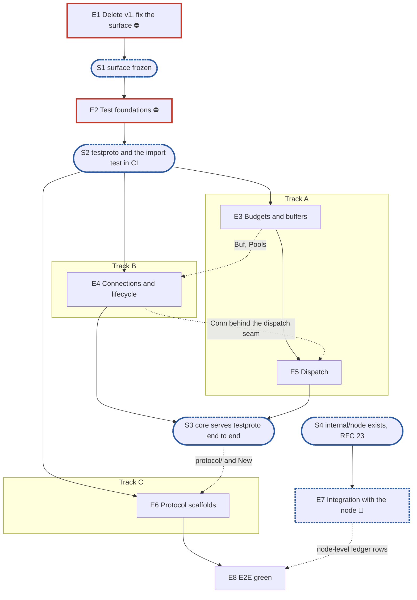

# RFC 20 — adapter model v2: implementation plan

**Scope:** [RFC 20, the adapter model](../rfcs/rfc-20-adapters.md), as far as it is the shape every
adapter shares: the public surface in `pkg/adapter`, the shared `core` (lifecycle, connections,
dispatch, held requests, middleware, error tables, observability), RFC 24's pooled buffers and
budgets, the generic sidecar runner, the import test, and a thin NFS and SMB scaffold on `core`.
No operation handler is built. The decisions this plan starts from are recorded in
[`rfc-20-adapters-design.md`](rfc-20-adapters-design.md). Everything deferred, and everything
develop serves that `feat/storage-v2` stops serving, is in the deferral ledger (§6.2). Related
RFCs, with how far each is in scope:

- [RFC 17](../rfcs/rfc-17-vfs.md), the filesystem service: **constraints only**, except
  `vfs.WithRequestID` (RFC 17 §4.7) and `vfs.WithHold` (RFC 17 §5.9), which `pkg/vfs` lacks
  and epic 5 adds. `pkg/vfs`,
  `vfstest.Record` and `vfstest.Null` exist on `feat/storage-v2`.
- [RFC 24](../rfcs/rfc-24-resources.md), resources: **only the parts this RFC cannot work
  without**: `Budget`, `Reservation`, `Pools`, `Buf` and `BufPool` in `pkg/resources` (epic 3).
- [RFC 13](../rfcs/rfc-13-configuration.md), configuration: **only the parts this RFC cannot work
  without**: the adapters' settings shapes and their live or restart-only marks.
- [RFC 25](../rfcs/rfc-25-observability.md) and [RFC 29](../rfcs/rfc-29-test-harness.md): the
  rules every epic follows (§1.5 rules 3 and 4), and RFC 20 §10's series.
- [RFC 23](../rfcs/rfc-23-control-plane.md), the node: **constraints only**. `internal/node` does
  not exist; the node's wiring of adapters is epic 7, planned after S4.
- [RFC 14](../rfcs/rfc-14-open-state.md), [RFC 18](../rfcs/rfc-18-identity.md),
  [RFC 19](../rfcs/rfc-19-authorization.md), [RFC 21](../rfcs/rfc-21-nfs.md) and
  [RFC 22](../rfcs/rfc-22-smb.md): **constraints only**. Their parts of RFC 20 are ledger rows.
- [RFC 15](../rfcs/rfc-15-topology.md) and [RFC 27](../rfcs/rfc-27-namespace-migration.md): **out**,
  beyond the `Reconfigure` listener removal they call.

**Tracks:** A, B and C (§3.4).
**Programme:** stage 5, "adapters", of [#3119](https://github.com/marmos91/dittofs/issues/3119).
Stage 2 built the service the adapters call; stage 7 is the cutover, which wires the adapters
into `dfs` and turns the protocol suites back on.
**Naming:** v1 is today's adapter code (`internal/adapter`, `pkg/adapter`, the Runtime's adapter
half); v2 is RFC 20's. v1 is deleted on `feat/storage-v2` in epic 1, not migrated, and v2 reuses
the `pkg/adapter` and `internal/adapter` paths, so no name carries a version.
**Estimates** are human man-days on the shared scale of `rfc-to-epic-plan`, kept as they are
although the code is written by an agent; a scale for agent-written work is proposed on #3524.
**Defaults used from Step 0:** dashboards none (#9); output path the default (#10). The target
branch is `feat/storage-v2`, on which RFC 17's plan has merged; the plan document itself lands on
`develop` and is cherry-picked, as the other planning documents are.

## 1. Introduction

### 1.1 What we are building

| | v1 (deleted in epic 1) | v2 |
| --- | --- | --- |
| Reaches files through | `pkg/controlplane/runtime`, which hands out the stores | `vfs.Service` only (RFC 20 §2.3) |
| Public surface | `pkg/adapter/{nfs,smb}`: connection loops, dispatch, NLM | `pkg/adapter`: the contract, `Deps`, settings, two `New` |
| Shared code | one accept-and-drain shell; the rest twice | `internal/adapter/core`: lifecycle, connections, pipeline, compound runner, held requests, middleware, error tables |
| Protocol code | handlers, framing, signing and credits inline in each connection loop | `wire/` (pure codecs), `protocol/` (the `core.Protocol` and its stages), `ops/` (tables), the same in both |
| Buffers | a three-class `sync.Pool` of byte slices behind package functions | `pkg/resources`: reference-counted `Buf` behind a `Budget` reservation, shared with any component |
| Drain | cancels every request, 100 ms read deadline | stops accepting, serves what ends state, finishes what the service holds, abandons at the deadline |
| Sidecars | each adapter runs its own group | one runner driven by the serving set |
| Tests | handlers on real stores; four fakes | `core` on a test-only protocol over `vfstest.Null`; the import test from the first commit |

**Dependency limits.** An adapter imports, of the core, `pkg/vfs`, `pkg/metrics`,
`pkg/resources`, `pkg/adapter`, `pkg/adapter/config` and `internal/tlsconfig`; beyond the
standard library it may use `go.opentelemetry.io/otel/trace` and the Prometheus client through
`pkg/metrics` (RFC 20 §2.3, §7.1). `internal/identity`, `internal/auth`, `pkg/identity`,
`pkg/health` and every store are out of reach: liveness reaches an adapter as `Deps.Watch`, which
the node adapts to RFC 25's watchdog.
`pkg/adapter`, `pkg/adapter/config` and `pkg/resources` import nothing under `internal/`; only the
two constructor packages, `pkg/adapter/nfs` and `pkg/adapter/smb`, import `internal/adapter/`.

**What v2 serves at the end of the plan.** Nothing a client can mount. Each protocol accepts
connections, frames, decodes its header, routes, and answers every operation "not supported"
through the real pipeline. Operations arrive with RFC 21 and RFC 22.

### 1.2 How the plan is organised

Epic 1 deletes v1 and fixes the surface: the contract, the settings, the constructors, the
budget and buffer API, and `core`'s protocol-facing types, the dispatch seam between the
connection and the pipeline included. Epic 2 builds the test-only protocol that proves `core`
alone, and the import test. Four middle epics follow on three tracks: track A owns buffers and
dispatch, track B the connection, the lifecycle and the sidecar runner, track C both protocol
scaffolds and, while it waits for S3, part of dispatch. The node's integration waits for S4. The
last epic checks the per-change allocation cell and hands the deferral ledger over.

### 1.3 What epic 1 must deliver

- **Deletion.** `internal/adapter/`, `pkg/adapter/` and the Runtime's adapter half, in one change:
  `pkg/controlplane/runtime/adapters`, the Runtime's adapter fields and methods, the lifecycle
  service's `AdapterLoader`, the adapter health checks, the `/api/v1/adapters` routes and their
  handlers, the settings watcher, `dfsctl adapter`, the `grace.go` and `nfs_clients.go` handlers,
  the identity-mapping config in `pkg/config`, the start path in `cmd/dfs`, the API tests on
  `testruntime`, the harness fixture's adapter calls, and the e2e files that no longer compile.
  `internal/vfs/arch_test.go` keeps its adapter clause, RFC 17's check that the service imports
  no adapter: its fixtures live in `testdata/arch/`, which Go never builds, so deleting v1 breaks
  nothing there. `docs/guide/cli.md` is regenerated with `go run ./cmd/gendocs`.
- **Suites.** On `feat/storage-v2` what runs is decided by `tests.yml`'s V2 filter, which
  already skips `e2e`, `pjdfstest`, `pynfs`, `wpts`, `smbtorture`, `cthon04`, `nfstest`,
  `clients`, `fio-verify`, `bench-smoke`, `system` and `integration/ad-dc`; `test/suites.yaml`
  stays as develop has it, so each suite keeps one switch. The filter grows by
  `integration/kerberos`, whose package T1.1 deletes, and the required integration job's fixed
  `dt run integration/kerberos` step is removed on the branch, since a fixed step ignores both
  the filter and the registry. A per-change cell vets the adapter packages with `GOOS=windows`
  and `GOOS=darwin`, which the filter's skip of `unit/windows` would otherwise leave unbuilt
  once T4.8's socket options differ by platform. `test/required-tests.json`, whose every entry names a v1 test, is repinned to the surviving
  authorization gates in `internal/vfs/admit` (`TestNoAnonymousPrincipalFailsClosed`,
  `TestAnUnmappedClaimedRootIsPrivileged`), so `required-tests.sh` neither loses its subject nor
  fails on an empty manifest. A build tag on `lint-go`'s `go vet -tags=` line stays while any file
  behind it compiles; a tag whose files are all deleted leaves the line.
- **`pkg/adapter`** (RFC 20 §3.4, §3.5): `Adapter`, `Health`, `ConnInfo`, `Sidecar`, `Serving`,
  `Deps` (with `Watch`, RFC 20 §3.7).
- **A test with every new package.** `lint-repo` runs `test/new-package-tests.sh`, which fails a
  directory new to the base branch that has no `_test.go`. Each package epic 1 creates lands with
  a test that can fail (rule 8): `pkg/adapter`'s `Deps` with a nil `Watch` watching nothing,
  `pkg/resources`' class sizes ascending as RFC 24 §2.5 lists them, the settings' live and
  restart-only marks, `ErrRestartRequired`
  on a restart-only change, `New` refusing invalid settings, and for `core` `Bind`, whose body
  lands in T1.7: the `Invocation` its `Decode` returns hands `Bound`, `Resolve`, `EndsState`,
  `Call` and `Encode` the request it decoded.
- **`pkg/adapter/config`** (RFC 20 §3.6, RFC 13): `Adapter`, `NFS`, `SMB`, with each field
  marked live or restart-only, and `ErrRestartRequired`.
- **`pkg/adapter/nfs.New`, `pkg/adapter/smb.New`**: signatures and stubs returning an error.
- **`pkg/resources`** (RFC 24 §2.5, §3.1, RFC 20 §6.8): `Budget`, `Reservation`, `Pools`, `Buf`,
  `BufPool` (named apart from `Pools`, since RFC 24's pool is a counter, not an allocator), the
  class constants, as signatures.
- **`pkg/metrics`**: whatever `core` needs to register its own series. `RegisterProvider` exists;
  epic 1 checks it fits a per-request counter resolved at table build, and adds a registration
  call if it does not.
- **`internal/adapter/core`'s exported surface, RFC 20 §4.7**, with stub bodies but for `Bind`'s:
  what `testproto`, `core` itself and both scaffolds consume before any implementation. It
  carries what SMB needs from `core` (a connection's handshake and kept state, a session level
  and the protocol's own state per message, held and parked replies, a cancel, chained members
  each with its own header and offset, a per-request drain decision), so RFC 22's plan builds
  on the frozen surface rather than reopening it. This plan does not list the symbols: §4.7 does,
  and rule 9 points there.

### 1.4 What epic 2 must deliver

RFC 20's suites paragraph puts every layer this plan builds in `unit`, and the allocation gates
in a non-race cell. `unit/nonrace` is nightly, and the nightly runs on develop's schedule, never
on `feat/storage-v2`, so the gates get a per-change cell of their own, `unit/adapter-allocs`, as
the journal's run in `unit/journal-index`. Like that cell, it runs from a fixed step in the unit
job (T1.3): the branch's cell filter drops a cell with no job, so the cell alone would never run. `unit` keeps no `known.yaml`, so it cannot hold a red test: **epic 2
registers no red suite**. Each test lands green with the epic that makes it pass. Epic 2 builds
what those tests stand on:

- **`adaptertest/testproto`**: a protocol of length-prefixed frames with operations that echo,
  wait a scripted time, panic, hold (answer `ErrDelay` of a holding class), end state (for the
  drain filter) and mutate through `vfstest.Null`; toy `Security` (a checksum), `Flow` (a
  counter) and `Replay` (a map) stages; a version range for the `Versions` column. Tests drive it
  over a plain `net.Conn`. Its stateful half exercises the rest of RFC 20 §4.7, so the surface frozen
  at S1 is proven at S3 for what SMB needs and not only for what the simplest protocol needs: a
  handshake, session and tree levels, protocol state carried to a related member, kept state
  past the idle timeout, holds with interim and final headers and a cancel, a parked operation
  completed by a callback the test fires, an end-state operation decided by an argument, as
  SMB's `LOCK` is, and chained frames: a related member after a held one, answered at once and
  gone pending; a pending last member; a related member with a bad toy checksum refused; the
  parked operation before the last refused with nothing registered, and past the park cap; a
  chain's replies wrapped once; a cancel that arrives before its target holds; a drain that
  cancels a parked operation.
- **The import test** (RFC 20 §7.1), reusing the `go/parser` walk of
  `internal/vfs/arch_test.go`, and seeded with one violation in its own `testdata`. It checks the
  adapters' imports; `arch_test.go` keeps checking the other direction, that the service imports
  no adapter. It covers the import list of §1.1, both directions of `pkg/` and `internal/`, `wire`
  purity, test-only packages imported by no non-test package, and the paths v1 used that v2 does
  not (`pkg/controlplane/runtime/adapters`, `internal/adapter/{common,pool,testruntime,auth}`,
  `internal/adapter/nfs/rpc`, `internal/adapter/smb/{session,handlers}`).
- **The leak checks**: one helper failing when any `Pools` budget reads above zero, one failing on
  goroutines left behind (a `runtime.NumGoroutine` comparison, no new dependency). The budget
  check proves it can fail in epic 3, once a `Buf` can be kept.

The scenario catalogue of RFC 20 §7.5 needs kernel clients and handlers, and is a ledger row
(§6.2). Its `core`-level forms (drain, slow client, cancel, order) run on `testproto` in epics 4
and 5.

### 1.5 General rules for each epic

> **Instruction for whoever expands an epic into its detailed description and subtasks,
> human or AI:**
>
> - **Creating an epic from this plan: use the `epic-breakdown` skill.** Whenever the user
>   asks to create an epic from this plan, or to expand, detail or break one down, run the
>   `epic-breakdown` skill (`.claude/skills/epic-breakdown/SKILL.md`) on this plan and that
>   epic, rather than writing the epic document freehand. It extracts the RFC's MUST and
>   MUST NOT into numbered requirements, estimates each subtask in man-days and suggests
>   the pull requests. A human doing it by hand follows the same skill.
> - **Epic and subtask, nothing else.** The units of work are the epic and its subtasks,
>   with subtask ids `<epic>.<n>` (`subtask 4.3`, or `T4.3` for short). No other word names
>   them: not task, ticket, story, step or phase, in headings, tables, ids or prose.
> - **The epic stands alone.** Copy the numbered rules below into the epic document word
>   for word, under their own heading — the rules only, not this instruction, which speaks
>   of "this plan". The epic document must not refer to this plan, link to it,
>   or say "see the plan". Everything a reader needs to do the epic is in the epic
>   document itself: the RFC sections it implements, the interfaces it builds on, the
>   rules, the subtasks, and a short legend of the names the rules borrow from this plan
>   (E1, E2, S1, the integration epic, …).
> - **The epic document records decisions, not progress, like this plan.** It has no
>   status fields, no checkboxes to tick and no sections to keep up to date as the work
>   goes on. It is revised through a pull request only when a decision changes.
> - **Subtasks are not pull requests.** A subtask is ideally up to 5 man-days. The owner
>   ships subtasks as they see fit, one pull request each or several together; the epic
>   document only suggests a grouping, each suggested pull request ideally up to 15
>   man-days. Cut and group by logic, readability, dependencies and a deliverable that can
>   be named, not to hit a number.
> - **Every subtask states how it meets each rule that applies to it.** A rule that does
>   not apply is named, with the reason.
> - **In the issue tracker, only when someone asks for issues:** they are not created by
>   default, but by hand when the team is ready to assign an epic's subtasks, and never
>   before the epic document has merged. They point at the epic document and copy
>   nothing: their bodies are a link to its section with a line of context, so a revision
>   of the document never leaves an issue saying something else. The epic is one issue labelled `epic`. Each subtask is its own
>   issue, created as a sub-issue of the epic issue rather than as a checklist in its body.
>   All of them join the "DittoFS" project, each subtask with its man-days in the
>   `Estimate` field. The release an epic ships in is set on its epic issue, never in a
>   document, and its subtask issues take the same release, also when created later.

1. **Independent unit tests, under `-race`.** Each epic carries its own unit tests. It may use
   another epic's implementation once that has landed, `vfstest.Null` and `vfstest.Record`, and
   E2's `testproto` and leak checks. `core` is tested from `package core_test` on `testproto` and
   never through NFS or SMB; no `core` test imports a protocol package. Connections are real TCP
   over loopback, with real deadlines and socket options read back from the socket. Test at the
   layer that consumes a value (`CLAUDE.md`, "Verifying a change"): a setting is asserted on a
   connection accepted after `Reconfigure`, not on the snapshot.
2. **Fuzz tests where relevant.** Go native fuzzing on every decoder of bytes a peer sent: the
   NetBIOS and RPC record framers, the SMB2 header, the RPC call header and AUTH_SYS credential,
   `testproto`'s frame. Seeded with each package's golden vectors. The property: accepted or
   refused, never a panic, never an allocation past the protocol's cap (RFC 20 §5.2, A8).
3. **Observability follows RFC 25 and RFC 20 §10.** Every metric, span and log key lives in
   `core`; protocol code records none. The series are RFC 20 §10.1's that `core` produces here,
   through `pkg/metrics`, resolved once per protocol and operation at table build so the request
   path does an atomic add; the replay, translation, status-mapped and record series arrive with
   their producers. Spans through `Deps.Tracer`, logs through `Deps.Logger`.
4. **Leaks and allocations.** Every test that runs the pipeline ends with E2's leak checks. Hot
   paths carry allocation assertions (`testing.AllocsPerRun`): the header codecs of both
   protocols and `testproto`'s at 0, `BufPool.Get` and `Release` at 0, and the pipeline's
   allocations per request at or under a checked-in number that may only fall. Each gate is
   registered in the per-change `unit/adapter-allocs` cell by the subtask that writes it.
5. **v2 ignores v1.** v1 is deleted in epic 1; nothing is copied from it but what RFC 20
   Appendix B marks **keep**, lifted from `develop`'s history into its new place: the accept
   backoff and the sidecar group's reconcile here, the rest with RFC 21 and 22. The import test
   fails any import of a path v1 used that v2 does not.
6. **Nothing deferred is lost.** A subtask that leaves out part of an RFC 20 obligation, or
   anything develop serves, adds or keeps its row in the deferral ledger, naming the owner that
   brings it back.
7. **Code comment conventions** (`CLAUDE.md`, "Code comments"). A source comment describes the
   code's behaviour and references nothing outside it: no issue or pull request numbers, no CI,
   runner or OS names, no ids from planning documents (epics, subtasks, synchronisation points,
   decisions). A `ponytail:` marker records a knowingly simple implementation, naming its
   ceiling and the upgrade path. A `decision:` marker records deliberate behaviour, naming the
   rule, why it holds and the evidence that would overturn it. RFC 20's notes go at their code
   sites: parked requests off the hold floor, capped instead, `unwrap` on the reader, the cap of 64, one goroutine per request,
   `sync.Pool` per class, no self-probe. `pkg/resources`'s missing turns, `Reclaim`, `ShareCap`
   and `Split` each carry a `ponytail:` naming RFC 24.
8. **A test must be able to fail.** Keep a test only if a plausible change would make it fail and
   nothing else would catch that change. The import test proves it can by reporting its seeded
   violation; the budget leak check by failing a test that keeps a `Buf`.
9. **A symbol is exported only if RFC 20's interface uses it.** `pkg/adapter`,
   `pkg/adapter/config`, `pkg/resources` and the two `New` are the public surface. `core`'s
   exported symbols are those RFC 20 §4.7 names, frozen at S1; everything else in `core` is
   unexported. A symbol §4.7 does not name is added to §4.7 first, by a pull request to the RFC.
10. **Each subtask creates only what it declares.** No empty package and no stub without a
    caller: no empty `ops/`, `callbacks.go`, `gss/`, `translate/` or `dcerpc/`. A package, a stage
    or a test helper lands with its first consumer.

Not adopted from the skill's standard rules: a separate profiling-harness rule (rule 4 covers
leaks and allocations, and RFC 20 §6.9 already asks a change to the connection or pipeline for its
mutex and block profiles); a known-failures rule (no suite here keeps a `known.yaml`; the skipped
suites come back through the ledger); a real-dependencies rule beyond rule 1's real sockets
(nothing here has a property of a store to test).

## 2. Epics at a glance

| # | Epic | Content | Subtasks | Man-days | Track | Blocks |
| --- | --- | --- | --- | --- | --- | --- |
| E1 ⛔ | Delete v1, fix the surface | v1 and the Runtime's adapter half deleted, suites off, required tests repinned; `pkg/adapter`, `pkg/adapter/config`, `pkg/resources`, `core`'s §4.7 surface | 8 | 14.5 | team | all |
| E2 ⛔ | Test foundations | `testproto` and its stateful half, the import test, the leak checks | 4 | 8 | team | E3–E6 |
| E3 | Budgets and buffers | `pkg/resources`: `Budget`, `Reservation`, `Buf`, `BufPool` | 3 | 6 | A | E4, E5 (partly) |
| E4 | Connections and lifecycle | `Server` states, accept, limits, `Conn` reader and writer, drain, `Reconfigure`, health, TCP; the sidecar runner | 9 | 20 | B | E5 (partly), E6 via 🔀 S3 |
| E5 | Dispatch | pipeline, tables, compound runner and chains, held and parked requests, middleware, error tables, request context, §10, benchmark | 11 | 26.5 | A | E6 via 🔀 S3 |
| E6 | Protocol scaffolds | `wire/`, `protocol/` and `New` for SMB and NFS; not supported end to end | 4 | 11.5 | C | E8 |
| E7 🔀 | Integration with the node | `internal/node` builds, starts, reconciles and stops adapters and sidecars | — | planned after S4 | team | E8 (partly) |
| E8 | E2E green | the allocation cell checked, the ledger handed over | 2 | 1.5 | team | — |
| | **Total** | | **41** | **88** | | |

**Plan estimate: 41 subtasks, 88 man-days, not counting epic 7.**

The estimate `N = round(2785 / 400) = 7` against four middle epics: RFC 20's handler, codec,
security and translation areas (§4.3–§4.4, §4.9–§4.10, most of §5) are ledger rows for RFC 21 and
22; the sidecar runner joins the lifecycle it follows; the two scaffolds are one epic because
they are built the same way and each is too small alone. There is no integration epic before the
node exists: the conditions, alert rules, config loader and docs it would hold have no consumer
until epic 7 or the cutover, and are ledger rows.

Legend: ⛔ blocks every epic after it; 🔀 waits for or opens a synchronisation point.

## 3. Synchronisation points, blockers and the split

### 3.1 Dependency graph



### 3.2 Synchronisation points

- **S1 surface frozen** (after E1). v1 is gone, the branch builds, the protocol suites are off,
  `required-tests.sh` passes on its new pins. `pkg/adapter`, `pkg/adapter/config`,
  `pkg/resources` and `core`'s §4.7 surface compile with stub bodies; what SMB needs from
  `core` is in that surface, and `testproto`'s stateful half proves it by S3.
  Unblocks E2, and through it every middle epic.
- **S2 testproto and the import test in CI** (after E2). `testproto` runs over a `net.Conn`; the
  import test runs in `unit` and reports its seeded violation. Unblocks E3, E4 and E6's `wire/`.
- **🔀 S3 `core` serves `testproto` end to end** (after E4 and E5). A `testproto` request goes
  accept → frame → pipeline → `vfstest.Null` → reply; drain serves only requests that end state and
  abandons at the deadline; reconfigure and the leak checks pass; the handshake deadline, kept
  state, held and parked requests, cancel and chains run on `testproto`'s stateful half. Unblocks the `protocol/` and
  `New` half of E6.
- **🔀 S4 `internal/node` exists** (outside this plan). RFC 23's `node.New` and reconcile loop,
  built by whoever owns the node for the cutover (§6.1). Unblocks E7.

### 3.3 Blockers

| Epic | Blocks | Why |
| --- | --- | --- |
| ⛔ E1 | everything | `pkg/adapter` is recreated at v1's path, and every epic builds on its types |
| ⛔ E2 | E3–E6 | `core` is proven only on `testproto`; the import test must run from the first package |
| E3 | E4, E5, partly | the reader reserves receive bytes before a body; the pipeline reserves the reply. Both start on E1's stubs and finish on E3 |
| E4 | E5, partly | the pipeline is tested behind the dispatch seam with a fake sender; its end-to-end tests need `Conn` |
| E4, E5 | E6, via S3 | a scaffold is done only when "not supported" goes through the real pipeline |
| 🔀 S4 | E7 | no node to wire into |
| E6 | E8 | `unit/adapter-allocs` runs every gate, the scaffolds' included |
| E7 | E8, partly | the ledger's node-level rows close in E7 |

### 3.4 Splitting the work

- **Track A: E3 → E5.** Buffers and budgets first, then the request path through them: the
  pipeline, tables, compound runner, held requests and request context, tested behind the
  dispatch seam with a fake sender until E4's `Conn` lands.
- **Track B: E4.** The connection and the adapter's life: `Server`, listeners, accept and its
  limits, the reader and writer, drain, `Reconfigure`, health, TCP, then the sidecar runner. Its
  drain and cancellation tests run against a stub dispatcher until E5's pipeline lands, then
  again end to end at S3.
- **Track C: E6, with part of E5.** Both `wire/` packages first (about 6 man-days), which need only
  E1's types. Track C would then idle until S3, so it takes three E5 subtasks that need only E1's
  types and `testproto`: the middleware chain (T5.6), the error table (T5.7) and observability
  (T5.9). Then `protocol/` and `New` at S3.
- **The team.** E1 and E2 before the tracks start; E8 after them. E7 when S4 is reached.

## 4. Directory layout proposed for epic 1

```text
pkg/
  resources/                  E1 surface, E3 body
    budget.go                 Budget, Reservation, Pools
    buf.go                    Buf, BufPool, classes
  adapter/                    E1
    adapter.go                Adapter, Health, ConnInfo, Sidecar, Serving
    deps.go                   Deps
    config/                   Adapter, NFS, SMB; live and restart-only marks
    nfs/  smb/                New: E1 stub, E6 body
internal/
  adapter/
    core/                     E1 types, E4 and E5 bodies
      protocol.go             E1: Protocol, Framer, Stages, stage interfaces, Header, Dispatcher
      dispatch.go             E1 types, E5: OpTable, Op (with EndsState), Invocation, Bind, Needs, Range, Request
      errors.go               E1 type, E5: ErrorTable, totality check
      server.go settings.go conn.go                               E4
      pipeline.go compound.go hold.go middleware.go metrics.go    E5
    adaptertest/              E2
      testproto/  imports_test.go  testdata/violation/
    smb/                      E6
      smb.go  wire/  protocol/
    nfs/                      E6
      nfs.go  wire/  protocol/
  sidecar/                    E4
    runner.go
```

## 5. The epics in detail

### Epic 1 — Delete v1, fix the surface ⛔

**Epic 1 estimate: 8 subtasks, 14.5 man-days.**

Deletes v1 and everything that imports it, keeps the suites that need a served protocol skipped,
repins the required tests, and fixes the public surface and `core`'s protocol-facing types with
stub bodies. At the end the branch builds, `unit` and `lint-go` pass, no adapter is served, and
S1 holds. Every client-visible or operator-visible thing deleted here is a ledger row (§6.2).
Every package T1.4 to T1.8 creates lands with a test that can fail, or `lint-repo`'s new-package
check refuses it (§1.3).

RFC sections: §2.5 (layout, `pkg/` and `internal/`), §3.4, §3.5's `Sidecar` and `Serving`, §3.6's
settings, §4.7's types, §6.8's `Buf` surface; RFC 24 §2.5 and §3.1's surface; Appendix B (what is
deleted).

- T1.1 Delete `internal/adapter`, `pkg/adapter` and their importers outside the control plane:
  the start path in `cmd/dfs`, the identity-mapping config in `pkg/config`, the e2e files that no
  longer compile. `internal/vfs/arch_test.go`'s adapter clause stays.
- T1.2 Delete the Runtime's adapter half: `runtime/adapters`, the Runtime's adapter fields and
  methods, the lifecycle `AdapterLoader`, the adapter health checks, the `/api/v1/adapters`
  routes and handlers, the settings watcher, the `grace` and `nfs_clients` handlers, the
  `testruntime` API tests, the harness fixture's adapter calls; `dfsctl adapter`, and the
  `dfsctl grace`, `netgroup` and `client` commands whose routes go with them; regenerate
  `docs/guide/cli.md`.
- T1.3 `tests.yml`'s V2 filter extended by `integration/kerberos` and the fixed
  `dt run integration/kerberos` step removed on the branch; a fixed `dt run unit/adapter-allocs`
  step in the unit job, as `unit/journal-index` has; the `GOOS=windows` and `GOOS=darwin`
  vet cell for the adapter packages; `test/required-tests.json` repinned to
  `internal/vfs/admit`'s gate tests; `lint-go`'s vet tags pruned to those with files left.
- T1.4 `pkg/adapter`: the contract and `Deps`, `Watch` included.
- T1.5 `pkg/adapter/config`: the three settings shapes with live and restart-only marks.
- T1.6 `pkg/resources`: `Budget`, `Reservation`, `Pools`, `Buf`, `BufPool`, classes, as stubs;
  `pkg/metrics`'s registration path for `core`'s series checked, and added if missing.
- T1.7 `internal/adapter/core`'s surface, RFC 20 §4.7, with stub bodies; `Bind`'s body, with
  the test that its `Invocation` hands each closure the request it decoded.
- T1.8 `pkg/adapter/nfs.New` and `pkg/adapter/smb.New` stubs.

### Epic 2 — Test foundations ⛔

**Epic 2 estimate: 4 subtasks, 8 man-days.**

What every later test stands on (§1.4). No red suite is registered: RFC 20's suites paragraph
puts these layers in `unit`, which holds no known failures.

RFC sections: §7 (the layers; the `core` layer on a test-only protocol), §7.1's import checks.

- T2.1 `testproto`: frames, operations (echo, wait, panic, hold, end state, mutate), toy stages,
  versions; driven over a plain `net.Conn`.
- T2.2 `testproto`'s stateful half, as §1.4 describes, so every symbol of RFC 20 §4.7 has a
  caller in `testproto`.
- T2.3 The import test, on `arch_test.go`'s walker, with its seeded violation; `arch_test.go`
  keeps checking that the service imports no adapter.
- T2.4 The budget and goroutine leak checks.

### Epic 3 — Budgets and buffers

**Epic 3 estimate: 3 subtasks, 6 man-days.**

RFC 24's minimal slice in `pkg/resources`, used by `core` here and by open state and the service
later. A budget is a counter of reserved bytes that waits or refuses at its ceiling; a `Buf` is a
pooled buffer of one of four classes, reserved before it is taken, returned with its reservation
at its last release.

RFC sections: RFC 20 §5.3, §6.8, A18; RFC 24 §2.5 (`Reserve`, `Release`, `Reserved`; wait or
refuse), §3.1 (classes), §2.7's zero-at-close.

- T3.1 `Budget` and `Reservation`: reserve, release, wait or refuse by pool, cancellation while
  waiting, release past zero panics in tests and clamps in production.
- T3.2 `BufPool` and `Buf`: a `sync.Pool` per class, smallest class that holds, unpooled past the
  largest, reference counting, poison on release under `-race`, second release past zero panics.
- T3.3 Reserved-bytes gauges through `pkg/metrics`; a property test of reserve and release
  sequences against a model; the 0-allocation gate on `Get` and `Release`; the budget leak
  check's own failing test.

### Epic 4 — Connections and lifecycle

**Epic 4 estimate: 9 subtasks, 20 man-days.**

The adapter's life and its connections, in `core`: the four states, listeners, accept and its
limits, one reader and one writer per connection, drain, `Reconfigure` with its settings
snapshot, health, and the TCP options. Then the sidecar runner in `internal/sidecar`, which
follows those states. Proven on `testproto` over loopback, first behind the dispatch seam with a
stub dispatcher, then end to end against `vfstest.Null` at S3.

RFC sections: §3.1 (states, drain, abandon at the deadline, auxiliary listeners all or none),
§3.2 (a connection's lifecycle; the session-keyed cleanup wait as a `core` mechanism), §3.5,
§3.6, §3.7, §6.1, §6.2, §6.4, §6.5's close and drain halves, §6.7, §6.9's connection and registry
rows, A10, A11, A14, A19, A20.

- T4.1 `Server`: configured, serving, draining, stopped; `Start` binds every listener or none.
- T4.2 Accept: connection limit per node and a quarter per address, closed at accept; the
  connection-state charge; backoff 10 ms to 1 s and `adapter_listener_lost` after 60 s.
- T4.3 `Conn` reader: one small-class read buffer, records cut from it or read into their class,
  receive reservation before the body, frame deadline, hand-off through the dispatch seam.
- T4.4 `Conn` writer: bounded queue, gathered `net.Buffers` writes, write deadline, a send that
  queues a message ahead of a named reply (RFC 20 §6.2), the reader stopped at a full queue.
- T4.5 Drain, close and cancellation: no accept; the dispatch seam told the adapter is draining;
  in-flight requests awaited up to the drain deadline, then their contexts cancelled and their
  replies dropped; closing cancels each request's context and runs `OnClose`; cleanup keyed by
  session before a reconnect of that session is served.
- T4.6 `Reconfigure`: validate (the settings' own checks, also run by `New`), refuse restart-only
  with `ErrRestartRequired`, open added listeners before swapping the snapshot, close removed
  ones and their connections after.
- T4.7 Health (readiness from the state, liveness from accept-loop turns through `Deps.Watch`,
  `adapter_refused`), `Connections()` from a connection map in `Server`, the idle timeout that
  passes over a connection while a `Keep` is held, the handshake deadline that `Established`
  disarms; both on `testproto`'s stateful half.
- T4.8 TCP: `TCP_NODELAY`, keepalive 15 s and 3 probes 5 s apart, `TCP_USER_TIMEOUT` on Linux,
  asserted on an accepted socket; buffers left to the kernel.
- T4.9 The sidecar runner, lifted from v1's `pkg/adapter/sidecar.Group` on `develop`: `Sync` with
  the serving set after an adapter is serving and before it drains, idempotent, a disabled
  sidecar synced with the empty set, a failing one raising `sidecar_failed` without touching the
  adapters or readiness; tested with fake sidecars and `testproto` adapters.

### Epic 5 — Dispatch

**Epic 5 estimate: 11 subtasks, 26.5 man-days.**

The request path in `core`: §4.1's stages in order with their defaults and refusals, the drain
filter, operation tables and their precondition columns, the reply reservation, the compound
runner, held requests and their re-drive, the middleware chain, the error-table mapping and
totality check, the request context, and the observability of RFC 20 §10. Tested behind the
dispatch seam with a fake sender, then end to end on `Conn` at S3, against `vfstest.Null` and
`vfstest.Record`.

RFC sections: §3.1's drain filter, §4.1, §4.2, §4.3's runner and reply budget (the one-call rule
is `vfstest.Record`'s), §4.5, §4.6, §4.7's pipeline and middleware, §4.8's table selection, §6.3,
§6.4's request deadline and request ID, §6.5's client-cancel half, §6.6, §6.9's request rows,
§6.10's pipeline row, §10, A4, A6, A7, A15, A16, A17.

- T5.1 The pipeline: frame to send in order, nil stages take their defaults, each stage's refusal
  as RFC 20 §4.1's table says, replies out of order; while draining, only requests that end state
  run and others get the protocol's move signal or are left unread.
- T5.2 `OpTable`, `Bind`, `Invocation`; `Needs` checked against `Request.Level` and `Versions`
  before decoding; an absent or switched-off operation answered not supported.
- T5.3 Admission: the per-connection cap of 64 where `Flow` is nil; the reply-bound reservation
  before the call, its refusal as `ErrDelay` with `DelayResources`.
- T5.4 The compound runner: stop at the first failure, a cap refused before any operation, the
  reply budget checked before each operation; chains from one record, each member's header
  decoded, unwrapped, admitted and looked up on its own, the related-request rule, the replies
  joined with `HeaderCodec.Chain`, a related member routed from the one before it; the drain
  decision per request through `Invocation.EndsState`; on `testproto`'s chained frames, not on the runner's
  internals alone.
- T5.5 Held requests: interim timer and `HoldCodec.Interim`, the final reply under
  `HoldCodec.Final`, re-drive from `Resolve` with a fresh attempt deadline inside the hold bound,
  `vfs.WithHold` added to `pkg/vfs` (RFC 17 §5.9) and passed on every call, the per-connection
  floor and the hold pool, a cancel (`HoldCodec.Cancels`) and close ending a hold with no reply
  to the cancel, and a cancel that arrives first remembered; the write data's `Buf` kept across
  re-drives; chain members held: RFC 20 §4.7.
- T5.6 The middleware chain: recovery (server fault, logged with the stack, the connection's
  other requests unharmed), trace span, metrics, deadline; order pinned by a test.
- T5.7 `ErrorTable`: mapping by error, operation and version; `ErrDelay` by cause; an unmapped
  error answered server fault and counted; the totality check against `vfs.Errors()` as a
  helper each protocol's table will call.
- T5.8 Request context: the 30 s deadline; `vfs.WithRequestID` added to `pkg/vfs` (RFC 17 §4.7)
  and set from the protocol's retry identity; cancellation on close and drain.
- T5.9 RFC 20 §10's metrics, spans and logs, all in `core`; series resolved at table build.
- T5.10 The pipeline micro-benchmark on `testproto` over `vfstest.Null`, its allocation ceiling
  checked in and registered in `unit/adapter-allocs`.
- T5.11 Parked requests: RFC 20 §4.7's `Park` (`ErrNotLast`, `MaxParked`, the reply reservation
  kept), §3.1's cancel at drain and §6.5, on `testproto`'s parked operation.

### Epic 6 — Protocol scaffolds

**Epic 6 estimate: 4 subtasks, 11.5 man-days.**

The least that shows each protocol plugs into `core`, built the same way for both: a pure `wire/`
(framer and header codec), a `protocol/` (the `core.Protocol` and a `Router` over empty tables),
and `New`, internal and public. Every operation is answered as not supported through the real
pipeline: `STATUS_NOT_SUPPORTED` for SMB; `PROG_UNAVAIL`, `PROG_MISMATCH` or `PROC_UNAVAIL` for
NFS as RFC 20 §4.8 says. `wire/` needs only E1's types, so it starts at S2; `protocol/` and `New`
wait for S3. Golden vectors are read by a small helper inside each `wire` package, as
`pkg/block/journal/internal/format` does.

RFC sections: §2.5's `wire` purity, §4.7's Header and Router rows for both protocols, §4.8's NFS
and SMB rows, §5.1, §5.2, §5.4 for the headers, §6.10's codec gate for the headers.

- T6.1 `smb/wire`: NetBIOS framer with the size cap, SMB2 header codec, golden vectors from
  MS-SMB2's examples, fuzz targets, 0-allocation gate.
- T6.2 `nfs/wire`: record-mark framer with the cap, RPC call and reply header, AUTH_SYS, the XDR
  they need written by hand; golden vectors from RFC 5531's encodings; fuzz targets; 0-allocation
  gate.
- T6.3 `smb/protocol` and `New` (internal and public): `Router` by dialect over the empty tables;
  every command not supported over loopback, leak checks clean.
- T6.4 `nfs/protocol` and `New` (internal and public): `Router` by (program, version) over empty
  tables; unknown program, version and procedure each refused as RFC 5531 says over loopback,
  leak checks clean.

### Epic 7 — Integration with the node 🔀

**Epic 7 estimate: planned after S4.**

Waits for RFC 23's `internal/node`. Then: `node.New` builds each enabled adapter through
`pkg/adapter/nfs.New` and `smb.New` from its `Deps`, starts them last, applies a settings
generation by `Reconfigure` or by stop, `New` and start, drives the sidecar runner, reports
`Health` and `Connections()` to the control plane's client list, and checks every budget at zero
after the adapters stop. It also takes the ledger rows that need a node: the config loader for
`pkg/adapter/config`, `core`'s conditions in RFC 25 §3.9's registry and the alert rules for
`adapter_unmapped_errors_total` and `adapter_handler_panics_total` (RFC 25 §7).

RFC sections: §3.4's "built by `node.New`", §3.6's sequence, §3.7's conditions, §10.1's alerting
sentences; RFC 23 §2.2, §2.3; RFC 24 §2.7; RFC 25 §3.9, §7.

### Epic 8 — E2E green

**Epic 8 estimate: 2 subtasks, 1.5 man-days.**

No suite of this plan holds known failures, so nothing is burned down, and each gate was
registered by the subtask that wrote it. This epic checks the per-change `unit/adapter-allocs`
cell runs every gate of epics 3, 5 and 6 and `testproto`'s, and hands the ledger to the plans
that own its rows.

RFC sections: §6.10's codec and pipeline rows.

- T8.1 The `unit/adapter-allocs` cell runs every allocation gate on `feat/storage-v2`; any
  missing registration fixed.
- T8.2 The ledger's rows copied into the RFC 21, RFC 22, RFC 18 and RFC 24 plans, or into #3119
  for those with no plan yet, each linked back.

## 6. Risks, open points and what is deferred

### 6.1 Risks and open points

1. **Divergence from RFC 17's migration** (RFC 17 §9, [`rfc-17-vfs-plan.md`](rfc-17-vfs-plan.md)).
   Both described adapters moving onto the service behind a shrinking allowlist. This plan deletes
   v1 instead and starts the import test with no allowlist, decided by the owner; RFC 17 §9 is
   amended in the same change to say so. `rfc-17-vfs-plan.md`'s stage 5 wording is not.
2. **`feat/storage-v2` serves no protocol, and loses API and config surface,** from epic 1 until
   the ledger's rows close: no mount, no `/api/v1/adapters`, no `dfsctl adapter`, no NFS client
   list or grace endpoint, no identity-mapping config. develop keeps v1 as the reference for
   parity.
3. **Who builds `internal/node`** (S4, epic 7). RFC 23 owns it; no plan exists. Options: the
   cutover owner builds it, or RFC 23 gets its own plan. Pending a programme decision in #3119.
4. **RFC 24 has no plan.** Epic 3 builds its minimal slice; a future RFC 24 plan starts from
   `pkg/resources` as epic 3 leaves it.
5. **RFC 20 §4.4 as an RFC of its own.** The owner expects `gss` to become a separate RFC.
6. **NFS XDR, generated or by hand.** Epic 6 writes the RPC header's XDR by hand; whether every
   program's codecs are generated (RFC 20 §5.1) is RFC 21's plan's call.
7. **`pkg/discovery/mdns` and `wsd` have no importer after epic 1**: they compile and are tested,
   but nothing runs them until the cutover moves them onto the sidecar runner.
8. **The skills this plan uses are unmerged** (#3524): `rfc-to-epic-plan` and `epic-breakdown`
   live on `docs/skills-epic-plan-breakdown`. §1.5's instruction names a path that exists only
   once that pull request merges.
9. **The critical path is long.** E1 → E2 → E3 → E4 and E5 → S3 → E6's second half → E8 holds
   most of the estimate; the dispatch seam and track C's share of E5 are what keep the tracks
   parallel.

### 6.2 Deferral ledger

Every part of RFC 20 this plan does not build, and everything develop serves that epic 1 stops
`feat/storage-v2` serving. The cutover (#3119 stage 7) is done when every row is closed: that is
feature parity with develop. A row moves only to another owner, never off the ledger.

| Deferred | Why not here | Owner | Comes back when |
| --- | --- | --- | --- |
| NFSv3 procedures; NFSv4.0, 4.1 and 4.2 operations; the `ops/` tables | handlers are RFC 21's | RFC 21 plan | its handler epics |
| MOUNT, NLM, NSM, `SM_NOTIFY`; MOUNT, NLM and NSM over UDP (RFC 20 §11 q3) | auxiliary programs are RFC 21's | RFC 21 plan | its auxiliary-services epic |
| RPCSEC_GSS context table and window; NFSv4.1 slots and reply cache; the v3 and v4.0 duplicate-request cache (RFC 20 §11 q2) | stage state machines, no driver here | RFC 21 plan | with `EXCHANGE_ID`/`CREATE_SESSION` and GSS `INIT` |
| NFS-over-TLS (`Conn.StartTLS`, `tlsconfig` reload, `require` mode) | starts at the `NULL` handler | RFC 21 plan | with `NULL` |
| NFS callbacks (`CB_RECALL`, `CB_NOTIFY`, `CB_RECALL_ANY`, NLM `GRANTED` via `Deps.Dial`) | need sessions and handlers | RFC 21 plan | with delegations and NLM |
| SMB 2.1–3.1.1 commands and `ioctl/` | handlers are RFC 22's | RFC 22 plan | its handler epics |
| SMB transform header, signing, encryption, credits, message-ID window, multichannel session registry, `Caps` | stage state machines, no driver here | RFC 22 plan | with `NEGOTIATE` and `SESSION_SETUP` |
| SMB callbacks (lease break, change notify, lock wait, revoked) | need sessions and handlers | RFC 22 plan | with leases |
| `IPC$`, `dcerpc`, srvsvc share listing, lsarpc lookups | handlers | RFC 22 plan | with `TREE_CONNECT` |
| `gss`: Kerberos, NTLM, SPNEGO, `Exchanges`, `Identity`, RFC 4121 tokens, `gsstest` | no handshake to drive it | its own RFC, or RFC 21/22 | first `SESSION_SETUP` or GSS `INIT` |
| `translate` (ACLs, access masks, times, attributes, `Fit`) | no handler calls it | RFC 21/22 plans | their first handler epic |
| each protocol's error-table rows and its totality test (RFC 20 §7.3) | rows are protocol choices | RFC 21/22 plans | with their handlers |
| handler tests on `vfstest.Record` (§7.2), the one-call rule enforced per handler | no handlers | RFC 21/22 plans | every handler epic |
| operation codecs, their golden vectors from reference captures, 0-allocation gates for `READ`, `WRITE`, `GETATTR`, `QUERY_INFO` | no handlers | RFC 21/22 plans | with those operations |
| import test: entry-method call sites (§4.10, §7.1) and the 800-line allowlist (§2.5) | vacuous with no handlers | RFC 21/22 plans | first handler epic |
| scripted client (§8.2) and a shared golden helper | first consumers are wire tests and benchmarks | RFC 21/22 plans | first wire-test or benchmark epic |
| cross-protocol rows (§7.4) | need both protocols' handlers | RFC 21 and 22 plans, jointly | when both serve opens and locks |
| end-to-end rows (§7.5): drain under `tar`, slow client, reconnect, cancel, order, Kerberos and AD, TLS | need kernel clients | RFC 21/22 plans | their e2e epics |
| wire tests against Samba and knfsd (§8) | need handlers | RFC 21/22 plans | their wire-test epics |
| end-to-end benchmark and nightly benchmark tracking (§6.10); a `core` soak under real traffic | need a mountable protocol | RFC 21/22 plans | their E2E green |
| the authenticator: keytab, PAC, NTLMv2, NETLOGON, LDAP, consolidated as `internal/identity` | RFC 18's | RFC 18 plan | its own plan |
| RFC 24's turns, `Reclaim`, `ShareCap`, `Detect`, `Split` | no consumer here | RFC 24 plan | when the node budgets memory |
| `node.New` wiring; config loader for `pkg/adapter/config`; conditions in RFC 25 §3.9's registry; alert rules | need `internal/node` | epic 7 | S4 |
| concrete sidecars: mDNS, WS-Discovery (`pkg/discovery`), port mapper, rpcbind registration | need serving protocols | cutover | stage 7 |
| `/api/v1/adapters`, the settings watcher, `dfsctl adapter` (deleted in T1.2); the persisted `NFSAdapterSettings` and `SMBAdapterSettings` rows and the share adapter config, mapped onto `pkg/adapter/config` | built on the Runtime | cutover, on `pkg/adapter` | stage 7 |
| the `/clients`, `/mounts` and `/durable-handles` listings, empty once T1.1 deletes their producers; `dfsctl client` (deleted in T1.2) | read v1's connection and handle state | RFC 23 §4.2 (connections, mounts), RFC 22 plan (durable handles) | with their records |
| netgroup CRUD under `/api/v1/adapters/{type}/netgroups` (deleted in T1.2) | a control-plane record (RFC 23 §3.5) | RFC 23 | with RFC 23's records |
| client eviction: `DELETE /api/v1/clients/{id}`, `dfsctl client evict` (`Runtime.DisconnectClient` → `ForceCloseClientConnection`, deleted in T1.2) | RFC 23 §4.2 makes v2's connection listing read-only, so nothing brings it back | RFC 23 edit, or dropped there by decision | when RFC 23 decides |
| `grace` and `nfs_clients` API endpoints (deleted in T1.2) | read NFSv4 state | RFC 21 plan, with cutover | stage 7 |
| identity-mapping config (deleted in T1.1) | squash and mapping are RFC 18 §6's, per share | RFC 18 plan | its resolution epic |
| suites skipped on the branch by `tests.yml`'s V2 filter, `integration/kerberos` added to it and its fixed step removed in T1.3; the e2e build tags | nothing to mount | cutover | each green against v2; the V2 filter deleted once the adapters run on `vfs.Service`, as its own comment says |
| `test/required-tests.json` pins for the adapters' authorization gates | the v1 tests are deleted | RFC 21/22 plans | each gate's test re-written |
| docs: architecture's adapter section, the configuration guide's adapter keys, the user guides | describe v1 | cutover | stage 7 |

## 7. RFC coverage

| RFC 20 section | Epic(s) |
| --- | --- |
| §2.1, §2.2, §2.4 (what an adapter holds and decides) | rules here; checked by RFC 21's and 22's handler tests (§6.2) |
| §2.3 (imports) | E2 |
| §2.5 (layout, `pkg/` and `internal/`, `wire` purity; file sizes: §6.2) | E1, E2 |
| §3.1 (states, drain, auxiliary services) | E4 (states, drain), E5 (drain filter); auxiliary programs: §6.2 |
| §3.2 (a connection's lifecycle) | E4 |
| §3.3 (callbacks) | E4 (the writer's ordered send); callbacks: §6.2 |
| §3.4 (interface, `Deps`, `New`) | E1, E6 |
| §3.5 (sidecars) | E1 (types), E4 (runner); concrete sidecars: §6.2 |
| §3.6 (settings while serving) | E1 (shapes), E4 (`Reconfigure`), E7 (node) |
| §3.7 (health) | E4, E7 |
| §4.1 (pipeline) | E5 |
| §4.2 (operation table) | E1 (types), E5 |
| §4.3 (one mutating call, compound runner) | E5 (runner, reply budget); per handler: §6.2 |
| §4.4 (identity, `gss`) | §6.2 |
| §4.5 (error tables) | E5 (type, totality helper); rows: §6.2 |
| §4.6 (held requests) | E5 |
| §4.7 (wiring, stages, `Bind`, middleware; connection state, holds, park, chains, `Dispatcher`) | E1 (types), E2 (`testproto`'s stateful half), E4 (`Established`, `Keep`), E5 |
| §4.8 (versions) | E5 (selection), E6 (routers) |
| §4.9, §4.10 | §6.2 |
| §5.1, §5.2, §5.4 (codecs) | E6 (headers); operations: §6.2 |
| §5.3 (no copies) | E3, E4 |
| §5.5 (transforms, TLS) | §6.2 |
| §6.1, §6.2 (reader, writer) | E4 |
| §6.3 (flow control) | E5 (cap of 64); slots and credits: §6.2 |
| §6.4 (deadlines and limits) | E4, E5 |
| §6.5 (cancellation) | E4 (close, drain), E5 (client cancel) |
| §6.6 (throughput) | E4, E5 |
| §6.7 (TCP) | E4 |
| §6.8 (buffers) | E3 |
| §6.9 (concurrency in code) | E4, E5 |
| §6.10 (benchmarks) | E3, E5, E6, E8 (micro); end to end: §6.2 |
| §7 (layers), §7.1 | E2; call sites and file sizes: §6.2 |
| §7.2, §7.3 | E5 (helper); per protocol: §6.2 |
| §7.4, §7.5, §8 | §6.2 |
| §9 (invariants) | A4, A6, A7, A10, A11, A14–A18, A20: E3–E5; A1: E2; A19: E4; A2, A3, A5, A8, A9, A12, A13: rules here, proven by RFC 21's and 22's handlers (§6.2) |
| §10 (observability) | E5; conditions in the registry and alerts: E7 |
| §11 (open questions) | §6.2 (q2, q3), §6.1 point 6 (q1 with RFC 22) |
| Appendix B (where v1 differs) | E1 (deletion), rule 5 (what is kept) |

| Related RFC section | Epic(s) |
| --- | --- |
| RFC 17 §4.7 (`WithRequestID`), §5.9 (`WithHold`) | E5 |
| RFC 24 §2.5, §3.1, §2.7's zero check | E3, E7 |
| RFC 13 adapter settings | E1, E7 |
| RFC 23 §2.2, §2.3 | E7 |
| RFC 25 §2, §3.9, §6, §7 | E5, E7 |
| RFC 29 §4.10 | E5, E8 |
