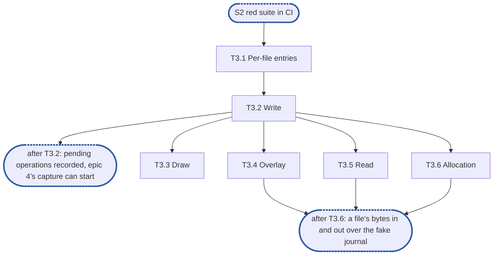

# Epic 3: engine v2 write, read and overlay

**Sources:** [RFC 8](../rfcs/rfc-8-engine.md) §1.1 (the request path), §2.3 (per-file
state), §4.1 (the write and `Draw`), §7.1, §7.2 (a failing read's count only), §7.5, §7.6,
§12.1 (`Draw`, `Overlay`, `Allocation` and the errors), §13 (E9, E15, E32, E37), §14 (this
epic's series and the loss log line) and §15's rows for those sections;
[RFC 1](../rfcs/rfc-1-journal.md) §3.1, §3.2 and §4.3 and
[RFC 28](../rfcs/rfc-28-journal-format.md) §2.3, for the journal calls and the `mtime` a
write records; [RFC 17](../rfcs/rfc-17-vfs.md) §2.3 and §5.7, for `Content` and the join
`Overlay` feeds.
**Track:** A.
**Epic 3 estimate: 6 subtasks, 13 man-days.**
**Depends on:** sync point **S2, red suite in CI**: E1's `pkg/block/enginev2` surface
(`Engine`, `Deps`, the `Journal` and `Handle` interfaces, `WriteOpts`, `Overlay`) and E2's
fake journal (`enginev2test.FakeJournal`), profiler wiring and red rows. Nothing of epic 4:
`Write` answers a stand-in verifier until epic 4's T4.1 replaces it (D12).
**Blocks:** epic 4, whose group commit captures the pending operations T3.1 and T3.2
record per file, and whose T4.1 replaces T3.2's stand-in verifier; epic 5, which records its truncates and deallocates as pending operations
and is answered by T3.4 to T3.6's replay; epic 6, which rebuilds the per-file entries from
the journal at start; epic 7, whose refusal mapping (T7.1) replaces T3.2's interim answer
to a capacity refusal; epic 8, whose clone copies through `Write`'s path and resolves its
source as `Read` does.

---

## 1. Goal

Epic 3 gives the engine a file's bytes in and out: `Write` stages them in the journal and
acknowledges, `Read` resolves the journal's answer against block metadata, and `Overlay`,
`Allocation` and `Draw` answer what the journal holds and has not yet committed. Nothing in
it waits on a metadata transaction or keeps an answer past the request.

**At the end of the epic:**

- a write is acknowledged once the journal holds it, with no metadata read or write, and
  `Overlay`, `Allocation` and `Read` reflect it at once;
- `Overlay` replays a file's pending operations in version order, so a pending truncate is
  never answered as the larger size;
- `Read` returns zeros only for a hole or a zero ref, fails **Lost** only when existence the
  journal had already answered for is missing, re-asks the journal when existence landed
  after it answered, and fails a carved run `ErrUnavailable`, never zeros;
- no lock shared by two files is held across a journal or store call.

### 1.1 In scope

The per-file entry and its pending operations; the routing of a file to its share's
binding, as far as one bound share; `Write`, `Draw`, `Overlay`, `Read` and `Allocation` over
the journal and `kvstore`; the journal's errors mapped to `vfserr` values at the content
boundary; the series `engine_reads_total{class}`, `engine_read_seconds` and
`engine_lock_wait_seconds{area}`; the loss log line.

### 1.2 Out of scope

- The verifier's inputs and their derivation (RFC 8 §4.1): epic 4, T4.1. T3.2 samples a stand-in
  verifier before staging (D12), which T4.1 replaces.
- `Commit`, the group commit, the entry's drop once its operations commit, and `Done`'s
  calls: epic 4.
- `Truncate`, `Deallocate`, `Delete` and the per-file guard: epic 5. Epic 3 only replays the
  pending operations they record. RFC 8 invariant E17, that correctness never depends on
  the guard, is the guard's epic's.
- The share table, `Bind`, `Start` and rebuilding per-file entries from `Since`: epic 6.
- Write admission and the refusal table (RFC 8 §10.2), `Stats` and its fields: epic 7.
- Fetching a carved run, the fill, the speculator and `PreWarm` (RFC 8 §7.2 to §7.4, §7.7,
  §7.8), the `Dirty` post of §4.1 step 4: RFC 8's second part, with offload.
- The `Content` check and the integration tier: the integration epic.

### 1.3 Names used here

- **E1**, epic 1, interfaces: `pkg/block/enginev2`'s exported surface, `Deps` and its
  interfaces, frozen at S1.
- **E2**, epic 2, red e2e suite and test foundations: `engine-conformance` with its
  `known.yaml`, the fixture over the real journal and `kvstore`, the fault-injecting
  `kv.KV`, the fake journal and the profiler wiring.
- **S1**, interfaces frozen and `Content` agreed with the filesystem service.
- **S2**, red suite in CI: E2's suite runs on every pull request, listed whole as known
  failures; epics 3, 4 and 6 start here.
- **S3**, engine complete over the fake journal: epics 3 to 8 done, every row whose journal
  call exists green.
- **S4**, the journal's calls built: the journal v2 team's work this engine calls; the rows
  still red wait only on it.
- **E9, E15, E17, E32, E37**: RFC 8 §13's invariants of those numbers, not epics. E9: zeros
  only for a hole or a zero ref, and distinguishable failures; E15: existence answered from
  the journal until committed; E17: correctness never rests on the per-file guard; E32: the
  re-ask above `asOf`, and a zero ref under a newer overwrite counted as data; E37: the
  request path shares no lock across files.
- **The integration epic**, epic 9: the filesystem service composed over the engine at
  RFC 17 §8's integration tier.

## 2. General rules for each epic

1. **Independent unit tests.** Each epic carries its own unit tests. It may use another
   epic's pure in-memory implementation, the implementation of an epic it depends on once
   that has landed, and E2's test components: above all the fake journal, which stands in
   for the journal wherever the logic under test is the engine's (the resolution table, the
   group commit's split, the refusal mapping). E1 declares no internal interface for it to
   fake (rule 12).
2. **Fuzz tests: none.** The engine parses no bytes of its own: it reads the journal's
   answers and the store's records through typed calls. RFC 8 §15 checks its pure parts,
   read resolution and the group commit's split, by its tables, not by fuzz, and says so in a
   `ponytail:` marker, so no fuzz target is built for them.
3. **Observability follows RFC 25, through what exists.** `Deps` carries a `*slog.Logger`
   narrowed with `With("component", "engine")` and a `Tracer`, a function type the engine
   declares over standard-library types only. RFC 25's metrics registry, watchdog and
   health source exist on neither branch, so the engine exposes its counters and
   conditions as `Stats` fields, and the root that composes it adapts them. Counters are
   named for RFC 8 §14's metrics, under the `engine_` prefix (RFC 25 §2.1), never
   `enginev2_`, with no share label on a per-operation series. Spans are RFC 8 §14's
   proposals, `engine.sync` and `engine.existence_commit`, and a removal batch opens a root
   span. Each epic names the counters, conditions and spans it owns; the units, labels and
   logging rules are RFC 25's, applied as written.
4. **Profiling.** Tests and benchmarks run under E2's profiling harness and fail on
   goroutine, descriptor or memory leaks and on anomalous resource growth. No
   allocations-per-op assertion: RFC 8 §15.4 defers its engine-cost benchmark until a
   profile shows engine time on the request path.
5. **Public interface and internals.** Tests cover both the internal package API and the
   public behaviour the epic enables, including concurrency under `-race`. Test at the
   layer that **consumes** a value (see `CLAUDE.md`, "Verifying a change"): a field the engine
   passes to the journal or the store is asserted where they read it, over the real journal
   and `kvstore`, not where the engine builds it.
6. **Known failures shrink.** An e2e test that turns green leaves the suite's `known.yaml`
   (`test/enginev2/known.yaml`) in the same change: `dt` fails the run if a listed test
   passes, so the change that turns it green removes it, a journal pull request included. A
   test over the real journal that starts red sits in that suite behind its build tag, never
   in `unit`, which keeps no known list.
7. **v2 ignores v1.** No import of, copy from, or behavioural dependence on v1, enforced by
   the engine's one import test, a walk over every package of `pkg/block/enginev2` with
   one allowlist, which also refuses `pkg/vfs`: no package imports `pkg/block/engine`,
   `pkg/block/journal`, `pkg/block/syncer`, `pkg/block/carver`, `pkg/block/remote` or the
   v1 metadata service `pkg/metadata`. The walk checks every package on its own, so its
   allowlist names each package an exception applies to, test packages included. v1 is not
   touched: it is deleted at the cutover.
8. **Real dependencies for properties of those dependencies.** No fake stands in for a
   check about what the real thing does: the real journal on a real directory, with its crash
   seam, for durability, recovery and loss; the real `kvstore` for what a transaction
   commits and conflicts on. The fake journal is for the engine's pure logic only, and no
   conformance row runs over it.
9. **Code comment conventions** (`CLAUDE.md`, "Code comments"). A source comment describes
   the code's behaviour and references nothing outside it: no issue or pull request
   numbers, no CI, runner or OS names, no epic, subtask, plan or decision ids. A
   `ponytail:` marker records a knowingly simple implementation, naming its ceiling and the
   upgrade path. A `decision:` marker records deliberate behaviour, naming the rule, why it
   holds and the evidence that would overturn it. Where the RFC carries such a note, its
   marker goes at the code site that implements it: RFC 8's copy-on-write share table, the
   per-file state bound, the loss-sequence floor, the version-limit headroom and its burst,
   the lazy existence of appends, and the stable-overwrite cost.
10. **A test must be able to fail.** Keep a test only if a plausible change would make it
    fail and nothing else would catch that change: not the compiler, not the diff, not a
    later epic's tests. A review rule that no test can check, such as "stubs never panic",
    stays a review rule.
11. **A symbol is exported only if the RFC's interface uses it.** Everything exported is
    frozen at S1. Helpers the engine's own files need stay unexported or move to an
    `internal/` package of `enginev2`.
12. **Each subtask creates only what it declares.** No empty package and no stub without a
    caller. A package, an option or a test helper lands with its first consumer.

### 2.1 How the rules apply

| Rule | Subtasks | How |
| --- | --- | --- |
| 1 Unit tests | all | every subtask tests over E2's fake journal and the real `kvstore` on an in-memory `kv.KV`, composed by T3.1's unit composition (D2), since `Bind` and `Start` are epic 6's |
| 2 Fuzz | none | no parser: the engine reads typed journal and store answers. T3.5 puts RFC 8 §15's `ponytail:` marker at the read-resolution table, which its table test checks instead |
| 3 Observability | T3.1, T3.5 | the logger is `Deps.Logger`, already narrowed to `component=engine`. T3.1 records `engine_lock_wait_seconds{area="file_state"}`, T3.5 `engine_reads_total{class}` and `engine_read_seconds`, none labelled by share, in unexported counters that epic 7's `Stats` exposes (D9). T3.5 logs a **Lost** or corrupt read at `Error`, once per extent. No span: this part's write and read wait on none of RFC 8 §14's stages (no sync, no existence commit, no fetch, no pacing) |
| 4 Profiling | all | T3.1's unit composition calls `prof.Watch`, so every unit test of the epic fails on a leaked goroutine, descriptor or heap |
| 5 Public and internal | all | internal tests of the replay (T3.4) and the resolution table (T3.5); the content methods tested through `*Engine`; `-race` runs in T3.1, T3.2 and T3.5. Values the engine hands the store (`Covering`'s and `Allocation`'s share, file and extent) are asserted over the real `kvstore`; the `mtime` handed the journal is asserted where the journal reads it back, by `Since` over the real journal (T3.2) |
| 6 Known failures | T3.2 | T3.2's test over the real journal enters `test/enginev2/known.yaml` naming this epic's issue; any row an epic-3 change turns green leaves it in that change |
| 7 v2 ignores v1 | T3.1 | the import walk stays as it is; T3.1 adds the unit composition's imports (`journalv2test/prof`, `kvstoretest`, `badgerkv`, `kv`, `sim`) for the engine's own test package to its allowlist, by name |
| 8 Real dependencies | T3.2, T3.5, T3.6 | the store's answers come from the real `kvstore`; the fake journal stands in only for the engine's logic; the `mtime` check runs over the real journal |
| 9 Comments | all | the markers of §4, each at its code site; RFC 8 §2.3's per-file bound at the entry map (T3.1) |
| 10 Tests can fail | all | each test below names the change it catches |
| 11 Exports | all | nothing new is exported: the content methods are E1's; the test hooks live in `export_test.go` |
| 12 Creates only what it declares | all | the entry's guard, its removal and loss fields and its drop land with epics 4 and 5, their consumers; T3.1's pending-operation kinds for truncate and deallocate land because T3.4 to T3.6 replay them |

## 3. Requirements and invariants

Every MUST and MUST NOT that RFC 8 and the journal RFCs place on this epic, numbered so that
subtasks and tests can cite them.

**Request path and per-file state**

| # | Requirement | Kind | Source | Subtasks |
| --- | --- | --- | --- | --- |
| R1 | No lock, queue or serialisation point shared by more than one file, or by more than one share, is held across a journal or store call, or a wait, on the path of `Write`, `Read`, `Overlay`, `Allocation` or `Draw`; the entry map's shard lock is held for the lookup only | MUST NOT | RFC 8 §1.1, E37 | T3.1, T3.2, T3.5 |
| R2 | Per-file state is keyed by file: one entry per file, never a stripe two files share | invariant | §2.3, §6.4 | T3.1 |
| R3 | A file's entry exists only while it holds something (here, pending operations); `Read`, `Overlay`, `Allocation` and `Draw` never create one; the bound is RFC 8 §2.3's `ponytail:` marker at the map | invariant | §2.3 | T3.1 |
| R4 | The engine keeps no copy of the bytes: a pending operation records its version, kind, extent and time, never its payload | invariant | §1.1 | T3.1, T3.2 |
| R5 | §1.1 no cross-share slowdown, the write half: one share saturated with writes leaves every other share's write latency within its baseline, and no `engine_lock_wait_seconds` area grows with the loaded share's rate | test row | §15.2 | T3.1, T3.2 |

**Write and Draw**

| # | Requirement | Kind | Source | Subtasks |
| --- | --- | --- | --- | --- |
| R6 | `Write` waits for no metadata transaction, offload or remote tier: it makes no store call, and waits only for the journal | MUST NOT | §4.1 | T3.2 |
| R7 | `Write` stages through the file's share handle's `WriteAt` with the clock's time in nanoseconds since the Unix epoch, or 0 when the caller's `WriteOpts.Suspend` holds `TimeModify` | MUST | §4.1 step 3, RFC 1 §3.1, RFC 28 §2.3 | T3.2 |
| R8 | `Write` samples the verifier's inputs before it stages the write, and returns that verifier | MUST | §4.1 | T3.2 |
| R9 | Until its stability point the journal is the write's authority: its pending operation is in the file's entry, in version order, before `Write` answers, so a `Read`, `Overlay` or `Allocation` that starts after reflects it | invariant | §4.1, E15 | T3.2, T3.4, T3.5, T3.6 |
| R10 | A `Write` that fails never calls `WriteOpts.Done`; a zero-length `Write` stages nothing, answers the verifier and calls `Done` once, with nothing charged | invariant | §12.1 | T3.2 |
| R11 | `Draw` issues the next version of the file's journal and no other: above every version staged or drawn on that journal before it, with no version of the engine's or the store's own, and takes no lock (the caller holds the accept lock) | MUST | §4.1, RFC 1 §4.3 | T3.3 |
| R12 | The content methods return only `vfserr` values and no `journalv2` type: the journal's `OtherShareError` is `ErrCorrupt`, never retried; a `NoSpaceError` is `ErrDelay` | MUST | §12.1, RFC 1 §4.3 | T3.2, T3.3, T3.5 |

**Overlay**

| # | Requirement | Kind | Source | Subtasks |
| --- | --- | --- | --- | --- |
| R13 | `Overlay` makes no metadata read and takes no lock shared across files: it reads the file's entry, which mirrors the journal's uncommitted operations | invariant | §12.1 | T3.4 |
| R14 | With no pending operation `Overlay` answers `pending` false and the zero `Overlay` | invariant | §12.1 | T3.4 |
| R15 | `Overlay` replays the pending operations in version order: a truncate sets `Size` and `SizeSet`, and each later write raises `Size` to its end; `Version` is the highest pending version, so it advances at every accepted write | invariant | §12.1, RFC 17 §5.7 | T3.4 |
| R16 | `Overlay` costs the file's pending operations alone: a file with none costs no allocation | bound | §12.1 | T3.4 |

**Read**

| # | Requirement | Kind | Source | Subtasks |
| --- | --- | --- | --- | --- |
| R17 | The journal is asked before block metadata, and metadata only about the extents the journal reported missing, one `Covering` call per missing extent, never one per window | MUST | §7.1 | T3.5 |
| R18 | The resolution is computed per request and never kept | MUST, MUST NOT | §7.1 | T3.5 |
| R19 | A read returns zeros only for a hole or a zero ref, and fills them itself: `ReadAt` leaves a missing extent's bytes of `dst` untouched | MUST NOT | §7.1, E9, RFC 1 §3.2 | T3.5 |
| R20 | An uncarved run whose file's `applied` and whose own overwrite version are both at or below `asOf` fails the read `ErrLost`, reporting data loss naming the file and extent, and nothing is fetched for it | MUST NOT | §7.1 | T3.5 |
| R21 | An uncarved run whose file's `applied`, or whose own overwrite version, is above `asOf` is asked of the journal again and resolved again, within the read's deadline | MUST | §7.1, E32 | T3.5 |
| R22 | "Uncarved" and "past end of file" are judged with the pending operations applied: a part past the committed size but below a later pending write's end is a hole, unless a pending write covers it, which then reads **Lost**; past the replayed size is a short read | invariant | §7.1 | T3.5 |
| R23 | A carved run fails the read `ErrUnavailable`: transient, distinguishable from `ErrLost`, never zeros | MUST | §7.5, E9 | T3.5 |
| R24 | A read that fails part-way returns `n`, the bytes filled in file order before the first failing part, and the error | invariant | §7.2 | T3.5 |
| R25 | A **Lost** or corrupt read logs the file and extent at `Error`, once per extent | invariant | §14 | T3.5 |
| R26 | §7.1 the join: every row of §7.1's table this part can reach, an uncarved extent the journal lost included, fails **Lost** where the table says so | test row | §15.1 | T3.5 |
| R27 | §7.1 existence above `asOf`: an overwrite, a hole fill and a growing write staged and committed between a read's journal step and its metadata step never fail the read **Lost** | test row | §15.1 | T3.5 |
| R28 | §4.1 journal authority, the reads half: a write without a stability point is reflected by `Overlay`, `Allocation` and `Read`; the recovery half is epic 6's | test row | §15.1 | T3.2, T3.4, T3.5, T3.6 |
| R29 | This part's own row: a carved run fails `ErrUnavailable`, never zeros and never `ErrLost` | test row | §7.5 | T3.5 |

**Allocation**

| # | Requirement | Kind | Source | Subtasks |
| --- | --- | --- | --- | --- |
| R30 | `Allocation` answers from block metadata's hole set and zero refs with the pending operations applied, never from what the journal holds | MUST NOT | §7.6 | T3.6 |
| R31 | A zero ref under a newer overwrite record counts as data, and so does a committed hole or zero ref under a pending write | MUST | §7.6, E32 | T3.6 |

## 4. Decisions this epic takes

- **D1, a file's binding.** The content methods name only a `FileID`, yet the handle a
  write goes through and every `Existence` and `Content` call need the file's share, and
  `kvstore` keys a file's records under it. RFC 8 does not say how the engine finds it
  (§9, point 1). T3.1 puts the lookup in one unexported function, `bindingOf(f)`, which
  answers the only bound share; with more than one bound it refuses the call. A
  `decision:` marker there names the ceiling, one share per engine, and is withdrawn when
  the content interface names the share.
- **D2, the unit composition.** `Bind` and `Start` are epic 6's, so a unit test cannot bind
  a share through them. T3.1 adds `export_test.go`, in package `enginev2`, with a hook that
  installs one binding over a `Journal` and a `Handle`, and a helper in the engine's test
  package composing the engine over E2's `FakeJournal`, `kvstoretest.NewFS` on an
  in-memory `kv.KV`, `sim.TestClock` and `prof.Watch`. The helper cannot live in
  `enginev2test`, which cannot reach `export_test.go`. It is replaced by epic 6's `Bind`
  once that lands, so no marker.
- **D3, pending-operation order.** The entry's lock is never held across `WriteAt`: the
  operation is inserted by version after the journal answers. Writes of one file arrive in
  version order because the filesystem service holds the file's accept lock across `Write`
  (RFC 8 §4.1). A `decision:` marker at the insert says the ordering against a capture rests
  on that lock, and is to be withdrawn if a caller can ever stage two writes of one file at
  once.
- **D4, the journal's errors at the content boundary.** T3.2 maps them in one function: a
  `NoSpaceError` of any limit is `ErrDelay` with `DelayCapacity`, including the version
  limit, which RFC 1 §4.3 says the engine answers `ErrDelay` and names no cause for;
  `OtherShareError` is `ErrCorrupt`; `ErrClosed` is `ErrUnavailable`; the context's own
  error passes through; anything else is `ErrUnavailable`, wrapping it, logged at `Error`.
  A `decision:` marker on the `NoSpaceError` line says that until the refusal table is
  built every capacity refusal is answered as retry-later, never as a false disk-full, and
  is replaced by epic 7's mapping.
- **D5, a carved run.** No code of this part writes a ref, so a carved run means a store
  written by something else. It fails `ErrUnavailable`, as an unreachable remote does
  (RFC 8 §7.5). A `decision:` marker at the case names it, and is withdrawn when the fetch
  is built.
- **D6, the re-ask's deadline.** RFC 8 §7.1 bounds the re-ask by the read's deadline and
  does not say what answers when it is reached. `Read` re-asks while `ctx` is live and, at
  its end, fails the read `ErrDelay` with `DelayConflict`: existence kept landing faster
  than the read. A `decision:` marker names it.
- **D7, a loss logged once.** The log line of R25 needs to remember which extents it has
  reported, and the file's entry is gone once nothing is pending. The memory is one
  node-wide set of (file, extent) keys, at most 4096, the oldest dropped first, with a
  `ponytail:` marker: an extent read again after 4096 later losses logs again; key it per
  file in the entry if logs show repeats.
- **D8, a read's class.** `engine_reads_total{class}` counts each read once, by its outcome:
  the failing part's class (`lost`, `corrupt`, `unavailable`) when it fails, otherwise
  `hole` when any part read as zeros, otherwise `journal`. A `decision:` marker says so.
- **D9, where the series live.** `Stats` is an empty struct frozen at S1 and filled by
  epic 7. Epic 3 keeps its series in unexported counters, and its tests read them through
  `export_test.go`; epic 7 adds the fields. No marker: nothing here is simplified.
- **D10, the overlay's times.** The journal records one time per write, `mtime`, zero when
  suspended. The entry keeps each operation's clock time as its change time, so `Ctime` is
  the newest operation's time and `Mtime` the newest time of an operation that set it, zero
  when none did. A suspended write's change time is therefore memory only, and a restart
  cannot rebuild it (§9, point 4). A `decision:` marker at the replay names it.
- **D11, an allocation's class.** `Existence.Allocation` answers a run and whether it is a
  hole; the engine's `Allocation` answers an `entity.Span`. It answers `Hole` for a hole and
  `Uncarved` for data, with no ref, since a caller reads only hole against data. A
  `decision:` marker names it.
- **D12, the verifier before epic 4.** `Write` returns RFC 8 §4.1's verifier, whose inputs
  T4.1 derives, and nothing in this epic may wait for epic 4. T3.2 samples the verifier
  through one function, `sampleVerifier`, that answers a fixed zero verifier, with a
  `ponytail:` marker: a write's verifier, a stable one's included, means nothing until T4.1
  replaces that function's body with the derived one, so a client comparing verifiers sees
  no restart or loss until then; T4.1 replaces it, and nothing else does.

## 5. Target tree

```text
pkg/block/enginev2/
  file.go           T3.1  per-file entries, sharded by file; pending operations; bindingOf (D1)
  export_test.go    T3.1  the binding hook, counter accessors and the verifier swap (D2, D9, D12)
  unit_test.go      T3.1  the unit composition over the fake journal and the real kvstore
  imports_test.go   T3.1  allowlist entries for the composition's imports
  write.go          T3.2  Write, the identifier and version conversions, the error mapping (D4)
                    T3.3  Draw
  overlay.go        T3.4  Overlay and the pending-operation replay
  read.go           T3.5  Read and the resolution table
  allocation.go     T3.6  Allocation
  unbuilt.go        T3.2–T3.6  each built method leaves it
  conformance/
    rfc8_write_test.go  T3.2  mtime read back through Since over the real journal
test/enginev2/known.yaml  T3.2  its entry
```

## 6. Subtasks

### T3.1 Per-file entries and the unit composition

**Subtask T3.1 estimate: 2.5 man-days.**

- **Track:** A. **Depends on:** S2.
- **Covers:** R1, R2, R3, R4, R5.
- **Deliverables:** `file.go`: the entry map sharded by a hash of the `FileID`, each shard a
  map behind its own mutex held only to look up, insert or remove; the entry with its own
  mutex and its pending operations, each `{version, kind (write, truncate, deallocate),
  extent, time, setsMtime, done}`; `entryOf(f)` that never inserts and `entryFor(f)` that
  does; `bindingOf(f)` (D1); the lock-wait series for `area="file_state"`, timed with
  `Deps.Clock`; RFC 8 §2.3's `ponytail:` marker on the per-file bound at the map.
  `export_test.go` and the unit composition (D2), with the import allowlist entries.
- **Acceptance criteria:**
  - A shard's lock is never held while an entry's lock is waited on, nor across any call
    out of the package.
  - A lookup for a file with no entry allocates nothing and creates nothing.
  - With two shares bound, `bindingOf` refuses the call rather than guess.
- **Tests:** one file's entry lock held through the hook while a second file in the same
  shard is looked up, inserted and released (catches a shard lock held across an entry
  wait, or a striped entry); the `-race` run with writers on 64 files over the composition;
  `testing.AllocsPerRun` of `entryOf` on an absent file is 0 and the map stays empty
  (catches a lookup that inserts); a reflection check that the pending-operation type holds
  no slice or array of bytes (catches a payload copy, R4); the lock-wait series records the
  test clock's advance while a holder keeps the lock (catches it unrecorded); one file
  saturated by writers while another file's writes record no lock wait (R5's property
  across files, which D1 allows; its row across shares waits for open point 1 and
  epic 6).

### T3.2 Write

**Subtask T3.2 estimate: 2.5 man-days.**

- **Track:** A. **Depends on:** T3.1.
- **Covers:** R1, R4, R5, R6, R7, R8, R9, R10, R12, R28.
- **Deliverables:** `write.go`: `Write` as RFC 8 §4.1's steps without admission and the post:
  validate (`off` negative is `ErrInvalid`), sample the stand-in verifier (D12), stage through `WriteAt`
  with the time of R7, insert the pending operation by version (D3), answer. The `FileID`
  and version conversions to `journalv2`'s types, one line each over its converters, at
  their first caller. The journal-error mapping of D4. `conformance/rfc8_write_test.go`
  and its `known.yaml` entry.
- **Acceptance criteria:**
  - `Write` makes no `Existence`, `Content` or `Lifecycle` call.
  - The `mtime` passed is the clock's `Now` in nanoseconds, 0 under `TimeModify`.
  - Every accepted write's operation is in the entry before `Write` returns.
  - A refused write leaves no operation and calls no `Done`.
- **Tests:** a `Write` with every `Existence` and `Content` call blocked until the test ends,
  which still returns (catches a store call on the write path, R6); the change `Since`
  reports carries the clock's time, and 0 under `TimeModify`, over the fake journal and,
  behind the tag, over the real one where the journal reads it back (catches a wrong unit or
  an ignored `Suspend`); a journal wrapper that counts `WriteAt` calls, with
  `sampleVerifier` swapped through `export_test.go` for one that records that count: it reads
  0 (catches sampling after staging, R8, which the zero stand-in alone cannot show); a
  write refused `NoSpaceError`: `ErrDelay` with `DelayCapacity`, no `Done`, no operation
  (catches a leaked `journalv2` error or an early `Done`); `OtherShareError` answered
  `ErrCorrupt`; a zero-length write calls `Done` once and stages nothing; 32 concurrent
  writes of distinct files under `-race`, each operation present once.

### T3.3 Draw

**Subtask T3.3 estimate: 0.5 man-days.**

- **Track:** A. **Depends on:** T3.2.
- **Covers:** R11, R12.
- **Deliverables:** `Draw` in `write.go`: the file's journal's `Draw`, converted, its refusal
  mapped by D4.
- **Acceptance criteria:**
  - A `Draw` after a `Write` of the same journal answers a higher version; a `Draw` takes no
    entry and creates none.
- **Tests:** write, draw, write: the three versions strictly increase (catches a version from
  a counter of the engine's own or from the clock); `Draw` at the fake's version limit
  answers `ErrDelay`, not a `NoSpaceError`.

### T3.4 Overlay

**Subtask T3.4 estimate: 1.5 man-days.**

- **Track:** A. **Depends on:** T3.2.
- **Covers:** R9, R13, R14, R15, R16, R28.
- **Deliverables:** `overlay.go`: `Overlay` from the file's entry, and the replay as a pure
  function over its pending operations, with D10's times and its marker.
- **Acceptance criteria:**
  - The replay of a truncate followed by writes is never `max(truncate, every write's end)`.
  - No pending operation: `pending` false, the zero `Overlay`, no allocation.
- **Tests:** the replay with explicit versions: a write of 0 to 8 KiB at v3, then a
  truncate to 4 KiB at v5 (`SizeSet`, `Size` 4 KiB); a write ending at 12 KiB at v6 (`Size`
  12 KiB, `SizeSet` still true); a write ending at 2 KiB at v7 (`Size` 12 KiB, `SizeSet` true,
  `Version` v7). A `max` replay fails the v5 case, one ignoring order the v7 case. The same
  operations inserted out of order replay the same. `Overlay` with every store call failing
  the test (catches a metadata read, R13); `testing.AllocsPerRun` of `Overlay` on a file
  with nothing pending is 0 (R16); a suspended write leaves `Mtime` at the earlier write's
  time and moves `Ctime`.

### T3.5 Read

**Subtask T3.5 estimate: 4.5 man-days.**

- **Track:** A. **Depends on:** T3.2.
- **Covers:** R1, R9, R12, R17, R18, R19, R20, R21, R22, R23, R24, R25, R26, R27, R28, R29.
- **Deliverables:** `read.go`: `Read` as RFC 8 §7.1's steps: `ReadAt`; for each missing
  extent, one `Covering` call; the table resolved with the pending operations applied
  (R22); zeros written into `dst` for holes and zero refs; the re-ask loop of R21 with D6
  at its end; `ErrLost` with D7's log line; the carved case of D5; `n` as R24 counts it;
  `engine_reads_total{class}` by D8 and `engine_read_seconds`; RFC 8 §15's `ponytail:`
  marker at the table.
- **Acceptance criteria:**
  - A read the journal answers whole makes no store call.
  - Every row of the table is reached by a test, and only a hole or a zero ref yields
    zeros.
  - A re-asked extent that the journal now holds returns its bytes; one still missing with
    `applied` and its overwrite version at or below the new `asOf` fails `ErrLost`.
- **Tests:** the table test over a stub `Content` answering each class, `dst` prefilled with
  0xFF: hole and zero ref read zeros, uncarved at or below `asOf` `ErrLost`, carved
  `ErrUnavailable`, past the end a short read (a build serving zeros for any other row
  fails it, R19, R26, R29); a stub recording calls: none before `ReadAt`, one per missing
  extent with its exact bounds, none when nothing is missing (R17); over the real
  `kvstore`, with a `Content` wrapper that commits existence through `Existence.Commit`
  between the journal step and `Covering`: an overwrite, a hole fill and a growing write
  each read back, never `ErrLost`; keying the re-ask on overwrite records alone fails the
  last two (R21, R27); the same with `ctx` ended mid-loop answers `ErrDelay`; a lost extent
  read, a hole committed over it, then read again reads zeros (catches a kept resolution,
  R18); a pending write the fake journal loses reads `ErrLost`, a gap below a pending
  write past the committed size reads zeros (R22); a read with a hole, then a lost part,
  then held bytes returns the hole's count and `ErrLost` (R24); the same lost extent read
  twice logs one `Error` line (R25); a read of one file while another file's entry is held
  returns (R1).

### T3.6 Allocation

**Subtask T3.6 estimate: 1.5 man-days.**

- **Track:** A. **Depends on:** T3.2.
- **Covers:** R9, R28, R30, R31.
- **Deliverables:** `allocation.go`: `Allocation` from `Existence.Allocation` with the
  pending operations applied, a write making data, a deallocate a hole and a truncate the
  end of file; the `Span` of D11.
- **Acceptance criteria:**
  - `Allocation` makes no journal call.
  - The run answered is the longest one of a single class from `off`, pending operations
    included.
- **Tests:** over the real `kvstore`: a committed file of data whose bytes the fake journal
  then loses still answers data (catches an answer from what the journal holds, R30); a
  committed hole under a pending write answers data over the write and hole after it
  (R31); a pending deallocate inside committed data splits the run; a pending truncate
  ends it; a `Journal` stub failing the test on any call.

## 7. Order of work



T3.5 is the riskiest, for the re-ask, and starts as soon as T3.2 lands. Checkpoint after
T3.2: epic 4 can capture pending operations. Checkpoint after T3.6: epic 8 can copy through
`Write` and resolve a source as `Read` does.

## 8. Suggested pull requests

| PR | Subtasks | Man-days | After | Why together |
| --- | --- | --- | --- | --- |
| 1 | T3.1, T3.2, T3.3 | 5.5 | — | the write path: entries, `Write` and `Draw`, with the composition every later test uses |
| 2 | T3.4, T3.6 | 3 | PR 1 | the two answers that apply pending operations without reading bytes |
| 3 | T3.5 | 4.5 | PR 1 | the read resolution; can be open at the same time as PR 2 |

A suggestion only: one pull request per subtask works as well.

## 9. Open points

1. **A file's share.** RFC 8 §12.1's content methods, and RFC 17 §2.3's `Content`, name only
   the file, while the engine needs the file's share for its handle and for every store
   call. The service has it (`shareOf(h)`). Either the content methods take the share, or
   the engine learns a file's share from a store lookup; D1 serves one bound share until
   then. It must be settled before epic 6 binds a second share, and the change touches
   the surface frozen at S1.
2. **The verifier's edge.** T3.2 returns the verifier T4.1 derives, an edge from epic 4 into
   epic 3 that the dependency graph between epics does not draw. This document breaks it
   with a stand-in (D12) so epic 3 waits for nothing of epic 4; the graph between epics
   should either add an edge from epic 4 to epic 3, which T4.1 allows since it needs nothing of epic 3
   and comes first on track B, or note the stand-in and T4.1's replacing it.
3. **No row over the real journal turns green in this epic.** E2's fixture composes the
   engine through `Start`, epic 6's, and the journal's `WriteAt` and `ReadAt` are not built
   yet. The rows R5 and R26 to R29 name leave `known.yaml` once both exist.
4. **A suspended write's `ctime`** (D10): the journal records `mtime` only, so a restart
   loses it; RFC 28's to decide. And when every pending write suspended `mtime`, `Overlay`
   answers a zero `Mtime`: the filesystem service should keep the File record's, which
   RFC 17 §5.7 ("the times … are the overlay's") does not say.
5. **`Allocation`'s type.** RFC 8 §12.1 answers RFC 6 §2's `Span`, while `kvstore`'s
   `Existence.Allocation` answers a run and a hole flag; D11 translates. RFC 6 §10.1 or
   RFC 8 §12.1 should say which.
6. **Two causes RFC 8 leaves open:** the answer at the re-ask's deadline (D6) and the
   `DelayCause` of a version-limit refusal (D4).
