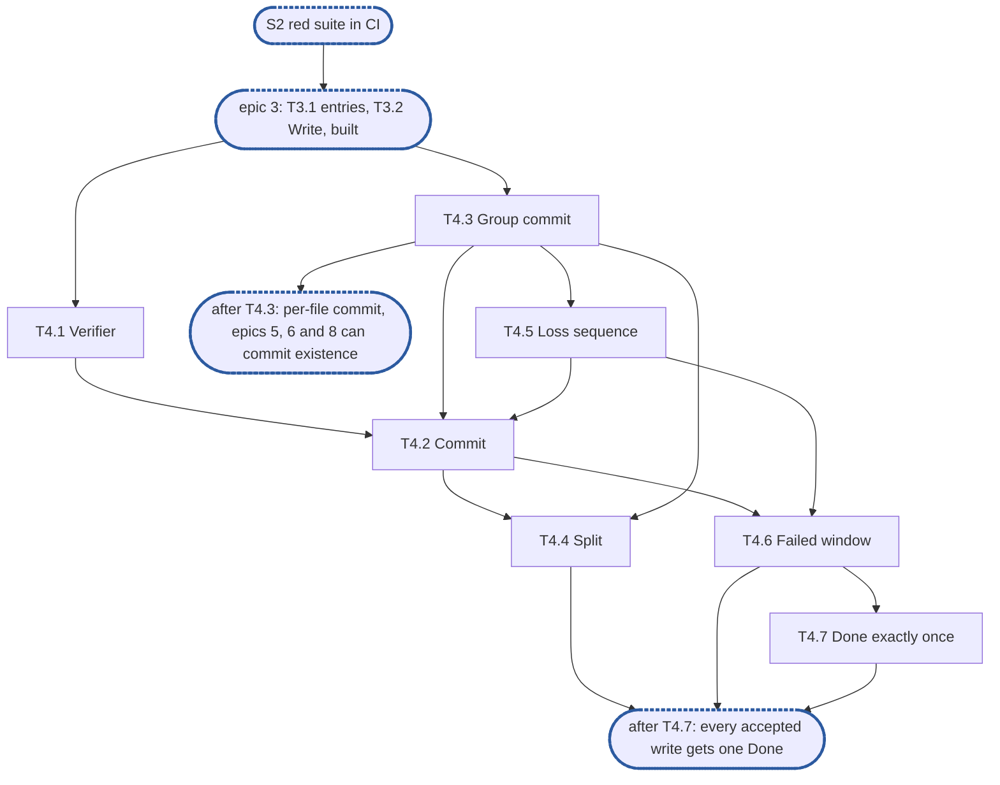

# Epic 4: engine v2 commit, group commit and losses

**Sources:** [RFC 8](../rfcs/rfc-8-engine.md) §4.1 (the write verifier), §5.1, §5.2, §11.3,
§12.1 (`Commit`, `LossSeq`, `WriteOpts.Done`), §13 (E15, E19, E24, E27, E31, E35, E40), §14
(this epic's series and spans) and §15's rows for those sections;
[RFC 1](../rfcs/rfc-1-journal.md) §3.8, §5.2 and §5.3, for the journal's sync, loss events
and failed windows; [RFC 6](../rfcs/rfc-6-block-metadata.md) §3.3, §5.2 and §10.1, for
overwrite records, the key budget `K` and `Existence`; [RFC 17](../rfcs/rfc-17-vfs.md) §5.6
and §5.8, for `Done` and the verifier the service hands its clients.
**Track:** B.
**Package paths:** `feat/storage-v2`'s, after #3645 renamed `enginev2` to `engine` and
`journalv2` to `journal`.
**Epic 4 estimate: 7 subtasks, 23 man-days.**
**Depends on:** sync point **S2, red suite in CI**: E1's surface (`Commit`, `LossSeq`,
`WriteOpts.Done`, `Settings`, `Deps.Existence`) and E2's fake journal; epic 3, built:
T3.1's per-file entries and their drop of an empty entry marked dead, T3.2's `Write`, which
records each pending operation with its `Done`, and its stand-in verifier (`zeroVerifier`, behind the engine's `sample` field),
which T4.1 replaces. #3608 and #3609, which put the share on every content call.
**Blocks:** epic 5, whose phase 1 commits a file's pending existence through this epic's
claim and calls its `Done`s, and whose removal record the group commit's due rule must
precede; epic 6, whose recovery commits each file's existence through T4.3's per-file
commit, whose `Drop` takes a share's files out of T4.3's due set, and whose tests count
`Done` with T4.7's reservation counter; epic 7, whose capacity sync feeds T4.6's per-file
report, whose `Stats` exposes T4.4's `existence_commit_failing` and this epic's counters, and
whose self-fence watches the group commit's transactions through T4.4's retrying-owner mark; epic 8, whose clone commits its
source's pending existence through T4.3's per-file commit before it reads `asOf`.

---

## 1. Goal

Epic 4 builds RFC 8 §4.1's write verifier, §5.1's `Commit` and loss sequence, §5.2's group
commit per journal with its sync marks, and `Done` on four of §5.1's paths. §3 numbers each
obligation the RFC places on the epic and names the subtask that meets it; this document
gives the split, the order, the estimates and the tests, and cites the RFC rather than
restating it.

### 1.1 In scope

§3's requirements, through §6's subtasks; the `kvstore` changes they need (`PendingOp`'s
modify and change times, `OpLost`, the marks write) and the test components they add to E2's
(the fake journal's sync marks, `Report`, `FailSync(also)` and `Durable`, the fixture's
`FailNextSync` and `Stall`, and `newUnitOver`).

### 1.2 Out of scope

- `Truncate`, `Deallocate`, `Delete`, the per-file guard, a removal's phase 1 and its `Done`
  path, and the aborted release's `Done` path: epic 5 (T5.1, T5.4). The group commit's
  capture skipping a guarded file and `commitThrough`'s wait for the guard's release
  (epic 5's D1 and D2) land with the guard, in T5.1.
- Rebuilding entries from `Since`, committing recovered existence before a file is served,
  the incarnation raise at start, `Close`'s join, `Forget`'s `Done` and `Drop`'s removal from
  the due set: epic 6, over this epic's per-file commit and `dropShare`. Epic 6 also owns
  `Bind` filling T4.1's node, node epoch and incarnation (D1), a start past an acknowledged
  device loss setting T4.5's floor of that journal to 1, and `Close` calling `commitAll`
  then `closeGroupCommits` before it closes the journals.
- The capacity refusal table, the capacity sync, the self-fence and `Stats`'s fields: epic 7.
- The cut (`PrepareCut`, `CommitCut`, `Deps.Gate`) and the stamp after a group commit
  (RFC 8 §5.1 step 5, RFC 12); an offer's capture, offload's commit and §15.1's "durable
  commits" row: the second part. No existence commit here passes a gate.
- The stop-serving sweep's `Done`: a cluster, which this part does not have.
- A journal device dying under the running process: T4.5 builds the engine's half behind a
  hook; the journal reports no such state (§9, point 3).
- **Between T4.5 and T4.6**, a failed window's write: T4.5's drain raises the file's loss
  sequence but leaves the write in the entry, so a group commit commits it as written;
  T4.6 drops it. Until T4.6 lands the sequence is right and the size may not be.

### 1.3 Names used here

- **E1**, epic 1, interfaces: `pkg/block/engine`'s exported surface, `Deps` and its
  interfaces, frozen at S1.
- **E2**, epic 2, red e2e suite and test foundations: `engine-conformance` with its
  `known.yaml`, the fixture over the real journal and `kvstore`, the fault-injecting
  `kv.KV`, the fake journal and the profiler wiring.
- **S1**, interfaces frozen and `Content` agreed with the filesystem service.
- **S2**, red suite in CI: E2's suite runs on every pull request, listed whole as known
  failures; epics 3, 4 and 6 start here.
- **S3**, engine complete over the fake journal: epics 3 to 8 done, every row whose journal
  call exists green.
- **E15, E19, E24, E27, E31, E35, E40**: RFC 8 §13's invariants of those numbers, not epics.
- **`G`, `K`**: `group_commit.max_files` (`Settings.GroupCommitMaxFiles`, RFC 8 §5.2) and
  RFC 6 §5.2's key budget, which `kvstore`'s `Existence.Commit` applies itself.
- **The integration epic**, epic 9: the filesystem service composed over the engine at
  RFC 17 §8's integration tier.

## 2. General rules for each epic

1. **Independent unit tests.** Each epic carries its own unit tests. It may use another
   epic's pure in-memory implementation, the implementation of an epic it depends on once
   that has landed, and E2's test components: above all the fake journal, which stands in
   for the journal wherever the logic under test is the engine's (the resolution table, the
   group commit's split, the refusal mapping). E1 declares no internal interface for it to
   fake (rule 12).
2. **Fuzz tests: none.** The engine parses no bytes of its own: it reads the journal's
   answers and the store's records through typed calls. RFC 8 §15 checks its pure parts,
   read resolution and the group commit's split, by its tables, not by fuzz, and says so in a
   `ponytail:` marker, so no fuzz target is built for them.
3. **Observability follows RFC 25, through what exists.** `Deps` carries a `*slog.Logger`
   narrowed with `With("component", "engine")` and a `Tracer`, a function type the engine
   declares over standard-library types only. RFC 25's metrics registry, watchdog and
   health source exist on neither branch, so the engine exposes its counters and
   conditions as `Stats` fields, and the root that composes it adapts them. Counters are
   named for RFC 8 §14's metrics, under the `engine_` prefix (RFC 25 §2.1), never
   `enginev2_`, with no share label on a per-operation series. Spans are RFC 8 §14's
   proposals, `engine.sync` and `engine.existence_commit`, and a removal batch opens a root
   span. Each epic names the counters, conditions and spans it owns; the units, labels and
   logging rules are RFC 25's, applied as written.
4. **Profiling.** Tests and benchmarks run under E2's profiling harness and fail on
   goroutine, descriptor or memory leaks and on anomalous resource growth. No
   allocations-per-op assertion: RFC 8 §15.4 defers its engine-cost benchmark until a
   profile shows engine time on the request path.
5. **Public interface and internals.** Tests cover both the internal package API and the
   public behaviour the epic enables, including concurrency under `-race`. Test at the
   layer that **consumes** a value (see `CLAUDE.md`, "Verifying a change"): a field the engine
   passes to the journal or the store is asserted where they read it, over the real journal
   and `kvstore`, not where the engine builds it.
6. **Known failures shrink.** An e2e test that turns green leaves the suite's `known.yaml`
   (`test/engine/known.yaml`) in the same change: `dt` fails the run if a listed test
   passes, so the change that turns it green removes it, a journal pull request included. A
   test over the real journal that starts red sits in that suite behind its build tag, never
   in `unit`, which keeps no known list.
7. **v2 ignores v1.** No import of, copy from, or behavioural dependence on v1, enforced by
   the engine's one import test, a walk over every package of `pkg/block/engine` with
   one allowlist, which also refuses `pkg/vfs`: no package imports `pkg/block/syncer`,
   `pkg/block/carver`, `pkg/block/remote` or the v1 metadata service `pkg/metadata`; v1's
   engine and journal are gone on `feat/storage-v2` since #3645. The walk checks every package on its own, so its
   allowlist names each package an exception applies to, test packages included. v1 is not
   touched: it is deleted at the cutover.
8. **Real dependencies for properties of those dependencies.** No fake stands in for a
   check about what the real thing does: the real journal on a real directory, with its crash
   seam, for durability, recovery and loss; the real `kvstore` for what a transaction
   commits and conflicts on. The fake journal is for the engine's pure logic only, and no
   conformance row runs over it.
9. **Code comment conventions** (`CLAUDE.md`, "Code comments"). A source comment describes
   the code's behaviour and references nothing outside it: no issue or pull request
   numbers, no CI, runner or OS names, no epic, subtask, plan or decision ids. A
   `ponytail:` marker records a knowingly simple implementation, naming its ceiling and the
   upgrade path. A `decision:` marker records deliberate behaviour, naming the rule, why it
   holds and the evidence that would overturn it. Where the RFC carries such a note, its
   marker goes at the code site that implements it: RFC 8's copy-on-write share table, the
   per-file state bound, the loss-sequence floor, the version-limit headroom and its burst,
   the lazy existence of appends, and the stable-overwrite cost.
10. **A test must be able to fail.** Keep a test only if a plausible change would make it
    fail and nothing else would catch that change: not the compiler, not the diff, not a
    later epic's tests. A review rule that no test can check, such as "stubs never panic",
    stays a review rule.
11. **A symbol is exported only if the RFC's interface uses it.** Everything exported is
    frozen at S1. Helpers the engine's own files need stay unexported or move to an
    `internal/` package of `engine`.
12. **Each subtask creates only what it declares.** No empty package and no stub without a
    caller. A package, an option or a test helper lands with its first consumer.


### 2.1 How the rules apply

| Rule | Subtasks | How |
| --- | --- | --- |
| 1 Unit tests | all | every subtask tests over E2's fake journal and the real `kvstore` on an in-memory `kv.KV`, through epic 3's unit composition; the split's test puts a `kv.KV` wrapper under `kvstore` through `newUnitOver`, and the stalled store's a stalling `Existence` wrapper, since E2's fault-injecting `kv.KV` does not exist |
| 2 Fuzz | none | no parser: the group commit's split is checked by its table test (T4.4), which carries RFC 8 §15's `ponytail:` marker |
| 3 Observability | T4.2, T4.3, T4.4 | T4.2 counts `engine_stability_points_total` and opens `engine.sync`; T4.3 records `engine_pending_existence_ops` (the operations one commit applied) and opens `engine.existence_commit`; T4.4 counts `engine_group_commit_splits_total` and raises `existence_commit_failing` naming the file, logged at `Warn` on entering and leaving. Counters in unexported fields epic 7's `Stats` exposes; none labelled by share |
| 4 Profiling | all | the unit composition calls `prof.Watch`; T4.3's timer and its batch goroutine are joined by `closeGroupCommits`, which the tests call as epic 6's `Close` will, so a leak fails the test that composes the engine |
| 5 Public and internal | all | the split (T4.4) and the claim (T4.7) tested internally; `Commit` and `LossSeq` through `*Engine`; `-race` in T4.3, T4.4 and T4.7. What the commit writes, the split times and the loss op's charge included, is asserted over the real `kvstore` (T4.3, T4.5), and the verifier where the service reads it, by `Commit`'s answer against `Write`'s (T4.1) |
| 6 Known failures | T4.1, T4.2, T4.3, T4.4, T4.6 | `TestRFC8A_Verifier` and `TestRFC8A_StableWriteLazyExistence` are already listed, naming epic 6, whose start they also need; T4.1 and T4.2 add their engine assertions and leave those entries. The new rows, verifier inputs (T4.1), overwrite waits for existence, stalled store and marks wait (T4.2), sync before existence (T4.3), group commit and sync marks ride in one batch (T4.4), and failed window with verifier after a loss (T4.6), enter `test/engine/known.yaml` naming this epic's issue, red until the journal's `Init`, `Sync`, crash seam and loss events exist; a row an epic-4 change turns green leaves it in that change |
| 7 v2 ignores v1 | none | no new import |
| 8 Real dependencies | T4.1, T4.2, T4.3, T4.4, T4.6 | every conformance row runs over the real journal and `kvstore`; the fake journal is for the unit tests of the engine's logic only, none of which stands in for a row |
| 9 Comments | all | the markers of §4 at their code sites, and three of RFC 8 §5.1's: the loss sequence's floor (`ponytail:`, T4.5), the lazy existence of appends (`decision:`, T4.2) and the stable-overwrite cost (`ponytail:`, T4.2) |
| 10 Tests can fail | all | each test below names the change it catches |
| 11 Exports | all | nothing new is exported from `engine`; the test hooks live in `export_test.go`, the reservation counter in `enginetest`. `kvstore.PendingOp`'s new fields and `OpLost` are `kvstore`'s own, used by its caller |
| 12 Creates only what it declares | all | the per-file commit lands in T4.3 with its first consumer, `Commit` (T4.2); the sync function lands in T4.5 with its first consumer, the drain; the retrying-owner mark lands in T4.4 with its first setter, the group commit, or its reader, epic 7's T7.2, whichever lands first: epic 4 blocks epic 7, so a dependency of T4.4 on T7.2 would be a cycle, and T7.2 does not depend on T4.4 |

## 3. Requirements and invariants

Every MUST and MUST NOT that RFC 8 and the journal RFCs place on this epic, numbered so that
subtasks and tests can cite them. Each row names the obligation and cites where the RFC
states it: the RFC's text is the requirement, so read it there. Numbers are stable: a row
added later takes the next free number in its group's table, and a withdrawn one keeps its
row.

**The verifier**

| # | Requirement | Kind | Source | Subtasks |
| --- | --- | --- | --- | --- |
| R1 | The verifier is derived from RFC 8 §4.1's five inputs, never from the clock alone | MUST, MUST NOT | RFC 8 §4.1 | T4.1 |
| R2 | `Write` samples the inputs before it stages; `Commit` after its sync and every wait it makes | MUST | §4.1 | T4.1, T4.2 |
| R3 | One verifier for every call between two changes of the inputs | MUST | §4.1 | T4.1 |
| R4 | The loss generation is monotonic for the life of the process, across a reopen in it; the journal guarantees it, the engine reads it | invariant | §4.1, RFC 1 §3.8 | the journal; T4.1's row |
| R5 | The verifier changes exactly when an acknowledged unstable write may have been lost, and on nothing else | invariant | §4.1, E27 | T4.1, T4.5 |
| R6 | §4.1 verifier (engine assertions); §4.1 verifier inputs (adapted: the journal reopened in-process only; a shard handed away and back and an offloaded loss are the second part's); §4.1 verifier after a loss | test row | §15.1 | T4.1, T4.6 |

**The stability point**

| # | Requirement | Kind | Source | Subtasks |
| --- | --- | --- | --- | --- |
| R7 | `Commit` syncs the file over the extent it names and answers as RFC 8 §5.1's first rule and steps 1–4 give | MUST | §5.1 | T4.2 |
| R8 | The engine keeps no committed size or holes: `Commit` asks `Existence.Overwrites`, one read per call | invariant | §5.1, RFC 6 §10.1 | T4.2 |
| R9 | What each of `Commit`'s waits covers: the overwrite wait and the marks wait of §5.1 steps 2 and 3 | invariant | §5.1 | T4.2 |
| R10 | A stability point joins the group commit and never issues its own; points that arrive together share transactions | invariant | §5.1 | T4.2, T4.3 |
| R11 | Under a store that commits nothing, `Commit` answers as §11.2's one rule gives | MUST | §5.1, §11.2, E31 | T4.2 |
| R12 | `Commit` answers with the verifier and the loss sequence sampled after its waits | MUST | §5.1 step 4 | T4.2 |
| R13 | §5.1 stable write, lazy existence (engine assertions); §5.1 overwrite waits for existence (adapted: an overwrite of journal-held committed content); §5.1, §11.2 stalled store; §5.1 marks wait, §11.2 stalled store | test row | §15.1 | T4.2 |
| R42 | An overwrite staged above a removal whose phase 1 has not committed is covered only once that phase 1 commits; its stability point waits for it, bounded as for a stalled store | invariant | §5.1 | T4.2, T4.3; tested in epic 5's T5.3 |

**The group commit**

| # | Requirement | Kind | Source | Subtasks |
| --- | --- | --- | --- | --- |
| R14 | A file's pending existence commits within `existence_age` of the sync that made it recoverable, and before a removal's first transaction (that half is epic 5's T5.1, through T4.7's claim) | MUST | §5.1 | T4.3 |
| R15 | Due existence of one journal commits together, one transaction per bounded batch, never one per write or per file | MUST | §5.2 first rule | T4.3 |
| R16 | A batch holds at most `G` files and `K` keys; a file needing more than `K` commits over several transactions in version order, and a stability point on it waits for the last | MUST | §5.2 third rule, E40 | T4.3 |
| R17 | Every existence commit syncs the file first | MUST | §5.1, E19 | T4.3 |
| R18 | The commit writes §5.1 step 5's fields from the operations it applies, the times as RFC 7 §9.4 gives, and those operations stay in the entry until it returns | invariant | §5.1 step 5, RFC 7 §9.4, E15 | T4.3 |
| R19 | A file's existence commits are serialised, a removal's and a clone's phase 1 among them | invariant | §5.1 step 5, RFC 6 §3.4 | T4.3 |
| R20 | An entry dropped once its operations commit never orphans a write | invariant | §5.1, E15 | T4.3 |
| R21 | §5.1 sync before existence, the write and `Commit` half (the truncate half is epic 5's T5.5) | test row | §15.1 | T4.3 |
| R21a | A commit is reported only once durable: no `Commit` that waits on an existence commit answers, and no `Settle` covers a version, before that commit has returned | MUST | §5.1 | T4.2, T4.3 |
| R21b | A stability point never waits for an offload. Nothing in this part offloads, so it holds by construction; the second part's offload commit carries its test | MUST NOT | §5.1 | none here |
| R40 | Once a transaction commits a file's pending existence, `Settle(id, v)` at the newest version it committed for the file, never above it | MUST, MUST NOT | §5.1 "A committed file's journal is settled", RFC 1 §3.10 | T4.3 |
| R41 | A group commit commits a file's operations in version order and stops at a removal, a clone's destination included, whose phase 1 has not committed: neither `applied` nor `Settle` reaches its version | MUST | §5.1, §5.1 step 5, §5.2 first rule | T4.3; tested in epic 5's T5.3 |
| R48 | Every existence commit passes each write with the runs where it overlaps an earlier pending write of the file, computed from the pending writes the engine holds, never asked of the journal | MUST | §5.1 "A commit carries supersession within itself" | T4.3; the removal's and clone's phase 1 are epic 5's T5.1 and epic 8's T8.2, over T4.3's computation; recovery's re-apply is epic 6's |

**The sync marks**

| # | Requirement | Kind | Source | Subtasks |
| --- | --- | --- | --- | --- |
| R43 | One transaction of each group commit records the journal's sync marks, read after the batches' sync and counted against `K`; a group commit with no batch due records them alone | MUST | §5.2 second rule | T4.3 |
| R44 | Once that transaction commits, the marks it recorded go to the journal's `MarksRecorded` | MUST | §5.2 second rule, RFC 1 §3.1 | T4.3 |
| R45 | One group commit at a time records a journal's marks, in the order it read them, and a marks write commits only while the tracked `og` still equals the generation of the open whose marks it read | MUST | §5.2 second rule, RFC 6 §10.1 | T4.3 |
| R46 | When the batch carrying the marks is split, one half keeps them; when its file fails alone, they go in a transaction of their own | MUST | §5.2 second rule | T4.4 |
| R47 | A marks error, `ErrOpenGenMoved` or `ErrSyncMarks`, never splits a batch or blames a file: existence is retried at once without the marks, then the marks are handled as §5.2 gives (the in-place reopen's cancel of queued retries is epic 6's) | MUST NOT | §5.2 second rule | T4.4 |

**The split and conflicts**

| # | Requirement | Kind | Source | Subtasks |
| --- | --- | --- | --- | --- |
| R22 | A conflict or any other per-file failure never fails or delays a file that did not fail: named failing files are retried alone, an unnamed failure halves the batch until each stands alone | MUST NOT | §5.2 fourth rule, E24 | T4.4 |
| R23 | A file that still fails alone is backed off by itself and raises `existence_commit_failing` naming it; its stability points answer `ErrDelay` meanwhile | MUST | §5.2, §11.1 | T4.4 |
| R24 | A metadata conflict is retried under the caller's deadline and never reaches a client as an I/O error; unresolved at the deadline, `ErrDelay` with `DelayConflict` | MUST, MUST NOT | §11.3 | T4.4 |
| R25 | A failed existence commit is retried by the next group commit, and fails a reply only through R11's rule | invariant | §5.1 | T4.4 |
| R26 | §5.2 group commit (adapted: one file's removal record undecodable too, the existence fence checked for presence, never decoded); §5.2 sync marks ride in one batch | test row | §15.2 | T4.4 |

**Losses**

| # | Requirement | Kind | Source | Subtasks |
| --- | --- | --- | --- | --- |
| R27 | Each file has a loss sequence, in memory and monotonic for the life of the process, raised by each loss event that drops an acknowledged, unoffloaded write of the file (the metadata reconcile's raise at start: §9, point 6) | MUST | §5.1 "Each file has a loss sequence" | T4.5 |
| R28 | `Commit` returns the loss sequence read after its sync; `LossSeq` returns it without one | MUST | §5.1, §12.1 | T4.2, T4.5 |
| R29 | A loss generation above the last one applied drains the loss ring before any existence commit that follows; events the ring missed raise every file of that journal | MUST | §5.1, RFC 1 §3.8 | T4.5 |
| R30 | A journal device lost whole under the running process raises every attached file's sequence (a start past an acknowledged loss is epic 6's) | MUST | §5.1 | T4.5 |
| R31 | The sequence is a journal-wide floor plus per-file entries above it; a file's sequence is the larger | bound | §5.1's `ponytail:` | T4.5 |
| R32 | A synced append or hole fill a loss event drops before its existence commit is committed from its loss event, reading **Lost** and charging nothing | MUST | §5.1, "Why an overwrite waits" | T4.5 |
| R33 | A failed sync window is reported once per file, to its next `Sync`, waiting or later; a later `Sync` does not wait on the failed window | MUST | §5.1, E35, RFC 1 §5.3 | T4.6 |
| R34 | A `Commit` that meets a failed window answers the verifier sampled after it and the raised loss sequence, never an I/O error | invariant | §5.1, RFC 17 V25 | T4.6 |
| R35 | §5.1 failed window | test row | §15.1 | T4.6 |

**`Done`**

| # | Requirement | Kind | Source | Subtasks |
| --- | --- | --- | --- | --- |
| R36 | `Done` exactly once for every write `Write` accepted, on this epic's four paths: the existence commit, after it commits; a failed window's drop and a device lost whole, charging nothing; the commit from a loss event, charging nothing | MUST | §5.1, §12.1 | T4.3, T4.5, T4.6, T4.7 |
| R37 | The paths are exclusive: a write leaves the accepted, uncommitted set under one lock; the commit claims it before its transaction, calls `Done` once it commits and puts it back when it fails and is retried | invariant | §5.1 | T4.7 |
| R38 | A write a failed window drops leaves the batch that claimed it, which neither commits its size nor calls its `Done` | invariant | §5.1 | T4.6, T4.7 |
| R39 | After a restart nothing is reserved and nothing waits on a `Done`; nothing in this epic can break it, and epic 6's T6.5 carries its test | invariant | §5.1 | T4.7 |

## 4. Decisions this epic takes

Only what the RFC leaves to the code. Ids are stable; a missing number became a citation.

- **D1, the verifier's inputs** (RFC 8 §4.1). Node, node epoch and incarnation live on the
  binding, filled by epic 6's `Bind` (RFC 8 §2.5); until then `export_test.go`'s
  `SetPrimary` sets them, and E2's fixture leaves them zero. The process instance is drawn
  in `New` from `crypto/rand`; the generation is `Stats().LossGeneration`. The verifier is
  the first 8 bytes of a SHA-256 over the five inputs in a fixed order; a `decision:` marker
  names the order and the hash.
- **D2, the generation's read.** `Write` and `Commit` each read `Stats()` once. A
  `ponytail:` marker: add a journal call returning the generation alone if a profile shows
  `Stats()` on the write path.
- **D3, the version a sync reached** (RFC 8 §5.1 step 2). The journal's `Sync` returns no version,
  so `Commit` takes the highest pending version in the file's entry, under its lock, just
  before it calls `Sync`. A `decision:` marker, withdrawn if RFC 1's `Sync` returns it.
- **D4, when a file is due** (RFC 8 §5.1's bounded age). The engine cannot see the journal's
  timer sync, so a file is due once its oldest uncommitted operation was staged
  `existence_age` ago by the clock, or at once when a stability point, recovery or a clone
  asks. One timer per journal fires at the earliest due time. A `decision:` marker at the
  due rule.
- **D5, the batch.** One batch in flight per journal, on an engine goroutine started with
  the journal's first binding and joined by `closeGroupCommits`; at most `G` due files in due
  order. The capture, under each entry's lock, marks the file in-batch and claims its
  operations in place, as a count, so they stay in the entry. Then one sync per share among
  the files, through D9; then, under each entry's lock again, `PendingExistence` built from
  the claimed operations with D6's times, so a loss the drain marked after the capture is
  left out; then one `Existence.Commit`, which splits by `K` itself. Each commit runs under
  `conflictBound`, 1 s, since `kv.Update` retries a conflict until its context ends. A
  whole-call error splits the batch (T4.4) unless store-wide: the bound expiring with no
  conflict, or the store closed. Undecodable removal, hole or overwrite records reach the
  engine as a whole-call error, so the split isolates them. On return the committed
  operations leave their entries, the mark is cleared and waiters are woken on every file
  the batch took from the due set, captured or not. The capture stops where RFC 8 §5.2's first
  rule stops it; a file whose entry starts with that removal goes back on the due set one
  `existence_age` later. `waitBatch(fe)` waits the mark out, for epic 5's phase 1 and
  epic 8's clone. A `ponytail:` marker: one batch per journal caps existence throughput at
  one transaction chain per journal; pipeline batches when B5 shows stability points
  queueing behind one.
- **D6, the store's operation fields.** `kvstore.PendingOp` gains `Mtime` and `Ctime` in
  place of `Time`; `Existence.Commit` sets `Mtime` from the newest operation with a non-zero
  one and `Ctime` from the newest operation, and the batch fills them from each claimed
  operation's time and `setsMtime` (epic 3's D10). `kvstore`'s `Remove` and `Clone` read
  `Ctime` where they read `Time`. `PendingOp` also gains `Over`, the runs where a write
  overlaps an earlier pending write of the file (R48), over which `Existence.Commit`
  writes an overwrite record; `Remove` and `Clone` commit pending operations through it.
  A new kind, `kvstore.OpLost`, commits an extent uncarved,
  holding nothing, and changes neither `Charged` nor the usage counters.
- **D7, the failing file's backoff** (RFC 8 §5.2). A file failing alone goes back on the due
  set at once, held by a doubling backoff from 100 ms to 30 s. A `ponytail:` marker: a fixed
  schedule, not `offload.retry_min`/`retry_max`; move it to the shared scheduler when
  offload brings it. Its stability points answer `DelayConflict` when the last failure was a
  conflict, else `DelayCommit`.
- **D8, the drain's cases** (RFC 8 §5.1, RFC 1 §3.8). The drain reads `Stats().Losses` when
  the generation moved past the last one applied; a gap in `SeqNum` raises the floor.
  `Offloaded` and `LossStale` events raise nothing. `LossFailedWindow` raises the file's
  sequence (the write's drop is T4.6's). `LossCorrupt` of a pending write commits it as
  `OpLost`. A `decision:` marker names the cases, since `LossEvent` carries no synced flag
  (§9, point 2).
- **D9, the one sync function.** Every engine `Sync` goes through one function: the group
  commit's, `Commit`'s, epic 5's phase 1, epic 6's recovery, epic 7's capacity sync and epic
  8's clone. It runs the drain after the sync and before the caller commits. On a
  `SyncError` it syncs again until one succeeds and raises each named file's sequence once
  (T4.6): the files a `SyncError` names are noted in `losses.windows`, where the matching
  `LossFailedWindow` event is consumed rather than raising again. A named file with no
  event (the ring overflowed) keeps its pending writes, committed as written (§9, point 4).
  `decision:` markers at the function: every engine sync goes through it, and the overflow
  case.
- **D10, the per-file commit.** `commitNow(ctx, b, f)` notes the highest version pending for
  `f`, marks it due now, wakes the group commit and waits for a batch that **covers** that
  version: one whose capture took every operation at or below it, so a batch in flight that
  captured `f` lower does not count. `commitThrough(ctx, b, f, target)` does the same for a
  version the caller names (`Commit`'s D3 version). `commitAll(ctx, j)` does it for every file
  of a journal, for epic 6's `Close`, less a file RFC 8 §2.5's stop step 2 leaves for recovery
  (epic 5's T5.3). Epic 6's recovery and epic 8's clone call `commitNow`.
- **D11, a device lost whole** (RFC 8 §5.1). `lostWhole(j)` raises the journal's floor and
  marks it halted first, so the sync function answers `ErrUnavailable` on it and `Write`
  refuses under the entry's lock (D12); then, under each entry's lock, it removes every
  uncommitted write and calls its `Done` charging nothing. Marking first is what a due-set
  snapshot would miss. Nothing in `journal` reports the state, so a test hook calls it
  (§9, point 3); a `decision:` marker says so.
- **D12, a write on a halted journal** answers `ErrUnavailable` and calls no `Done`. A
  `decision:` marker, withdrawn if the service needs a cause it can retry (`ErrDelay`).
- **D13, a loss reported after the batch built its operations.** One found before commits
  the write as `OpLost` from that batch; one reported between `pending()` and the commit is
  committed as written. A `decision:` marker names the fix, the store-side loss path
  (§9, point 5).

## 5. Target tree

```text
pkg/block/engine/
  commit.go         T4.1  the verifier's five inputs and the derivation (D1, D2)
                    T4.2  Commit
  groupcommit.go    T4.3  the group commit per journal: due set, batch, in-batch mark, commitNow, commitThrough, commitAll, closeGroupCommits, dropShare (D4, D5, D10)
                    T4.4  the split, the failing file's backoff, existence_commit_failing, the retrying-owner mark (D7)
                    T4.7  the claim and its release
  loss.go           T4.5  the sync function, the drain, the loss sequence and its floor, LossSeq, a device lost whole (D8, D9, D11, D12)
                    T4.6  the failed window's report in the sync function
  write.go          T4.1  the `sample` field set to D1's derivation in place of `zeroVerifier`
  unbuilt.go        T4.2, T4.5  Commit and LossSeq leave it
  export_test.go    T4.1–T4.7  the binding's inputs, the batch hook, the loss hook
  enginetest/
    reservations.go T4.7  the reservation counter, for this epic's tests and epics 5, 6 and 8
  conformance/
    rfc8_commit_test.go  T4.1–T4.4, T4.6  the rows of rule 6
pkg/metadata/kvstore/
  existence.go      T4.3  PendingOp's Mtime, Ctime and Over (D6), the marks write
                    T4.5  OpLost (D6)
test/engine/known.yaml  T4.1–T4.4, T4.6  their entries
```


## 6. Subtasks

Each subtask's acceptance: the requirements it covers hold, the named rows pass, and each
listed test fails on the regression it names (after "catches").

### T4.1 The verifier

**Subtask T4.1 estimate: 2 man-days.**

- **Track:** B. **Depends on:** S2; epic 3's T3.2, built, whose stand-in it replaces.
- **Covers:** R1, R2 (`Write`), R3, R4's row, R5 (with T4.5), R6 (verifier, inputs).
  RFC 8 §4.1, the verifier and its sampling for `Write`; E27 with T4.5.
- **Deliverables:** in `commit.go`, the process instance drawn in `New`; the node, epoch and
  incarnation on the binding, with `export_test.go`'s `SetPrimary` (D1); the engine's `sample`
  field set to D1's derivation with D2's read, in place of `zeroVerifier`.
- **Rows:** §4.1 verifier and §4.1 verifier inputs (adapted), over the real journal; red until
  epic 6's `Start` composes the engine in E2's fixture or the journal can inject a loss.
- **Tests,** over the fake: two writes with the test clock advanced an hour between them
  answer equal verifiers (catches a clock input); each input raised alone changes the
  verifier (catches an input dropped from the hash); a loss injected by a fake-journal hook
  between `WriteAt` and the reply leaves that write's verifier and changes the next
  `Commit`'s (catches sampling after staging).

### T4.2 `Commit`

**Subtask T4.2 estimate: 3 man-days.**

- **Track:** B. **Depends on:** T4.1, T4.3, T4.5.
- **Covers:** R2 (`Commit`), R7–R13, R21a, R28, R42.
  RFC 8 §5.1's first two rules, the marks wait and steps 1–4, §4.1's sampling for `Commit`,
  §11.2's stalled store, §12.1's `Commit`; E31.
- **Deliverables:** in `commit.go`, `Commit(ctx, s, f, off, n)`: D3's version, the sync through
  D9 inside an `engine.sync` span, one `Existence.Overwrites` over the pending writes in the
  extent at or below that version, `commitThrough` (D10) when it answers true, the marks wait
  over the marks the sync returned, then the verifier and the loss sequence sampled; `ErrDelay` at the deadline, `DelayCommit` from a
  stalled store and D7's cause from a failing file; `engine_stability_points_total`; RFC 8
  §5.1's `decision:` (lazy appends) and `ponytail:` (stable-overwrite cost) at the
  `Overwrites` call. E2's `Fixture.Stall`.
- **Rows:** §5.1 stable write, lazy existence (engine assertions); §5.1 overwrite waits for
  existence (adapted); §5.1, §11.2 stalled store and §5.1 marks wait, §11.2 stalled store,
  through `Fixture.Stall`. Red until the
  journal's `Sync` exists.
- **Tests,** over the fake and the real `kvstore` with a transaction counter: an append's
  `Commit` makes zero transactions (catches a commit before every reply); an overwrite's
  returns after one (catches an answer after the sync alone); an operation staged during
  `Commit`'s sync, whose batch a hook keeps from being captured, does not hold the `Commit`
  (catches a wait on versions above D3's, `commitNow` in place of `commitThrough`); with a
  stalling `Existence` wrapper, since E2's fault-injecting `kv.KV` does not exist, an
  overwrite's `Commit` answers `ErrDelay` at its deadline and an append's succeeds (catches
  success under a stall).

### T4.3 The group commit per journal

**Subtask T4.3 estimate: 6 man-days.**

- **Track:** B. **Depends on:** S2; epic 3's T3.1 and T3.2, built.
- **Covers:** R10, R14–R21a, R36 (the commit's path), R40, R41, R42, R43–R45, R48.
  RFC 8 §5.1's "A stability point joins the group commit", "Existence is
  otherwise committed lazily", "A committed file's journal is settled", the commit's `Done`,
  the sync before every existence commit and step 5 (not the stamp), "A commit carries
  supersession within itself"; §5.2's first three rules;
  E15, E19, E40.
- **Deliverables:** in `groupcommit.go`, per journal: the due set and its timer (D4); the
  batch goroutine (D5) and `closeGroupCommits`; the capture, whose claim is a count here and
  made exclusive by T4.7, stopping as RFC 8 §5.1 and §5.2's first rule give; one sync per
  share through each share's handle, which T4.5 replaces with the sync function; `PendingExistence` with D6's times and `Existence.Commit` inside an
  `engine.existence_commit` span, the sync marks on one transaction per group
  commit or alone, and what a committed one recorded handed to `MarksRecorded` (RFC 8 §5.2's
  second rule); on return, `Settle(id, v)` per committed file at the
  highest version committed for it, which also drops a truncate up's marker (epic 5's D4)
  and a synced loss's `OpLost` (RFC 1 §3.6, §3.10), its operations removed and their `Done`s
  called, the mark cleared and its waiters woken, an empty entry dropped marked dead under
  its own lock (epic 3's `unlock`); `engine_pending_existence_ops`; `waitBatch`,
  `commitNow`, `commitThrough` and `commitAll` (D10); `dropShare(s)`, which removes a share's
  files from the due set and waits for the batch in flight, called and tested by epic 6's
  `Drop` (T6.9). `kvstore`'s `PendingOp` split (D6) and its marks write (RFC 6 §10.1), each with its own
  test. The superseded runs: one function computing each write's `Over` from the entry's
  pending writes, which `PendingExistence` calls and epic 5's T5.1 and epic 8's T8.2 reuse,
  and `kvstore.PendingOp`'s `Over` (D6), with `Existence.Commit` writing an overwrite record
  over it. E2's fake journal gains sync marks: `Sync` returns them, `MarksRecorded` logs them.
- **Rows:** §5.1 sync before existence, the write and `Commit` half; red until the journal's
  crash seam and `Sync` exist.
- **Tests,** over the fake with a call log: `Sync` before `Existence.Commit` in every batch
  (catches a commit before the sync); 64 due files and `G = 16` give four calls (catches an
  unbounded batch); the test clock advanced to `existence_age` commits a lone write (catches
  no timer); every committed file's `Settle` at the highest version committed for it, none
  for a file the store failed (catches no settle, or one past what committed). Over the real
  `kvstore`: a suspended write committed over an earlier one keeps the earlier `Mtime` and
  carries its own `Ctime` (catches one time for both). With a batch held by a hook between
  its capture and its `Existence.Commit`: `Overlay` still answers the captured writes
  (catches operations moved out of the entry); a `waitBatch` returns only once the batch
  returns (catches a commit that overtakes it); a `commitNow` for a write staged after the
  capture returns only after the next batch (catches D10's "covers" taken as "any batch"). Over the fake: 64 due files and `G = 16`
  carry the marks on exactly one call, a group commit with no batch due makes one call with
  the marks alone, and `MarksRecorded` gets what each committed call recorded (catches marks
  on every transaction, or on none).
  Under `-race`, a hook between `lockFor`'s lookup and its lock in which the commit drops the
  entry: the write lands in a live entry, `Overlay` reflects it, the next batch commits it
  and its `Done` runs once (catches an orphaned write). Over the real `kvstore`, a write and
  an overwrite of part of it, committed in one batch, leave an overwrite record over the
  overlapped runs (catches supersession left out of the commit).

### T4.4 The split and the failing file

**Subtask T4.4 estimate: 3 man-days.**

- **Track:** B. **Depends on:** T4.2, T4.3.
- **Covers:** R22–R26, R46, R47.
  RFC 8 §5.2's fourth rule and the second's marks through a split and on a marks
  error, §5.1's "A failed existence commit is retried", §11.1's
  `existence_commit_failing`, §11.3; E24.
- **Deliverables:** in `groupcommit.go`: T4.3's marks kept through a split, and
  `ErrOpenGenMoved` and `ErrSyncMarks` handled as RFC 8 §5.2 gives; the files `Existence.Commit`'s map names retried
  alone in the next batch; a whole-call error halving the batch (D5 says which errors do
  not); D7's backoff and cause; `existence_commit_failing` naming the file, raised and
  cleared, logged at `Warn`, also cleared when a capture finds the file's entry gone, on
  `lostWhole` and on `dropShare`; a conflict named through `kvstore.ErrConflict`, since the
  engine's import rule forbids `kv`; `engine_group_commit_splits_total`; RFC 8 §15's
  `ponytail:` at the split table. **The retrying-owner context mark:** an unexported context
  value with its setter and reader, built here unless epic 7's T7.2 landed first and built
  it; every store call the group commit retries is made under it, so epic 7's self-fence
  (T7.2, its D7) counts a whole-call failure as failing and a file's own failure not; epic
  5's removal loop sets the same mark. In the engine's test package, `newUnitOver`, which
  composes the unit over a given `kv.KV`, for a wrapper that fails or conflicts on chosen
  keys.
- **Rows:** §5.2 group commit (adapted), over the real journal and `kvstore`, red until the
  journal's `Sync` exists; §5.2 sync marks ride in one batch, over the same, red until it
  returns marks.
- **Tests:** the split's table over a stub `Existence`, each failure shape (a file in the
  map, a whole-call error, two failing files, every file failing, each on a batch carrying
  the marks) against the expected calls
  (catches a committed file resubmitted, or a failing one resubmitted with the rest). Over
  the real `kvstore` through `newUnitOver`: one file's File record undecodable, the other
  files' overwrite `Commit`s succeed, that file's answers `ErrDelay` and the condition names
  it (catches a whole-batch failure); a conflict held past a `Commit`'s deadline answers
  `DelayConflict`, never `ErrUnavailable` (catches a conflict surfaced as an I/O error); a
  conflict held past `conflictBound` splits the batch, and so does one file's removal record
  made undecodable (catches a split on conflicts only); a store stalled past the bound, or
  closed, does not split (catches 2G−1 calls on a store-wide failure, or a commit left
  retrying until the caller's deadline); the condition cleared on `dropShare` and on
  `lostWhole` (catches a condition naming a file nothing will commit); a `kv.KV` wrapper
  recording the mark sees it on every group-commit call and on no `Existence.Overwrites` call
  of a `Commit` (catches a retried call left unmarked, which the self-fence never counts).

### T4.5 The loss sequence

**Subtask T4.5 estimate: 4 man-days.**

- **Track:** B. **Depends on:** T4.3.
- **Covers:** R5 (with T4.1), R27–R32, R36 (the loss event's and the lost device's paths).
  RFC 8 §5.1's "Each file has a loss sequence" and "Why an overwrite waits",
  `Done` on the loss record's and the lost device's paths, §12.1's `LossSeq`; E27 with T4.1;
  RFC 1 §3.8.
- **Deliverables:** in `loss.go`: the sync function (D9), which the group commit then uses;
  per journal, the floor and the per-file entries with RFC 8 §5.1's `ponytail:`, the last
  generation applied and the last event seen; the drain (D8), run by the sync function and
  `LossSeq`; `LossSeq`; a synced pending write committed from its loss event as `OpLost`
  through T4.3's batch, its `Done` from that commit; `lostWhole` (D11), `Write`'s refusal
  (D12) and its hook. **The unmatched loss:** `Write` takes its version from `WriteAt` before
  it inserts the operation under the entry's lock, so a drain in that gap finds no write.
  `markLost` keeps such an event per file in the journal's loss state, under the lock the
  insert takes; the insert checks it and inserts a write whose version it names marked
  lost, committed as `OpLost`; a kept event below the write's version is a committed
  write's, discarded, since a file's writes arrive in version order (epic 3's D3). A
  `decision:` marker at the discard names that order, withdrawn with epic 3's D3. A
  `ponytail:` marker: a kept event of a file never written again stays until the process
  ends; prune it with §9 point 5's loss path. `kvstore`'s `OpLost` (D6), with its own test.
  E2's fake journal gains `Report`, which injects a loss event, an offloaded one included,
  and a gap in the ring.
- **Rows:** none of its own; the verifier after a loss is T4.6's.
- **Tests,** over the fake's ring through `Report`: one event raises one file (catches a
  journal-wide raise for every loss); an `Offloaded` or `LossStale` event raises nothing
  (catches a raise RFC 8 §4.1's "on nothing else" forbids); a gap raises a file with no event
  (catches a drain that trusts the ring); `LossSeq` after a loss with no `Commit` is raised
  (catches a drain only in `Commit`); a corrupt loss reported between a batch's capture and
  its sync is committed as `OpLost` (catches a store operation built at capture, before the
  drain). A hook between `Write`'s `WriteAt` and its insert reports a corrupt loss of that
  write and runs `LossSeq`: the next batch commits it as `OpLost`, a `Read` answers `ErrLost`
  and its `Done` runs once (catches an event the drain advances past unmarked, committed as
  data). Over the real `kvstore`: the loss event's commit leaves the extent uncarved, a
  `Read` answers `ErrLost`, and `Charged` and the usage counters are unchanged (catches a
  hole committed instead, or an `OpWrite` that charges). `lostWhole` under `-race` with
  writers: every uncommitted write's `Done` once, every file's sequence raised, a racing
  write refused rather than left with no `Done`; after it, a `Commit` on the halted journal
  answers `ErrUnavailable`, never a verifier (catches a verifier answered past the loss).

### T4.6 The failed window, per file

**Subtask T4.6 estimate: 3 man-days.**

- **Track:** B. **Depends on:** T4.2, T4.3, T4.5.
- **Covers:** R6 (verifier after a loss), R33–R35, R36 (the failed window's path), R38.
  RFC 8 §5.1's "A failed sync window is reported once per file" and the failed
  window's `Done`, §4.1's sampling for a `Commit` that meets one; E35; RFC 1 §5.3; RFC 17
  §5.8.
- **Deliverables:** in `loss.go`, the sync function's `SyncError` case (D9), used by every
  engine sync, epic 7's capacity sync included; in `groupcommit.go`, the claim's and the
  drop's marks on an operation, made under the entry's lock, so a `LossFailedWindow` event
  drops the matching pending write from its entry and from any batch that claimed it, its
  `Done` charging nothing; an unmatched `LossFailedWindow` event kept as T4.5 keeps a corrupt
  one, the insert dropping the write it names instead of inserting it, its `Done` charging
  nothing; `Commit` answering it with the new verifier and sequence, never `ErrUnavailable`
  (epic 3's D4 left an unnamed journal error so). E2's fake journal gains `FailSync(also)`
  and `Durable`, and its fixture `FailNextSync`.
- **Rows:** §5.1 failed window and §4.1 verifier after a loss, over the real journal; red
  until the journal fails windows.
- **Tests,** over the fake: a `SyncError` returned to the group commit's sync names file A;
  A's next `Commit` answers the new verifier and a raised sequence, and its following one
  after a new write matches that write's (catches a report lost when no `Commit` waited, and
  a file wedged); a `SyncError` on `Commit`'s own sync answers success with the new verifier
  (catches epic 3's D4 mapping); a window reported both as a `SyncError` and as an event
  raises once (catches a double raise); a `SyncError` then a successful sync answers only
  after the second (catches a sync that returns at the failure); a batch claims a write whose
  window then fails: the committed size excludes it (catches a batch keeping the dropped
  write); a hook between `Write`'s `WriteAt` and its insert reports a `LossFailedWindow` of
  that write and runs `LossSeq`: the committed size excludes it and its `Done` runs once,
  charging nothing (catches an unmatched failed window committed as written).

### T4.7 `Done` exactly once

**Subtask T4.7 estimate: 2 man-days.**

- **Track:** B. **Depends on:** T4.6.
- **Covers:** R36, R37, R38, R39.
  RFC 8 §5.1's "`Done` is called exactly once": the paths' exclusivity and the
  claim's release on a failed commit. "After a restart nothing is reserved" has no test
  here: nothing in this epic reserves across a restart, and epic 6's recovery test checks
  that it calls no `Done`.
- **Deliverables:** the claim's release on a failed commit, over T4.6's marks;
  `enginetest/reservations.go`, the reservation counter: a `Done` wrapper incremented by each
  accepted `Write` and decremented by its `Done`, failing the test on a second call, reused
  by epics 5, 6 and 8.
- **Rows:** none.
- **Tests,** over the fake with the counter: failed windows, corrupt losses and `lostWhole`
  interleaved with writes and batches return it to zero under `-race` (catches a missed
  `Done`); a batch whose commit fails then succeeds calls each `Done` once (catches a `Done`
  before the commit, or none after the retry); a batch captures a write whose window then
  fails, and retries: the committed size excludes the write and its `Done` ran once, from the
  drop (catches a batch that keeps the write and calls `Done` once, which the counter alone
  passes).

## 7. Order of work



T4.3 is the riskiest, for the claim against the entry's drop and the in-batch mark under
`-race`, and starts beside T4.1. Checkpoint after T4.3: epic 5's phase 1, epic 6's recovery
and epic 8's clone can commit a file's existence and wait out its batch. Checkpoint after
T4.7: `Done` runs exactly once on this epic's four paths.

## 8. Suggested pull requests

| PR | Subtasks | Man-days | After | Why together |
| --- | --- | --- | --- | --- |
| 1 | T4.1, T4.3 | 8 | — | the verifier and the group commit, with the per-file commit the other epics call; T4.1 needs nothing of T4.3 and can open alone, as a 2 man-day pull request, leaving T4.3 as a 6 man-day one |
| 2 | T4.5, T4.2 | 7 | PR 1 | the sync function and its drain, and the stability point that syncs through it |
| 3 | T4.4, T4.6, T4.7 | 8 | PR 2 | the split, the failed window and `Done` |

A suggestion only: one pull request per subtask works as well.


## 9. Open points

RFC gaps go to the RFC, not here; each is listed until its RFC change merges.

1. **RFC gap: which call commits a file's existence on demand.** RFC 17 §5.5's owner change
   and RFC 7 §9.5's explicit time set commit pending existence first, but RFC 8 §12.1 offers
   only `Commit`. `commitNow` (D10) is the join; RFC 8 §12.1 should name the call. No RFC
   change yet.
2. **Journal blocker: `LossEvent` has no synced flag**, which RFC 1 §3.8's loss record names.
   D8 decides by the reason until `journal` carries it.
3. **Journal blocker: a device lost whole under the running process has no signal**, and RFC
   1 §5.4's read-only state is not built. T4.5 builds the engine's half behind a hook (D11).
4. **RFC gap: a missed ring and the pending writes it covered.** A ring gap raises the floor,
   but the engine cannot tell which pending writes the missed events dropped, so a group
   commit can commit existence over a dropped record, reading **Lost** where RFC 8 §5.1 says
   a dropped unsynced write reads as before. RFC 1 should bound the ring so a miss is rare
   enough, or refuse a `Sync` until the engine has caught up. No RFC change yet.
5. **RFC gap: a synced loss of committed, unoffloaded content reaches no metadata,** [#3734](https://github.com/cubbit/dittofs/issues/3734).
   A loss reported once its write is committed as written (D13, or one a ring gap hides)
   lands at or below `applied`, where `kvstore` skips an `OpLost`; the extent still reads
   **Lost**, but the File marks no loss and the charge is never released, while RFC 1 §3.10
   counts the loss recorded, its write's existence committed, so `Settle` drops its record.
   The planned fix is epic 4's: a store-side loss path, driven from T4.5's discard of a kept event below a
   write's version (never from `markLost`, whose kept event may still name a write between
   `WriteAt` and its insert) and, for a gap, from the journal's `Since(id, 0)` loss records.
   It needs a `kvstore` call and an RFC 6 line; #3734 decides whether a **Lost** extent counts
   in `Charged`.
6. **Planning gap: the metadata reconcile's raise of the loss sequence has no subtask.**
   [RFC 8 §5.1](../rfcs/rfc-8-engine.md) raises a file's sequence "each time the metadata
   reconcile finds content of the file superseded where only an overwrite record knew the
   newer bytes, whether `DropOlder` drops it or a snapshot hold keeps it retained". R27
   leaves that raise to epic 6, whose reconcile it belongs to, but epic 6's document has no
   subtask that builds it. Listed here until epic 6 names one; T4.5's sequence is what it
   raises.
