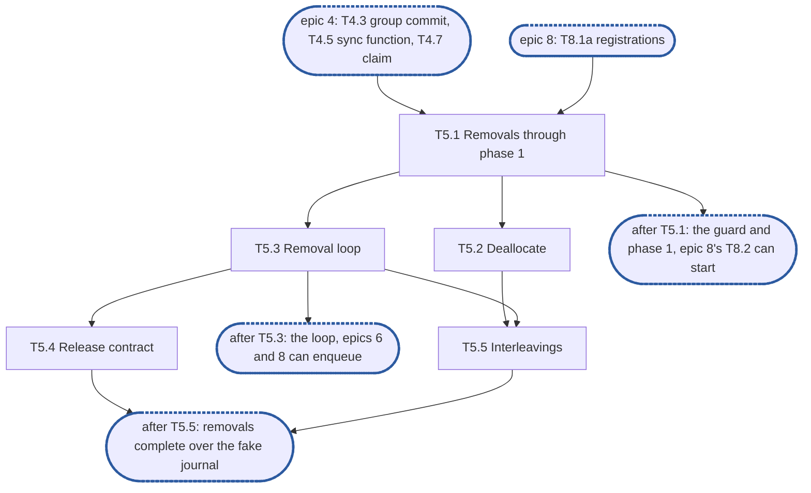

# Epic 5: engine v2 removals

**Sources:** [RFC 8](../rfcs/rfc-8-engine.md) §8 (a release is the journal's `Delete`, never
its `Release`), §8.1, §8.2, §2.5 step 3 (the abort a release reports), §6.4 (the guard, as
far as a removal holds it), §12.1 (`Truncate`, `Deallocate`, `Delete`), §13 (E6, E17, E40),
§14 (this epic's series, its span and `removal_stalled`) and §15's rows for those sections;
[RFC 1](../rfcs/rfc-1-journal.md) §3.6 and §3.10, for the journal's removals, `Settle` and
the marker; [RFC 6](../rfcs/rfc-6-block-metadata.md) §3.5 and §6.2, for phase 1, the masks
and phase 2; [RFC 7](../rfcs/rfc-7-namespace-metadata.md) §4.5 and
[RFC 14](../rfcs/rfc-14-open-state.md) §9.1, for the holder re-check and `Releasing`;
[RFC 17](../rfcs/rfc-17-vfs.md) §5.3, for the release's retry channel as the service waits
on it.
**Track:** B.
**Package paths:** `feat/storage-v2`'s, after #3645 renamed `enginev2` to `engine` and
`journalv2` to `journal`.
**Epic 5 estimate: 5 subtasks, 15.5 man-days.**
**Depends on:** sync point **S2, red suite in CI**: E1's surface (`Truncate`, `Deallocate`,
`Delete`, `Deps.Existence.Remove`, `Deps.Content.Resume` and `PruneRemovals`) and E2's fake
journal; epic 3, built: T3.1's per-file entries, whose pending-operation kinds for truncate
and deallocate T3.4 to T3.6 already replay; epic 4's T4.3 (the capture this epic's guard
makes skip a file, the superseded runs phase 1 passes, the in-batch mark phase 1 waits
out, and `dropShare`), T4.5 (the one sync
function phase 1 syncs through) and T4.7 (the claim phase 1 takes a file's pending writes
with, and the reservation counter), and T4.4 (the retrying-owner mark T5.3's loop sets); epic 8's T8.1a (admission and registrations), built, whose
registrations T5.1's entry-lock section checks; epic 8's T8.1b (the removal checks) lands
with T5.1. Neither `Delete`'s retry channel nor
`vfserr.ErrFileOpen` is on `feat/storage-v2` or #3609: T5.4 lands them, from the code on
`feat/enginev2-delete-retry`. Open state's `Releasing`, merged with the stage 1 follow-up,
for one test of T5.4, through E2's fixture.
**Blocks:** epic 6, whose start step 3 reuses T5.4's abort routine, whose step 4 hands
unfinished removals to T5.3's loop, and whose `Close` and `Drop` end the loop's retries with
`ErrUnavailable`; epic 7, whose self-fence watches the loop's transactions and whose `Stats`
exposes `removal_stalled` and this epic's counters; epic 8, whose clone takes the guard and
phase 1's order from T5.1, runs its phase 2 as a clone item of T5.3's loop, and builds the
`DelayClone` branch of T5.4's channel.

---

## 1. Goal

Epic 5 builds RFC 8 §8's removals: `Truncate`, `Deallocate` and `Delete` through §8.1's
guard, journal step, phase 1, `Settle` and post; §8.2's deallocate; the removal loop per
journal that runs phase 2 and the prune; and the release's contract with the service (§8.1,
RFC 17 §5.3). §3 numbers each obligation the RFC places on the epic and names the subtask
that meets it; this document gives the split, the order, the estimates and the tests, and
cites the RFC rather than restating it.

### 1.1 In scope

§3's requirements, through §6's subtasks; the `kvstore` changes they need (`Existence.Size`,
the truncate above the File record's size, `kvstore.Refused`, the holder read) and `Delete`'s
retry channel with `vfserr.ErrFileOpen`, landed from `feat/enginev2-delete-retry`.

### 1.2 Out of scope

- The cut gate a removal's phase 1 passes (`Deps.Gate`, RFC 12): the second part.
- A pass in flight under a removal (RFC 8 §8.3, E16), and the offload guard's other holder,
  the offer's capture: the second part. With no pass in flight, a prune's in-flight floor is
  the removal's own version.
- The shared work scheduler and its `offload.retry_min`/`retry_max`: the second part. This
  epic's loop is a FIFO with a fixed backoff (D5).
- A journal turned read-only that undoes a `Delete` (RFC 8 §8.1 step 1's exception, RFC 1
  §5.4): `journal` has no read-only state (§9, point 2).
- Rebuilding a removal from the journal's marker or the store's unfinished removals at
  start, and the abort found at start: epic 6, which reuses T5.3's loop and T5.4's routine.
- Testing `Close` and `Drop` ending a pending release with `ErrUnavailable`: built here
  (T5.3's join at `Close` and its part of `dropShare`), tested in epic 6's T6.8 and T6.9.
- A release into an extent a clone registered, and the `DelayClone` outcome of its channel:
  epic 8's T8.2, over this epic's channel. A clone's phase 2 items and its `Holds.Hold`
  retries: epic 8's T8.3, over this epic's loop.
- The service's `Releasing` mark and its `done(...)`: the filesystem service's (RFC 17 §5.3).

### 1.3 Names used here

- **E1**, epic 1, interfaces: `pkg/block/engine`'s exported surface, `Deps` and its
  interfaces, frozen at S1.
- **E2**, epic 2, red e2e suite and test foundations: `engine-conformance` with its
  `known.yaml`, the fixture over the real journal and `kvstore`, the fault-injecting
  `kv.KV`, the fake journal and the profiler wiring.
- **S1**, interfaces frozen and `Content` agreed with the filesystem service.
- **S2**, red suite in CI: E2's suite runs on every pull request, listed whole as known
  failures; epics 3, 4 and 6 start here.
- **S3**, engine complete over the fake journal: epics 3 to 8 done, every row whose journal
  call exists green.
- **E6, E16, E17, E19, E40**: RFC 8 §13's invariants of those numbers, not epics.
- **Phase 1, phase 2**: a removal's first metadata transaction, `Existence.Remove`, and its
  later batches, `Content.Resume` (RFC 8 §8.1, RFC 6 §6.2).
- **The integration epic**, epic 9: the filesystem service composed over the engine at
  RFC 17 §8's integration tier.

## 2. General rules for each epic

1. **Independent unit tests.** Each epic carries its own unit tests. It may use another
   epic's pure in-memory implementation, the implementation of an epic it depends on once
   that has landed, and E2's test components: above all the fake journal, which stands in
   for the journal wherever the logic under test is the engine's (the resolution table, the
   group commit's split, the refusal mapping). E1 declares no internal interface for it to
   fake (rule 12).
2. **Fuzz tests: none.** The engine parses no bytes of its own: it reads the journal's
   answers and the store's records through typed calls. RFC 8 §15 checks its pure parts,
   read resolution and the group commit's split, by its tables, not by fuzz, and says so in a
   `ponytail:` marker, so no fuzz target is built for them.
3. **Observability follows RFC 25, through what exists.** `Deps` carries a `*slog.Logger`
   narrowed with `With("component", "engine")` and a `Tracer`, a function type the engine
   declares over standard-library types only. RFC 25's metrics registry, watchdog and
   health source exist on neither branch, so the engine exposes its counters and
   conditions as `Stats` fields, and the root that composes it adapts them. Counters are
   named for RFC 8 §14's metrics, under the `engine_` prefix (RFC 25 §2.1), never
   `enginev2_`, with no share label on a per-operation series. Spans are RFC 8 §14's
   proposals, `engine.sync` and `engine.existence_commit`, and a removal batch opens a root
   span. Each epic names the counters, conditions and spans it owns; the units, labels and
   logging rules are RFC 25's, applied as written.
4. **Profiling.** Tests and benchmarks run under E2's profiling harness and fail on
   goroutine, descriptor or memory leaks and on anomalous resource growth. No
   allocations-per-op assertion: RFC 8 §15.4 defers its engine-cost benchmark until a
   profile shows engine time on the request path.
5. **Public interface and internals.** Tests cover both the internal package API and the
   public behaviour the epic enables, including concurrency under `-race`. Test at the
   layer that **consumes** a value (see `CLAUDE.md`, "Verifying a change"): a field the engine
   passes to the journal or the store is asserted where they read it, over the real journal
   and `kvstore`, not where the engine builds it.
6. **Known failures shrink.** An e2e test that turns green leaves the suite's `known.yaml`
   (`test/engine/known.yaml`) in the same change: `dt` fails the run if a listed test
   passes, so the change that turns it green removes it, a journal pull request included. A
   test over the real journal that starts red sits in that suite behind its build tag, never
   in `unit`, which keeps no known list.
7. **v2 ignores v1.** No import of, copy from, or behavioural dependence on v1, enforced by
   the engine's one import test, a walk over every package of `pkg/block/engine` with
   one allowlist, which also refuses `pkg/vfs`: no package imports `pkg/block/syncer`,
   `pkg/block/carver`, `pkg/block/remote` or the v1 metadata service `pkg/metadata`; v1's
   engine and journal are gone on `feat/storage-v2` since #3645. The walk checks every package on its own, so its
   allowlist names each package an exception applies to, test packages included. v1 is not
   touched: it is deleted at the cutover.
8. **Real dependencies for properties of those dependencies.** No fake stands in for a
   check about what the real thing does: the real journal on a real directory, with its crash
   seam, for durability, recovery and loss; the real `kvstore` for what a transaction
   commits and conflicts on. The fake journal is for the engine's pure logic only, and no
   conformance row runs over it.
9. **Code comment conventions** (`CLAUDE.md`, "Code comments"). A source comment describes
   the code's behaviour and references nothing outside it: no issue or pull request
   numbers, no CI, runner or OS names, no epic, subtask, plan or decision ids. A
   `ponytail:` marker records a knowingly simple implementation, naming its ceiling and the
   upgrade path. A `decision:` marker records deliberate behaviour, naming the rule, why it
   holds and the evidence that would overturn it. Where the RFC carries such a note, its
   marker goes at the code site that implements it: RFC 8's copy-on-write share table, the
   per-file state bound, the loss-sequence floor, the version-limit headroom and its burst,
   the lazy existence of appends, and the stable-overwrite cost.
10. **A test must be able to fail.** Keep a test only if a plausible change would make it
    fail and nothing else would catch that change: not the compiler, not the diff, not a
    later epic's tests. A review rule that no test can check, such as "stubs never panic",
    stays a review rule.
11. **A symbol is exported only if the RFC's interface uses it.** Everything exported is
    frozen at S1. Helpers the engine's own files need stay unexported or move to an
    `internal/` package of `engine`.
12. **Each subtask creates only what it declares.** No empty package and no stub without a
    caller. A package, an option or a test helper lands with its first consumer.


### 2.1 How the rules apply

| Rule | Subtasks | How |
| --- | --- | --- |
| 1 Unit tests | all | every subtask tests over E2's fake journal and the real `kvstore` on an in-memory `kv.KV`, through epic 3's unit composition; the wedge's unit test puts a failing `Content` wrapper in through `newUnit`'s options, since E2's fault-injecting `kv.KV` (T2.3) is not built |
| 2 Fuzz | none | no parser: the engine hands typed removals to the journal and the store |
| 3 Observability | T5.1, T5.3 | `engine_removals_pending` and `engine_removals_oldest_seconds`, per share under RFC 25 §2.5's worst-n rule, and `engine_removal_batches_total{result}` with `ok`, `conflict` or `error`, in unexported fields epic 7's `Stats` exposes; `removal_stalled` naming the file and the removal's kind, logged at `Warn` on entering and leaving; each batch a root span through `Deps.Tracer` (T5.3). A wait on a file's guard or its in-batch mark is a span event (T5.1) |
| 4 Profiling | all | the unit composition calls `prof.Watch`; the loop's goroutine per journal is joined at `Close`, and a pending release's channel is buffered by one, so no sender is left blocked on it |
| 5 Public and internal | all | the loop's stall count tested internally (T5.3); the removals through `*Engine`; `-race` in T5.1, T5.4 and T5.5. What phase 1 writes (the size, the merged hole, the removal record) is asserted over the real `kvstore` |
| 6 Known failures | T5.1, T5.2, T5.3, T5.5 | their rows over the real journal, §8.1 terminal failure (T5.1, T5.3), §8.2 deallocate (T5.2), §8.1 removal wedge and §8.1 phase 1 past the journal step (T5.3), and §5.1 sync before existence's truncate half with the truncate-up crash (T5.5), enter `test/engine/known.yaml` naming this epic's issue, red until the journal's `Truncate`, `Deallocate`, `Delete`, `Settle` and crash seam exist |
| 7 v2 ignores v1 | none | no new import: T5.4's test over the real open-state table runs through E2's fixture, which composes it |
| 8 Real dependencies | T5.1–T5.5 | every conformance row runs over the real journal and `kvstore`; the fake journal is for the unit tests, the interleavings and the hooks, none of which stands in for a row |
| 9 Comments | all | the markers of §4 at their code sites, the removal loop's `ponytail:` among them |
| 10 Tests can fail | all | each test below names the change it catches |
| 11 Exports | T5.1, T5.4 | `Deps.Existence` gains `Size` (D4), and `Delete`'s frozen signature becomes `(retry <-chan error, err error)` with `vfserr.ErrFileOpen` beside it (T5.4), the two changes to E1's surface (§9, point 1, for `Size`); the hooks live in `export_test.go` |
| 12 Creates only what it declares | all | the guard lands in T5.1 with its first holder; the loop lands in T5.3 with its first item, phase 2; the channel's `DelayClone` branch lands with epic 8, its consumer |

## 3. Requirements and invariants

Every MUST and MUST NOT that RFC 8 and the journal and metadata RFCs place on this epic,
numbered so that subtasks and tests can cite them. Each row names the obligation and cites
where the RFC states it: the RFC's text is the requirement, so read it there. Numbers are
stable: a row added later takes the next free number in its group's table, and a withdrawn
one keeps its row.

**The removal and its guard**

| # | Requirement | Kind | Source | Subtasks |
| --- | --- | --- | --- | --- |
| R1 | A file's release is the engine's `Delete`, which calls the journal's `Delete`, never its `Release` | invariant | RFC 8 §8 | T5.4 |
| R2 | A removal holds the file's guard across its journal step and its phase 1, and returns once phase 1 commits, or first with a pending release's channel or `ErrDelay`, the guard kept until the retry commits or ends | MUST | §8.1 first rule, §6.4, E6 | T5.1 |
| R3 | The group commit's capture never waits on a removal's journal call; correctness rests on the store's conflicts and the group commit's stop, never on the guard | invariant | E17, §5.2 | T5.1 |
| R4 | Phase 1 commits with it the file's pending existence below *v*, the file synced first, and calls `Done` for every write it records; a write staged above *v* stays pending | MUST | §8.1 second rule, §5.1, E19, RFC 6 §3.4 | T5.1 |
| R5 | The journal step assigns the removal its version *v*; phase 1 records the existence change and `Removal(file, v)` in one transaction, writing no ref and dropping none | MUST | §8.1 steps 2–3, RFC 6 §6.2 | T5.1 |
| R6 | Once phase 1 commits: the guard released, `Settle(id, v)`, the post, in that order; a crash before `Settle` leaves the marker for recovery | MUST | §8.1 step 4, RFC 1 §3.10 | T5.1 |
| R7 | A read between a truncate's journal step and its pending operation never finds the extent **Lost** | invariant | §7.1, RFC 1 §3.6 | T5.1, T5.5 |
| R8 | A removal and a clone's registration of its extent are ordered as §6.4 and §9.1 give: the removal checks the registrations and marks itself in flight in one entry-lock section, the mark lasting until phase 1 ends | invariant | §6.4, §9.1, E6 | T5.1 |
| R9 | A truncate to at or above the file's replayed size is a pending grow: the journal assigns its version, the group commit commits it, and it has no phase 1 | invariant | §8, RFC 1 §3.6, RFC 6 §6.2 | T5.1 |
| R10 | A file's existence commits are serialised: phase 1 waits out a batch in flight on its file | invariant | §5.1 step 5, RFC 6 §3.4 | T5.1 |
| R28 | Once its journal step is done, a removal fails only terminally: a truncate or deallocate whose phase 1 its call cannot commit answers `ErrDelay` and its phase 1 is retried with the guard held | MUST | §8.1 "Once its journal step is done, a removal does not fail" | T5.1, T5.3 |
| R29 | A terminal failure leaves the removal's own operation out, commits the file's other pending existence first, a loss's included, then releases the guard and settles the marker without the removal; a failure of that commit is retried with the guard held and the marker unsettled | MUST | §8.1, RFC 1 §3.10 | T5.1, T5.3 |
| R30 | `Close`'s last group commit leaves out a file whose phase-1 retry was cancelled, its pending operations left for recovery | MUST | §2.5 stop step 2 | T5.3 |
| R33 | Phase 1 passes each write it commits with the runs where it overlaps an earlier pending write of the file, computed from the pending writes the engine holds, never asked of the journal (the group commit's half is epic 4's R48) | MUST | §5.1 "A commit carries supersession within itself", §8.1 | T5.1 |

**Deallocate**

| # | Requirement | Kind | Source | Subtasks |
| --- | --- | --- | --- | --- |
| R11 | A deallocate's phase 1 writes the extent's merged hole at *v*, under the merged hole's start key | MUST | §8.2, §8.1 step 3 | T5.2 |
| R12 | A deallocate never stages zeros through the write path | MUST NOT | §8.2 | T5.2 |
| R13 | §8.2 deallocate | test row | §15.1 | T5.2 |

**Phase 2 and the loop**

| # | Requirement | Kind | Source | Subtasks |
| --- | --- | --- | --- | --- |
| R14 | The refs a removal drops are dropped later, in batches within `K` from its cursor, by version; until then the removal masks them from every read | MUST | §8.1 third rule, step 5, E40 | T5.3 |
| R15 | A done removal is pruned by the file's primary once at or below the in-flight floor, its own version with no pass in flight | MUST | §8.1, RFC 6 §6.2 | T5.3 |
| R16 | A failed phase-2 batch or prune is retried, backed off, while the node serves the shard; five consecutive failures raise `removal_stalled` naming the file and the removal's kind, cleared by its next batch that commits | MUST | §8.1 | T5.3 (the scheduler's backoff: §9, point 3) |
| R17 | A removal that keeps failing wedges no other | invariant | §8.1, §15.2 | T5.3 |
| R18 | §8.1 removal wedge (adapted: batches that keep failing raise `removal_stalled` and wedge no other file; the undecodable ref is the second part's) | test row | §15.2 | T5.3 |
| R31 | §8.1 phase 1 past the journal step, which also tests epic 4's R41 and R42 | test row | §15.2 | T5.3 |
| R32 | §8.1 terminal failure (the restart's start step 3 is epic 6's) | test row | §15.2 | T5.1, T5.3 |

**The release**

| # | Requirement | Kind | Source | Subtasks |
| --- | --- | --- | --- | --- |
| R19 | A release reads and writes no open state in the engine | invariant | §8.1 step 1 | T5.4 |
| R20 | A release's phase 1 re-checks the file's holders and aborts if one has arrived, handled as §2.5 step 3 gives | MUST | §8.1 step 3, §2.5 step 3 | T5.4 |
| R21 | A release whose phase 1 has not committed at the call's deadline, its journal `Delete` done, is pending, not failed: `Delete` answers a retry channel and retries phase 1 with no goroutine of its own | MUST | §8.1 | T5.4 |
| R22 | The channel yields the outcome once: nil, `ErrFileOpen`, `ErrDelay` (`DelayClone`, epic 8's T8.2) or `ErrUnavailable` | MUST | §8.1, RFC 17 §5.3 | T5.4 |
| R23 | A pending release that keeps failing raises `removal_stalled` after five failures; its commit or abort clears it | MUST | §8.1 | T5.4 |
| R24 | A pending release runs step 4 once its retried phase 1 commits | MUST | §8.1 step 4 | T5.4 |
| R25 | `ErrFileOpen` passes only between the engine and the service: `vfs.Errors()` omits it | invariant | RFC 17 §4.3, RFC 20 §7.3 | T5.4 |

**Interleavings**

| # | Requirement | Kind | Source | Subtasks |
| --- | --- | --- | --- | --- |
| R26 | §5.1 sync before existence, the truncate half, with a truncate up crashed before its group commit | test row | §15.1 | T5.5 |
| R27 | Removals interleaved with writes and group commits leave the file reading what the version order says | invariant | §8.1, RFC 6 §3.4 | T5.5 |

## 4. Decisions this epic takes

Only what the RFC leaves to the code. Ids are stable; a missing number became a citation.

- **D1, the guard** (RFC 8 §6.4, E17). One atomic flag in the file's entry, set under the
  entry's lock before the journal step and cleared under it after phase 1, with waiters on
  the entry's condition; a second removal of the file waits under its own context. The
  group commit's capture reads the flag without the entry's lock and skips a guarded file,
  so it never waits behind D2's lock. An entry holding the guard stays alive (epic 3's
  bound). A wait on it is a span event. A `decision:` marker at the skip.
- **D2, the truncate's lock.** The entry's lock is held across the journal's `Truncate` and
  the insert of its pending operation, unlike a write (epic 3's D3), so a `ReadAt` between
  them cannot find the extent gone with no pending truncate; `Deallocate` the same. A
  `decision:` marker, withdrawn if the journal can hand back the removal's version before it
  stops holding the extent. Before the grow-or-removal decision and the journal call, the
  same lock waits out writes already admitted (epic 8's T8.1a builds the count; the removal
  waits on its condition with the context's `AfterFunc`). `commitThrough` (epic 4's D10) on a
  guarded file waits for the guard's release, then finds its target covered and wakes no
  group commit, so a `Commit` never spins on batches that skip the file.
- **D3, the in-flight mark.** The entry-lock section that takes the guard also checks the
  file's registrations (epic 8's T8.1b) and marks the removal in flight in the entry; the
  mark is cleared when phase 1 commits or fails, or, for a pending release, when its retried
  phase 1 commits or ends. A clone registering the extent waits on it under its own context.
  How a truncate or deallocate meeting a registration answers is epic 8's (its §9, point 1);
  a `Delete` into one is answered pending by T8.2. A `decision:` marker at the section says
  why both share it: a removal that checked before a clone registered could still drop the
  clone's source bytes.
- **D4, truncate up.** The engine keeps no committed size, so `Truncate` reads it with one
  store read, `Existence.Size`, added to `kvstore` and `Deps.Existence`, and replays the
  entry's pending operations over it. The journal's `Truncate` always runs and assigns the
  version; at or above the replayed size the entry records `kvstore.OpGrow`, below it the
  call is a removal. A `decision:` marker: a grow needs no phase 1 (§9, point 1).
- **D5, the loop.** One goroutine per journal, a FIFO of items (phase 2, prune, pending
  release, epic 8's clone items), each failure retried after a fixed 1 s. An item answers
  done, retry (counted toward the five) or retry-uncounted, the last for epic 8's
  `Holds.Hold` answered `DelayFrozen` or `ErrStopped`. The marker, at the loop:
  ```go
  // ponytail: removal phase 2 and its prune run from one loop per journal, a
  // FIFO with a fixed backoff, not the shared work scheduler. Replace it with
  // the scheduler's removal source when offload adds the first work that needs
  // fairness between shares.
  ```
- **D6, the abort.** `kvstore` answers a release a holder still holds `kvstore.ErrHeld`; the
  engine answers `vfserr.ErrFileOpen`, which T5.4 adds; a `decision:` marker at the mapping.
  One function settles the abort without its removal, logs the loss at `Error` naming the
  file and calls `Done` for the dropped writes, those below *v* only; epic 6's start step 3
  reuses it. `kvstore` reads the holders before `Remove` commits (RFC 8 §8.1 step 3), with a
  `decision:` marker at `kvstore` naming the window to `releasePhase1`'s own check.
- **D7, the pending release's hand-off** (RFC 8 §8.1). `Delete` runs phase 1 within the
  caller's context; once the journal's `Delete` has returned, a phase 1 cut off by the
  context or answering a retry-later store error goes to the loop and the call returns its
  channel, buffered by one. Before the journal's `Delete`, the context's end is a refusal
  that changed nothing. A `decision:` marker at the hand-off.
- **D8, what phase 1 claims.** Only the pending operations below *v*, through epic 4's claim;
  one staged between the journal step and phase 1 stays unclaimed. `kvstore`'s `Remove`
  skips a removal at or below `applied`, so claiming above *v* would lose the removal. Once
  phase 1 commits, the claimed operations and the removal's own leave the entry. A
  `decision:` marker at the claim.
- **D9, a phase 1 that fails after the journal step** is RFC 8 §8.1's "Once its journal step
  is done, a removal does not fail"; the retry is a loop item (D5) that keeps the guard.
- **D10, terminal failures** (RFC 8 §8.1): `ErrStale` and `kvstore.Refused` end phase 1, in
  the call or in the loop. The loop ending or the share dropped ends a retried phase 1 too;
  at `Close`, as RFC 8 §2.5's stop step 2 gives.

## 5. Target tree

```text
pkg/block/engine/
  remove.go         T5.1  the guard, the in-flight mark, Truncate, the shared phase 1 (D1–D4, D8–D10)
                    T5.2  Deallocate
                    T5.4  Delete, the retry channel, the abort routine (D6, D7)
  removals.go       T5.3  the removal loop per journal, its backoff, removal_stalled, its part of dropShare (D5)
  file.go           T5.1  the entry's guard and in-flight mark
  groupcommit.go    T5.1  the capture's skip of a guarded file, commitThrough's wait for its release
  deps.go           T5.1  Existence.Size
  unbuilt.go        T5.1, T5.2, T5.4  each built method leaves it
  export_test.go    T5.1–T5.5  hooks inside the journal's removals and between them and phase 1
  conformance/
    rfc8_removal_test.go  T5.1, T5.2, T5.3, T5.5  the rows of rule 6
pkg/vfs/vfserr/
  vfserr.go         T5.4  ErrFileOpen
pkg/vfs/
  errors.go         T5.4  Errors() omits ErrFileOpen
pkg/metadata/kvstore/
  existence.go      T5.1  Existence.Size (D4)
  removal.go        T5.1  a truncate above the size as a hole (RFC 6 §6.2), Refused
                    T5.4  the holders read before Remove commits (D6)
test/engine/known.yaml  T5.1, T5.2, T5.3, T5.5  their entries
```


## 6. Subtasks

Each subtask's acceptance: the requirements it covers hold, the named rows pass, and each
listed test fails on the regression it names (after "catches").

### T5.1 The removals through phase 1

**Subtask T5.1 estimate: 4.25 man-days.**

- **Track:** B. **Depends on:** epic 4's T4.3, T4.5 and T4.7; epic 8's T8.1a; epic 6's T6.7
  (`issued`); T8.1b lands with it.
- **Covers:** R2–R10, R28, R29, R32 (the call's half), R33.
  RFC 8 §8.1's first two rules, steps 2–4, "Once its journal step is done, a
  removal does not fail" and its terminal failure, for `Truncate`; §5.1's "A commit carries
  supersession within itself" for phase 1; truncate up (§8); E6,
  E17, E19.
- **Deliverables:** in `remove.go` and `file.go`, the guard (D1) and the in-flight mark's
  entry-lock section (D3), in which T8.1b puts the registration check; `Truncate`, up and
  down (D2, D4); the phase 1 the three removals share: the guard, epic 4's `waitBatch`, D8's
  claim, the sync through epic 4's sync function, `Existence.Remove` with each claimed write's
  superseded runs from epic 4's T4.3 computation, `Done` for each claimed
  write once it commits, the claim released on failure; then, under the entry's lock and
  before the guard is released, the claimed operations and the removal's own removed from
  the entry; then the guard released, `Settle(id, v)` and the post to the loop. A phase 1
  failing after the journal step handed to the loop (D9), a terminal failure ending it
  (D10), the file's other pending existence committed first as RFC 8 §8.1 gives. In
  `groupcommit.go`, the capture's skip and `commitThrough`'s wait (D1, D2). The wait
  on T8.1a's admitted-write count (D2). `Existence.Size` in `kvstore` and `Deps` (D4);
  `kvstore`'s truncate above the File record's size (RFC 6 §6.2) and `kvstore.Refused`. The
  version the journal step returns is passed to epic 6's `issued`, as `Write` and `Draw` do
  (RFC 8 §2.7). The fake journal draws the versions of `Truncate`, `Deallocate`, `Delete`
  and `CloneTarget` from the same counter T6.7 bounds, so these tests run with T6.7's test
  block.
- **Rows:** §8.1 terminal failure, the call's half, over the real journal, `kvstore` and E2's
  fault-injecting `kv.KV` (T2.3); red until the journal's `Truncate` and `Settle` exist.
  `TestATerminalRemovalCommitsTheExistenceBelowItBeforeItsSettle` and
  `TestATerminalRemovalCommitsALossBelowItBeforeItsSettle` stay unit tests over the fake,
  carrying the row's engine assertions.
- **Tests,** over the fake and the real `kvstore`: a truncate's phase 1 writes the size and
  the removal record, then one `Settle` at *v* after the guard's release (catches a settle
  before the commit, or the guard held across it); the reservation counter at zero after a
  truncate over pending writes (catches phase 1 without `Done`); a hook between the journal's
  `Truncate` and phase 1 stages a write at *v*+1: the size is the truncate's grown by the
  write, never the pre-truncate size (catches a claim above *v*, D8); a hook inside the fake
  journal's `Truncate` blocks it while a group commit runs: the other files commit and the
  guarded one is skipped (catches a capture that takes the entry's lock); a batch held
  between its capture and its `Existence.Commit` on the file: phase 1 starts only after it
  returns, and the captured writes are committed (catches a phase 1 that overtakes the
  batch); a hook between the journal's `Truncate` and phase 1 registering a clone over the
  extent: the registration returns only after phase 1 (catches the mark released early); a
  truncate up makes no `Existence.Remove` call and its grow commits through the group commit
  (catches a grow taken for a removal); a group commit triggered just after the guard's
  release captures neither the truncate's own operation nor the writes phase 1 committed
  (catches them removed after the release, which hands `kvstore` a truncate down it
  refuses); a hook between a write's `WriteAt` and its insert while a truncate comes in: the
  journal call starts only after the insert, phase 1 claims the write and its `Done` runs
  once (catches a removal that does not wait out admitted writes); a `Commit` over a pending
  overwrite on a file whose phase 1 a hook holds, the clock pinned so `existence_age` never
  re-queues the file, answers after phase 1 commits, the group commit skipping the file at
  most once (catches a `Commit` that spins); over the real `kvstore`, a write and an
  overwrite of part of it, both pending below a truncate that keeps them, leave an overwrite
  record over the overlapped runs after phase 1 (catches phase 1 passing its claimed writes
  without their superseded runs);
  `TestATerminalRemovalCommitsTheExistenceBelowItBeforeItsSettle` and
  `TestATerminalRemovalCommitsALossBelowItBeforeItsSettle` (catch a settle before the
  existence below it commits, a loss's included); over the fake, with the test block of 16,
  a `Truncate` whose version is past the trigger and no other call issuing a version: the
  raise runs and the journal gets the new limit (catches a truncate that does not call
  `issued`).

### T5.2 `Deallocate`

**Subtask T5.2 estimate: 1 man-days.**

- **Track:** B. **Depends on:** T5.1; epic 6's T6.7 (`issued`).
- **Covers:** R11–R13. RFC 8 §8.2, and §8.1 step 3's merged hole.
- **Deliverables:** `Deallocate` over T5.1's phase 1 with `kvstore.RemoveDeallocate`, the
  entry's lock held across the journal's `Deallocate` and the insert, under D2's marker. The
  version the journal step returns is passed to epic 6's `issued`, as `Write` and `Draw` do
  (RFC 8 §2.7).
- **Rows:** §8.2 deallocate, over the real journal; red until the journal's `Deallocate`
  exists.
- **Tests:** over the real `kvstore`, the merged hole present after phase 1 with phase 2 held
  by the loop's hook (catches a hole left to phase 2); a write into the extent between the
  phases reads back, not zeros (the same bug through its consumer); over the fake, no
  `WriteAt` during a deallocate (catches zeros staged); over the fake, with the test block
  of 16, a `Deallocate` whose version is past the trigger and no other call issuing a
  version: the raise runs and the journal gets the new limit (catches a deallocate that does
  not call `issued`).

### T5.3 The removal loop

**Subtask T5.3 estimate: 3 man-days.**

- **Track:** B. **Depends on:** T5.1; epic 4's T4.4 (the retrying-owner mark).
- **Covers:** R14–R18, R28 and R29 (their retries), R30, R31, R32 (the retry's half).
  RFC 8 §8.1 step 5, the prune, the retry and `removal_stalled`, a terminal
  failure's existence commit retried; §2.5's stop step 2; E40.
- **Deliverables:** `removals.go`: the loop per journal (D5), joined at `Close`, which ends
  its pending releases' channels with `ErrUnavailable` and leaves a cancelled phase-1 retry's
  file for recovery (RFC 8 §2.5 stop step 2); phase 2 through `Content.Resume`, the
  prune through `PruneRemovals(…, v)`; the stall count per loop item and `removal_stalled`;
  the three answers; `enqueue`, for epic 6's start step 4 and epic 8's clone items; the
  loop's part of epic 4's `dropShare(s)`, ending the share's items with their channels
  yielding `ErrUnavailable`, tested in epic 6's T6.9; the series of §2.1 and each batch's
  root span; every store call the loop retries made under epic 4's retrying-owner mark
  (T4.4), which epic 7's self-fence reads (its D7).
- **Rows:** §8.1 removal wedge (adapted), over the real journal and E2's fault-injecting
  `kv.KV` (T2.3); red until the journal's `Truncate` and `Settle` exist. §8.1 phase 1 past
  the journal step and §8.1 terminal failure, the retry's half, over the same, red until
  the same calls exist. `TestAGroupCommitStopsAtARetriedRemoval`, the guard's skip turned
  off, and `TestATerminalRemovalsFailedCommitIsRetried` stay unit tests over the fake,
  carrying the rows' engine assertions.
- **Tests,** over the fake's clock: five failures raise the condition and four do not
  (catches an off-by-one, or a count across files); a retry-uncounted answer leaves the
  count (catches epic 8's hold retries counted); a `Content` wrapper through `newUnit`'s
  options failing one file's batches: the other file's removal completes and the stalled one
  finishes once the fault clears (catches a loop that waits on a failing item). Over the real
  `kvstore`: no ref under the removal's mask after the loop, the record pruned (catches a
  prune skipped). `TestAGroupCommitStopsAtARetriedRemoval` (catches a capture past a
  retried removal, epic 4's T4.3); `TestALoopEndingLeavesARetriedPhase1ForRecovery`
  (catches the last group commit taking a cancelled retry's file);
  `TestATerminalRemovalsFailedCommitIsRetried` (catches a settle before the retried commit,
  or the guard released across it).

### T5.4 A release's contract with the service

**Subtask T5.4 estimate: 4.5 man-days.**

- **Track:** B. **Depends on:** T5.1, T5.3; epic 6's T6.7 (`issued`).
- **Covers:** R1, R19–R25.
  RFC 8 §8, §8.1 step 1, step 3's re-check and abort, the pending release and
  its channel, step 4 after a retry; §2.5 step 3's abort; RFC 17 §4.3, §5.3; RFC 20 §7.3.
- **Deliverables:** from `feat/enginev2-delete-retry`: E1's `Delete` signature
  `(retry <-chan error, err error)`, `vfserr.ErrFileOpen` and `vfs.Errors()` omitting it, and
  `internal/vfs`'s wait on the channel. In `remove.go`, `Delete`: the guard, the journal's
  `Delete`, phase 1 with `RemoveRelease`; the abort's mapping and routine (D6); the hand-off
  (D7), the channel yielding nil, `ErrFileOpen` or `ErrUnavailable`; the guard and the mark
  kept across the retries; step 4 once the retried phase 1 commits; `removal_stalled` after
  five failed retries, cleared by the commit or the abort; `kvstore`'s holder read (D6). The
  `DelayClone` branch is epic 8's; `Close`'s and `Drop`'s `ErrUnavailable` are tested in
  epic 6. The version the journal step returns is passed to epic 6's `issued`, as `Write`
  and `Draw` do (RFC 8 §2.7).
- **Rows:** none of its own.
- **Tests,** over the fake: `Delete` never calls the journal's `Release` (catches the
  eviction call); a store stalled past the deadline, then cleared: the channel yields nil
  once and the marker is settled (catches a pending release answered as failed); a stall
  ended by an abort yields `ErrFileOpen` (catches the catch-all mapping it to
  `ErrUnavailable`); five failed retries raise `removal_stalled` and the abort clears it;
  `vfs.Errors()` omits `ErrFileOpen` while listing every other `vfserr` value (catches it
  added to the adapters' table). Over E2's fixture with the real open-state table and
  `kvstore`: an open by handle racing the last close's release loses no bytes, and an
  aborted phase 1 leaves the file openable, its loss logged and the reservation counter at
  zero (catches an abort that drops the pending writes it should keep, or keeps the file
  marked); over the fake, with the test block of 16, a `Delete` whose version is past the
  trigger and no other call issuing a version: the raise runs and the journal gets the new
  limit (catches a delete that does not call `issued`).

### T5.5 Removals interleaved with writes and commits

**Subtask T5.5 estimate: 2.75 man-days.**

- **Track:** B. **Depends on:** T5.2, T5.3.
- **Covers:** R7, R26, R27.
  RFC 8 §7.1 over a truncate in flight (D2), RFC 6 §3.4's version order, §5.1's
  sync before existence for a truncate.
- **Deliverables:** tests only, and the fake journal's hooks they need in `export_test.go`.
- **Rows:** §5.1 sync before existence, the truncate half, and a truncate up crashed before
  its group commit, whose size the restart serves; over the real journal and its crash
  seam, red until it exists; the restart is epic 6's, which the row composes.
- **Tests:** a hook in the fake journal between its `Truncate` or `Deallocate` and the call's
  return starts a `ReadAt` of the removed extent on another goroutine and waits until it has
  returned or is blocked on the entry's lock (a lock-wait hook): the read finds the pending
  removal, never **Lost** (catches the lock released before the insert, every run); a
  randomised interleaving of writes, truncates, deallocates and group commits under `-race`
  against a model of the version order (catches a removal applied out of order); the crash
  row's truncate up (catches a grow with no journal step, which recovery cannot replay).

## 7. Order of work



T5.1 is the riskiest, for the entry-lock section shared with the clone's registration and
the wait on a batch in flight, and starts as soon as epic 4's T4.3, T4.5 and T4.7 land.
Checkpoint after T5.1: epic 8's T8.2 can take the guard. Checkpoint after T5.3: epic 6's
start step 4 and epic 8's phase 2 can enqueue.

## 8. Suggested pull requests

| PR | Subtasks | Man-days | After | Why together |
| --- | --- | --- | --- | --- |
| 1 | T5.1, T5.2, epic 8's T8.1b | 5.25 (+1, epic 8's T8.1b, counted there) | epic 4's PR 2 and PR 3; epic 8's PR 1 (T8.1a) | the three removals' phase 1 with the guard and the mark, and the registration check T8.1b builds in T5.1's entry-lock section |
| 2 | T5.3, T5.4 | 7.5 | PR 1 | the loop and the release that retries from it |
| 3 | T5.5 | 2.75 | PR 2 | the interleavings and the crashes, once every removal exists |

A suggestion only: one pull request per subtask works as well.


## 9. Open points

RFC gaps go to the RFC, not here; each is listed until its RFC change merges.

1. **RFC gap: truncate up reads the committed size** (D4): one store read per truncate and a
   method added to E1's frozen `Deps.Existence`, which the filesystem service could spare by
   passing the size it holds. RFC 8 §12.1's `Truncate` takes only the new size; RFC 8 or RFC
   17 §5.5 should say which. No RFC change yet.
2. **Journal blocker: no read-only state**, so RFC 8 §8.1 step 1's exception (a release
   failing before phase 1, its `ErrUnavailable`, the mark kept until the process ends) is
   untested here.
3. **Second-part blocker: the loop's backoff** (D5) is not RFC 8 §8.1's scheduler backoff
   between `offload.retry_min` and `retry_max`; the second part's scheduler brings it.
