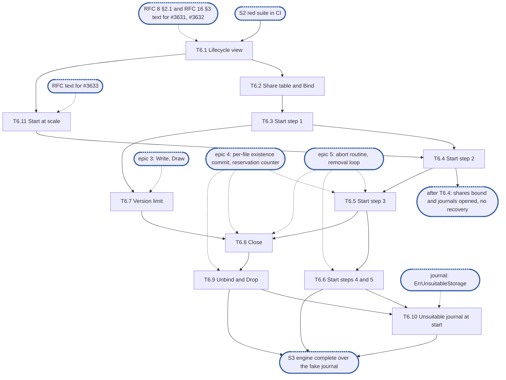

# Epic 6: engine v2 start, bindings and recovery

**Sources:** [RFC 8](../rfcs/rfc-8-engine.md) §1.1 (the share table's `decision:`), §2.1
(the `Lifecycle` row), §2.3 (bindings, `Bind`, `Unbind`, `Drop`), §2.4 (a binding's
settings), §2.5 (start steps 1 to 5 and 8, the retried open of a journal refused as
unsuitable, `Bind`'s attach, stop steps 1 to 5), §2.7, §12.1 (`Start`, `Close`, `Bind`,
`Unbind`, `Drop`, and a content call naming an unbound or removed share),
§13 (E13, E15, E19, E29, E40) and §15's rows for those sections; [RFC 16](../rfcs/rfc-16-metadata-store.md) §3
(`Lifecycle`), §2.3.2 (the removal's steps 3 and 4) and §4.2 (`J‖journal`, `S‖id‖vl`,
`S‖id‖rr`); [RFC 1](../rfcs/rfc-1-journal.md) §3 (`Open`, `Share`, `Forget`, `Strand`,
`Stats`), §3.7, §3.10 and §4.3, for the journal calls; [RFC 28](../rfcs/rfc-28-journal-format.md)
§3.1 and §3.4, for the floor and `expect`; [RFC 14](../rfcs/rfc-14-open-state.md) §4.4, for
what a raised incarnation does to the grace instance.
**Track:** C.
**Epic 6 estimate: 11 subtasks, 39.75 man-days.**
**Depends on:** sync point **S2, red suite in CI**: E1's surface (`Engine`, `Deps`,
`Journal`, `Handle`, `Lifecycle`, `Share`, `ShareState`, `Stats`) and E2's fixture and fake
journal. T6.1 also needs the RFC 8 §2.1 and RFC 16 §3 text that settles #3631 and #3632, and
the source of a share's journal (§9 point 14), since it changes E1's frozen `Lifecycle`.
T6.2 extends the share table epic 3's T3.1 declares, already on epic 3's branch. T6.4 needs
E2's fault-injecting `kv.KV` (T2.3), which is not built yet, to fail a start transaction.
T6.7 needs epic 3's `Write` and `Draw` (T3.2, T3.3), where a version is issued, and the same
`kv.KV` to block the raise. T6.5 needs epic 4's per-file existence commit (T4.3) and epic
5's abort routine (T5.4); T6.6 and T6.8 epic 5's removal loop (T5.3); T6.9 epic 4's due set
(T4.3) and reservation counter (T4.7), and T6.8. T6.10 needs T6.9 and `journal` to declare
`ErrUnsuitableStorage` (RFC 1 §3). #3608 and #3609 put the share on every content call and
give a pending release its retry channel. Epic 8's T8.6 builds a rebuilt clone's `Served`
wait under a context that `Close` cancels and `Unbind` waits out (its D11).
**Blocks:** epic 7, whose refusal table answers the version-limit row with T6.7's raise
and whose self-fence counts the commits of a bound share; epic 8, whose clone is rebuilt
from T6.5's clone markers and T6.6's unfinished removals and joined by T6.8 and T6.9;
epic 3's cross-share row (its R5), which needs `Bind` for a second share; the
integration epic, which cannot run the filesystem over an engine that does not start.

---

## 1. Goal

Epic 6 gives the engine its life. `Start` opens each device's journal with the floor and
identity the store records, refuses by name the shares of a journal that is missing or
foreign, raises every shard's incarnation in transactions of at most `K` keys, re-applies from the journal
every existence a crash left uncommitted before any file is served, resumes the unfinished
removals and strands the tags no share claims. `Bind` attaches a share above its floor;
`Unbind` and `Drop` end a removed share's work and its tag. The version limit is written
before any version is issued and raised before it is reached. `Close` stops in reverse and
never closes a component under a live loop.

**At the end of the epic:**

- after a crash, every write that was acknowledged and synced reads back, with the size and
  `mtime` it had, and every removal the crash cut off is applied, before the file is served;
- no version a client saw is issued again after a crash, and a share attached later never
  gets a version below one its files already hold;
- a journal found missing or foreign refuses its shares by name and is never opened as new;
- the share table is read on the request path without a lock;
- a removed share's tag is forgotten and nothing of it runs against a closed handle;
- `Close` leaves no goroutine and closes nothing a running loop still uses.

### 1.1 In scope

The store's `Lifecycle` view in `kvstore`; the copy-on-write share table and the bindings'
states; `Bind` (attach above the floor, a state change); `Start`'s steps 1 to 5 and 8 over
the journal and the store alone; the retried open of a journal refused as unsuitable and its
late attach; the version limit at start, at attach and while serving; `Close`'s steps 1 to 5
with the removal loop standing for the work scheduler; `Unbind` and `Drop`; the conformance
rows of RFC 8 §15 for §2.3, §2.5 and §2.7 that this part can pass.

### 1.2 Out of scope

- Start step 6 (the work queue) and step 7 (the scheduler's dispatch, the age tick, the
  rescan, eviction and the reseed), stop step 2's scheduler and step 3's offload loops, and
  the re-offer after a restart: RFC 8's second part, with offload. Here stop step 2 stops
  epic 5's removal loop and epic 8's clone batches.
- The syncer flow a binding opens at `Bind` and closes at `Drop` and `Close`, the key scope,
  the budgets beyond the journal's per-share limit, and `Bind`'s backend change: the second
  part.
- `keepHolds` (a removal that keeps snapshots offloads what its hold marks cover): RFC 12,
  out. `Unbind` refuses it.
- The asynchronous copy `Unbind` cancels (RFC 14 §2.7): RFC 14's, not built in this part.
- The operator's acknowledgement of a lost journal device, which re-initialises it: the
  second part. Here the shares stay refused, and a test re-initialises the directory and
  calls `RecordJournal`, which rewrites the shards' primary journal identity (D10), as the
  operator's step would. The loss sequence of 1 that RFC 8 §5.1 gives each file at a start
  past an acknowledged loss goes with that step (§9 point 14).
- The salvage export of a stranded tag and its `Forget` while serving (`salvage.path`): the
  second part. Here a stranded tag stays stranded until the next start.
- A read-only journal reopened in place (RFC 8 §2.5, E42): it needs RFC 1 §5.4's read-only
  state, spares and probe, which `journal` does not have. No epic of this part owns it
  (§9 point 8).
- `Bind` with `State: Closing` (a re-home's finish, RFC 27) and `Fenced` (RFC 8 §11.2's
  copied-image row): out, and epic 7 for the self-fence, which is not a share state.
- The chunking settings `Apply` records and reports as a migration (RFC 8 §2.4): the
  carver's, in the second part. `Apply` itself is E1's.
- The clone rebuild itself, from a marker or a `Removal` record: epic 8 (T8.6). This epic
  hands it the markers and records and serves no file before its turn.
- **(cluster)** paragraphs: a new primary settling before serving, a primary draining a
  shard it loses, per-(shard, tag) forget records, replicated journals.
- Imports (RFC 26's recovery import, RFC 27's move back): `Bind`'s strand of the journal's
  unclaimed tags before an imported share is served (RFC 8 §2.5, RFC 1 §3): out, with RFC 26
  and RFC 27. No share this part binds is imported.

### 1.3 Names used here

- **E1**, epic 1, interfaces: `pkg/block/engine`'s exported surface, `Deps` and its
  interfaces, frozen at S1.
- **E2**, epic 2, red e2e suite and test foundations: `engine-conformance` with its
  `known.yaml`, the fixture over the real journal, `kvstore` and the real open-state table,
  the fault-injecting `kv.KV` (its T2.3), the fake journal and the profiler wiring.
- **Epics 3, 4, 5, 7 and 8**: write, read and overlay (3); commit, group commit and losses
  (4); removals (5); capacity, self-fence and health (7); clone and copy (8). Their subtasks
  are cited as `T<epic>.<n>`.
- **S1**, interfaces frozen and `Content` agreed with the filesystem service. **S2**, red
  suite in CI. **S3**, engine complete over the fake journal: epics 3 to 8 done, every row
  whose journal call exists green. **S4**, the journal's calls built.
- **E13, E15, E19, E29, E40, E42**: RFC 8 §13's invariants of those numbers, not epics. E13: no
  background work outlives a component it uses; E15: existence is re-applied at recovery
  before a file is served; E19: every existence commit syncs the file in the journal first;
  E29: a journal serves a share it did not serve at open only by the attach rule; E40: no
  engine transaction exceeds the key budget `K`; E42: a read-only journal is reopened in
  place.
- **The integration epic**, epic 9: the filesystem service composed over the engine at
  RFC 17 §8's integration tier.
- **The removal loop**: epic 5's per-journal loop that runs a removal's phase 2 and prune,
  which stands for RFC 8 §6.1's work queue in this part.

## 2. General rules for each epic

1. **Independent unit tests.** Each epic carries its own unit tests. It may use another
   epic's pure in-memory implementation, the implementation of an epic it depends on once
   that has landed, and E2's test components: above all the fake journal, which stands in
   for the journal wherever the logic under test is the engine's (the resolution table, the
   group commit's split, the refusal mapping). E1 declares no internal interface for it to
   fake (rule 12).
2. **Fuzz tests: none.** The engine parses no bytes of its own: it reads the journal's
   answers and the store's records through typed calls. RFC 8 §15 checks its pure parts,
   read resolution and the group commit's split, by its tables, not by fuzz, and says so in a
   `ponytail:` marker, so no fuzz target is built for them.
3. **Observability follows RFC 25, through what exists.** `Deps` carries a `*slog.Logger`
   narrowed with `With("component", "engine")` and a `Tracer`, a function type the engine
   declares over standard-library types only. RFC 25's metrics registry, watchdog and
   health source exist on neither branch, so the engine exposes its counters and
   conditions as `Stats` fields, and the root that composes it adapts them. Counters are
   named for RFC 8 §14's metrics, under the `engine_` prefix (RFC 25 §2.1), never
   `enginev2_`, with no share label on a per-operation series. Spans are RFC 8 §14's
   proposals, `engine.sync` and `engine.existence_commit`, and a removal batch opens a root
   span. Each epic names the counters, conditions and spans it owns; the units, labels and
   logging rules are RFC 25's, applied as written.
4. **Profiling.** Tests and benchmarks run under E2's profiling harness and fail on
   goroutine, descriptor or memory leaks and on anomalous resource growth. No
   allocations-per-op assertion: RFC 8 §15.4 defers its engine-cost benchmark until a
   profile shows engine time on the request path.
5. **Public interface and internals.** Tests cover both the internal package API and the
   public behaviour the epic enables, including concurrency under `-race`. Test at the
   layer that **consumes** a value (see `CLAUDE.md`, "Verifying a change"): a field the engine
   passes to the journal or the store is asserted where they read it, over the real journal
   and `kvstore`, not where the engine builds it.
6. **Known failures shrink.** An e2e test that turns green leaves the suite's `known.yaml`
   (`test/engine/known.yaml`) in the same change: `dt` fails the run if a listed test
   passes, so the change that turns it green removes it, a journal pull request included. A
   test over the real journal that starts red sits in that suite behind its build tag, never
   in `unit`, which keeps no known list.
7. **v2 ignores v1.** No import of, copy from, or behavioural dependence on v1, enforced by
   the engine's one import test, a walk over every package of `pkg/block/engine` with
   one allowlist, which also refuses `pkg/vfs`: no package imports `pkg/block/syncer`,
   `pkg/block/carver`, `pkg/block/remote` or the v1 metadata service `pkg/metadata`; v1's
   engine and journal are gone on `feat/storage-v2` since #3645. The walk checks every package on its own, so its
   allowlist names each package an exception applies to, test packages included. v1 is not
   touched: it is deleted at the cutover.
8. **Real dependencies for properties of those dependencies.** No fake stands in for a
   check about what the real thing does: the real journal on a real directory, with its crash
   seam, for durability, recovery and loss; the real `kvstore` for what a transaction
   commits and conflicts on. The fake journal is for the engine's pure logic only, and no
   conformance row runs over it.
9. **Code comment conventions** (`CLAUDE.md`, "Code comments"). A source comment describes
   the code's behaviour and references nothing outside it: no issue or pull request
   numbers, no CI, runner or OS names, no epic, subtask, plan or decision ids. A
   `ponytail:` marker records a knowingly simple implementation, naming its ceiling and the
   upgrade path. A `decision:` marker records deliberate behaviour, naming the rule, why it
   holds and the evidence that would overturn it. Where the RFC carries such a note, its
   marker goes at the code site that implements it: RFC 8's copy-on-write share table, the
   per-file state bound, the loss-sequence floor, the version-limit headroom and its burst,
   the lazy existence of appends, and the stable-overwrite cost.
10. **A test must be able to fail.** Keep a test only if a plausible change would make it
    fail and nothing else would catch that change: not the compiler, not the diff, not a
    later epic's tests. A review rule that no test can check, such as "stubs never panic",
    stays a review rule.
11. **A symbol is exported only if the RFC's interface uses it.** Everything exported is
    frozen at S1. Helpers the engine's own files need stay unexported or move to an
    `internal/` package of `engine`.
12. **Each subtask creates only what it declares.** No empty package and no stub without a
    caller. A package, an option or a test helper lands with its first consumer.

### 2.1 How the rules apply

| Rule | Subtasks | How |
| --- | --- | --- |
| 1 Unit tests | all | T6.2 to T6.10 test over E2's fake journal and the real `kvstore` on an in-memory `kv.KV`, through epic 3's unit composition until T6.2's `Bind` replaces its hook; T6.1 and T6.11 over `kvstoretest`'s suite. T6.3 extends the fake with `Open`'s refusals, `Forget`, `Strand` and `Stats`' tags and versions; T6.5 with `Files`, `Since` and `Settle`; T6.7 with `SetVersionLimit` and a counter that issues against it |
| 2 Fuzz | none | no parser. The `ponytail:` marker at the read-resolution table already says why |
| 3 Observability | T6.3, T6.5, T6.6, T6.7, T6.10 | no new counter and no new span: RFC 8 §14 names none for start, bindings or the version limit. Conditions through `Stats`: a share refused at start, named with its device (T6.3); `journal_lost` (T6.3, T6.10) and `journal_unsuitable` (T6.10), each per journal. Logs: a refused share and a stranded tag at `Warn`, with held and dirty bytes for the tag (T6.3, T6.6); a release marker settled as data loss at `Error`, naming the file (T6.5); a version-limit raise that fails at the store at `Warn`, and a version limit the journal refuses at `Error` (T6.7). |
| 4 Profiling | all | the unit composition's `prof.Watch` covers every test: a raise goroutine (T6.7), a retry loop (T6.10) or a loop left running past `Close` (T6.8) fails it |
| 5 Public and internal | all | internal tests of the share table (T6.2), the floor and limit arithmetic (T6.3, T6.7) and the trigger (T6.7); the rest through `*Engine`; `-race` in T6.2, T6.7, T6.8 and T6.9. What the engine hands the journal is asserted where the journal acts on it: the floor by the version the next `WriteAt` returns over the real journal (T6.2, T6.3), the limit by the version a `Draw` is refused at (T6.7); what it hands the store by reading the keys back through `kvstore` (T6.1, T6.4) |
| 6 Known failures | T6.2 to T6.10 | E2 delivered four of its rows; the rows this epic owns are written here, over E2's fixture, red in `known.yaml` naming this epic's issue until the journal calls they need exist, and removed in the change that turns them green |
| 7 v2 ignores v1 | all | nothing new is imported; `kvstore` is not v1 |
| 8 Real dependencies | T6.1, T6.3, T6.5, T6.7, T6.9, T6.10 | the identity, limits and incarnations from the real `kvstore`; the floor, the refusal of a missing or foreign journal, the recovery, the version limit, `Drop`'s `Forget` and the retried open over the real journal and its crash seam. Every §15 row runs over the fixture; the fake keeps the unit tests (the retry loop's, the content calls' answers after `Unbind`) |
| 9 Comments | all | epic 3's copy-on-write share table `decision:`, kept at the `bindings` type (T6.2); `kvstore`'s `decision:` at `RaiseIncarnations`, rewritten for `RaiseAtStart` (T6.1); the `ponytail:` markers at `RaiseAtStart`, `Tags` and `VersionLimits` removed (T6.11); the version-limit headroom `decision:`, burst `ponytail:` and the raise's retry wait `decision:` (T6.7), RFC 8 §2.5's `decision:` on an error a check meets (T6.3), and the markers of §4 |
| 10 Tests can fail | all | each test below names the change it catches |
| 11 Exports | T6.1, T6.3 | `Lifecycle` changes shape (D4) and gains `Tags` (D2), as RFC 16 §3 declares them (§9 points 1 and 2); `Tags`' record type is declared in `entity`, beside the store's other records, so `kvstore` imports no engine, and `entity.Shard` gains the primary's journal identity (D10, §9 point 14); `kvstore` gains `RecordJournal` on the opened store (D3, §9 point 5), the `JD` key kind and `Lifecycle()`; `Stats` gains the refused shares and the journal conditions (T6.3). Test hooks live in `export_test.go` |
| 12 Creates only what it declares | all | each fake journal call lands with the subtask that first calls it; `RecordJournal` with T6.1, whose fixture is its first caller; `kv.Counting`'s count of Updates and of the most keys one Update wrote with T6.1; the fixture's second share with T6.2 and its second device with T6.10 |

## 3. Requirements and invariants

Every MUST and MUST NOT that RFC 8 and the RFCs it cites place on this epic, numbered so that
subtasks and tests can cite them. Sections are RFC 8's unless named.

**The store's lifecycle view**

| # | Requirement | Kind | Source | Subtasks |
| --- | --- | --- | --- | --- |
| R1 | The engine's store access outside block metadata's views and `Refs` is `Lifecycle` alone, its seven calls: `JournalID` for this node's device, `Tags` (D2), `VersionLimits`, `RaiseVersionLimits`, `RaiseAtStart` and `RaiseAtAttach` (D4), and `SyncMarks`, which reads the journal's sync marks and raises its open generation in one transaction (RFC 16 §3); the engine never calls `RecordJournal` (D3) | invariant | §2.1, RFC 16 §3 | T6.1 |
| R2 | `JournalID` answers the identity the store records for a device; `J‖journal` is written when the journal is created, before anything in it is acknowledged | invariant | §2.5 step 1, RFC 16 §4.2, RFC 1 §3 | T6.1 |
| R3 | Every write of `S‖id‖vl` (at start, at an attach, at every raise) is a tracked max-write: it writes the larger of the value it reads and its own, never blindly, and never lowers the limit | invariant | §2.7, RFC 16 §4.2 | T6.1, T6.2, T6.3, T6.7 |
| R4 | The limits are raised in as many transactions as `K` takes, never one over every share | bound | §2.7, E40 | T6.1, T6.7 |
| R5 | A raise at attach of a shard this process has raised changes its incarnation and keeps its grace instance; a start's raise, and the first raise of any other shard since the process started, copy the incarnation into the grace instance | invariant | RFC 14 §4.4, RFC 16 §2 (`Shard`), RFC 8 §2.5 step 2 | T6.1, T6.2, T6.10 |

**The share table and the bindings**

| # | Requirement | Kind | Source | Subtasks |
| --- | --- | --- | --- | --- |
| R6 | The share table is read on the request path without a lock; an attach or removal copies the whole table once per change, and no lock shared by more than one share is held across I/O or a wait on a write, read or commit | MUST NOT | §1.1 | T6.2 |
| R7 | A binding holds the share's handle on each journal one of its shards lives on, and on no other, opened by `Share` at attach, its settings copied from the share record and its state; its handles and state are never stored, and `Start` rebuilds every binding from the share records | invariant | §2.3, RFC 11 §2.1 (one shard, one journal device) | T6.2, T6.3 |
| R8 | `Bind` validates a share's settings and refuses an invalid one with an error, keeping the binding it had | MUST | §2.4, §2.3 | T6.2 |
| R9 | `Bind` of a share not served attaches it: reads its version floor and limit, passes the larger to `Share`, raises the shard's incarnation, writes the share's limit at the journal's as a tracked max-write (the two in either order; T6.7 raises the incarnation first, D6), puts the incarnation that raise wrote on the binding, where a write samples it for its verifier, and only then publishes the binding; a failure undoes these in reverse and publishes nothing | invariant | §2.5 (`Bind`), §4.1, E29, RFC 1 §3 | T6.2 |
| R10 | `Bind` of a served share applies a state change, serving to quiesced and back, without restarting the engine or touching another binding | invariant | §2.3 | T6.2 |
| R11 | A share's full limit never refuses another share's writes on the same journal | test row | §2.3, §15.2 shared journal | T6.2 |
| R12 | A content call naming a share with no binding answers `ErrDelay` with `DelayFrozen`, a share refused at start or left unattached by a lost journal included; only a share being removed or retired answers `ErrStale` | invariant | §12.1 | T6.2, T6.3, T6.9 |

**Start**

| # | Requirement | Kind | Source | Subtasks |
| --- | --- | --- | --- | --- |
| R13 | `New` opens nothing; `Start` runs its steps in order, each complete before the next; a failing step closes in reverse what earlier steps opened and returns its error, so the engine is serving or as built | invariant | §2.5 | T6.3 |
| R14 | The engine opens each journal itself through `Deps.Open`, with the floor and the identity read from the store; start never creates a journal | invariant | §2.5 step 1 | T6.3 |
| R15 | The floor a journal opens with is at least every share's version floor and version limit (D5) | invariant | §2.5 step 1, §2.7; RFC 28 §3.1; RFC 1 §3, §4.3 | T6.3, T6.7 |
| R16 | A journal missing or foreign where one is recorded (an `Open` with a recorded `expect` answering `ErrNoJournal`, an `IdentityError` or `ErrUnidentified`): every share on that device (D10) is refused, each named in `Stats` with its device, and `Start` does not fail for it | MUST | §2.5 step 1, RFC 28 §3.4 | T6.3 |
| R17 | The directory of a missing or foreign journal is never opened as a new journal until an operator acknowledges the loss | MUST NOT | §2.5 step 1, RFC 28 §3.4 | T6.3 |
| R18 | An `Open` with no identity recorded for this node's device (zero `expect`) always fails. When the directory holds a journal, every share on that device is refused by name, `Stats` naming the device and the journal identity and installation ID the error names, and `Start` does not fail: the journal is foreign, or of this installation and not recorded (a changed node identity or directory, an interrupted `Init`), never the metadata store lost, and it serves only once `RecordJournal` records it, at a later start. When it holds none, `Start` fails as uninitialised | invariant | §2.5 step 1, RFC 28 §3.4 | T6.3 |
| R19 | A share whose removal has reached its offload step is never attached at start; once the journal is open and before any share attaches, `Forget` runs for every tag `Stats` names whose share's removal reads forgotten | invariant | §2.5 step 1, §2.3 | T6.3 |
| R20 | Before any version is issued, every served share's limit is written at the journal's next version plus one block, and passed with `SetVersionLimit` only once every write of it has committed; the floor at `Open` and every mark keep the epoch half zero | MUST | §2.5 step 1, §2.7, RFC 1 §4.3 | T6.3, T6.7 |
| R21 | An error a check meets at `Open`, rather than a refusal it makes, fails `Start` as any failing step does | invariant | §2.5 (`decision:`) | T6.3 |
| R22 | The start raises the incarnation of every shard the node will serve, in as many transactions as `K` takes; until the last commits, no open-state request is answered, no `WRITE` or `COMMIT` returns a verifier, no NSM restart notice is sent and no grace instance begins; a start cut off between them is redone whole by the next | MUST | §2.5 step 2, RFC 14 §4.4, RFC 16 §3 | T6.4, T6.11 |
| R23 | For each file the journal lists, the operations above its `applied` from `Since` are applied to existence in version order, each write with the `mtime` its record carries, recording the usage they add | invariant | §2.5 step 3, E15 | T6.5 |
| R24 | Each file is synced before its re-applied existence commits, and `Settle` is called with the new `applied` only after the commit | invariant | §2.5 step 3, E19 | T6.5 |
| R25 | A synced loss record above `applied` has the dropped write's existence committed from it, so the extent reads **Lost**, never as the file was before the write | invariant | §2.5 step 3, §5.1 | T6.5 |
| R26 | A clone marker is a clone, never applied as a plain removal | invariant | §2.5 step 3 | T6.5 |
| R27 | A release marker whose phase 1 aborts on a holder is settled without its removal and reported as data loss naming the file, so no later start re-applies it | invariant | §2.5 step 3, §8.1 | T6.5 |
| R28 | No file is served before step 3 has run for it; a clone's destination waits for its clone (epic 8) | invariant | §2.5 step 8, E15 | T6.5 |
| R29 | Unfinished removals are found by listing each shard's `S‖id‖rr` index, never by scanning files, and run from the removal loop once serving, each one not done batch by batch and each done one by its prune, a release's leftover keys included, so start time does not grow with the removals pending | invariant | §2.5 step 4, RFC 16 §4.2 | T6.6 |
| R30 | Once every share the journal serves is attached, and before any file of the journal is served, every tag `Stats` names that no share record of the installation names is stranded and reported with its held and dirty bytes; a tag a share record names is never stranded | MUST | §2.5 step 5, RFC 1 §3 | T6.6 |
| R31 | A journal whose `Open` refuses with `ErrUnsuitableStorage` at `Start`: its shares are not attached, `Stats` names each with its device and the rule, `journal_unsuitable` is raised, `Start` succeeds, nothing in the directory changes, and the open is retried every 30 s | invariant | §2.5, RFC 1 §3, §5.4 | T6.10 |
| R32 | A retried open that succeeds attaches the journal's shares as `Bind` would (step 1 for that journal, its `Forget`s and limits included, the shards' incarnations raised at attach, steps 3 to 5) and serves each file once step 3 has run for it, then clears the condition; one that finds the journal missing or foreign leaves the shares unattached behind the operator gate and raises `journal_lost` in place of `journal_unsuitable`; one, the late attach included, that fails for any other cause closes what it opened, in reverse, leaves the shares unattached, and is retried; `journal_unsuitable` then names that cause | invariant | §2.5 | T6.10 |
| R33 | Until the late attach serves, a `Bind`, `Unbind` or `Drop` naming a share the journal serves or would serve answers `ErrDelay` | invariant | §2.5 | T6.10 |

**The version limit**

| # | Requirement | Kind | Source | Subtasks |
| --- | --- | --- | --- | --- |
| R34 | The trigger is evaluated on every version the engine issues, not on a timer | invariant | §2.7, §15.2 sustained load | T6.7 |
| R35 | When the versions left below the limit last passed with `SetVersionLimit` after the version just issued, `limit - v - 1`, the count `Stats` reports, are below the larger of half a block and the peak version rate times the margin (D6), every served share's limit is raised to a block above the larger of that limit and `Stats().NextVersion`, and the new limit is passed with `SetVersionLimit` only after every share's raise has committed. The peak is the highest count of versions drawn in any one second of the last 60 s; the margin is 30 s plus the existence age plus 1 s | bound | §2.7 | T6.7 |
| R36 | `Bind` raises every served share's limit first when the counter it raised leaves fewer versions than the trigger, itself and to R35's target, under the journal's raise lock, which it holds from its limit write until it publishes (D6) | invariant | §2.5 (`Bind`) | T6.7 |
| R37 | A write that reaches the limit is refused retry-later, never `ErrNoSpace`, and is served once the raise commits | test row | §2.7, RFC 1 §4.3, §15.1 version limit | T6.7 (the raise), T7.1 (the answer) |
| R38 | The raise never runs on the request path: a version issued posts the check and never waits for a transaction | MUST NOT | §1.1 | T6.7 |

**Stop, `Unbind` and `Drop`**

| # | Requirement | Kind | Source | Subtasks |
| --- | --- | --- | --- | --- |
| R39 | `Close` first refuses every call with `ErrUnavailable` | invariant | §2.5 stop step 1 | T6.8 |
| R40 | `Close` stops the background work that takes journal versions (the removal loop, clone batches): it refuses new dispatch, cancels the batches in flight and joins them, then commits every file's pending existence in a last group commit per journal, within the stop bound | invariant | §2.5 stop step 2 | T6.8 |
| R41 | `Close` cancels and joins the other loops (each journal's group commit once its last batch has committed, the version-limit raise, the retried open) | invariant | §2.5 stop steps 2 and 3, E13 | T6.8, T6.10 |
| R42 | `Close` closes what the engine opened (handles, then journals) in the reverse of the order it opened them, and nothing it was handed, only after every join has completed; no component is closed while work that uses it runs | MUST NOT | §2.5 stop step 4, E13, RFC 1 §8.7 | T6.8 |
| R43 | A join that does not complete within its bound leaves the components it depends on open and reports the failure | MUST | §2.5 stop step 5 | T6.8 |
| R44 | `Unbind` moves the binding to removing and, in this order: admits no new call, clone or removal batch for the share (but the phase-2 batches of a clone its join waits on); joins every call admitted before, every clone with the share on either side and every batch in flight | MUST | §2.3 | T6.9 |
| R45 | `Drop` ends the share's work in the removal loop, closes the share's handle on each journal, then runs the whole-tag `Forget`, which the journal refuses while a handle is open; `Forget` is idempotent, so a repeated `Drop` succeeds | invariant | §2.3, RFC 1 §3 | T6.9 |
| R46 | Node stop never calls `Drop`: `Close` closes handles and keeps tags | invariant | §2.3 | T6.8 |
| R47 | Every write `Forget` drops uncommitted gets `Done` from the engine, charging nothing, exactly once | invariant | §5.1, §12.1 (`WriteOpts.Done`) | T6.9 |
| R48 | `Close` and `Drop` end a pending release's retry: its `retry` channel yields `ErrUnavailable` and no `done(...)` follows; after `Close` its marker is left for the next start's step 3, after `Drop` the whole-tag `Forget` drops it with the tag and no start runs it | invariant | §8.1 and §12.1 (`Delete`), §2.3, RFC 1 §3 | T6.8, T6.9 |
| R49 | `Close` cancels a rebuilt clone's wait on `Holds.Served`, leaving its clone `Removal` for the next start's step 4, so it never hangs on a shard that is never served here; `Unbind` joins the clone, waiting out the `Served` wait, as R44 says | invariant | §2.5 step 4, §2.3, epic 8's D11 | T6.8, T6.9 |

## 4. Decisions this epic takes

- **D1, the share table.** One `atomic.Pointer` to an immutable map from `ShareID` to
  `*binding`. `Bind`, `Unbind`, `Drop`, `Start` and the late attach copy the map, change it
  and swap the pointer under one lifecycle mutex that no content call takes. The mutex is
  held only for the copy and the swap, never across I/O, a join or a wait, so one share's
  long `Unbind` never holds up another share's `Bind` (RFC 8 §2.3: a change to one share
  changes one binding). On the same journal, another share's `Bind` waits only for the
  journal's raise lock (D6): one `Bind`'s limit write and publish, or a raise in progress,
  never an incarnation raise. A set of the shares with a lifecycle call in progress, kept
  under the same mutex, answers a second `Bind`, `Unbind` or `Drop` naming one of them with
  `ErrDelay`, which its caller retries (RFC 8 §2.3). `Close`'s step 1 sets the engine's closed state
  (R39) under the same mutex, and every publish, by `Bind` or the late attach, checks it
  under the mutex and, when it is set, publishes nothing and undoes in reverse; `Close`
  waits for the set to drain, within the stop bound (D7), before it closes anything, so no
  handle is published on, or left open over, a journal stop step 4 closes. After the set
  drains, `Close` also joins every handle marked closing, within the stop bound (D7); past
  it, that handle and its journal are left open and reported in the error. Closing every
  handle skips such a handle, since a failed `Bind` leaves the set before its handle's
  `Close` returns. For the same reason a `Bind`, `Unbind` or `Drop` of a share whose tag has
  a handle marked closing waits, outside the mutex, for that `Close` to return (RFC 8
  §2.3). A binding's state
  (serving, quiesced, removing) is an atomic in the binding, so a state change swaps
  nothing; attach and removal copy the table, as RFC 8 §1.1's `decision:` says. Epic 3's
  T3.1 already declares the table, `atomic.Pointer[bindings]` in `engine.go` read through
  `bindingOf(share)` in `file.go`, with that `decision:` at the `bindings` type. T6.2
  extends it and keeps that marker. No marker of its own.
- **D2, how start learns the removals and the installation's tags.** Start step 1 needs
  each share's removal progress (`SH‖shard‖rm`) to skip a share past its offload step and to
  forget a tag whose removal reads forgotten, and step 5 needs every tag a share record of
  the installation names, attached or not. `Start` is handed the shares to attach (RFC 23
  §2.2), and `Lifecycle`'s four calls read neither. T6.1 gives `Lifecycle` a fifth call,
  `Tags(ctx) (map[ShareID]TagRecord, error)`: every share record's tag, as the store's
  `uint32`, with `Forgotten` when every one of the share's `rm` rows reads forgotten, step 4
  or done, `Offloaded` when every row otherwise reads offloaded or later, and `Serving` for
  the rest. Keyed by `ShareID`, because a resumed removal's `Drop` names only the share, and
  the engine learns a tag only from a `Share` handed to `Start` or `Bind`, which a share
  past its offload step never is. `Start` keeps each share at `Offloaded` or `Forgotten` in
  the table in D9's removed state, holding its tag and no handle, so the resumed removal's
  `Drop` forgets the tag and a content call naming the share answers `ErrStale`. A
  `decision:` marker at `Tags` says so, withdrawn if RFC 8 §2.1 settles another source
  (§9 point 1).
- **D3, who records a journal's identity.** RFC 16 §3.2 names the write: T6.1 adds
  `RecordJournal(ctx, id, node, device)`, a method of the opened `kvstore.Store` in no
  view, the store's part of the explicit initialisation step, which the fixture calls after
  `Init` and production's initialisation step will; the engine never calls it. In one
  transaction it writes `J‖journal` with the node and device and the index key
  `JD‖node‖device` (kind 0x48) with the identity, so `JournalID(ctx, node, device)` is one
  read of that key, with no scan of `J‖` and no `ponytail:`. `node` is `Deps.Node`;
  `device` is a `JournalDir`, the directory the bootstrap names, encoded as a byte string,
  never `entity.DeviceID` (a device file's major and minor). For a re-initialised device
  it overwrites the index key and deletes the `J‖journal` of the identity the key named
  (RFC 16 §3.2's proposal), so the key answers the new identity. A node whose identity, or
  the directory it names, changed finds nothing under the new key by design (RFC 13 §2.2):
  the device's shares are refused as not recorded (R18) until `RecordJournal` records the
  journal there. When it records an identity whose `J‖journal` names another node or
  directory, it also deletes that older index key, so each journal keeps one; RFC 16 says
  nothing on that key, and a `decision:` marker at `RecordJournal` says so, withdrawn if
  RFC 16 settles it. Start never writes `J‖journal` (#3642).
- **D4, an attach keeps the grace instance only of a shard already raised.** `kvstore`'s
  `RaiseIncarnations` copies the incarnation into the grace instance on every call, which is
  right for a start and for the first raise of a shard since the process started, and wrong
  for an attach of a shard this process has raised (R5). T6.1 gives the call that meaning,
  renamed `RaiseAtStart`, and adds `RaiseAtAttach(ctx, shard)`, which keeps the grace
  instance; `Lifecycle` declares both. The engine keeps the set of shards whose incarnation
  it has raised and whose binding it has published since `Start`: an attach calls
  `RaiseAtAttach` for a shard in it and `RaiseAtStart` for any other, since the restart lost
  that shard's open state (RFC 14 §4.4). A `Bind` that raised the incarnation and then
  failed leaves its shard out of the set, so the next attach uses the start form again; that
  is safe, as an incarnation only goes up and a shard never served has no client state to
  lose. `kvstore`'s
  `decision:` at `RaiseIncarnations`, as #3606 words it, already gives the start form "the
  first serve of a share's shard this process has not served": T6.1 rewrites that marker for
  `RaiseAtStart` and adds no second one. Both return the incarnation they wrote for each
  shard, and the engine puts it on the share's binding before it publishes it, so the first
  `Write` samples it for its verifier (RFC 8 §4.1) with no read after the raise. The
  verifier's other inputs from the shard record, the primary's node and node epoch (RFC 16's
  `Shard.Primary` and `PrimaryEpoch`), are written by nothing until the node record lands
  (D8), so the binding carries the incarnation
  alone, and the process instance tells one start from the next. RFC 16 §3 declares both
  forms (§9 point 2).
- **D5, the floor at `Open`.** One number per journal: the largest of every share's version
  floor (`Content.VersionFloor`) and every share's limit (`VersionLimits`) among the shares
  the journal may serve, removed ones included, read through the `ShareID`s `Tags` names
  (D2) whose shard lives on that journal (D10). `journal`'s doc for `Open` names the
  smallest limit; both are above every version issued, and the largest also covers a
  share whose limit was raised ahead of the others. A `decision:` marker at the computation
  says so. RFC 8 §2.5 and §2.7, RFC 28 §3.1 and RFC 1 §3 take the largest since #3710
  (§9 point 4).
- **D6, the block and the trigger.** The block is a package constant, 2²⁴ versions, set by
  a hook in `export_test.go` for the tests that need 16. The peak rate is 60 one-second
  buckets on `Clock.Elapsed`; the margin is 30 s plus `existence_age` plus 1 s, read from the
  settings at each check. A version issued (`Write`, `Draw`, a removal's journal step, a
  clone target and its copies) calls `limits.issued(journal, v)`, which counts it and
  compares the versions left below the limit it last passed with `SetVersionLimit` after
  `v`, `limit - v - 1`, the count `Stats` reports, with the trigger; past it, it wakes the
  journal's raise goroutine and returns. No `Stats` call on the request path: `Stats`
  returns copies of its per-share maps, a cost that grows with the shares on the journal.
  The raise reads `Stats().NextVersion` once per raise and raises to a block above the
  larger of that and the limit last passed: from the limit alone, a `Share` that moved the
  counter from about 2·10⁶ to 9·10⁸ (T6.2's case) leaves every share on the journal below
  the counter for about 50 raises, and from the counter alone, a rate term above a block
  raises nothing while versions are left (§9 point 15). One raise runs at a time per
  journal; one woken during a raise runs again after it only if the versions left are still
  within the trigger. A raise that fails at the store is logged at `Warn` and retried until
  it commits, off the request path. Between attempts it waits on `Clock.After`: 10 ms at
  first, doubled after each failure, at most 1 s, and back to 10 ms after a raise that
  commits. A `decision:` marker says RFC 8 sets no wait. `Close` cancels and joins it (R41).
  A limit the journal refuses with `SetVersionLimit` is not retried, since trying again
  changes nothing: the raise logs it once at `Error` and marks the journal, so no later
  version wakes a raise for it, and writes at the limit answer retry-later, never
  `ErrNoSpace`, until the journal is opened again. A `Bind` on that journal fails. No
  condition in RFC 8 §11 names this. The raise holds a per-journal raise lock from its read
  of the counter to its `SetVersionLimit`, and `Bind` takes the same lock from its limit
  write until it publishes the binding. `Bind` raises the shard's incarnation before it
  takes the lock, so the lock covers only the limit write and the publish, and another
  share's `Bind` on the journal never waits for an incarnation raise; RFC 8 §2.5 asks only
  that both come before the publish. A `Bind` that fails after its incarnation raise leaves
  the incarnation raised, which is safe: an incarnation only goes up, so a retried `Bind`
  raises it again and no incarnation repeats (RFC 14 §4.4). Under the raise lock, `Bind`
  runs R36's raise itself when its `Share` left the counter within the trigger, the new
  share among the shares raised, and otherwise writes the new share's limit at the limit
  last passed. A lock released at the limit write would let a raise in the gap before the
  publish lift only the served shares, which do not include the new one yet, and pass a
  limit above its `S‖id‖vl`, against RFC 1 §4.3's "smallest of the durable per-share
  limits"; a crash would then issue those versions again. The lock is the journal's, not
  the lifecycle mutex (D1): the raise goroutine reads the table through its pointer and
  never takes the mutex, so the two never wait on each other in reverse order, and no
  content call takes the lock.
- **D7, the stop bound.** RFC 8 §2.5 names "the stop bound" without a value. It is the
  deadline of the context `Close` is given and, only when that context has none, a package
  default, 30 s from the call, so a `Close(context.Background())` over a stuck loop still
  returns and a caller that gave 120 s keeps them: past it, a
  join is abandoned and reported, and what it depends on, the journal and every handle on
  it, is left open (R43). 30 s matches the server's `shutdown_timeout` default, which the
  node's stop has to fit in. A `decision:` marker at `Close` says so, withdrawn if RFC 8 or
  RFC 23 sets the bound.
- **D8, the start raise is split by `K` inside the store.** Settled by #3633 (2026-11-05):
  `RaiseAtStart` writes at most `K` keys a transaction (RFC 16 §3), so its signature and its
  callers (T6.2's `Bind`, T6.4, the service's stand-in raise) do not change. A failure part
  way leaves the shards already raised; `Start` fails, and the next start raises every shard
  again. The node epoch rises before, in its own transaction, as `openstate.Start` already
  does. T6.4 holds every answer that carries a verifier until the call returns; T6.11 builds
  the batches (§9 point 3).
- **D9, a dropped share stays known.** `Drop` keeps the binding in the table in a removed
  state, holding no handle, so a content call naming the share answers `ErrStale` rather
  than `DelayFrozen` (R12) for as long as `Tags` names the share: a later start puts it back
  in that state (D2) until its record is gone. A `ponytail:` marker at `Drop` names the
  cost, one entry per share being removed, and the upgrade, a set of removed `ShareID`s.
- **D10, the journal a share lives on.** RFC 11 §2.1 holds a shard in one journal device,
  "**Release 1:** this binds the single node too", but nothing handed to `Start`, `Bind` or
  `Lifecycle` names it: RFC 8 §12.1's `Share` has no device, and RFC 16 records it only as
  the journal identity in `Shard.Primary`, which `entity.Shard` does not carry yet. T6.1
  adds the primary's journal identity to the shard record, and `Tags`' record (D2) carries,
  per share, the journal identity of each of its shards, so the engine finds the journal of
  a share it attaches and of one past its offload step alike. The engine matches it against
  the identity `JournalID` answered for each device: the share gets a handle on that
  journal only (R7), is refused with that device (R16), counts in that journal's floor only
  (D5), and its `Drop` runs `Forget` there. A share whose shard names the journal of no
  device in `Deps.Devices` is refused by name. The fixture writes the identity where it
  creates the shard, until the control plane creates shards. A re-initialised device has a
  new identity (D3), while its shards' `Shard.Primary` still names the old one, and RFC 10
  §2.2 says "A lost device therefore loses the node's place in every shard that journal
  held". So the operator's step, out of scope here (§1.2) and the fixture's re-init in its
  place, rewrites the primary journal identity of every shard naming the old identity in
  `RecordJournal`'s transaction, as a compare-and-swap on each shard record; until then
  the device's shares are refused by name. A `ponytail:` marker at `RecordJournal` names
  the ceiling, more shards on one device than `K` in that one transaction, as D8's did for
  the start transaction until #3633. A `decision:` marker at the match says so, withdrawn if RFC 8 §2.1
  or §12.1 settles another source (§9 point 14).

## 5. Target tree

```text
pkg/metadata/kv/
  counting.go        T6.1  a count of Updates and the most keys one Update wrote
pkg/metadata/entity/
  control.go         T6.1  Tags' record, its three removal states (D2) and its shards'
                           journal identities (D10)
  openstate.go       T6.1  Shard's primary journal identity (D10)
pkg/metadata/kvstore/
  lifecycle.go       T6.1  Lifecycle(): JournalID, VersionLimits, RaiseVersionLimits,
                           RaiseAtStart, RaiseAtAttach, Tags, SyncMarks (D2 to D4, D10);
                           RecordJournal
                     T6.11 RaiseAtStart in batches of K, Tags in batches, VersionLimits
                           with GetMany (D8)
  shards.go          T6.1  RaiseIncarnations split into its start and attach forms (D4);
                           the shard codec with the journal identity (D10)
  kvstoretest/
    lifecycle.go     T6.1  the view's cases
                     T6.11 the batch cases: 3 × K shards and shares, a raise failed part way
    shards.go        T6.11 testRaiseAtStartAllOrNone's comment, all or none per transaction
pkg/block/engine/
  deps.go            T6.1  Lifecycle's new shape (D2, D4, D10)
  share.go           T6.2  the share table (D1), the binding, Bind
                     T6.9  Unbind, Drop, the removed state (D9)
  engine.go          T6.3  Start's step sequence and undo stack
                     T6.8  Close (D7)
  recover.go         T6.3  step 1, the floor (D5), the share's journal (D10), the refusals
                     T6.4  step 2
                     T6.5  step 3
                     T6.6  steps 4 and 5
                     T6.7  the version limit: the trigger, the peak rate, the raise
                           goroutine and its lock (D6)
                     T6.10 the retried open and the late attach
  health.go          T6.3  refused shares and the journal conditions, recorded in the one
                           condition set Stats reports, which T6.3 or epic 7's T7.3
                           creates, whichever lands first
  export_test.go     T6.7  the block hook; T6.2 the unit composition through Bind
  enginetest/
    fake.go          T6.3  Open's refusals, Forget, Strand, Stats' tags and versions
                     T6.5  Files, Since, Settle
                     T6.7  SetVersionLimit and a counter bounded by it
    fixture.go       T6.1  the real Lifecycle and RecordJournal after Init
                     T6.2  a second share on the fixture's journal
                     T6.10 a second device and its journal
  conformance/
    rfc8_a_test.go   T6.2 to T6.7, T6.10  the rows of §15.1 this epic owns
    rfc8_b_test.go   T6.2, T6.9  the rows of §15.2
test/engine/known.yaml    T6.2 to T6.10  each new red row, naming this epic's issue
```

## 6. Subtasks

### T6.1 The store's lifecycle view

**Subtask T6.1 estimate: 4 man-days.**

- **Track:** C. **Depends on:** S2; the RFC 8 §2.1 and RFC 16 §3 edits that settle #3631
  and #3632, and §9 point 14.
- **Covers:** R1 to R5.
- **Deliverables:** `kvstore.Store.Lifecycle()` returning a view with `JournalID(ctx, node,
  device JournalDir) ([16]byte, error)` over `JD‖node‖device`, `VersionLimits(ctx, shares)`,
  `RaiseVersionLimits(ctx, to)` writing at most `K` keys per transaction, each key a tracked
  max-write over `RaiseVersionLimit`'s rule, except that a share whose record reads being
  removed or retired is skipped instead of refused with `ErrStale`, since nothing attaches
  it again and one such share must not fail the raise for every share batched with it;
  `RaiseAtStart(ctx, shards)` and `RaiseAtAttach(ctx, shard)` (D4), each returning the
  incarnation it wrote per shard, rewriting `kvstore`'s `decision:` at `RaiseIncarnations`
  for `RaiseAtStart`, and `Tags(ctx)` (D2), its record declared in `entity` and carrying the
  journal identity of each of the share's shards (D10); `SyncMarks(ctx, journal)` reading
  every `J‖journal‖sm‖stream` and raising `J‖journal‖og` in one transaction (RFC 16 §3); the primary's journal identity added
  to `entity.Shard` and its codec (D10); `RecordJournal(ctx, id, node, device)` on the
  opened store, writing `J‖journal` and `JD‖node‖device`, deleting the `J‖journal` the
  overwritten key named and the older index key of a journal recorded again (D3), and
  rewriting, in the same transaction, the primary journal identity of every shard that names
  the deleted one (D10), with its `ponytail:`; the engine's `Lifecycle` declaring the seven
  calls. `kv.Counting` gains a count of Updates and the most keys one Update wrote, its
  first consumer here. In E2's fixture, the real view replaces the stub `Lifecycle` that
  refuses every call (`unbuiltLifecycle`), and the fixture records `Fixture.Journal`, the
  `JournalID` it kept from `Init`, through `RecordJournal`, so the view's `JournalID`
  answers it for the fixture's directory.
- **Acceptance criteria:**
  - `JournalID` of a device with no record answers the zero identity, not an error; of a
    device whose journal was re-initialised, the newer identity; of the same directory
    under another node, the zero identity.
  - After `RecordJournal` for a re-initialised device, no shard record names its old
    identity.
  - `RaiseVersionLimits` never lowers a limit, never commits more than `K` keys, and skips a
    share being removed or retired.
  - `RaiseAtAttach` leaves `GraceInstance` as it was; `RaiseAtStart` sets it to the new
    incarnation. Each returns the incarnation the shard record then holds.
  - `Tags` names a share being removed with its `ShareID`, its tag and its `TagState`, and
    a retired share, each with its shards' journal identities.
- **Tests:** a raise to a lower value leaves the stored one (catches a blind write, R3); two
  concurrent raises, the higher held after its read by a `kv.KV` wrapper in the test until
  the lower one commits, end at the higher (catches an untracked read); 3 × `K` shares raised:
  no `RaiseVersionLimits` Update wrote more than `K` keys, and they took at least 6 Updates
  (catches one transaction over every share, and a batch of `K` shares, R4); an attach raise
  followed by a read of the shard record: incarnation up, grace instance unchanged, and the
  incarnation returned equal to the one read (catches the start meaning at attach, R5, and a
  stale incarnation handed to the binding); `JournalID` after `RecordJournal` for two
  devices answers each its own (catches a scan that returns the first key); `RecordJournal`
  twice for one device: `JournalID` answers the second and one `J‖` key names the device
  (catches a re-initialisation that keeps the old key), and the shard record of a share on that device
  then names the second identity, while a shard on another device keeps its own (catches a
  stale `Shard.Primary` after a re-initialisation, and a rewrite of every shard, D10); two
  shares, one whose `rm` row reads forgotten and one at offloaded: `Tags` answers each its
  own state under its `ShareID` (catches the states swapped or taken from another share,
  D2); two shares whose shards name two journals:
  `Tags` answers each its own identity, and a shard record written and read back keeps it
  (catches an identity dropped by the codec, D10); over the fixture, `JournalID` of its
  directory equals `Fixture.Journal` (catches an identity not recorded or recorded under
  another device), red in `known.yaml` until the journal has `Init`, which the fixture calls
  before anything else.

### T6.2 The share table and `Bind`

**Subtask T6.2 estimate: 4 man-days.**

- **Track:** C. **Depends on:** T6.1; epic 3's T3.1 (the table it extends).
- **Covers:** R6 to R11, R3, R5, R12.
- **Deliverables:** in `share.go`, epic 3's table extended (D1), its `decision:` kept, and
  the set of shares with a lifecycle call in progress; the binding: `Share`, a handle per
  journal, the state; `Bind` for a share not served (validate, read floor and limit, `Share`
  at the larger, the limit written at the journal's and the attach raise D4 picks, in either
  order (T6.7 puts the attach raise first, D6), the incarnation it returns put on the
  binding, publish; undo in reverse on failure) and for a served one (a state change); the
  set of shards raised since `Start` (D4). Epic 3's unit composition binds through `Bind`
  from here, and its hook goes. E2's fixture gains a second share on its journal.
- **Acceptance criteria:**
  - A content call never waits on the lifecycle mutex.
  - A `Bind` that fails at any step leaves no handle open that it opened, and the table
    unchanged; a handle it took over from the metadata reconcile is handed back to it
    (RFC 8 §2.5), closed outside the lifecycle mutex. It leaves the set of shares with a
    lifecycle call in progress in the hold of the mutex where it clears the mark (and,
    if the visit has ended, marks the handle closing), so a retried `Bind` waits for that
    `Close` rather than answering `ErrDelay` (RFC 8 §2.3).
  - A share bound above a floor of 9·10⁸ gets a first version above it from the real
    journal.
- **Tests:** a content call on share A while a `Bind` of share B holds the lifecycle mutex
  answers (catches a table read under the mutex, R6); `-race` with readers and binds;
  the attach raise made to fail: the handle is closed and the table holds no binding
  (catches a binding published before the raise, R9); a share bound, then written: the
  incarnation its first `Write` samples equals the one its shard record reads back through
  `kvstore` (catches a binding published without the raised incarnation, R9), written with
  T6.2 or epic 4's T4.1, whichever lands last; a negative limit refused and the
  earlier binding kept (R8); a served share bound again `Quiesced`, then `Serving`: the
  table pointer is unchanged, another share's writes are served throughout, and the share's
  state follows each call (catches a state change that copies the table or touches another
  binding, R10); a share not handed to `Start`, then bound: its `GraceInstance` equals its
  new incarnation (catches the attach form on a first serve after a restart, R5); a content
  call naming a share never bound answers `ErrDelay` with `DelayFrozen`, not `ErrStale`, and
  touches no journal (R12);
  over the fixture, §15.1's "attach above the floor", adapted: a share whose files' versions
  reach 9·10⁸ is bound to a journal near 2·10⁶ and written over: the version `WriteAt`
  returns is above 9·10⁸ (catches `Share` called without the floor, R9; with no offload or
  eviction in this part the read is no evidence); over the fixture, §15.2's
  "shared journal": two shares, one filled to its limit, the other's writes accepted (R11);
  with epic 3's R5, two shares bound through `Bind`, one saturated with writes: the other's
  write latency stays within its baseline and no `engine_lock_wait_seconds` area grows with
  the loaded share's rate (§15.2's "no cross-share slowdown", the write half); §15.1's
  "`Bind` takes over the reconcile's handle", a retried `Bind` after a failed one waiting
  for its handle's `Close` rather than answering `ErrDelay` included, written with T6.2 or
  the engine subtask that builds the metadata reconcile, whichever lands last, since no
  engine epic plans the reconcile yet.

### T6.3 Start step 1: open the journals

**Subtask T6.3 estimate: 4.25 man-days.**

- **Track:** C. **Depends on:** T6.2.
- **Covers:** R7, R13 to R21, R3, R12.
- **Deliverables:** `Start(ctx, shares)`: the step sequence with its undo stack (R13); for
  each device of `Deps.Devices`, `JournalID`, the floor (D5), `Deps.Open`; the error mapped
  by `expect`, read first: with a recorded `expect`, a journal missing, foreign or
  unidentifiable (`ErrNoJournal`, `ErrIdentityMismatch`, `ErrUnidentified`) refusing its
  shares by name and raising `journal_lost` (R16); with zero `expect`, a directory holding
  a journal refusing the device's shares by name as not recorded, naming the identity and
  installation ID the error names, and one holding none failing `Start` as uninitialised
  (R18); any other error failing
  `Start` (R21); `Tags`' forgotten tags forgotten, its offloaded ones not attached, and both
  kept in the table in D9's removed state (R19, D2); each share
  given a handle on the journal its shard's record names (D10), at the larger of its floor
  and limit, and a share whose shard names no opened journal refused by name; every served
  share's limit written at `Stats().NextVersion` plus a block, then `SetVersionLimit`; `Stats`
  naming refused shares and their device; the `decision:` marker of RFC 8 §2.5 on a check's
  error.
- **Acceptance criteria:**
  - A refused device never has `Deps.Open` called on it twice in one `Start`, and nothing
    else touches its directory.
  - No `WriteAt` or `Draw` reaches a journal before its `SetVersionLimit`.
  - A failure at any point closes every handle and journal opened so far, in reverse.
- **Tests:** over the fake: a store recording identity A and a directory holding B, both
  shares of the device refused by name, `Start` succeeds, the other device's share serves
  and has `Share` called on its own journal only (catches a foreign journal opened, R16,
  and a handle on every journal, R7, D10), and a content call naming a refused share
  answers `ErrDelay` with `DelayFrozen`, never `ErrStale` (R12); a failure injected at the
  last handle closes the others in reverse (R13); `Tags` with one forgotten and one
  offloaded tag: `Forget` called for the first before any `Share`, no `Share` for the
  second, and a content call naming either answers `ErrStale` (R19, R12); a device with no
  recorded identity whose directory holds a journal, which `Open` with zero `expect` answers
  with an `IdentityError`: the device's shares refused by name as not recorded, `Stats`
  naming the identity and installation ID, no report of the store lost, `Start` succeeds,
  and after `RecordJournal` for this node and device the next `Start` serves them (catches
  the error mapped before `expect` is read, and a changed node identity taken for a lost
  store, R18); with a recorded `expect`, an
  `Open` answering `ErrUnidentified`: the device's shares refused by name and `Start`
  succeeds (R16); one device recorded as B, with share Y's shard naming B and share X's
  naming A, as after a re-initialisation whose rewrite was missed: X is refused by name with
  no `Share` call on any journal, Y serves, and `Start` succeeds (catches a share given its
  device's journal without its shard's identity matched, D10); an `Open` that returns an
  I/O error from its platform check: `Start` fails and closes in reverse (catches a check's
  error taken for a refusal, R21). Over the fixture:
  §15.1's "journal gone", adapted: two shares written without offload, the directory
  deleted, `Start` refuses both by name and creates nothing (catches a journal re-created,
  R17); §15.1's
  "attach after a device loss", adapted: the device destroyed and re-initialised, and
  before `RecordJournal` the share is refused by name (catches a re-initialised journal
  opened before the operator's step, R16, R17); then `RecordJournal` as the operator's step
  would, rewriting the primary journal identity of the device's shards in its transaction
  (D10), the share attached to it: its first version is above its old limit, and a share
  whose removal reads offloaded is not attached.

### T6.4 Start step 2: the start transaction

**Subtask T6.4 estimate: 1.5 man-days.**

- **Track:** C. **Depends on:** T6.3, T6.11; E2's T2.3 (the fault-injecting `kv.KV`).
- **Covers:** R22.
- **Deliverables:** `RaiseAtStart` over every served shard in one call, after step 1 and
  before step 3, so before any `Write` or `Commit` can return a verifier and before any
  file is served; each shard's new incarnation
  put on its share's binding before any file is served (D4); its failure fails `Start`; the
  shards raised recorded in D4's set. These are the node's start transactions that RFC 14 has
  the filesystem service read the `GraceInstance` from: once the engine composes with the
  service, it replaces the stand-in raise #3606 puts in the service's `serve` (§9 point 12).
- **Acceptance criteria:** the incarnation of every served shard rises once per `Start`, in
  transactions of at most `K` keys, and nothing that carries a verifier is answered before
  the last commits.
- **Tests:** over the fixture, §15.1's "incarnation at start", the engine half: every
  shard's incarnation and grace instance rose, no Update wrote more than `K` keys by T6.1's
  count, and the verifier changed across the restart (catches a start that raises only at
  attach); over an in-memory `kv.KV` whose limits make `K` small and more shards than one
  transaction holds, the fault-injecting `kv.KV` fails the second raise transaction:
  `Start` returns the error and every journal is closed, and a `Write` issued meanwhile
  never returned a verifier; a restart then raises every shard strictly above its value
  before the first start (catches a start that skips shards an earlier attempt raised, and
  a verifier answered before the last batch, R22). E2's `TestRFC8A_Verifier`, which restarts and expects a new verifier, stays red
  in `known.yaml` until this subtask, T6.8 and epic 4's commit are in and the journal has
  `Init`, `Open` and `WriteAt`. The `RECLAIM_COMPLETE` half is open state's and the
  adapters'.

### T6.5 Start step 3: existence re-applied

**Subtask T6.5 estimate: 5.25 man-days.**

- **Track:** C. **Depends on:** T6.4; epic 4's T4.3 (a file synced and its existence
  committed); epic 5's T5.4 (the abort routine).
- **Covers:** R23 to R28.
- **Deliverables:** for each served share's handle, `Files`; per file, `Existence.Applied`,
  then `Since(applied)` replayed into the file's entry as pending operations in version
  order: a write with its record's `mtime`, a truncate, a deallocate, a delete, a synced
  loss as a loss operation; a clone marker handed to epic 8's rebuild and taken out of the
  plain replay (R26); the entries committed through epic 4's per-file commit, which syncs
  first; `Settle` with the new `applied` after each commit; a release marker whose phase 1
  aborts committed as settled and logged at `Error` as data loss (R27); files served only
  after (R28). Large shares are processed file by file, never all `Since` streams held at
  once.
- **Acceptance criteria:**
  - After a restart, a write acknowledged and synced but uncommitted reads back with its
    size and `mtime`; a truncate whose metadata step was cut off is applied.
  - A second restart re-applies nothing and reports nothing.
  - No `Done` is called for a re-applied write: nothing was reserved.
- **Tests:** over the fixture and the journal's crash seam: §15.1's "recovery through
  `Since`" (a crash after a truncate's journal step, before its removal record: `Since`
  yields the marker, existence applies it before the file is served, `Settle` drops it;
  catches a marker applied after serving); the recovery halves of §15.1's "journal
  authority" and "stable write and lazy existence", which E2 wrote (their `known.yaml`
  entries name this epic); a synced loss committed as **Lost** (catches a loss read as the
  old content, R25); `Since` yielding, in version order, a write of 0 to 4 KiB at v3, a
  truncate to 4 KiB at v5 and a write of 8 to 12 KiB at v6: the committed size is 12 KiB and
  4 to 8 KiB reads as a hole (catches a replay that applies writes and removals as separate
  passes, R23); T5.4's abort: a holder keeping the file open, the marker settled, the log
  line naming the file, and the next restart quiet (R27); a release marker a crash left
  mid-retry finished by the restart; the share's usage counters read back after recovery
  equal the bytes re-applied, and a second restart leaves them unchanged (catches usage not
  recorded, or counted twice, R23). Over the fake: a clone marker reaches the rebuild hook
  and no `Remove` (R26); the fake records the file's sync, the existence commit and `Settle`
  in that order, and an existence commit made to fail leaves `Settle` uncalled and the
  marker yielded again at the next start (catches a `Settle` before the commit, or a commit
  before the sync, R24).

### T6.6 Start steps 4 and 5: removals resumed, unclaimed tags stranded

**Subtask T6.6 estimate: 2.25 man-days.**

- **Track:** C. **Depends on:** T6.5; epic 5's T5.3 (the removal loop).
- **Covers:** R29, R30.
- **Deliverables:** per served shard, `Content.UnfinishedRemovals`; each plain removal posted
  to the journal's removal loop, its phase 2 if not done and its prune if done; each clone
  `Removal` handed to epic 8's rebuild; then, per
  journal, the tags `Stats().Shares` names that `Tags` does not name, each `Strand`ed and
  logged at `Warn` with its held and dirty bytes.
- **Acceptance criteria:**
  - `Start` returns before any posted removal runs a batch.
  - A tag of a share being removed, or of a share not attached at this start, is never
    stranded.
- **Tests:** over the fixture, §15.1's "recovery through `Since`", second half: a removal
  crashed between batches resumes and the extent reads removed throughout; a crash after a
  removal's last batch and before its prune: the restart prunes it, a release's leftover
  keys included, and its `S‖id‖rr` entry goes (catches a resume that posts only removals not
  done, R29); over the fake, 10⁴
  unfinished removals posted and `Start` returning before the loop's first batch (catches a
  start that runs them, R29); a tag left by a deleted share stranded before `Start` returns,
  so before any file of the journal is served, and a share's tag that
  `Tags` names but `Start` was not handed left alone (catches a tag computed against the
  attached set, R30).

### T6.7 The version limit while serving

**Subtask T6.7 estimate: 3.75 man-days.**

- **Track:** C. **Depends on:** T6.3; epic 3's T3.2 and T3.3; E2's T2.3.
- **Covers:** R34 to R38, R3, R4, R15, R20.
- **Deliverables:** in `recover.go` (D6): the per-journal peak-rate buckets,
  `issued(journal, v)` called from `Write` and `Draw` (epics 5 and 8 add their own calls),
  the raise goroutine: `RaiseVersionLimits` for every served share to a block above the
  larger of the limit last passed and `Stats().NextVersion`, `SetVersionLimit` after the
  last transaction commits, under the journal's raise lock; `Bind` holding the same lock
  from its limit write until it publishes, writing the new share's limit at the limit last
  passed or, when its `Share` left the counter within the trigger, running that raise
  itself with the new share among the shares raised (R36); RFC 8 §2.7's headroom `decision:`
  and burst `ponytail:` markers at the trigger; a raise that fails at the store retried
  until it commits, with D6's wait and its `decision:` marker; the goroutine pushed on
  `Start`'s undo stack (R13), so a later failing step stops it, and joined by `Close`.
- **Acceptance criteria:**
  - The journal never gets a limit the store has not committed.
  - A request that issues a version past the trigger returns without waiting for the raise.
- **Tests:** over the fixture, §15.1's "version limit", its start and crash halves:
  `S‖id‖vl` committed before the first write; a crash with a reported, unsynced version,
  then a restart whose first write's version is above it and no version issued again
  (catches a floor taken from the version floor alone, R15, and a limit not written before
  the first version, R20); a floor several blocks above the journal's limit, then a share
  bound: its `S‖id‖vl` is above the version its first `WriteAt` returns, and another share's
  write is served after one raise (catches a raise counted from the old limit, R35). The
  row's raise halves (a block of 16: below 8 left the limit is raised before the journal is
  given it; the raise blocked by the fault-injecting `kv.KV`, the write reaching the limit
  refused and then served once the raise commits) and the two raise lock cases (a raise held
  between its last commit and `SetVersionLimit`, then a share bound; a `Bind` held inside
  its limit write while a write past the trigger wakes the raise) need the test block of 16,
  which the conformance package cannot set without an exported symbol: they wait until it
  can, and the row stays red in `known.yaml`. Over the fake, the same wrong changes are
  caught: a raise held before the store: the journal has only `Start`'s limit (catches
  `SetVersionLimit` before the raise commits); a raise held after its commit and before
  `SetVersionLimit`, then a share bound: the `Bind` waits on the raise lock and its
  `S‖id‖vl` is at least the limit the journal ends with (catches a `Bind` without the lock,
  D6); a `Bind` held inside its own `RaiseVersionLimits` call while a `Draw` past the
  trigger wakes the raise: the raise waits on the lock and passes no new limit (catches the
  lock taken only after the limit write, R36). Over the fake: a rate held below the trigger
  and raised in one step, the raise due on the next `Draw` with the test clock not advanced
  (catches a timer, R34); the peak computed from a 60 s history (catches a window of the
  last second only); with a non-zero `existence_age` E and a steady peak rate r, versions
  left above half a block and between 31·r and (31 + E)·r make the raise due (catches a
  margin without the existence age, R35); a peak rate whose term is two blocks and versions
  left between one and two blocks: one raise lifts the limit by a block (catches a target
  counted from the counter alone, which raises nothing, R35); a `Bind` whose `Share` leaves
  the journal's counter within the trigger: every served share's limit and the new share's
  are raised, by `Bind` itself, before `SetVersionLimit` and before the publish (R36); 3 ×
  `K` shares served, one of them being removed in the store: one raise makes one
  `RaiseVersionLimits` call naming every one of them, and every served share not being
  removed ends with `S‖id‖vl` at least the new limit (catches one call per share, and every
  share dropped when one is removed); the split itself, no Update over `K` keys and at least
  6 Updates for 3 × `K` shares, is the store's and is T6.1's test (R4); one share marked
  removing while a raise is in flight, and every other share's limit still raised and given
  to the journal (catches one removed share failing the batch); a raise that fails once at
  the store with the journal at its limit and no write pending: retried after the wait, the
  limit passed, the next write served (catches a raise run only when woken); a `Draw` past
  the trigger while a raise runs: one more pass after it, which raises only if the versions
  left are still within the trigger (catches a wake lost while a raise runs); a
  `SetVersionLimit` the fake journal refuses: no second call, one `Error` log, a later
  version past the trigger wakes no raise, and a write at the limit answers `ErrDelay`, not
  `ErrNoSpace` (catches a refused limit retried in a loop). §15.2's
  sustained-load and burst rows are epic 7's T7.4, over this raise.

### T6.8 `Close`

**Subtask T6.8 estimate: 4 man-days.**

- **Track:** C. **Depends on:** T6.5, T6.7; epic 4's T4.3; epic 5's T5.3.
- **Covers:** R39 to R43, R46, R48, R49.
- **Deliverables:** `Close(ctx)`: refuse every call with `ErrUnavailable`, the closed state
  set under the lifecycle mutex (D1), where every publish checks it; stop the removal
  loops and clone batches, refusing new dispatch, cancelling the batches in flight and
  joining them (each pending release's `retry` yielding `ErrUnavailable`, with no
  `done(...)`, its marker left for start); the cancel of every rebuilt
  clone's `Served` wait, through the context epic 8's T8.6 waits under, its clone `Removal`
  left for start; the last group commit per journal, then each journal's group commit
  goroutines (epic 4's T4.3) stopped and joined, so no batch runs on a journal step 4
  closes; cancel and join the version-limit raise and the retried open; wait for D1's set
  of lifecycle calls in progress to drain, then join every handle marked closing, within
  the stop bound; close every other handle, then every journal, in
  reverse, only after every join; a join past the stop bound (D7), the context's deadline
  or, with none, the default, leaving its components open, the journal and every handle on
  it, and reported in the error.
- **Acceptance criteria:**
  - After a clean `Close`, a restart finds no append or hole fill to re-apply.
  - No `Handle.Close` or `Journal.Close` is called while a loop that uses it runs.
  - No binding is published once `Close` has begun.
  - `Close` never calls `Forget`.
- **Tests:** over the fake: a removal loop held in a batch past the context's deadline,
  `Close` returns its error and the journal and every handle on it are still open (catches a
  close under a live loop, R42, R43); the same with `context.Background()` and the test
  clock advanced past the default: `Close` returns its error (catches a bound taken from
  `ctx` alone, D7); the same with a 120 s deadline and the clock past 30 s: `Close` still
  waits (catches the default applied over a deadline, D7); a `Bind` held in `Share`, then
  `Close` called, then the `Bind` released: nothing is published, the `Bind` answers
  `ErrUnavailable`, and the fake records its handle closed before the journal (catches a
  publish not checked under the mutex, and a journal closed under a `Bind`, R39, R42); a
  group commit batch held in its store commit by a `kv.KV` wrapper when `Close` begins: no
  handle or journal is closed until the batch returns and its goroutine is joined (catches
  a journal closed under a running group commit, R41, R42); the fake records the order of
  every close (catches journals closed before handles); a content
  call and a `Bind` made once `Close` has begun answer `ErrUnavailable`, and the fake
  records no version drawn after it (R39); a clean `Close` and restart over the fixture with
  `Since` yielding nothing above `applied`, the share's tag still in `Stats` and a synced
  write reading back (catches a `Close` that calls `Forget`, R40, R46); T5.4's
  `ErrUnavailable` outcome: a `Close` while the loop retries a release's phase 1 yields
  `ErrUnavailable` on its channel with no `done(...)`, leaves the marker, and a restart then
  settles it (R48); a `Served` stub that never returns: `Close` returns within its deadline,
  the wait's goroutine is gone and the clone `Removal` is still listed at the next start
  (catches a `Close` hung on a shard never served, R49), written with T6.8 or T8.6,
  whichever lands last; a `Bind` that took over a handle, failed, its handle's `Close`
  held by a hook, then `Close` called: `Journal.Close` does not start before the handle's
  `Close` returns, and the handle is closed once (catches a `Close` that joins only the
  lifecycle set, R42), and the same with the hook never releasing the handle's `Close`:
  `Close` returns its error within the stop bound with that handle and its journal still
  open (catches an unbounded wait on a handle marked closing, R43), written with T6.8 or the subtask that builds the metadata
  reconcile, whichever lands last; `prof.Watch` finds no goroutine left.

### T6.9 `Unbind` and `Drop`

**Subtask T6.9 estimate: 4 man-days.**

- **Track:** C. **Depends on:** T6.8; epic 4's T4.3 and T4.7.
- **Covers:** R12, R44, R45, R47, R48, R49.
- **Deliverables:** `Unbind(ctx, id, keepHolds)`: `keepHolds` refused with `ErrInvalid`;
  the binding moved to removing, which content calls answer `ErrStale`; the join of calls
  admitted before, of clones on either side (epic 8 joins its own) and of the share's batch
  in flight, a rebuilt clone still waiting on `Holds.Served` included, so `Unbind` waits
  out that wait (epic 8's D11 raises `removal_stalled` while it lasts), with the lifecycle
  mutex not held (D1). `Drop(ctx, id)`: the share's files taken out of the group commit's
  due set and its in-flight batch joined, so no later batch captures one; the removal loop's
  retries of the share's releases ended with `ErrUnavailable`, with no `done(...)`, their
  markers then dropped by the whole-tag `Forget`; each handle closed, then the whole-tag
  `Forget`, the tag read from the binding, or from the removed entry `Start` kept for a
  share past its offload step (D2); `Done` with nothing charged for every write `Forget`
  dropped; the binding kept as removed (D9).
- **Acceptance criteria:**
  - From the moment `Unbind` is called, no call, clone or batch for the share starts, but
    the phase-2 batches of a clone the join waits on.
  - After `Drop`, no entry for the share's tag remains in the journal, and every accepted
    write of the share has had exactly one `Done`.
- **Tests:** over E2's fixture, §15.2's "unbind and drop", adapted (no offload pass):
  `Unbind` with 10⁴ pending entries and a removal batch in flight returns only once the
  batch has returned; while it is held in that join, a content call, a removal batch and a
  clone posted for the share are each refused (catches an `Unbind` that joins first and
  refuses after, R44); no entry for its tag remains after `Drop`, red in `known.yaml` until
  the journal has `Forget` (§9 point 10). Over the fake: one call per content method that
  returns an error, naming the share after `Unbind`, each `ErrStale`, not `DelayFrozen`
  (R12); `Drop` under writes with a batch due as it joins: T4.7's reservation counter back
  to zero and one `Done` per write (catches a `Done` missed or doubled, R47); `Forget`
  refused while a handle is open is never reached (catches `Forget` before `Close`, R45); a
  restart with the share's `rm` row at offloaded, then `Drop`: no handle closed, `Forget`
  run for its tag, `Stats` names no such tag, and a content call naming the share answers
  `ErrStale` (catches a `Drop` that knows only bound shares, R45, R12); an `Unbind` held in
  its join while another share's `Bind` completes, and a second `Unbind` of the same share
  answering `ErrDelay` (catches the lifecycle mutex held across a join, D1); T5.4's stall
  ended by `Drop` yielding `ErrUnavailable` with no `done(...)` and, once `Drop` returns, no
  marker of the tag in the journal (R48); `Unbind` of a share whose rebuilt clone waits on a
  `Served` stub: `Unbind` has not returned while the stub blocks, and returns only once the
  stub is released and the clone is done (catches a cancel in place of the join, R44, R49),
  written with T6.9 or T8.6, whichever lands last.

### T6.10 A journal refused as unsuitable at start

**Subtask T6.10 estimate: 3.75 man-days.**

- **Track:** C. **Depends on:** T6.6 and T6.9 (`Close`, `Unbind` and `Drop`); `journal`
  declaring `ErrUnsuitableStorage`.
- **Covers:** R5, R31 to R33, R41.
- **Deliverables:** in `recover.go`, an `Open` refused with `ErrUnsuitableStorage` leaving its
  shares unattached, named in `Stats` with device and rule, `journal_unsuitable` raised; one
  retry goroutine per refused journal on `Clock.After(30 s)`; a successful retry running
  step 1 for that journal, the attach raise D4 picks per shard and steps 3 to 5 for it, then
  clearing the condition; a missing or foreign journal at retry raising `journal_lost` in its
  place; any other failure, the late attach included, closing in reverse, leaving the shares
  unattached, naming the cause in `journal_unsuitable` and retrying; `Bind`, `Unbind` and
  `Drop` naming its shares answering `ErrDelay` meanwhile; a failed `Start` stopping the
  retries; `Close` joining them at its step 3; the closed state `Close` sets at its step 1
  under the lifecycle mutex (R39, D1), checked by the retry before it opens and, under the
  same mutex, before it publishes, so a retry inside `Open` when `Close` begins starts no
  loop after stop step 2 has joined the removal loops and closes what it opened (E13, R42),
  and no join made under the lifecycle mutex (D1). E2's
  fixture gains a second device and its journal.
- **Acceptance criteria:**
  - A retry never opens a directory after `Close` or a failed `Start` returned.
  - A retry that fails leaves nothing open.
  - A retry that `Close` overtakes starts no loop and publishes no binding.
- **Tests:** over E2's fixture, with the test clock: §15.1's "unsuitable journal at start",
  adapted (no reseed): `Start` succeeds and the other device serves; the refused share is not
  attached, `Stats` names it with its device and the rule, `journal_unsuitable` is raised and
  nothing in the directory changed; the check cleared and the clock advanced 30 s: the share
  attaches, its content reads back, its shard's incarnation is higher than when `Start`
  returned and its `GraceInstance` above its value before the restart, the write verifier
  differs from before the restart and the condition clears; `Close` with the retry pending,
  then the check cleared: nothing opens the directory; a start transaction failed: `Start`
  returns its error and nothing opens the directory later; the directory emptied before the
  check clears: `journal_lost` in place of `journal_unsuitable` and nothing created; `Unbind`
  on the refused share answers `ErrDelay` and succeeds once it serves; a retry whose recovery
  fails once on I/O leaves the share unattached, `journal_unsuitable` names the error, and
  the next retry attaches it; a late attach whose `Since` is held: a read of that journal's
  files answers `ErrDelay` until step 3 has run for it (catches a file served before its
  recovery, R32). Red in `known.yaml` until the journal declares
  `ErrUnsuitableStorage` and refuses at its seam (§9 point 10). Over the fake: the retry
  loop's unit tests (one goroutine per refused journal, none left after `Close`); a retry's
  `Open` held, `Close` called, then `Open` released: no removal loop starts, the journal is
  closed, and `Close` returns (catches a late attach that outlives stop step 2, E13).

### T6.11 Start at scale: batched raise and batched reads

**Subtask T6.11 estimate: 3 man-days.**

- **Track:** C. **Depends on:** T6.1; the RFC 8 §2.5 step 2, RFC 14 §4.4 and RFC 16 §3 text
  that settles #3633.
- **Covers:** R22 (the store half), #3741.
- **Deliverables:** in `kvstore/lifecycle.go`, `RaiseAtStart` split into transactions of at
  most `K` keys, each reading its shard records with one `GetMany`, its signature and its
  sort and dedup unchanged (1 man-day); `Tags` read in batches, each share whole in one
  `View`, resuming after the last `ShareID` read (1 man-day); `VersionLimits` read with
  `GetMany` in batches of `K` shares (0.5 man-day); the three `ponytail:` markers at
  `RaiseAtStart`, `Tags` and `VersionLimits` removed, the first naming the
  one-transaction start, and the comment of `testRaiseAtStartAllOrNone` rewritten to
  all or none per transaction (0.5 man-day, with the tests).
- **Acceptance criteria:**
  - No `RaiseAtStart` Update writes more than `K` keys.
  - A raise that fails part way leaves the earlier transactions' shards raised once and the
    rest unchanged; a second call raises every shard again.
  - `Tags` and `VersionLimits` answer every share at 3 × `K` shares, no transaction holding
    more than `K` of them.
- **Tests:** 3 × `K` shards raised: at least 3 Updates, none over `K` keys by T6.1's count
  (catches one transaction over every shard); the fault-injecting `kv.KV` fails the second
  raise transaction, then a second call: every shard strictly above its value before the
  first call (catches a raise that skips the shards that look done); 3 × `K` shares, one
  removed and one retired: `Tags` answers each once with its own state (catches a share
  lost or repeated at a batch edge); `VersionLimits` over 3 × `K` shares: one `GetMany` per
  batch by a counting `kv.KV` (catches one read per share, the round trips #3741 counts).
  FoundationDB's five seconds are not tested here: no unit test runs `fdbkv`.

## 7. Order of work



T6.1 to T6.4 and T6.11 need only the RFC text for #3631, #3632, #3633 and §9 point 14, epic
3's table (T3.1) and E2's `kv.KV` (T2.3), and fill the wait for epics 4 and 5; T6.7 follows as soon as epic
3's `Write` and `Draw` land. T6.5 is the riskiest, for the order of sync, commit and
`Settle` across a crash, and starts once epic 4's T4.3 and epic 5's T5.4 exist. Checkpoint
after T6.4: a share bound and served over the fake journal; the fixture's `Start` gets past
`Lifecycle` once the journal has `Init`, which the fixture calls first. Checkpoint after
T6.6: a restart over the fake journal recovers every file.

## 8. Suggested pull requests

| PR | Subtasks | Man-days | After | Why together |
| --- | --- | --- | --- | --- |
| 1 | T6.1, T6.2, T6.3 | 12.25 | S2; T3.1; the RFC text for #3631 and #3632 and §9 point 14 | the store view, the table, `Bind` and the journals opened: what needs only epic 3's table |
| 2 | T6.11, T6.4 | 4.5 | PR 1; T2.3; the RFC text for #3633 | the start at scale in `kvstore`, then step 2 over it: the batched raise and its caller |
| 3 | T6.7 | 3.75 | PR 1; T3.2, T3.3, T2.3 | the version limit while serving, on the paths that issue versions |
| 4 | T6.5, T6.6 | 7.5 | PR 2; T4.3, T5.3, T5.4 | recovery: existence re-applied, removals resumed, tags stranded |
| 5 | T6.8, T6.9 | 8 | PR 3, PR 4; T4.7; T8.6 for the `Served` wait's test | the ends of the engine and of a share: `Close`, `Unbind`, `Drop` |
| 6 | T6.10 | 3.75 | PR 4, PR 5; `ErrUnsuitableStorage` | the retried open and the late attach, which reuse steps 1 to 5 and call `Close` and `Unbind` |

A suggestion only: one pull request per subtask works as well. PR 3 can be open beside PR 2
and PR 4.

## 9. Open points

1. **How start reads the removals and the installation's tags** (D2), settled by #3712.
   RFC 16 §3 gives `Lifecycle` `Tags(ctx) (map[ShareID]TagRecord, error)`, keyed by
   `ShareID` so a resumed removal's `Drop` finds the tag, and RFC 8 §2.1 counts six
   methods: D2's shape.
2. **An attach keeps the grace instance** (D4), settled by #3712. RFC 16 §3 declares
   `RaiseAtStart`, which sets `GraceInstance`, and `RaiseAtAttach`, which keeps it, each
   returning the incarnations written; RFC 8 §2.5 step 2 takes the attach form only when
   the node holds the shard's open state, and the start form otherwise (RFC 14 §4.4): D4's
   rule.
3. **The start transaction against `K`** (D8), settled by #3633. RFC 8 §2.5 step 2, RFC 0,
   RFC 14 §4.4 and RFC 16 §3 now raise the shards in transactions of at most `K` keys,
   holding every answer that carries a verifier until the last commits, so E40 holds with no
   exception. T6.11 builds it in `kvstore`, with the batched reads #3741 asks for.
4. **The floor at `Open`** (D5), settled by #3710. RFC 8 §2.5 step 1 and §2.7, RFC 28 §3.1
   and RFC 1 §3 now take the largest of every served share's version floor and version
   limit, as D5 does. `journal`'s doc for `Open` still names the smallest limit, which is
   safe; it follows in a code change.
5. **Who writes `J‖journal`** (D3), settled by #3712. RFC 16 §3.2 names
   `RecordJournal(ctx, id, node, device)` on the opened store, writing `J‖journal` and the
   index `JD‖node‖device` that `JournalID(ctx, node, device)` reads; a changed node
   identity or directory is new to the store (RFC 13 §2.2), and RFC 8 §2.5 step 1 refuses
   its shares as not recorded, never as the store lost. Still open: the older index key of
   a journal recorded again (D3's `decision:`), and who rewrites the shards' journal
   identity when a device is re-initialised (point 14).
6. **`journal_lost` at start.** #3641 added `journal_lost` to RFC 8 §11.1's list, but only
   "when a retried open finds the journal missing or foreign", while T6.3 raises it at
   `Start` too, as RFC 0 §10 and RFC 25 read; pending #3661.
7. **E2's rows.** E2 delivered four rows of its 45, and three name this epic in
   `known.yaml`: journal authority and stable write and lazy existence (T6.5), and the
   verifier, which needs a restart that raises the incarnation (T6.4, T6.8) and epic 4.
   The rows this epic writes (incarnation at start, recovery through `Since`, journal gone,
   attach above the floor, attach after a device loss, version limit, shared journal,
   unbind and drop, unsuitable journal at start) are written in T6.2 to T6.10, and their
   estimates include them. E2's fault-injecting `kv.KV` (its T2.3) is not built either.
   T6.4 and T6.7 depend on it, and its days stay in E2's estimate.
8. **A read-only journal reopened in place** (RFC 8 §2.5, E42, and §15.2's read-only row) is
   in no epic of this part. It needs RFC 1 §5.4's read-only state, which `journal` does not
   have yet; once it does, it is a subtask of this epic or of the second part. That subtask
   also adds the drain's closing mark to epic 4's group commit (RFC 8 §2.5) and passes
   §15.2's "the marks fence is per open" row.
9. **`Unbind` with `keepHolds`** is refused: no snapshot exists in this part. A removal that
   keeps snapshots is RFC 12's, out.
10. **No row over the real journal turns green in this epic** until `journal`'s `Init`,
    `Open`, `Share`, `Forget`, `Strand`, `SetVersionLimit`, `Files`, `Since` and `Settle`
    exist. Each row leaves `known.yaml` in the change that turns it green.
11. **Two text fixes, merged.** RFC 1 §4.3 now sends the version limit's sizing to RFC 8
    §2.7, and §15.2's sustained-load row says a block of 2²⁰ is the design it must fail
    (#3641, closing #3637 and #3638). T6.7 follows §2.7.
12. **Who raises the incarnations once the engine composes with the filesystem service.**
    #3606's `serve` raises every share's shard in its own transaction, "standing in for the
    node's start transaction", and RFC 14 §4.4 has the service read the `GraceInstance` the
    node's start transactions raised. T6.4's raise is those transactions, so the integration
    epic drops the stand-in; a shard bound after `Start` is raised by `Bind`, in the form D4
    picks. The binding carries the incarnation alone (D4), while RFC 0's glossary derives
    the write verifier from "the node, its node epoch, the process instance, the shard's
    incarnation and the journal's loss generation". That holds while nothing writes
    `PrimaryEpoch` and each start is a new process instance. When the node record lands,
    the node epoch moves into it, still raised in its own transaction before the start's
    raise (D8), and the binding then carries the node and its epoch beside the
    incarnation.
13. **A failed open at `Start` stops the node** (R21, RFC 8 §2.5's `decision:`). #3585
    proposes leaving such a journal closed and retrying it, as T6.10 does for an unsuitable
    one. If RFC 8 takes it, R21 and the `decision:` change, and T6.10's retry covers the
    other errors.
14. **Which journal a share lives on** (D10), with #3631. RFC 11 §2.1 binds a shard to one
    journal device on a single node too, and RFC 8 §2.3 gives a binding "the share's handle
    on each journal", but neither `Start`'s shares, RFC 8 §12.1's `Share`, `Lifecycle` nor
    RFC 16 §3 names a share's device; RFC 16 records it only as the journal identity in
    `Shard.Primary`. RFC 8 §2.1 or §12.1 should name the source: a `Lifecycle` read of the
    shard's journal identity, D10's choice, or a field on `Share`. It changes E1's frozen
    `Lifecycle`, so T6.1 waits for the RFC text, as for points 1 and 2. The text should
    also say who rewrites that identity when a device is re-initialised, since RFC 10 §2.2
    loses the node's place in every shard the old journal held: D10's choice is the
    operator's step, rewriting the primary journal identity of the device's shards in
    `RecordJournal`'s transaction. It should also say how `Start` learns that a loss was
    acknowledged: RFC 8 §5.1 starts each attached file's loss sequence "at 1 rather than
    0" "at a start past an acknowledged loss", which epic 4's journal-wide loss floor
    gives, but a re-initialised journal holds no record of its shares' tags, as does a
    journal whose shares' records were never written or are all released, so nothing
    `Start` reads tells the two apart. Until that text, T6.3 sets no loss floor, and the
    second part's acknowledgement sets it.
15. **What a raise of the version limit counts from.** RFC 8 §2.7 raises every served
    share's limit "by a block" and does not say from what. From the limit alone, a `Bind`
    whose `Share` jumped the counter leaves the journal refusing writes for many raises;
    from the counter alone, a rate term above a block raises nothing while versions are
    left. D6 raises to a block above the larger of the two. RFC 8 §2.7, and RFC 1's plan
    that repeats it, should say so; it changes no interface, so nothing waits for it.
