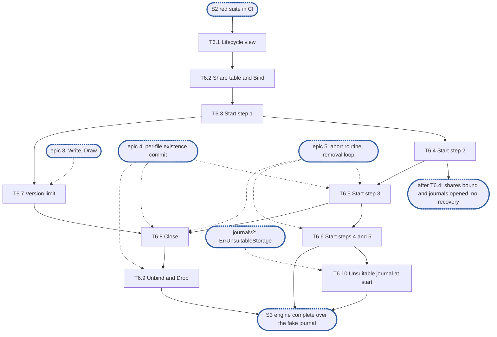

# Epic 6: engine v2 start, bindings and recovery

**Sources:** [RFC 8](../rfcs/rfc-8-engine.md) §1.1 (the share table's `decision:`), §2.1
(the `Lifecycle` row), §2.3 (bindings, `Bind`, `Unbind`, `Drop`), §2.4 (a binding's
settings), §2.5 (start steps 1 to 5 and 8, the retried open of a journal refused as
unsuitable, `Bind`'s attach, stop steps 1 to 5), §2.7, §12.1 (`Start`, `Close`, `Bind`,
`Unbind`, `Drop`, and a content call naming an unbound or removed share), §13 (E13, E15,
E29, E40) and §15's rows for those sections; [RFC 16](../rfcs/rfc-16-metadata-store.md) §3
(`Lifecycle`), §2.3.2 (the removal's steps 3 and 4) and §4.2 (`J‖journal`, `S‖id‖vl`,
`S‖id‖rr`); [RFC 1](../rfcs/rfc-1-journal.md) §3 (`Open`, `Share`, `Forget`, `Strand`,
`Stats`), §3.7, §3.10 and §4.3, for the journal calls; [RFC 28](../rfcs/rfc-28-journal-format.md)
§3.1 and §3.4, for the floor and `expect`; [RFC 14](../rfcs/rfc-14-open-state.md) §4.4, for
what a raised incarnation does to the grace instance.
**Track:** C.
**Epic 6 estimate: 10 subtasks, 31.5 man-days.**
**Depends on:** sync point **S2, red suite in CI**: E1's surface (`Engine`, `Deps`, `Journal`,
`Handle`, `Lifecycle`, `Share`, `ShareState`, `Stats`) and E2's fixture and fake journal.
T6.1 to T6.4 need nothing else. T6.7 needs epic 3's `Write` and `Draw` (T3.2, T3.3), where
a version is issued. T6.5 needs epic 4's per-file existence commit (T4.3) and epic 5's abort
routine (T5.4); T6.6 and T6.8 epic 5's removal loop (T5.3); T6.9 epic 4's due set (T4.3)
and T6.8. T6.10 needs `journalv2` to declare `ErrUnsuitableStorage` (RFC 1 §3). The
fault-injecting `kv.KV` (E2's T2.3), for T6.7's blocked raise and T6.4's failed start
transaction. #3608 and #3609, which put the share on every content call, give a pending
release its retry channel and make a rebuilt clone's `Served` wait cancellable; epic 8's
T8.6, which builds that wait under a context this epic cancels.
**Blocks:** epic 7, whose refusal table answers the version-limit row with T6.7's raise
and whose self-fence counts the commits of a bound share; epic 8, whose clone is rebuilt
from T6.5's clone markers and T6.6's unfinished removals and joined by T6.8 and T6.9; the
integration epic, which cannot run the filesystem over an engine that does not start.

---

## 1. Goal

Epic 6 gives the engine its life. `Start` opens each device's journal with the floor and
identity the store records, refuses by name the shares of a journal that is missing or
foreign, raises every shard's incarnation in one transaction, re-applies from the journal
every existence a crash left uncommitted before any file is served, resumes the unfinished
removals and strands the tags no share claims. `Bind` attaches a share above its floor;
`Unbind` and `Drop` end a removed share's work and its tag. The version limit is written
before any version is issued and raised before it is reached. `Close` stops in reverse and
never closes a component under a live loop.

**At the end of the epic:**

- after a crash, every write that was acknowledged and synced reads back, with the size and
  `mtime` it had, and every removal the crash cut off is applied, before the file is served;
- no version a client saw is issued again after a crash, and a share attached later never
  gets a version below one its files already hold;
- a journal found missing or foreign refuses its shares by name and is never opened as new;
- the share table is read on the request path without a lock;
- a removed share's tag is forgotten and nothing of it runs against a closed handle;
- `Close` leaves no goroutine and closes nothing a running loop still uses.

### 1.1 In scope

The store's `Lifecycle` view in `kvstore`; the copy-on-write share table and the bindings'
states; `Bind` (attach above the floor, a state change); `Start`'s steps 1 to 5 and 8 over
the journal and the store alone; the retried open of a journal refused as unsuitable and its
late attach; the version limit at start, at attach and while serving; `Close`'s steps 1 to 5
with the removal loop standing for the work scheduler; `Unbind` and `Drop`; the conformance
rows of RFC 8 §15 for §2.3, §2.5 and §2.7 that this part can pass.

### 1.2 Out of scope

- Start step 6 (the work queue) and step 7 (the scheduler's dispatch, the age tick, the
  rescan, eviction and the reseed), stop step 2's scheduler and step 3's offload loops, and
  the re-offer after a restart: RFC 8's second part, with offload. Here stop step 2 stops
  epic 5's removal loop and epic 8's clone batches.
- The syncer flow a binding opens at `Bind` and closes at `Drop` and `Close`, the key scope,
  the budgets beyond the journal's per-share limit, and `Bind`'s backend change: the second
  part.
- `keepHolds` (a removal that keeps snapshots offloads what its hold marks cover): RFC 12,
  out. `Unbind` refuses it.
- The asynchronous copy `Unbind` cancels (RFC 14 §2.7): RFC 14's, not built in this part.
- The operator's acknowledgement of a lost journal device, which re-initialises it: the
  second part. Here the shares stay refused, and a test re-initialises the directory as the
  operator's step would.
- The salvage export of a stranded tag and its `Forget` while serving (`salvage.path`): the
  second part. Here a stranded tag stays stranded until the next start.
- A read-only journal reopened in place (RFC 8 §2.5, E42): it needs RFC 1 §5.4's read-only
  state, spares and probe, which `journalv2` does not have. No epic of this part owns it
  (§9 point 8).
- `Bind` with `State: Closing` (a re-home's finish, RFC 27) and `Fenced` (RFC 8 §11.2's
  copied-image row): out, and epic 7 for the self-fence, which is not a share state.
- The chunking settings `Apply` records and reports as a migration (RFC 8 §2.4): the
  carver's, in the second part. `Apply` itself is E1's.
- The clone rebuild itself, from a marker or a `Removal` record: epic 8 (T8.6). This epic
  hands it the markers and records and serves no file before its turn.
- **(cluster)** paragraphs: a new primary settling before serving, a primary draining a
  shard it loses, per-(shard, tag) forget records, replicated journals.

### 1.3 Names used here

- **E1**, epic 1, interfaces: `pkg/block/enginev2`'s exported surface, `Deps` and its
  interfaces, frozen at S1.
- **E2**, epic 2, red e2e suite and test foundations: `engine-conformance` with its
  `known.yaml`, the fixture over the real journal, `kvstore` and the real open-state table,
  the fault-injecting `kv.KV` (its T2.3), the fake journal and the profiler wiring.
- **Epics 3, 4, 5, 7 and 8**: write, read and overlay (3); commit, group commit and losses
  (4); removals (5); capacity, self-fence and health (7); clone and copy (8). Their subtasks
  are cited as `T<epic>.<n>`.
- **S1**, interfaces frozen and `Content` agreed with the filesystem service. **S2**, red
  suite in CI. **S3**, engine complete over the fake journal: epics 3 to 8 done, every row
  whose journal call exists green. **S4**, the journal's calls built.
- **E13, E15, E19, E29, E40, E42**: RFC 8 §13's invariants of those numbers, not epics. E13: no
  background work outlives a component it uses; E15: existence is re-applied at recovery
  before a file is served; E19: every existence commit syncs the file in the journal first; E29: a journal serves a share it did not serve at open only by
  the attach rule; E40: no engine transaction exceeds the key budget `K`; E42: a read-only
  journal is reopened in place.
- **The integration epic**, epic 9: the filesystem service composed over the engine at
  RFC 17 §8's integration tier.
- **The removal loop**: epic 5's per-journal loop that runs a removal's phase 2 and prune,
  which stands for RFC 8 §6.1's work queue in this part.

## 2. General rules for each epic

1. **Independent unit tests.** Each epic carries its own unit tests. It may use another
   epic's pure in-memory implementation, the implementation of an epic it depends on once
   that has landed, and E2's test components: above all the fake journal, which stands in
   for the journal wherever the logic under test is the engine's (the resolution table, the
   group commit's split, the refusal mapping). E1 declares no internal interface for it to
   fake (rule 12).
2. **Fuzz tests: none.** The engine parses no bytes of its own: it reads the journal's
   answers and the store's records through typed calls. RFC 8 §15 checks its pure parts,
   read resolution and the group commit's split, by its tables, not by fuzz, and says so in a
   `ponytail:` marker, so no fuzz target is built for them.
3. **Observability follows RFC 25, through what exists.** `Deps` carries a `*slog.Logger`
   narrowed with `With("component", "engine")` and a `Tracer`, a function type the engine
   declares over standard-library types only. RFC 25's metrics registry, watchdog and
   health source exist on neither branch, so the engine exposes its counters and
   conditions as `Stats` fields, and the root that composes it adapts them. Counters are
   named for RFC 8 §14's metrics, under the `engine_` prefix (RFC 25 §2.1), never
   `enginev2_`, with no share label on a per-operation series. Spans are RFC 8 §14's
   proposals, `engine.sync` and `engine.existence_commit`, and a removal batch opens a root
   span. Each epic names the counters, conditions and spans it owns; the units, labels and
   logging rules are RFC 25's, applied as written.
4. **Profiling.** Tests and benchmarks run under E2's profiling harness and fail on
   goroutine, descriptor or memory leaks and on anomalous resource growth. No
   allocations-per-op assertion: RFC 8 §15.4 defers its engine-cost benchmark until a
   profile shows engine time on the request path.
5. **Public interface and internals.** Tests cover both the internal package API and the
   public behaviour the epic enables, including concurrency under `-race`. Test at the
   layer that **consumes** a value (see `CLAUDE.md`, "Verifying a change"): a field the engine
   passes to the journal or the store is asserted where they read it, over the real journal
   and `kvstore`, not where the engine builds it.
6. **Known failures shrink.** An e2e test that turns green leaves the suite's `known.yaml`
   (`test/enginev2/known.yaml`) in the same change: `dt` fails the run if a listed test
   passes, so the change that turns it green removes it, a journal pull request included. A
   test over the real journal that starts red sits in that suite behind its build tag, never
   in `unit`, which keeps no known list.
7. **v2 ignores v1.** No import of, copy from, or behavioural dependence on v1, enforced by
   the engine's one import test, a walk over every package of `pkg/block/enginev2` with
   one allowlist, which also refuses `pkg/vfs`: no package imports `pkg/block/engine`,
   `pkg/block/journal`, `pkg/block/syncer`, `pkg/block/carver`, `pkg/block/remote` or the
   v1 metadata service `pkg/metadata`. The walk checks every package on its own, so its
   allowlist names each package an exception applies to, test packages included. v1 is not
   touched: it is deleted at the cutover.
8. **Real dependencies for properties of those dependencies.** No fake stands in for a
   check about what the real thing does: the real journal on a real directory, with its crash
   seam, for durability, recovery and loss; the real `kvstore` for what a transaction
   commits and conflicts on. The fake journal is for the engine's pure logic only, and no
   conformance row runs over it.
9. **Code comment conventions** (`CLAUDE.md`, "Code comments"). A source comment describes
   the code's behaviour and references nothing outside it: no issue or pull request
   numbers, no CI, runner or OS names, no epic, subtask, plan or decision ids. A
   `ponytail:` marker records a knowingly simple implementation, naming its ceiling and the
   upgrade path. A `decision:` marker records deliberate behaviour, naming the rule, why it
   holds and the evidence that would overturn it. Where the RFC carries such a note, its
   marker goes at the code site that implements it: RFC 8's copy-on-write share table, the
   per-file state bound, the loss-sequence floor, the version-limit headroom and its burst,
   the lazy existence of appends, and the stable-overwrite cost.
10. **A test must be able to fail.** Keep a test only if a plausible change would make it
    fail and nothing else would catch that change: not the compiler, not the diff, not a
    later epic's tests. A review rule that no test can check, such as "stubs never panic",
    stays a review rule.
11. **A symbol is exported only if the RFC's interface uses it.** Everything exported is
    frozen at S1. Helpers the engine's own files need stay unexported or move to an
    `internal/` package of `enginev2`.
12. **Each subtask creates only what it declares.** No empty package and no stub without a
    caller. A package, an option or a test helper lands with its first consumer.

### 2.1 How the rules apply

| Rule | Subtasks | How |
| --- | --- | --- |
| 1 Unit tests | all | T6.2 to T6.10 test over E2's fake journal and the real `kvstore` on an in-memory `kv.KV`, through epic 3's unit composition until T6.2's `Bind` replaces its hook; T6.1 over `kvstoretest`'s suite. T6.3 extends the fake with `Open`'s refusals, `Forget`, `Strand` and `Stats`' tags and versions; T6.5 with `Files`, `Since` and `Settle`; T6.7 with `SetVersionLimit` and a counter that issues against it |
| 2 Fuzz | none | no parser. The `ponytail:` marker at the read-resolution table already says why |
| 3 Observability | T6.3, T6.5, T6.6, T6.7, T6.10 | no new counter: RFC 8 §14 names none for start, bindings or the version limit. Conditions through `Stats`: a share refused at start, named with its device (T6.3); `journal_lost` (T6.3, T6.10) and `journal_unsuitable` (T6.10), each per journal. Logs: a refused share and a stranded tag at `Warn`, with held and dirty bytes for the tag (T6.3, T6.6); a release marker settled as data loss at `Error`, naming the file (T6.5); a version-limit raise that fails at `Warn` (T6.7). Start opens one root span, `engine.start`, with a child per step |
| 4 Profiling | all | the unit composition's `prof.Watch` covers every test: a raise goroutine (T6.7), a retry loop (T6.10) or a loop left running past `Close` (T6.8) fails it |
| 5 Public and internal | all | internal tests of the share table (T6.2), the floor and limit arithmetic (T6.3, T6.7) and the trigger (T6.7); the rest through `*Engine`; `-race` in T6.2, T6.7, T6.8 and T6.9. What the engine hands the journal is asserted where the journal acts on it: the floor by the version the next `WriteAt` returns over the real journal (T6.2, T6.3), the limit by the version a `Draw` is refused at (T6.7); what it hands the store by reading the keys back through `kvstore` (T6.1, T6.4) |
| 6 Known failures | T6.2 to T6.10 | E2 delivered four of its rows; the rows this epic owns are written here, over E2's fixture, red in `known.yaml` naming this epic's issue until the journal calls they need exist, and removed in the change that turns them green |
| 7 v2 ignores v1 | all | nothing new is imported; `kvstore` is not v1 |
| 8 Real dependencies | T6.1, T6.3, T6.5, T6.7 | the identity, limits and incarnations from the real `kvstore`; the floor, the refusal of a missing or foreign journal, the recovery and the version limit over the real journal and its crash seam |
| 9 Comments | all | RFC 8's copy-on-write share table `decision:` (T6.2), the version-limit headroom `decision:` and burst `ponytail:` (T6.7), RFC 8 §2.5's `decision:` on an error a check meets (T6.3), and the markers of §4 |
| 10 Tests can fail | all | each test below names the change it catches |
| 11 Exports | T6.1, T6.3 | `Lifecycle` changes shape (D3, D4) and gains `Tags` (D2), all pending agreement (§9 points 1 to 3); `kvstore` gains `RecordJournal` and `Lifecycle()`. No new symbol in `enginev2`; test hooks live in `export_test.go` |
| 12 Creates only what it declares | all | each fake journal call lands with the subtask that first calls it; `RecordJournal` with T6.1, whose fixture is its first caller |

## 3. Requirements and invariants

Every MUST and MUST NOT that RFC 8 and the RFCs it cites place on this epic, numbered so that
subtasks and tests can cite them. Sections are RFC 8's unless named.

**The store's lifecycle view**

| # | Requirement | Kind | Source | Subtasks |
| --- | --- | --- | --- | --- |
| R1 | The engine's store access outside block metadata's views and `Refs` is `Lifecycle` alone: `JournalID`, `VersionLimits`, `RaiseVersionLimits`, `RaiseIncarnations` | invariant | §2.1, RFC 16 §3 | T6.1 |
| R2 | `JournalID` answers the identity the store records for a device; `J‖journal` is written when the journal is created, before anything in it is acknowledged | MUST | §2.5 step 1, RFC 16 §4.2, RFC 1 §3 | T6.1 |
| R3 | Every write of `S‖id‖vl` (at start, at an attach, at every raise) is a tracked max-write: it writes the larger of the value it reads and its own, never blindly, and never lowers the limit | MUST | §2.7, RFC 16 §4.2 | T6.1, T6.2, T6.3, T6.7 |
| R4 | The limits are raised in as many transactions as `K` takes, never one over every share | bound | §2.7, E40 | T6.1, T6.7 |
| R5 | A raise at attach changes the shard's incarnation and keeps its grace instance; only a start's raise copies the incarnation into the grace instance | invariant | RFC 14 §4.4, RFC 16 §2 (`Shard`) | T6.1, T6.2 |

**The share table and the bindings**

| # | Requirement | Kind | Source | Subtasks |
| --- | --- | --- | --- | --- |
| R6 | The share table is read on the request path without a lock; an attach or removal copies the whole table once per change, and no lock shared by more than one share is held across I/O or a wait on a write, read or commit | MUST NOT | §1.1 | T6.2 |
| R7 | A binding holds the share's handle on each journal, opened by `Share` at attach, its settings copied from the share record and its state; its handles and state are never stored, and `Start` rebuilds every binding from the share records | invariant | §2.3 | T6.2, T6.3 |
| R8 | `Bind` validates a share's settings and refuses an invalid one with an error, keeping the binding it had | MUST | §2.4, §2.3 | T6.2 |
| R9 | `Bind` of a share not served attaches it: reads its version floor and limit, passes the larger to `Share`, writes the share's limit at the journal's as a tracked max-write, raises the shard's incarnation, and only then publishes the binding; a failure undoes these in reverse and publishes nothing | invariant | §2.5 (`Bind`), E29, RFC 1 §3 | T6.2 |
| R10 | `Bind` of a served share applies a state change, serving to quiesced and back, without restarting the engine or touching another binding | invariant | §2.3 | T6.2 |
| R11 | A share's full limit never refuses another share's writes on the same journal | test row | §2.3, §15.2 shared journal | T6.2 |
| R12 | A content call naming a share with no binding answers `ErrDelay` with `DelayFrozen`, a share refused at start or left unattached by a lost journal included; only a share being removed or retired answers `ErrStale` | MUST | §12.1 as #3608 words it | T6.2, T6.3, T6.9 |

**Start**

| # | Requirement | Kind | Source | Subtasks |
| --- | --- | --- | --- | --- |
| R13 | `New` opens nothing; `Start` runs its steps in order, each complete before the next; a failing step closes in reverse what earlier steps opened and returns its error, so the engine is serving or as built | invariant | §2.5 | T6.3 |
| R14 | The engine opens each journal itself through `Deps.Open`, with the floor and the identity read from the store; start never creates a journal | invariant | §2.5 step 1 | T6.3 |
| R15 | The floor a journal opens with is at least every share's version floor and version limit | MUST | §2.5 step 1, §2.7, RFC 1 §4.3, RFC 28 §3.1 | T6.3 |
| R16 | A journal missing or foreign where one is recorded: every share on that device is refused, each named in `Stats` with its device, and `Start` does not fail for it | MUST | §2.5 step 1 | T6.3 |
| R17 | The directory of a missing or foreign journal is never opened as a new journal until an operator acknowledges the loss | MUST NOT | §2.5 step 1, RFC 28 §3.4 | T6.3 |
| R18 | An `Open` that finds a journal with no identity recorded for its directory reports the metadata store lost, and the node serves nothing | invariant | §2.5 step 1, RFC 28 §3.4 | T6.3 |
| R19 | A share whose removal has reached its offload step is never attached at start; once the journal is open and before any share attaches, `Forget` runs for every tag `Stats` names whose share's removal reads forgotten | invariant | §2.5 step 1, §2.3 | T6.3 |
| R20 | Before any version is issued, every served share's limit is written at the journal's next version plus one block, and passed with `SetVersionLimit` only once every write of it has committed | MUST | §2.5 step 1, §2.7, RFC 1 §4.3 | T6.3 |
| R21 | An error a check meets at `Open`, rather than a refusal it makes, fails `Start` as any failing step does | invariant | §2.5 (`decision:`) | T6.3 |
| R22 | One transaction raises the incarnation of every shard the node will serve, before any verifier is returned | MUST | §2.5 step 2, RFC 14 §4.4 | T6.4 |
| R23 | For each file the journal lists, the operations above its `applied` from `Since` are applied to existence in version order, each write with the `mtime` its record carries, recording the usage they add | invariant | §2.5 step 3, E15 | T6.5 |
| R24 | Each file is synced before its re-applied existence commits, and `Settle` is called with the new `applied` only after the commit | invariant | §2.5 step 3, E19 | T6.5 |
| R25 | A synced loss record above `applied` has the dropped write's existence committed from it, so the extent reads **Lost**, never as the file was before the write | invariant | §2.5 step 3, §5.1 | T6.5 |
| R26 | A clone marker is a clone, never applied as a plain removal | invariant | §2.5 step 3 | T6.5 |
| R27 | A release marker whose phase 1 aborts on a holder is settled without its removal and reported as data loss naming the file, so no later start re-applies it | invariant | §2.5 step 3, §8.1 | T6.5 |
| R28 | No file is served before step 3 has run for it; a clone's destination waits for its clone (epic 8) | invariant | §2.5 step 8, E15 | T6.5 |
| R29 | Unfinished removals are found by listing each shard's `S‖id‖rr` index, never by scanning files, and run from the removal loop once serving, so start time does not grow with the removals pending | invariant | §2.5 step 4 | T6.6 |
| R30 | Once every share the journal serves is attached, every tag `Stats` names that no share record of the installation names is stranded and reported with its held and dirty bytes; a tag a share record names is never stranded | invariant | §2.5 step 5, RFC 1 §3 | T6.6 |
| R31 | A journal whose `Open` refuses with `ErrUnsuitableStorage` at `Start`: its shares are not attached, `Stats` names each with its device and the rule, `journal_unsuitable` is raised, `Start` succeeds, nothing in the directory changes, and the open is retried every 30 s | invariant | §2.5, RFC 1 §3, §5.4 | T6.10 |
| R32 | A retried open that succeeds attaches the journal's shares as `Bind` would (step 1 for that journal, its `Forget`s and limits included, the shards' incarnations raised at attach, steps 3 to 5) and serves each file once step 3 has run for it, then clears the condition; one that finds the journal missing or foreign leaves the shares unattached behind the operator gate and raises `journal_lost` in place of `journal_unsuitable`; one that fails for any other cause closes what it opened, in reverse, and is retried | invariant | §2.5 | T6.10 |
| R33 | Until the late attach serves, a `Bind`, `Unbind` or `Drop` naming a share the journal serves or would serve answers `ErrDelay` | invariant | §2.5 | T6.10 |

**The version limit**

| # | Requirement | Kind | Source | Subtasks |
| --- | --- | --- | --- | --- |
| R34 | The trigger is evaluated on every version the engine issues, not on a timer | invariant | §2.7, §15.2 sustained load | T6.7 |
| R35 | When `Stats` shows fewer versions left than the larger of half a block and the peak version rate times the margin, every served share's limit is raised by a block, and the new limit is passed with `SetVersionLimit` only after every share's raise has committed. The peak is the highest count of versions drawn in any one second of the last 60 s; the margin is 30 s plus the existence age plus 1 s | bound | §2.7 | T6.7 |
| R36 | `Bind` raises every served share's limit first when the counter it raised leaves fewer versions than the trigger | invariant | §2.5 (`Bind`) | T6.7 |
| R37 | A write that reaches the limit is refused retry-later, never `ErrNoSpace`, and is served once the raise commits | test row | §2.7, RFC 1 §4.3, §15.1 version limit | T6.7 (the raise), T7.1 (the answer) |
| R38 | The raise never runs on the request path: a version issued posts the check and never waits for a transaction | MUST NOT | §1.1 | T6.7 |

**Stop, `Unbind` and `Drop`**

| # | Requirement | Kind | Source | Subtasks |
| --- | --- | --- | --- | --- |
| R39 | `Close` first refuses every call with `ErrUnavailable` | invariant | §2.5 stop step 1 | T6.8 |
| R40 | `Close` stops the background work that takes journal versions (the removal loop, clone batches) and joins it, then commits every file's pending existence in a last group commit per journal, within the stop bound | invariant | §2.5 stop step 2 | T6.8 |
| R41 | `Close` cancels and joins the other loops (the version-limit raise, the retried open) | invariant | §2.5 stop step 3 | T6.8, T6.10 |
| R42 | `Close` closes what the engine opened (handles, then journals) in the reverse of the order it opened them, and nothing it was handed, only after every join has completed; no component is closed while work that uses it runs | MUST NOT | §2.5 stop step 4, E13, RFC 1 §8.7 | T6.8 |
| R43 | A join that does not complete within its bound leaves the components it depends on open and reports the failure | MUST | §2.5 stop step 5 | T6.8 |
| R44 | `Unbind` moves the binding to removing and, in this order: admits no new call, clone or removal batch for the share (but the phase-2 batches of a clone its join waits on); joins every call admitted before, every clone with the share on either side and every batch in flight | MUST | §2.3 | T6.9 |
| R45 | `Drop` ends the share's work in the removal loop, closes the share's handle on each journal, then runs the whole-tag `Forget`, which the journal refuses while a handle is open; `Forget` is idempotent, so a repeated `Drop` succeeds | invariant | §2.3, RFC 1 §3 | T6.9 |
| R46 | Node stop never calls `Drop`: `Close` closes handles and keeps tags | invariant | §2.3 | T6.8 |
| R47 | Every write `Forget` drops uncommitted gets `Done` from the engine, charging nothing, exactly once | MUST | §5.1, §12.1 (`WriteOpts.Done`) | T6.9 |
| R48 | `Close` and `Drop` end a pending release's retry: its `retry` channel yields `ErrUnavailable`, no `done(...)` follows, and its marker is left for the next start's step 3 | invariant | §8.1 and §12.1 (`Delete`) as #3608 words them | T6.8, T6.9 |
| R49 | `Unbind` and `Close` cancel a rebuilt clone's wait on `Holds.Served`, leaving its clone `Removal` for the next start's step 4, so neither hangs on a shard that is never served here | invariant | §2.5 step 4 as #3608 words it | T6.8, T6.9 |

## 4. Decisions this epic takes

- **D1, the share table.** One `atomic.Pointer` to an immutable map from `ShareID` to
  `*binding`. `Bind`, `Unbind`, `Drop`, `Start` and the late attach serialise on one
  lifecycle mutex that no content call takes, copy the map, change it and swap the pointer.
  A binding's state (serving, quiesced, removing) is an atomic in the binding, so a state
  change swaps nothing; attach and removal copy the table, as RFC 8 §1.1's `decision:`
  says, and that marker goes at the swap. Epic 3's T3.1 reads the table through
  `bindingOf(share)`: whichever of T3.1 and T6.2 lands first declares the map, and the
  other extends it. No marker of its own.
- **D2, how start learns the removals and the installation's tags.** Start step 1 needs
  each share's removal progress (`SH‖shard‖rm`) to skip a share past its offload step and to
  forget a tag whose removal reads forgotten, and step 5 needs every tag a share record of
  the installation names, attached or not. `Start` is handed the shares to attach (RFC 23
  §2.2), and `Lifecycle`'s four calls read neither. T6.1 gives `Lifecycle` a fifth call,
  `Tags(ctx) (map[ShareTag]TagState, error)`: every tag a share record names, with
  `Serving`, `Offloaded` or `Forgotten` from the record's removal step. A `decision:` marker
  at `Tags` says so, withdrawn if RFC 8 §2.1 settles another source (§9 point 1).
- **D3, who records a journal's identity.** No interface of RFC 16 writes `J‖journal`. T6.1
  adds `kvstore`'s `RecordJournal(ctx, device, id)`, the store's part of the explicit
  initialisation step, which the fixture calls after `Init` and production's initialisation
  step will. `J‖journal` is keyed by identity, so `JournalID(device)` scans `J‖` for the
  device: one key per device of the node. A `ponytail:` marker at the scan names the ceiling
  (a node with hundreds of devices) and the upgrade (a device index key).
- **D4, an attach keeps the grace instance.** `kvstore`'s `RaiseIncarnations` copies the
  incarnation into the grace instance on every call, which is right for a start and wrong
  for an attach (R5). T6.1 gives the call the start's meaning only, renamed `RaiseAtStart`,
  and adds `RaiseAtAttach(ctx, shard)`, which keeps the grace instance; `Lifecycle` declares
  both. Pending the RFC 16 §3 text (§9 point 2).
- **D5, the floor at `Open`.** One number per journal: the largest of every share's version
  floor (`Content.VersionFloor`) and every share's limit (`VersionLimits`) among the shares
  the journal may serve, removed ones included. `journalv2`'s doc for `Open` names the
  smallest limit; both are above every version issued, and the largest also covers a share
  whose limit was raised ahead of the others. A `decision:` marker at the computation says
  so, withdrawn if the journal's doc and RFC 28 §3.1 settle the smallest (§9 point 4).
- **D6, the block and the trigger.** The block is a package constant, 2²⁴ versions, set by
  a hook in `export_test.go` for the tests that need 16. The peak rate is 60 one-second
  buckets on `Clock.Elapsed`; the margin is 30 s plus `existence_age` plus 1 s, read from the
  settings at each check. A version issued (`Write`, `Draw`, a removal's journal step, a
  clone target) calls `limits.issued(journal)`, which counts it and compares `Stats`'
  `VersionsLeft` with the trigger; past it, it wakes the journal's raise goroutine and
  returns. One raise runs at a time per journal; one woken during a raise runs again after.
- **D7, the stop bound.** RFC 8 §2.5 names "the stop bound" without a value. It is the
  deadline of the context `Close` is given: past it, a join is abandoned and reported, and
  what it depends on is left open (R43). A `decision:` marker at `Close` says so.
- **D8, the start transaction is not split.** Step 2 raises every shard in one transaction,
  as RFC 14 §4.4 requires, though E40 bounds every engine transaction by `K`. `kvstore`'s
  `ponytail:` at `RaiseIncarnations` already names the ceiling; this epic adds none (§9
  point 3).
- **D9, a dropped share stays known.** `Drop` keeps the binding in the table in a removed
  state, holding no handle, so a content call naming the share answers `ErrStale` rather
  than `DelayFrozen` (R12) until the next start, which is handed no such share. A
  `ponytail:` marker at `Drop` names the cost, one entry per share removed since start, and
  the upgrade, a set of removed `ShareID`s.

## 5. Target tree

```text
pkg/metadata/kvstore/
  lifecycle.go       T6.1  Lifecycle(): JournalID, VersionLimits, RaiseVersionLimits,
                           RaiseAtStart, RaiseAtAttach, Tags (D2 to D4); RecordJournal
  shards.go          T6.1  RaiseIncarnations split into its start and attach forms (D4)
  kvstoretest/
    lifecycle.go     T6.1  the view's cases
pkg/block/enginev2/
  deps.go            T6.1  Lifecycle's new shape (D2, D4)
  share.go           T6.2  the share table (D1), the binding, Bind
                     T6.9  Unbind, Drop, the removed state (D9)
  start.go           T6.3  Start, step 1, the floor (D5), the refusals
                     T6.4  step 2
                     T6.5  step 3
                     T6.6  steps 4 and 5
                     T6.10 the retried open and the late attach
  limit.go           T6.7  the trigger, the peak rate, the raise goroutine (D6)
  engine.go          T6.8  Close (D7)
  stats.go           T6.3  refused shares and the journal conditions in Stats
  export_test.go     T6.7  the block hook; T6.2 the unit composition through Bind
  enginev2test/
    fake.go          T6.3  Open's refusals, Forget, Strand, Stats' tags and versions
                     T6.5  Files, Since, Settle
                     T6.7  SetVersionLimit and a counter bounded by it
    fixture.go       T6.1  the real Lifecycle and RecordJournal after Init
  conformance/
    rfc8_a_test.go   T6.2 to T6.7, T6.10  the rows of §15.1 this epic owns
    rfc8_b_test.go   T6.2, T6.9  the rows of §15.2
test/enginev2/known.yaml  T6.2 to T6.10  each new red row, naming this epic's issue
```

## 6. Subtasks

### T6.1 The store's lifecycle view

**Subtask T6.1 estimate: 3 man-days.**

- **Track:** C. **Depends on:** S2.
- **Covers:** R1 to R5.
- **Deliverables:** `kvstore.Store.Lifecycle()` returning a view with `JournalID(ctx,
  device string) ([16]byte, error)`, `VersionLimits(ctx, shares)`, `RaiseVersionLimits(ctx,
  to)` writing at most `K` keys per transaction, each key a tracked max-write over
  `RaiseVersionLimit`'s rule, `RaiseAtStart(ctx, shards)` and `RaiseAtAttach(ctx, shard)`
  (D4), and `Tags(ctx)` (D2); `RecordJournal(ctx, device, id)` writing `J‖journal` (D3); the
  engine's `Lifecycle` declaring the same. In E2's fixture, the real view replaces the stub
  `Lifecycle` that refuses every call (`unbuiltLifecycle`), and the fixture records
  `Fixture.Journal`, the `JournalID` it kept from `Init`, through `RecordJournal`, so the
  view's `JournalID` answers it for the fixture's directory.
- **Acceptance criteria:**
  - `JournalID` of a device with no record answers the zero identity, not an error; of a
    device whose journal was re-initialised, the newer identity.
  - `RaiseVersionLimits` never lowers a limit, and never commits more than `K` keys.
  - `RaiseAtAttach` leaves `GraceInstance` as it was; `RaiseAtStart` sets it to the new
    incarnation.
  - `Tags` names a share being removed with its removal's step, and a retired share.
- **Tests:** a raise to a lower value leaves the stored one (catches a blind write, R3); two
  concurrent raises, one higher, end at the higher (catches an untracked read); 3 × `K` shares
  raised and the transaction count from `kv.Counts` is at least 3 (catches one transaction
  over every share, R4); an attach raise followed by a read of the shard record: incarnation
  up, grace instance unchanged (catches the start meaning at attach, R5); `JournalID` after
  `RecordJournal` for two devices answers each its own (catches a scan that returns the first
  key); over the fixture, `JournalID` of its directory equals `Fixture.Journal` (catches an
  identity not recorded or recorded under another device), and the fixture's `Start` gets
  past `Lifecycle` (its error moves to the journal's `Init`).

### T6.2 The share table and `Bind`

**Subtask T6.2 estimate: 3.5 man-days.**

- **Track:** C. **Depends on:** T6.1.
- **Covers:** R6 to R11, R3, R5, R12.
- **Deliverables:** in `share.go`, the table (D1) with its `decision:` marker; the binding:
  `Share`, a handle per journal, the state; `Bind` for a share not served (validate, read
  floor and limit, `Share` at the larger, the limit written at the journal's, `RaiseAtAttach`,
  publish; undo in reverse on failure) and for a served one (a state change). Epic 3's unit
  composition binds through `Bind` from here, and its hook goes.
- **Acceptance criteria:**
  - A content call never waits on the lifecycle mutex.
  - A `Bind` that fails at any step leaves no handle open and the table unchanged.
  - A share bound above a floor of 9·10⁸ gets a first version above it from the real
    journal.
- **Tests:** a content call on share A while a `Bind` of share B holds the lifecycle mutex
  answers (catches a table read under the mutex, R6); `-race` with readers and binds;
  `RaiseAtAttach` made to fail: the handle is closed and the table holds no binding (catches
  a binding published before the raise, R9); a negative limit refused and the earlier binding
  kept (R8); a content call naming a share never bound answers `ErrDelay` with
  `DelayFrozen`, not `ErrStale`, and touches no journal (R12); over the fixture, §15.1's "attach above the floor", adapted: a share whose files'
  versions reach 9·10⁸ is bound to a journal near 2·10⁶, written over, and the read returns
  the new bytes from the journal (no offload or eviction in this part); over the fixture,
  §15.2's "shared journal": two shares, one filled to its limit, the other's writes accepted
  (R11).

### T6.3 Start step 1: open the journals

**Subtask T6.3 estimate: 4 man-days.**

- **Track:** C. **Depends on:** T6.2.
- **Covers:** R7, R13 to R21, R3, R12.
- **Deliverables:** `Start(ctx, shares)`: the step sequence with its undo stack (R13); for
  each device of `Deps.Devices`, `JournalID`, the floor (D5), `Deps.Open`; a journal missing
  or foreign (`ErrNoJournal`, `ErrIdentityMismatch`) refusing its shares by name and raising
  `journal_lost`; an unrecorded journal (zero `expect`, `ErrUnidentified` or the open's
  naming error) failing `Start` as the store lost (R18); any other error failing `Start`
  (R21); `Tags`' forgotten tags forgotten, its offloaded ones not attached (R19); every share
  given a handle on every opened journal at the larger of its floor and limit; every served
  share's limit written at `Stats().NextVersion` plus a block, then `SetVersionLimit`; `Stats`
  naming refused shares and their device; the `decision:` marker of RFC 8 §2.5 on a check's
  error.
- **Acceptance criteria:**
  - A refused device never has `Deps.Open` called on it twice in one `Start`, and nothing
    else touches its directory.
  - No `WriteAt` or `Draw` reaches a journal before its `SetVersionLimit`.
  - A failure at any point closes every handle and journal opened so far, in reverse.
- **Tests:** over the fake: a store recording identity A and a directory holding B, both
  shares of the device refused by name, `Start` succeeds, the other device's share serves
  (catches a foreign journal opened, R16), and a content call naming a refused share
  answers `ErrDelay` with `DelayFrozen`, never `ErrStale` (R12); a failure injected at the last handle closes the
  others in reverse (R13); `Tags` with one forgotten and one offloaded tag: `Forget` called
  for the first before any `Share`, no `Share` for the second (R19). Over the fixture:
  §15.1's "journal gone", adapted: two shares written without offload, the directory
  deleted, `Start` refuses both by name and creates nothing (catches a journal re-created,
  R17); a crash with a reported, unsynced version, then a restart whose first write's version
  is above it (catches a floor taken from the version floor alone, R15, R20); §15.1's
  "attach after a device loss", adapted: the device destroyed, re-initialised as the
  operator's step would, the share attached to it: its first version is above its old limit,
  and a share whose removal reads offloaded is not attached.

### T6.4 Start step 2: the start transaction

**Subtask T6.4 estimate: 1 man-days.**

- **Track:** C. **Depends on:** T6.3.
- **Covers:** R22.
- **Deliverables:** `RaiseAtStart` over every served shard in one call, after step 1 and
  before step 3, so before any `Write` can return a verifier; its failure fails `Start`.
- **Acceptance criteria:** the incarnation of every served shard rises once per `Start`, in
  one transaction.
- **Tests:** over the fixture, §15.1's "incarnation at start", the engine half: every
  shard's incarnation and grace instance rose, in one transaction by `kv.Counts`, and the
  verifier changed across the restart (catches a start that raises only at attach); the
  fault-injecting `kv.KV` fails the transaction: `Start` returns the error and every journal
  is closed. The `RECLAIM_COMPLETE` half is open state's and the adapters'.

### T6.5 Start step 3: existence re-applied

**Subtask T6.5 estimate: 5 man-days.**

- **Track:** C. **Depends on:** T6.4; epic 4's T4.3 (a file synced and its existence
  committed); epic 5's T5.4 (the abort routine).
- **Covers:** R23 to R28.
- **Deliverables:** for each served share's handle, `Files`; per file, `Existence.Applied`,
  then `Since(applied)` replayed into the file's entry as pending operations in version
  order: a write with its record's `mtime`, a truncate, a deallocate, a delete, a synced
  loss as a loss operation; a clone marker handed to epic 8's rebuild and taken out of the
  plain replay (R26); the entries committed through epic 4's per-file commit, which syncs
  first; `Settle` with the new `applied` after each commit; a release marker whose phase 1
  aborts committed as settled and logged at `Error` as data loss (R27); files served only
  after (R28). Large shares are processed file by file, never all `Since` streams held at
  once.
- **Acceptance criteria:**
  - After a restart, a write acknowledged and synced but uncommitted reads back with its
    size and `mtime`; a truncate whose metadata step was cut off is applied.
  - A second restart re-applies nothing and reports nothing.
  - No `Done` is called for a re-applied write: nothing was reserved.
- **Tests:** over the fixture and the journal's crash seam: §15.1's "recovery through
  `Since`" (a crash after a truncate's journal step, before its removal record: `Since`
  yields the marker, existence applies it before the file is served, `Settle` drops it;
  catches a marker applied after serving); the recovery halves of §15.1's "journal
  authority" and "stable write and lazy existence", which E2 wrote (their `known.yaml`
  entries name this epic); a synced loss committed as **Lost** (catches a loss read as the
  old content, R25); `Since` yielding two writes of one range out of order: the later
  version wins (R23); T5.4's abort: a holder keeping the file open, the marker settled, the
  log line naming the file, and the next restart quiet (R27); T5.4's `ErrUnavailable`
  outcome: a release marker a `Close` left mid-retry finished by the restart. Over the fake:
  a clone marker reaches the rebuild hook and no `Remove` (R26).

### T6.6 Start steps 4 and 5: removals resumed, unclaimed tags stranded

**Subtask T6.6 estimate: 2 man-days.**

- **Track:** C. **Depends on:** T6.5; epic 5's T5.3 (the removal loop).
- **Covers:** R29, R30.
- **Deliverables:** per served shard, `Content.UnfinishedRemovals`; each plain removal posted
  to the journal's removal loop, each clone `Removal` handed to epic 8's rebuild; then, per
  journal, the tags `Stats().Shares` names that `Tags` does not name, each `Strand`ed and
  logged at `Warn` with its held and dirty bytes.
- **Acceptance criteria:**
  - `Start` returns before any posted removal runs a batch.
  - A tag of a share being removed, or of a share not attached at this start, is never
    stranded.
- **Tests:** over the fixture, §15.1's "recovery through `Since`", second half: a removal
  crashed between batches resumes and the extent reads removed throughout; over the fake, 10⁴
  unfinished removals posted and `Start` returning before the loop's first batch (catches a
  start that runs them, R29); a tag left by a deleted share stranded and a share's tag that
  `Tags` names but `Start` was not handed left alone (catches a tag computed against the
  attached set, R30).

### T6.7 The version limit while serving

**Subtask T6.7 estimate: 3 man-days.**

- **Track:** C. **Depends on:** T6.3; epic 3's T3.2 and T3.3.
- **Covers:** R34 to R38, R3, R4.
- **Deliverables:** `limit.go` (D6): the per-journal peak-rate buckets, `issued(journal)`
  called from `Write` and `Draw` (epics 5 and 8 add their own calls), the raise goroutine:
  `RaiseVersionLimits` for every served share by a block, `SetVersionLimit` after the last
  transaction commits; `Bind`'s raise-all-first (R36); RFC 8 §2.7's headroom `decision:` and
  burst `ponytail:` markers at the trigger; the goroutine joined by `Close`.
- **Acceptance criteria:**
  - The journal never gets a limit the store has not committed.
  - A request that issues a version past the trigger returns without waiting for the raise.
- **Tests:** over the fixture, §15.1's "version limit": a block of 16, `S‖id‖vl` committed
  before the first write; below 8 left the limit is raised before the journal is given it;
  the raise blocked by the fault-injecting `kv.KV`, the write reaching the limit refused and
  then served once the raise commits (its `ErrDelay` half turns green with T7.1); a crash
  with a reported, unsynced version, then no version issued again. Over the fake: a rate held
  below the trigger and raised in one step, the raise due on the next `Draw` with the test
  clock not advanced (catches a timer, R34); the peak computed from a 60 s history (catches a
  window of the last second only); 3 × `K` shares and `kv.Counts` above 2 transactions per
  raise (R4). §15.2's sustained-load and burst rows are epic 7's T7.4, over this raise.

### T6.8 `Close`

**Subtask T6.8 estimate: 3.25 man-days.**

- **Track:** C. **Depends on:** T6.5, T6.7; epic 4's T4.3; epic 5's T5.3.
- **Covers:** R39 to R43, R46, R48, R49.
- **Deliverables:** `Close(ctx)`: refuse every call with `ErrUnavailable`; stop and join the
  removal loops (each pending release's `retry` yielding `ErrUnavailable`, with no
  `done(...)`, its marker left for start) and clone batches; the cancel of every rebuilt
  clone's `Served` wait, through the context epic 8's T8.6 waits under, its clone `Removal`
  left for start; the last group commit per journal; cancel and join the
  version-limit raise and the retried open; close every handle, then every journal, in
  reverse, only after every join; a join past the context's deadline (D7) leaving its
  components open and reported in the error.
- **Acceptance criteria:**
  - After a clean `Close`, a restart finds no append or hole fill to re-apply.
  - No `Handle.Close` or `Journal.Close` is called while a loop that uses it runs.
  - `Close` never calls `Forget`.
- **Tests:** over the fake: a removal loop held in a batch past the context's deadline,
  `Close` returns its error and the journal is still open (catches a close under a live
  loop, R42, R43); the fake records the order of every close (catches journals closed before
  handles); a clean `Close` and restart over the fixture with `Since` yielding nothing above
  `applied` (R40); T5.4's `ErrUnavailable` outcome: a `Close` while the loop retries a
  release's phase 1 yields `ErrUnavailable` on its channel with no `done(...)`, and leaves the
  marker for T6.5 (R48); a `Served` stub that never returns: `Close` returns within its
  deadline, the wait's goroutine is gone and the clone `Removal` is still listed at the next
  start (catches a `Close` hung on a shard never served, R49), written with T6.8 or T8.6,
  whichever lands last; `prof.Watch` finds no goroutine left.

### T6.9 `Unbind` and `Drop`

**Subtask T6.9 estimate: 3.75 man-days.**

- **Track:** C. **Depends on:** T6.8; epic 4's T4.3.
- **Covers:** R12, R44, R45, R47, R48, R49.
- **Deliverables:** `Unbind(ctx, id, keepHolds)`: `keepHolds` refused with `ErrInvalid`;
  the binding moved to removing, which content calls answer `ErrStale`; the join of calls
  admitted before, of clones on either side (epic 8 joins its own) and of the share's batch
  in flight, a rebuilt clone still waiting on `Holds.Served` cancelled rather than joined,
  its clone `Removal` left for start. `Drop(ctx, id)`: the share's files taken out of the group commit's due set and
  its in-flight batch joined, so no later batch captures one; the removal loop's retries of
  the share's releases ended with `ErrUnavailable`, with no `done(...)`, their markers left
  for start; each handle
  closed, then the whole-tag `Forget`; `Done` with nothing charged for every write `Forget`
  dropped; the binding kept as removed (D9).
- **Acceptance criteria:**
  - After `Unbind`, no call, clone or batch for the share starts, but the phase-2 batches
    of a clone the join waits on.
  - After `Drop`, no entry for the share's tag remains in the journal, and every accepted
    write of the share has had exactly one `Done`.
- **Tests:** over the fake: `Unbind` with 10⁴ pending entries and a removal batch in flight
  returns only once the batch has returned, and nothing of the share starts after it (§15.2's
  "unbind and drop", adapted: no offload pass); one call per content method naming the share
  after `Unbind`, each `ErrStale`, not `DelayFrozen` (R12); `Drop` under writes with a batch
  due as it joins: T4.7's reservation counter back to zero and one `Done` per write (catches
  a `Done` missed or doubled, R47); `Forget` refused while a handle is open is never reached
  (catches `Forget` before `Close`, R45); T5.4's stall ended by `Drop` yielding
  `ErrUnavailable` with no `done(...)` and the marker still in the journal (R48); `Unbind`
  of a share whose rebuilt clone waits on a `Served` stub that never returns: `Unbind`
  returns, the wait is gone and the clone `Removal` stays (R49), written with T6.9 or T8.6,
  whichever lands last.

### T6.10 A journal refused as unsuitable at start

**Subtask T6.10 estimate: 3 man-days.**

- **Track:** C. **Depends on:** T6.6; `journalv2` declaring `ErrUnsuitableStorage`.
- **Covers:** R31 to R33, R41.
- **Deliverables:** in `start.go`, an `Open` refused with `ErrUnsuitableStorage` leaving its
  shares unattached, named in `Stats` with device and rule, `journal_unsuitable` raised; one
  retry goroutine per refused journal on `Clock.After(30 s)`; a successful retry running
  step 1 for that journal, `RaiseAtAttach` per shard and steps 3 to 5 for it, then clearing
  the condition; a missing or foreign journal at retry raising `journal_lost` in its place;
  any other failure closing in reverse and retrying; `Bind`, `Unbind` and `Drop` naming its
  shares answering `ErrDelay` meanwhile; a failed `Start` stopping the retries; `Close`
  joining them at its step 3.
- **Acceptance criteria:**
  - A retry never opens a directory after `Close` or a failed `Start` returned.
  - A retry that fails leaves nothing open.
- **Tests:** over the fake, with the test clock: §15.1's "unsuitable journal at start",
  adapted (no reseed): `Start` succeeds and the other device serves; the check cleared and the
  clock advanced 30 s: the share attaches, its shard's incarnation is higher than when
  `Start` returned and the condition clears; `Close` with the retry pending, then the check
  cleared: nothing opens the directory; the start transaction failed: `Start` returns its
  error and nothing opens the directory later; the directory emptied before the check clears:
  `journal_lost` in place of `journal_unsuitable` and nothing created; `Unbind` on the refused
  share answers `ErrDelay` and succeeds once it serves; a retry whose recovery fails once on
  I/O leaves the share unattached and the next retry attaches it.

## 7. Order of work



T6.1 to T6.4 need nothing of tracks A and B and fill the wait for epics 4 and 5; T6.7
follows as soon as epic 3's `Write` and `Draw` land. T6.5 is the riskiest, for the order of
sync, commit and `Settle` across a crash, and starts once epic 4's T4.3 and epic 5's T5.4
exist. Checkpoint after T6.4: a share bound and served over the fake journal, the fixture's
`Start` past `Lifecycle`. Checkpoint after T6.6: a restart over the fake journal recovers
every file.

## 8. Suggested pull requests

| PR | Subtasks | Man-days | After | Why together |
| --- | --- | --- | --- | --- |
| 1 | T6.1, T6.2, T6.3, T6.4 | 11.5 | S2 | the store view, the table, `Bind` and the journals opened: what needs nothing of tracks A and B |
| 2 | T6.7 | 3 | PR 1; T3.2, T3.3 | the version limit while serving, on the paths that issue versions |
| 3 | T6.5, T6.6 | 7 | PR 1; T4.3, T5.3, T5.4 | recovery: existence re-applied, removals resumed, tags stranded |
| 4 | T6.8, T6.9 | 7 | PR 2, PR 3; T8.6 for the `Served` wait's test | the ends of the engine and of a share: `Close`, `Unbind`, `Drop` |
| 5 | T6.10 | 3 | PR 3; `ErrUnsuitableStorage` | the retried open and the late attach, which reuse steps 1 to 5 |

A suggestion only: one pull request per subtask works as well. PR 2 can be open beside PR 3.

## 9. Open points

1. **How start reads the removals and the installation's tags** (D2), pending #3631. RFC 8 §2.5 step 1
   forgets a tag "whose share's `rm` rows read forgotten" and does not attach one at
   "offloaded or later", and step 5 strands "a tag no share record of the installation
   names"; RFC 8 §2.1 says `Lifecycle`'s four methods are the engine's only store access
   outside block metadata's views and `Refs`, and RFC 23 §2.2 hands `Start` only the
   attached shares. One of them must change: RFC 16 §3 gaining `Tags` is D2's choice. It
   changes E1's frozen `Lifecycle`.
2. **An attach keeps the grace instance** (D4), pending #3632. RFC 16 §3 has one `RaiseIncarnations` "in
   the start transaction, or at attach", and `kvstore`'s copies the incarnation into the
   grace instance on every call, which RFC 14 §4.4 and RFC 16's `Shard.GraceInstance` allow
   only for a start or a failover that lost open state. RFC 16 §3 should declare the two
   forms. It changes E1's frozen `Lifecycle`.
3. **The start transaction against `K`** (D8), pending #3633. RFC 8 §2.5 step 2, RFC 0 and RFC 14 §4.4 put
   every shard in one transaction; E40 and §2.7 bound every engine transaction by `K`, and
   §2.7 takes 10⁴ shares' 2 × 10⁴ keys as past it. On a node serving more shards than `K`,
   the two cannot both hold.
4. **The floor at `Open`** (D5), pending #3634. RFC 8 §2.5 says "per share, the larger of the version
   floor and the share's version limit"; RFC 28 §3.1 calls the floor "the highest content
   version recorded in metadata", with no limit; RFC 1 §4.3 and `journalv2`'s doc for `Open`
   take the smallest limit. One sentence in RFC 28 §3.1 would settle it.
5. **Who writes `J‖journal`** (D3), pending #3635. RFC 16 §4.2 has the key "written when the journal is
   created", and no interface of RFC 16 §3 writes it; RFC 16 §3.2's `Init` writes `\x00format`,
   `IN` and `SL` only. RFC 16 should name the write, and how `JournalID(device)` finds a key
   that is keyed by identity.
6. **`journal_lost` is missing from RFC 8 §11.1's list** of the conditions the engine raises,
   though §2.5 raises it and RFC 25 registers it, pending #3636.
7. **E2's rows.** E2 delivered four rows of its 45; the rows this epic turns green
   (incarnation at start, recovery through `Since`, journal gone, attach above the floor,
   attach after a device loss, version limit, shared journal, unbind and drop, unsuitable
   journal at start) are written in T6.2 to T6.10, and their estimates include them. E2's
   fault-injecting `kv.KV` (its T2.3) is not built either; T6.4 and T6.7 need it.
8. **A read-only journal reopened in place** (RFC 8 §2.5, E42, and §15.2's read-only row) is
   in no epic of this part. It needs RFC 1 §5.4's read-only state, which `journalv2` does not
   have yet; once it does, it is a subtask of this epic or of the second part.
9. **`Unbind` with `keepHolds`** is refused: no snapshot exists in this part. A removal that
   keeps snapshots is RFC 12's, out.
10. **No row over the real journal turns green in this epic** until `journalv2`'s `Init`,
    `Open`, `Share`, `Forget`, `Strand`, `SetVersionLimit`, `Files`, `Since` and `Settle`
    exist. Each row leaves `known.yaml` in the change that turns it green.
11. **Two text fixes that change nothing here.** RFC 1 §4.3 says RFC 8 §2.5 sizes the
    version limit, which §2.7 does (pending #3637); RFC 8 §15.2's sustained-load row speaks of
    "half a block of 2²⁰" where §2.7 proposes a block of 2²⁴, most likely the wrong design the
    row must catch (pending #3638). T6.7 follows §2.7.
