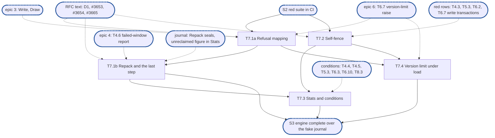

# Epic 7: engine v2 capacity, self-fence and health

**Sources:** [RFC 8](../rfcs/rfc-8-engine.md) §10 (the two measures, as far as repack goes),
§10.2 (the refusal table and its last step), §10.3 (scoped repack and its reserve), §11.1
(the engine's conditions, `Stats` as a health source), §11.2 (the self-fence and the rows
this part reaches), §3.1 (`admit` among the policy functions) and §2.8 (the refusal table
in `capacity.go`), §2.7 (the headroom's `decision:` and the burst's `ponytail:`), §14
(refusals and self-fences) and §15's rows for those sections;
[RFC 1](../rfcs/rfc-1-journal.md) §3.1 (`Sync`), §3.7 (`Stats` and its per-share figures,
`Files`), §4.2 (the index bound), §6 (the refusal and its named limits, the headroom), §7.2
(`Repack` and its scope) and §10 questions 5 and 6, for the journal calls, and §3.8,
§3.9, §5.3 and §5.4 (loss events, the counters in `Stats`, a failed sync and a read-only
journal), for `journal_sync_failed`;
[RFC 28](../rfcs/rfc-28-journal-format.md) §2.2 (the spare pool, the seal for capacity);
[RFC 0](../rfcs/rfc-0-data-lifecycle.md) §1.4 and §10.3, for the single node's fence, the
version limit's headroom and the deadline rule; [RFC 17](../rfcs/rfc-17-vfs.md) §4.3, for the
delay causes; [RFC 25](../rfcs/rfc-25-observability.md) §3.9 and §8.2, for the condition
registry and the health source.
**Track:** C, with T7.1a and T7.1b on track A.
**Epic 7 estimate: 5 subtasks, 17.5 man-days.**
**Depends on:** sync point **S2, red suite in CI**: E1's surface (`Engine`, `Deps`, `Journal`,
`Handle`, `Stats`) and E2's fixture, fake journal and fault-injecting `kv.KV` (T2.3). T7.1a
needs epic 3's `Write` and `Draw` (T3.2, T3.3), whose interim answer to a `NoSpaceError` it
replaces, epic 6's version-limit raise (T6.7) for the version-limit row, and the RFC 8 text
that settles where the refusal table lives (§9 point 5). T7.1b needs epic 4's per-file
failed-window report (T4.6) and the journal's `Repack` with the seal and the unreclaimed
figure of RFC 1 §10 questions 5 and 6. T7.2's recorder needs only S2 and T2.3; its tests
call the wrapped views directly, and its §15.2 rows wait red for the write transactions of
epic 4's group commit (T4.3), epic 5's removal loop (T5.3) and epic 6's raises (T6.2, T6.7).
T7.3 needs the conditions epics 4, 5 and 6 raise, epic 8's T8.3, which raises epic 5's
`removal_stalled` for a clone, T7.1b, whose refusals raise `journal_full`, and epic 4's
T4.5, whose drain of the loss events `journal_sync_failed` reads. T7.4 needs T6.7, T7.1a and T7.2. Each subtask also waits on
the RFC text its decisions follow (§9).
**Blocks:** the integration epic, through S3: the filesystem service cannot answer a full
journal or a stalled store before this epic maps them.

---

## 1. Goal

Epic 7 decides what a client hears when the node runs out of room or out of a metadata
store. A write the journal refuses for space is never answered as an I/O error and never
as a false disk-full: the engine repacks the scope the refusal names, syncs and seals it if
that freed nothing, and answers retry-later while something can still be freed, no space at
once when nothing can. A store that commits nothing for 30 s fences the node: writes and
stability points answer retry-later, reads go on, and the first commit lifts it. `Stats`
reports every share and journal with the conditions each epic raises.

**At the end of the epic:**

- a full journal or a share at its limit answers `ErrDelay` while repack can free space, and
  `ErrNoSpace` only once its scope, synced and sealed, holds nothing left to free;
- two writes refused at once never turn one repack that found its segments taken into a
  false `ErrNoSpace`;
- a stalled or erroring store fences the node after 30 s and the first commit clears it,
  with the verifier unchanged; an idle node never fences;
- the version limit never refuses a write before the fence would, at any rate the last
  minute has seen;
- `Stats` carries every condition this part raises, per share, journal and node, and the
  two counters RFC 8 §14 names for this part.

### 1.1 In scope

The refusal mapping for every `NoSpaceError` the journal returns on `WriteAt`, `Draw`, a
header-only record or `Reserve`, and for a full device; repack at a refusal, scoped by the
limit that refused, and §10.2's last step (scope sync, seal, repack, retry); the deadline
rule; the self-fence; `Stats` per share, journal and node with this part's conditions and
counters; the conformance rows of RFC 8 §15 for §10.2, §10.3, §11.2 and §2.7 that this
part can pass, and §15.2's §11.1 rows for `journal_full` and `journal_sync_failed`.

### 1.2 Out of scope

- Eviction (§10.1), the eviction loop and `repackDue` run from it, pacing (§10.2.1) and the
  journal's pressure flag (§6.1): the second part, with offload. With no drain, pacing's
  rate is its floor and would delay every write past half the limit for nothing.
- Step 2 and step 3 of §10.2 (evict, then offload and evict): nothing is offloaded here.
- The causes of §10.2's second row that need a remote store or an operator's setting: a
  store put-unhealthy with `ErrDenied` (quota, access, size) or `ErrDrift`, and a retention
  pin. No store is composed and no pin exists in this part, so none of them occurs here;
  the full device is the one second-row cause this part meets.
- Offload health, put and get health, drift, `offload_stalled`, `file_offload_failing`,
  `offload_age_exceeded`, `work_queue_stalled`, §11.4's drain figures and `WaitOffloaded`:
  the second part.
- §11.2's "metadata unwritable, or stalled" row, the one rule for a store that commits
  nothing (a stability point over an overwrite waits for its existence commit, then
  `ErrDelay`): epic 4's, which answers stability points. This epic adds only the fence of
  the row below it.
- A read-only journal (§11.2's journal-sync row, `ErrReadOnly`, `journal_read_only`, the
  reopen): it needs RFC 1 §5.4's read-only state, which `journal` does not have; epic 6's
  §9 point 8. So is the half of `journal_sync_failed` raised when the journal turns
  read-only (D10): it waits for RFC 1 §5.4's read-only state, which no epic of this part
  owns yet (epic 6's §9 point 8).
- `stranded_export_failed` (§11.1) and its §15.2 row: the second part, with the salvage
  export of a stranded tag, which epic 6 leaves there (epic 6's out of scope).
- A node started from a copied image (§11.2's last row, `Fenced` bindings, `copied_image`):
  RFC 27's claim, out.
- Logical quota (`ErrQuota`): the filesystem service answers it before the engine.
- The metadata store lost (§11.2): RFC 26's recovery import, out.
- **(cluster)** the lease fence at half the lease, and the `lease`, `unreachable` and
  `clock` reasons of `engine_self_fences_total`.

### 1.3 Names used here

- **E1**, epic 1, interfaces: `pkg/block/engine`'s exported surface, `Deps` and its
  interfaces, frozen at S1.
- **E2**, epic 2, red e2e suite and test foundations: `engine-conformance` with its
  `known.yaml`, the fixture over the real journal, `kvstore` and the real open-state table,
  the fault-injecting `kv.KV` (its T2.3), the fake journal and the profiler wiring.
- **Epics 3, 4, 5, 6 and 8**: write, read and overlay (3); commit, group commit and losses
  (4); removals (5); start, bindings and recovery (6); clone and copy (8). Their subtasks
  are cited as `T<epic>.<n>`.
- **S1**, interfaces frozen and `Content` agreed with the filesystem service. **S2**, red
  suite in CI. **S3**, engine complete over the fake journal: epics 3 to 8 done, every row
  whose journal call exists green. **S4**, the journal's calls built.
- **The integration epic**, epic 9: the filesystem service composed over the engine at
  RFC 17 §8's integration tier.
- **Scope**: what a refusal is about. The share's records for a refusal naming the share's
  limit; the whole journal for one naming the journal's maximum, the headroom or the index.
- **Left to free**: the unreclaimed bytes in the scope's segments that take no further
  append, which a repack can turn into free space; what §10.2's last step reads to choose
  `ErrDelay` or `ErrNoSpace` (D4).

## 2. General rules for each epic

1. **Independent unit tests.** Each epic carries its own unit tests. It may use another
   epic's pure in-memory implementation, the implementation of an epic it depends on once
   that has landed, and E2's test components: above all the fake journal, which stands in
   for the journal wherever the logic under test is the engine's (the resolution table, the
   group commit's split, the refusal mapping). E1 declares no internal interface for it to
   fake (rule 12).
2. **Fuzz tests: none.** The engine parses no bytes of its own: it reads the journal's
   answers and the store's records through typed calls. RFC 8 §15 checks its pure parts,
   read resolution and the group commit's split, by its tables, not by fuzz, and says so in a
   `ponytail:` marker, so no fuzz target is built for them.
3. **Observability follows RFC 25, through what exists.** `Deps` carries a `*slog.Logger`
   narrowed with `With("component", "engine")` and a `Tracer`, a function type the engine
   declares over standard-library types only. RFC 25's metrics registry, watchdog and
   health source exist on neither branch, so the engine exposes its counters and
   conditions as `Stats` fields, and the root that composes it adapts them. Counters are
   named for RFC 8 §14's metrics, under the `engine_` prefix (RFC 25 §2.1), never
   `enginev2_`, with no share label on a per-operation series. Spans are RFC 8 §14's
   proposals, `engine.sync` and `engine.existence_commit`, and a removal batch opens a root
   span. Each epic names the counters, conditions and spans it owns; the units, labels and
   logging rules are RFC 25's, applied as written.
4. **Profiling.** Tests and benchmarks run under E2's profiling harness and fail on
   goroutine, descriptor or memory leaks and on anomalous resource growth. No
   allocations-per-op assertion: RFC 8 §15.4 defers its engine-cost benchmark until a
   profile shows engine time on the request path.
5. **Public interface and internals.** Tests cover both the internal package API and the
   public behaviour the epic enables, including concurrency under `-race`. Test at the
   layer that **consumes** a value (see `CLAUDE.md`, "Verifying a change"): a field the engine
   passes to the journal or the store is asserted where they read it, over the real journal
   and `kvstore`, not where the engine builds it.
6. **Known failures shrink.** An e2e test that turns green leaves the suite's `known.yaml`
   (`test/engine/known.yaml`) in the same change: `dt` fails the run if a listed test
   passes, so the change that turns it green removes it, a journal pull request included. A
   test over the real journal that starts red sits in that suite behind its build tag, never
   in `unit`, which keeps no known list.
7. **v2 ignores v1.** No import of, copy from, or behavioural dependence on v1, enforced by
   the engine's one import test, a walk over every package of `pkg/block/engine` with
   one allowlist, which also refuses `pkg/vfs`: no package imports `pkg/block/syncer`,
   `pkg/block/carver`, `pkg/block/remote` or the v1 metadata service `pkg/metadata`; v1's
   engine and journal are gone on `feat/storage-v2` since #3645. The walk checks every package on its own, so its
   allowlist names each package an exception applies to, test packages included. v1 is not
   touched: it is deleted at the cutover.
8. **Real dependencies for properties of those dependencies.** No fake stands in for a
   check about what the real thing does: the real journal on a real directory, with its crash
   seam, for durability, recovery and loss; the real `kvstore` for what a transaction
   commits and conflicts on. The fake journal is for the engine's pure logic only, and no
   conformance row runs over it.
9. **Code comment conventions** (`CLAUDE.md`, "Code comments"). A source comment describes
   the code's behaviour and references nothing outside it: no issue or pull request
   numbers, no CI, runner or OS names, no epic, subtask, plan or decision ids. A
   `ponytail:` marker records a knowingly simple implementation, naming its ceiling and the
   upgrade path. A `decision:` marker records deliberate behaviour, naming the rule, why it
   holds and the evidence that would overturn it. Where the RFC carries such a note, its
   marker goes at the code site that implements it: RFC 8's copy-on-write share table, the
   per-file state bound, the loss-sequence floor, the version-limit headroom and its burst,
   the lazy existence of appends, and the stable-overwrite cost.
10. **A test must be able to fail.** Keep a test only if a plausible change would make it
    fail and nothing else would catch that change: not the compiler, not the diff, not a
    later epic's tests. A review rule that no test can check, such as "stubs never panic",
    stays a review rule.
11. **A symbol is exported only if the RFC's interface uses it.** Everything exported is
    frozen at S1. Helpers the engine's own files need stay unexported or move to an
    `internal/` package of `engine`.
12. **Each subtask creates only what it declares.** No empty package and no stub without a
    caller. A package, an option or a test helper lands with its first consumer.

### 2.1 How the rules apply

| Rule | Subtasks | How |
| --- | --- | --- |
| 1 Unit tests | all | T7.1a and T7.1b test the refusal table (D1) as a table and the engine's own sequencing of the refusal path over E2's fake journal; T7.2 over the real `kvstore` on E2's fault-injecting `kv.KV` and the test clock; T7.3 through `*Engine` over the fake. T7.1a extends the fake with a `NoSpaceError` per limit and a full device; T7.1b with `Repack` over a scope, its seal and the unreclaimed figure of D4 in its `Stats` |
| 2 Fuzz | none | no parser. The refusal table is a pure function, tested by its table |
| 3 Observability | T7.1a, T7.2, T7.3 | counters `engine_write_refusals_total` (T7.1a) and `engine_self_fences_total{reason="store"}` (T7.2), as `Stats` fields. Conditions through `Stats` (T7.3): `node_fenced` (T7.2), `journal_full` (T7.1b raises it, T7.3 clears it on room, D9), `journal_sync_failed` (T7.3, D10), and the ones epics 4, 5 and 6 raise (epic 8's T8.3 raising epic 5's `removal_stalled` for a clone). Logs: a refused write at `Warn`, rate-limited (T7.1a); entering the fence at `Error`, naming the store's last error, and leaving it at `Info` (T7.2), as RFC 25 §3.4 logs an unhealthy condition raised and cleared. The refusal path's repack and sync are children of the caller's span; no new span name |
| 4 Profiling | all | `prof.Watch` covers every test: the refusal path starts no goroutine and the fence none (D6), so a goroutine left by either fails it |
| 5 Public and internal | all | internal tests of the refusal table (T7.1a, T7.1b) and of the fence's clock arithmetic (T7.2); the rest through `*Engine`; `-race` in T7.1b (racing refusals) and T7.2 (commits racing the fence's check). What the engine hands the journal is asserted where the journal acts on it: the scope by which segments `Repack` retired, the sync by the failed window the file's next `Commit` reports |
| 6 Known failures | T7.1a to T7.4 | the rows this epic owns are written here, over E2's fixture, red in `known.yaml` naming this epic's issue until the journal calls they need exist (`Repack` above all), and removed in the change that turns them green |
| 7 v2 ignores v1 | all | nothing new is imported |
| 8 Real dependencies | T7.1b, T7.2, T7.4 | the refusal, the seal, the repack, the race between refusals and the failed window over the real journal and its storage and crash seams; the fence over the real `kvstore` with T2.3's stalls and errors; the stall checks over the fixture. The fake journal serves only the engine's own sequencing |
| 9 Comments | all | the `decision:` that dirty bytes count as nothing that can be freed while no offload is composed, and the `ponytail:` that repack runs only at a refusal (T7.1b); RFC 8 §10.2's `decision:` on the first two rows (T7.1a); §10's `ponytail:` on concurrent refusals (T7.1b); §2.7's headroom `decision:` and burst `ponytail:` stay at T6.7's trigger, and T7.4's checks are their evidence; the markers of §4 |
| 10 Tests can fail | all | each test below names the change it catches |
| 11 Exports | T7.3, and the first subtask that raises a condition | `Stats` gains its fields, frozen empty at S1 (D8, §9 point 6): the condition set, `Condition` and the `Shares` and `Node` fields with the first subtask that raises a condition, the journal figures and the counters with T7.3. `Deps.Journal` does not change: D4's figure comes through the `Stats` call it already declares. No other symbol; test hooks live in `export_test.go` |
| 12 Creates only what it declares | all | each fake journal call lands with the subtask that first calls it |

## 3. Requirements and invariants

Every MUST and MUST NOT that RFC 8 and the RFCs it cites place on this epic, numbered so that
subtasks and tests can cite them. Sections are RFC 8's unless named.

**The refusal mapping**

| # | Requirement | Kind | Source | Subtasks |
| --- | --- | --- | --- | --- |
| R1 | The journal's refusal is the engine's input, not the client's answer: no `NoSpaceError` reaches a caller as itself, and none is answered as an I/O error, nor when the refusal path's own repack or scope sync fails (D1) | invariant | §10.2, RFC 1 §6, RFC 0 §10.3 | T7.1a, T7.1b |
| R2 | One table decides every capacity refusal, by the limit the refusal names; nothing else answers one | invariant | §10.2 | T7.1a |
| R3 | A refusal naming the version limit, from `WriteAt`, `Draw` or a header-only record, answers `ErrDelay` with `DelayCommit` until epic 6's raise commits, never `ErrNoSpace` | MUST | §10.2 table, §2.7, RFC 17 §4.3 | T7.1a |
| R4 | A refusal naming the spare pool answers `ErrDelay` with `DelayCapacity` and is never waited for inside the journal; a spare that cannot be made because the device is full is a full device | MUST | §10.2 table, RFC 1 §6, RFC 28 §2.2 | T7.1a |
| R5 | A full device (`ENOSPC`) answers `ErrNoSpace` at once | MUST | §10.2 table, second row, RFC 1 §6 | T7.1a |
| R6 | A refusal naming the index bound answers `ErrDelay` with `DelayCapacity` for as long as a repack or a sync can lower the count, and `ErrNoSpace` at once when nothing can | MUST | §10.2 table, RFC 1 §4.2 (#3665) | T7.1a, T7.1b |
| R7 | A refusal naming the headroom is answered as the journal's capacity: retry-later while repack can return space | MUST | RFC 1 §6, §10.2 | T7.1a, T7.1b |
| R8 | The deadline ends the wait, never the cause's class: an `ErrDelay` standing at the caller's deadline stays `ErrDelay`, and a refusal that would outlast the deadline returns `ErrDelay` at once instead of waiting. With no estimate of a wait's length in this part, a refusal outlasts the deadline when the deadline has already passed: it answers `ErrDelay` at once, with no repack and no wait on the raise; every other wait runs under the caller's context and answers `ErrDelay` when it ends | MUST | §10.2, RFC 0 §10.3 | T7.1a, T7.1b |
| R9 | A refused write changes nothing: no version kept, no pending operation, no `Done` | invariant | §4.1, RFC 1 §6 | T7.1a, T7.1b |
| R10 | A refused write logs at `Warn`, rate-limited, and counts in `engine_write_refusals_total` | invariant | §14 | T7.1a |

**Repack at a refusal**

| # | Requirement | Kind | Source | Subtasks |
| --- | --- | --- | --- | --- |
| R11 | A refusal naming the share's limit first repacks with the share as `Repack`'s scope; one naming the journal's maximum, the headroom or the index repacks with no scope, the journal choosing the segments with most unreclaimed bytes; then retries | MUST | §10.2 step 1, §10.3, RFC 1 §7.2 | T7.1b |
| R12 | Still refused: sync the scope with `Sync` over every file the share's `Files` yields, or every bound share's on that journal for the journal's own scope; repack over the scope, which seals each active segment holding the scope's unreclaimed bytes, never one of a stream whose capacity-sealed segment still awaits repack; retry | MUST | §10.2 step 4, RFC 1 §3.1, §10 question 5 | T7.1b |
| R13 | Still refused after that: `ErrDelay` with `DelayCapacity` while the scope has bytes left to free (D4) and no cause of the table's second row holds, else `ErrNoSpace` at once | MUST | §10.2 step 4, RFC 1 §3.7, §10 question 6 | T7.1b |
| R14 | The answer rests on what is left to free, never on what one repack freed: bytes in a segment another pass has selected count | invariant | §10.2 step 4, §10 | T7.1b |
| R15 | A failed window the scope sync takes is reported to that file's next `Commit`, which fails once | invariant | §5.1, §11.2, RFC 1 §5.3 | T7.1b |
| R16 | The engine requests a repack when the journal is at capacity | MUST | §10.3 | T7.1b |
| R17 | Every capacity measure reads the journal's `UnreclaimedBytes` and `DirtyBytes`, never a release's or a repack's result | invariant | §10.3 | T7.1b |
| R18 | Repack at a refusal runs inline under the caller's deadline, never as queued work | invariant | §10 | T7.1b |
| R19 | Repack draws on the journal's repack reserve, outside every share's limit, so a share at its limit never blocks the repack that frees space for another | invariant | §10.3, RFC 1 §6 | T7.1b |

**The self-fence**

| # | Requirement | Kind | Source | Subtasks |
| --- | --- | --- | --- | --- |
| R20 | The engine records when the last write transaction any of its components issued committed | invariant | §11.2, RFC 0 §1.4 | T7.2 |
| R21 | Once a write transaction is outstanding or failing and none has committed for 30 s, the engine fences the node: writes and stability points answer `ErrDelay` with `DelayCommit`, reads continue, and `node_fenced` names the store | invariant | §11.2, RFC 0 §1.4, RFC 17 §4.3, RFC 25 §3.9 | T7.2 |
| R22 | The fence counts commits, not answers: a store whose writes fail at once while its reads complete trips it; a node with no write transaction outstanding or failing never fences | invariant | §11.2 | T7.2 |
| R23 | The first write transaction to commit clears the fence, with no new node epoch, no grace and the verifier unchanged | invariant | §11.2, RFC 0 §1.4, §15.2 | T7.2 |
| R24 | The fence is a local fault of the node, never a lease loss: open state, the shards' incarnations and the grace instance are untouched while it holds and when it clears | invariant | §11.2, RFC 0 §1.4 | T7.2 |
| R25 | The 30 s is fixed, not a setting | invariant | RFC 13 (single-node self-fence row) | T7.2 |
| R26 | Each fence counts once in `engine_self_fences_total{reason="store"}`, the one count of self-fences | invariant | §14, RFC 11, RFC 10 | T7.2 |

**The version limit under load**

| # | Requirement | Kind | Source | Subtasks |
| --- | --- | --- | --- | --- |
| R27 | The version limit's headroom covers the peak version rate for §2.7's margin: a store stall that begins as a raise falls due reaches the fence before the version limit refuses a write | MUST | RFC 0 §1.4, §2.7, §15.2 | T7.4 |
| R28 | A burst past the larger of half a block over 30 s and 1.07 times the last minute's peak is refused `ErrDelay` with `DelayCommit`, never `ErrNoSpace`, and no sooner than the ponytail's bound | invariant | §2.7 (`ponytail:`), §15.2 | T7.4 |

**Health and `Stats`**

| # | Requirement | Kind | Source | Subtasks |
| --- | --- | --- | --- | --- |
| R29 | `Stats` reports per share and per journal, conditions included, and for the node | invariant | §11.1, §12.1 | T7.3 |
| R30 | The conditions this part raises reach `Stats`: `existence_commit_failing` (share, naming the file), `removal_stalled` (share, naming the file and the kind), `journal_unsuitable`, `journal_lost`, `journal_full` (journal, D9) and `journal_sync_failed` (journal, D10), `node_fenced` (node), each with its subject and cause | invariant | §11.1, RFC 25 §3.9 | T7.3 |
| R31 | A condition clears when its cause does, with no operator step, but `journal_lost`, which waits for the operator | invariant | §11.1, RFC 0 §10.2, RFC 25 §3.9 | T7.3 |
| R32 | `Stats` is a read: it takes no lock a content call takes and does no I/O beyond the journals' own `Stats` and, for D9, the read of a journal directory's free space while that journal's `journal_full` stands for a full device | invariant | RFC 25 §2.8, for what the root exports from it (rule 3) | T7.3 |
| R33 | §11.1 `journal_full` at the maximum and `journal_full` on a full device: raised by a refusal of the journal's own capacity or a full device, kept while writes into allocated segments are accepted, cleared only once the limit that refused has room again since the latest refusal, by at least what it lacked, and after a headroom refusal by the next content write accepted outside a reservation (D9) | test row | §11.1, §15.2 | T7.1b, T7.3 |
| R34 | §11.1 `journal_sync_failed` (adapted: the half raised when the journal turns read-only waits for RFC 1 §5.4's read-only state, which no epic of this part owns yet (epic 6's §9 point 8)): raised from a failed window's loss event in the last hour, never for a window re-appended nor for a loss found at open, cleared an hour after the latest (D10) | test row | §11.1, §15.2 | T7.3 |

## 4. Decisions this epic takes

- **D1, the refusal table.** One pure function decides every refusal. Its inputs are the
  refusal as the journal named it (limit, missing amount, or a full device), the step
  reached, the scope's bytes left to free (D4), which the engine reads from the journal's
  `Stats`, and whether another repack pass is running on that journal (D3), which the engine
  knows since in this part only its refusal path calls `Repack`; it returns the next action:
  repack (with its scope), the last step, retry, or the answer with its cause.
  The engine only sequences: it calls the journal, passes the refusal in, and does what the
  table names, so the table is tested on its own (rule 1). It lives in `capacity.go`, as
  RFC 8 §2.8 and the plan place "the refusal table", while RFC 8 §10.2 has `admit` decide
  and §3.1 gives `admit` no refusal among its inputs; this document follows §2.8 until RFC 8
  settles it, and if RFC 8 instead widens §3.1's signature, the same table moves into
  `admit` in `policy.go` (§9 point 5). Nothing calls `admit` before a write stages in this
  part: with no pacing it could only accept, and the journal's reservation is the only check
  that holds against a concurrent writer (RFC 1 §6). A `Repack` or a scope `Sync` of the
  refusal path that fails with anything but a failed window (T4.6's per-file report) or the
  caller's own context leaves the refusal as the input: the table goes on as if that step
  freed nothing, so the answer still rests on what is left to free. The step's error is
  logged at `Error` when that step starts failing on the journal, then as RFC 25 §5.2's
  summary while it lasts and a line when it ends, never once per refused write;
  `ErrClosed` answers `ErrUnavailable`, as epic 3's D4 maps it, since a closed journal is
  not a capacity cause (R1).
- **D2, the scope of each limit.** The share's limit: `RepackScope{Share: tag}` and the
  share's `Files`. The journal's maximum and the headroom: the zero scope and every bound
  share's `Files` on that journal. The index bound: the zero scope, since coalescing lowers
  the count wherever it happens, and every bound share's `Files` on that journal, since a
  retained extent counts in `ExtentCount` and leaves the index once the record that
  superseded it is synced (RFC 1 §3.8, §4.2), which RFC 8 §10.2's index row leaves out
  (§9 point 9). The version limit and the spare pool: no repack; the raise and the spare
  pool clear them on their own.
- **D3, the index row in this part.** Two things lower the index's count here: a sync,
  which drops the retained extents its records supersede, and a repack, which coalesces
  held extents. #3665 also names the group commit's stamp, which this part does not write
  (the plan's §5.1 row), so the row has no stamp to wait for. Held extents that are all
  dirty count as nothing that can be freed, as in the capacity rows (T7.1b's
  `decision:`). So the row runs the capacity rows' steps over the journal's scope: one
  journal-wide repack and retry, then the last step (the sync of every bound share's
  `Files`, a journal-wide repack, a retry). Still refused, it answers `ErrDelay` with
  `DelayCapacity` while another repack pass is running on that journal, since its
  coalescing may still lower the count, and `ErrNoSpace` at once otherwise. No refusal of
  the index is retried forever: an endless delay hangs an NFS hard mount. The same
  `decision:` marker covers it, withdrawn when offload is composed. The sync follows RFC 1
  §3.8 and §4.2, as #3665 words it, against develop's RFC 8 §10.2 index row; the stamp
  joins the row with the second part's group commit (§9 point 9).
- **D4, left to free.** The unreclaimed bytes of the scope's segments that take no further
  append: sealed ones, and ones a failed sync or append left, whether or not its window has
  resolved, counting segments a running pass has selected. A failed segment is never sealed
  (RFC 28 §2.2), so a refusal while its window is unresolved answers `ErrDelay` and the write
  is served once it resolves (§9 point 3). Read from the journal's `Stats`, per journal for
  the journal's own scope and per tag for a share's, after the last retry, so two refusals
  racing for the same segments both see what is still left (§9 point 6).
- **D5, one gate for write transactions.** `New` wraps the store-facing views the engine
  holds in one recorder, which brackets their write methods: `Existence.Commit`,
  `Existence.Remove` and `Existence.Clone`, `Content.Resume` and `Content.PruneRemovals`,
  and every `Lifecycle` method that writes (`RaiseVersionLimits` and the incarnation
  raises). So the fence sees every write transaction whatever epic issues it, epic 8's clone
  included, with no test of its own needed there. Every other method is a read. `Opens`
  is open state's in-memory table, not a store view: `CloneOpen` holds a record the clone's
  phase-1 transaction wrote, and `CloneClose` follows the batch whose transaction deleted it,
  so neither is bracketed.
- **D6, the fence's clock, and no goroutine.** The recorder keeps, all atomics, the
  `Clock.Elapsed` of the last commit, how many write transactions are outstanding, whether
  a retried one is failing, and the `Elapsed` at which the node last went from none
  outstanding or failing to one. The 30 s run from the later of the last commit and that
  moment, so the first transaction after an idle minute starts a fresh 30 s instead of
  finding the last commit a minute old. That moment is the change of the node's state, not
  a count leaving zero: a failing owner's count leaves zero at each retry, so a store that
  errors would otherwise never fence. The fence is evaluated where it is read: at the gate
  of every write and stability point, and in `Stats`. The first reader past 30 s flips it,
  counts it and logs it, by compare-and-swap; the first commit clears it, and so does D7's
  second way out. `Elapsed`, not the store's time: no engine view returns the store's `Now`,
  and §2.1 sizes every wait on `Elapsed` (§9 point 2).
- **D7, what failing means.** A write transaction is failing while the latest attempt of an
  owner that retries it (the group commit, the removal loop, the version-limit raise, the
  late attach, a resumed clone's phase 1, at start or after a store error, as epic 8's
  R26 resumes it) failed at the store as a whole. A file's own
  failure, which the group commit retries alone (RFC 8 §5.2), and a clone's refusal raise
  their own conditions and are not failing. So a `Commit` that returns only per-file errors
  in its map is not a failed attempt, nor is a conflict or a file's own refusal that the
  group commit's split narrows to one file: RFC 8 §5.2 counts each as that file's failure,
  which fails or delays no other. A one-shot call that failed and returned its
  error to its caller (`Bind`'s raise and attach, the start transaction) is outstanding while
  it runs and not failing after: nothing would retry it (§9 point 4). One view method can
  serve both (`RaiseVersionLimits` is `Bind`'s and the raise's), so a retrying owner marks
  the context it calls with, and the recorder counts a failed attempt as failing only under
  that mark. A caller's own context ending is neither a commit nor a failure, and the fence
  lifts once no write transaction is outstanding or failing, so a one-shot that held it
  through a stall leaves none behind, as RFC 25 §3.4 derives a condition from current
  evidence.
- **D8, `Stats`' fields.** `Stats` holds `Journals` (per device: `MaxBytes`, `UsedBytes`,
  `DirtyBytes`, `UnreclaimedBytes`, `NextVersion`, `VersionLimit`, its conditions, and per
  `ShareID` the journal's figures for that share's tag: `Limit`, `UsedBytes`, `HeldBytes`,
  `UnreclaimedBytes`), `Shares` (per `ShareID`: its conditions, and the device and cause of
  a share refused or left unattached at start), `Node` (its conditions), and the counters of
  every epic, under RFC 8 §14's names. A `Condition` mirrors RFC 25 §8.2's (`Name`,
  `Subject`, `Cause`, `Detail`), so the root adapts it into the evaluator once the health
  source exists (rule 3). The condition set, `Condition` and the `Shares` and `Node` fields
  land with the first subtask that raises a condition, whichever epic's it is (rule 12), and
  every epic records into that set; T7.3 adds the journal figures and the counters. Pending
  agreement, since `Stats` is frozen empty at S1 (§9 point 6). For D9 the engine also reads,
  from the journal's `Stats`, `freed_bytes` among its counters (RFC 1 §3.9), `HeadroomBytes`,
  `ExtentCount` and `ExtentLimit` (RFC 1 §3.7), and reads itself the free space of the
  journal directory's filesystem (RFC 8 §11.1), only while that journal's `journal_full`
  stands for a full device. That read is an internal function of `health.go`, which the
  tests replace, not a member of `Deps`, which is frozen at S1.
- **D9, `journal_full`.** RFC 8 §11.1 names the engine as its owner. Raised when the
  engine answers a write on the journal `ErrDelay` with `DelayCapacity` or `ErrNoSpace` by
  §10.2's table because the journal refused it for its own maximum, its headroom or its
  index bound, or because the device itself is out of space (a roll refused with `ENOSPC`,
  RFC 28 §2.2); a share's own limit, a roll with no spare ready while the device has room,
  and pacing alone raise nothing. As it answers the refusal, the engine notes what the
  refusal lacked (its `Missing`) and the journal's figures then. It clears once the limit
  that refused has room again since the latest refusal, by at least what that refusal
  lacked:
  - the journal's maximum: the growth of `freed_bytes` since then, which counts a segment
    returned by an unlink or by a recycle, plus any rise of `MaxBytes` since then, together
    reaching `Missing`. Never `UsedBytes`: a recycle returns a segment to the spare pool,
    and a spare still counts in `UsedBytes` (RFC 1 §3.7), so it does not fall;
  - the headroom or the index bound: the records or entries the refusal names, regained
    (`HeadroomBytes`; `ExtentLimit` against `ExtentCount`);
  - a full device: a spare that can be ready again, a segment's cap of free space in the
    journal directory's filesystem, which the engine reads itself, or a recycle, seen as
    `freed_bytes` grown.

  After a headroom refusal, the next content write on the journal accepted outside a
  reservation clears it too: below half the headroom every unreserved content write is
  refused, while a reservation that holds enough lets its writes pass (RFC 1 §6). No other
  accepted write clears it: at the maximum or on a full device only a write that needs a new
  segment is refused, and under the index bound a write that adds fewer entries than the
  refused one is accepted. So a journal
  nobody writes to clears when a removal or a repack frees space, as RFC 25 §3.4 derives a
  condition from current evidence at every evaluation. A share at its own limit raises
  nothing on the journal: a journal condition applies to every share the journal serves
  (RFC 25 §3.3), and the others still write. T7.1b raises it and clears it at an unreserved
  write after a headroom refusal; T7.3 clears it on room, when `Stats` reads the figures.
- **D10, `journal_sync_failed`.** RFC 8 §11.1 names the engine as its owner. Raised while
  the journal has reported, in the last hour, a loss event of a failed sync window (RFC 1
  §5.3), which the engine drains from the journal's loss events (epic 4's T4.5); never for a
  window re-appended, nor for a loss found at open, whose window failed before the restart
  (RFC 1 §3.8). It clears on its own an hour after the latest, on the engine's clock. The
  RFC also raises it when the journal turns read-only with its loss generation raised (RFC 1
  §5.4): that half waits for RFC 1 §5.4's read-only state, which no epic of this part owns yet (epic 6's §9 point 8), so the §15.2 row's read-only assertion is not written
  here. T7.3 owns it, beside the other
  conditions, so epic 4 does not change.

## 5. Target tree

```text
pkg/block/engine/
  capacity.go        T7.1a  the refusal table (D1, D3) and the refusal path on Write, Draw,
                            header-only records and Reserve
                     T7.1b  the table's last step (D4); repack at a refusal, the scope sync,
                            the seal (D2); journal_full (D9)
  fence.go           T7.2   the transaction recorder (D5) and the fence (D6, D7)
  deps.go            T7.2   New wraps Existence, Content and Lifecycle in the recorder
  health.go          T7.3   the journal figures and the counters in Stats (D8), as RFC 8 §2.8
                            places Stats; journal_full's clear on room (D9) and
                            journal_sync_failed (D10); the condition set lands with the first subtask
                            that raises a condition
  types.go           T7.3   Stats, ShareStats, JournalStats; Condition with the condition set
  export_test.go     T7.2   the fence's clock; T7.3 a file's state lock held
  enginetest/
    fake.go          T7.1a  NoSpaceError per limit, a full device
                     T7.1b  Repack over a scope, the seal, D4's unreclaimed figure in Stats
  conformance/
    rfc8_a_test.go   T7.1a, T7.1b  the refusal cases: racing refusals, a failed window, an
                            unsynced overwrite, nothing left to free
    rfc8_b_test.go   T7.1b, T7.2, T7.3, T7.4  the rows of §15.2 this epic owns
test/engine/known.yaml    T7.1a to T7.4  each new red row, naming this epic's issue
```

## 6. Subtasks

### T7.1a The refusal mapping

**Subtask T7.1a estimate: 2.5 man-days.**

- **Track:** A. **Depends on:** S2; epic 3's T3.2 and T3.3; epic 6's T6.7; the RFC 8 text
  that settles D1 (§9 point 5).
- **Covers:** R1 to R10.
- **Deliverables:** the refusal table as D1, table-driven over every limit `journal`
  names (`LimitShare`, `LimitJournal`, `LimitIndex`, `LimitHeadroom`, `LimitVersion`,
  `LimitSpare`) and a full device; the refusal path in `capacity.go`, which takes the refused
  journal call so it can retry it, called where epic 3's D4 maps a `NoSpaceError` today.
  Epic 5's header-only records and epic 8's `Reserve` call the same path: whichever of
  T5.1, T8.2 and this subtask lands last wires them, with a test each. Until T7.1b lands,
  the share's, the journal's, the headroom's and the index's rows answer `ErrDelay` with
  `DelayCapacity`, as epic 3's interim answer does. The version-limit row waiting on T6.7's
  raise until the caller's deadline; the deadline rule, at the refusal path: a caller's
  context that ends while a refusal stands answers `ErrDelay` with that refusal's cause,
  never `ctx.Err()`, since RFC 8 §10.2 keeps an `ErrDelay` standing at the deadline as
  `ErrDelay`; this is the one place epic 3's D4 pass-through of the context's error does
  not apply (R8); RFC 8 §10.2's `decision:` on the
  first two rows at the table; the rate-limited `Warn` and `engine_write_refusals_total`.
  Epic 3's D4 `decision:` marker is withdrawn, and T3.2's test of a journal-limit refusal is
  rewritten for the table.
- **Acceptance criteria:**
  - Every `journal` limit has a row in the refusal table: the table test walks the `Limit`
    values from `LimitShare` up to the first whose `String()` has no name, and fails on one
    without a row.
  - No caller of the refusal path sees a `journal` type.
- **Tests:** the refusal table: one row per limit and step, the answer and its cause
  (catches a version-limit refusal answered `DelayCapacity` or `ErrNoSpace`, R3); a full
  device answers `ErrNoSpace` at once without a repack (R5); a spare refusal answers
  `ErrDelay` with no repack (R4). Over the fake: a version-limit refusal held while the raise
  is blocked, `ErrDelay` with `DelayCommit` at the caller's deadline, and served once the
  raise commits (catches a deadline turned into `ErrNoSpace` or `ctx.Err()`, R8); a
  version-limit refusal whose deadline has already passed answers `ErrDelay` at once,
  without waiting on the raise (catches a wait that starts past the deadline, R8); a
  refusal by each limit answers
  `ErrDelay` or `ErrNoSpace`, never the journal's error (catches a leaked `NoSpaceError`,
  R1);
  a journal closed under the refusal answers `ErrUnavailable` (R1); after a refusal,
  `Overlay` and the pending set unchanged and no `Done` (R9); 1000 refusals within one
  second of the test clock log at most one line and count 1000 (R10).

### T7.1b Repack at a refusal, and the last step

**Subtask T7.1b estimate: 5.5 man-days.**

- **Track:** A. **Depends on:** T7.1a; epic 4's T4.6; the RFC text D2 and D3 follow
  (#3665) and D4's (#3653); the journal's `Repack` with the seal for both
  scopes and the unreclaimed figure in its `Stats` (RFC 1 §10 questions 5 and 6) for the rows
  over the real journal.
- **Covers:** R1, R6, R7, R8, R9, R11 to R19, R33 (the raise, and the clear at an
  unreserved write).
- **Deliverables:** the refusal path's repack by D2's scope, then the last step: the scope
  sync through T4.6's per-file report, the repack over the scope that seals, the retry, and
  D4's left to free read after it; the `decision:` marker that dirty bytes count as nothing
  that can be freed while no offload is composed, so a scope with nothing left to free
  answers `ErrNoSpace` at once rather than an endless `ErrDelay`, which would hang an NFS
  hard mount (it covers D3's index row too), and the `ponytail:` marker that repack runs only
  at a refusal; §10's `ponytail:` on concurrent refusals; `journal_full` raised, with what
  the refusal lacked and the journal's figures noted at it (D9); D4's left to free read
  through the journal's `Stats`. The fake journal gains `Repack` over a scope with its seal,
  D4's unreclaimed figure in its `Stats`, per journal and per tag, two append streams, a roll
  refused with `ENOSPC`, and reservations.
- **Acceptance criteria:**
  - No answer reads `Repack`'s `freed`.
  - A share's refusal never syncs another share's files.
- **Tests:** over the fake, for the engine's own sequencing: the scope each limit hands
  `Repack` and the files each scope syncs (D2); a refusal by the journal's maximum repacks
  the journal before it answers (R16); a `SyncError` from the scope sync goes to T4.6's
  per-file report and the refused write is still answered by the table; an index refusal
  with no other pass running: one journal-wide repack, then the last step with every bound
  share's files synced, then `ErrNoSpace`; with another pass held: `ErrDelay` (D3); the
  fake's `Repack` failing with an I/O error, with bytes left to free: `ErrDelay` with
  `DelayCapacity`, and 100 such refusals within a second of the test clock log one `Error`
  line (catches a line per refused write, RFC 25 §5.2), and with none: `ErrNoSpace`
  (catches a repack's error handed to the client, R1); a refusal whose deadline has already
  passed answers `ErrDelay` with no `Repack` call (R8); the fake's `Repack` held past the
  caller's deadline: `ErrDelay` with `DelayCapacity`, never `ErrNoSpace`, and the write not
  staged (catches a deadline turned into no space, R8, R9); RFC 8 §15.2's "`journal_full`
  at the maximum", its write half: a journal of two streams at its maximum with no spare
  ready, a write on the first stream refused at a roll raises `journal_full`, which stays
  raised while writes on the second stream, whose segment has room, are accepted (catches a
  clear at any accepted write, D9, R33); after a headroom refusal, a write under a reservation taken
  before it (the row's clone copy, made here with the fake's `Reserve`, since T7.1b does not
  wait for epic 8) is accepted and `journal_full` stays raised, then the next
  unreserved content write accepted clears it (catches a reserved write taken as room, D9);
  a share refused at its own limit raises none and the journal's other share stays healthy
  (catches a share's limit raised as a journal condition, D9); "`journal_full` on a full
  device", its write half: every roll refused with `ENOSPC`, no retired segment to recycle,
  raises it, and it stays raised while writes into allocated segments are accepted (R33). Over the fixture, red until the journal's
  `Repack` seals and its `Stats` reports D4's figure. Every record is synced the same way,
  within a fixed time bound after its write (RFC 1 §5.2), so where a row needs an overwrite
  left unsynced, the test clock holds the journal's sync timer until the refusal's own
  scope sync runs:
  - share A at its limit with unreclaimed bytes in segments 90 % live with share B's data,
    and emptier segments elsewhere: A's write succeeds after the scoped repack (catches a
    journal-wide pass, §15's "scoped repack", R11, R16);
  - two refusals racing for the only unreclaimed segments, the first refusal's repack held
    mid-pass at the journal's storage seam: the second answers `ErrDelay`, never
    `ErrNoSpace`, and is served once the hold is let go (catches an answer on what one
    repack freed, R14);
  - an overwrite at the share's limit left unsynced by the held sync timer, the share's
    `UnreclaimedBytes` asserted 0 before the scope sync: the write is served after the last
    step (catches a missing sync or seal, R12);
  - the same with nothing left to free: `ErrNoSpace`, and the first write's bytes still
    read back (R13);
  - the journal at its maximum, its unreclaimed bytes only in active segments after the
    sync: the write is served after the last step (catches a journal-wide pass that does
    not seal, R12);
  - the first refusal's pass held mid-pass at the storage seam on a failed segment whose
    window has resolved, then a second refusal: `ErrDelay`, and served once the hold is let
    go (catches left to free that skips a resolved failed segment, D4, R14);
  - a timer sync's failed window in a file of share A, made with the journal's crash seam,
    then a refusal of A whose scope sync takes the window's report: that file's next
    `Commit` fails once and the one after succeeds (catches a report dropped or handed to
    the refused write, R15);
  - a refusal while a failed window is unresolved: the window is made with the journal's
    crash seam in a segment that also holds share A's synced, superseded bytes, its writes
    all share B's, and the delay on that seam holds the sync that resolves it (the
    re-append's, RFC 1 §5.3) until the test advances the clock. Share A, at its limit, is
    refused: its scope sync covers only A's files, which have no write in the window, so it
    does not wait on that sync. Assert `ErrDelay` well before the caller's deadline, under
    a tenth of it, then the write served once the window resolves (catches left to free
    that skips that segment, D4, and an `ErrDelay` that only the deadline produced);
  - small overwrites at the index bound left unsynced by the held sync timer, every
    retained extent they leave counted in `ExtentCount`: the write is served after the last
    step's sync (catches an index row that answers `ErrNoSpace` before syncing, D3);
  - one share at its limit with dirty bytes and another share's segments with superseded
    bytes: the repack frees space for a third share's write (§15's "repack reserve",
    adapted with no eviction, R19).

### T7.2 The self-fence

**Subtask T7.2 estimate: 2.5 man-days.**

- **Track:** C. **Depends on:** S2 and E2's T2.3 for the recorder and its tests, which call
  the wrapped views directly; its §15.2 rows, and every test below that needs another
  epic's owner, sit in the conformance suite, red in `known.yaml` (rule 6) until the write
  transactions of epic 4's T4.3, epic 5's T5.3 and epic 6's T6.2 and T6.7 land; the RFC text
  D6 and D7 follow (#3654).
- **Covers:** R20 to R26.
- **Deliverables:** `fence.go`: the recorder of D5 wrapping `Existence`, `Content` and
  `Lifecycle` at `New`; D6's evaluation at the gate of `Write`, `Commit` and every
  stability point, and in `Stats`; D7's failing; `node_fenced` naming the store and its last
  error; `engine_self_fences_total{reason="store"}`; the log lines.
- **Acceptance criteria:**
  - No goroutine and no timer: the fence is computed where it is read.
  - Reads never consult the fence.
- **Tests:** over the real `kvstore` on T2.3's `kv.KV` and the test clock, the §15.2 rows
  over E2's fixture: a stall of 10 s, writes acknowledged; 31 s, writes and stability points
  `ErrDelay` with `DelayCommit`, reads served, `node_fenced` raised; the stall lifted, the
  next write acknowledged with the same verifier (§15's "self-fence threshold", R21, R23);
  every write transaction failing at once while reads succeed: fenced after 30 s and cleared
  once one commits (catches a trigger on "no transaction completed", R22); idle for 60 s
  with no write: never fenced (R22); idle 60 s, then a write whose existence commit T2.3
  holds for 1 s: a second write in that second is acknowledged and
  `engine_self_fences_total` stays 0 (catches a fence timed from the last commit alone,
  D6); a one-shot failed raise at `Bind`, then idle: never fenced (D7); T6.7's raise failing
  at once for 31 s with no write pending: fenced, and cleared when the raise commits
  (catches a recorder that sorts by method, D7); one file's existence commit failing alone
  at every attempt (T2.3's chosen-file failure), no other write for 60 s: never fenced, and
  `existence_commit_failing` names the file (catches a file's own failure counted as the
  store's, D7); one file's existence commit conflicting at every attempt, from T2.3's error
  schedule, no other write for 60 s: never fenced (catches a conflict counted as the
  store's failure, D7); `Bind` with a 35 s context while the store stalls 40 s, nothing
  pending: once the store answers, the next write is acknowledged (catches a fence held by
  a one-shot that ended, D7); entering the fence logs at `Error` and leaving it at `Info`
  (rule 3); a fence counted once whatever number of writes see it (R26); a conflict
  retried to success inside 30 s counts as a commit; a fence held and cleared leaves every
  shard's incarnation and grace instance as they were (R24). Under `-race`: commits landing
  while 100 goroutines read the gate.

### T7.3 `Stats` and the conditions

**Subtask T7.3 estimate: 5 man-days.**

- **Track:** C. **Depends on:** T7.2; epic 4's T4.4, epic 5's T5.3, epic 6's T6.3 and
  T6.10, epic 8's T8.3, whose conditions it reports; T7.1b, whose refusals raise
  `journal_full`; epic 4's T4.5, whose drain of the loss events `journal_sync_failed` reads.
- **Covers:** R29 to R32, R33 (the clear on room), R34.
- **Deliverables:** the rest of `Stats`' fields (D8), around the condition set the first
  subtask that raises a condition created and each epic records into; the journal's figures
  per journal and, under it, per tag, copied from the journals' `Stats`; `journal_full`
  cleared once the limit that refused has room again by D9's measure: `freed_bytes` and
  `MaxBytes` for the journal's maximum, `HeadroomBytes` or `ExtentLimit` against
  `ExtentCount` for the headroom or the index bound, and the journal directory's free space,
  read by the engine through D8's internal function, for a full device; `journal_sync_failed`
  (D10), raised from the loss events of failed windows and cleared an hour after the latest
  on the engine's clock; the
  counters epics 3 to 8 keep unexported (epic 3's D9) moved into `Stats`; the `export_test.go`
  readers they used replaced.
- **Acceptance criteria:**
  - Every condition and counter named in this part's epics has a `Stats` field or an entry
    of the condition set.
  - `Stats` while 100 writes run takes no file-state lock.
- **Tests:** over the fake: one test per condition, raised and cleared by its cause, read
  through `Stats` (catches a condition set but not reported, R30, R31); `journal_lost`
  stays after its cause is gone until the directory is re-initialised, which stands for the
  operator's acknowledgement in this part, as in epic 6 (R31); a share's `UsedBytes` in
  `Stats` equals the journal's for its tag (catches a share read from the wrong tag); a
  share refused at start, its journal missing, has a `Shares` entry naming its device and
  cause (catches a refused share left out of `Stats`, RFC 8 §2.5, R29); RFC 8 §15.2's
  "`journal_full` at the maximum", its room half: after a journal-maximum refusal, a segment
  freed by repack with nothing written clears it (catches a condition only a write clears,
  D9, R31); a retired segment recycled clears it though `UsedBytes` did not fall (catches
  room read from `UsedBytes`, D9, R33); the maximum raised by a segment's cap with nothing
  freed clears it (catches a raised maximum not counted, D9); a journal-maximum refusal
  whose `Missing` is below the room left, nothing freed: `Stats` still reports
  `journal_full` (catches a clear on room for the missing amount alone, D9); "`journal_full`
  on a full device", its room half: the fake filesystem given a segment's cap of free space
  clears it with nothing written (R33); RFC 8 §15.2's "`journal_sync_failed`": a failed
  window with loss records, the journal still writable, raises it, and it clears an hour
  after the latest failed window on the test clock with no operator step; a window
  re-appended raises none; a restart over a loss record on disk raises none for the loss
  found at open; the row's read-only assertion is not written, since that half waits for RFC 1 §5.4's read-only state, which no epic of this part owns yet (epic 6's §9 point 8)
  (D10, R34); with a
  file's state lock held through `export_test.go`, `Stats` returns within a second (catches
  a `Stats` that takes it, R32), and `Stats` under `-race` beside writes and the group commit.

### T7.4 The version limit under sustained load and a burst

**Subtask T7.4 estimate: 2 man-days.**

- **Track:** C. **Depends on:** T7.1a, whose version-limit row answers the burst's refusals;
  T7.2; epic 6's T6.7; E2's T2.3.
- **Covers:** R27, R28.
- **Deliverables:** §15.2's "version limit under sustained load" and "burst at a stall's
  start" rows, over the fixture with the test clock: versions drawn by `Draw` at a rate
  counted in the clock's seconds, so the rates are reached without the device's IOPS, the
  store stalled by T2.3 as a raise falls due. They are the evidence §2.7's `decision:` and
  `ponytail:` at T6.7's trigger name.
- **Acceptance criteria:**
  - The rows run in under a minute of wall time.
- **Tests:** a rate held for a minute, the store stalled just as the raise falls due and one
  existence age after the last commit: writes acknowledged until the fence trips at 30 s,
  never refused by the version limit first (R27); after a minute at 100 000 a second, a step
  to 250 000: no version-limit refusal before the fence; a step to 500 000: refusals are
  `ErrDelay` with `DelayCommit`, beginning no sooner than about 13 s before the fence, and
  writes resume once the store returns and the raise commits (R28); a design raising only
  below half a block of 2²⁰ fails the first (the negative case §15.2 names).

## 7. Order of work



T7.2's recorder needs only S2 and T2.3, so it can land first, with its tests over the
wrapped views, and bracket each write transaction as the epics that issue it land; its
§15.2 rows wait red in `known.yaml` for T4.3, T5.3, T6.2 and T6.7.
T7.1a and T7.1b sit on `Write`'s path, so track A builds them once epic 3 lands, and track C
keeps the rest. T7.1b is the riskiest, for the race between refusals and for its dependence
on two journal changes RFC 1 has only as open questions. Checkpoint after T7.2: a stalled
store fences and clears over the fixture. Checkpoint after T7.1b: a full journal answers
retry-later and no space as §10.2's table says.

## 8. Suggested pull requests

| PR | Subtasks | Man-days | After | Why together |
| --- | --- | --- | --- | --- |
| 1 | T7.2 | 2.5 | S2; T2.3; #3654 | the fence and its recorder, which every later write transaction goes through; its tests call the wrapped views directly, and its §15.2 rows wait red in `known.yaml` for T4.3, T5.3, T6.2 and T6.7 |
| 2 | T7.1a | 2.5 | T3.2, T3.3, T6.7; the RFC 8 text for D1 | the refusal table on the write path, replacing epic 3's interim answer |
| 3 | T7.1b | 5.5 | PR 2; T4.6; #3665, #3653 | repack and the last step, its fixture rows red until the journal seals |
| 4 | T7.3, T7.4 | 7 | PR 1, PR 2, PR 3; T4.4, T4.5, T5.3, T6.3, T6.7, T6.10, T8.3 | what an operator sees, and the version limit's checks against the fence |

A suggestion only: one pull request per subtask works as well.

## 9. Open points

1. **Who raises `journal_full`, `journal_sync_failed` and `stranded_export_failed`**
   (D9, D10). Settled: RFC 8 §11.1 now names the engine as the owner of all three, with
   when each is raised and cleared (#3772). This epic raises `journal_full` (D9) and
   `journal_sync_failed` (D10, its read-only half waiting for the journal's read-only
   state); `stranded_export_failed` goes to the second part with the salvage export (§1.2).
2. **The fence's clock** (D6). RFC 8 §11.2 now records the `Clock.Elapsed` of the last
   commit (#3656). RFC 8 §11.2 and RFC 0 §1.4 still read either way on when the 30 s start;
   this document starts them when a transaction becomes outstanding or failing on a node
   with none, as the plan's "after 30 s with one outstanding or failing" does (D6). Pending
   #3654.
3. **A failed window and the last step** (D4). RFC 8 §10.2 waits while the scope's
   **sealed** segments hold unreclaimed bytes; RFC 28 §2.2 says a segment left by a failed
   sync "is never sealed while the journal runs". Read literally, a refusal while that
   window is unresolved answers `ErrNoSpace`, though the window's resolution frees the
   space, and one after it resolved skips a segment RFC 1 §7.2 makes a repack candidate.
   This document counts every segment of the scope that takes no further append, answers
   `ErrDelay` and serves the write once the window resolves. Pending #3653.
4. **What clears a fence nothing retries** (D7). RFC 8 §11.2 and RFC 0 §1.4 fence on a
   write transaction "outstanding or failing" and clear on the next commit; a fence entered
   on a one-shot failure, on an idle node whose writes the fence refuses, would find no
   commit to clear it. This document counts only retried transactions as failing, and of
   those only an attempt the store failed as a whole, never a file's own failure (RFC 8
   §5.2), and lifts the fence once none is outstanding or failing. Pending #3654.
5. **`admit`'s signature** (D1). RFC 8 §10.2 has `admit` decide the answer to a refusal,
   while §3.1 gives `admit` no refusal among its inputs and §2.8 keeps "the refusal table
   (§10.2)" in `capacity.go`, apart from `policy.go`'s five functions. RFC 8 settles it
   first: §3.1's signature takes the refusal and the step reached, or §10.2 hands the
   decision to the refusal table in `capacity.go`. Pending an RFC 8 pull request, before
   T7.1a starts.
6. **E1's frozen `Stats`, and the journal's figure for D4.** `Stats` is an empty struct
   frozen at S1 and RFC 8 §12.1 names no field (D8); adding them is to be agreed with the
   filesystem service's owner, who reads it. D4 reads the unreclaimed bytes of the scope's
   segments that take no further append: `journal`'s `UnreclaimedBytes` counts active
   segments too, and its per-segment `SegmentInfo` has neither an unreclaimed field nor a
   tag, so it cannot give a share's scope. `journal.Stats` and `ShareStats` each gain that
   figure, once RFC 1 §3.7 names it (RFC 1 §10 question 6, which today asks it of §4.4's
   per-segment breakdown), and the engine reads it through the `Stats` call RFC 8 §2.1
   already gives it. `Deps.Journal` does not change.
7. **The journal's `Repack`** is not built (`journal` returns `ErrNotImplemented`), and
   RFC 1 does not yet require it to seal or to report that figure (§10 questions 5 and 6).
   Question 5 asks the seal only of a pass scoped to a share, while R12 needs it from the
   zero scope too, for the journal's own limits, as RFC 8 §10.2 step 4 words it; its answer
   must cover both. T7.1b's sequencing is tested over the fake until then; its rows over the
   fixture stay red in `known.yaml`.
8. **The headroom row.** Settled: RFC 8 §10.2's capacity rows now name the headroom
   (#3656), as RFC 1 §6 answers it as the journal's capacity, and R7 follows both.
9. **The index row and the sync** (D2, D3). RFC 8 §10.2's index row and RFC 1 §4.2 name
   offload, eviction and repack as what lowers the index's count; RFC 1 §3.8 and §4.2 count
   a retained extent in `ExtentCount` until the record that superseded it is synced, so a
   sync lowers it too. D2 and D3 follow #3665's text for the sync: the index row syncs
   every bound share's files in its last step. #3665 also names the group commit's stamp,
   which this part does not write (D3). RFC 1 §1 and
   §3.6, RFC 13's index excess row and RFC 24 §2.3 and §7.1 still answer a removal's or the
   index's refusal retry-later, where R6, R7 and D3 can answer `ErrNoSpace`. Pending #3665,
   which closes #3660 and #3662.
10. **The estimate.** 17.5 man-days against the earlier estimate of 12.5: T7.1 is split into
    T7.1a and T7.1b, since the race, the seal and the failed window each need their own
    fixture rows and fake support; and RFC 8 §11.1's rules for `journal_full` and
    `journal_sync_failed` add 1 day to T7.1b and 2 to T7.3 (D9, D10).
