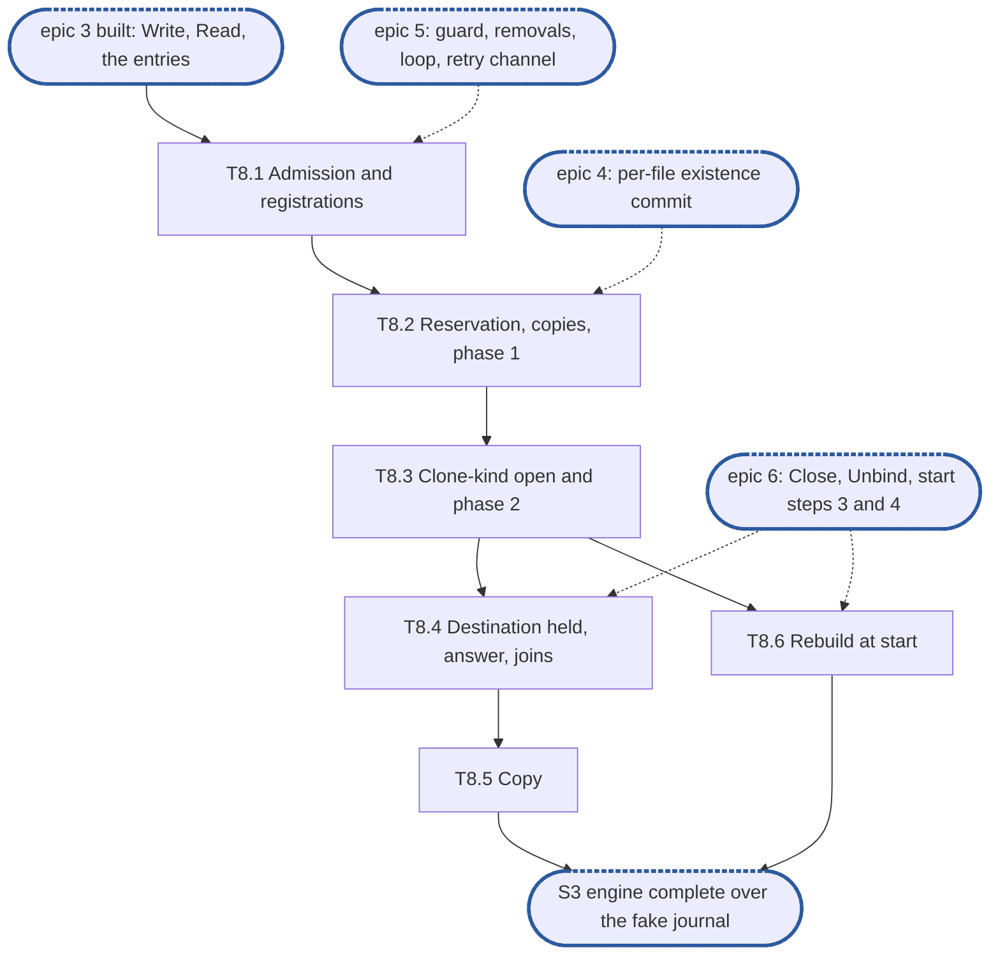

# Epic 8: engine v2 clone and copy, journal-held

**Sources:** [RFC 8](../rfcs/rfc-8-engine.md) §9.1 (all but the adoption of carved refs, the
fill and the snapshot cases), §2.3 (`Unbind`'s join of clones), §2.5 (start steps 3 and 4
for a clone, and stop step 2), §2.6 (`Deps.Holds`, a `CloneHold`), §8.1 (a release held
behind a clone, its retry channel), §12.1 (`Clone`, `Copy` and their errors), §13 (E6, E28,
E34, E40) and §15.1's §9.1 and §2.5 rows; [RFC 14](../rfcs/rfc-14-open-state.md) §2.2 (the
clone-kind open), §9.2 (`CloneOpen`, `CloneClose`) and §11.3 (`Recovery.Served`), for the
hold on the source; [RFC 17](../rfcs/rfc-17-vfs.md) §5.9, for what the filesystem service
admits before the call and how it holds a call behind a clone;
[RFC 1](../rfcs/rfc-1-journal.md) §3.6 (`CloneTarget`, `CloneSpec`, the clone marker) and §6
(`Reserve`), for the journal calls; [RFC 6](../rfcs/rfc-6-block-metadata.md) §2.4 and §6.6, for
the clone `Removal` record and the two phases `kvstore`'s `Existence.Clone` and
`Content.Resume` already implement.
**Track:** A.
**Epic 8 estimate: 6 subtasks, 19 man-days.**
**Depends on:** epic 3, built: T3.1's per-file entries, T3.2's `Write`, T3.4's replay and
T3.5's read resolution, which a clone copies through and resolves its source with; epic 4's
per-file existence commit (T4.3), which commits the source's pending existence before
`asOf` is read; epic 5's guard, the three removals' entry points (T5.1), the removal loop
(T5.3) that runs phase 2, and a release's retry channel (T5.4), whose `ErrDelay` branch is
built here; epic 6's `Close` and `Unbind` (T6.8, T6.9), which join clones, and start step 3's
clone markers and step 4's unfinished removals (T6.5, T6.6), from which a clone is rebuilt.
#3608 and #3609, which put the share on every content call and give `Clone` and `Copy` a
source and a destination share (D1). Open state's `Releasing`, the stage 1 follow-up, for
one test of T8.3.
**Blocks:** the integration epic, through S3; stage 2's piece 11, Copy and clone, which
calls `Clone` and `Copy` once S3 is reached.

---

## 1. Goal

Epic 8 gives the engine `Clone` and `Copy` for content the journal holds. A clone freezes
its source extent, reserves the journal capacity for its copies, removes the destination
extent in the journal, copies the source's held bytes above that removal and syncs them,
commits phase 1, holds the source through open state, and lets the removal loop run phase 2,
which adopts nothing here. A copy is a series of bounded clones.

**At the end of the epic:**

- every refusal, the capacity reservation's included, comes before the journal step and
  leaves the destination as it was; after the journal step a clone never fails for good,
  and a crash resumes it from its spec;
- the destination reads exactly the source as it was at `asOf`, a source run that was
  neither held nor a hole reading **Lost** there, never zeros;
- no write, removal or clone changes the source extent while the clone runs, and no
  removal of the destination races its batches; writes outside the destination extent
  survive;
- the source cannot be released before the clone is done, at any point of the clone,
  across a restart included;
- a clone is answered only once done, `ErrDelay` at its deadline while it keeps running, and
  a retry joins it rather than starting another.

### 1.1 In scope

Admission and the extent registrations of both files; the reservation, the journal step,
the copies, the sync and phase 1; the clone-kind open taken and released through
`Deps.Holds` around phase 2, which epic 5's removal loop runs; every call on a cloning
destination held; the answer at the deadline and a retry's join; `Copy` as 64 MiB clones;
a clone rebuilt at start; `Unbind`'s and `Close`'s join of clones; the fake journal's
`CloneTarget`, `Reserve` and clone marker.

### 1.2 Out of scope

- Adoption of carved refs, the fill a clone must not install, and a source whose bytes
  must be fetched (RFC 8 §9.1's carved case): RFC 8's second part, with offload. A carved
  run cannot arise, since no code of this part writes a ref; phase 2 adopts one if a store
  written by something else holds it, which `kvstore`'s `Resume` already does, and the
  clone fetches nothing.
- The cut gate and a clone in a pre-cut commit (RFC 8 §5.1), and the "snapshot between
  batches" and "clone across a cut" rows: RFC 12, out.
- The clone across shards (RFC 8 §9.1, **(cluster)**), its `OtherShard` refusal and its
  `ponytail:` marker; a share's re-home (`Closing`, RFC 27 §2.7) and the count of clones
  admitted into it.
- An incomplete source: the filesystem service refuses it (RFC 17 §5.9 step 2), and the
  store records no `Incomplete` flag in this part (D2).
- RFC 17 §5.9's admission of both handles, authorisation, the charge reservation and the
  setuid clear, the hold of a call behind a clone (`WithHold`), and the adapters' mapping:
  the filesystem service's, stage 2's piece 11.
- Phase 2's batches themselves (`Content.Resume`), the clone `Removal` record, the source's
  durable open record and their prune: built in `kvstore` (`clone.go`, `removal.go`,
  `release.go`).

### 1.3 Names used here

- **E1**, epic 1, interfaces: `pkg/block/enginev2`'s exported surface, `Deps` and its
  interfaces, frozen at S1.
- **E2**, epic 2, red e2e suite and test foundations: `engine-conformance` with its
  `known.yaml`, the fixture over the real journal, `kvstore` and the real open-state table,
  the fault-injecting `kv.KV`, the fake journal and the profiler wiring.
- **Epics 3 to 6**: write, read and overlay (3); commit, group commit and losses (4);
  removals (5); start, bindings and recovery (6). Their subtasks are cited as `T<epic>.<n>`.
- **S1**, interfaces frozen and `Content` agreed with the filesystem service. **S2**, red
  suite in CI. **S3**, engine complete over the fake journal: epics 3 to 8 done, every row
  whose journal call exists green. **S4**, the journal's calls built.
- **The guard**: epic 5's per-file guard, held by a removal across its journal step and
  phase 1, and by a group commit's capture.
- **A registration**: an extent of a file a running clone has frozen: the source extent, which
  takes no change, and the destination extent, which is not served.
- **E6, E28, E34, E40**: RFC 8 §13's invariants of those numbers, not epics. E6: a clone
  holds the destination's guard over its copies and freezes its source by registration,
  never by the source's guard; E28: a clone changes only its destination extent, fails only
  before its journal step, is answered only when done, and a copy runs as bounded clones;
  E34: a clone never waits on the remote tier, and a source run uncarved and not held is
  carried as **Lost**; E40: no transaction exceeds the key budget `K`.
- **The integration epic**, epic 9: the filesystem service composed over the engine at
  RFC 17 §8's integration tier.

## 2. General rules for each epic

1. **Independent unit tests.** Each epic carries its own unit tests. It may use another
   epic's pure in-memory implementation, the implementation of an epic it depends on once
   that has landed, and E2's test components: above all the fake journal, which stands in
   for the journal wherever the logic under test is the engine's (the resolution table, the
   group commit's split, the refusal mapping). E1 declares no internal interface for it to
   fake (rule 12).
2. **Fuzz tests: none.** The engine parses no bytes of its own: it reads the journal's
   answers and the store's records through typed calls. RFC 8 §15 checks its pure parts,
   read resolution and the group commit's split, by its tables, not by fuzz, and says so in a
   `ponytail:` marker, so no fuzz target is built for them.
3. **Observability follows RFC 25, through what exists.** `Deps` carries a `*slog.Logger`
   narrowed with `With("component", "engine")` and a `Tracer`, a function type the engine
   declares over standard-library types only. RFC 25's metrics registry, watchdog and
   health source exist on neither branch, so the engine exposes its counters and
   conditions as `Stats` fields, and the root that composes it adapts them. Counters are
   named for RFC 8 §14's metrics, under the `engine_` prefix (RFC 25 §2.1), never
   `enginev2_`, with no share label on a per-operation series. Spans are RFC 8 §14's
   proposals, `engine.sync` and `engine.existence_commit`, and a removal batch opens a root
   span. Each epic names the counters, conditions and spans it owns; the units, labels and
   logging rules are RFC 25's, applied as written.
4. **Profiling.** Tests and benchmarks run under E2's profiling harness and fail on
   goroutine, descriptor or memory leaks and on anomalous resource growth. No
   allocations-per-op assertion: RFC 8 §15.4 defers its engine-cost benchmark until a
   profile shows engine time on the request path.
5. **Public interface and internals.** Tests cover both the internal package API and the
   public behaviour the epic enables, including concurrency under `-race`. Test at the
   layer that **consumes** a value (see `CLAUDE.md`, "Verifying a change"): a field the engine
   passes to the journal or the store is asserted where they read it, over the real journal
   and `kvstore`, not where the engine builds it.
6. **Known failures shrink.** An e2e test that turns green leaves the suite's `known.yaml`
   (`test/enginev2/known.yaml`) in the same change: `dt` fails the run if a listed test
   passes, so the change that turns it green removes it, a journal pull request included. A
   test over the real journal that starts red sits in that suite behind its build tag, never
   in `unit`, which keeps no known list.
7. **v2 ignores v1.** No import of, copy from, or behavioural dependence on v1, enforced by
   the engine's one import test, a walk over every package of `pkg/block/enginev2` with
   one allowlist, which also refuses `pkg/vfs`: no package imports `pkg/block/engine`,
   `pkg/block/journal`, `pkg/block/syncer`, `pkg/block/carver`, `pkg/block/remote` or the
   v1 metadata service `pkg/metadata`. The walk checks every package on its own, so its
   allowlist names each package an exception applies to, test packages included. v1 is not
   touched: it is deleted at the cutover.
8. **Real dependencies for properties of those dependencies.** No fake stands in for a
   check about what the real thing does: the real journal on a real directory, with its crash
   seam, for durability, recovery and loss; the real `kvstore` for what a transaction
   commits and conflicts on. The fake journal is for the engine's pure logic only, and no
   conformance row runs over it.
9. **Code comment conventions** (`CLAUDE.md`, "Code comments"). A source comment describes
   the code's behaviour and references nothing outside it: no issue or pull request
   numbers, no CI, runner or OS names, no epic, subtask, plan or decision ids. A
   `ponytail:` marker records a knowingly simple implementation, naming its ceiling and the
   upgrade path. A `decision:` marker records deliberate behaviour, naming the rule, why it
   holds and the evidence that would overturn it. Where the RFC carries such a note, its
   marker goes at the code site that implements it: RFC 8's copy-on-write share table, the
   per-file state bound, the loss-sequence floor, the version-limit headroom and its burst,
   the lazy existence of appends, and the stable-overwrite cost.
10. **A test must be able to fail.** Keep a test only if a plausible change would make it
    fail and nothing else would catch that change: not the compiler, not the diff, not a
    later epic's tests. A review rule that no test can check, such as "stubs never panic",
    stays a review rule.
11. **A symbol is exported only if the RFC's interface uses it.** Everything exported is
    frozen at S1. Helpers the engine's own files need stay unexported or move to an
    `internal/` package of `enginev2`.
12. **Each subtask creates only what it declares.** No empty package and no stub without a
    caller. A package, an option or a test helper lands with its first consumer.

### 2.1 How the rules apply

| Rule | Subtasks | How |
| --- | --- | --- |
| 1 Unit tests | all | every subtask tests over E2's fake journal and the real `kvstore` on an in-memory `kv.KV`, through epic 3's unit composition, with a recording `CloneHold` stub where open state is not the subject; T8.2 extends the fake with `CloneTarget`, `Reserve` and the clone marker `Since` yields |
| 2 Fuzz | none | no parser. RFC 8 §15's `ponytail:` names `Copy`'s extents among the parts its tables check; T8.5's table test is that check, and the marker already stands at the read-resolution table, so no second one |
| 3 Observability | T8.2, T8.3, T8.6 | no new counter and no new condition: a clone's phase 2 is a removal of kind clone, counted in epic 5's `engine_removal_batches_total`, `engine_removals_pending` and `engine_removals_oldest_seconds`, and its `removal_stalled` condition is unhealthy, not degraded (RFC 8 §8.1). T8.3 opens each clone's `Resume` as the removal loop's root span, its kind an attribute. RFC 8 §14's span events for a wait on a registration are not recorded: the `Tracer` declares no event, and a call never waits on one here (D3). T8.2 logs a phase-1 refusal met after the journal step at `Error` (D8); T8.3 a failed `Hold` at `Error`; T8.6 a rebuilt clone at `Info`, naming both files, and reports a rebuilt clone whose source's shard is not served after five backoffs as `removal_stalled` for its clone `Removal` (D11) |
| 4 Profiling | all | the unit composition's `prof.Watch` covers every test, a clone's detached goroutine (D6) included: one leaked past `Close` fails it |
| 5 Public and internal | all | internal tests of admission (T8.1), the replay of a clone operation (T8.2) and `Copy`'s chunking (T8.5); `Clone` and `Copy` tested through `*Engine`; `-race` in T8.1, T8.4 and T8.5. The spec handed `CloneTarget` is asserted where the journal yields it back, from `Since` over the real journal (T8.6); the `CloneOp` handed `Existence.Clone` where `kvstore` reads it, by the destination's `Covering` and the source's open record after phase 1 (T8.2); `CloneSrc` where open state matches it, by `CloneOpen` over the real table (T8.3) |
| 6 Known failures | T8.2, T8.3, T8.4, T8.6 | the rows of R33 to R40 are E2's, red in `known.yaml`; a row this epic turns green over the real journal leaves it in that change. T8.3's tests over the open-state table enter `known.yaml` naming this epic's issue until `Releasing` and the journal's `CloneTarget` and `Reserve` exist |
| 7 v2 ignores v1 | all | the import walk stays as it is: nothing new is imported. The engine still imports no `pkg/openstate`: `Deps.Holds` is the engine's own `CloneHold` |
| 8 Real dependencies | T8.2, T8.3, T8.6 | the store's answers come from the real `kvstore`; the open record and its matching from the real open-state table in E2's fixture; recovery from a clone marker over the real journal and its crash seam |
| 9 Comments | all | the markers of §4, each at its code site, and RFC 8 §9.1's two: the copy chunk's `decision:` at `Copy` (T8.5) and the copy-through-the-journal `decision:` at the copy step (T8.2) |
| 10 Tests can fail | all | each test below names the change it catches |
| 11 Exports | T8.1 | one field: `Share.Namespace`, which RFC 8 §12.1's `Share` declares (D2). `Clone`, `Copy`, `CloneHold` and `CloneSrc` are E1's; test hooks live in `export_test.go` |
| 12 Creates only what it declares | all | the fake's clone calls land in T8.2, their first consumer; the pending-operation kind for a clone in T8.2, which replays it; the done-clone memory (D7) in T8.4, which reads it |

## 3. Requirements and invariants

Every MUST and MUST NOT that RFC 8 and the RFCs it cites place on this epic, numbered so that
subtasks and tests can cite them. Sections are RFC 8's unless named.

**Admission**

| # | Requirement | Kind | Source | Subtasks |
| --- | --- | --- | --- | --- |
| R1 | A clone whose source and destination are one file and whose extents overlap is refused `ErrInvalid`; a clone between disjoint extents of one file is allowed; a `Copy` any of whose extents overlap in one file is refused the same way | MUST | §9.1, RFC 17 §5.9 step 2 | T8.1, T8.5 |
| R2 | A `Clone` longer than `clone_max_len` is refused `ErrInvalid`, all or nothing; `Copy` is not bounded by it | MUST | §9.1, RFC 17 §5.9 | T8.1 |
| R3 | A clone or copy whose destination's share does not list every namespace the source's share lists is refused `ErrCross` (`CrossNamespace`) | MUST | §9.1, RFC 6 §6.6 | T8.1 |
| R4 | Every refusal (overlap, length, namespace, an extent under a running clone, a source extent past the source's end, the capacity reservation) comes before the journal step and leaves the destination's prior content; a refused reservation also undoes the registration | MUST | §9.1 step 1, E28 | T8.1, T8.2 |
| R5 | A share with no binding answers `ErrDelay` (`DelayFrozen`) whichever side it is on, and touches no journal | MUST | §12.1 | T8.1 |

**The registration**

| # | Requirement | Kind | Source | Subtasks |
| --- | --- | --- | --- | --- |
| R6 | Until the clone is done, a write, truncate, deallocate or clone into the registered source extent answers `ErrDelay`, so every step reads the source as it was at `asOf` | MUST | §9.1 | T8.1 |
| R7 | The registration waits for writes already admitted to the source extent to stage before `asOf` is read, and for a removal of it in flight | MUST | §9.1 | T8.1 |
| R8 | The source is frozen by the registration, never by its guard, and a same-file clone registers its source extent once and takes no guard twice | MUST NOT | §9.1, E6 | T8.1 |
| R9 | The registration is memory, rebuilt at start before the source is served: from the clone's `Removal` record once phase 1 wrote it, from the journal's clone marker before | invariant | §9.1, §2.5 step 4 | T8.6 |
| R10 | A release of the source while it is registered, or of the destination while its clone runs, answers pending through `Delete`'s retry channel before the journal's `Delete`, so nothing is dropped; the channel yields `ErrDelay` (`DelayClone`) once the clone is done, or `ErrUnavailable` at `Close` or `Drop` | MUST | §8.1, §9.1 | T8.2, T8.4 |

**Copy and phase 1**

| # | Requirement | Kind | Source | Subtasks |
| --- | --- | --- | --- | --- |
| R11 | Step 1: register, sync the source and commit its pending existence, read `asOf`, and reserve on the destination's handle, with `Reserve(n, writes)`, everything the copies need, so no copy is refused part-way | MUST | §9.1 step 1, RFC 1 §6 | T8.2 |
| R12 | Step 2: `CloneTarget(dst, spec)` under the destination's guard, the spec naming source share and file, both offsets, the length and `asOf` | MUST | §9.1 step 2, RFC 1 §3.6 | T8.2 |
| R13 | Every source run the journal holds at `asOf` is copied into the destination above the clone's version *v* through the reservation, the destination synced and the reservation closed, before phase 1 | MUST | §9.1 step 3, E34 | T8.2 |
| R14 | The destination's guard is held from the journal step over the copies, the sync and phase 1, so no group commit captures one of its operations meanwhile | MUST | E6, §9.1 step 4 | T8.2 |
| R15 | Phase 1 commits the destination's pending existence, the copies included, and records the removal of kind clone with its spec, through `Existence.Clone`; the guard is then released and `Settle(dst, v)` called | MUST | §9.1 step 4, RFC 6 §6.6 | T8.2 |
| R16 | A source run neither held nor a hole or zero ref at `asOf` is carried as uncarved: nothing is copied for it, and the destination reads **Lost** there, never zeros | MUST NOT | §9.1, E34 | T8.2 |
| R17 | A clone never waits on the remote tier: it fetches nothing | invariant | §9.1, E34 | T8.2 |

**Phase 2 and the hold on the source**

| # | Requirement | Kind | Source | Subtasks |
| --- | --- | --- | --- | --- |
| R18 | The engine takes the clone-kind open with `Holds.Hold` after phase 1 and before `Content.Resume` runs phase 2, and calls `Holds.Release` once `Resume` returns, holding no admission lock in either | MUST | §2.6, §8.1 step 1, RFC 14 §9.2, §11 | T8.3 |
| R19 | Phase 2 runs from the removal loop, metadata only, in batches within `K`; a failed batch is retried with backoff and raises `removal_stalled`, unhealthy, after five | MUST | §9.1 step 5, §8.1, E40 | T8.3 |
| R20 | After phase 2's last batch has set the removal done: drop the registration and the open, serve the destination extent, and answer | MUST | §9.1 step 6 | T8.3 |
| R21 | A rebuilt clone's batches run only once `Holds.Served` returns for the source's shard | MUST | §2.5 step 4 | T8.6 |

**The destination**

| # | Requirement | Kind | Source | Subtasks |
| --- | --- | --- | --- | --- |
| R22 | The destination extent is not served until the clone is done: a read of it or a write into it does not run | MUST NOT | §9.1 | T8.1, T8.4 |
| R23 | Nothing removes from the destination while its clone runs: a truncate, deallocate or clone of the destination file, and its release, are held until it is done | MUST | §9.1 | T8.4 |
| R24 | A clone removes exactly the destination extent: a write to the destination outside it, acknowledged at any point during the clone, survives | MUST | §9.1 | T8.2, T8.4 |

**The answer**

| # | Requirement | Kind | Source | Subtasks |
| --- | --- | --- | --- | --- |
| R25 | A clone is answered only once done; at its request's deadline it is answered `ErrDelay` and keeps running from its durable spec, never success and never failure | MUST | §9.1, E28 | T8.4 |
| R26 | After the journal step a clone does not fail for good: a crash or a store error resumes it, and no undo path exists | invariant | §9.1, E28 | T8.2, T8.6 |
| R27 | A retry naming the same source, destination, offsets and length while the first runs joins it, and does not start a second clone; once the first is done, a retry whose destination extent was not written since and whose source extent has no version above `asOf` is answered success at once | MUST NOT | §9.1 | T8.4 |
| R28 | `Unbind` admits no new clone or copy for the share, and joins every clone with the share on either side, letting the phase-2 batches the join waits on run; `Close` cancels and joins clone batches, each `Release` included, before open state stops; a `Resume` it cancelled takes no `Release` (D6) | MUST | §2.3, §2.5 stop step 2, §2.6 | T8.4 |

**Copy**

| # | Requirement | Kind | Source | Subtasks |
| --- | --- | --- | --- | --- |
| R29 | `Copy` takes its extents in order and runs each as clones of the fixed copy chunk, 64 MiB, in offset order, and returns the bytes copied across them; at the deadline it answers a short count | MUST | §9.1, RFC 17 §5.9 | T8.5 |
| R30 | A chunk refused at admission after earlier chunks are done answers the short count of the chunks done, never the chunk's error; only a refusal of the first chunk returns the error | MUST | §9.1, RFC 17 §5.9 | T8.5 |

**Restart**

| # | Requirement | Kind | Source | Subtasks |
| --- | --- | --- | --- | --- |
| R31 | A clone marker `Since` yields above `applied` is rebuilt as a clone, never applied as a plain removal | MUST | §2.5 step 3, RFC 1 §3.6 | T8.6 |
| R32 | A clone rebuilt before phase 1 keeps the copies the journal holds above *v*, re-makes and reserves only what they do not cover; a refused reservation does not hold up start, and the destination file answers `ErrDelay` (`DelayCapacity`) while the clone waits for space, `DelayClone` otherwise, until phase 1 commits | MUST | §2.5 step 4, §9.1 step 3, RFC 1 §6 | T8.6 |

**Test rows** (RFC 8 §15.1, registered red by E2)

| # | Row | Kind | Source | Subtasks |
| --- | --- | --- | --- | --- |
| R33 | Clone keeps writes outside its extent, adapted: the stalls before phase 1, between the phases and between two batches; the offload and eviction half is the second part's | test row | §15.1 | T8.2, T8.4 |
| R34 | Overlapping clone: `ErrInvalid`, the file unchanged | test row | §15.1 | T8.1 |
| R35 | Failure leaves the destination, adapted: a refused reservation leaves the prior content; crashes after the journal step, the copies, phase 1 and between two batches each finish from the spec, the source written at each restart answering `ErrDelay`; the source part dirty and part a hole or uncarved, not carved | test row | §15.1 | T8.2, T8.6 |
| R36 | Removals of a cloning destination: a punch, a truncate, a clone onto it and an unlink held until done, then applied; the release's prune keeps the clone `Removal`; the last batch deletes the source's clone-kind open | test row | §15.1 | T8.3, T8.4 |
| R37 | Source registration rebuilt: stopped between two batches with the files in two shares, the source's registration is rebuilt before it is served (D10) | test row | §15.1 | T8.6 |
| R38 | Clone never waits, adapted: no remote is composed; writes into either extent answer `ErrDelay` until done; power cut after the answer, the destination reads the source | test row | §15.1 | T8.1, T8.2, T8.6 |
| R39 | Refusals, adapted: two namespaces `ErrCross`; one byte over `clone_max_len` `ErrInvalid`; a `Copy` of 1 GiB with a writer of the source answered within one chunk's time once the service retries, and a deadline mid-copy answering a short count a continued copy completes. The NFSv3 client's view is the integration epic's | test row | §15.1 | T8.1, T8.5 |
| R40 | Clone resumed at a full limit, adapted: crash after the copies synced, before phase 1, on a share at its journal limit; restart re-makes no copy, reserves nothing, serves every other file and finishes the clone. The remote outage is the second part's | test row | §15.1 | T8.6 |

## 4. Decisions this epic takes

- **D1, the two shares.** `Clone` and `Copy` take `srcShare` and `dstShare` beside the files
  (RFC 8 §12.1 as #3608 words it). The engine's stubs change with #3609: on this base
  `unbuilt.go` still declares the one-share `Clone(ctx, src, dst FileID, x)`. Each is resolved through epic 3's `bindingOf`; either one unbound answers
  `DelayFrozen`. The source is read through its share's handle and the copies are written
  through the destination's, which may be another journal. On one node a clone between two
  shares of one namespace is a clone between two shards, which RFC 8 §9.1 refuses only in a
  cluster. A `decision:` marker at admission says so: no failover or handover can split two
  shards on one node; withdraw it when a node can lose one of the two shards while the
  clone runs.
- **D2, who refuses what.** The engine refuses what it can judge before the journal step:
  a zero length, overlap, `clone_max_len`, an extent under a running clone, the namespace,
  and a source extent past the source's end at `asOf`, which T8.2's sizing pass finds (D5)
  and `kvstore`'s phase 1 also refuses, so it would otherwise be met after the journal step. The namespace check compares
  the two shares' write namespaces, `Share.Namespace`, a field RFC 8 §12.1's `Share`
  declares and T8.1 adds; `Bind` gives it. A `decision:` marker says a share listing more than
  one namespace, a re-home of RFC 27, needs the whole list, which `kvstore`'s phase 1
  compares as a backstop, and is withdrawn when re-homes are built. An incomplete source is
  the filesystem service's (RFC 17 §5.9 step 2): the File record is RFC 7's, the store keeps
  no `Incomplete` flag here, and the engine reads no File record; a `decision:` marker names
  it.
- **D3, a call behind a clone answers at once.** A write into either registered extent, a
  read or `Allocation` of the destination extent, a truncate, deallocate or clone into the
  source extent, and a truncate, deallocate or clone of the destination file answer
  `ErrDelay` with `DelayClone` at once, or with the clone's own cause while it is held up
  (`DelayCapacity` waiting for space at start, `DelayCommit` behind a stalled store); a
  release answers pending with its retry channel (R10). The engine never waits inside such
  a call: the filesystem service holds the file's admission and accept locks across it
  (RFC 8 §4.1, RFC 17 §5.0), and RFC 14 §11 requires a call held behind a clone to hold no
  entry mutex meanwhile. The hold itself, `WithHold` and its bound, is the service's
  (RFC 17 §5.9). A `decision:` marker at the registration check names it, and is
  withdrawn if RFC 17 moves the hold into the engine (§9, point 2).
- **D4, the registrations.** A registration is an extent and a running clone, kept in each
  file's entry, which it keeps alive (epic 3's bound: an entry exists while it holds
  something). The source's is installed under the source's entry lock once a removal of the
  source extent in flight, which T5.1 marks in the entry, has ended (T5.1's registration
  check and its mark sit in one entry-lock section, and the mark lasts until phase 1 ends): the clone waits it
  out without taking the source's guard (RFC 8 §6.4, §9.1, E6), and a removal admitted after
  sees the registration under the entry lock. Then the clone waits until the writes admitted
  before it have staged. `Write`
  counts itself admitted under the entry lock before `WriteAt` and uncounts once its
  operation is inserted, and checks the registrations at that point. The destination's
  extent is registered with the source's, before the reservation. A same-file clone holds
  one entry with two registrations, registers its source extent once, and takes no guard
  twice: the only guard it takes is the destination's, at the journal step (T8.2). Checked
  on every write, the registration costs one more entry-lock round per write.
- **D5, sizing the reservation.** `Reserve` needs the bytes and write count of the copies
  before the journal step, and the journal reports held extents only through `ReadAt`.
  Admission resolves the source extent at `asOf` with epic 3's resolution, in windows of the
  copy buffer, 1 MiB, discarding the bytes and keeping the held runs; step 3 reads those runs
  again to copy them, one write per buffer, so `writes` is the sum over held runs of their
  buffers. The same pass finds the source's end (D2). A `ponytail:` marker: a clone reads
  its source's held bytes twice; give the handle RFC 1 §3.7's `Extents` to size without
  reading when clone time on journal-held sources shows in a profile.
- **D6, a clone outlives its call.** Everything after the journal step runs on a goroutine
  the engine owns, under the engine's context: the copies, the sync, phase 1 and the post
  to the removal loop, whose item takes `Hold` (T8.3), and for a rebuilt clone the wait on
  `Served` before that post (D11). The call waits for the clone's done signal within its own
  context, so a deadline answers `ErrDelay` and leaves the clone running (R25). The running
  clones are a map keyed by destination share and file, its lock held for the lookup only,
  which a retry joins (R27) and `Unbind` and `Close` join (R28). Before the journal step the
  call's own context governs, and its end is a refusal that changes nothing. `Close` cancels
  the goroutine and the loop's clone item; a `Resume` it cancelled is followed by no
  `Release`, so the source's clone-kind open record stays and the restart's rebuild (D10)
  holds the source from it, open state installing it before the shard is served (RFC 14
  §9.2). A context
  cancelled, not past its deadline, answers its own error, as epic 3's content methods do.
- **D7, a done clone's memory.** RFC 8 §9.1 answers a retry of a finished clone at once when
  neither extent changed. A done clone leaves its spec in both files' entries, which keeps
  each entry alive as a registration does (D4), until a write or removal overlapping either
  extent drops it, and a node-wide FIFO keeps at most 1024,
  dropping the oldest. A retry finding its spec answers success at once; one finding none
  runs the clone again, which yields the same bytes. A `ponytail:` marker: the memory is
  lost at restart and after 1024 later clones, so a client retrying across a restart re-runs
  its clone, which can outlast a deadline again; persist it in the clone `Removal` record,
  kept done until pruned, if retries after a restart are seen in logs.
- **D8, a phase-1 refusal after the journal step.** `kvstore`'s phase 1 refuses an overlap,
  a source past its end, two namespaces and a destination already cloning, after the journal
  step that RFC 8 §9.1 says no refusal may follow. Admission refuses each first (D2, D4),
  the past-end source in T8.2's step 1 once `asOf` is read, so phase 1 meets one only when
  the store changed under a registered extent by a path this part does not have. Met anyway, it is logged at `Error` naming both files, and the clone
  is retried from its spec with the removal loop's backoff; it never fails and never undoes.
  The destination's guard stays held across the retries, so no group commit raises
  `applied` above *v* meanwhile, which would leave the destination reading **Lost** (T8.2's
  test of R14). A refusal that never clears therefore pins the guard, holding the file's
  removals and group commits, and raises `removal_stalled` for the destination after five
  retries, as T5.4's retry does. A group commit's capture skips a file whose guard is held
  and takes it in a later batch (RFC 8 E17), so it never blocks on a pinned guard: the
  journal's other files commit, and the phase-2 batches `Unbind`'s join waits on (R28) run.
  That join then waits on the clone's own retries only, which `removal_stalled` makes
  visible, and `Close` cancels them (D6). A `decision:` marker names it, and is withdrawn if the
  store's check moves to an admission read (§9, point 3).
- **D9, the version on the source's open.** `kvstore`'s phase 1 records the source's open
  with the clone's version *v*, and `CloneOpen` matches on it, while `CloneSrc.AsOf` and
  RFC 14's `CloneSource.Version` describe the source's `asOf`. The engine passes *v*, what
  the record holds; a `decision:` marker at the `Hold` call names it until the RFC or the
  field's name agrees (§9, point 4).
- **D10, rebuilding the source's registration.** The engine reads no open record: `Deps`
  holds no view of them. On one node every shard is this node's, so start step 4's listing of
  unfinished removals (T6.6) yields every clone `Removal` not done, and its spec names the
  source extent, `asOf` and *v*, the facts the source's clone-kind open record holds; phase 1
  writes both in one transaction and the last batch ends both. Before phase 1, the journal's
  clone marker (T6.5) carries the same spec. A `decision:` marker says so; withdraw it when a
  source's shard can have another primary than its destination's, which needs open state's
  recovery to hand the engine the record.
- **D11, waiting for the source's shard.** A rebuilt clone waits on `Holds.Served` for its
  source's shard on its own goroutine (D6), in rounds of the loop's backoff, and posts to the
  removal loop only once it returns, so the loop never holds a wait. After five rounds it
  reports `removal_stalled` for the clone `Removal`, cleared when `Served` returns.
  `Unbind` joins the clone as R28 and RFC 8 §2.3 say, waiting out the `Served` wait, which the
  condition makes visible; only `Close` cancels it, the clone `Removal` left for the next
  start's step 4 (D6).
- **D12, `Copy`'s edges.** The chunk is the smaller of 64 MiB and `clone_max_len`, so no chunk
  is refused by the length rule. At the deadline `Copy` answers the bytes of the chunks done
  and leaves the running chunk to finish, which the client's continuation joins (D6) or finds
  done (D7). With no chunk done at the deadline it answers the first chunk's `ErrDelay`, not a
  count of 0, which an NFSv4.2 client would read as nothing left to copy. A `decision:` marker
  beside RFC 8 §9.1's chunk marker names both.
- **D13, a clone in the destination's entry.** The journal step inserts a pending operation
  of kind clone at *v*, `{extent, size raised to the extent's end}`, and each copy a pending
  write above it with no `Done`, since no client write is charged. T3.4's replay applies it,
  so `Overlay` answers the size phase 1 will commit, and phase 1 hands every pending
  operation of the file to `Existence.Clone`.
- **D14, a `Hold` that fails.** In the loop's item, `ErrDelay` with `DelayFrozen`, which the
  root's adapter answers for a shard not yet served, and `ErrStopped`, a table not running,
  hold phase 2 before `Resume`, retried with the removal loop's backoff and counted toward no
  `removal_stalled` (T5.3). Any other
  failure is logged at `Error` and holds nothing: `Resume` runs, its last batch deletes the
  record, and no `Release` follows. `Release` of a hold already gone answers nil through the
  adapter. A `decision:` marker at the call says a failed `Hold` leaves the source held by the
  durable record alone, which the release's holder check still sees.

## 5. Target tree

```text
pkg/block/enginev2/
  types.go          T8.1  Share.Namespace (D2)
  clone.go          T8.1  admission, the registrations and their checks (D2, D3, D4)
                    T8.2  sizing, Reserve, CloneTarget, the copies, the sync, phase 1 (D5, D6, D8, D13)
                    T8.3  Hold, the post to the removal loop, Release, the done signal (D9, D14)
                    T8.4  the running-clone map, the wait and its deadline, the done memory (D6, D7)
                    T8.5  Copy (D12)
  file.go           T8.1  registrations and the admitted-write count on the entry
                    T8.2  the clone pending-operation kind
  write.go          T8.1  the admitted count and the registration check in Write
  read.go           T8.1  the destination extent refused in Read
  allocation.go     T8.1  and in Allocation
  remove.go         T8.1  the check before the journal step of Truncate and Deallocate
                    T8.2  Delete into a registered extent answered pending (T5.4's channel)
  overlay.go        T8.2  the clone operation in the replay
  removals.go       T8.3  the clone item in the removal loop: Hold, Resume, Release
  share.go          T8.4  Unbind's join of clones
  engine.go         T8.4  Close's cancel and join of clones
  start.go          T8.6  a clone rebuilt from its marker or its Removal record (D10), its Served wait (D11)
  export_test.go    T8.1  hooks: the registrations, the admitted count; T8.2 the faked done signal; T8.4 the done memory
  enginev2test/
    fake.go         T8.2  CloneTarget, Reserve, Reservation, Since's clone marker
```

## 6. Subtasks

### T8.1 Admission and the registrations

**Subtask T8.1 estimate: 3.5 man-days.**

- **Track:** A. **Depends on:** epic 3 (T3.1, T3.2, T3.5); epic 5's T5.1 for the removal half,
  the guard and the entry points of `Truncate` and `Deallocate`. The admission checks start
  right after epic 3, while track A waits on epic 5.
- **Covers:** R1, R2, R3, R4, R5, R6, R7, R8, R22, R34, R38, R39.
- **Deliverables:** `clone.go`'s admission: both bindings (D1, its marker), a zero length,
  overlap within one file, `clone_max_len` for `Clone`, the write namespaces (D2, its
  marker), each answered before any journal or store call; the registration type and its
  install on both files (D4), and its removal, which T8.3 calls; the check in `Write`,
  `Read`, `Allocation`, `Truncate`, `Deallocate` and a clone's own admission, answering
  `DelayClone` at once (D3, its marker); `Share.Namespace` in `types.go`; the hooks in
  `export_test.go`.
- **Acceptance criteria:**
  - A refused clone makes no journal call, changes no store key, and leaves no
    registration.
  - A write admitted before the registration stages before the registration returns; one
    admitted after answers `ErrDelay` (`DelayClone`), stages nothing and calls no `Done`.
  - A write outside both extents, of either file, is served while the registrations
    stand.
- **Tests:** a table of refusals over the composition with a journal wrapper counting every
  call and `kv.Counts` on the store: `f[0, 8 MiB)` onto `f[1, 9 MiB)` `ErrInvalid` (R34), one
  byte over `clone_max_len` `ErrInvalid`, a zero length `ErrInvalid`, two namespaces
  `ErrCross` with `CrossNamespace`, an unbound share on either side `DelayFrozen`, each
  with zero journal calls and zero transactions (catches a check after `CloneTarget`, R4);
  `f[0, 4 MiB)` onto `f[8, 12 MiB)` admitted (catches overlap judged by file alone); a write
  held between `entryFor` and `WriteAt` by a hook, then a clone's registration: the
  registration returns only after the write staged (catches registering without waiting,
  R7, which yields a source written after `asOf`); after it, writes into the source extent,
  into the destination extent, a truncate into the source extent, a deallocate inside it
  and a clone into it each answer `ErrDelay` with `DelayClone`, while a write one byte past
  each extent is served (catches a registration of the whole file, or none, R6, R22); a
  read and an `Allocation` of the destination extent answer `DelayClone`; a deallocate
  inside the source extent held by a hook between its journal step and phase 1: the
  registration returns only after it ends (catches a removal in flight not waited out, R7);
  a deallocate outside the source extent held the same way, so it holds the file's guard: a
  same-file clone's registration returns meanwhile, with one source registration on the
  entry (catches the source's guard taken, or its extent registered twice, R8); `-race` with 32 writers on the source file while a clone registers.

### T8.2 Reservation, journal step, copies and phase 1

**Subtask T8.2 estimate: 4.5 man-days.**

- **Track:** A. **Depends on:** T8.1; epic 4's T4.3, the per-file existence commit; epic 5's
  T5.1 (the guard, phase 1's order) and T5.4 (the retry channel).
- **Covers:** R4, R10, R11, R12, R13, R14, R15, R16, R17, R24, R26, R33, R35, R38.
- **Deliverables:** `clone.go`'s steps 1 to 4: the source synced and its pending existence
  committed, the sizing pass (D5, its marker), `Reserve` on the destination's handle, a
  refusal undoing both registrations and mapped by epic 3's journal-error mapping; a source
  extent past the source's end at `asOf`, found by the sizing pass, refused `ErrInvalid` the
  same way (D2); then on
  the clone's own goroutine (D6) the destination's guard, `CloneTarget` with the spec, the
  clone operation in the entry (D13), the copies of every held run through the reservation
  with the clock's time, `Sync`, the reservation's `Close`, `Existence.Clone` with the
  file's pending operations, the guard released, `Settle(dst, v)`; a phase-1 refusal handled
  by D8; RFC 8 §9.1's `decision:` on copying through the journal at the copy step. T5.4's
  `ErrDelay` branch: `Delete` of a file with a registration answers pending before the
  journal's `Delete`, and the channel yields `ErrDelay` with `DelayClone` when the
  registration drops (T8.3), or `ErrUnavailable` at `Close` or `Drop`. The fake journal's
  `CloneTarget` (removes the extent as `Deallocate` does and leaves a marker with the spec),
  `Reserve` and `Reservation` (draw, refusal by an injected `NoSpaceError`, `Close`), and
  `Since` yielding the marker as `Change.Clone`.
- **Acceptance criteria:**
  - No copy is written below *v*, and no copy is refused once the reservation is held.
  - Phase 1's `CloneOp.Copied` is the newest copy's version, and the destination's
    `applied` after it is at or above it.
  - A source run neither held nor a hole reads **Lost** in the destination after the
    clone, never zeros.
- **Tests:** the done signal is T8.3's, so here an `export_test.go` hook fakes it, dropping
  the registrations and raising it once phase 1 returns; the stall between two batches is
  T8.4's, and the power cut after the answer T8.6's. A reservation refused by the fake: the clone fails with the mapped error, both
  registrations are gone (a write into the source extent is served), the destination reads
  its prior content, and the journal saw no `CloneTarget` (R4, R35's first case); a clone
  whose source extent ends past the source's end at `asOf`: `ErrInvalid`, the journal sees no
  `CloneTarget`, and the destination reads its prior content (catches the refusal left to
  phase 1, after `CloneTarget` wiped the destination range, R4); a source
  of three held runs and two holes: `Reserve` is called with the runs' bytes and buffer
  count, and every `Reservation.WriteAt` version is above the `CloneTarget` version (catches
  copies drawn before the journal step, or through the handle's `WriteAt`, R13); a group
  commit triggered through epic 4's hook while the clone is held between its copies and
  phase 1 captures none of the destination's operations, and the clone then commits (a clone
  releasing the guard after `CloneTarget` lets the commit raise `applied` above *v*, and
  `kvstore` then skips phase 1 as applied, leaving the destination reading **Lost**, R14);
  over the real `kvstore`, after phase 1 the source has an open record of the clone kind
  naming the destination and *v*, and the destination's `Covering` over the extent answers
  `ErrDelay` until done (the consumer of `CloneOp`, rule 5); a source extent whose middle
  run the fake journal lost after its existence committed: the destination reads **Lost**
  there and the source's bytes around it (catches zero-filling an uncarved run, R16); a
  write into the destination outside the extent at each stall reads back after the clone
  (R24, R33); a release of the source while registered returns a pending channel, the
  journal sees no `Delete`, and the channel yields `DelayClone` once the clone is done and
  then nothing (catches a release dropped or answered twice, R10); `Existence.Clone`
  answering a namespace refusal once: the clone is retried, logged once at `Error`, and
  completes on the next attempt (catches a clone failed after its journal step, D8, R26);
  answering it six times: `removal_stalled` names the destination, and a group commit
  triggered between two attempts captures none of its operations (catches the guard
  released across the retry, D8), while a write to another file on the same journal commits
  in that batch (catches a capture blocking on the pinned guard, D8).

### T8.3 The clone-kind open and phase 2

**Subtask T8.3 estimate: 3.5 man-days.**

- **Track:** A. **Depends on:** T8.2; epic 5's T5.3, the removal loop; open state's
  `Releasing` for the unlink-during-`Resume` test.
- **Covers:** R18, R19, R20, R36.
- **Deliverables:** after phase 1, `Holds.Hold` with `CloneSrc{Share, Shard, File, Dst,
  AsOf: v}` (D9, its marker), the source's shard from its binding's `Share.Shard`, the
  marker on that key:

  ```go
  // decision: a clone's source open is keyed in its share's own shard, the
  // one Bind named; nothing the engine receives names a finer shard. A share
  // split into per-child shards needs Existence.Clone to return the hold's key.
  ```

  A `Hold` failure handled by D14, its marker. The clone posted to the removal loop as a
  removal of kind clone; the loop's item calls `Content.Resume`, which runs every batch, as
  its root span; once it returns nil, `Holds.Release`, the registrations dropped, which
  yields `DelayClone` on every retry channel the registration answered pending, the done
  signal raised.
- **Acceptance criteria:**
  - `Hold` is called after `Existence.Clone` returned and before the first `Resume`;
    `Release` once, after the `Resume` that returned nil, and none after a `Resume` that
    `Close` cancelled (D6); neither while an admission lock or entry lock is held.
  - A clone whose `Resume` keeps failing raises `removal_stalled` for the destination after
    five failures, and holds its registrations meanwhile.
- **Tests:** a recording `CloneHold` and a `Content` wrapper logging calls: the order is
  `Clone`, `Hold`, `Resume`, `Release` (catches a `Hold` before phase 1, which `CloneOpen`
  refuses with `ErrBadState`, or a `Release` before the last batch); `Hold` answering
  `DelayFrozen` twice: `Resume` waits, runs on the third try, and no `removal_stalled` is
  raised (catches the retries counted as failures); `Hold` answering another error: `Resume`
  runs, no `Release` follows, one `Error` line; `Resume` failing six times:
  `removal_stalled` names the file, and clears on success. Over E2's fixture and the real
  open-state table: the source unlinked between phase 1 and `Hold`, held there by
  `DelayFrozen`, keeps its content, its release answered pending with no byte dropped,
  and runs again once the registration drops; the source unlinked during `Resume` keeps its
  content until `Sink.Closed` reports the orphan after `Release` (catches a clone that holds
  nothing between phase 1 and phase 2's end); after the clone, the source's clone-kind open
  record is gone (R36's last assertion).

### T8.4 The destination held, the answer and the joins

**Subtask T8.4 estimate: 3 man-days.**

- **Track:** A. **Depends on:** T8.3; epic 6's T6.8 and T6.9, `Close` and `Unbind`.
- **Covers:** R10, R22, R23, R24, R25, R27, R28, R33, R36.
- **Deliverables:** the destination file's registration answering a truncate, deallocate
  or clone of the destination file, whatever its extent, `DelayClone` (D3), and its release
  pending (R10); the running-clone map and the call's wait on the done signal within its
  context, `ErrDelay` with `DelayClone` at the deadline, or the clone's own cause (D6); a
  retry with the same spec joining a running clone; the done memory and its marker (D7);
  `Unbind` refusing new clones for the share and joining clones on either side; `Close`
  cancelling the clones' goroutines, joining them and the loop's clone items, a `Release`
  following only a `Resume` that returned nil (D6).
- **Acceptance criteria:**
  - Two calls with one spec run one clone: one `CloneTarget`, one phase 1.
  - A clone call past its deadline answers `ErrDelay`, and the clone still completes.
  - `Unbind` returns only once every clone naming the share has finished or, at `Close`,
    been cancelled at a step its spec resumes from.
- **Tests:** with `K` forced small and the loop held between two batches: a punch in the
  destination extent, a truncate of the destination, a clone onto it and an unlink with no
  open each answer `DelayClone` or pending, and once the clone is done each applies, the
  punched range reading zeros, never cloned bytes (catches a removal admitted mid-clone,
  R23, R36); the clone `Removal` is listed, not done, until the last batch though the unlink
  came first, and the unlink's release prunes it only once done (catches the release run
  mid-clone, whose prune deletes the record, R36); a second `Clone` with the same spec while the first runs: one `CloneTarget` in
  the journal's log and both answered once done (catches a second clone, R27); the first
  called with a deadline the held loop outlasts answers `ErrDelay`, and a later retry
  answers once done (R25); after it, the same retry answers success with no journal call
  (D7), and after a write into the destination extent, or into the source extent above
  `asOf`, it runs the clone again (catches a spec kept past either change); `Unbind` of
  the source's share while the loop holds the clone returns only after the clone is done
  (catches a join of the destination's share alone, R28); `Close` with a clone mid-copy
  leaves no goroutine for `prof.Watch` and a marker a restart finishes (T8.6); `Close` with
  the loop held between two batches: no `Release`, the source's clone-kind open record
  still there, and the restart finishes the clone (catches a `Release` of a cancelled
  `Resume`, which frees the source mid-clone, R28); `-race`
  with joiners, writers outside the extents and the loop.

### T8.5 Copy

**Subtask T8.5 estimate: 1.5 man-days.**

- **Track:** A. **Depends on:** T8.4.
- **Covers:** R1, R29, R30, R39.
- **Deliverables:** `Copy` in `clone.go`: each extent in order cut into chunks of D12's
  length in offset order, each run as a clone; the count of bytes of the chunks done; the
  deadline and refusal rules of R29, R30 and D12; RFC 8 §9.1's chunk `decision:` marker and
  D12's beside it.
- **Acceptance criteria:**
  - A 200 MiB extent runs as chunks of 64, 64, 64 and 8 MiB, in that order.
  - The count returned equals the bytes the destination holds from the copy.
- **Tests:** the chunk table over a recording clone hook, for extents of 1 byte, exactly
  64 MiB, 200 MiB, two extents, and `clone_max_len` below 64 MiB (catches an off-by-one
  chunk end, reordering, or chunks the length rule refuses); the third chunk refused
  `DelayFrozen` by unbinding the destination's share mid-copy: count 128 MiB and nil
  (catches the chunk's error returned, R30); the first chunk refused: its error; the
  deadline reached during the second chunk: count 64 MiB, the second chunk still completes,
  and a continued copy from 64 MiB joins it (R29, R39); the deadline reached during the
  first: `ErrDelay` (D12); a writer of the source between chunks is served once the chunk
  it met ends (R39's engine half: `DelayClone` during the chunk, served after).

### T8.6 Rebuild at start

**Subtask T8.6 estimate: 3 man-days.**

- **Track:** A. **Depends on:** T8.3; epic 6's T6.5 (clone markers from `Since`) and T6.6
  (unfinished removals posted to the loop).
- **Covers:** R9, R21, R26, R31, R32, R35, R37, R38, R40.
- **Deliverables:** in `start.go`, a clone marker above `applied` handed by start step 3
  rebuilt as a clone: both registrations before either file is served, the destination's
  copies kept (its held extents above *v*), only the source's held runs they do not cover
  re-made through a new reservation, a refused reservation leaving the clone waiting with
  the destination answering `DelayCapacity`, then phase 1 and the rest from T8.2; a clone
  `Removal` not done, from step 4's listing, rebuilt as both registrations (D10, its
  marker), whose goroutine waits on `Holds.Served` (D11) and then posts it to the loop,
  which takes T8.3's path, `Hold` finding the hold open state installed; one `Info` line per
  rebuilt clone. No start step calls `Hold`.
- **Acceptance criteria:**
  - No file is served before its registrations are rebuilt; the destination file answers
    `ErrDelay` until phase 1 commits.
  - A restart re-makes no copy the journal already holds.
  - A rebuilt clone's `Resume` runs only after `Served` returned for the source's shard.
- **Tests:** over E2's fixture, the journal's crash seam and the real open-state table: a
  crash after the journal step, after the copies, after phase 1 and between two batches,
  the source written at each restart before the clone ends: every restart finishes the
  clone, the destination equals the source at `asOf`, and the write answers `ErrDelay`
  until done (a restart applying the marker as a plain removal leaves the destination
  reading zeros or **Lost**; one keeping the registration in memory only clones a source
  written since; R31, R35); the files in two shares, stopped between two batches: after
  the restart a write into the source extent answers `ErrDelay` before any other call
  (R37); a power cut right after the clone's answer: the destination reads the source (catches
  an answer before the copies are synced, R38); a crash after the copies synced on a share at its journal limit: the restart's
  reservation asks for nothing, every other file is served, and the clone finishes (catches
  a restart re-making the copies, which the full limit refuses, R40); a `Served` stub that
  returns only when released: no `Resume` before it, `removal_stalled` names the clone
  `Removal` after five backoffs and clears once it returns (catches a silent wait, D11), and
  an `Unbind` of the source's share before then returns only after the stub is released and
  the clone done (catches a join that abandons the clone, R28).

## 7. Order of work



T8.1's admission checks need only epic 3 and fill track A's wait for epic 5; its removal
half lands once T5.1 does. T8.2 is the riskiest, for the guard held across the copies and
phase 1's order against the group commit. Checkpoint after T8.3: a clone runs end to end
over the fake journal. T8.4 and T8.6 can run in parallel once T8.3 and epic 6 have landed.

## 8. Suggested pull requests

| PR | Subtasks | Man-days | After | Why together |
| --- | --- | --- | --- | --- |
| 1 | T8.1, T8.2 | 8 | epic 3; epic 5's T5.1 and T5.4; epic 4's T4.3 | the clone up to phase 1, with the registrations it rests on and the fake's clone calls |
| 2 | T8.3, T8.4 | 6.5 | PR 1; T5.3, T6.8, T6.9 | phase 2 and the clone's answer: the hold, the join, the deadline |
| 3 | T8.5, T8.6 | 4.5 | PR 2; T6.5, T6.6 | `Copy` and the restart, each a consumer of the finished clone |

A suggestion only: one pull request per subtask works as well.

## 9. Open points

1. **RFC 8 §9.1 still has the source open taken at admission.** Its rule "the clone holds an
   open on the source, entered in the source's open table at its primary at admission"
   predates §2.6's `CloneHold`, whose `Hold` takes over the record phase 1 writes and so
   cannot run before it. Between admission and `Hold` the registration holds the source
   (R10). §9.1's text is owed the narrowing §2.6 and §8.1 already carry.
2. **How a call held behind a clone learns it ended.** RFC 8 §9.1 answers a write into the
   source extent `ErrDelay` "which the filesystem service holds and retries", yet holds the
   destination's removals itself ("answer `ErrDelay` only past their own deadline") and has a
   destination read "wait"; RFC 17 §5.9 lists the destination read among no held calls,
   and RFC 14 §11 forbids an entry mutex across a hold. D3 answers every such call at once
   and leaves the hold to the service, which then has no signal for the clone's end and
   polls. RFC 17 §5.9 should say how the service waits, and RFC 8 §9.1 that the engine
   never does.
3. **`kvstore` refuses after the journal step.** `Existence.Clone`'s phase 1 refuses an
   overlap, a source past its end, two namespaces and a destination already cloning, and
   `Remove`'s phase 1 a removal of a cloning destination, all after a journal step RFC 8
   §9.1 says no refusal follows. D2 and D4 move each to admission and D8 retries what is
   left. RFC 6 §6.6 should either name the admission read or call phase 1's checks
   backstops.
4. **`CloneSrc.AsOf` holds *v*** (D9): RFC 14's `CloneSource.Version` and the engine's field
   name say `asOf`, while the record `kvstore` writes and `CloneOpen` matches carries the
   clone's version. One of the three should change.
5. **`Reserve`'s `n`.** RFC 1 §6 says "`n` record bytes in all", RFC 8 §9.1 "their bytes". The
   engine passes the copies' payload bytes; if the journal counts record headers in `n`, it
   should say so in RFC 1 §6, and the engine adds them.
6. **The "source registration rebuilt" row** asserts the registration is rebuilt "from its
   clone-kind open record". On one node D10 rebuilds the same registration from the
   destination's clone `Removal` record, written and ended in the same transactions; the
   row holds in substance, its wording in a cluster.
7. **RFC 8 §15.1's "one source state" row** is in no epic: its offload of the source during
   the clone is the second part's, but its registration half (writes into the source extent
   `ErrDelay` between two batches, the destination equal to the source at the clone's start,
   a same-file disjoint clone completing, the source released only after the clone) runs in
   this part. T8.1, T8.3 and T8.4 test each piece; E2's catalogue could carry it adapted.
8. **No row over the real journal turns green in this epic.** `journalv2`'s `CloneTarget`,
   `Reserve` and `Reservation` answer `ErrNotImplemented`, and E2's fixture composes the
   engine through `Start`. R33 to R40 leave `known.yaml` once the journal builds them.
