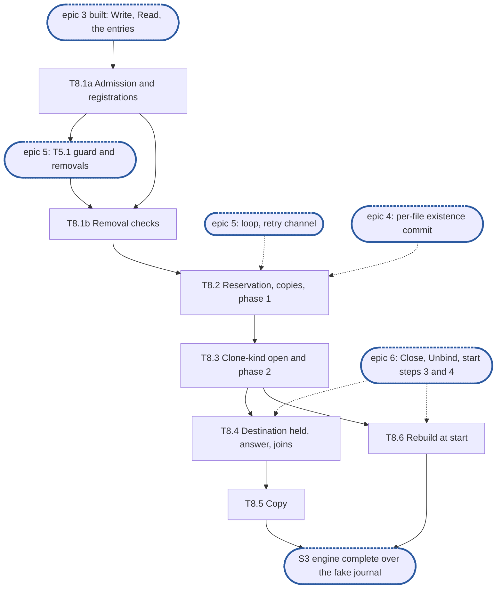

# Epic 8: engine v2 clone and copy, journal-held

**Sources:** [RFC 8](../rfcs/rfc-8-engine.md) §9.1 (all but the adoption of carved refs, the
fill and the snapshot cases), §2.3 (`Unbind`'s join of clones), §2.5 (start steps 3 and 4
for a clone, and stop step 2), §2.6 (`Deps.Holds`, a `CloneHold`), §8.1 (a release held
behind a clone, its retry channel), §12.1 (`Clone`, `Copy` and their errors), §13 (E6, E28,
E34, E40) and §15.1's §9.1 and §2.5 rows; [RFC 14](../rfcs/rfc-14-open-state.md) §2.2 (the
clone-kind open), §9.2 (`CloneOpen`, `CloneClose`) and §11.3 (`Recovery.Served`), for the
hold on the source; [RFC 17](../rfcs/rfc-17-vfs.md) §5.9, for what the filesystem service
admits before the call and how it holds a call behind a clone;
[RFC 1](../rfcs/rfc-1-journal.md) §3.6 (`CloneTarget`, `CloneSpec`, the clone marker) and §6
(`Reserve`), for the journal calls; [RFC 6](../rfcs/rfc-6-block-metadata.md) §2.4 and §6.6, for
the clone `Removal` record and the two phases `kvstore`'s `Existence.Clone` and
`Content.Resume` already implement.
**Track:** A.
**Epic 8 estimate: 7 subtasks, 19.75 man-days.**
**Depends on:** epic 3, built: T3.1's per-file entries, T3.2's `Write`, T3.4's replay and
T3.5's read resolution, which a clone copies through and resolves its source with; epic 4's
per-file existence commit (T4.3) and the one sync function (T4.5), which commits the source's pending existence before
`asOf` is read; epic 5's guard, the three removals' entry points (T5.1), the removal loop
(T5.3) that runs phase 2, and a release's retry channel (T5.4), whose `ErrDelay` branch is
built here; epic 6's `Close` and `Unbind` (T6.8, T6.9), which join clones, and start step 3's
clone markers and step 4's unfinished removals (T6.5, T6.6), from which a clone is rebuilt.
#3608 and #3609, which put the share on every content call and give `Clone` and `Copy` a
source and a destination share (D1). Open state's `Releasing`, the stage 1 follow-up, for
one test of T8.3.
**Blocks:** epic 5's T5.1, which checks T8.1a's registrations; the integration epic, through S3; stage 2's piece 11, Copy and clone, which
calls `Clone` and `Copy` once S3 is reached.

---

## 1. Goal

Epic 8 builds RFC 8 §9.1's `Clone` and `Copy` for content the journal holds: admission and
the registrations, the reservation, the journal step, the copies and phase 1, the hold on
the source through `Deps.Holds` around phase 2, the answer and its joins, and the rebuild at
start. §3 numbers each obligation the RFC places on the epic and names the subtask that
meets it; this document gives the split, the order, the estimates and the tests, and cites
the RFC rather than restating it.

### 1.1 In scope

§3's requirements, through §6's subtasks; `kvstore`'s `Clone` change (D15), `Share.Namespace`,
and the fake journal's `CloneTarget`, `Reserve` and `Reservation`, with `Since` yielding the
clone marker.

### 1.2 Out of scope

- Adoption of carved refs, the fill a clone must not install, and a source whose bytes must
  be fetched (RFC 8 §9.1's carved case): the second part, with offload. No code of this part
  writes a ref; phase 2 adopts one if a store written by something else holds it, which
  `kvstore`'s `Resume` already does, and the clone fetches nothing.
- The cut gate and a clone in a pre-cut commit (RFC 8 §5.1), and the "snapshot between
  batches" and "clone across a cut" rows: RFC 12, out.
- The clone across shards (RFC 8 §9.1, **(cluster)**), its `OtherShard` refusal and its
  `ponytail:` marker; a share's re-home (`Closing`, RFC 27 §2.7) and the count of clones
  admitted into it.
- An incomplete source: the filesystem service refuses it (RFC 17 §5.9 step 2), and the
  store records no `Incomplete` flag in this part (D2).
- RFC 17 §5.9's admission of both handles, authorisation, the charge reservation and the
  setuid clear, the hold of a call behind a clone (`WithHold`), and the adapters' mapping:
  the filesystem service's, stage 2's piece 11.
- Phase 2's batches themselves (`Content.Resume`), the clone `Removal` record, the source's
  durable open record and their prune: built in `kvstore` (`clone.go`, `removal.go`,
  `release.go`).

### 1.3 Names used here

- **E1**, epic 1, interfaces: `pkg/block/engine`'s exported surface, `Deps` and its
  interfaces, frozen at S1.
- **E2**, epic 2, red e2e suite and test foundations: `engine-conformance` with its
  `known.yaml`, the fixture over the real journal, `kvstore` and the real open-state table,
  the fault-injecting `kv.KV`, the fake journal and the profiler wiring.
- **Epics 3 to 6**: write, read and overlay (3); commit, group commit and losses (4);
  removals (5); start, bindings and recovery (6). Their subtasks are cited as `T<epic>.<n>`.
- **S1**, interfaces frozen and `Content` agreed with the filesystem service. **S2**, red
  suite in CI. **S3**, engine complete over the fake journal: epics 3 to 8 done, every row
  whose journal call exists green. **S4**, the journal's calls built.
- **The guard**: epic 5's per-file guard (its D1).
- **A registration**: an extent of a file a running clone has frozen (RFC 8 §9.1).
- **E6, E28, E34, E40**: RFC 8 §13's invariants of those numbers, not epics.
- **The integration epic**, epic 9: the filesystem service composed over the engine at
  RFC 17 §8's integration tier.

## 2. General rules for each epic

1. **Independent unit tests.** Each epic carries its own unit tests. It may use another
   epic's pure in-memory implementation, the implementation of an epic it depends on once
   that has landed, and E2's test components: above all the fake journal, which stands in
   for the journal wherever the logic under test is the engine's (the resolution table, the
   group commit's split, the refusal mapping). E1 declares no internal interface for it to
   fake (rule 12).
2. **Fuzz tests: none.** The engine parses no bytes of its own: it reads the journal's
   answers and the store's records through typed calls. RFC 8 §15 checks its pure parts,
   read resolution and the group commit's split, by its tables, not by fuzz, and says so in a
   `ponytail:` marker, so no fuzz target is built for them.
3. **Observability follows RFC 25, through what exists.** `Deps` carries a `*slog.Logger`
   narrowed with `With("component", "engine")` and a `Tracer`, a function type the engine
   declares over standard-library types only. RFC 25's metrics registry, watchdog and
   health source exist on neither branch, so the engine exposes its counters and
   conditions as `Stats` fields, and the root that composes it adapts them. Counters are
   named for RFC 8 §14's metrics, under the `engine_` prefix (RFC 25 §2.1), never
   `enginev2_`, with no share label on a per-operation series. Spans are RFC 8 §14's
   proposals, `engine.sync` and `engine.existence_commit`, and a removal batch opens a root
   span. Each epic names the counters, conditions and spans it owns; the units, labels and
   logging rules are RFC 25's, applied as written.
4. **Profiling.** Tests and benchmarks run under E2's profiling harness and fail on
   goroutine, descriptor or memory leaks and on anomalous resource growth. No
   allocations-per-op assertion: RFC 8 §15.4 defers its engine-cost benchmark until a
   profile shows engine time on the request path.
5. **Public interface and internals.** Tests cover both the internal package API and the
   public behaviour the epic enables, including concurrency under `-race`. Test at the
   layer that **consumes** a value (see `CLAUDE.md`, "Verifying a change"): a field the engine
   passes to the journal or the store is asserted where they read it, over the real journal
   and `kvstore`, not where the engine builds it.
6. **Known failures shrink.** An e2e test that turns green leaves the suite's `known.yaml`
   (`test/engine/known.yaml`) in the same change: `dt` fails the run if a listed test
   passes, so the change that turns it green removes it, a journal pull request included. A
   test over the real journal that starts red sits in that suite behind its build tag, never
   in `unit`, which keeps no known list.
7. **v2 ignores v1.** No import of, copy from, or behavioural dependence on v1, enforced by
   the engine's one import test, a walk over every package of `pkg/block/engine` with
   one allowlist, which also refuses `pkg/vfs`: no package imports `pkg/block/syncer`,
   `pkg/block/carver`, `pkg/block/remote` or the v1 metadata service `pkg/metadata`; v1's
   engine and journal are gone on `feat/storage-v2` since #3645. The walk checks every package on its own, so its
   allowlist names each package an exception applies to, test packages included. v1 is not
   touched: it is deleted at the cutover.
8. **Real dependencies for properties of those dependencies.** No fake stands in for a
   check about what the real thing does: the real journal on a real directory, with its crash
   seam, for durability, recovery and loss; the real `kvstore` for what a transaction
   commits and conflicts on. The fake journal is for the engine's pure logic only, and no
   conformance row runs over it.
9. **Code comment conventions** (`CLAUDE.md`, "Code comments"). A source comment describes
   the code's behaviour and references nothing outside it: no issue or pull request
   numbers, no CI, runner or OS names, no epic, subtask, plan or decision ids. A
   `ponytail:` marker records a knowingly simple implementation, naming its ceiling and the
   upgrade path. A `decision:` marker records deliberate behaviour, naming the rule, why it
   holds and the evidence that would overturn it. Where the RFC carries such a note, its
   marker goes at the code site that implements it: RFC 8's copy-on-write share table, the
   per-file state bound, the loss-sequence floor, the version-limit headroom and its burst,
   the lazy existence of appends, and the stable-overwrite cost.
10. **A test must be able to fail.** Keep a test only if a plausible change would make it
    fail and nothing else would catch that change: not the compiler, not the diff, not a
    later epic's tests. A review rule that no test can check, such as "stubs never panic",
    stays a review rule.
11. **A symbol is exported only if the RFC's interface uses it.** Everything exported is
    frozen at S1. Helpers the engine's own files need stay unexported or move to an
    `internal/` package of `engine`.
12. **Each subtask creates only what it declares.** No empty package and no stub without a
    caller. A package, an option or a test helper lands with its first consumer.

### 2.1 How the rules apply

| Rule | Subtasks | How |
| --- | --- | --- |
| 1 Unit tests | all | every subtask tests over E2's fake journal and the real `kvstore` on an in-memory `kv.KV`, through epic 3's unit composition, with a recording `CloneHold` stub where open state is not the subject; T8.2 extends the fake with `CloneTarget`, `Reserve` and the clone marker `Since` yields |
| 2 Fuzz | none | no parser. RFC 8 §15's `ponytail:` names `Copy`'s extents among the parts its tables check; T8.5's table test is that check, and the marker already stands at the read-resolution table, so no second one |
| 3 Observability | T8.2, T8.3, T8.6 | no new counter and no new condition: a clone's phase 2 is a removal of kind clone, counted in epic 5's `engine_removal_batches_total`, `engine_removals_pending` and `engine_removals_oldest_seconds`, and its `removal_stalled` condition is unhealthy, not degraded (RFC 8 §8.1). T8.3 opens each clone's `Resume` as the removal loop's root span, its kind an attribute. RFC 8 §14's span events for a wait on a registration are not recorded: the `Tracer` declares no event, and a call never waits on one here (§9, point 1). T8.2 logs a phase-1 refusal met after the journal step at `Error` (D8); T8.3 a failed `Hold` at `Error`; T8.6 a rebuilt clone at `Info`, naming both files, and reports a rebuilt clone whose source's shard is not served after five backoffs as `removal_stalled` for its clone `Removal` (D11) |
| 4 Profiling | all | the unit composition's `prof.Watch` covers every test, a clone's detached goroutine (D6) included: one leaked past `Close` fails it |
| 5 Public and internal | all | internal tests of admission (T8.1a), the replay of a clone operation (T8.2) and `Copy`'s chunking (T8.5); `Clone` and `Copy` tested through `*Engine`; `-race` in T8.1a, T8.1b, T8.4 and T8.5. The spec handed `CloneTarget` is asserted where the journal yields it back, from `Since` over the real journal (T8.6); the `CloneOp` handed `Existence.Clone` where `kvstore` reads it, by the destination's `Covering` and the source's open record after phase 1 (T8.2); `CloneSrc` where open state matches it, by `CloneOpen` over the real table (T8.3) |
| 6 Known failures | T8.2, T8.3, T8.4, T8.6 | the test rows of §3 are E2's, red in `known.yaml`; a row this epic turns green over the real journal leaves it in that change. T8.3's tests over the open-state table enter `known.yaml` naming this epic's issue until `Releasing` and the journal's `CloneTarget` and `Reserve` exist |
| 7 v2 ignores v1 | all | the import walk stays as it is: nothing new is imported. The engine still imports no `pkg/openstate`: `Deps.Holds` is the engine's own `CloneHold` |
| 8 Real dependencies | T8.2, T8.3, T8.6 | the store's answers come from the real `kvstore`; the open record and its matching from the real open-state table in E2's fixture; recovery from a clone marker over the real journal and its crash seam |
| 9 Comments | all | the markers of §4, each at its code site, and RFC 8 §9.1's two: the copy chunk's `decision:` at `Copy` (T8.5) and the copy-through-the-journal `decision:` at the copy step (T8.2) |
| 10 Tests can fail | all | each test below names the change it catches |
| 11 Exports | T8.1a | one field: `Share.Namespace`, which RFC 8 §12.1's `Share` declares (D2). `Clone`, `Copy`, `CloneHold` and `CloneSrc` are E1's; test hooks live in `export_test.go` |
| 12 Creates only what it declares | all | the fake's clone calls land in T8.2, their first consumer; the pending-operation kind for a clone in T8.2, which replays it; the done-clone memory (D7) in T8.4, which reads it |


## 3. Requirements and invariants

Every MUST and MUST NOT that RFC 8 and the RFCs it cites place on this epic, numbered so that
subtasks and tests can cite them. Sections are RFC 8's unless named. Each row names the
obligation and cites where the RFC states it: the RFC's text is the requirement, so read it
there. Numbers are stable: a row added later takes the next free number in its group's
table, and a withdrawn one keeps its row.

**Admission**

| # | Requirement | Kind | Source | Subtasks |
| --- | --- | --- | --- | --- |
| R1 | A same-file clone whose extents overlap, or a `Copy` any of whose extents overlap in one file, is refused `ErrInvalid`; disjoint extents of one file are allowed | MUST | §9.1, RFC 17 §5.9 step 2 | T8.1a, T8.5 |
| R2 | A `Clone` longer than `clone_max_len` is refused `ErrInvalid`; `Copy` is not bounded by it | MUST | §9.1, RFC 17 §5.9 | T8.1a |
| R3 | A clone or copy whose destination's share does not list every namespace the source's share lists is refused `ErrCross` (`CrossNamespace`) | MUST | §9.1, RFC 6 §6.6 | T8.1a |
| R4 | Every refusal, the capacity reservation's included, comes before the journal step and leaves the destination's prior content; a refused reservation also undoes the registration | MUST | §9.1 "A clone fails only before it changes anything", step 1, E28 | T8.1a, T8.2 |
| R5 | A share with no binding answers `ErrDelay` (`DelayFrozen`) on either side, and touches no journal | MUST | §12.1 | T8.1a |

**The registration**

| # | Requirement | Kind | Source | Subtasks |
| --- | --- | --- | --- | --- |
| R6 | Until the clone is done, a write, truncate, deallocate or clone into the registered source extent answers `ErrDelay` | MUST | §9.1 | T8.1a, T8.1b |
| R7 | The registration waits for writes already admitted to the source extent to stage before `asOf` is read, and for a removal of it in flight | MUST | §9.1 | T8.1a, T8.1b |
| R8 | The source is frozen by the registration, never by its guard; a same-file clone registers its source extent once and takes no guard twice | MUST NOT | §9.1, E6 | T8.1b |
| R9 | The registration is memory, rebuilt at start before the source is served: from the source's clone-kind open record, or from the journal's clone marker before phase 1 | invariant | §9.1, §2.5 step 4 | T8.6 |
| R10 | A release of the source while it is registered, or of the destination while its clone runs, is answered pending before the journal's `Delete`; its channel yields `ErrDelay` (`DelayClone`) once the registration drops, or `ErrUnavailable` at `Close` or `Drop` | MUST | §8.1, §9.1 | T8.2, T8.4 |

**Copy and phase 1**

| # | Requirement | Kind | Source | Subtasks |
| --- | --- | --- | --- | --- |
| R11 | Step 1: register, sync the source and commit its pending existence, read `asOf`, and reserve with the destination journal's `Reserve(n, writes)` everything the copies need | MUST | §9.1 step 1, RFC 1 §6 | T8.2 |
| R12 | Step 2: `CloneTarget(dst, spec)` under the destination's guard, its marker carrying the clone spec | MUST | §9.1 step 2, RFC 1 §3.6 | T8.2 |
| R13 | Every source run the journal holds at `asOf` newer than any ref over it is copied above *v* through the reservation, the destination synced and the reservation closed, before phase 1 | MUST | §9.1 step 3, E34 | T8.2 |
| R14 | The destination's guard is held from the journal step through phase 1 | MUST | E6, §9.1 step 4 | T8.2 |
| R15 | Phase 1 is §9.1 step 4's two transactions, after a batch in flight on the destination is waited out and the destination synced through the one sync function; then the guard is released and `Settle(dst, v)` called | MUST | §9.1 step 4, RFC 6 §6.6, RFC 6 §3.4 | T8.2 |
| R16 | A source run neither held nor carved at `asOf` is carried as uncarved and reads **Lost**, never zeros | MUST NOT | §9.1 "A Lost source run is carried as Lost", E34 | T8.2 |
| R17 | A clone never waits on the remote tier: it fetches nothing | invariant | §9.1, E34 | T8.2 |
| R41 | A clone is a pending operation of its destination at *v*: no group commit commits past it before phase 1 commits, so neither the destination's `applied` nor its `Settle` reaches *v* while phase 1 retries (the stop is epic 4's R41) | invariant | §9.1 "A clone is a pending operation of its destination", §5.1 | T8.2 |
| R42 | Phase 1 passes each pending write of the destination it commits with the runs where it overlaps an earlier pending write of the file, computed from the pending writes the engine holds, never asked of the journal (the group commit's half is epic 4's R48) | MUST | §5.1 "A commit carries supersession within itself", §9.1 | T8.2 |

**Phase 2 and the hold on the source**

| # | Requirement | Kind | Source | Subtasks |
| --- | --- | --- | --- | --- |
| R18 | The engine takes the clone-kind open with `Hold` after phase 1 and before `Resume` runs phase 2, and releases it once `Resume` returns, holding no admission lock in either | MUST | §2.6, §9.1 steps 5–6, RFC 14 §9.2, §11 | T8.3 |
| R19 | Phase 2 runs from the removal loop, metadata only, in batches within `K`; a failing batch is retried and raises `removal_stalled`, unhealthy, after five | MUST | §9.1 step 5, §8.1, E40 | T8.3 |
| R20 | Once the last batch sets the removal done: `Release` the source's open, then drop the registration, serve the destination extent and answer | MUST | §9.1 step 6 | T8.3 |
| R21 | A rebuilt clone's batches run only once `Holds.Served` returns for the source's shard | MUST | §2.5 step 4 | T8.6 |

**The destination**

| # | Requirement | Kind | Source | Subtasks |
| --- | --- | --- | --- | --- |
| R22 | The destination extent is not served until the clone is done | MUST NOT | §9.1 | T8.1a, T8.4 |
| R23 | Nothing removes from the destination while its clone runs: a truncate, deallocate or clone of the destination file, and its release, are held until it is done | MUST | §9.1 | T8.4 |
| R24 | A clone removes exactly the destination extent: a write outside it, acknowledged at any point during the clone, survives | MUST | §9.1 | T8.2, T8.4 |

**The answer**

| # | Requirement | Kind | Source | Subtasks |
| --- | --- | --- | --- | --- |
| R25 | A clone is answered only once done; at its request's deadline it answers `ErrDelay` and keeps running from its spec, never success and never failure | MUST | §9.1, E28 | T8.4 |
| R26 | After the journal step a clone does not fail for good: a crash or a store error resumes it, and no undo path exists | invariant | §9.1, E28 | T8.2, T8.6 |
| R27 | A retry with the same spec while the first runs joins it and never starts a second clone; once the first is done, a retry with neither extent changed since is answered success at once | MUST NOT | §9.1 | T8.4 |
| R28 | `Unbind` admits no new clone or copy for the share and joins every clone with the share on either side; `Close` cancels and joins clone batches before open state stops, a cancelled `Resume` taking no `Release` (D6), and leaves a destination whose phase-1 retry it cancelled for recovery | MUST | §2.3, §2.5 stop step 2, §2.6 | T8.4 |

**Copy**

| # | Requirement | Kind | Source | Subtasks |
| --- | --- | --- | --- | --- |
| R29 | `Copy` takes its extents in order and runs each as clones of the fixed copy chunk, 64 MiB, in offset order, returning the bytes copied; at the deadline it answers a short count | MUST | §9.1, RFC 17 §5.9 | T8.5 |
| R30 | A chunk refused at admission after earlier chunks are done answers the short count of those, never its error; only a refusal of the first chunk returns the error | MUST | §9.1, RFC 17 §5.9 | T8.5 |

**Restart**

| # | Requirement | Kind | Source | Subtasks |
| --- | --- | --- | --- | --- |
| R31 | A clone marker `Since` yields above `applied` is rebuilt as a clone, never applied as a plain removal | MUST | §2.5 step 3, §9.1, RFC 1 §3.6 | T8.6 |
| R32 | A clone rebuilt before phase 1 keeps the copies the journal holds above *v* and re-makes and reserves only the rest; a refused reservation waits like any capacity refusal and never fails the clone | MUST | §2.5 step 4, §9.1 step 3, RFC 1 §6 | T8.6 |

**Test rows** (RFC 8 §15.1, registered red by E2)

| # | Requirement | Kind | Source | Subtasks |
| --- | --- | --- | --- | --- |
| R33 | §9.1 clone keeps writes outside its extent (adapted: the stalls before phase 1, between the phases and between two batches; the offload and eviction half is the second part's) | test row | §15.1 | T8.2, T8.4 |
| R34 | §9.1 overlapping clone | test row | §15.1 | T8.1a |
| R35 | §9.1 failure leaves the destination (adapted: the source part dirty and part a hole or uncarved, not carved) | test row | §15.1 | T8.2, T8.6 |
| R36 | §9.1 removals of a cloning destination | test row | §15.1 | T8.3, T8.4 |
| R37 | §9.1 source registration rebuilt (adapted: rebuilt from the clone `Removal` record on one node, D10; §9, point 5) | test row | §15.1 | T8.6 |
| R38 | §9.1 clone never waits (adapted: no remote is composed) | test row | §15.1 | T8.1a, T8.2, T8.6 |
| R39 | §9.1 refusals (adapted: the engine's half of the `COPY` writer; the NFSv3 client's view is the integration epic's) | test row | §15.1 | T8.1a, T8.5 |
| R40 | §2.5 clone resumed at a full limit (adapted: the remote outage is the second part's) | test row | §15.1 | T8.6 |

## 4. Decisions this epic takes

Only what the RFC leaves to the code. Ids are stable; D3 and D9 fill RFC gaps and moved to
§9 (points 1 and 3).

- **D1, the two shares.** `Clone` and `Copy` take `srcShare` and `dstShare` (RFC 8 §12.1);
  on this base `unbuilt.go` still declares the one-share `Clone(ctx, src, dst FileID, x)`,
  which #3609 changes. Each share is resolved through epic 3's `bindingOf`, either unbound
  answering `DelayFrozen`; the source is read through its share's handle and the copies
  written through the destination's, which may be another journal. A `decision:` marker at
  admission: on one node a clone between two shares of one namespace is allowed, since no
  failover or handover can split them; withdraw it when a node can lose one of two shards
  while a clone runs.
- **D2, who refuses what.** The engine refuses before the journal step a zero length,
  overlap, `clone_max_len`, an extent under a running clone, the namespace, and a source
  extent past the source's end at `asOf`, which T8.2's sizing pass finds (D5). The namespace
  check compares `Share.Namespace`, a field RFC 8 §12.1's `Share` declares, which T8.1a adds
  and `Bind` gives; a `decision:` marker says a share listing several namespaces (an RFC 27
  re-home) needs the whole list, which `kvstore`'s phase 1 compares as a backstop, withdrawn
  when re-homes are built. An incomplete source is the filesystem service's: the engine
  reads no File record; a `decision:` marker names it.
- **D4, the registrations.** A registration is an extent and a running clone, kept in each
  file's entry, which it keeps alive (epic 3's bound). The source's is installed under the
  source's entry lock once a removal of that extent in flight, which T5.1 marks in the entry,
  has ended, waited out without the source's guard; a removal admitted after sees it under
  the entry lock. The clone then waits until writes admitted before it have staged: `Write`
  counts itself admitted under the entry lock before `WriteAt`, uncounts once its operation
  is inserted, and checks the registrations there. The destination's extent is registered
  with the source's, before the reservation. A same-file clone holds one entry with two
  registrations and takes only the destination's guard, at the journal step. The check
  costs one more entry-lock round per write.
- **D5, sizing the reservation.** The journal reports held extents only through `ReadAt`, so
  admission resolves the source extent at `asOf` with epic 3's resolution in windows of the
  copy buffer, 1 MiB, discarding the bytes and keeping the held runs; step 3 reads them
  again, one write per buffer, so `writes` is the sum of the runs' buffers. The same pass
  finds the source's end (D2). A `ponytail:` marker: a clone reads its source's held bytes
  twice; give the handle RFC 1 §3.7's `Extents` when clone time on journal-held sources shows
  in a profile.
- **D6, a clone outlives its call.** Everything after the journal step runs on an engine
  goroutine under the engine's context: the copies, the sync, phase 1 and the post to the
  removal loop, and for a rebuilt clone the `Served` wait (D11). The call waits for the
  clone's done signal within its own context, so a deadline answers `ErrDelay` and leaves the
  clone running. The running clones are a map keyed by destination share and file, its lock
  held for the lookup only, which a retry, `Unbind` and `Close` join. Before the journal step
  the call's context governs, and its end is a refusal that changes nothing; a context
  cancelled, not past its deadline, answers its own error, as epic 3's content methods do.
  `Close` cancels the goroutine and the loop's clone item; a `Resume` it cancelled is
  followed by no `Release`, so the source's clone-kind open record stays and the restart's
  rebuild (D10) holds the source from it (RFC 14 §9.2).
- **D7, a done clone's memory** (RFC 8 §9.1's retry of a finished clone). A done clone leaves
  its spec in both files' entries, keeping each alive, until a write or removal overlapping
  either extent drops it; a node-wide FIFO keeps at most 1024, dropping the oldest. A retry
  finding its spec answers success at once; one finding none runs the clone again. A
  `ponytail:` marker: the memory is lost at restart and after 1024 later clones; persist it
  in the clone `Removal` record, kept done until pruned, if retries after a restart show in
  logs.
- **D8, a phase-1 refusal after the journal step** (§9, point 2). Admission refuses each case
  first (D2, D4), so phase 1 meets one only when the store changed under a registered extent
  by a path this part lacks. Met anyway, it is logged at `Error` naming both files and the
  clone is retried from its spec with the removal loop's backoff, the destination's guard
  held across the retries; after five it raises `removal_stalled` for the destination. What
  keeps the destination's `applied` below *v* across them is RFC 8 §5.1's stop at the clone's
  operation (§9.1); the guard only spares them conflicts (§6.4). The capture's skip of a
  guarded file (epic 5's D1) keeps the journal's other files committing,
  so `Unbind`'s join waits only on the clone's own retries, which `Close` cancels (D6). A
  `decision:` marker, withdrawn if the store's check moves to an admission read.
- **D10, rebuilding the source's registration.** `Deps` holds no view of open records, so on
  one node start step 4's listing of unfinished removals (T6.6) yields every clone `Removal`
  not done, whose spec names the source extent, `asOf` and *v*; before phase 1 the journal's
  clone marker (T6.5) carries the same spec. A `decision:` marker; withdraw it when a
  source's shard can have another primary than its destination's, which needs open state's
  recovery to hand the engine the record (§9, point 5).
- **D11, waiting for the source's shard.** A rebuilt clone waits on `Holds.Served` on its own
  goroutine (D6), in rounds of the loop's backoff, and posts to the removal loop only once it
  returns, so the loop never holds a wait. After five rounds it reports `removal_stalled` for
  the clone `Removal`, cleared when `Served` returns. `Unbind` waits the clone out; only
  `Close` cancels it, leaving the clone `Removal` for the next start's step 4.
- **D12, `Copy`'s edges** (RFC 8 §9.1, RFC 17 §5.9). The chunk is the smaller of 64 MiB and
  `clone_max_len`. At the deadline `Copy` answers the bytes of the chunks done and leaves the
  running chunk to finish, which a continuation joins (D6) or finds done (D7); with no chunk
  done it answers the first chunk's `ErrDelay`, not 0, which an NFSv4.2 client would read as
  nothing left to copy. A `decision:` marker beside RFC 8 §9.1's chunk marker names both.
- **D13, a clone in the destination's entry.** The journal step inserts a pending operation
  of kind clone at *v*, `{extent, size raised to the extent's end}`, and each copy a pending
  write above it with no `Done`, since no client write is charged. T3.4's replay applies it,
  and phase 1 hands every pending operation of the file to `Existence.Clone`.
- **D14, a `Hold` that fails.** `ErrDelay` with `DelayFrozen` (a shard not yet served) and
  `ErrStopped` hold phase 2 before `Resume`, retried with the loop's backoff and counted
  toward no `removal_stalled` (T5.3's retry-uncounted). Any other failure is logged at
  `Error` and holds nothing: `Resume` runs and no `Release` follows. `Release` of a hold
  already gone answers nil. A `decision:` marker at the call: the durable record alone then
  holds the source, which the release's holder check still sees.
- **D15, writes outside the extent during a clone.** One staged on the destination between
  the journal step and phase 1 sits between *v* and `Copied`, kept out of every group commit
  by RFC 8 §5.1's stop at the clone's operation (§9.1); `kvstore`'s `Clone` sets `applied`
  to the larger of *v* and `Copied`, which would skip it. So `Existence.Clone` takes every pending operation of the destination but
  the copies, commits those below *v* before the clone and applies those above *v* in the
  clone's transaction after it. Refusing such writes until phase 1 would hold a whole file's
  writes behind one extent. A `decision:` marker at `kvstore`'s `Clone`.

## 5. Target tree

```text
pkg/block/engine/
  types.go          T8.1a Share.Namespace (D2)
  clone.go          T8.1a admission, the registrations and their checks (D2, D4; §9, point 1)
                    T8.2  sizing, Reserve, CloneTarget, the copies, the sync, phase 1 (D5, D6, D8, D13, D15)
                    T8.3  Hold, the post to the removal loop, Release, the done signal (D14; §9, point 3)
                    T8.4  the running-clone map, the wait and its deadline, the done memory (D6, D7)
                    T8.5  Copy (D12)
  file.go           T8.1a registrations and the admitted-write count on the entry
                    T8.2  the clone pending-operation kind
  write.go          T8.1a the admitted count and the registration check in Write
  read.go           T8.1a the destination extent refused in Read
  allocation.go     T8.1a and in Allocation
  remove.go         T8.1b the check before the journal step of Truncate and Deallocate
                    T8.2  Delete into a registered extent answered pending (T5.4's channel)
  overlay.go        T8.2  the clone operation in the replay
  removals.go       T8.3  the clone item in the removal loop: Hold, Resume, Release
  share.go          T8.4  Unbind's join of clones
  engine.go         T8.4  Close's cancel and join of clones
  start.go          T8.6  a clone rebuilt from its marker or its Removal record (D10), its Served wait (D11)
  export_test.go    T8.1a hooks: the registrations, the admitted count; T8.2 the faked done signal; T8.4 the done memory
  enginetest/
    fake.go         T8.2  CloneTarget, Reserve, Reservation, Since's clone marker
pkg/metadata/kvstore/
  clone.go          T8.2  Clone applies the destination's operations above v outside the extent (D15)
```


## 6. Subtasks

Each subtask's acceptance: the requirements it covers hold, the named rows pass, and each
listed test fails on the regression it names (after "catches").

### T8.1a Admission and the registrations

**Subtask T8.1a estimate: 2.5 man-days.**

- **Track:** A. **Depends on:** epic 3 (T3.1, T3.2, T3.5). It needs nothing of epic 5, so it
  starts right after epic 3, and epic 5's T5.1 checks its registrations.
- **Covers:** R1–R3, R4 (admission), R5, R6 and R7 (writes, clones), R22, R34, R38 and R39
  (admission halves).
  RFC 8 §9.1's admission and the source's registration for writes and clones,
  its wait for admitted writes, the destination extent not served (`Write`, `Read`,
  `Allocation`); §12.1's unbound share; E28.
- **Deliverables:** `clone.go`'s admission: both bindings (D1, its marker), a zero length,
  overlap within one file, `clone_max_len` for `Clone`, the write namespaces (D2, its
  marker), each before any journal or store call; the registration type and its install on
  both files (D4), and its removal, which T8.3 calls; the check in `Write`, `Read`,
  `Allocation` and a clone's own admission (§9, point 1, its marker); `Share.Namespace` in
  `types.go`; the hooks in `export_test.go`.
- **Rows:** §9.1 overlapping clone; §9.1 refusals and §9.1 clone never waits, their
  admission halves.
- **Tests:** a table of refusals with a journal wrapper counting every call and `kv.Counts` on
  the store: `f[0, 8 MiB)` onto `f[1, 9 MiB)` `ErrInvalid`, one byte over `clone_max_len`
  `ErrInvalid`, a zero length `ErrInvalid`, two namespaces `ErrCross` with `CrossNamespace`,
  an unbound share on either side `DelayFrozen`, each with zero journal calls and zero
  transactions (catches a check after `CloneTarget`); `f[0, 4 MiB)` onto `f[8, 12 MiB)`
  admitted (catches overlap judged by file alone); a write held between `entryFor` and
  `WriteAt` by a hook, then a clone's registration: it returns only after the write staged
  (catches registering without waiting, which yields a source written after `asOf`); after
  it, writes into either extent and a clone into the source extent each answer `DelayClone`,
  stage nothing and call no `Done`, while a write one byte past each extent is served
  (catches a registration of the whole file, or none); a read and an `Allocation` of the
  destination extent answer `DelayClone`; `-race` with 32 writers on the source while a clone
  registers.

### T8.1b The removal checks

**Subtask T8.1b estimate: 1 man-days.**

- **Track:** A. **Depends on:** T8.1a; epic 5's T5.1, the guard, the in-flight mark and the
  entry points of `Truncate` and `Deallocate`; it lands with T5.1, in its entry-lock section.
- **Covers:** R6 and R7 (truncates, deallocates, a removal in flight), R8.
  RFC 8 §9.1's registration for truncates and deallocates, its wait for a
  removal in flight, and "A same-file clone registers its source extent once"; E6.
- **Deliverables:** in `remove.go`, the registration check before the journal step of
  `Truncate` and `Deallocate`, answering `DelayClone` at once (§9, point 1); the
  registration's wait for a removal of its extent in flight, on T5.1's mark (D4).
- **Rows:** none of its own.
- **Tests:** a truncate into the source extent and a deallocate inside it each answer
  `DelayClone` with zero journal calls, while one a byte past it is served (catches a check
  missing from a removal); a deallocate inside the source extent held by a hook between its
  journal step and phase 1: the registration returns only after it ends (catches a removal in
  flight not waited out); a deallocate outside the source extent held the same way, so it
  holds the file's guard: a same-file clone's registration returns meanwhile, with one source
  registration on the entry (catches the source's guard taken, or its extent registered
  twice).

### T8.2 Reservation, journal step, copies and phase 1

**Subtask T8.2 estimate: 5.25 man-days.**

- **Track:** A. **Depends on:** T8.1a, T8.1b; epic 4's T4.3 (the per-file existence commit
  and `waitBatch`) and T4.5 (the one sync function); epic 5's T5.1 (the guard, phase 1's
  order) and T5.4 (the retry channel); epic 6's T6.7 (`issued`).
- **Covers:** R4 (the reservation, a source past its end), R10 (the source's release),
  R11–R17, R24, R26 (a store error), R33 (the stall before phase 1), R35 (the refused
  reservation), R38, R41, R42.
  RFC 8 §9.1 steps 1–4, "Journal-held source bytes are copied and synced before
  phase 1", "A Lost source run is carried as Lost", the source's release answered pending,
  "A clone removes exactly the destination extent" before phase 1, and a store error after
  the journal step; E6, E28, E34.
- **Deliverables:** `clone.go`'s steps 1 to 4: the source synced and its pending existence
  committed, the sizing pass (D5, its marker), `Reserve` on the destination's handle, a
  refusal undoing both registrations and mapped by epic 3's journal-error mapping, a source
  past its end refused `ErrInvalid` the same way (D2); then on the clone's goroutine (D6) the
  destination's guard and epic 4's `waitBatch`, `CloneTarget` with the spec, the clone
  operation in the entry (D13), the copies of every held run through the reservation with
  the clock's time, the sync through epic 4's one sync function, the reservation's `Close`,
  `Existence.Clone` with every pending operation of the destination but the copies (D15),
  each write's superseded runs from epic 4's T4.3 computation, the
  committed operations and the copies removed from the entry under its lock, the guard
  released, `Settle(dst, v)`; `kvstore`'s `Clone` changed as D15 says; D8's retry; RFC 8
  §9.1's `decision:` on copying through the journal at the copy step. T5.4's `ErrDelay`
  branch: `Delete` of a file with a registration answered pending before the journal's
  `Delete`, the channel yielding `DelayClone` when the registration drops (T8.3), or
  `ErrUnavailable` at `Close` or `Drop`. The fake journal's `CloneTarget` (removes the extent
  as `Deallocate` does and leaves a marker with the spec), `Reserve` and `Reservation` (draw,
  refusal by an injected `NoSpaceError`, `Close`), and `Since` yielding the marker as
  `Change.Clone`. The version the journal step returns, and each version a copy's
  `Reservation.WriteAt` returns, is passed to epic 6's `issued`, as `Write` and `Draw` do
  (RFC 8 §2.7).
- **Rows:** §9.1 failure leaves the destination (the refused reservation), §9.1 clone keeps
  writes outside its extent (the stall before phase 1), §9.1 clone never waits.
- **Tests:** the done signal is T8.3's, so an `export_test.go` hook fakes it, dropping the
  registrations once phase 1 returns; the stall between two batches is T8.4's, the power cut
  after the answer T8.6's. A reservation refused by the fake: the clone fails with the mapped
  error, both registrations are gone, the destination reads its prior content, and the
  journal saw no `CloneTarget` (catches a refusal after the journal step); a source extent
  ending past the source's end at `asOf`: `ErrInvalid`, no `CloneTarget`, the destination
  unchanged (catches the refusal left to phase 1, after `CloneTarget` wiped the range); a
  source of three held runs and two holes: `Reserve` gets the runs' bytes and buffer count,
  and every `Reservation.WriteAt` version is above the `CloneTarget` version (catches copies
  drawn before the journal step, or through the handle's `WriteAt`); a group commit triggered
  while the clone is held between its copies and phase 1, the guard's skip turned off,
  leaves the destination's `applied` and every `Settle` of it below *v*, and the clone then
  commits (catches a capture past the clone's operation, RFC 8 §5.1 and §9.1, letting a
  commit raise `applied` above *v* so `kvstore` skips phase 1 and the destination reads
  **Lost**); over the real `kvstore`, after phase 1 the source has an open record of the
  clone kind naming the destination and *v*, and the destination's `Covering` over the extent
  answers `ErrDelay` until done (the consumer of `CloneOp`, rule 5); a source whose middle run
  the fake journal lost after its existence committed: the destination reads **Lost** there
  and the source's bytes around it (catches zero-filling an uncarved run); a write into the
  destination outside the extent at each stall reads back after the clone (catches a removal
  wider than the extent); a release of the source while registered returns a pending channel,
  the journal sees no `Delete`, and the channel yields `DelayClone` once the clone is done and
  then nothing (catches a release dropped or answered twice); `Existence.Clone` answering a
  namespace refusal once: the clone is retried, logged once at `Error`, and completes
  (catches a clone failed after its journal step); answering it six times: `removal_stalled`
  names the destination, and a write to another file on the same journal commits in a batch
  between two attempts (catches a capture blocking on the pinned guard); with the guard's
  skip turned off, a write outside the extent staged between two attempts stays uncommitted,
  and the destination's `applied` and every `Settle` of it stay below *v*, until phase 1
  commits (catches a capture past the clone's operation across the retry, RFC 8 §9.1). Over the
  real `kvstore`: a destination with a pending write below *v* outside the extent and copies
  above it reads the source in the extent, the earlier write back, and `applied` at or above
  `Copied` (catches the copies passed to `Existence.Clone`, committed first and the clone then
  skipped as applied); a batch held between its capture and its `Existence.Commit` on the
  destination: phase 1 starts only after it returns (catches a phase 1 that overtakes the
  batch); a write outside the extent staged between the journal step and phase 1, growing the
  file past a hole: after phase 1 the File record's size and holes include it, and a later
  group commit changes nothing (catches `Clone` setting `applied` over the write, D15); a
  write to the destination outside the extent and an overwrite of part of it, both pending
  below *v*: after phase 1 an overwrite record covers the overlapped runs (catches phase 1
  passing the destination's writes without their superseded runs); over the fake, with the
  test block of 16, a clone whose `CloneTarget` version is past the trigger and no other
  call issuing a version: the raise runs and the journal gets the new limit (catches a clone
  target that does not call `issued`).

### T8.3 The clone-kind open and phase 2

**Subtask T8.3 estimate: 3.5 man-days.**

- **Track:** A. **Depends on:** T8.2; epic 5's T5.3, the removal loop; open state's
  `Releasing` for the unlink-during-`Resume` test.
- **Covers:** R18–R20, R36 (its last assertion).
  RFC 8 §9.1 steps 5–6 and the source held from `Hold`; §2.6's `CloneHold`; §8.1's
  retry and `removal_stalled` for a clone; RFC 14 §9.2 and §11; E40.
- **Deliverables:** after phase 1, `Holds.Hold` with `CloneSrc{Share, Shard, File, Dst,
  AsOf: v}` (§9, point 3, its marker), the source's shard from its binding's `Share.Shard`,
  the marker on that key:

  ```go
  // decision: a clone's source open is keyed in its share's own shard, the
  // one Bind named; nothing the engine receives names a finer shard. A share
  // split into per-child shards needs Existence.Clone to return the hold's key.
  ```

  A `Hold` failure handled by D14, its marker. The clone posted to the removal loop as a
  removal of kind clone; the loop's item calls `Content.Resume`, which runs every batch, as
  its root span; once it returns nil, `Holds.Release`, the registrations dropped, which
  yields `DelayClone` on every retry channel the registration answered pending, and the done
  signal raised.
- **Rows:** §9.1 removals of a cloning destination, its last assertion (the source's
  clone-kind open record gone after the clone).
- **Tests:** a recording `CloneHold` and a `Content` wrapper logging calls: the order is
  `Clone`, `Hold`, `Resume`, `Release`, none under an admission or entry lock (catches a
  `Hold` before phase 1, which `CloneOpen` refuses with `ErrBadState`, or a `Release` before
  the last batch); `Hold` answering `DelayFrozen` twice: `Resume` runs on the third try and no
  `removal_stalled` is raised (catches the retries counted as failures); `Hold` answering
  another error: `Resume` runs, no `Release` follows, one `Error` line; `Resume` failing six
  times: `removal_stalled` names the file, the registrations held, cleared on success. Over
  E2's fixture and the real open-state table: the source unlinked between phase 1 and `Hold`,
  held there by `DelayFrozen`, keeps its content, its release answered pending with no byte
  dropped, and runs again once the registration drops; the source unlinked during `Resume`
  keeps its content until `Sink.Closed` reports the orphan after `Release` (catches a clone
  that holds nothing between phase 1 and phase 2's end).

### T8.4 The destination held, the answer and the joins

**Subtask T8.4 estimate: 3 man-days.**

- **Track:** A. **Depends on:** T8.3; epic 6's T6.8 and T6.9, `Close` and `Unbind`.
- **Covers:** R10 (the destination's release), R22–R25, R27, R28, R33 (the later stalls), R36.
  RFC 8 §9.1's "The destination extent is not served", "Nothing removes from the
  destination while its clone runs", "A clone removes exactly the destination extent" and "A
  clone is answered only when it is done"; §2.3's join, §2.5 stop step 2; E28.
- **Deliverables:** the destination file's registration answering a truncate, deallocate or
  clone of the destination file `DelayClone` (§9, point 1), and its release pending; the
  running-clone map and the call's wait on the done signal, `ErrDelay` with `DelayClone` at
  the deadline or the clone's own cause (D6); a retry with the same spec joining a running
  clone; the done memory and its marker (D7); `Unbind` refusing new clones for the share and
  joining clones on either side; `Close` cancelling the clones' goroutines, joining them and
  the loop's clone items, a `Release` following only a `Resume` that returned nil (D6).
- **Rows:** §9.1 removals of a cloning destination; §9.1 clone keeps writes outside its
  extent (the stalls between the phases and between two batches).
- **Tests:** with `K` forced small and the loop held between two batches: a punch in the
  destination extent, a truncate of the destination, a clone onto it and an unlink with no
  open each answer `DelayClone` or pending, and once the clone is done each applies, the
  punched range reading zeros, never cloned bytes (catches a removal admitted mid-clone); the
  clone `Removal` stays listed, not done, until the last batch though the unlink came first,
  and the unlink's prune runs only once done (catches the release run mid-clone, whose prune
  deletes the record); a second `Clone` with the same spec while the first runs: one
  `CloneTarget` and both answered once done (catches a second clone); the first called with a
  deadline the held loop outlasts answers `ErrDelay`, and a later retry answers once done
  (catches an answer before done, or a failure); after it, the same retry answers success
  with no journal call, and after a write into the destination extent, or into the source
  extent above `asOf`, it runs the clone again (catches a spec kept past either change);
  `Unbind` of the source's share while the loop holds the clone returns only after the clone
  is done (catches a join of the destination's share alone); `Close` with a clone mid-copy
  leaves no goroutine for `prof.Watch` and a marker a restart finishes (T8.6); `Close` with
  the loop held between two batches: no `Release`, the source's clone-kind open record still
  there, and the restart finishes the clone (catches a `Release` of a cancelled `Resume`,
  which frees the source mid-clone); `-race` with joiners, writers outside the extents and the
  loop.

### T8.5 Copy

**Subtask T8.5 estimate: 1.5 man-days.**

- **Track:** A. **Depends on:** T8.4.
- **Covers:** R1 (`Copy`), R29, R30, R39 (the `COPY` half).
  RFC 8 §9.1's "A copy is bounded clones" and `Copy`'s overlap refusal; RFC 17
  §5.9's short count.
- **Deliverables:** `Copy` in `clone.go`: each extent in order cut into D12's chunks in offset
  order, each run as a clone; the count of the chunks done; D12's edges; RFC 8 §9.1's chunk
  `decision:` marker and D12's beside it.
- **Rows:** §9.1 refusals, the `COPY` half (engine side).
- **Tests:** the chunk table over a recording clone hook, for extents of 1 byte, exactly
  64 MiB, 200 MiB (64, 64, 64, 8), two extents, and `clone_max_len` below 64 MiB (catches an
  off-by-one chunk end, reordering, or chunks the length rule refuses); a `Copy` whose
  extents overlap in one file answers `ErrInvalid` before any chunk; the third chunk refused
  `DelayFrozen` by unbinding the destination's share mid-copy: count 128 MiB and nil (catches
  the chunk's error returned); the first chunk refused: its error; the deadline reached
  during the second chunk: count 64 MiB, the chunk still completes, a continued copy from
  64 MiB joins it, and the count equals the bytes the destination holds (catches a count of
  chunks started); the deadline reached during the first: `ErrDelay` (D12); a writer of the
  source between chunks is served once the chunk it met ends (catches a hold across the
  whole copy).

### T8.6 Rebuild at start

**Subtask T8.6 estimate: 3 man-days.**

- **Track:** A. **Depends on:** T8.3; epic 6's T6.5 (clone markers from `Since`) and T6.6
  (unfinished removals posted to the loop).
- **Covers:** R9, R21, R26 (a crash), R31, R32, R35 (the crashes), R37, R38 (the power cut),
  R40.
  RFC 8 §2.5 steps 3 and 4 for a clone, §9.1 step 3's restart, the registration
  rebuilt before the source is served, a crash after the journal step; RFC 1 §6; E28.
- **Deliverables:** in `start.go`, a clone marker above `applied` handed by start step 3
  rebuilt as a clone: both registrations before either file is served, the destination's
  copies kept (its held extents above *v*), only the source's held runs they do not cover
  re-made through a new reservation, each version a re-made copy's `Reservation.WriteAt`
  returns passed to epic 6's `issued` as in T8.2, a refused reservation leaving the clone
  waiting with the destination answering `DelayCapacity`, then phase 1 and the rest from
  T8.2; a clone `Removal` not done, from step 4's listing, rebuilt as both registrations
  (D10, its marker), whose goroutine waits on `Holds.Served` (D11) and then posts it to the
  loop, which takes T8.3's path, `Hold` finding the hold open state installed; one `Info`
  line per rebuilt clone. No start step calls `Hold`.
- **Rows:** §9.1 failure leaves the destination (the crashes), §9.1 source registration
  rebuilt (adapted), §9.1 clone never waits (the power cut), §2.5 clone resumed at a full
  limit (adapted). Over E2's fixture, the journal's crash seam and the real open-state table.
- **Tests:** a crash after the journal step, after the copies, after phase 1 and between two
  batches, the source written at each restart: every restart finishes the clone, the
  destination equals the source at `asOf`, and the write answers `ErrDelay` until done
  (catches a marker applied as a plain removal, reading zeros or **Lost**, or a registration
  kept in memory only, cloning a source written since); the files in two shares, stopped
  between two batches: after the restart a write into the source extent answers `ErrDelay`
  before any other call (catches a registration rebuilt after serving); a power cut right
  after the answer: the destination reads the source (catches an answer before the copies are
  synced); a crash after the copies synced on a share at its journal limit: the restart's
  reservation asks for nothing, every other file is served, and the clone finishes (catches a
  restart re-making the copies, which the full limit refuses); a `Served` stub that returns
  only when released: no `Resume` before it, `removal_stalled` names the clone `Removal` after
  five backoffs and clears once it returns (catches a silent wait, D11), and an `Unbind` of
  the source's share before then returns only after the stub is released and the clone done
  (catches a join that abandons the clone).

## 7. Order of work



T8.1a needs only epic 3 and fills track A's wait for epic 5; epic 5's T5.1 checks its
registrations, and T8.1b lands with T5.1, so the two epics form no cycle. T8.2 is the riskiest, for the guard held across the copies and
phase 1's order against the group commit. Checkpoint after T8.3: a clone runs end to end
over the fake journal. T8.4 and T8.6 can run in parallel once T8.3 and epic 6 have landed.

## 8. Suggested pull requests

| PR | Subtasks | Man-days | After | Why together |
| --- | --- | --- | --- | --- |
| 1 | T8.1a | 2.5 | epic 3 | admission and the registrations, which epic 5's T5.1 reads |
| — | T8.1b | 1 | lands in epic 5's PR 1 | the removal checks, in T5.1's entry-lock section |
| 2 | T8.2 | 5.25 | PR 1; epic 5's PR 1 and PR 2 (T5.1, T5.4); epic 4's T4.3 and T4.5 | the clone up to phase 1 and the fake's clone calls |
| 3 | T8.3, T8.4 | 6.5 | PR 2; T5.3, T6.8, T6.9 | phase 2 and the clone's answer: the hold, the join, the deadline |
| 4 | T8.5, T8.6 | 4.5 | PR 3; T6.5, T6.6 | `Copy` and the restart, each a consumer of the finished clone |

A suggestion only: one pull request per subtask works as well.


## 9. Open points

RFC gaps go to the RFC, not here; each is listed until its RFC change merges. None has an
RFC change yet.

1. **RFC gap: how a call held behind a clone learns it ended.** RFC 8 §9.1 answers a write
   into the source extent `ErrDelay` "which the filesystem service holds and retries", yet
   holds the destination's removals itself ("answer `ErrDelay` only past their own
   deadline") and has a destination read "wait"; RFC 17 §5.9 lists the destination read
   among no held calls, and RFC 14 §11 forbids an entry mutex across a hold. RFC 17 §5.9
   should say how the service waits, and RFC 8 §9.1 that the engine never does. Until then
   the engine answers every such call at once (former D3): a write into either registered
   extent, a read or `Allocation` of the destination extent, a truncate, deallocate or clone
   into the source extent, and a truncate, deallocate or clone of the destination file answer
   `ErrDelay` with `DelayClone`, or the clone's own cause while it is held up (`DelayCapacity`
   waiting for space at start, `DelayCommit` behind a stalled store); a release answers
   pending with its channel. A `decision:` marker at the registration check, withdrawn if RFC
   17 moves the hold into the engine.
2. **RFC gap: `kvstore` refuses after the journal step.** `Existence.Clone`'s phase 1 refuses
   an overlap, a source past its end, two namespaces and a destination already cloning, and
   `Remove`'s phase 1 a removal of a cloning destination, all after a journal step RFC 8 §9.1
   says no refusal follows. D2 and D4 refuse each at admission and D8 retries what is left;
   RFC 6 §6.6 should either name the admission read or call phase 1's checks backstops.
3. **RFC gap: the version on the source's open.** `kvstore`'s phase 1 records the source's
   open with the clone's version *v*, as RFC 8 §9.1 says, and `CloneOpen` matches on it,
   while RFC 14's `CloneSource.Version` and the engine's `CloneSrc.AsOf` say `asOf`. Until one
   changes, the engine passes *v* (former D9), with a `decision:` marker at the `Hold` call.
4. **RFC gap: `Reserve`'s `n`.** RFC 1 §6 says "`n` record bytes in all", RFC 8 §9.1 step 1
   "their bytes". The engine passes the copies' payload bytes; if the journal counts record
   headers in `n`, RFC 1 §6 should say so, and the engine adds them.
5. **RFC gap: the "source registration rebuilt" row** says "from its clone-kind open record".
   On one node D10 rebuilds the same registration from the destination's clone `Removal`
   record, written and ended in the same transactions: the row holds in substance, its
   wording only in a cluster.
6. **RFC gap: phase 1's transactions.** RFC 8 §9.1 step 4 now says phase 1 is two
   transactions, the first a group commit run early; RFC 6 §6.6 step 1 still says one. D15's
   operations above *v* go in the second.
7. **Planning gap: rows in no epic.** RFC 8 §15.1's "one source state" row: its offload of
   the source during the clone is the second part's, but its registration half runs in this
   part, and T8.1a, T8.3 and T8.4 test each piece; E2's catalogue could carry it adapted.
   "Lost source run carried" likewise needs offload; T8.2's lost-middle-run test is its
   engine half.
8. **Journal blocker: no row over the real journal turns green in this epic.** `journal`'s
   `CloneTarget`, `Reserve` and `Reservation` answer `ErrNotImplemented`, and E2's fixture
   composes the engine through `Start`. The rows of §3 leave `known.yaml` once the journal
   builds them.
