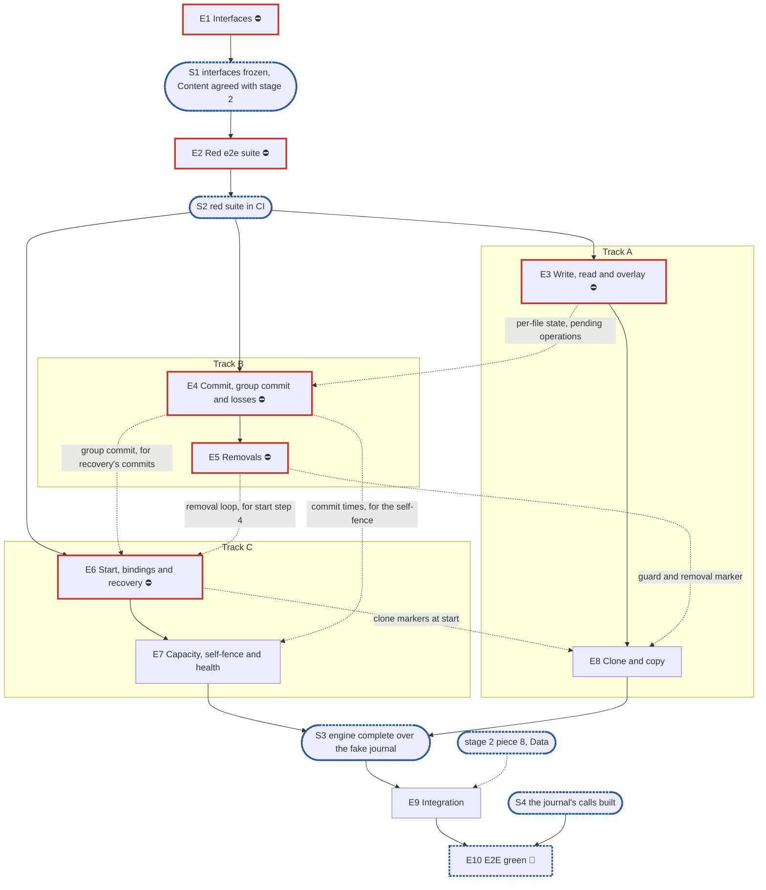

# RFC 8 — engine v2, the journal-only part: implementation plan

**Scope:** the part of [RFC 8 — the engine](../rfcs/rfc-8-engine.md) that runs on journal v2
and the RFC 16 store alone: write, draw, overlay, read, allocation, commit, removals, clone
and copy of journal-held content, start, stop, bindings, recovery, the version limit,
capacity and the self-fence. Every byte stays in the journal and nothing is offloaded: no
carver, syncer, remote block store, work scheduler, eviction, fill, speculator, snapshot
cut or GC. That is RFC 8's second part, planned separately once this one is under way,
and built on top of this part, not beside it. Related RFCs, with how far each is in scope:
- [RFC 1](../rfcs/rfc-1-journal.md) and [RFC 28](../rfcs/rfc-28-journal-format.md), the
  journal: **constraints only**. The engine calls RFC 1 §3's surface; the journal plan
  ([`rfc-1-journal-plan.md`](rfc-1-journal-plan.md)) builds it.
- [RFC 6](../rfcs/rfc-6-block-metadata.md) and [RFC 16](../rfcs/rfc-16-metadata-store.md),
  block metadata and the store: **only the parts this RFC cannot work without**, the
  `Lifecycle` view RFC 8 §2.1 names (epic 6). The rest is built (`pkg/metadata/kvstore`).
- [RFC 17](../rfcs/rfc-17-vfs.md), the filesystem service: **constraints only**, its
  `Content` interface and its integration tier (epic 9).
- [RFC 14](../rfcs/rfc-14-open-state.md), open state: **constraints only**, the clone-kind
  open and a release's mark (epics 5 and 8).
- [RFC 25](../rfcs/rfc-25-observability.md) and [RFC 29](../rfcs/rfc-29-test-harness.md):
  the rules every epic follows (§1.5 rules 3 and 6).
- RFC 2, 3, 4, 5 and 9 (carver, syncer, remote tier, transforms, GC), and RFC 10, 11, 12,
  15 §4.3, 26 and 27 (replication, ownership, snapshots, the route envelope, backups,
  namespace moves): **out**.

**Tracks:** A, B and C (§3.4).
**Programme:** the first part of stage 3 of [#3119](https://github.com/marmos91/dittofs/issues/3119),
"the engine (RFC 8)". This part is built by rif's team, which built stages 1 and 2. The
journal v2 team — Davide (`didimelli`) and Vitor (`viquitorreis`), coordinated by Simone
(`simonebaracchi`) — builds the journal itself, RFC 1 and RFC 28, which this part sits on.
#3119's stage list and the journal plan's epic 11 still give all of stage 3 to the journal
v2 team (§6, point 1). Stage 3 replaces nothing that a later stage deletes: today's engine
keeps serving `develop` until the cutover (stage 7), and this part is composed by no root
before stage 4.
**Naming:** **v1** is the engine that exists today, `pkg/block/engine`, over one journal per
share and payload-keyed chunk rows. **v2** is the engine RFC 8 describes, built here in
`pkg/block/enginev2`.
**Transition:** new installations only, as #3119 decided (Marco's answer 3): v1 and v2 never
run in one binary, so no metric, span, log key or setting carries a version.
**Which RFC 8:** `origin/develop`'s, ahead of `feat/storage-v2` by #3347 (§2.1: `Clock` and
`Fault` signatures, `pkg/sim` their home), #3421 (§10.2: a clone target can split a held
extent past the index bound) and #3497 (§5.1, §5.2: the group commit is bounded batches, and
a stability point waits for the last of them). `feat/storage-v2` carries nothing of RFC 8
that `develop` does not; the cherry-pick is owed.
**Defaults used:** the package path `pkg/block/enginev2` is proposed here (§4, §6 point 7);
no dashboards; the plan lands on `feat/storage-v2`; external dependencies are listed in §3.3.

---

## 1. Introduction

### 1.1 What we are building

An engine with every byte held in the journal. A write is staged and acknowledged; a
`Commit` syncs it and, for an overwrite of committed content, waits for its existence
commit; a read asks the journal first and block metadata for the rest; a removal is a journal
step, one transaction and a resumed tail; a restart re-applies existence from the journal
before any file is served. It lets the filesystem service (`*vfs.Filesystem`, stage 2) run over
a real engine at RFC 17 §8's integration tier, with files that live in the journal and
survive a restart, before any offload exists.

| | v1 (`pkg/block/engine`) | v2 (this part) |
| --- | --- | --- |
| Journal | one per share, v1's format | one per device, journal v2, a `Handle` per share (RFC 8 §2.3) |
| Metadata | payload-keyed chunk rows, a global hash index, the carve commit inside metadata transactions | RFC 6's `Existence` and `Content` views of the RFC 16 store, keyed by journal versions |
| Composition | setters on a serving engine; about fifteen capabilities found by type assertion, each with a silent fallback | `New(Deps)` with declared interfaces, refused when one is missing (§2.1, §2.2) |
| Write and existence | the adapters call authorise and existence around a stage-only write | the engine orders the write; existence is committed at the stability point, in one group commit per journal (§4.1, §5) |
| Read of an extent the journal lacks | the whole window fetched; an uncovered extent reads as zeros | per missing extent: zeros for a hole or zero ref only, otherwise a re-ask or **Lost** (§7.1) |
| Deallocate | zeros written through the journal | the merged hole recorded in phase 1 (§8.2) |
| Start | no floor, no existence replay | journal open with floor and identity, incarnations, existence re-applied, removals resumed (§2.5) |

**What this part leaves out, and what stands in.** RFC 8 says every share has a remote block
store and there is no local-only share (§2.1, E5). This part is an interim build of the
engine, not a mode: no root composes it for a served share, no setting selects it, and it never
ships in a release. It sets no offloaded bit, because its journal interface holds none of
`Offload`, `OffloadMany`, `Fill`, `Release`, `MarkOffloaded`, `Unmark`, `Hold`, `Stamp` or
`DirtyFiles`, and an architecture test fails on a method the engine never calls (§2.1).

| RFC 8 | In this part | Left to the second part, and what stands in |
| --- | --- | --- |
| §2.1, §2.6 composition | `Deps` holding only what this part calls | `Carver`, `Syncer`, `Refs`, `Gate` join `Deps` with the code that calls them; the root's "every share has a remote" check is the root's (stage 4) |
| §2.3 bindings | the share table, a handle per journal, settings, state; `Bind`, `Unbind`, `Drop` | no flow, no key scope, no budgets beyond the journal's per-share limit |
| §2.5 start | steps 1–5 and 8; stop steps 1, 2, 4, 5 | no work queue (step 6), no reseed or eviction (step 7); restart re-offers nothing |
| §3 policy, §6 offload, §7.2–§7.4, §7.7, §7.8 | — | all of it |
| §4.1 write | in, `Draw` included | the `Dirty` event of step 4 is not posted |
| §5.1 commit | in, the loss sequence included | the cut (`PrepareCut`, `CommitCut`) and the stamp after a group commit (RFC 12) |
| §7.1 resolution | journal first, then `Covering` | a **carved** run cannot arise; met anyway, it fails `ErrUnavailable` (epic 3) |
| §8 removals | `Truncate`, `Deallocate`, `Delete` | phase 2 and the prune run from one loop per journal, not the shared scheduler (epic 5) |
| §9 clone | journal-held source runs: copy, sync, phase 1, phase 2 with nothing to adopt | adoption of carved refs; the snapshot cases |
| §10 local space | the refusal table and scoped repack | eviction, pacing, the pressure flag (epic 7) |
| §11 health | journal and store conditions, the self-fence | offload health, put and get health, `WaitOffloaded` |
| §12.1 interface | the content methods, `New`, `Apply`, `Start`, `Close`, `Bind`, `Unbind`, `Drop`, `Stats` | `PrepareCut`, `CommitCut`, `PreWarm`, `WaitOffloaded` |
| §12.2 retried mutation | — | single node: no route envelope (RFC 15 §4.3) |

**Capacity without offload.** Nothing is released, so the only space that returns is what
repack frees: records superseded by an overwrite, and extents a truncate, deallocate or
delete removed (RFC 1 §7.1, §7.2). Content written and kept is never freed; a share's
capacity is its journal limit.

### 1.2 How the plan is organised

Epics 1 and 2 are the team's and run first: the frozen surface and the red suite. Six middle
epics implement the part along RFC 8's seams, two per track. Each is built and unit-tested
against epic 2's fake journal, then turns its conformance rows green over the real journal
once the journal call it needs exists. Epic 9 composes the engine with the filesystem
service at RFC 17's integration tier. Epic 10 burns the known-failure list down, which waits
on the journal (§3.3).

### 1.3 What epic 1 must deliver

The exported surface of `pkg/block/enginev2`, frozen at S1, and the `Content` contract agreed
with stage 2:

- `Engine`, `New(Deps)`, `Apply(Settings)`, `Start`, `Close`, `Bind`, `Unbind`, `Drop`,
  `Stats` and the twelve content methods, with RFC 8 §12.1's signatures and stub bodies.
- `Deps` (§2.6) narrowed to this part: `Devices`, `Open`, `Existence`, `Content`, `Lifecycle`,
  `Clock`, `Watchdog`, `Metrics`, `Logger` and `Tracer`. RFC 8 §2.6 has no `Tracer`; RFC 25
  §8.1 puts one in the engine's `Deps` (§6 point 6). Each interface holds exactly the methods
  this part calls: the journal's `Share`, `Forget`, `Strand`, `Stats`, `Draw`,
  `SetVersionLimit`, `Close`; the handle's `WriteAt`, `ReadAt`, `Sync`, `Truncate`,
  `Deallocate`, `Delete`, `CloneTarget`, `Reserve`, `Close`, `Since`, `Settle`, `Repack`,
  `Files`, `Extents`. `Journal` and `Handle` are two-consumer interfaces before any
  implementation: the real journal and epic 2's fake.
- `Settings` with the three this part reads (`existence_age`, `group_commit.max_files`,
  `clone_max_len`), `Share`, `ShareState`, `WriteOpts`, `Overlay`, `Extent`, `Stats`.
- The types at the boundary: the engine takes `entity.FileID` and `entity.JournalVersion`
  and converts once, at its journal interface; no `journalv2` type crosses `Content`.

`Content` is declared by stage 2 in `internal/vfs/filesystem.go` (#3534), over `pkg/vfs`
(#3533). Its methods, parameter order and results match RFC 8 §12.1. These do not yet, and
S1 settles them:

| # | Where | RFC 8 §12.1 | `Content` today | Proposed |
| --- | --- | --- | --- | --- |
| C1 | `Overlay`, nothing pending | answers "nothing pending"; the struct has no field for it | the zero `Overlay` | `Overlay(ctx, f) (o Overlay, pending bool, err error)` rather than a zero `Version` the journal would have to promise never to issue |
| C2 | `Overlay.Size` | "committed existence with the uncommitted operations applied", yet "no metadata read" | same words | `Size` is the end of the pending operations, which the service takes the larger of with the File record's |
| C3 | `Overlay.Ctime` | `Mtime, Ctime` | same | the journal records one time per write, `mtime`, zero when suspended (RFC 28 §2.3); a write that suspends `mtime` still changes `ctime`, which recovery cannot rebuild. RFC 28's to decide |
| C4 | `WriteOpts`, `Overlay` | declared by the engine | declared in `internal/vfs` | the engine declares them; `internal/vfs` aliases them (epic 9), since Go matches method signatures by type identity |
| C5 | `Extent` | the engine's; RFC 17's aliases it | `vfs.Extent` | one declaration in the shared package (C7) |
| C6 | `Verifier` | "an alias of the metadata types" | `vfs.Verifier`; `entity` declares none | in the shared package (C7) |
| C7 | errors | "the errors package it shares with the filesystem service, which re-exports them" | declared in `pkg/vfs/errors.go`, and `pkg/vfs` imports `pkg/openstate` | a small package below both, importing only `entity`, holding the content errors, `Verifier` and `Extent`; `pkg/vfs` re-exports it |
| C8 | `ErrLost` | residency **Lost** and a flush across a loss | `vfs.ErrLost` | one sentinel for both meanings, confirmed |
| C9 | `WriteOpts.Done` | called by the existence commit that records the write's usage | same | open in RFC 8 §16 Q8 (§6 point 2) |
| C10 | request ID | each mutation's ctx carries it | nothing | unused on a single node; the ctx key is RFC 15's to declare (§6 point 2) |

### 1.4 What epic 2 must deliver

**The suite and its registration.** `pkg/block/enginev2/conformance`, behind the build tag
`engine_conformance`, registered as `engine-conformance` in `test/suites.yaml` with
`tier: pr` and `known: test/enginev2/known.yaml`, in a new `engine` group (RFC 29 §4.9). The
tag joins `lint-go`'s `go vet -tags=…` list, or no check would compile the suite. Each red
test is one `known.yaml` entry with `status: fail`, `fix: planned`, `category: feature`, a
reason naming the epic and journal call it waits for, and `issue:` the epic issue of the epic
expected to turn it green: the harness refuses a planned entry without one
(`test/harness/known/entry.go`), so epic 2 opens one issue per middle epic, and no subtask
issues. RFC 8 gains its suites paragraph naming `engine-conformance` and the `engine` group
(RFC 29 R11), on `develop`, cherry-picked here.

**The scenario catalogue, by source.**
- **RFC 8 §15.1, Group A** (26 rows this part can pass): §2.5 incarnation at start (the
  engine half), recovery through `Since`, journal gone, attach above the floor, attach after
  a device loss; §2.7 version limit; §4.1 journal authority, verifier, verifier inputs,
  verifier after a loss; §5.1 sync before existence, stable write and lazy existence,
  overwrite waits for existence, stalled store, failed window; §7.1 the join, existence above
  `asOf`; §8.2 deallocate; §9.1 clone keeps writes outside its extent, overlapping clone,
  failure leaves the destination, removals of a cloning destination, source registration
  rebuilt, clone never waits, refusals.
- **RFC 8 §15.2, Group B** (11 rows): §1.1 no cross-share slowdown (the write half); §2.1 one
  clock; §2.3 shared journal, unbind and drop; §2.7 version limit under sustained load,
  burst at a stall's start; §5.2 group commit; §8.1 removal wedge; §10.3 scoped repack;
  §11.2 self-fence threshold, self-fence on an erroring store.
- **RFC 8 §15.3, Group C** (3 rows): §2.1 declared interfaces, §2.2 no assertions, §2.4
  settings.
- **Rows of this part's own** (3), which the second part deletes or keeps: a carved run fails
  `ErrUnavailable`, never zeros or `ErrLost`; a full journal answers `ErrNoSpace` after one
  scoped repack, and the first write's bytes still read back; across a whole run, the
  journal's offloaded and released byte counts stay 0.
- **v1's bug history**, through RFC 8 Appendix A: each row it lists (setters, assertions, an
  uncovered extent read as zeros, a deallocate writing zeros, a bounded join then a close
  under running loops) is one of the rows above, which is how the catalogue covers it.

Rows a row of RFC 8 can only pass in part are written "adapted": the part needing offload is
the second part's, and named there. Rows that need offload, eviction, fills, pacing, the
scheduler, snapshots, a cluster or RFC 26 are not catalogued here (§7). RFC 17's rows
(V19, V20, V22, V25, V26) and the `Content` check import `internal/vfs`, which epic 9
composes, so they are epic 9's. The `Content` check is what one `Content` call promises the
next — bytes written read back, `Draw` above every version drawn or staged before it,
`Overlay` reflecting a write at once, a `Commit` answered after its writes' sync, a removed
extent read as zeros or end of file — run over stage 2's fake and the engine alike.

**The test components.** The fixture composing the engine over the real `journalv2` on a
temporary directory, `kvstore` on an in-memory `kv.KV` and `sim.TestClock`; a
fault-injecting `kv.KV` consulting `sim.Fault` (stalls, errors, conflicts that name their keys
and conflicts that do not), counting transactions with `kv.Counts`; a fake journal and handle
implementing epic 1's interfaces, for pure-logic unit tests; and the journal's profiling
harness (`journalv2test/prof`) wired to the fixture.

### 1.5 General rules for each epic

> **Instruction for whoever expands an epic into its detailed description and subtasks,
> human or AI:**
>
> - **Creating an epic from this plan: use the `epic-breakdown` skill.** Whenever the user
>   asks to create an epic from this plan, or to expand, detail or break one down, run the
>   `epic-breakdown` skill (`.claude/skills/epic-breakdown/SKILL.md`) on this plan and that
>   epic, rather than writing the epic document freehand. It extracts the RFC's MUST and
>   MUST NOT into numbered requirements, estimates each subtask in man-days and suggests
>   the pull requests. A human doing it by hand follows the same skill.
> - **Epic and subtask, nothing else.** The units of work are the epic and its subtasks,
>   with subtask ids `T<epic>.<n>` (`T4.3`). No other word names them: not task, ticket,
>   story, step or phase, in headings, tables, ids or prose.
> - **The epic stands alone.** Copy the numbered rules below into the epic document word
>   for word, under their own heading — the rules only, not this instruction, which speaks
>   of "this plan". The epic document must not refer to this plan, link to it,
>   or say "see the plan". Everything a reader needs to do the epic is in the epic
>   document itself: the RFC sections it implements, the interfaces it builds on, the
>   rules, the subtasks, and a short legend of the names the rules borrow from this plan
>   (E1, E2, S1, the integration epic, …).
> - **The epic document records decisions, not progress, like this plan.** It has no
>   status fields, no checkboxes to tick and no sections to keep up to date as the work
>   goes on. It is revised through a pull request only when a decision changes.
> - **Subtasks are not pull requests.** A subtask is ideally up to 5 man-days. The owner
>   ships subtasks as they see fit, one pull request each or several together; the epic
>   document only suggests a grouping, each suggested pull request ideally up to 15
>   man-days. Cut and group by logic, readability, dependencies and a deliverable that can
>   be named, not to hit a number.
> - **Every subtask states how it meets each rule that applies to it.** A rule that does
>   not apply is named, with the reason.
> - **In the issue tracker, only when someone asks for issues:** they are not created by
>   default, because the plan and the breakdown are often revised and issues copied from
>   them go stale. When they are created, the epic is one issue labelled `epic`, whose body is the
>   epic document. Each subtask is its own issue, created as a sub-issue of the epic
>   issue rather than as a checklist in its body. Like the epic, a subtask issue stands
>   alone and does not refer to the plan.

1. **Independent unit tests.** Each epic carries its own unit tests. It may use another
   epic's pure in-memory implementation, the implementation of an epic it depends on once
   that has landed, and E2's test components: above all the fake journal, which stands in
   for the journal wherever the logic under test is the engine's (the resolution table, the
   group commit's split, the refusal mapping). E1 declares no internal interface for it to
   fake (rule 12).
2. **Fuzz tests where relevant.** The engine parses no bytes of its own: it reads the
   journal's answers and the store's records through typed calls. Fuzz the join instead:
   `Read` and `Allocation` against random sequences of journal answers (held, missing,
   `asOf`) and covering answers (hole, zero ref, uncarved with `applied` and overwrite
   versions), with the property that a read returns zeros only for a hole or a zero ref, never
   panics, and fails **Lost** only where both versions are at or below `asOf`; and the
   group commit against random conflict sets, with the property that no file outside the
   set is delayed past log₂ `G` splits. `Apply` is fuzzed on its settings: valid or refused.
3. **Observability follows RFC 25.** `Deps` carries a `*slog.Logger` narrowed with
   `With("component", "engine")`, the `*metrics.Registry`, the tracing API's `Tracer` and the
   `*health.Watchdog`, from which each long-running loop (the group commit, the removal loop,
   the self-fence's timer) takes its `*health.Loop`. `*Engine` is a `health.Source`.
   Metrics are RFC 8 §14's, under the `engine_` prefix (RFC 25 §2.1), with no share label on
   a per-operation series. Spans are RFC 8 §14's proposals, `engine.sync` and
   `engine.existence_commit`, and a removal batch opens a root span. Each epic names the
   metrics, conditions and spans it owns; the units, labels, buckets, recording and logging
   rules are RFC 25's, applied as written.
4. **Profiling.** Tests and benchmarks run under E2's profiling harness and fail on
   goroutine, descriptor or memory leaks and on anomalous resource growth. The hot paths
   with allocations-per-op assertions are `Write`, `Read` of held content, `Overlay` and
   `Draw`: no allocation above the journal's own (RFC 8 §15.4's proposed engine-cost
   benchmark).
5. **Public interface and internals.** Tests cover both the internal package API and the
   public behaviour the epic enables, including concurrency under `-race`. Test at the
   layer that **consumes** a value (see `CLAUDE.md`, "Verifying a change"): a field the engine
   passes to the journal or the store is asserted where they read it, over the real journal
   and `kvstore`, not where the engine builds it.
6. **Known failures shrink.** An e2e test that turns green leaves the suite's `known.yaml`
   (`test/enginev2/known.yaml`) in the same change: `dt` fails the run if a listed test
   passes.
7. **v2 ignores v1.** No import of, copy from, or behavioural dependence on v1, enforced by
   an import test: no package of `pkg/block/enginev2` imports `pkg/block/engine`,
   `pkg/block/journal`, `pkg/block/syncer`, `pkg/block/carver`, `pkg/block/remote` or the
   v1 metadata service `pkg/metadata`. The test checks every package on its own, so its
   allowlist names each package an exception applies to, test packages included. v1 is not
   touched: it is deleted at the cutover.
8. **Real dependencies for properties of those dependencies.** No fake stands in for a
   check about what the real thing does: the real journal on a real directory, with its crash
   seam, for durability, recovery and loss; the real `kvstore` for what a transaction
   commits and conflicts on. The fake journal is for the engine's pure logic only, and no
   conformance row runs over it.
9. **Code comment conventions** (`CLAUDE.md`, "Code comments"). A source comment describes
   the code's behaviour and references nothing outside it: no issue or pull request
   numbers, no CI, runner or OS names, no epic, subtask, plan or decision ids. A
   `ponytail:` marker records a knowingly simple implementation, naming its ceiling and the
   upgrade path. A `decision:` marker records deliberate behaviour, naming the rule, why it
   holds and the evidence that would overturn it. Where the RFC carries such a note, its
   marker goes at the code site that implements it: RFC 8's copy-on-write share table, the
   per-file state bound, the loss-sequence floor, the version-limit headroom and its burst,
   the lazy existence of appends, and the stable-overwrite cost.
10. **A test must be able to fail.** Keep a test only if a plausible change would make it
    fail and nothing else would catch that change: not the compiler, not the diff, not a
    later epic's tests. A review rule that no test can check, such as "stubs never panic",
    stays a review rule.
11. **A symbol is exported only if the RFC's interface uses it.** Everything exported is
    frozen at S1. Helpers the engine's own files need stay unexported or move to an
    `internal/` package of `enginev2`.
12. **Each subtask creates only what it declares.** No empty package and no stub without a
    caller. A package, an option or a test helper lands with its first consumer.

## 2. Epics at a glance

| # | Epic | Content | Subtasks | Man-days | Track | Blocks |
| --- | --- | --- | --- | --- | --- | --- |
| 1 | **Interfaces** ⛔ | `pkg/block/enginev2`'s surface, `Deps` narrowed to this part, the shared content errors, `Verifier` and `Extent`; the `Content` contract agreed with stage 2 | 6 | 8.5 | team | **everything** |
| 2 | **Red e2e suite and test foundations** ⛔ | `engine-conformance` registered red, 43 rows, the fixture, a fault-injecting `kv.KV`, the fake journal | 10 | 28.25 | team | **all testing** in 3–10 |
| 3 | **Write, read and overlay** ⛔ | per-file state, `Write`, `Draw`, `Overlay`, `Read`'s resolution, `Allocation` | 7 | 15 | A | 4, 8 |
| 4 | **Commit, group commit and losses** ⛔ | the verifier, `Commit`, the group commit and its split, the loss sequence, failed windows | 7 | 20 | B | 5, 6, 7 |
| 5 | **Removals** ⛔ | `Truncate`, `Deallocate`, `Delete`, phase 1, the removal loop | 5 | 10 | B | 6, 8 |
| 6 | **Start, bindings and recovery** ⛔ | the store's `Lifecycle` view, the share table, start steps 1–5, the version limit, stop, `Unbind`, `Drop` | 9 | 24 | C | 7, 8 |
| 7 | **Capacity, self-fence and health** | the refusal table without offload, scoped repack, the self-fence, conditions and `Stats` | 5 | 12 | C | 9 |
| 8 | **Clone and copy, journal-held** | admission, registration, the clone-kind open, copy and phase 1, `Copy` as bounded clones, rebuild at start | 6 | 18 | A | 9 |
| 9 | **Integration: the filesystem service over the engine** | `internal/vfs` aliases, the `Content` check over stage 2's fake and the engine, `suite.Run` at the integration tier, RFC 17's V-rows | 5 | 12 | team | 10 |
| 10 | **E2E green** 🔀 | burn `known.yaml` down as the journal's calls land; soak, benchmarks B5, B7, B9 (adapted), the nightly tier | 4 | 12.5 | team | the second part |
| | **Total** | | **64** | **160.25** | | |

**Plan estimate: 64 subtasks, 160.25 man-days.**

RFC 8 is 3,394 lines, which gives N = 8. This part covers about half of it, and its cohesive
areas are six: the data path, the stability point, removals, the lifecycle, capacity and
health, and clone.

⛔ = blocker: other epics cannot finish until this one has delivered.
🔀 = synchronisation point: the team converges, and the work that follows depends on
everything before it.

## 3. Synchronisation points, blockers and the split

### 3.1 Dependency graph



### 3.2 Synchronisation points

- **S1 🔀 Interfaces frozen and `Content` agreed** (end of epic 1). The team and stage 2
  review every signature, and C1–C8 of §1.3 are settled; C9 and C10 are settled or carried
  as §6's open points. The journal plan calls this agreement its S4a. Nothing in epics 3–8
  starts before it.
- **S2 🔀 Red suite in CI** (end of epic 2). `engine-conformance` compiles, runs on every pull
  request, fails at the journal's `Open` and is listed whole in `known.yaml`. The fixture,
  the fault-injecting store, the fake journal and the profiler are green. Epics 3, 4 and 6
  start here.
- **S3 🔀 Engine complete over the fake journal** (epics 3–8 done). Every method of §1.3
  has its behaviour, unit-tested over the fake journal, and every conformance row whose
  journal call exists is green. Epic 9 starts here.
- **S4 🔀 The journal's calls built** (external: the journal plan's S4, its epics 3–9, and its
  epic 7's `Open`). The rows still red wait only on it; epic 10 cannot finish before it.

### 3.3 Blockers

- **E1 and E2** block everything. Keep them short and do them together.
- **E3** blocks E4 (a commit captures the pending operations epic 3 records per file) and
  E8 (a clone copies through `Write`'s path and resolves its source as `Read` does).
- **E4** blocks E5 (a removal's phase 1 commits the file's pending existence), E6 (recovery
  commits re-applied existence through the group commit) and E7 (the self-fence counts the
  commits epic 4 makes).
- **E5** blocks E6 (start step 4 posts unfinished removals to epic 5's loop) and E8 (a clone's
  destination is a removal of kind clone).
- **E6** blocks E7 (the version-limit row of the refusal table answers with epic 6's raise)
  and E8 (a clone marker found at start is rebuilt as a clone).
- **E7 and E8** block E9 through S3.
- **Stage 2 piece 8, Data (external, rif's team)** blocks epic 9's data cases of
  `suite.Run`.
- **The journal (external, the journal v2 team)** blocks every conformance row over the real
  journal, and so epic 10. What this part calls, by journal epic: E4's index, E3's codecs and
  E5's streams under everything; E8's `Share`, `WriteAt`, `ReadAt`, `Draw`,
  `SetVersionLimit`, `Truncate`, `Deallocate`, `Delete`, `CloneTarget`, `Reserve`, `Since`,
  `Settle`, `Files`, `Extents`, the named refusals and `Stats`; E6's `Sync`, loss records, the
  loss ring and failed windows; E7's `Open` with floor and `expect`; E9's `Repack`,
  auto-retire, `Forget` and `Strand`, and none of its offload half; E10's `J‖journal`
  record written by the initialisation step. The first rows to turn green come with the
  journal plan's S3 (`WriteAt`, `ReadAt`); files survive a restart from its epic 7's `Open`.

### 3.4 Splitting the work

- **Track A, the data path:** epic 3, then epic 8. From S2 to S3 it builds what a file's
  bytes go through, ending with the clone, which reuses the write path and the read
  resolution.
- **Track B, the stability point:** epic 4, then epic 5. Both are existence-commit
  transactions: the group commit, then the removal's phase 1 that commits pending
  existence with it and the loop that finishes it.
- **Track C, the lifecycle:** epic 6, then epic 7. It opens with the store's `Lifecycle` view
  and the share table, which need nothing from tracks A and B, and reaches recovery once
  epic 4's group commit and epic 5's loop exist.
- **Where the team converges:** epics 1 and 2 before S2; epic 9 and epic 10 after S3. No
  track is idle between S2 and S3: track C's recovery is the only point waiting on another
  track, and the store view, share table, start step 1 and the version limit fill the wait.

## 4. Directory layout proposed for epic 1

```text
pkg/block/enginev2/                    E1: the package; renamed pkg/block/engine at the cutover
  doc.go engine.go                     E1 (New, Apply, stubs); E6 (Start, Close)
  deps.go                              E1: Deps and the interfaces it holds
  types.go                             E1: Settings, Share, WriteOpts, Overlay, Stats
  file.go                              E3: per-file state, sharded by file
  write.go read.go overlay.go          E3: Write, Draw, Read, Overlay, Allocation
  commit.go groupcommit.go loss.go     E4: Commit, the verifier, the group commit, the loss sequence
  remove.go removals.go                E5: Truncate, Deallocate, Delete; the removal loop
  share.go start.go limit.go           E6: the share table, Bind, Unbind, Drop; start and stop; the version limit
  capacity.go fence.go health.go       E7: the refusal table, repack, the self-fence, Stats and conditions
  clone.go                             E8: Clone, Copy
  arch_test.go imports_test.go         E2: declared interfaces, no assertions, v2 ignores v1
  enginev2test/                        E2: the fixture and the fake journal
  conformance/                         E2: the rows, build tag engine_conformance
pkg/<content errors>/                  E1: content errors, Verifier, Extent; name open (§6 point 3)
pkg/metadata/kv/kvtest/fault.go        E2: the fault-injecting kv.KV
pkg/metadata/kvstore/lifecycle.go      E6: the Lifecycle view
internal/vfs/                          E9: aliases of WriteOpts and Overlay; the integration tier
test/enginev2/known.yaml               E2
test/suites.yaml                       E2: engine-conformance, group engine
```

## 5. The epics in detail

### Epic 1 — Interfaces ⛔

**Epic 1 estimate: 6 subtasks, 8.5 man-days.**

The surface of §1.3, with stub bodies, and the agreement with stage 2 that freezes it.
`Deps` holds only what this part calls, by RFC 8 §2.1's own rule, so the interfaces grow
with the second part rather than being declared whole now; a fixture supplies whole stubs,
never `nil`. Sections owned: RFC 8 §2.1 (the declaration rule), §2.6, §12.1's signatures.

- T1.1 The package, `Engine`, `New(Deps)` refusing a missing capability by name, `Apply`
  validating `Settings`, lifecycle and share method stubs.
- T1.2 `Deps` and its declared interfaces (`Journal`, `Handle`, `Reservation`, `Existence`,
  `Content`, `Lifecycle`, `Clock`) holding exactly §1.3's calls.
- T1.3 The content method stubs and their types: `WriteOpts`, `Overlay` in C1's form,
  `Share`, `ShareState`, `Stats`.
- T1.4 The shared content-error package (C5–C7): the errors, `Verifier`, `Extent` moved below
  `pkg/vfs`, which re-exports them; stage 2's code updated in the same change.
- T1.5 The boundary conversions: `entity.FileID` and `entity.JournalVersion` to the journal's
  types, with their round-trip tests.
- T1.6 The S1 review with stage 2: C1–C10 settled, or carried to §6.

### Epic 2 — Red e2e suite and test foundations ⛔

**Epic 2 estimate: 10 subtasks, 28.25 man-days.**

§1.4 whole. Every row is written red against the real composition and listed in
`known.yaml`; the fixture fails at the journal's `Open` until the journal has one. Sections
owned: RFC 8 §15.1–§15.3 for the rows §1.4 lists, and §15's composition rule.

- T2.1 Registration: `engine-conformance` in `test/suites.yaml` (`tier: pr`, `engine`
  group), `test/enginev2/known.yaml`, the build tag in `lint-go`'s vet list, the epic issues
  the entries name, RFC 8's suites paragraph.
- T2.2 The fixture: the engine over the real journal on a temporary directory, `kvstore` on
  an in-memory `kv.KV`, `sim.TestClock`, the journal's crash seam.
- T2.3 The fault-injecting `kv.KV`: stalls, errors, conflicts naming their keys or not, from
  a `sim.Fault` schedule; transaction counts from `kv.Counts`.
- T2.4 The fake journal and handle: versions, held and missing extents, `asOf`, markers,
  `Since`, the loss ring and generation, named refusals; for unit tests only (rule 8).
- T2.5 Group A rows of the data path and the stability point (13): §4.1, §5.1, §7.1, §8.2.
- T2.6 Group A rows of the lifecycle and clone (13): §2.5, §2.7, §9.1.
- T2.7 Group B rows (11).
- T2.8 Group C rows (3) and the import test of rule 7.
- T2.9 This part's own rows (3).
- T2.10 The journal's profiling harness wired to the fixture.

### Epic 3 — Write, read and overlay ⛔

**Epic 3 estimate: 7 subtasks, 15 man-days.**

A file's bytes in and out. The per-file entry — guard, pending existence, overlay — is one
map entry sharded by file, kept while the file has pending existence, a removal in flight or
a loss entry above the floor (RFC 8 §2.3's ponytail); the guard orders a removal against a
capture, and correctness never rests on it (E17). A **carved** run cannot arise, since no
code of this part writes a ref; met anyway it means a store written by something else, and
it fails `ErrUnavailable`, transient and distinguishable from **Lost**, never zeros (E9).
Sections owned: RFC 8 §1.1 (the request path), §4.1, §7.1, §7.5, §7.6, §12.1's `Overlay`,
`Allocation` and `Draw`. Metrics: `engine_reads_total{class}`, `engine_read_seconds`,
`engine_lock_wait_seconds{area}`.

- T3.1 Per-file state, sharded, with its bound's `ponytail:` marker.
- T3.2 `Write`: sample the verifier's inputs, stage through `WriteAt` with the clock's time
  unless suspended, record the pending operation, answer; admission is epic 7's.
- T3.3 `Draw` on the file's journal, under the caller's accept lock.
- T3.4 `Overlay` from the file's entry alone, in C1's and C2's form.
- T3.5 `Read`: `ReadAt`, `Covering` per missing extent, §7.1's table, the re-ask on `applied` or
  an overwrite version above `asOf` within the deadline, **Lost** reported once per extent,
  the carved case.
- T3.6 `Allocation`: `Existence.Allocation` with the pending operations applied, a zero ref
  under a newer overwrite counted as data.
- T3.7 The join's fuzz targets (rule 2) and the hot paths' allocation assertions (rule 4).

### Epic 4 — Commit, group commit and losses ⛔

**Epic 4 estimate: 7 subtasks, 20 man-days.**

The stability point and everything that commits existence. Appends and hole fills are
answered after the sync; an overwrite of committed content waits for the group commit
that covers it, or the last of the batches its file is split over. A failed file is retried
alone and never delays another. Sections owned: RFC 8 §4.1 (the verifier), §5.1, §5.2,
§11.3. Metrics: `engine_stability_points_total`, `engine_pending_existence_ops`,
`engine_group_commit_splits_total`. Spans: `engine.sync`, `engine.existence_commit`.

- T4.1 The verifier: node and node epoch, process instance, incarnation, loss generation
  monotonic across a journal reopened in-process; sampled before staging and after a
  `Commit`'s waits.
- T4.2 `Commit`: `Sync`, one `Existence.Overwrites`, join the group commit only for an
  overwrite at or below the sync's version, answer with the verifier and loss sequence;
  `ErrDelay` at the deadline under a stalled store.
- T4.3 The group commit per journal: due within `existence_age` and before a removal's phase
  1, batches bounded by `G` and `K`, a file split over several in version order, `Settle`
  with the store's `Applied`, `Done` after the commit that records the write.
- T4.4 The split: resubmit the others when the store names the failing keys, halves when it
  does not; a file failing alone backed off, with a condition naming it and `ErrDelay` for
  its stability points; a conflict unresolved at the deadline as `DelayConflict`.
- T4.5 The loss sequence: a journal-wide floor plus per-file entries, the ring drained when
  the generation is above the last applied, every file raised on missed events or a lost
  device; `LossSeq`.
- T4.6 A failed window reported once per file, the next `Commit` succeeding.
- T4.7 Benchmarks B5 and B7 over the fixture, recorded, not gated.

### Epic 5 — Removals ⛔

**Epic 5 estimate: 5 subtasks, 10 man-days.**

`Truncate`, `Deallocate` and `Delete`: guard, journal step, phase 1 through `Existence.Remove`
with the file's pending existence, release the guard, `Settle(id, v)`, post. No pass is ever
in flight, so a prune's in-flight floor is the removal's own version. Phase 2 and the prune
run from one loop per journal, since the shared scheduler is the second part's:

```go
// ponytail: removal phase 2 and its prune run from one loop per journal, a
// FIFO with a fixed backoff, not the shared work scheduler. Replace it with
// the scheduler's removal source when offload adds the first work that needs
// fairness between shares.
```

Sections owned: RFC 8 §8 (the release is the journal's `Delete`, never `Release`), §8.1,
§8.2. Condition: `removal_stalled`. Metrics: `engine_removals_pending`,
`engine_removals_oldest_seconds`, `engine_removal_batches_total`.

- T5.1 The three removals through phase 1, `Settle` and the post.
- T5.2 `Deallocate`'s merged hole in phase 1; no zeros staged.
- T5.3 The removal loop: phase 2 through `Resume`, the prune through `PruneRemovals`, backoff
  between the retry bounds, `removal_stalled` after five failed batches.
- T5.4 A release's step 1: the file marked releasing in its open table before the journal's
  `Delete` (§6 point 2, who calls it).
- T5.5 Removals interleaved with writes, commits and a crash, over the fake journal.

### Epic 6 — Start, bindings and recovery ⛔

**Epic 6 estimate: 9 subtasks, 24 man-days.**

The engine's life, and the store calls it needs. RFC 8 §2.1's `Lifecycle` names
`JournalID`, `VersionLimits` and `RaiseVersionLimits` within `K` keys a transaction, and
`RaiseIncarnations`; `kvstore` has `RaiseIncarnations` and the per-share `VersionLimit` and
`RaiseVersionLimit`, but no read of a device's journal identity and no view grouping them.
Sections owned: RFC 8 §1.1 (the share table's `decision:`), §2.3, §2.4, §2.5 steps 1–5 and 8
and stop, §2.7. Metrics: none new; conditions named by `Stats` for a refused share.

- T6.1 The store's `Lifecycle` view: the `J‖journal` read, the batched version-limit calls,
  `RaiseIncarnations`; `kvstoretest` cases.
- T6.2 The copy-on-write share table and the bindings' states; `Bind` attaching above the
  floor, writing the share's limit as a tracked max-write, raising the shard's incarnation.
- T6.3 Start step 1: floors and identity read, each journal opened through `Deps.Open`, a
  missing or foreign journal's shares refused by name until an operator acknowledges, the
  forgotten tags forgotten; every share's limit written before a version is issued.
- T6.4 Start step 2: every incarnation in one transaction.
- T6.5 Start step 3: `Files`, `Since(applied)` applied in version order with each write's
  `mtime`, a synced loss committed as **Lost**, a clone marker handed to epic 8, `Settle`
  with the store's `Applied`; no file served before.
- T6.6 Start steps 4 and 5: unfinished removals posted to the removal loop; unclaimed tags
  stranded.
- T6.7 The version limit while serving: the trigger on every version issued, the raise in
  `K`-bounded transactions, `SetVersionLimit` after, the two markers.
- T6.8 `Close`: refuse, the last group commit, joins within their bounds, close in reverse,
  nothing closed under a live loop.
- T6.9 `Unbind` and `Drop`: admit nothing new, join, `keepHolds` refused; `Close` the handle,
  `Forget` the tag.

### Epic 7 — Capacity, self-fence and health

**Epic 7 estimate: 5 subtasks, 12 man-days.**

The refusal table with no offload behind it. Repack is the only thing that frees space, so a
refused write gets one scoped repack and a retry, then `ErrNoSpace`; the version-limit,
index-bound and spare rows answer `ErrDelay` while a raise, a repack or a spare can still
clear them. Nothing is paced: with no drain, §10.2.1's rate is its floor, and every write
past half the limit would be delayed for nothing.

```go
// decision: with no offload, nothing drains dirty bytes, so a refused write
// is answered by one scoped repack and then ErrNoSpace, and no write is paced.
// RFC 8 §10.2's refusal table applies whole once offload is composed.
```

Sections owned: RFC 8 §10 (the two measures, as far as repack goes), §10.2, §10.3, §11.1
(the engine's conditions), §11.2, §14 for what this part produces. Conditions:
`node_fenced`, `removal_stalled` and the group commit's failing file reported through
`Stats` and `health.Source`. Metrics: `engine_write_refusals_total`,
`engine_self_fences_total{reason="store"}`.

- T7.1 The refusal mapping: the journal's `NoSpaceError` by its limit onto §10.2's rows as
  narrowed above, the deadline rule, the `decision:` marker.
- T7.2 `repackDue` past `eviction.repack_threshold` and at capacity, run by a per-journal
  loop.
- T7.3 The self-fence: the store time of the last write transaction any part of the engine
  committed; after 30 s with one outstanding or failing, writes and stability points
  `ErrDelay`, reads continue; cleared by the next commit.
- T7.4 `Stats` per share and journal, and `Conditions` as a `health.Source`.
- T7.5 The §2.7 version-limit stall checks under sustained load and a burst, with epic 6's
  raise.

### Epic 8 — Clone and copy, journal-held

**Epic 8 estimate: 6 subtasks, 18 man-days.**

A clone whose source bytes are all journal-held or uncarved: copied into the destination
above the removal's version and synced before phase 1, with phase 2 adopting nothing. A
source run uncarved and not held is carried as uncarved and reads **Lost**. Sections owned:
RFC 8 §9.1 (all but adoption and the snapshot cases), §5.1's clone in a pre-cut commit
excluded. Spans: a clone's batches as root spans.

- T8.1 Admission: overlap, `clone_max_len`, namespace, an incomplete source; the source
  extent's registration, waiting for writes already admitted, and `ErrDelay` for writes and
  removals into it.
- T8.2 The clone-kind open on the source through open state, and `Reserve` for the bytes to
  copy.
- T8.3 `CloneTarget`, the copies through the reservation, the sync, phase 1 through
  `Existence.Clone`, phase 2, the uncarved carry.
- T8.4 The destination held until done; removals of it held; a retry joining a running
  clone; `ErrDelay` at the deadline, success once done.
- T8.5 `Copy` as 64 MiB bounded clones with a short count, the chunk's `decision:` marker.
- T8.6 Rebuild at start: from the journal's clone marker and from the clone-kind open record.

### Epic 9 — Integration: the filesystem service over the engine

**Epic 9 estimate: 5 subtasks, 12 man-days.**

The programme puts the engine under `*vfs.Filesystem` at RFC 17 §8's integration tier now,
and into `node.New` at stage 4, so this epic composes the two and nothing else: no root, no
configuration keys, no API or CLI. Observability is wired the way the root will: `Deps`
from a logger, registry, tracer and watchdog the fixture builds, and the engine added to a
health evaluator as a `Source`. RFC 8 names no alert rule this part can raise. Sections
owned: RFC 17 §8's integration tier for the engine's side; RFC 8 §12.1's single caller.

- T9.1 `internal/vfs` aliases the engine's `WriteOpts` and `Overlay` (C4); `*enginev2.Engine`
  satisfies `vfs.Content`.
- T9.2 The `Content` check: its cases, run over stage 2's fake, moved to an importable
  package (§6 point 12), and over the engine.
- T9.3 `suite.Run` over `vfs.New` composed with the engine, `kvstore`, the real open-state
  table and a temporary journal directory, with fault injection below.
- T9.4 RFC 17's V19, V20 (the `DelayCapacity` half), V22, V25 and V26, registered red and
  turned green here.
- T9.5 The composition's observability: the engine's conditions registered in RFC 25 §3.9's
  registry, the `health.Source` added and removed.

### Epic 10 — E2E green 🔀

**Epic 10 estimate: 4 subtasks, 12.5 man-days.**

`test/enginev2/known.yaml` burnt down to empty, as each journal call of §3.3 lands. Its size
follows the journal's, not this part's (§6 point 10).

- T10.1 The burn-down: each remaining row green over the real journal, its entry removed.
- T10.2 A soak: crash and restart in a loop at the integration tier under fault schedules,
  asserting every acknowledged synced write reads back or reads **Lost**.
- T10.3 B5, B7 and B9 at the service tier (B9 adapted: stable overwrites through `vfs.Service`
  rather than SMB), baselines recorded.
- T10.4 The `nightly` tier for the soak, and profiling baselines.

## 6. Risks and open points

**Programme and ownership**
1. **Ownership.** rif's team builds this part. #3119's stage list ("Stage 3: the engine
   (RFC 8), journal v2 team (#3152)") and the journal plan's epic 11 ("Engine on the RFC 16
   store … team", planned after S4a, which also makes the `Content` check epic 11's) say
   otherwise. Both need revising: epic 11 narrows to RFC 8's second part, and the `Content`
   check moves here (T9.2). Pending the journal v2 team's agreement.

**For Marco (RFC 8)**
2. **Contract points:** C9, `WriteOpts.Done` or a `Charge` (RFC 8 §16 Q8; the store already
   computes a write's charge in `Existence.Commit`, which favours `Done`), and whether a
   write dropped in a failed window or by `Forget`, whose existence never commits, ever calls
   `Done`; C1 and C2, `Overlay`'s form; C3, a suspended write's `ctime` (RFC 28's); C10, the
   request ID's ctx key (RFC 15's); who marks a release releasing (§8.1 step 1 writes the
   open table, and `Deps` holds no open-state view: the service before `Delete`, or a new
   `Deps` entry).
3. **The shared errors' package** (C5–C7): §12.1 describes it, nobody has declared it, and
   `pkg/vfs` imports open state. Its name is open.
4. **A part without offload** on `feat/storage-v2`, under §2.1 and E5, given that no root
   composes it and it sets no offloaded bit.
5. **A full journal with no offload** (epic 7): `ErrNoSpace` after one scoped repack and no
   pacing, or `ErrDelay` for as long as any removal is still settling.
6. **RFC 8 edits owed:** `Deps` gains `Tracer` (RFC 25 §8.1); the suites paragraph
   (RFC 29 R11, T2.1); RFC 8 §11.1's condition list names none for a file the group commit
   backs off (§5.2 asks for one); Appendix B migrates today's engine, which #3119's route B
   (new installations only, v1 deleted at the cutover) replaces.
7. **Package name:** `pkg/block/enginev2` until the cutover, as the journal took
   `journalv2`, while RFC 8 §2.8 says `pkg/block/engine`, which is v1's.
8. **The removal loop without the scheduler** (epic 5) as an interim.

**For the journal v2 team**
9. **`Share`'s `SyncPolicy`:** `journalv2.Share` takes a fourth parameter RFC 1 §3 does not
   list. The engine passes the share's `sync.policy`; is an RFC 1 edit owed?
10. **Order of the journal's work:** the order this part wants is the journal plan's S3, then
    its epic 6's `Sync` and losses, its epic 8's removals, `Since` and `Files`, its epic 7's
    `Open`, then its epic 9's `Repack`, auto-retire, `Forget` and `Strand` ahead of the
    offload half. Epics 5, 6, 7 and 10 of the journal plan have no issue yet; epic 10's
    estimate is a guess until they do. Also: can a pending operation ever carry the zero
    version (C1)? And salvage export of stranded tags after serving stays the second part's.

**For rif's team (stage 2)**
11. **Stage 2 piece 8** gates epic 9's data cases.
12. **The fake `Content`** moves from `internal/vfs/content_test.go` to an importable package
    so the `Content` check runs over it (T9.2).
13. **A throwaway front end** (a CLI or FUSE) before stage 5's adapters: not planned; the
    integration tier is how the part is used before then.

**Risks**
- The journal sets the pace (§3.3): until its S3, no row is green over the real journal, and
  the fake journal is the only check of the engine's logic.
- The fake journal can drift from the real one. Rule 8 bounds that: no conformance row runs
  over it, so a drift shows as a row that is green on unit tests and red in the suite.

## 7. RFC coverage

| RFC section | Epic(s) |
| --- | --- |
| RFC 8 §1, §1.1 | 3 (request path), 6 (share table) |
| RFC 8 §1.2 | review rule: E1 to E8 |
| RFC 8 §2.1 | 1 (declaration rule, `Deps`), 2 (declared interfaces, one clock) |
| RFC 8 §2.2 | 2 (no assertions) |
| RFC 8 §2.3 | 6 |
| RFC 8 §2.4 | 1 (`Apply`), 6 (`Bind`'s settings) |
| RFC 8 §2.5 | 6 (steps 1–5, 8, stop), 8 (clone rebuild in steps 3 and 4) |
| RFC 8 §2.6 | 1 |
| RFC 8 §2.7 | 6, 7 (its refusal row and stall checks) |
| RFC 8 §2.8 | 1 (§4's layout) |
| RFC 8 §3 | out: the second part |
| RFC 8 §4.1 | 3 (write, `Draw`), 4 (the verifier) |
| RFC 8 §5.1 | 4 (cut and stamp out: RFC 12) |
| RFC 8 §5.2 | 4 |
| RFC 8 §6 | out: the second part |
| RFC 8 §7.1 | 3 |
| RFC 8 §7.2–§7.4, §7.7, §7.8 | out: the second part |
| RFC 8 §7.5 | 3 (the carved case) |
| RFC 8 §7.6 | 3 |
| RFC 8 §8, §8.1, §8.2 | 5 |
| RFC 8 §8.3 | out: the second part |
| RFC 8 §9.1 | 8 (adoption and snapshots out) |
| RFC 8 §10, §10.2, §10.3 | 7 (eviction, pacing, §10.1, §10.2.1, §10.4 out) |
| RFC 8 §10.5 | out: GC |
| RFC 8 §11.1, §11.2 | 7 (offload health, remote and copied-image rows out; store lost: RFC 26) |
| RFC 8 §11.3 | 4 |
| RFC 8 §11.4 | out: the second part |
| RFC 8 §12.1 | 1 (signatures), 3, 4, 5, 6, 8 (behaviour), 9 (the caller) |
| RFC 8 §12.2 | out: cluster |
| RFC 8 §12.3 | review rule: no residency write exists in this part's journal interface (E1) |
| RFC 8 §13 | E1–E3, E9, E15, E17, E19, E24, E27–E29, E31–E33 (in part), E35, E37, E38, E40: epics 3–8 as their sections; the rest out |
| RFC 8 §14 | 3, 4, 5, 7 (their metrics and spans) |
| RFC 8 §15.1–§15.3 | 2 (the rows of §1.4), 10 (burn-down) |
| RFC 8 §15.4 | 4 (B5, B7), 10 (B9 adapted) |
| RFC 8 §16 | Q8: §6 point 2; Q5: 4 (`G`); Q7: out (the cut gate) |
| RFC 8 Appendix A | 2 (catalogue source) |
| RFC 8 Appendix B | §6 point 6: replaced by route B |
| RFC 1 §3, §3.1–§3.2, §3.6–§3.8, §3.10, §4.3, §5.3, §6, §7.2 | constraints: the calls of §1.3, consumed by epics 3–8 |
| RFC 6 §8.1, §10.1 | constraints: 3 (`Covering`, `Allocation`), 4 (`Overwrites`, `Commit`) |
| RFC 16 §3 (`Lifecycle`), §4.2 (`J‖journal`, `S‖id‖vl`) | 6 (T6.1) |
| RFC 17 §2.3 (`Content`), §4.3 (errors) | 1 |
| RFC 17 §6 V19, V20, V22, V25, V26; §8 integration tier | 9 |
| RFC 14 §2.2 (clone-kind open), §9.1 (releasing) | 8, 5 |
| RFC 25 §2.1, §3.9, §8 | rule 3; 9 (registry and `Source`) |
| RFC 29 §4.9, R11 | 2 (T2.1) |
