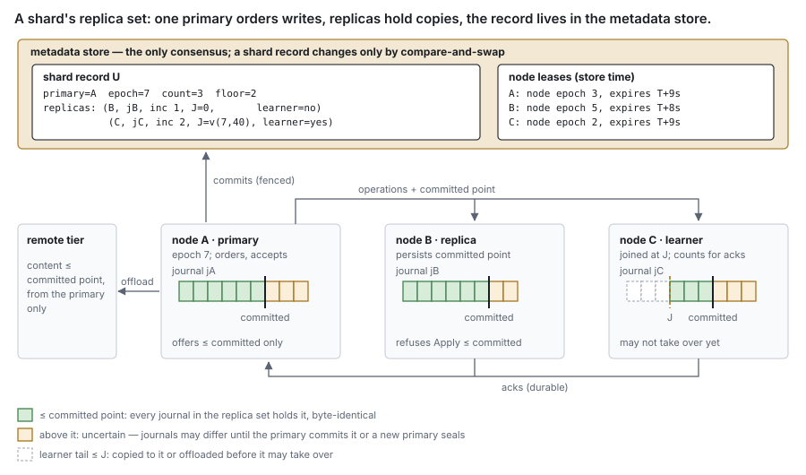
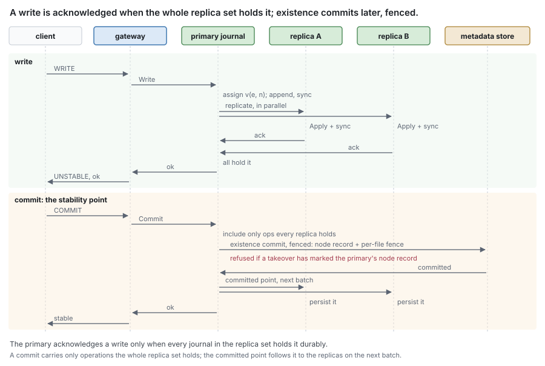
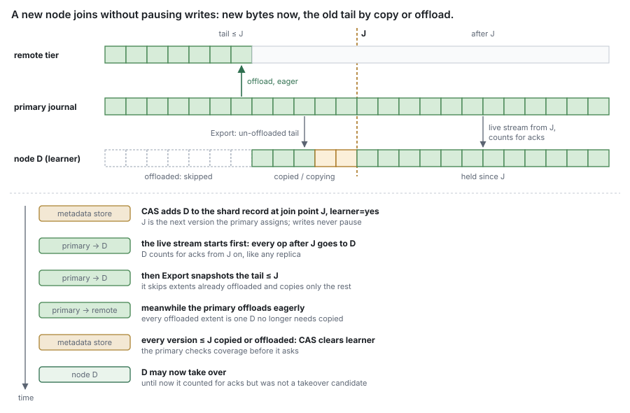
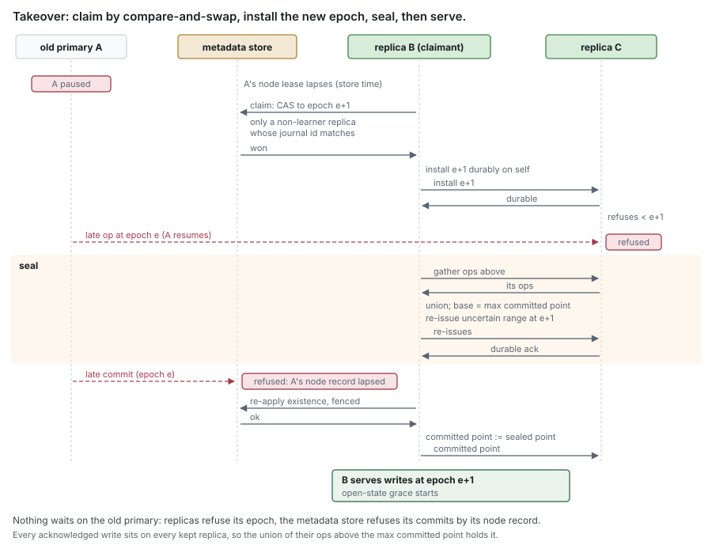

# RFC 10 — journal replication

**Status:** deferred. [§16](#16.%20Open%20questions) lists what is known to be undecided.
**Audience:** anyone designing or changing how an acknowledged write survives the
loss of the node that accepted it.

> [!note] Built after the single-node release
> This design is not shelved. The first release is a single node scaled
> vertically; horizontal scaling is the phase after it, needed for large
> contracts, for large shares spread over several nodes and, later, for
> NFSv4.2 and pNFS. Every rule here is a cluster rule; which of them bind the
> first release, and what replaces the rest on one node, is
> [RFC 0's single-node profile](rfc-0-data-lifecycle.md#1.4%20The%20single-node%20profile).
> Until the cluster is built only these hooks are implemented:
>
> - the 128-bit content version, with its epoch half held at zero
>   ([RFC 1 §4.3](rfc-1-journal.md#4.3%20Versions));
> - the node epoch and the shard incarnation carried in the NFS write verifier
>   ([RFC 11 §7](rfc-11-ownership.md#7.%20Protocol%20state), rule 3);
> - one binary, with roles chosen by configuration ([RFC 15 §2.1](rfc-15-topology.md#2.1%20One%20binary%2C%20roles%20chosen%20at%20deployment)).
>
> Adding nodes does migrate each journal's format, one way: the extension's
> record kinds ([§2.3](#2.3%20The%20journal%20extension)) are not in the first
> release's format, and a journal that has written one cannot be opened by an
> older binary. That upgrade is gated ([§2.3](#2.3%20The%20journal%20extension)), never implicit.

---

## Start here

*Explanatory. The rules are in §1 onward; where this section and a rule differ, the rule wins.*

### In plain words

Each shard keeps a notebook of recent writes, the journal, on a fast local disk.
The node in charge, the primary, writes every entry first. It reads the entry
out to two other nodes, the replicas, and waits until both have written it down.
Only then does the client hear OK. Later the primary files the pages in the
warehouse, the object bucket, and tells the replicas they may tear theirs out.
The metadata store keeps the list of who holds a copy, stamped with a ticket
number, the epoch. Nobody votes on each entry: the store only settles who is in
the group, and a replica never writes an entry the primary did not send.

```text
 write ─► S1 primary ──copy──► S2 ✓
             │      └──copy──► S3 ✓
             ▼  all three hold it
            OK ─► client        later: S1 ─► bucket; S2, S3 drop their copies
```

**What this is.** When several DittoFS servers serve one share, a write must
survive the loss of the server that accepted it. This layer copies every write
into the local journals of a small group of servers before the client is told
it succeeded, and decides which copies still count after a server fails or is
replaced.

**The problem.** DittoFS answers a write as soon as it is in the **journal** — a
log of recent writes on a fast local disk — and uploads it to the object store
(the S3 bucket `dfs-data`) later, in the background
([RFC 0 §5](rfc-0-data-lifecycle.md#5.%20The%20write%20path)). On a single node that is the design: if
its disk dies, the server is gone too. In a cluster it is not enough.

Take a cluster with storage nodes S1, S2 and S3. Shard A is the set of files
under `profiles/alice/`; its **primary**, the one node allowed to write them, is
S1 ([RFC 11](rfc-11-ownership.md) says how that is decided).

1. alice-pc writes 64 KiB into `profiles/alice/ODFC_alice.vhdx` over SMB. The
   call reaches S1.
2. Without this layer, S1 puts the write in its journal and answers OK. Until the
   background upload, the bytes exist only on S1's disk.
3. S1's disk fails. Windows believes the write is saved; it is gone, alice's
   profile disk is corrupt, and no other node can even tell which writes were lost.

With this layer, step 2 changes:

1. S1 gives the write a version number and stores it in its own journal.
2. S1 sends it to S2 and S3, the shard's **replicas**. Each makes it durable in
   its own journal and answers.
3. Only when S1, S2 and S3 all hold it does alice-pc get OK. The price is one
   network round trip and one disk sync on a replica.
4. Later S1 alone uploads the bytes to the bucket, then tells S2 and S3 they may
   release their copies.

Now S1 crashes. S1 renews one lease in the metadata store every 3.3 s, valid for
10 s (the proposed defaults). Once it has lapsed, plus 0.5 s allowed for clock drift,
and S2 and S3 have re-read its expiry — at most one renewal period later — they compare
how much each is sure the whole group holds. The one ahead claims shard A in one
metadata-store transaction, which raises the shard's **epoch** from 5 to 6.
Before serving, it pulls from the other anything it lacks and re-issues the
uncertain writes under epoch 6. alice's write is on both, so nothing that was
acknowledged is lost. Writes to shard A stall for up to the lease, the drift
allowance, one renewal period, the comparison and the reconciliation together —
about 14 s plus a few seconds, more when much was in flight — then resume. No operator acts.

If S1 had only paused — a frozen VM, a long stall — and woke up still believing
it was primary, everything it sends carries epoch 5. S2 and S3 refuse it, and
the metadata store refuses its commits, because the takeover marked S1's lease
lapsed. The fence is enforced by every receiver, never by S1's own check.

```text
  alice-pc ── SMB ──► protocol node ── forwards ──┐
                                                  ▼
 ┌─────────────────────── shard A, epoch 5 ───────────────────────┐
 │  S1 (primary)                                                  │
 │  1 version v(5,100), into S1's journal                         │
 │  2 send to every replica ──────┬─────────────────────┐         │
 │                                ▼                     ▼         │
 │                         S2 (replica)          S3 (replica)     │
 │                         3 journal, sync,      3 journal, sync, │
 │                           answer "held"         answer "held"  │
 │  4 all three hold it ──► OK to alice-pc                        │
 └────────────────────────────────────────────────────────────────┘
   later: S1 alone uploads to the bucket `dfs-data`, then tells
   S2 and S3 they may release their copies

 metadata store: shard record "A: epoch 5, primary S1, replicas S2, S3"
 changed only by compare-and-swap, never per write
```

**The words you need.**

- **primary** — the one storage node that orders and accepts a shard's writes
  ([glossary](rfc-0-data-lifecycle.md#Glossary)); which node it is, and how it
  moves, is [RFC 11](rfc-11-ownership.md)'s.
- **replica** / **replica set** — a storage node whose journal receives every
  write of the shard / the primary and its replicas. The default is three
  copies in all, and writes stop below two ([§7.1](#7.1%20Count%2C%20floor%20and%20placement)).
- **epoch** — a fencing number in the shard's record in the metadata store;
  what raises it is stated once, in [§2.1](#2.1%20Terms). Every message carries
  it, and a receiver refuses an older one ([§6](#6.%20Fencing)).
- **shard incarnation** — a second number in the shard record, raised every time
  a node or journal begins serving the shard as primary, that re-claim included.
  The write verifier follows it; fencing does not ([§2.1](#2.1%20Terms)).
- **committed point** — per shard, the newest version the whole replica set
  durably holds, a learner counted only from its join point. Only content at or below it is uploaded, and a late message at
  or below it is refused ([§2.1](#2.1%20Terms)).
- **learner** — a replica that has just joined: it receives every new write at
  once, but not yet the older content still waiting for upload, so it cannot
  take over ([§7.3](#7.3%20Joining)).
- **node lease** — one lease per storage node, renewed in the metadata store; a
  node whose lease has lapsed serves nothing ([§3](#3.%20What%20it%20assumes%20of%20shard%20placement)).
- **takeover** / **handover** — a replica becoming primary after the primary's
  lease lapsed ([§9.2](#9.2%20Takeover)) / a planned change of primary that waits
  for no lease ([§9.4](#9.4%20Handover)).

**What this RFC promises.**

- An acknowledged write is in the journal of every member of its replica set
  until it is uploaded, so it survives the loss of all of them but one that is
  not a learner.
- A shard whose primary is lost becomes writable again on its own, as soon as
  one replica that is not a learner is alive. No quorum, no operator.
- Nothing a replaced primary sends or commits takes effect after the takeover.
- A read never returns bytes older than the last acknowledged write, nor bytes a
  takeover later takes back: the primary serves only what the whole replica set
  holds, and any other node confirms the version with the primary or forwards
  the read.
- Adding a replica never pauses writes, and a single node runs the same code
  with a replica set of one.

### Scenarios

Shard A has primary S1 and replicas S2 and S3, at the default of three copies
and a floor of two ([§7.1](#7.1%20Count%2C%20floor%20and%20placement)).

**A replica dies while writes keep coming.**

1. S3 loses power. Writes to A wait, because S1 acknowledges only what every
   listed replica holds ([§4](#4.%20The%20write%20path)).
2. S3 stays silent past the removal bound. S2 answered within it, so S1 keeps
   S2 and removes S3 ([§7.2](#7.2%20Removal)).
3. S1 writes the shard record without S3 at the next epoch, by
   compare-and-swap. The waiting writes are acknowledged without it ([§7.2](#7.2%20Removal)).
4. Two members remain, the floor, so A keeps writing. It is under-replicated,
   so S1 offloads eagerly ([§7.1](#7.1%20Count%2C%20floor%20and%20placement), [§5](#5.%20Offload%20and%20release)).
5. The repair scheduler joins S4, from a failure domain A does not use, as a
   learner ([§7.4](#7.4%20Repair), [§7.3](#7.3%20Joining)).

The stall is about the removal bound plus one compare-and-swap
([§15](#15.%20Test%20plan%20and%20benchmarks)); A has three copies again once S4's tail
is covered.

**A slow replica that still answers.**

1. S3's disk slows down. It still answers, but lags by more than the configured
   bytes or time ([§7.2](#7.2%20Removal)).
2. Until then every write to A runs at S3's pace: acknowledgement needs the whole
   replica set, not a quorum ([§4](#4.%20The%20write%20path)).
3. Before removing S3, S1 probes S2, the replica it keeps, and acts only on S2's
   answer ([§7.2](#7.2%20Removal)).
4. S1 removes S3 at the next epoch, and writes return to S2's pace.

A slow node is removed like a dead one; until then it sets the shard's write
latency.

**A replica comes back after a reboot.**

1. S3 restarts, its journal still holding old entries of A's files.
2. It joins A as a learner and first discards those entries: they may include
   writes never acknowledged ([§7.3](#7.3%20Joining)).
3. S1 adds it at the next epoch with a join point. From there S3 receives every
   new write and counts for its acknowledgement ([§7.3](#7.3%20Joining)).
4. S1 covers the older tail file by file, by copying or offloading it
   ([§7.3](#7.3%20Joining)).
5. Once every file is covered, S1 clears the learner flag. Only now may S3 take
   over or serve reads ([§7.3](#7.3%20Joining)).

Writes never pause. A short absence still costs a full tail copy today; a
dirty-region map is the recorded upgrade ([§7.3](#7.3%20Joining)).

**The primary is cut off from both replicas.**

1. A network fault isolates S1 from S2 and S3, while S1 still reaches the
   metadata store.
2. S1 hears from no replica within the removal bound. It cannot tell its own
   isolation from their loss ([§7.2](#7.2%20Removal)).
3. So it removes neither. It relinquishes A: it stops serving A, then marks the
   record relinquished at the next epoch ([§7.2](#7.2%20Removal)).
4. S2 or S3 takes A over at once, with no wait for S1's lease
   ([§9.2](#9.2%20Takeover)).
5. S1 may not claim A back while the record marks it relinquished
   ([§7.2](#7.2%20Removal)).

A never runs on one isolated copy. If both replicas are truly lost, only an
operator's acknowledgement lets S1 claim A alone.

**A client's read lands on a replica.**

1. A read of a file in A reaches S2 ([§8](#8.%20Reads)).
2. S2 asks S1 for the newest version of each extent the read covers. The
   answer carries no bytes ([§8](#8.%20Reads)).
3. S2 serves its own bytes only if each extent carries exactly that version,
   and the answer is still fresh by S2's own clock ([§8](#8.%20Reads)).
4. Otherwise S2 forwards the read to S1.

One round trip spreads reads over the replicas without ever serving stale bytes.

**How the rest is organised.** §1–§3 give the purpose, the terms, the journal
extension replication needs and what it takes from [RFC 11](rfc-11-ownership.md);
§2.2–§2.3 can be skipped on a first read. §4–§6 are the core: the write path,
upload and release, fencing. §7 adds and removes replicas, §8 serves reads on
any node, §9 is failover and handover, and §10 the single node. §11 replays
each case of §9 as a step-by-step table and is best read beside it. §12–§16 —
API, invariants, metrics, tests, open questions — are for implementers.

## 1. Purpose

A write is acknowledged once the journal holds it ([RFC 8 §4.1](rfc-8-engine.md#4.1%20A%20write%20is%20staged%20and%20acknowledged%2C%20and%20nothing%20more)), and until it is
offloaded the journal of the node that accepted it is the only copy. On one node
that is the design. With several nodes serving one share, losing a node must not
lose acknowledged writes. This layer makes that true:

> **An acknowledged write is held by the journal of every node in its replica
> set until it is offloaded.**

It sits between the engine and the journal. The journal ([RFC 1](rfc-1-journal.md)) stays a local
store that knows nothing of peers; this layer decides which journals hold a shard,
moves operations between them, and fences the ones that must no longer count.

### 1.1 Goals

1. **Durability across node loss.** An acknowledged write survives the loss of
   every node of its replica set but one that is not a learner.
2. **Reads anywhere.** Any storage node **MAY** serve recently written bytes it
   holds, after one round trip to the primary that carries no bytes ([§8](#8.%20Reads)).
3. **No consensus among storage nodes.** The metadata store is the only consensus
   ([§3](#3.%20What%20it%20assumes%20of%20shard%20placement)); it is consulted when the replica set changes, never per write.
4. **A new node takes writes at once**, with no pause in the shard's writes ([§7.3](#7.3%20Joining)).
5. **One code path** on one node as on many ([§10](#10.%20A%20single%20node)).

### 1.2 Non-goals

This layer **MUST NOT**:

- decide which node is a shard's primary, or move it — [RFC 11](rfc-11-ownership.md);
- order writes from more than one writer to the same bytes — one writer per shard
  is assumed ([§3](#3.%20What%20it%20assumes%20of%20shard%20placement));
- offload, carve, sync to the remote tier, or evict — the primary's engine does,
  exactly as on one node;
- replicate metadata — the metadata store has its own durability;
- erasure-code journal content ([Appendix B](#Appendix%20B%20%E2%80%94%20alternatives%20considered)).

Which process runs which role is [RFC 15](rfc-15-topology.md#2.1%20One%20binary%2C%20roles%20chosen%20at%20deployment)'s. This document speaks only of
**storage nodes** — nodes with the `storage` role, each with a journal per device
— and of the metadata store.

## 2. Model

### 2.1 Terms

**Shard**, **primary**, **shard record** and **node lease** are the
[glossary](rfc-0-data-lifecycle.md#Glossary)'s. Every rule here is per shard. The
primary also holds the shard's namespace writes and open state, which this layer
does not replicate.

| Term | Means |
| --- | --- |
| **replica** | a storage node whose journal receives a copy of every operation the primary assigns for the shard |
| **replica set** | the primary and its replicas |
| **learner** | a replica that joined at a **join point** and has not yet been given the shard's older content ([§7.3](#7.3%20Joining)) |
| **holds durably** | a node holds an operation durably once its journal has synced the record of it to the journal's device ([RFC 1 §5.2](rfc-1-journal.md#5.2%20Sync%20policy)), so the operation survives a crash or power loss of that node. It says nothing of the remote tier: content synced there is *offloaded* |
| **acknowledged** | answered to the client as done — a write's reply, a stable write, a flush or a synchronous metadata operation. Only what the client was told counts; an operation the primary assigned but did not answer is not acknowledged |
| **epoch** | the shard's **ownership epoch**: a number in the shard record, carried by every version and message ([§6](#6.%20Fencing)). **This is the one statement of what raises it; every other RFC cites it.** It is raised by every change to the record that must fence a sender: a takeover, a handover, a relinquish ([§7.2](#7.2%20Removal)), a replica joining or removed, a learner cleared, and the raise before a move. Two record changes raise none, because nothing else can hold the shard: a node's re-claim of a shard with no replica ([§10](#10.%20A%20single%20node)) and a journal attach on one node ([RFC 0 §1.4](rfc-0-data-lifecycle.md#1.4%20The%20single-node%20profile)); both raise the shard incarnation only. Others raise neither, because they change no member and fence no sender: an override of the shard's replica count or floor ([§7.1](#7.1%20Count%2C%20floor%20and%20placement)), and an operator's acknowledgement that a relinquished shard's replicas are lost ([§7.2](#7.2%20Removal)); each is a compare-and-swap on the record, and the claim or write that relies on it reads it there |
| **shard incarnation** | a second number in the shard record, raised every time a node or journal begins serving the shard as primary, the re-claim included, and by nothing else. It fences nothing; it is an input of the write verifier ([RFC 11 §7](rfc-11-ownership.md#7.%20Protocol%20state)). A start that lost the shard's open state, a handover whose table never arrived included, copies it into the record's `GraceInstance`, which names the grace instance; a handover that ships the table raises the incarnation and leaves `GraceInstance` alone ([RFC 14 §4.4](rfc-14-open-state.md#4.4%20Grace%20is%20per%20shard)) |
| **join incarnation** | raised each time a node joins a shard as a replica; with the node and its journal identity it names one membership, so a node that left and returned is never taken for the copy that left ([§7.3](#7.3%20Joining)) |
| **committed point** | per shard, the newest version `v` such that every member that is not a learner durably holds every operation at or below `v`, every learner durably holds every operation from its join point up to `v`, and metadata records every removal at or below `v`. The primary sends it to its replicas, and each keeps it durably. A learner's missing tail, which lies below its join point, therefore never holds the point back |
| **seal** | steps 3 and 4 of a takeover ([§9.2](#9.2%20Takeover)): reconciling the kept replicas above the baseline and re-issuing what was uncertain under the new epoch |
| **drift bound** | the bound on clock drift with which every node reckons its node lease ([§3](#3.%20What%20it%20assumes%20of%20shard%20placement)) |



**What the epoch buys.** A version is an epoch and a counter, compared as one
number ([RFC 1 §4.3](rfc-1-journal.md#4.3%20Versions)): after a takeover to epoch 4, `v(4,1)` outranks `v(3,90)`, and a
late `v(3,95)` from the old primary loses to it in every journal it reaches.

**Each number does one job.** The ownership epoch fences: it orders versions,
and every receiver and every fence record compares it. The node epoch names one
lease of one node, and the node-record guard on every commit compares it
([§3](#3.%20What%20it%20assumes%20of%20shard%20placement) item 6). The shard
incarnation tells clients that the serving primary changed, through the write
verifier; the shard record's `GraceInstance`, set to the incarnation only by a
start that lost the shard's open state (a handover whose table never arrived
counts, [§9.4](#9.4%20Handover)) and carried unchanged by a handover that ships
the table, names the grace instance a stateid is judged against
([RFC 14 §4.4](rfc-14-open-state.md#4.4%20Grace%20is%20per%20shard)). A put intent is superseded once the shard record
no longer names the (node, node epoch) it was written under as primary
([RFC 11 §8](rfc-11-ownership.md#8.%20Metadata%20consistency)), never by the
epoch alone and never by the incarnation; a primary that stays through a raise
of the epoch rewrites each object's fence records in its first fenced transaction on it under the new epoch ([RFC 11 §8](rfc-11-ownership.md#8.%20Metadata%20consistency)). A retried request is recognised by its request ID
alone, never by any of the three ([RFC 15 §4.3](rfc-15-topology.md#4.3%20The%20route%20envelope)).
No rule here reads a number for another's job: a move's raise changes the epoch
and nothing a client sees, and a single node's re-claim changes the incarnation
and the node epoch and fences nothing.

**What the replicas agree on.** Journals are not byte-identical on disk, but **at
or below the committed point every journal of the replica set returns the same
bytes at the same version for any file and offset**. Above it they can differ;
a takeover resolves those extents ([§9.2](#9.2%20Takeover)).

### 2.2 One journal carries many shards

A storage node keeps one journal per device ([RFC 1](rfc-1-journal.md)), holding files of every shard
the node is primary or replica of. Nothing in this layer is per journal:

- every journal call and every procedure acts per file, and only on the files the
  journal holds content for — never on every file of a shard, which can hold
  millions;
- the node keeps, per shard, an **install record** — the installed epoch, the
  committed point and its own join incarnation — durably and on the device of the
  journal it describes, so losing the device loses both;
- capacity is the journal's, shared under its per-share limits ([RFC 1 §6](rfc-1-journal.md#6.%20Capacity));
  [§5](#5.%20Offload%20and%20release) says how pressure reaches primaries;
- a replica is identified by its node, the **journal identity** of the journal
  holding the shard ([RFC 28 §2.1](rfc-28-journal-format.md#2.1%20Layout)) and a join incarnation, and so is the primary,
  whose entry in the shard record adds its node epoch. A lost device therefore
  loses the node's place in every shard that journal held;
- each journal has a **generation**, kept in its `format` file and in the
  metadata store under its journal identity ([RFC 16 §4.2](rfc-16-metadata-store.md#4.2%20Keys%3A%20per-file%2C%20per-share%2C%20content-addressed)). At every open of
  the journal, every acquisition of its node's lease and every renewal of it
  (once per renewal period), and every resume of a lapsed lease ([§3](#3.%20What%20it%20assumes%20of%20shard%20placement) item 3), the node reads the generation `g` in `format`, writes `g + 1`
  there and syncs it, then raises the store's to `g + 1` by compare-and-swap,
  conditional on the store's being at most `g` — a crash, or a failed renewal,
  between the sync and the swap leaves the store one behind. At a renewal the
  swaps ride in the renewal's own transaction, beside the lease's new expiry; it
  writes the lease's expiry record and the journals' generation records, never
  the node record, so it still does not conflict with fenced commits ([§3](#3.%20What%20it%20assumes%20of%20shard%20placement)
  item 3). A swap that loses does not fail the renewal; it fails only its
  journal. A renewal whose outcome is unknown — its reply lost — **MUST** be
  resolved by re-reading the store's generation of each journal before the node
  renews again: one that equals the `g + 1` the node synced landed, and the next
  renewal swaps from it; one still at `g` did not, and is swapped again from `g`.
  A blind retry of a swap that landed finds the store at `g + 1`, loses, and
  declares a sound journal amnesiac. A node **MUST** complete the swap at open, at acquisition and at resume
  before it serves or acknowledges anything from the journal. A journal whose swap loses
  was rolled back — restored from an older copy, or from a VM image taken before
  its node's last successful swap — and is amnesiac for every shard it holds
  ([§6](#6.%20Fencing)): the node stops serving from it, durably drops its install records,
  then swaps again from the store's generation, so the amnesia outlives a crash
  and the next open does not lose again. Any image older than one renewal
  interval therefore loses. The cost is one sync of `format` per journal per
  renewal; the compare-and-swaps add no round trip.

### 2.3 The journal extension

The journal of [RFC 1](rfc-1-journal.md) assigns every version itself. Replication needs a journal
that also takes versions assigned elsewhere, raises a file's epoch, and forgets a
file on command. That is a **later journal format version**, added as
[RFC 28 §2.3](rfc-28-journal-format.md#2.3%20Records) prescribes: a binary that knows it opens a journal of format
version 1 ([RFC 28 §2.1](rfc-28-journal-format.md#2.1%20Layout)) and upgrades it on its first extension record; a binary that does not
refuses the newer journal.

**The upgrade is gated.** A node **MUST NOT** write a journal's first extension
record until the installation's replication gate is open: a setting
([RFC 13](rfc-13-configuration.md)) that an operator opens only after every node of
the installation runs a binary that knows the extension, and that the store
refuses to open while a node record names an older binary. Until then every
extension call is refused with `ErrGateClosed` and the shard keeps its single-node
behaviour. Once open, the gate never closes: a journal that has written an
extension record cannot be opened by an older binary, so a downgrade past the gate
is refused at start rather than at the first open of an upgraded journal.

> decision: the extension's record kinds are a gated upgrade, not shipped in the
> first release's format. Shipping them now would freeze, before the cluster is
> built or modelled, record layouts the model may yet change; the gate costs one
> setting and makes the one-way step explicit. Overturned if the record layouts
> are fixed by the model before the first release ships, in which case shipping
> them removes the gate.

**Every applied or assigned operation's record keeps its request ID and its
result** — what the client was or would be answered — beside the digest, so a
new primary answers a retry of an operation it holds from its journal
([§4](#4.%20The%20write%20path)) rather than by applying it again. **The pair
outlives the operation's content.** When eviction, settling or repack drops an
operation whose acknowledgement is younger than the retry window
([RFC 15 §4.3](rfc-15-topology.md#4.3%20The%20route%20envelope)), the
journal keeps a **request entry** — the request ID, the result and an expiry —
on the primary and on every replica, carries it forward in repack, and yields it
in `Export`; it drops the entry once the window has passed. Otherwise a write
offloaded and evicted before its primary fails is applied a second time by its
retry, over whatever landed on the same bytes since.

```go
Apply(s ShardID, id FileID, op Op) error                         // write, deallocate, truncate or delete, with its version and digest
Export(s ShardID, id FileID, from Version) iter.Seq2[Op, error]  // un-offloaded content and removal markers, with bytes
SetEpoch(s ShardID, id FileID, e uint64) error
Discard(s ShardID, id FileID) error
```

It adds record kinds **epoch**, **discard**, **request entry** and per-shard **forget**, and, to
every operation's record, the fields the frozen header ([RFC 28 §2.3](rfc-28-journal-format.md#2.3%20Records)) lacks — the
shard, the request ID, the digest and the result — carried in the extension
record's own body, as RFC 28 §2.3 prescribes for a later format version. It lifts RFC 1's rule that a
version's epoch half is zero ([RFC 1 §4.3](rfc-1-journal.md#4.3%20Versions)), and gives `Offload` a **ceiling**:
an offer includes only content at or below the version the caller passes. This
layer passes the shard's committed point ([§5](#5.%20Offload%20and%20release)).

**Entries are per shard.** The extension keys a file's entry by (shard, file),
and its epoch record names the shard as well as the epoch. One journal can
therefore hold a file under two shards while a move runs ([§9.4](#9.4%20Handover)), and every
call names the shard and touches that entry only. A node serves a file only from
its entry under the shard whose primary it asked ([§8](#8.%20Reads)). An entry with no epoch
record, as every entry of format version 1 is, belongs to the shard metadata
records its file in.

**`Apply`** takes an operation whose version another journal assigned and applies
it by version: at each byte it takes effect only where it is newer than what the
journal holds there, content and removal markers alike. An equal version is a
repetition and changes nothing when its **digest** matches — a hash of the
operation's request ID, kind, extent and bytes, which every operation carries and
its record keeps — and is refused with `ErrDivergent` when it does not. Applied
operations are durable, reserve capacity, advance the file's change version
([RFC 1 §3.4](rfc-1-journal.md#3.4%20Fill)) and are recorded exactly as assigned ones are. The caller **MUST
NOT** apply two different operations under one version of one file. A journal
that applied a set of operations in any order therefore holds exactly what one
that applied them in version order holds.

**`SetEpoch`** raises the epoch under which the journal assigns versions for
`id` under `s`. `e` **MUST** exceed the file's current epoch, and the epoch record
**MUST** be durable before the first version under it is assigned. The primary
raises a file's epoch to the shard's just before assigning the file's first
version under it, so a new epoch costs nothing for files it never writes.

**`Export`** is RFC 1's `Since` with each write's bytes, **skipping offloaded
extents**: it yields, in version order, operations that reproduce every
un-offloaded extent and removal marker of `id` at or above `from`, each at its own
version.

**`Discard`** forgets the entry of `id` under `s` entirely — held extents
whatever their offloaded bit, removal markers and epoch — as if the journal had
never held it, and leaves the file's entry under any other shard alone. Its record
covers every record of the file with a lower sequence number whatever its
version, the one exception to precedence; it drops the file's entry by raising
its fill floor bucket to the entry's change version ([RFC 1 §3.4](rfc-1-journal.md#3.4%20Fill)), is durable on return, and recovery **MUST NOT**
bring back anything it discarded. **Discarding dirty content destroys it unless
another journal holds it**; the caller **MUST** know that one does.

**Retention.** A file's newest epoch record is live, and carried forward by
repack ([RFC 1 §7.2](rfc-1-journal.md#7.2%20Repack)), only while the file has a held extent or a removal marker. A
journal that has forgotten a file's epoch treats it as having none, and the
primary's `SetEpoch` before the next assignment re-establishes it. A discard record
is live while it still covers a record of its file in another segment.

**Snapshot holds and stamps are replicated operations.** `Hold`, `Unhold` and
`Stamp` ([RFC 1 §3.11](rfc-1-journal.md#3.11%20Snapshot%20holds)) are sent by the primary to every replica and applied
there like any operation, and a `Hold` returns only once its marks are durable on
every replica of the shard ([RFC 12 §2.4](rfc-12-snapshots.md#2.4%20A%20snapshot%20hold%20bridges%20dirty%20content%20to%20history)). A replica's `Hold`
acknowledgement returns its journal's held bytes and dirty bytes not yet
offloaded, summed over every share it carries, so the primary evaluates the hold
bound for every journal of the replica set. `Export` yields, beside un-offloaded
content, every held superseded version with the hold marks that keep it and every
version's stamp, so whatever an export feeds — a join, a reconcile, a move between
shards — carries the holds and the stamps too.

**`Forget` is a replicated operation.** A share's removal ([RFC 16 §2.3.2](rfc-16-metadata-store.md#2.3.2%20Removing%20a%20share), step 3)
has each shard's primary send `Forget` for the share's tag ([RFC 1 §3](rfc-1-journal.md#3.%20Interface)) to every
replica of the shard, and the step for that shard completes only once each
replica of the set has made it durable or has been removed from the set
([§7.2](#7.2%20Removal)). **No shard forgets before every shard is offloaded.** One
journal holds every shard its node is primary or replica of, and RFC 1's
`Forget` drops a tag whole, so the removal sends no `Forget` until every shard
of the share has offloaded what a kept snapshot needs: the coordinator's gate
over the shards' `rm` rows ([RFC 16 §2.3.2](rfc-16-metadata-store.md#2.3.2%20Removing%20a%20share), step 3) is that rule, and this
layer adds none of its own. Under `delete`, with no kept snapshot, each shard
has nothing to offload and records its row as offloaded at once, so the gate
opens. After the gate, each shard's replicated `Forget` writes a durable
**forget** record naming (shard, tag) on the primary and every replica. When a
node holds a forget record for every shard of the share it serves in that
journal, as primary or replica, it closes its flow and its handle on the tag
and **then** calls RFC 1's whole-tag `Forget`, which RFC 1 refuses while a
handle of the tag is open. So a primary of A and C never closes the flow C is
still using, and a replica of A and B never drops B's part early. A replica never offloads (§5), so without it each replica
would keep the share's dirty content, never offered and never evictable, until
its next start. A removed replica that comes back holds a tag no share claims
and resolves it at its next start ([RFC 1 §3](rfc-1-journal.md#3.%20Interface)).

**The whole-tag `Forget` runs before a row reads forgotten, and again at every
start while it is owed.** A member acknowledges a shard's `Forget` once its
forget record is durable and, when that record was the last the node awaited
for the tag, once RFC 1's whole-tag `Forget` has returned; the primary advances
the shard's `rm` row to forgotten only on every member's acknowledgement. RFC 1's
`Forget` is durable and idempotent, so at every start a node runs it again for
any tag its journal's `Stats` still names whose share's `rm` rows read forgotten
for every shard the node serves in that journal: a crash between the last row
and the call then costs one call at the next start, not the tag's bytes until
the share's records are gone. A forget record is live, and carried forward by
repack ([RFC 1 §7.2](rfc-1-journal.md#7.2%20Repack)), for as long as the node keeps
the shard's install record ([§2.2](#2.2%20One%20journal%20carries%20many%20shards)),
not merely until the journal holds its tag's whole-tag forget record: it is both
the evidence the whole-tag call waits on and what `ErrForgotten` rests on below.
The node drops the two together once its periodic re-read finds the shard record
gone with the share's other records ([§6](#6.%20Fencing)); a later message about
the shard then names a shard no record lists and is refused. A
journal of the first format version has no forget record kind and one shard
per tag: its shard's primary runs the whole-tag `Forget` and then advances the
row ([RFC 16 §2.3.2](rfc-16-metadata-store.md#2.3.2%20Removing%20a%20share), step 3).

**(cluster)** **Nothing reaches a shard's tag once its share is in its forget phase.** From
the moment the coordinator moves the share's state to its forget phase
([RFC 16 §2.3.2](rfc-16-metadata-store.md#2.3.2%20Removing%20a%20share), step 3), a shard's
primary sends no tail copy of it and the repair scheduler joins no node to it
([§7.3](#7.3%20Joining), [§7.4](#7.4%20Repair)): a learner's tail copy or a new
member's join after its forget record would land live, never evictable, under a
tag the node has already forgotten. A takeover of a shard in that phase skips
the reconcile and the re-issue of [§9.2](#9.2%20Takeover) (steps 3 and 4) and
re-sends `Forget` to every member instead: both would `Apply` under the tag, and
a member holding the forget record refuses them. A node that holds a shard's forget record refuses `Apply` and the
join's copy for that shard with `ErrForgotten`, so a message sent before the
phase and delivered after it adds nothing.

**Settling** needs no new record. A node calls RFC 1's `Settle` on a shard's files
at the committed point it has persisted, which drops removal markers at or below
it ([RFC 1 §3.10](rfc-1-journal.md#3.10%20Settle%20and%20Since)), and settles again after a restart. No marker is needed for what
settling drops or offload released: [§6](#6.%20Fencing)'s refusal at the committed point keeps
every late operation below it out.

## 3. What it assumes of shard placement

[RFC 11](rfc-11-ownership.md) provides these; this layer relies on nothing else:

1. **One primary per shard, named in its shard record** as (node, node epoch,
   journal identity, join incarnation), with the shard incarnation. The metadata
   store is the only consensus. It **MUST** provide linearizable compare-and-swap
   on a shard record and be reachable from every storage node, and a change to a
   record raises its epoch as [§2.1](#2.1%20Terms) states. Records change only when the
   primary or the replica set changes, or by an operator's override or
   acknowledgement ([§2.1](#2.1%20Terms)), never on lease renewal.
2. **A file's epoch never decreases**, including when it moves between shards
   ([RFC 11 §3.1](rfc-11-ownership.md#3.1%20The%20primary%20is%20fenced%20by%20an%20epoch)).
3. **One node lease per storage node**, with a node epoch. The node lease
   duration and the drift bound are installation settings
   ([RFC 13 Appendix B](rfc-13-configuration.md#Appendix%20B%20%E2%80%94%20the%20settings)) (proposals: 10 s and 500 ms), and the
   renewal period is a third of the lease, not a setting (the ratios are
   [RFC 11 §3.1](rfc-11-ownership.md#3.1%20The%20primary%20is%20fenced%20by%20an%20epoch)'s decision). The node record holds the node epoch and
   whether a takeover has marked it lapsed; renewals write only the lease's own
   expiry record and its journals' generations ([§2.2](#2.2%20One%20journal%20carries%20many%20shards)), never the node record ([RFC 16 §2.3](rfc-16-metadata-store.md#2.3%20Server-wide%20and%20control-plane%20entities)). Losing the lease fences all of the node's shards.
   A node **MUST** stop acknowledging and serving — open state included — when its
   lease runs out by its own clock less the drift bound (9.5 s of 10 s at the
   proposed defaults), and when it has not reached the store — any store call of
it answered, as [RFC 11 §3.1](rfc-11-ownership.md#3.1%20The%20primary%20is%20fenced%20by%20an%20epoch) defines it — for half its lease. A renewal returns
   the store's time ([RFC 9 §1.2](rfc-9-gc.md#1.2%20Words%20this%20document%20uses)); a node whose clock differs from it by more than half
   the drift bound, less half the renewal's round trip, self-fences. A drift
   beyond the bound can break open-state exclusivity, which only the lease
   protects, but not durability, which receivers and the store fence.
   **Renewal fails once a takeover has marked the node record**: the node
   acquires a new lease at a higher node epoch, no sooner than the old expiry
   plus the drift bound in store time, and is then primary of nothing until it
   re-claims ([RFC 11 §3.1](rfc-11-ownership.md#3.1%20The%20primary%20is%20fenced%20by%20an%20epoch)).
   A failed renewal is retried at once, after a random jitter of up to a tenth
   of the renewal period, then at the period ([RFC 11 §3.1](rfc-11-ownership.md#3.1%20The%20primary%20is%20fenced%20by%20an%20epoch)).
   A lease that lapsed in store time while no takeover marked the record — the
   store stalled, or the node could not reach it — is **resumed** instead, by a
   transaction that writes the node record unmarked at the same node epoch,
   swaps each of the node's journal generations as a renewal does
   ([§2.2](#2.2%20One%20journal%20carries%20many%20shards)), and conflicts with any claim marking it, so exactly one of the two commits.
   The node serves nothing from a journal until its swap in the resume has won.
   Any node that would mark the record lapsed first waits out the claim hold
   ([RFC 11 §3.1](rfc-11-ownership.md#3.1%20The%20primary%20is%20fenced%20by%20an%20epoch)). A
   resumed node keeps its shards, its open state and its write verifier, and runs
   no grace; only the process that held the lease resumes, and one that
   restarted acquires a new node epoch ([RFC 11 §3.1](rfc-11-ownership.md#3.1%20The%20primary%20is%20fenced%20by%20an%20epoch)).

   **Timing assumptions.** Each node measures its lease with a monotonic clock
   from the moment it sent the renewal, never from the reply. Two bounds are
   kept apart. The **drift bound** δ (500 ms) is a margin in time. The
   **clock-rate bound** ρ ([RFC 0 §1.4](rfc-0-data-lifecycle.md#1.4%20The%20single-node%20profile)) is a rate: one
   node's monotonic clock runs faster than another's, or than store time, by at
   most ρ, so an interval `T` one clock measures lasts at most `T × (1 + ρ)` on
   another. Every wait in this document and [RFC 11](rfc-11-ownership.md) is sized that way. With
   lease `L`, a node self-fences at `L − δ` by its own clock after it sent the
   renewal, and a successor serves no sooner than `L + δ` by its own monotonic
   clock from the reply to a read that saw that renewal's expiry record, unchanged since
   ([RFC 11 §3.1](rfc-11-ownership.md#3.1%20The%20primary%20is%20fenced%20by%20an%20epoch)); the design **MUST** keep
   `(L − δ) × (1 + ρ) < L + δ`, and a start **MUST** refuse settings that break
   it. At the proposed defaults that holds for any ρ below 10%. The renewal period
   is not set apart from the lease: it is a third of it
   ([RFC 11 §3.1](rfc-11-ownership.md#3.1%20The%20primary%20is%20fenced%20by%20an%20epoch)). Store time is the store's `Now`
   ([RFC 16 §4.1](rfc-16-metadata-store.md#4.1%20One%20small%20interface%20per%20backend)), and it orders only a node's own lease: no takeover
   compares an expiry one node stored with another node's `Now`, so a takeover
   rests on no bound of wall-clock offset, on a store with one time source or
   on one whose `Now` is each node's own clock alike — the clock check above is
   a sanity check, not a premise. Neither assumes anything of how long a process
   pause lasts: a pause of any length is answered by the receivers' fences,
   never by the paused node's own check.
4. **A shard whose primary's lease lapsed is taken over, never plainly claimed**,
   and only by a replica that is not a learner ([§9.2](#9.2%20Takeover)); a claim by any other
   node would leave the replicas outside the record ([RFC 11 §3.2](rfc-11-ownership.md#3.2%20The%20primary%20stays%20until%20another%20node%20needs%20it)).
5. **The primary follows the writer** by handover, not failover ([§9.4](#9.4%20Handover)).
6. **Commits are fenced at the store.** Every metadata commit acting for a shard
   carries its (shard, epoch) and its primary's (node, node epoch). It is refused
   unless the file's fence records hold exactly that (shard, epoch) — *current*
   means equal, and a fence from another shard never matches — and unless the
   primary's node record, which the commit guards, holds that node epoch
   unmarked ([RFC 11 §8](rfc-11-ownership.md#8.%20Metadata%20consistency)). The fence records order epochs per file; the guard
   fences the files a new primary has not yet touched, because a takeover marks
   the old primary's node record lapsed as it claims ([§9.2](#9.2%20Takeover)): a commit still
   in flight under the old node epoch aborts on its guard if the claim commits
   first, and one that commits first is ordered before the claim, under fences
   that still held.

**An unknown compare-and-swap outcome** — a claim, a join, a removal, clearing a
learner, a handover — is resolved by re-reading the shard record and acting on
what is there, before anything else.

## 4. The write path

The primary handles every operation on the shard. For a write, deallocate, truncate
or delete:

1. **Assign.** The primary stages the operation in its own journal, which assigns
   its version under the file's epoch. It carries the request ID of the routed
   call ([RFC 15 §4.3](rfc-15-topology.md#4.3%20The%20route%20envelope)), so a new primary that holds it answers a retry instead
   of applying it again.
2. **Replicate.** The primary sends it, with its epoch, to every replica in the
   shard record, learners included, in parallel.
3. **Apply.** Each replica checks it against [§6](#6.%20Fencing), applies it with `Apply`,
   makes it durable and answers.
4. **Acknowledge.** Once the primary and every replica hold it durably, the client
   is acknowledged.



**The whole replica set, not a quorum.** An operation **MUST NOT** be acknowledged
before step 4; that is what makes one replica enough for a takeover ([§9.1](#9.1%20Why%20one%20replica%20suffices)).
A replica that cannot keep up is removed ([§7.2](#7.2%20Removal)); the primary **MUST NOT**
acknowledge around it while it is listed.

`ponytail:` acknowledgement waits for the slowest member, so a shard's write
latency is its slowest replica's until removal on lag ([§7.2](#7.2%20Removal)) takes that
replica out. Upgrade to acknowledgement at *k* of the shard's *n* members, a
count kept in the shard record beside the floor, when lag removals or write tail
latency show up on the reference deployment. It gives up [§9.1](#9.1%20Why%20one%20replica%20suffices): no one
replica then holds every acknowledged operation, so the committed point becomes
the newest version *k* members hold, and a claimant must gather from *n* − *k* + 1
members before it claims — at three members acknowledging at two, both
surviving replicas, where one suffices today — so a shard that lost its primary
and one replica waits for the other rather than serving.

**Metadata follows the replica set.** Until a write's existence is committed, the
journal is its authority ([RFC 6 §3.4](rfc-6-block-metadata.md#3.4%20Ordering%20against%20the%20journal)). The primary group-commits existence within
its bounded age, and at a stability point only for overwrites of committed
content ([RFC 0 §5.1](rfc-0-data-lifecycle.md#5.1%20Write)); it **MUST** include only operations the whole replica set holds.
A truncate, deallocate, release or clone is a synchronous metadata operation: its
journal operation **MUST** be held by the whole replica set before its metadata
commit, and the client is acknowledged after that commit. Recorded first, a crash
of the primary leaves metadata describing an operation no surviving journal holds.

**A client's flush** ([RFC 8 §5.1](rfc-8-engine.md#5.1%20Commit%20is%20answered%20by%20the%20journal)) is answered once every node of the replica set
has synced the file's operations and the existence of those that overwrite
committed content is committed; appends and hole fills keep the bounded age of
[RFC 0 §5.1](rfc-0-data-lifecycle.md#5.1%20Write), so the store need not yet reflect them.

**The committed point** ([§2.1](#2.1%20Terms)) rides on every batch. A replica persists it
in its install record, never lowers it, and then settles to it ([§2.3](#2.3%20The%20journal%20extension)).

**Batching.** The primary **SHOULD** batch operations to a replica and group their
syncs, as the journal groups its own ([RFC 1 §5.2](rfc-1-journal.md#5.2%20Sync%20policy)). The unit of
acknowledgement stays the operation.

## 5. Offload and release

Only the primary offloads, as on one node, and **only content at or below the
committed point** — it passes the point as the offer's ceiling ([§2.3](#2.3%20The%20journal%20extension)). A newer
ref committed ahead of an older operation still in flight would make that
operation's commit be refused as older ([RFC 6 §4.4](rfc-6-block-metadata.md#4.4%20Commits%20for%20one%20file%20apply%20in%20order)), and it could never be
offloaded. Replicas never offload.

**Replicas release by being told.** After an offload commit lands, the primary
sends each replica the extents it covered with the commit's `oldest` and
`newest`. The replica calls `MarkOffloaded` ([RFC 28 §3.2](rfc-28-journal-format.md#3.2%20Offload%20state%20after%20recovery)) and evicts under its own
capacity policy. The notice also raises the replica's committed point to at least
`newest`, since the primary offloaded nothing above its own point: a replica that
evicted content therefore never reports a point below it ([§9.2](#9.2%20Takeover)). A replica
**MAY** derive the same marks from metadata, which is how it catches up on notices
it missed.

**Pressure.** A replica cannot offload to make room, and its journal is shared
with every shard it holds. When the journal nears capacity it **MUST** tell the
primary of each shard holding un-offloaded content in it, and each primary **MUST**
treat that as its own pressure ([RFC 8 §10.2](rfc-8-engine.md#10.2%20A%20capacity%20refusal%20comes%20back%20here)): offload sooner, then pace and
refuse writes. While the replica still acknowledges, backpressure is the answer,
not removal. A replica whose journal refuses an operation within its share's
limit is lagging for that shard alone, and [§7.2](#7.2%20Removal) applies — rate-limited, so
one full device does not remove itself from every shard at once.

**Under-replication means offloading eagerly.** While a shard is under-replicated
([§7.1](#7.1%20Count%2C%20floor%20and%20placement)), its primary offloads as soon as content is committed, so the content
only its survivors hold, and the tail a new replica must copy, shrink ([§7.3](#7.3%20Joining)).

## 6. Fencing

**Every message travels on an authenticated, encrypted channel.** Nodes
exchange messages — this layer's and forwarded calls alike
([RFC 15 §4.4](rfc-15-topology.md#4.4%20Node%20channels)) — only over channels that are
mutually authenticated by credentials the installation issues per node, and
encrypted. A receiver **MUST** refuse a message whose authenticated sender is not
the node the message names, and a message about a shard from a node the shard
record does not list. Without it, one forged offload notice makes a replica
release dirty content, and no epoch check catches a forger that copies the
current epoch.

Every message this layer sends — an operation batch, an offload notice, an
install, a seal request, a newest-version query — carries the epoch it was sent
under. **The receiver enforces it:**

- it **MUST** refuse a message whose epoch is lower than the one it has installed
  for the shard;
- on a higher epoch it **MUST** refuse the message, read the shard record and
  install it before accepting anything more. Installing **MUST** be durable before
  it answers anything under the new epoch, so a restart never accepts what it
  refused before;
- when it installs a record that does not list it — by node, journal identity and
  join incarnation — it **MUST** stop serving the shard and `Discard` its entries of
  the shard's files, and only those. It may return only by joining again ([§7.3](#7.3%20Joining));
- when a record lists it but it has no install record for the shard — its device
  was replaced or wiped — or its journal lost the generation swap ([§2.2](#2.2%20One%20journal%20carries%20many%20shards)), it
  **MUST** refuse with `ErrAmnesiac` and rejoin as a learner; listed as primary, it
  serves nothing. A record naming a dead node's ID is therefore safe to reuse: the
  new journal matches nothing listed;
- when its journal loses operations it had acknowledged — a failed sync window
  or a torn record raises the journal's loss generation
  ([RFC 1 §5.3](rfc-1-journal.md#5.3%20A%20failed%20sync)) — it **MUST** record, durably in its
  install record, the lowest version it lost for the shard, its **loss point**,
  and report it with its committed point in every answer from then on. A replica
  with a loss point is lagging: the primary removes it ([§7.2](#7.2%20Removal)), and a gather
  counts it at no point above its loss point ([§9.2](#9.2%20Takeover)). It is cleared only by
  rejoining ([§7.3](#7.3%20Joining)), which discards first;
- it **MUST** refuse every operation at or below its committed point. It refuses
  with `ErrCommitted` if it holds that version of the file with the same digest
  ([§2.3](#2.3%20The%20journal%20extension)) — a repetition of an operation the whole replica set already held, which
  the primary counts as held — and with `ErrDivergent` otherwise. A learner's
  copied tail is not refused ([§7.3](#7.3%20Joining)).

**`ErrDivergent` means the primary was rolled back.** A primary never waits on an
operation at or below a replica's committed point, since it sends that point only
once the whole replica set holds everything below it; only a primary restored from
a VM image younger than one renewal interval, which the generation swap cannot
catch ([§2.2](#2.2%20One%20journal%20carries%20many%20shards)), assigns a version a second time. A
primary that meets `ErrDivergent` for an operation it is waiting on **MUST**
acknowledge nothing more, stop renewing its lease, raise the store's generation of
each of its journals without writing it to the journal — so each reopens amnesiac
— and restart. Its replicas take the shard over holding every operation it
acknowledged before the rollback. A refusal of a late duplicate reaches a primary
that is not waiting on it, and is ignored.

A check made only by the sender is not a fence. A primary that pauses past its
lease still believes it is the shard's primary when it resumes; what stops it is
that every receiver has installed the new epoch before the new primary accepts a
write, and that the claim marked its node record lapsed ([§3](#3.%20What%20it%20assumes%20of%20shard%20placement) item 6).

A replica removed while cut off from the primary hears no refusal. It **MUST**
re-read, on a configured period, the shard record of every shard it holds content
for, and discard those that no longer list it.

## 7. Changing the replica set

### 7.1 Count, floor and placement

Each shard has a **replica count** and a **floor**, both in its shard record and
both counting the acknowledgement set — the primary and every replica, learners
included, since a learner durably holds every operation from its join point. The
defaults are installation settings, the replica count (proposal: 3, the primary
and two replicas) and the replica floor (proposal: 2), each overridable in a
shard's record; a single node is 1 and 1. Below the floor the primary **MUST** refuse writes and report
the shard through share health rather than only in a log
([RFC 0 §10.2](rfc-0-data-lifecycle.md#10.2%20No%20state%20requires%20intervention%20to%20leave)). A shard is **under-replicated** while its replica set has fewer
members that are not learners than the count; it keeps writing, and its primary
offloads eagerly ([§5](#5.%20Offload%20and%20release)). A shard whose only member that is not a learner is
its primary is **exposed**: it keeps writing, its primary offloads eagerly, the
repair scheduler orders it first ([§7.4](#7.4%20Repair)), and share health reports it.

> decision: learners count toward the floor, so a shard that lost replicas is
> writable again the moment a replacement joins, rather than for the whole copy
> of its tail. The cost is the exposed window: until a learner's tail is
> covered, losing the primary's device loses the un-offloaded tail below the
> join point, which only the primary then holds, and the shard waits for a
> member that can take over. Eager offload bounds that tail. Overturned if the
> repair-time distribution shows exposed windows long enough that the tail at
> risk exceeds what a deployment accepts; then the floor counts members that are
> not learners again, and writes stop for the copy.

A floor of one keeps writes available with no redundancy; that is a deployment's
choice, stated in its settings.

Replicas of one shard **SHOULD** be in different failure domains. What a domain is
— host, rack, zone — is a setting.

### 7.2 Removal

The primary removes a replica that does not answer within a configured bound,
the **removal bound**,
that lags by more than a configured amount of bytes or time — a slow node that
still answers is removed like a silent one — whose journal refuses within its
share's limit ([§5](#5.%20Offload%20and%20release)), or that refuses as amnesiac ([§6](#6.%20Fencing)). It writes the record without it at the next epoch by
compare-and-swap and installs that epoch on the remaining replicas; operations
the removed replica had not acknowledged are then acknowledged without it.

**A silence removal keeps one recently answering replica.** A primary **MUST
NOT** remove a replica for not answering within the removal bound unless another replica
answered it within the removal bound, and keeps that one. A learner's answer
counts: it proves the primary is not isolated as well as a full replica's does,
so a full replica that falls silent during a repair through a learner is
removed rather than stalling writes for the whole tail copy, and the shard runs
exposed ([§7.1](#7.1%20Count%2C%20floor%20and%20placement)) until the learner's tail is covered.
A replica removed for an answer that only a rejoin can cure — a refusal as
amnesiac, or a point below its persisted mark — is exempt: its answer proves the
primary is not isolated, and it can never accept the shard's writes again, so it
is removed even when it is the last full replica, and the shard runs below its
floor, reported, until repair restores it. Otherwise a two-member shard whose
one replica is amnesiac could neither remove it nor relinquish, and its writes
would stall on a replica that will never accept them. A replica removed for lag
or journal pressure — a refusal within its share's limit, or a lag it reported
— is not exempt: it may still catch up, so the keep-one rule holds it like a
silent one. **Silence removals run before answer removals**: with replica B
silent and replica C lagging, the primary removes B first, keeping C, which
answered; removing C first would leave dead B the only replica, which keep-one
then protects, and the primary would relinquish to it.
**An answer removal first re-proves the replica it keeps.** An answer within
the removal bound shows the primary was not isolated then, not that the replica
is alive now: B dead for less than one removal bound still counts, so C would
be removed and the primary relinquish to dead B. So before the compare-and-swap
of a lag or pressure removal, the primary sends the replica it keeps a probe and
removes the lagging one only on that replica's answer to it; with no answer
within the removal bound, the kept replica is the silent one, and it is removed
first, keeping the lagging replica, which answered.
A primary that has heard from no replica of
a shard within the bound cannot tell its own isolation from their loss, so it
removes none and **relinquishes** the shard instead: it stops acknowledging,
granting and serving for the shard, waits for its fenced commits for it to end,
ends its put intents for it as a handover does
([RFC 11 §8](rfc-11-ownership.md#8.%20Metadata%20consistency)), then writes the
record at the next epoch marking itself relinquished, by compare-and-swap
(`Relinquish`, [RFC 11 §11](rfc-11-ownership.md#11.%20API%20surface)). The shard
record holds the relinquishing node's ID, kept whatever its node epoch, and the
operator's acknowledgement below, written by `AckLost`; a takeover clears both. A relinquished shard is taken over like one whose primary's
lease lapsed ([§9.2](#9.2%20Takeover)), at once and without marking the old primary's node
record, whose other shards it still serves. Without the rule, a primary cut off
from both replicas but reaching the store removes them both before any watchdog
fires, and the shard runs on one copy on the isolated node, below its floor.

**The relinquishing node does not claim the shard back.** It is still listed in
the shard record as primary, so the takeover conditions alone would let it claim
the shard at once and run it, alone, on the copy it just gave up. A claim of a
relinquished shard therefore **MUST NOT** come from the node the record marks as
relinquishing — matched by node ID, so a restart under a new node epoch does not
make it a different node — nor from a node holding the journal it relinquished
on, except under the operator acknowledgement below
([§9.2](#9.2%20Takeover)). It may claim again once another primary has taken the
shard over and the record no longer marks it relinquished.

**A relinquished shard whose replicas are truly lost leaves by operator
acknowledgement (cluster).** If no replica returns to take it over, the shard
stays unavailable; an operator who acknowledges that its replicas are lost lets
the relinquishing node, or any node holding its journal, claim it on that one
copy. This is a named exception to [RFC 0 §10.2](rfc-0-data-lifecycle.md#10.2%20No%20state%20requires%20intervention%20to%20leave): the system cannot tell a
partition that will heal from a loss that will not, and claiming on its own
would bring back the single isolated copy this rule exists to refuse.

> decision: a primary that hears from no replica gives the shard up rather than
> continue alone. On a shard with a floor of one this trades availability for the
> copies a partition would otherwise leave on one node: the shard stays
> unavailable until a replica returns and takes it over. Overturned if a
> deployment with floor one shows relinquished shards whose replicas were truly
> lost often enough to matter; then a floor-one shard keeps its primary and
> reports itself exposed.

A primary remembers the highest committed point each replica has acknowledged,
and persists these marks in a side record of the shard ([RFC 16 §4.2](rfc-16-metadata-store.md#4.2%20Keys%3A%20per-file%2C%20per-share%2C%20content-addressed)) on a
configured period and before every record change it makes. The side record is not
the shard record, so writing it raises no epoch, and a mark is never lowered. A
replica that reports a point below its mark has lost state it acknowledged and is
removed the same way; a claimant gathering points reads the marks too ([§9.2](#9.2%20Takeover)).

`ponytail:` a mark persisted on a period misses a rollback to a point between the
persisted and the live mark while the primary is also restarted. The generation
swap ([§2.2](#2.2%20One%20journal%20carries%20many%20shards)) catches a restore from any image older than one renewal interval,
so the window is open only to a torn disk, which loses synced writes without
rolling the generation back — an image younger than one renewal is the same case.
Persist the mark with every committed point when one shows up in the fault record.

### 7.3 Joining

A new or returning node joins as a learner, and counts for new writes at once:

1. It `Discard`s its entries of the shard's files: a returning copy can hold
   operations never acknowledged.
2. The primary writes the record adding it at the next epoch by compare-and-swap,
   as a learner with a new incarnation and a **join point** `J`: the first version
   the primary will assign under the new epoch. It installs the epoch on every
   replica, the new one included.
3. From `J` on, the primary sends it every operation and waits for its answer like
   any replica's. It counts for acknowledgement of every operation from `J`.
4. The **tail** — the shard's un-offloaded content below `J` with its stamps, and
   every held superseded version with its hold marks ([§2.3](#2.3%20The%20journal%20extension)) — is covered by the
   primary, file by file, either by sending it `Export`'s output with `Copy` or
   by offloading it; a
   held version is covered only once it is copied or offloaded under its hold, not
   by offloading the file's current content. The live stream began at step 3,
   before any `Export` snapshot is taken, so no operation falls between the two.
   The primary offloads eagerly meanwhile ([§5](#5.%20Offload%20and%20release)), so the tail shrinks on its own.
5. When the primary has seen every file's `Export` acknowledged or the file's tail
   offloaded, it clears the learner flag by compare-and-swap at the next epoch.



Writes never pause. A learner's copied tail is applied whatever its committed
point, since the copy reflects the primary's current state, and it does not settle
until its flag is cleared: a copied operation can still arrive under a removal
whose marker settling would drop. A node accepts a copy only while it is a
learner of the shard; once its flag is cleared, a late copy is refused like any
late operation. A learner **MUST NOT** take over, serves no reads, and its
committed point is never compared with others' ([§9.2](#9.2%20Takeover)). It is safe to count at
once because every acknowledged operation below `J` is held by the primary and
every replica that is not a learner, or is offloaded. A takeover before the tail
is covered drops it, and it joins again under the new primary.

`ponytail:` a returning node discards the shard's files and receives the whole
un-offloaded tail again, so a node back after a short absence copies as much as
a new one. Upgrade to rejoin by delta when flapping nodes make catch-up show up
in repair time. It needs no per-file epoch history if the primary keeps a
**dirty-region map** for each member it removes, as a mirrored disk array keeps a
write-intent bitmap for a disk that dropped out: a coarse set of (file,
fixed-size region) pairs touched by any operation — write, truncate, deallocate,
delete, removal — above the last operation that member acknowledged, kept from
its removal on. Every such operation is still in the primary's journal at the
removal, since nothing above the committed point is offloaded while the member
is listed, so the map misses none. On rejoin the member discards only marked
regions, and the tail copy of step 4 covers only those. What the sketch already
knows it must solve:

- the map is valid only while the primary that removed the member still serves
  the shard under the same incarnation; after a takeover or a restart nobody
  holds it, and the rejoin is the full one above;
- the map is bounded in memory, and one that overflows its bound falls back to
  the full rejoin;
- content the member kept in unmarked regions may have been offloaded and
  released while it was away, so the rejoin hands it the offload state of what
  it kept, or the member reseeds that state from metadata
  ([RFC 28 §3.2](rfc-28-journal-format.md#3.2%20Offload%20state%20after%20recovery));
- held superseded versions and their hold marks ([§2.3](#2.3%20The%20journal%20extension)) in a marked region
  are copied with it, never inferred from what the member kept.

### 7.4 Repair

Restoring the count after a node is lost is paced by the **repair scheduler**.
It runs under a lease as GC does ([RFC 9 §7.3](rfc-9-gc.md#7.3%20GC%20is%20one%20service%20per%20namespace%2C%20partitioned%20by%20prefix)): partitioned by a hash of the
shard ID, each partition held by one node's lease record with an epoch
([RFC 16 §4.2](rfc-16-metadata-store.md#4.2%20Keys%3A%20per-file%2C%20per-share%2C%20content-addressed)); when a holder's lease lapses another node takes the
partition, which is the scheduler's only failover. The limits below are the
cluster's, divided evenly among the partitions. It **MUST**:

- order shards by fewest replicas that are not learners first, then by most
  un-offloaded bytes;
- place each new replica in a failure domain the shard does not use;
- limit how many shards join one node at once, and how many joins run in the
  cluster at once;
- be disabled cluster-wide by one setting, for maintenance that would otherwise
  start a storm of joins.

It joins no node to a shard whose share is in its removal's forget phase
([§2.3](#2.3%20The%20journal%20extension)): the share is going, and a join after a member's forget record
would leave live content under a forgotten tag.

The scheduler only chooses; each join is the primary's procedure of [§7.3](#7.3%20Joining).

## 8. Reads

**The primary** serves reads of the shard from its journal, but only content the
whole replica set holds: a read overlapping an operation still being replicated
waits for it. Otherwise a failover could remove content a client had already
read.

**Every other storage node**, replica or not, follows [RFC 11 §6](rfc-11-ownership.md#6.%20Reads%20on%20other%20nodes): it asks the
primary, for the extent it reads, the newest version the whole replica set holds
**at each extent within it** — a list of (extent, version) covering it, since one
read can span bytes written at many versions — and the answer carries the primary's epoch
and the time *R* left on its node lease by its own clock. It serves its own bytes only if every extent it serves
carries exactly the version named for it, the answer's epoch is the one it has
installed for the shard, it has not fenced itself, and less than
(*R* − δ) / (1 + ρ) has passed on its own monotonic clock since it sent the
question — a duration, so it rests on no clock offset between the two nodes
([§3](#3.%20What%20it%20assumes%20of%20shard%20placement) item 3); otherwise it forwards the read. The checks are
the asking node's own, since a primary that pauses between checking its lease and
answering sends an answer that is already stale. A learner serves none. A node
never serves un-offloaded content it does not hold.

`ponytail:` a read on a node other than the primary costs one round trip to the
primary. Add read leases when that round trip shows in a replica-read profile
([Appendix B](#Appendix%20B%20%E2%80%94%20alternatives%20considered)).

## 9. Failover

### 9.1 Why one replica suffices

Every acknowledged operation is held by the whole replica set ([§4](#4.%20The%20write%20path)), and every
replica that is not a learner also holds the shard's un-offloaded content from
before it joined. So any one of them holds every acknowledged operation that is
not offloaded, and can take over with no quorum to gather. What it may lack, or
others may hold beyond it, are operations never acknowledged.

### 9.2 Takeover

When the primary's node lease lapses, a replica takes over:

1. **Claim.** The claimant asks the shard's replicas that are not learners for
   their committed points and loss points for a configured **gather interval**.
   A point below the mark the primary persisted for that replica ([§7.2](#7.2%20Removal)) is not
   counted, and its replica is dropped; a replica with a loss point ([§6](#6.%20Fencing)) is
   counted at its loss point less one, never at its committed point, so a replica
   that lost an acknowledged operation never wins the gather from one that holds
   it. Of the rest, the one with the highest point claims, and among equal points
   the one that comes first in the shard's slot order — the order the slot table
   lists the slot's nodes ([RFC 11 §2.2](rfc-11-ownership.md#2.2%20Automatic%20per-child%20shards)), and after them, for a replica the slot
   does not list — a repair's node — the order the shard record lists its replicas. A tie therefore lands where placement
   would put the shard anyway, not always on the lowest node ID, which would pile
   every tied takeover in the cluster onto one node. So replicas that gathered
   the same points agree on one claimant; where their gathers differ, the
   conditional claim below still lets only one win. The claim is one transaction. It marks the old primary's node record lapsed at the
   node epoch the shard record names, unless that node epoch is already
   superseded, and writes the shard record naming the claimant primary — as
   (node, node epoch, journal identity, join incarnation) — at the next epoch, with
   every learner removed. It is conditional on the record being the one it read;
   on listing the claimant — node, journal identity and join incarnation — as primary
   or as a replica that is not a learner; and on the old primary's lease having
   lapsed: the lease's expiry record unchanged since a read of it, from whose reply
   the lease plus the drift bound has passed on the claimant's monotonic clock
   ([RFC 11 §3.1](rfc-11-ownership.md#3.1%20The%20primary%20is%20fenced%20by%20an%20epoch)), or its node epoch
   superseded, which implies it ([§3](#3.%20What%20it%20assumes%20of%20shard%20placement) item 3) — or on the record
   marking the primary relinquished ([§7.2](#7.2%20Removal)), in which case the claim does not
   mark its node record and is further conditional on the claimant being neither
   the node that relinquished it — by node ID, whatever its node epoch, so a
   restart does not lift the bar — nor a node holding the journal it was
   relinquished on, unless the record carries an operator's
   acknowledgement that the replicas are lost. A claimant that could not reach the store while the
   old primary's lease lapsed first waits out the claim hold
   ([RFC 11 §3.1](rfc-11-ownership.md#3.1%20The%20primary%20is%20fenced%20by%20an%20epoch)). Replicas it could not reach
   within the interval are dropped too. Every dropped node and every learner
   rejoins as a learner ([§7.3](#7.3%20Joining)). Two simultaneous claimants conflict on the
   record, and one wins.
2. **Install.** It installs the new epoch durably on itself, then on every kept
   replica; each answers with its committed point. From here nothing the old
   primary sends counts. If a kept replica reports a point above the claimant's
   own, the claimant does not seal: it names that replica as primary at the next
   epoch by compare-and-swap, conditional on it being listed and not a learner, and
   that replica runs this procedure from step 2.
3. **Reconcile.** The **baseline** is the highest committed point any kept
   replica reports. The claimant pulls every kept replica's operations above the
   baseline and applies them with `Apply`: with one writer, the highest version
   at each byte is the right one. It sends each kept replica whose point is below
   the baseline the un-offloaded operations it holds above that replica's point.
   **Repair comes before Lost.** Where the claimant's own journal lost an
   operation at or below the baseline — its loss point is below the baseline — it
   **MUST** pull that file's operations from every kept replica before it serves,
   and an extent is reported Lost ([RFC 8 §7.1](rfc-8-engine.md#7.1%20Resolution%20asks%20the%20journal%20first%2C%20then%20metadata)) only where no listed replica
   holds it. The same holds for any primary whose journal records a loss: it asks
   its replicas before declaring an extent Lost.
4. **Re-issue.** Where any operation above the baseline exists — the extents that
   may or may not have been acknowledged — the claimant re-issues what it now
   holds there under the new epoch and replicates it like any operation: its
   bytes, or a removal where a removal marker is the newest thing it holds. An extent
   metadata already covers at or above the uncertain version is never re-issued as
   a removal. Every kept replica then converges on the claimant's view. A shard
   whose share is in its removal's forget phase skips this step and step 3 and
   re-sends `Forget` to every member instead ([§2.3](#2.3%20The%20journal%20extension)): its tag is being dropped, and a
   reconcile or a re-issue would land live under a tag a member has already forgotten.
5. **Existence.** It re-applies existence for the shard's files it holds —
   `Since(id, applied)` for each ([RFC 1 §3.10](rfc-1-journal.md#3.10%20Settle%20and%20Since)) — writing each file's fence records at
   the new epoch first, in commits that wait until every kept replica durably
   holds the step 4 re-issues. Metadata can lag acknowledged writes ([§4](#4.%20The%20write%20path)), so the
   journal decides, not the recorded size.
6. **Set the committed point.** Once every kept replica has durably acknowledged
   every re-issue — one that has not is removed by compare-and-swap first — and
   step 5's commits have landed, it sets the committed point to the newest version
   it re-issued, or to the baseline if it re-issued nothing, and sends it to every
   replica. Only then does it serve or accept writes, and it starts the shard's
   grace period for open state ([RFC 14 §4.4](rfc-14-open-state.md#4.4%20Grace%20is%20per%20shard)).



**Holds are inherited.** Every kept replica holds the hold marks durably, and
steps 3 and 4 carry held superseded versions and their marks like un-offloaded
operations, so the new primary offloads them under the hold and the snapshot still
completes ([RFC 12 §2.4](rfc-12-snapshots.md#2.4%20A%20snapshot%20hold%20bridges%20dirty%20content%20to%20history)). While a snapshot record in state `cutting`
exists, the new primary starts the shard's cut gate closed ([RFC 12 §2.3](rfc-12-snapshots.md#2.3%20The%20cut%20is%20one%20transaction%20behind%20a%20brief%20gate)).

A claimant that fails before step 6 leaves nothing to repair: the next claimant
repeats the procedure at a higher epoch, which outranks every partial re-issue,
and its union includes them.

**A lost node costs per node, not per shard.** A node lost while primary of
thousands of shards would otherwise cost each replica one gather, one claim and
one install per shard. So a claimant **MUST** gather once per peer node, one
message carrying every shard both hold, and **MAY** claim many shards in one
metadata transaction, each conditional on its own record; installs to one replica
are batched the same way. The per-shard work left is steps 3 to 5, which touch
only the files holding content above the baseline, so a shard with nothing
uncertain costs one record write in a batched claim and one existence pass over
its un-offloaded files.

### 9.3 After takeover

The new primary offloads what it holds, which includes everything the old primary
had not; the learners the claim dropped join again under it ([§7.3](#7.3%20Joining)). The old
primary, if it returns, is primary of nothing ([§3](#3.%20What%20it%20assumes%20of%20shard%20placement) item 3) until it claims each shard
again under [§9.2](#9.2%20Takeover), or [§10](#10.%20A%20single%20node) for a shard with no replica, and is fenced by [§6](#6.%20Fencing)
everywhere else.

### 9.4 Handover

A planned move — the primary following the writer, a rebalance or a re-placement —
waits for no lease:

1. the new primary becomes a replica that is not a learner, joining under [§7.3](#7.3%20Joining)
   if it is not one;
2. the old primary stops accepting writes, granting open state and serving primary
   reads for the shard, drains what is in flight — ending each put attempt it
   began for the shard, by committing or abandoning its intent
   ([RFC 11 §8](rfc-11-ownership.md#8.%20Metadata%20consistency)) — and sends every replica the
   committed point covering it;
3. it writes the record naming the new primary at the next epoch, by
   compare-and-swap, and sends the new primary the shard's open-state table with
   the dedup entries of the open-state calls, which leave no durable result; the
   rest of the dedup table is not shipped, since the new primary looks a journal
   operation's or a namespace mutation's retry up on a miss in the journal
   request entries and durable request records ([RFC 15 §4.3](rfc-15-topology.md#4.3%20The%20route%20envelope)). On an unknown outcome it
   re-reads the record before doing anything else, so it never resumes writes
   under a record that has moved;
4. the new primary installs the epoch on every replica, re-applies existence as
   [§9.2](#9.2%20Takeover) step 5 does, sets the committed point to the drained one, installs the
   open-state table, and only then accepts writes and serves open state, with no
   grace period ([RFC 14 §10](rfc-14-open-state.md#10.%20Shard%20placement)). It inherits the shard's holds and gate as
   after a takeover.

No seal is needed: the old primary acknowledged nothing it had not replicated to
the whole replica set, and stopped before the move. It stays a replica unless
removed. If it is lost after step 3 and before the new primary holds the table, the
new primary runs grace as after a failover, and before it serves it advances
`GraceInstance` to its incarnation by compare-and-swap, since no takeover or start
will ([RFC 11 §3.1](rfc-11-ownership.md#3.1%20The%20primary%20is%20fenced%20by%20an%20epoch)).

**Moving files between shards** is a handover run in batches ([RFC 11 §4](rfc-11-ownership.md#4.%20Moving%20files%20and%20primaries)). The
receiving shard's primary first raises its own epoch above the giving shard's by an
ordinary record change and installs it on its replicas. The giving primary ships
each batch's un-offloaded operations with `Export` — held superseded versions and
their hold marks included — with the files' open-state and dedup entries, tagged
with the move, the batch and the giving shard's epoch. The receiving primary
accepts a ship only for a batch it has open under that epoch, so a delayed or
duplicated ship is refused. It **re-versions** what it accepts: in the order
exported, it assigns each operation a new version under its own epoch, in the
file's entry under the receiving shard, and replicates it like any write, hold
marks following their versions. Moved content therefore obeys every rule of this
document, and the files' refs follow in metadata, since the receiving epoch
outranks every version the giving shard assigned. A shipped removal marker becomes
a marker at its new version; the giving primary committed that removal before the
freeze drained, so none is committed again. A batch never holds the source or destination of
an unfinished clone ([RFC 11 §4](rfc-11-ownership.md#4.%20Moving%20files%20and%20primaries) step 1), so a shipped
marker is never a clone target's. Each batch commits only if both
shards' epochs are still the ones the batch ran under, and only once the
re-versioned content is durable on the receiving primary and every one of its
replicas. If it does not commit, the receiving primary `Discard`s the batch's
files under the receiving shard on itself and every replica before the batch is
shipped again; a replica that does not confirm is removed ([§7.2](#7.2%20Removal)). After a
batch commits, the giving primary sends its replicas a committed point at or above
the batch's newest operation, then tells every node of its replica set, itself
included, to `Discard` the files under the giving shard. A node in both replica
sets, or one that joins the receiving set later, keeps its entry under the
receiving shard ([§2.3](#2.3%20The%20journal%20extension)). A late operation of the giving shard for a moved file is
at or below that committed point, and is refused ([§6](#6.%20Fencing)).

### 9.5 Whole-cluster restart

Each node acquires a new lease once its journals are open, and each shard then
needs one claim ([§9.2](#9.2%20Takeover)), normally by its old primary, whose old node epoch is
now superseded. A node **MAY** claim many shards in one metadata transaction. A
shard with nothing above its baseline re-issues nothing, so its takeover is a
claim, an install and an existence pass; the repair scheduler restores what did
not return within the gather interval ([§7.4](#7.4%20Repair)).

## 10. A single node

On one node a shard's replica set is the primary alone. Replication is a local call,
the committed point is whatever the journal has synced with its removals
recorded, reads are always the primary's, and failover cannot happen. The engine
**MUST** still compose this layer, not the journal directly: with two code paths,
every rule here is exercised by one and not the other, and the untested one ships
to the deployment that needs it.

**A shard with no replica never changes epoch**, including across a restart that
lets its node lease lapse. Nothing else can claim it, so its node, holding a new
lease, re-claims it by a compare-and-swap that changes only the node epoch the
record names and raises the shard incarnation, and no epoch
([§2.1](#2.1%20Terms)). No receiver needs fencing, and the old process's commits are refused by
the guard on its node record ([§3](#3.%20What%20it%20assumes%20of%20shard%20placement) item 6). Nothing then calls `Apply`, `SetEpoch`
or `Discard` until files move between shards ([§9.4](#9.4%20Handover)), and the journal stays at
format version 1 until the replication gate opens ([§2.3](#2.3%20The%20journal%20extension)). In a
cluster, a shard configured with no replica is unavailable while its primary is
down.

**The first release** is one node with no replicas, and its rules are
[RFC 0's single-node profile](rfc-0-data-lifecycle.md#1.4%20The%20single-node%20profile), not this section's: no node lease is
renewed; the node epoch rises by one at every start; at start the node abandons
every put intent its shards hold, being their only writer; and a stall of its
embedded store is a local fault that stops acknowledgement after the profile's
stated threshold, never a lease loss, and clears with no new node epoch, no grace
and no change of write verifier. This section describes a node with no replica
inside a cluster.

## 11. Worked examples

Notation: nodes A, B, C, N; `v(e,n)` is a version at epoch `e`; `cp` is a
committed point. Each example is a scenario of the simulator's catalogue
([Appendix C](#Appendix%20C%20%E2%80%94%20test%20catalogue)), named with its ID, which replays it exactly.

**(a) A node crashes; a replica takes over; no acknowledged write is lost** —
`S-takeover-basic`. Shard U at epoch 5, primary A, replicas B and C.

| t | primary | replicas | metadata store | client-visible |
| --- | --- | --- | --- | --- |
| 0 | A assigns `v(5,100)` to `f[0,4K)`, sends it with `cp = v(5,99)` | B, C apply, persist `cp 99`, ack | U: e5, A; B, C | — |
| 1 | A holds all acks | — | — | write acknowledged |
| 2 | A crashes | — | A's node lease runs out | writes to U stall |
| 3 | — | B, C gather: both report `cp 99`; B wins the tie, coming before C in U's slot order | B's wait of the lease plus the drift bound passes, on its own clock, from a read that saw A's expiry record unchanged since | — |
| 4 | B claims | — | one txn: A's node record marked lapsed; U e6, primary B; C | — |
| 5 | B installs e6 on itself, then C | C installs e6, reports `cp 99` | — | — |
| 6 | baseline 99; B pulls `v(5,100)` from C (it holds it already) and re-issues it as `v(6,1)` | C applies `v(6,1)`, acks | — | — |
| 7 | B re-applies existence for `f`, sets `cp v(6,1)` | C persists `cp v(6,1)` | existence commit, fenced at e6 | U writable; grace starts; a read of `f` returns t0's bytes |

U is now under-replicated: count 3, two members, at its floor of 2. B offloads
eagerly, and (b) follows.

**(b) A new node replaces it and counts for writes at once** — `S-join-replace`.

| t | primary | replicas | metadata store | client-visible |
| --- | --- | --- | --- | --- |
| 0 | B is primary of U at e6, offloading eagerly | C | U: e6, B; C | writes continue |
| 1 | repair scheduler picks N | N discards anything of U | — | — |
| 2 | B adds N | — | CAS: U e7, B; C, N (learner, `J = v(7,1)`) | — |
| 3 | B installs e7 on C and N | C, N install | — | — |
| 4 | B assigns `v(7,1)` onward, waits for C and N | C, N ack | — | writes acknowledged with N counted |
| 5 | B exports `f`'s un-offloaded tail to N; `g`'s tail is offloaded meanwhile | N applies the copy under its point | offload commits for `g` | — |
| 6 | B has every file covered | — | CAS: U e8, N no longer a learner | U back at full count |

**(c) A paused old primary resumes** — `S-zombie-primary`.

| t | primary | replicas | metadata store | client-visible |
| --- | --- | --- | --- | --- |
| 0 | A (e5, lease expiry `E`) sends `v(5,200)`, begins unlinking `g`, then freezes | B, C have not received `v(5,200)` | `F_x(g)` at e5 | write pending |
| 1 | — | B claims and seals as in (a) | one txn: A's node record marked lapsed at A's node epoch; U e6, primary B; C | — |
| 2 | B serves; a client stats and opens `g` | — | no fence written for `g` (a read) | U writable |
| 3 | A resumes: `v(5,200)` arrives at B and C | both refuse: e5 < e6 | — | — |
| 4 | A's unlink commit for `g` arrives, guarding A's node record | — | refused: the record is marked lapsed, although `F_x(g)` is still e5 | `g` intact |
| 5 | A installs e6, is not listed, discards U's files | — | — | the client's retry reaches B; its request ID was never applied |

**(d) Operations reach a replica out of order** — `S-reorder-replica`. A
assigns `v(5,5)` to `f` at 1 MiB and `v(5,7)` to `f` at 0; `cp` is `v(5,4)`.

| t | primary | replicas | metadata store | client-visible |
| --- | --- | --- | --- | --- |
| 0 | A sends both | B receives `v(5,7)` first and applies it; C has both | — | — |
| 1 | A crashes | B still lacks `v(5,5)` | — | neither acknowledged |
| 2 | — | B claims; baseline `v(5,4)` | CAS: U e6, B; C | — |
| 3 | B's point is still `v(5,4)`, so its ceiling keeps `v(5,7)` out of any offer | — | — | — |
| 4 | B pulls `v(5,5)` from C, then re-issues both | — | — | — |

**(e) A seal over uncertain extents** — `S-seal-uncertain`. Two extents of `f`.
`X`: `v(5,110)` acknowledged, offloaded, then evicted by B. `Y`: `v(5,130)` never
acknowledged, held by C only.

| t | primary | replicas | metadata store | client-visible |
| --- | --- | --- | --- | --- |
| 0 | A offloads `v(5,110)` at `X`, sends `MarkOffloaded(newest = v(5,110))` | B raises its `cp` to `v(5,110)`, evicts `X`; C's notice is lost, `cp 100` | `X` refs `v(5,110)` | `X` acknowledged |
| 1 | A sends `v(5,130)` at `Y`, then crashes | only C receives it | — | `Y` not acknowledged |
| 2 | — | B claims; B reports 110, C reports 100 | CAS: U e6, B; C | — |
| 3 | baseline 110 = max; `X` is not above it, so nothing is re-issued there | B sends C nothing for `X` it no longer holds | `X` still refs `v(5,110)` | `X` intact |
| 4 | B pulls `v(5,130)` from C, re-issues it as `v(6,1)` | C acks | existence for `Y` at e6 | `Y` kept; a retry is answered by its request ID |

**(f) A replica read on an extent being written** — `S-replica-read`.

| t | primary | replicas | metadata store | client-visible |
| --- | --- | --- | --- | --- |
| 0 | A holds `f[0,4K)` at `v(5,250)` everywhere | B, C hold `v(5,250)` | — | — |
| 1 | a read of `f[0,4K)` arrives at B; A answers "newest held by all: `v(5,250)`" | B's bytes carry it; B serves | — | reads `v(5,250)` |
| 2 | A assigns `v(5,300)` there | B applies it; C has not yet | — | write pending |
| 3 | a read arrives at B; A answers `v(5,250)` | B holds `v(5,300)`, not 250; forwards | — | A serves `v(5,250)` |
| 4 | C acks; A acknowledges | — | — | write acknowledged |
| 5 | a read arrives at B; A answers `v(5,300)` | B serves | — | reads `v(5,300)` |

**(g) Handover following the writer** — `S-handover`. Writes to U now arrive only
at B, a replica that is not a learner.

| t | primary | replicas | metadata store | client-visible |
| --- | --- | --- | --- | --- |
| 0 | A stops writes, open-state grants and primary reads for U; drains | B, C ack the in-flight operations | — | writes to U pause |
| 1 | A sends `cp v(5,400)` | B, C persist it | — | — |
| 2 | A names B primary; sends the open-state table | — | CAS: U e6, primary B; A, C | — |
| 3 | B installs e6 on A and C, re-applies existence, sets `cp v(5,400)`, installs the table | A, C install e6 | existence commits at e6 | writes resume at B; no grace |

**(h) A node rejoins with an empty disk under the same node ID** —
`S-amnesiac-rejoin`. C's device is replaced; it restarts with journal identity
`J2`; U's record lists C with `J1`.

| t | primary | replicas | metadata store | client-visible |
| --- | --- | --- | --- | --- |
| 0 | A sends a batch at e5 | C has no install record for U: refuses `ErrAmnesiac` | U: e5, A; B, C(`J1`) | writes to U stall briefly |
| 1 | A removes C | — | CAS: U e6, A; B | writes resume |
| 2 | the scheduler assigns C | C discards, joins | CAS: U e7, A; B, C(`J2`, learner) | — |
| 3 | — | had A died at t0, C could not have claimed: `J2` matches nothing listed | — | — |

**(i) A primary restored from a VM image** — `S-primary-vm-restore`. Shard U at
epoch 5, primary A at node epoch 3, replicas B and C. A's VM is imaged, memory and
disk, while its journal's generation is 7.

| t | primary | replicas | metadata store | client-visible |
| --- | --- | --- | --- | --- |
| 0 | A restarts: swaps generation 7 → 8 at open, acquires node epoch 4 (swapping 8 → 9), re-claims U | B, C install e6 | generation 9; U e6, A; B, C | — |
| 1 | A assigns `v(6,1)`–`v(6,50)`, sends `cp v(6,45)`; three renewals swap 9 → 12 | B, C hold them, persist `cp 45` | generation 12 | fifty writes acknowledged |
| 2 | A's VM is restored to its image: node epoch 3, generation 7, a lease run out by its own clock | — | — | writes to U stall; A serves nothing |
| 3 | A's renewal is refused, node epoch 3 being superseded; it acquires node epoch 5 and swaps from 7: the store holds 12, the swap loses | — | A's node record at node epoch 5 | — |
| 4 | A is amnesiac for U and serves nothing | B claims: A's node epoch 4 is superseded | one txn: U e7, primary B; C | U writable; the fifty writes intact |
| 5 | — | A discards its entries of U's files and joins | U e8, B; C, A (learner) | — |

Had the image been taken after A's last renewal, its generation would match the store's and its
swap would win. Restored once its lease had lapsed in store time, A would be
primary of nothing and lose the gather to B's and C's higher points ([§9.2](#9.2%20Takeover));
restored within its lease, it would run on until a version it assigned a second
time met `ErrDivergent` ([§6](#6.%20Fencing)).

**(j) A learner is excluded from a takeover** — `S-learner-excluded-takeover`.
Shard U at epoch 7, primary B, replicas C and D, and N, a learner joined at
`J = v(7,1)`.

| t | primary | replicas | metadata store | client-visible |
| --- | --- | --- | --- | --- |
| 0 | B offloads `X` up to `v(7,40)`, sends `MarkOffloaded` | N and D raise `cp` to 40; C's notice is lost, `cp 30` | — | — |
| 1 | B crashes | — | — | writes to U stall |
| 2 | — | C and D gather; N's point is not asked for. D reports 40 and claims | one txn: B's node record marked lapsed; U e8, primary D; C | — |
| 3 | — | N installs e8, is not listed, discards its entries of U's files | — | — |
| 4 | D seals and serves as in (a) | C converges | existence at e8 | U writable |
| 5 | D adds N again | N discards, joins | U e9, D; C, N (learner, `J = v(9,1)`) | — |


## 12. API surface

Signatures are indicative; the obligations above are normative.

```go
// Replicated is what the engine calls in place of the journal (§10).
type Replicated interface {
	WriteAt(ctx context.Context, file FileID, off int64, p []byte) (Version, error) // §4
	Deallocate(ctx context.Context, file FileID, off, n int64) (Version, error)
	Truncate(ctx context.Context, file FileID, size int64) (Version, error)
	Delete(ctx context.Context, file FileID) (Version, error)
	Sync(ctx context.Context, file FileID) error                               // a client's flush, §4
	ReadAt(ctx context.Context, file FileID, p []byte, off int64) (int, error) // §8
	Offloaded(ctx context.Context, file FileID, ext []Extent, oldest, newest Version) error // §5: an offload commit landed; tells the replicas
	Hold(ctx context.Context, share ShareID, cut SnapshotCut, marks map[FileID]Version) error // §2.3
	Unhold(ctx context.Context, share ShareID, cut SnapshotCut) error
}

// Peer is one replica as the primary sees it, or the primary as a replica asks
// it. Every call carries the shard and its epoch and is fenced by §6.
type Peer interface {
	Apply(ctx context.Context, s ShardID, e Epoch, ops []Op, committed Version) error // §4; ErrForgotten once it holds the shard's forget record (§2.3)
	Copy(ctx context.Context, s ShardID, e Epoch, ops []Op) error                     // §7.3: a learner's tail; refused once it is no longer a learner, and with ErrForgotten once it holds the shard's forget record (§2.3)
	MarkOffloaded(ctx context.Context, s ShardID, e Epoch, file FileID, ext []Extent, oldest, newest Version) error // §5
	Install(ctx context.Context, s ShardID, e Epoch) (committed Version, err error) // §6
	Above(ctx context.Context, s ShardID, e Epoch, v Version) iter.Seq2[Op, error]   // §9.2
	Newest(ctx context.Context, s ShardID, e Epoch, file FileID, ext Extent) (vs []ExtentVersion, epoch Epoch, leaseLeft time.Duration, err error) // §8: one version per extent within ext; leaseLeft is R, by the primary's own clock
	Forget(ctx context.Context, s ShardID, e Epoch, share ShareID) error              // §2.3: durable on this replica before it returns
}

// The shard record is RFC 16's metadata.Shard; each member is a metadata.Replica (§3).

var (
	ErrStaleEpoch      = errors.New("replication: stale epoch")
	ErrNotReplica      = errors.New("replication: not listed")
	ErrAmnesiac        = errors.New("replication: listed, but no install record or a lost generation swap")
	ErrCommitted       = errors.New("replication: at or below the committed point, same digest")
	ErrDivergent       = errors.New("replication: another operation holds this version")
	ErrUnderReplicated = errors.New("replication: below the floor")
	ErrForward         = errors.New("replication: forward to the primary")
	ErrGateClosed      = errors.New("replication: the installation's replication gate is closed")
	ErrForgotten       = errors.New("replication: this node holds the shard's forget record")
)
```

## 13. Invariants

Each invariant is stated where its rule lives; the model checks them as properties
([§15](#15.%20Test%20plan%20and%20benchmarks)).

| # | Invariant | Rule |
| --- | --- | --- |
| R1 | An acknowledged operation is held by the whole replica set until offloaded | [§4](#4.%20The%20write%20path), [§7.3](#7.3%20Joining), [§9.1](#9.1%20Why%20one%20replica%20suffices) |
| R2 | Metadata commits and acknowledgements follow the whole replica set | [§4](#4.%20The%20write%20path) |
| R3 | Receivers refuse older epochs and install newer ones durably first | [§6](#6.%20Fencing) |
| R4 | The committed point never decreases, bounds every refusal and every offer | [§5](#5.%20Offload%20and%20release), [§6](#6.%20Fencing) |
| R5 | A learner counts but never takes over, is compared, serves or settles | [§7.3](#7.3%20Joining) |
| R6 | Reads serve only what the whole replica set holds | [§8](#8.%20Reads) |
| R7 | A claim is one conditional compare-and-swap that also marks the old node record | [§9.2](#9.2%20Takeover) step 1 |
| R8 | A seal re-issues the union above the baseline, removals only where newest | [§9.2](#9.2%20Takeover) steps 3–4 |
| R9 | A new primary serves nothing before its re-issues are held and its point set | [§9.2](#9.2%20Takeover) step 6 |
| R10 | A node not listed discards; one listed but amnesiac refuses | [§6](#6.%20Fencing) |
| R11 | Every commit is fenced by file epoch and by the primary's node record | [§3](#3.%20What%20it%20assumes%20of%20shard%20placement) item 6 |
| R12 | Shards sharing a journal are independent; moved content is re-versioned | [§2.3](#2.3%20The%20journal%20extension), [§9.4](#9.4%20Handover) |
| R13 | The engine reaches the journal only through this layer | [§10](#10.%20A%20single%20node) |
| R14 | Nothing is served or acknowledged from a journal before its generation swap at open, acquisition or resume, or after a swap of it loses; an unknown swap outcome is resolved by reading, never retried blind | [§2.2](#2.2%20One%20journal%20carries%20many%20shards) |
| R15 | A replica that lost an acknowledged operation is counted in a gather at no point above its loss; an extent is declared Lost only where no listed replica holds it | [§6](#6.%20Fencing), [§9.2](#9.2%20Takeover) |
| R16 | Every message between nodes travels on a mutually authenticated, encrypted channel, and its authenticated sender is the node it names and one the shard record lists | [§6](#6.%20Fencing) |
| R17 | No journal writes an extension record before the installation's replication gate opens, and the gate never closes | [§2.3](#2.3%20The%20journal%20extension) |
| R18 | A node other than the primary serves an extent only where every extent within it carries the version the primary named for it | [§8](#8.%20Reads) |
| R19 | The committed point counts a learner only from its join point; the floor counts learners | [§2.1](#2.1%20Terms), [§7.1](#7.1%20Count%2C%20floor%20and%20placement) |
| R20 | The ownership epoch fences, the node epoch guards commits and supersedes put intents, and the shard incarnation drives the write verifier, and `GraceInstance` alone, advanced only at a loss of open state, names the grace instance; no rule reads one for another's job | [§2.1](#2.1%20Terms) |
| R21 | A primary removes a replica for silence only while another, a learner included, answers it within the removal bound, removes silent replicas before answering ones, removes a lagging one only after the replica it keeps answers a probe sent for that removal, and removes regardless only one that is amnesiac or below its mark; one that hears from none ends its put intents and relinquishes the shard, which leaves relinquished only by another node's takeover or operator acknowledgement, never by a claim from the relinquishing node, under any node epoch, or from its journal | [§7.2](#7.2%20Removal) |
| R22 | An operation's request ID and result survive its eviction, settling and repack, on every member, until the retry window has passed | [§2.3](#2.3%20The%20journal%20extension) |
| R23 | A node's self-fence by its own clock falls before a successor may serve, at the clock-rate bound ρ: `(L − δ) × (1 + ρ) < L + δ`, the successor's wait being `L + δ` on its own monotonic clock from the reply to a read that saw the lease's expiry record unchanged since, so it rests on no clock offset | [§3](#3.%20What%20it%20assumes%20of%20shard%20placement) item 3, [§9.2](#9.2%20Takeover) step 1 |

## 14. Observability

Metric names are shown without the deployment's prefix.

Gauges that are per shard are exported under RFC 25's worst-n rule; no
histogram or counter carries a shard or share label.

| Answers | Metric | Type |
| --- | --- | --- |
| committed-point lag: time between the newest assigned version and the committed point | `replication_committed_lag_seconds` | gauge |
| time replication adds to an acknowledgement | `replication_ack_seconds` | histogram |
| replicas per shard, labelled `learner`; below the floor raises a health condition | `replication_replicas` | gauge |
| under-replicated shards, and shards waiting for the repair scheduler | `replication_under_replicated`, `replication_repair_queue` | gauge |
| refusals, labelled `reason` = `stale_epoch`, `committed`, `divergent`, `not_listed`, `amnesiac`, `pressure` or `forgotten` | `replication_refusals_total` | counter |
| bytes taken by `Apply`, labelled `outcome` = `applied` or `older` | `replication_applied_bytes_total` | counter |
| record changes, labelled `kind` = `takeover`, `handover`, `remove`, `join`, `covered` or `relinquish`, and `outcome` = `ok`, `stale` or `unknown` | `replication_record_changes_total` | counter |
| relinquished shards waiting for a takeover or the operator's `AckLost`; a shard relinquished longer than the gather interval raises a health condition naming it and the relinquishing node, since only a returning replica or the operator ends it ([§7.2](#7.2%20Removal)) | `replication_relinquished` | gauge |
| takeover time, lease expiry to writable | `replication_takeover_seconds` | histogram |
| seal duration, and the bytes it re-issued | `replication_seal_seconds`, `replication_seal_bytes_total` | histogram, counter |
| join to learner flag cleared, and the tail bytes, labelled `by` = `copy` or `offload` | `replication_tail_seconds`, `replication_tail_bytes_total` | histogram, counter |
| reads on nodes other than the primary, labelled `result` = `served` or `forwarded` | `replication_remote_reads_total` | counter |
| node clock offset from store time; self-fences are counted once, by RFC 8's `engine_self_fences_total` ([RFC 8 §14](rfc-8-engine.md#14.%20Observability)) | `replication_clock_offset_seconds` | gauge |

Logs: every record change at `Info`, with shard, old and new epoch and reason. A
node that self-fences logs at `Error`. Stale-epoch refusals log at `Warn`,
rate-limited per sender.

## 15. Test plan and benchmarks

This layer is a distributed protocol, and no amount of review establishes one.
Conformance rests on three kinds of check, all deterministic or replayable, and
all three are required. The scenarios, coverage assertions, properties and
journal extension checks they run are [Appendix C](#Appendix%20C%20%E2%80%94%20test%20catalogue).

**A model.** Shard records, fencing, joining, takeover and the seal **MUST** be
modelled in a model checker before they are implemented, with the invariants of
[§13](#13.%20Invariants) as properties, and kept in step with this document. **Before
implementation the model MUST confirm two simplifications this document makes**:
that one durable committed point per shard replaces a per-file settled point, and
that no release marker is needed because the committed-point refusal covers every
late operation below a released version.

**Deterministic simulation.** The layer reaches the network, the journals'
storage seam ([RFC 1 §1.3](rfc-1-journal.md#1.3%20It%20is%20testable%20on%20its%20own)), the metadata store, time and randomness only through
interfaces. A simulator drives a cluster in one process from a seed. A failing
seed **MUST** reproduce the failure exactly. It runs in two modes:

- **the scenario catalogue**: scripted, seeded scenarios replayed exactly, one per
  edge case;
- **randomized seed search** over every fault kind at once: message loss, delay,
  duplication and reordering; one-way links; swizzle-clogging (clogging a random
  subset of links one at a time and unclogging them in a different order);
  process pauses; crashes that discard unsynced writes; fsync errors; torn and
  misdirected writes; device loss; a full journal; slow nodes; clock drift within
  and beyond the bound; VM image restores; and a metadata store that stalls, is
  unavailable, or answers a compare-and-swap with an unknown outcome. Seed search
  **MUST** reach every coverage assertion or fail.

**Whole-system fault injection** against real processes, checking the histories
clients observe for linearizability of acknowledged writes.

**Benchmarks**, on three storage nodes on one local network, each the reference
box ([Test tiers](rfc-index.md#Test%20tiers)):

| Benchmark | Measures | Target |
| --- | --- | --- |
| Committed-point lag | p99 under sustained 4 KiB writes, three nodes | ≤ one sync interval + 2 ms |
| Acknowledgement overhead | p50 and p99 write latency against a single node | ≤ one network round trip + one replica sync |
| p99 with one degraded replica | write p99 while one replica's disk is 10× slower, until it is removed | ≤ the lag trigger, then back to the row above |
| Write stall on replica loss | longest acknowledgement gap when a replica dies | ≤ the removal bound + one compare-and-swap |
| Takeover time | lease expiry to writable, 64 MiB uncertain, 10³ files | ≤ drift bound + the claimant's read lag (at most a renewal period) + gather interval + 1 s |
| Lost node, many shards | lease expiry to every shard writable, a node primary of 10³ shards with nothing uncertain | ≤ drift bound + read lag, as above, + gather interval + 2 s; store transactions per shard ≤ 1 |
| Seal duration | seconds per uncertain GiB | report; ≤ 1 s for 64 MiB |
| Handover time | shard with 64 MiB un-offloaded | ≤ 2 s at 10 Gb/s |
| Join time | join to counting for writes; join to learner flag cleared | ≤ one metadata transaction + one round trip; report, tail ≥ 80% of the link |
| Whole-cluster restart | all node leases lapsed to 10⁴ shards writable | report ([§16](#16.%20Open%20questions) item 3) |

> decision: the fixed terms in these targets — 2 ms over a sync interval, 1 s
> and 2 s of takeover work, 1 s per 64 MiB sealed, 2 s per 64 MiB handed over at
> 10 Gb/s, a tail copy at 80% of the link — are proposals sized from line rate
> and one sync, not measured, and follow [the index's rule for proposed targets](rfc-index.md#Test%20tiers): the
> first run replaces each, and a miss on it is a design finding; the terms derived from settings
> (drift bound, read lag, gather interval, removal bound, lag trigger) stay.

## 16. Open questions

1. **The seal's cost.** Pulling the kept replicas' operations above the baseline
   is proportional to the committed point's lag, which is unmeasured.
2. **Journal capacity** is multiplied by the replica count for un-offloaded
   content, on journals shared by many shards. Whether offload keeps that bounded
   under sustained writes, and during repair, is unmeasured.
3. **Whole-cluster restart** now costs one lease per node, but still one claim per
   shard. Whether batched claims make 10⁴ shards writable fast enough is unmeasured.
4. **Repair pacing defaults** — how many joins per node and per cluster, the
   gather interval, the lag trigger — have no measured values yet.

Moves between shards and protocol state are [RFC 11](rfc-11-ownership.md)'s; per-file and range shards
are deferred ([RFC 11 Appendix C](rfc-11-ownership.md#Appendix%20C%20%E2%80%94%20later%3A%20per-file%20and%20range%20shards)).

---

## Appendix A — prior art

Every system below that keeps consensus off the data path does it this way: one
writer orders each shard, a service that already runs consensus holds the replica
set and an epoch, and every message is fenced by it.

| System | What this design takes from it |
| --- | --- |
| PacificA (MSR-TR-2008-25) | replica set kept apart from data; commit at every replica; reconcile before serving |
| Azure Storage stream layer (SOSP 2011) | all-replica acknowledgement; seal a failed writer, continue under a new set, repair in the background |
| BookKeeper ensemble change | swap the failed node and continue from the first unacknowledged entry — a replica counting from its join point |
| Kafka KIP-101, KIP-405, KIP-966, and its in-sync replica set | truncation by epoch; copy only the local tail; takeover eligibility apart from acknowledgement, as learners are; a follower that lags leaves the in-sync set and the leader acknowledges without it, a minimum in-sync count refuses writes below it, and an unclean election is an explicit choice — removal on lag ([§7.2](#7.2%20Removal)), the floor ([§7.1](#7.1%20Count%2C%20floor%20and%20placement)) and the operator acknowledgement of lost replicas ([§7.2](#7.2%20Removal)) |
| 3FS | a syncing target takes writes before reads; stop after half a lease without the manager |
| Chain replication (OSDI 2004), CRAQ (ATC 2009) | a read away from the writer confirmed against its newest committed version |
| Aurora (SIGMOD 2017, 2018) | one writer's versions make replica acknowledgements consistent |
| GFS (SOSP 2003), HDFS lease recovery | replica-set version bumped before a new writer writes; stale replicas detected by version |
| Ceph peering | reconcile and record before serving; recover the most degraded first |
| PostgreSQL streaming replication, with a cluster manager (Patroni) holding the leader key under a TTL in a consensus store | the whole design in miniature, one shard per database cluster: the write-ahead log is the journal, the leader key the node lease, the timeline raised at promotion the epoch, and a strict synchronous mode that refuses writes below its standby count the floor ([§7.1](#7.1%20Count%2C%20floor%20and%20placement)); rewinding a returning old primary is rejoin by delta ([§7.3](#7.3%20Joining)), and quorum synchronous commit (`ANY k`) the upgrade [§4](#4.%20The%20write%20path) sketches |
| Mirrored disk arrays (RAID 1, Linux md) | every mirror holds a write before it completes, and a degraded array keeps writing — the count and floor ([§7.1](#7.1%20Count%2C%20floor%20and%20placement)); a write-intent bitmap resyncs only the regions dirtied while a member was absent — the rejoin upgrade of [§7.3](#7.3%20Joining); a paced patrol read finds decay in what is never read ([RFC 28 §5](rfc-28-journal-format.md#5.%20Open%20questions)) |
| Frangipani (SOSP 1997) | a lease checked only by the sender is not a fence |
| Assise (OSDI 2020) | a local log replicated before acknowledgement, published asynchronously |
| FoundationDB (SIGMOD 2021), TigerBeetle, Antithesis | deterministic simulation; swizzle-clogging; a storage fault model; "sometimes" assertions |

## Appendix B — alternatives considered

| Alternative | Why not |
| --- | --- |
| Every storage node writes, and journals order operations differently | Two writers of one extent leave journals holding different bytes with no version comparable across them. Ordering needs one writer per shard or consensus per write. |
| Consensus per write through the metadata store's timestamp service | Moves consensus from rare events to every write. Reads of recent data then need a quorum or a metadata lookup, several nodes offload overlapping content, and `size` becomes contended. It buys nothing over forwarding to the primary, which costs the same hop replication already pays. |
| Total-order agreement on every operation among all nodes by gossip, tolerating Byzantine members (hashgraph) | Pays for faults this design does not have: nodes are mutually authenticated ([RFC 15 §4.4](rfc-15-topology.md#4.4%20Node%20channels)), so a member that misbehaves is a crash or a bug, not an adversary. It orders every operation across every node — the consensus per write above at a higher price — with finality in seconds where a write is acknowledged in milliseconds. |
| Acknowledge at a quorum of the replica set | Hides a slow replica, but a replica can then miss acknowledged writes, so failover needs a read quorum and a durable truncation record. A slow replica is removed on lag instead ([§7.2](#7.2%20Removal)); acknowledgement at *k* of *n* is kept as the upgrade [§4](#4.%20The%20write%20path) sketches. |
| Read leases for replicas | Saves one round trip per read on a node other than the primary, but costs a lease type, clean/dirty extent tracking, a wait of the longest read lease on every removal and takeover, and a second clock assumption that a drifting clock breaks. Removed; the round trip needs no extent tracking and no wait at a takeover ([§8](#8.%20Reads)). |
| Promote a joining node only after it catches up | Needs a barrier that stops the shard's writes while the joining node confirms everything, and leaves a shard at its floor unwritable for the whole catch-up. Counting from a join point needs no pause, and offload covers the tail ([§7.3](#7.3%20Joining)). |
| A lease per shard | 10⁴ renewals where one per node does, and 10⁴ lapsed leases after a whole-cluster restart. One node lease fences all of a node's shards at once. |
| Rejoin by delta | A returning node could keep what it holds up to each file's divergence point and receive only newer operations. Deferred. A dirty-region map the primary keeps from the member's removal, as a mirrored array's write-intent bitmap, does it without per-file epoch history; [§7.3](#7.3%20Joining) sketches it. |
| A seal from the claimant's view alone | Re-issues a removal wherever the claimant holds nothing, including content it evicted after offload: an acknowledged write is destroyed. The seal takes the union above the highest committed point ([§9.2](#9.2%20Takeover)). |
| Replicas read another's writes only after offload | Metadata shows a new size at once; reading the un-offloaded extent elsewhere must then wait for offload or ask the primary anyway. It also breaks close-to-open visibility unless close waits for offload. |
| Erasure-coded journal content | Journal content is small, overwritten and short-lived: stripes need read-modify-write on partial writes, failover must reconstruct, and no replica holds whole data to serve reads. Erasure coding belongs at rest, where blocks are sealed. |
| A shared journal on storage every node can reach, or a replicated log service | Either requires shared-access storage or another service to deploy and keep healthy. Replication among storage nodes needs neither. |
| Journal in a key-value store or an in-memory cache | Weaker durability or capacity, write amplification on large values, and the journal's semantics rebuilt on top. |

## Appendix C — test catalogue

**Scenarios.** `S-takeover-basic`, `S-join-replace`, `S-zombie-primary`,
`S-reorder-replica`, `S-seal-uncertain`, `S-replica-read`, `S-handover`,
`S-amnesiac-rejoin`, `S-primary-vm-restore` and `S-learner-excluded-takeover` are
[§11](#11.%20Worked%20examples) (a)–(j). The rest:

| ID | Scenario |
| --- | --- |
| `S-stale-commit-node-guard` | a paused primary's existence commit for a file the new primary never touched is in flight while the claim commits first; it aborts on the node record, and one started after the claim is refused. In the other order the commit lands before the claim and is a write the old primary still owned |
| `S-restart-own-shard` | a primary restarts and acquires a new node epoch before any replica claims; it claims its own shard at once |
| `S-seal-of-seal` | a claimant dies mid-seal; the next claimant's union includes its partial re-issues |
| `S-claimant-crash-<step>` | the claimant crashes after each of [§9.2](#9.2%20Takeover)'s six steps, and after each replica's install |
| `S-simultaneous-claims` | two replicas claim at once; one wins, the other installs and stays a replica |
| `S-tied-gather` | two replicas gather equal committed points; only the one first in the shard's slot order claims, and if both claim on differing gathers the conditional claim lets one win; over 10³ tied shards, claims follow slot order rather than all landing on the lowest node ID |
| `S-loss-point-gather` | a replica's journal loses an acknowledged operation in a failed sync window while its committed point is above it; the primary dies. Assert the replica is counted at its loss point, a replica holding the operation claims, and the operation survives. A gather by committed point alone loses it |
| `S-repair-before-lost` | the claimant's own journal lost an operation below the baseline that a kept replica holds; assert the claimant pulls it before serving and no read of it fails as Lost |
| `S-forged-notice` | a node that is not listed for a shard, and then one with a stolen node ID but no credential, sends an offload notice; assert both are refused and the replica keeps its dirty content |
| `S-renew-unknown-outcome` | a renewal's swap lands and its reply is lost; assert the node re-reads the generation, renews from it, and its journal is not declared amnesiac. A blind retry fails this |
| `S-store-stall-resume` | the store stalls for longer than a lease and returns; no takeover claims meanwhile. Assert every node resumes its lease at the same node epoch, no shard fails over, no grace runs and no write verifier changes |
| `S-lost-node-batched` | a node primary of 10³ shards is lost; assert each surviving replica sends one gather per peer and claims in batched transactions, and measure time to all shards writable |
| `S-replica-read-mixed` | a read on a replica spans two extents written at different versions, one of them not yet held by the whole replica set; assert the replica forwards, and serves once both match. A single-version answer serves the older extent's neighbour stale |
| `S-learner-tail-point` | a learner joins with an uncovered tail; assert the committed point advances with new writes and offload proceeds, and that the tail is covered by offload alone. A point that waits for the learner to hold the tail never advances |
| `S-floor-learner` | count 3, floor 2; both replicas are lost and one learner joins; assert writes resume as soon as it joins, the shard is reported exposed until its tail is covered, and repair orders it first |
| `S-replication-gate` | a cluster with one node on an older binary; assert the gate cannot open, extension calls answer `ErrGateClosed`, and after every node upgrades and the gate opens, an older binary is refused at start |
| `S-cas-unknown-<kind>` | a claim, join, removal, learner clear and handover each get an unknown outcome, once landed and once not |
| `S-partition-primary-store` | the primary reaches its replicas but not the store: it self-fences at half its lease; a replica claims |
| `S-partition-primary-replica` | the primary reaches the store but not a replica: it removes the replica; the replica cannot claim |
| `S-partition-primary-all-replicas` | the primary reaches the store but neither replica, with a removal bound under the stall bound; assert it removes neither, relinquishes the shard, and a replica takes it over at once, the old primary's other shards unaffected. A primary that removes every silent replica runs on one copy below the floor |
| `S-retry-after-eviction` | a write is acknowledged, offloaded and evicted on every member, its reply lost; the primary fails over; a second write lands on the same bytes; the first is retried within the window. Assert the retry is answered from the request entry and the second write's bytes survive |
| `S-resume-rollback` | a primary's VM is imaged while it holds its lease and restored after the lease lapsed, with no takeover between; assert its resume's generation swap loses and it serves nothing from that journal |
| `S-clock-rate-bound` | a node's clock runs slow at exactly ρ; assert its self-fence falls before a successor serves. A start with settings that break `(L − δ) × (1 + ρ) < L + δ` is refused |
| `S-clock-offset-takeover` | on a store whose `Now` is each node's clock, set the claimant's wall clock 2 s ahead of the old primary's and its monotonic clock ρ fast, the old primary's clock true — offsetting both would put the rates 2ρ apart, past the bound; stop the old primary's renewals by a journal stall that trips its watchdog ([RFC 11 §3.1](rfc-11-ownership.md#3.1%20The%20primary%20is%20fenced%20by%20an%20epoch)) while the store stays reachable, so it self-fences at `L − δ`, not at half the lease. The stalled primary keeps issuing store calls throughout — its renewals fail but its reads of the store still answer — so its reach fence stays satisfied and only the lease fence can stop it, which is what separates the two; assert the claim commits no sooner than that self-fence in the old primary's time. A claim that compares the stored expiry with the claimant's `Now` commits first |
| `S-removal-vs-takeover` | a primary's removal and a replica's claim race on one record |
| `S-forget-replica-down` | a share is removed while one replica of its shard is down; assert the shard's removal step completes only once that replica is removed from the set, the other replica holds none of the share's content after its `Forget`, and the down replica, on its return, resolves the unclaimed tag at its next start. A step that completes on the primary's `Forget` alone leaves the live replica holding the share's dirty content |
| `S-forget-two-shards-one-journal` | a share has shards A and B whose replica sets share one node N; A's rows reach forget while B still offloads; assert N keeps the tag until B's forget record, then runs the whole-tag `Forget`. Crash N between its last forget record and the call: assert the next start runs it, and that repack between the two keeps both forget records. A gate per shard drops B's dirty content with A's `Forget` |
| `S-forget-then-tail` | a learner joins shard B, then B's share reaches its forget phase mid-tail; B's primary fails over during it. Assert no tail copy or join follows the phase, the new primary skips the reconcile and the re-issue and re-sends `Forget`, and a delayed `Apply` or `Copy` reaching a member holding the forget record is refused `ErrForgotten`, also after the whole-tag `Forget` and a repack of every segment. Each, admitted, leaves live bytes under a forgotten tag |
| `S-keep-one-ordering` | replica B silent, replica C lagging: B is removed first, keeping C. Then kill B one millisecond before C's lag removal falls due, within the removal bound of B's last answer: assert the probe to B goes unanswered, B is removed for silence and C kept. Keep-one that counts B's earlier answer removes C and relinquishes to dead B |
| `S-relinquish-ack-lost` | a primary relinquishes a shard whose replicas are then lost for good; assert the shard is reported relinquished past the gather interval as a health condition, the relinquishing node's claim is refused, and after `AckLost` it claims on its one copy and the condition clears |
| `S-learner-orphaned` | the primary dies before a learner's tail is covered; the claim drops the learner, which discards and joins again |
| `S-join-during-takeover` | a join and a claim race; the loser re-reads |
| `S-move-during-failover` | files moving between shards when either shard's primary fails mid-batch |
| `S-replica-journal-full` | one replica's shared journal fills: backpressure first, then rate-limited removals across its shards |
| `S-gray-replica` | a replica answers but slowly; it is removed on lag, and acknowledgement latency recovers |
| `S-fsync-error` | a replica's sync fails; it must not acknowledge ([RFC 1 §5.3](rfc-1-journal.md#5.3%20A%20failed%20sync)) |
| `S-torn-write` | a torn record on a replica is found at recovery; the replica reports a lower point and is removed |
| `S-disk-loss` | a replica's device is lost while it is primary of some shards and replica of others |
| `S-rollback-replica` | a replica's journal is restored from an older copy with the same identity: amnesiac by its lost generation swap at open, lease acquisition or renewal; a torn one is removed by its mark |
| `S-clock-drift-beyond-bound` | one node's clock drifts past the bound: it self-fences on renewal; durability holds regardless |
| `S-store-stall` | the metadata store stalls for longer than half a lease, then returns |
| `S-store-unavailable` | the metadata store is down: every write stops, nothing acknowledged is lost |
| `S-restart-10k-staggered` | every node restarts, returning over minutes, with 10⁴ shards |
| `S-zombie-node` | a node paused past its lease, whose shards were all claimed, resumes and sends to every one |
| `S-dup-reorder-epochs` | duplicated and reordered operations from two epochs reach one replica |
| `S-release-late-duplicate` | an operation below a released version arrives late after eviction |

**Coverage.** Every run reports which branches it reached; seed search **MUST**
reach each of: a seal re-issued an extent; a union pulled an operation the claimant
lacked; a claim was handed to a replica with a higher point; a replica was removed
for silence, for lag and for pressure; pressure was answered by backpressure; a
node rejoined as a learner; a tail was covered by copy and by offload;
`ErrAmnesiac` was returned for a missing install record and for a generation swap
lost at open, at lease acquisition and at renewal; `ErrDivergent` was returned to a waiting
primary; a learner was dropped by a claim; a commit in flight was aborted by the
node-record guard; an operation was refused at or below the committed point; a
replica was dropped from a gather by its persisted mark; an unknown
compare-and-swap outcome was resolved by re-reading; a lag removal waited on a
probe of the replica it keeps; a start re-ran an owed whole-tag `Forget`; an
`Apply` was refused `ErrForgotten`; a relinquished shard left by `AckLost`.

**Properties** every check asserts:

| Property | Invariants | Violated by |
| --- | --- | --- |
| An acknowledged write is held by a journal of the current replica set, or offloaded, at every moment | R1, R8, R15 | a quorum acknowledgement, a seal from the claimant's view alone, a learner claiming |
| No read returns content older than the newest acknowledged write, or content a seal later removed | R6, R9, R14 | a node serving without asking the primary, a primary serving unreplicated content, a restored primary serving its image |
| Removed content is never served again | R4, R10 | a late duplicate below the committed point, a rejoining copy that did not discard |
| Nothing a superseded primary sends or commits takes effect after the claim | R3, R11 | a sender-side lease check standing in for receiver fencing, a stale commit on a file the new primary never touched, a commit fenced by a store time compared before the store fixes when the commit lands |
| A node without the shard's data never claims it or counts for it | R5, R7, R10, R14 | a claim by node ID alone, a wiped or restored device rejoining silently, a learner compared in a gather, a refusal counted as held without its digest |
| A shard with one replica that is not a learner alive becomes writable without operator action | R7, R9 | a takeover that waits for a quorum |
| One shard's install, discard, lag or pressure never changes or refuses another shard's files | R12 | a discard by journal, one share's backlog refusing another's writes |
| Nothing is offered above the committed point | R4 | an offer ahead of an operation still in flight |

**Journal extension checks**, run against the journal alone as [RFC 1 §9](rfc-1-journal.md#9.%20Conformance) and
[RFC 28 §4](rfc-28-journal-format.md#4.%20Conformance) run theirs:

| Checks | How |
| --- | --- |
| order does not matter | Apply one random set of writes, deallocates, truncates and a delete with distinct versions to fresh journals in many orders, with repetitions; assert identical bytes and versions, before and after a crash and reopen, and identical to version order. |
| no resurrection | Apply a write at v2, a deallocate at v3 over it, then a write at v1; assert the extent reads `missing`, and still does after reopen. |
| ceiling holds | Apply v2 at A and v4 at B; offer with ceiling v3; assert only A is offered. Raise it to v4; assert both are. |
| refusal below the point | Persist a committed point of v5, settle, crash and reopen; apply a write at v4 through this layer; assert `ErrCommitted` and that the journal is unchanged. |
| export skips offloaded | Export a file with offloaded extents, dirty content and removal markers into a fresh journal; assert it holds the dirty content and markers at their versions, and none of the offloaded extents. |
| epoch outranks | Assign, raise the epoch, apply an old-epoch operation with a larger counter; assert it loses. Crash between the epoch record and the first assignment; assert the next version is under the raised epoch. |
| discard is final | Apply content, `Discard`, crash and reopen; assert nothing is held and a `Fill` begun before the discard is refused. Repeat during an offer. |
| epoch records retire | Write, offload, release and settle every extent of a file; repack every segment; assert its epoch record is gone and the next write after `SetEpoch` is under the raised epoch. |
| format upgrade | Open a journal of format version 1, write, then `Apply`; assert it reopens under the extension's version and a version-1 binary refuses it. |
| generation swap | Open, crash between the `format` sync and the swap, reopen; assert the journal is not amnesiac. Copy the journal aside, open and close it again, restore the copy; assert its swap loses and it refuses as amnesiac. Copy a serving journal aside, let one renewal pass, restore the copy under the running node; assert the next renewal still extends the lease, that swap loses, and the node stops serving from that journal alone. |
