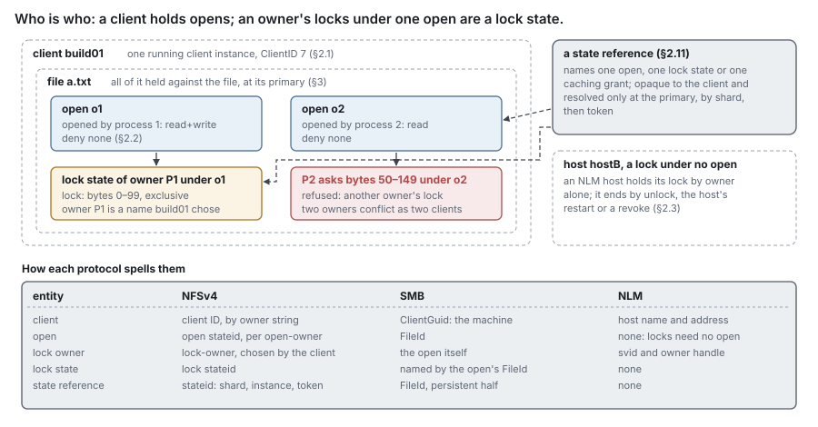
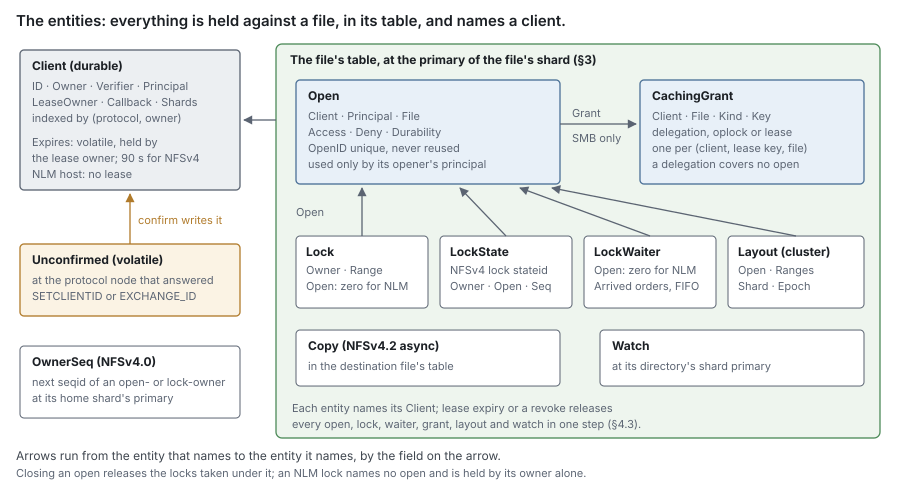
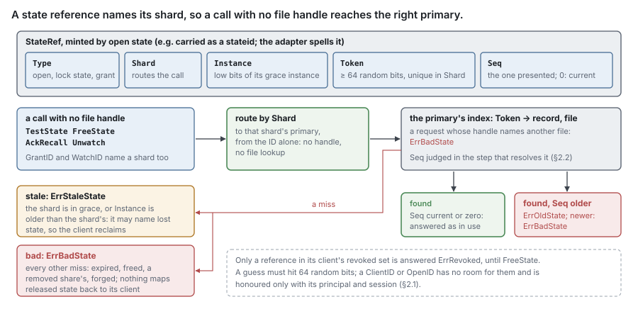
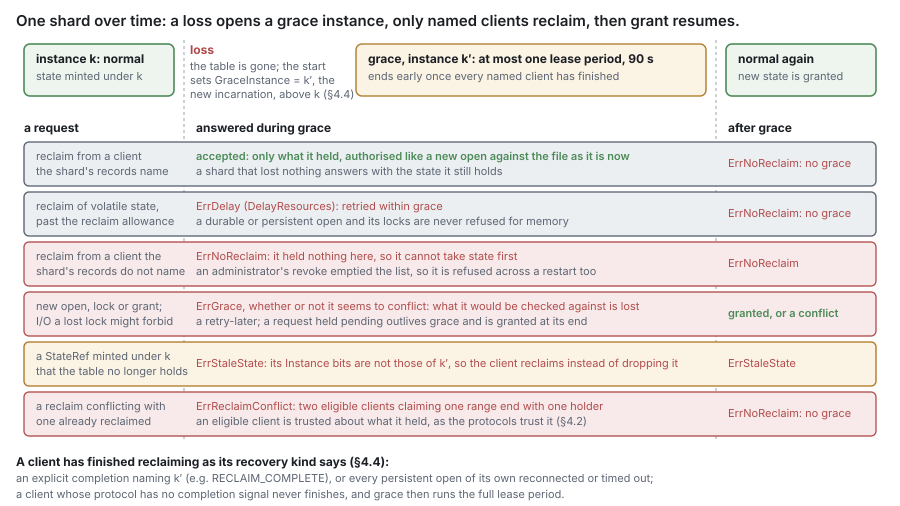

# RFC 14 — open state and locks

**Status:** draft. [§15](#15.%20Open%20questions) lists what is known to be undecided.
**Audience:** anyone changing how opens, byte-range locks, deny modes, caching
grants or change watches are granted, conflicted, recalled, recovered or
persisted — and anyone writing a protocol adapter that exposes them.

Conventions, RFC 2119 keywords and test tiers are set once in the
[index](rfc-index.md). This document specifies behaviour, not the current code.

A rule or record marked **(cluster)** binds only once a second node can serve a
share; what the first release, one node, follows instead is
[RFC 0's single-node profile](rfc-0-data-lifecycle.md#1.4%20The%20single-node%20profile).

---

## Start here

*Explanatory. The rules are in §1 onward; where this section and a rule differ, the rule wins.*

### In plain words

Clients reach DittoFS over NFS (Network File System) or SMB (Server Message
Block); writes land in a local journal and are later uploaded to an S3 (Simple
Storage Service) bucket ([RFC 0](rfc-0-data-lifecycle.md)). Every file has one
node that serves it, its **primary**: on a single-node install, N1.

Every file has one desk at its primary where all promises about it are kept:
who has it open, who locked which bytes, who may cache it. NFS and SMB requests
both come to it, so an SMB lock refuses an NFS write it forbids, and the check
and the write happen in one place. Most of the desk lives in memory, not on
paper. If the node fails or restarts, the node serving the file next runs a
grace period: for a while it only gives back what clients say they held. Three
things here share the word "lease", and nothing else:

- a **node lease**: is this server still the primary of its files?
- a **client lease**: is this client still alive? 90 s;
- an **SMB lease**: a promise that the client may cache the file.

### The problem, in one example

alice-pc holds `profiles/alice/ODFC_alice.vhdx` open all day: a persistent SMB
open for read and write that denies other writers, under an SMB lease. Then N1
restarts, and the table in its memory is gone. Without a rule, a second desktop
could open the file for writing before alice-pc comes back, and both would
think they held it. Instead N1 runs a **grace period**. For one lease period it
gives back only what clients say they held, and refuses everything else.
alice-pc reclaims its persistent open, whose record survived. Grace ends early
once every recorded client has reclaimed. Had the open been only SMB-durable,
it would not have survived the restart, and alice-pc would open the file again.

The rest of alice's day — sign-in, a network blip, a second sign-in, a
take-over by the same application instance, a lease break — is
[RFC 22 §2](rfc-22-smb.md#2.%20A%20profile%20container%2C%20end%20to%20end)'s.


### Terms

- **Client**: one running client machine or process, as the server knows it.
  It holds everything below.
- **Open**: one open of one file by a client, with what it may do and what it
  denies others.
- **Deny mode**: the access an open refuses to every *other* open while it is
  held.
- **Lock owner**: who holds a byte-range lock — a process, an open, or a host,
  by protocol.
- **Caching grant**: a promise that lets a client cache a file, taken back by
  recall: an SMB lease, an SMB oplock, an NFSv4 delegation.
- **Primary and shard.** *Primary* is the node that serves a file; *shard* is
  only RFC 11's record, the unit whose primary changes.
- **Open-state step**: the per-file serialisation every call below runs under
  ([§3](#3.%20One%20table%20per%20file%2C%20at%20one%20primary)).
- **Grace period** and **reclaim**: after a primary loses open state, the
  window in which only former holders may take state, by reclaiming it
  ([§4.2](#4.2%20Grace%20makes%20volatile%20state%20safe)). Each loss opens a
  new **grace instance** ([§4.4](#4.4%20Grace%20is%20per%20shard)).
- **Delete pending**: SMB's delete on close. The name stays until the last
  open closes; new opens are refused meanwhile ([§9.4](#9.4%20Delete%20on%20close)).
- **Durable** means written to the metadata store. An **SMB-durable** open is
  the protocol's term for one that survives a disconnect; it lives in memory
  only. An SMB **persistent** open survives a disconnect and its primary's
  restart, because it has a durable record and stable writes
  ([§8.1](#8.1%20SMB%20durable%20and%20persistent%20opens)).

### A scenario: an NFS build tool and an SMB editor share one file

1. A Windows editor holds an SMB byte-range lock on the first 4 KiB of
   `data.bin`.
2. build01 sends an NFS `WRITE` across that range. It is refused: SMB locks are
   mandatory ([§7](#7.%20Conflicts%20across%20protocols)).
3. build01 takes an NFS lock on another range. SMB I/O there is still allowed:
   NFS locks are advisory and gate only lock requests.
4. An SMB client asks for a lock overlapping build01's. It is refused.

One table serves both protocols, and each lock means what its own protocol says.

On a first read, skip §2.5–§2.10, §4.4–§4.5, §10, §11 and §13 onward.

## 1. Purpose

A file protocol does not only name files and move bytes. Clients open files,
deny others access while they hold them, lock byte ranges, cache under promises
the server made, and ask to be told when a directory changes. This document owns
that state and answers:

> **Who holds this file open, what may they do with it, what have we promised
> them, and what happens to all of it when a client, a server or a primary goes
> away?**

It is one component because every one of these kinds of state is consulted by
the others: an open is refused by a deny mode, a lock is released by its open's
close, a grant is broken by an open, a delete waits for the last close, and a
client's lease ending releases them all.

### 1.1 Non-goals

This component **MUST NOT**:

- decide names, permissions or when a file stops existing — [RFC 7](rfc-7-namespace-metadata.md)'s. It
  tells RFC 7 that a file is open ([§9](#9.%20Open%20state%20and%20the%20life%20of%20a%20file)); RFC 7 decides the rest;
- hold content or know where it is. A lock is a statement about who may act on
  a file, not about where its bytes are ([§9.3](#9.3%20Locks%20do%20not%20pin%20bytes));
- define shard records, node leases or primary epochs — [RFC 11](rfc-11-ownership.md)'s. Client
  state and shard placement share no records ([RFC 11 §7](rfc-11-ownership.md#7.%20Protocol%20state));
- encode a wire protocol: how a stateid, an SMB FileId, a lease key or a reply
  is spelled is the adapters' ([RFC 17](rfc-17-vfs.md)). A protocol value that must outlive a
  connection, a primary or a restart — a lease key, a create GUID, an app
  instance, a lock sequence — is an opaque field here, compared and never
  interpreted, because an adapter cannot carry it across a failover.

## 2. The entities

The entities below are `pkg/openstate`'s ([§11.1](#11.1%20Package%2C%20dependencies%20and%20wiring)).
The pieces [§8](#8.%20What%20is%20durable) makes durable are plain structs of
[RFC 16](rfc-16-metadata-store.md)'s entity package — `ClientRecord`,
`OpenRecord`, `LockRecord`, `DeleteRecord` — which the metadata store keys and
open state wraps with what it holds only in memory; the store cannot import
open state. Signatures are indicative; the rules around them are normative.

**Who is who.** A **client** is one running instance of a client machine or
process, as the server knows it. It holds **opens**, each an open of one file.
A byte-range **lock** belongs to a **lock owner**: a name the client chooses for
whoever holds the lock, such as a process. An owner's locks under one open form
one **lock state**; a lock may also sit under no open, held by its owner alone.
A **state reference** is the ID a client presents to name one open, one lock
state or one caching grant: opaque to the client, resolved only at the primary
(§2.11). Conflicts are decided between owners, not clients: two owners of one
client conflict as two clients would. For example, one NFSv4 client opening
`a.txt` from two processes is one client, two opens and two lock owners; over
SMB each open is its own lock owner.





### 2.1 Client

```go
// ClientRecord is a client's durable record (§8): a plain struct of RFC 16's
// entity package, written only through the OpenRecords view. Each field is
// one the table decides on; protocol detail it never interprets is the
// adapter's, in Adapter.
type ClientRecord struct {
	ID       ClientID     // 64 bits, unique across the installation, never reused, not random (§2.11)
	Protocol protocol.Kind // NFSv4, NLM or SMB: the protocol that names it
	Name     []byte       // the client's own stable name; indexed with Protocol, so a known client is found again
	Boot     [8]byte      // the instance under Name: a new Boot is a reboot, and the old ID expires once the new one is confirmed
	Owner    Principal    // who may act for it: another principal naming Name is refused; zero: none (a machine, a host, or an anonymous mapping)
	Protect  bool         // state protection: Owner may act on any of its state, and alone may Destroy or Rebind it
	Recovery RecoveryKind // how a loss of its state reaches it, and when it has finished reclaiming (§4.4)
	Lease    ClientLease  // who renews and expires it (§4.1); not an SMB lease, which is a CachingGrant (§2.4)
	Reach    Reach        // how a recall reaches it (§4.1)
	Shards   []ShardMark  // where it holds state; bounded, then every shard of the share (§8)
	Ended    bool         // (cluster) expired, kept until every shard it names has released its state (§4.3)
	Adapter  []byte       // the adapter's durable record, written in the step of the change it belongs to; never read here
}

// Client is the record and what the table holds for it in memory. When its
// lease ends, everything it holds is released in one step (§4.3).
type Client struct {
	entity.ClientRecord
	Expires time.Duration // volatile: the Deps.Clock.Elapsed reading at which its lease ends, at its lease owner; zero: no lease
	Pending *Pending      // volatile: a proposed instance awaiting its confirm (§2.9)
}

type ClientLease struct {
	Node NodeID // (cluster) the one node that renews and expires the client: its lease owner
}

type Reach struct {
	Callback NodeID   // (cluster) the gateway node holding its back channel; zero: none
	Down     bool     // the back channel is lost: signalled to the client, no grant offered, until it rebinds
	Sessions []NodeID // (cluster) gateway nodes holding a session of it; Destroy is refused while any remains
}

// ShardMark is one shard the client holds state in.
type ShardMark struct {
	Shard ShardID
	Done  uint64 // the grace instance it last finished reclaiming in, or the shard's instance when it joined (§4.4)
}

// RecoveryKind is how a loss of the client's state reaches it (§4.4); the
// adapter picks one at first contact.
type RecoveryKind uint8 // RecoverStatus, RecoverRefusal, RecoverReconnect, RecoverNotice
```

A client that reboots is a new `ClientID`, which is how its stale state is
recognised and released. Each adapter fills `Name` and `Boot` from what its
protocol carries, and keeps in `Adapter` what only it reads
([RFC 21 §3.3](rfc-21-nfs.md#3.3%20Trunking%2C%20server%20owner%20and%20scope),
[RFC 22 §4.4](rfc-22-smb.md#4.4%20The%20client%20record%20is%20the%20machine)
map each field). An NLM host's `Name` includes the source address it sends
from, since NLM carries no credential and a name alone could be written by any
host (RFC 21 §6.1).

**A client record is found by its name.** A client names itself by its own
string, not by an ID the server gave; the record is therefore indexed by
(protocol, name) as well as by ID
([RFC 16 §4.2](rfc-16-metadata-store.md#4.2%20Keys%3A%20per-file%2C%20per-share%2C%20content-addressed)).
A request naming a known name with the same `Boot` and owner returns the
existing client ID — through `Client.Pending` where the protocol confirms,
keeping the ID (§2.9); with a new `Boot` it is a reboot, and expires the old ID
once the new one is confirmed (§2.9); from another principal, where the record
has an `Owner`, it is refused with `ErrClientInUse`, so a client cannot take
over another's name.

**`Owner` is a mapped principal, never a squashed one.** `Owner`, and every
principal later compared with it, is the caller's principal as the one identity
mapping resolved it, before any squashing
([RFC 18 §6.1](rfc-18-identity.md#6.1%20From%20Identity%20to%20caller)): two
machines squashed to one anonymous principal would otherwise be one owner, and
either could destroy the other's client. A client-level call names no share, so
the service maps it under the installation's default, never a share's. An
`Owner` that maps to an anonymous principal is recorded as zero, and `Protect`
is then false: such a record is found by its name alone, as an SMB one is.

> decision: an owner that resolves to the anonymous principal protects
> nothing, so it is not recorded; two hosts mapped to nobody can reach each
> other's client by name, as their credentials already let them. Record it if a
> protocol is served whose anonymous callers the table can tell apart.

**State protection is the table's.** With `Protect` set, `Owner` may make every
call that releases or uses the client's state — `Close`, `Downgrade`, `Unlock`,
`AckRecall`, `TestState`, `FreeState`, I/O through `CheckIO` — on any of it, as
if it held it, and only `Owner` may `Destroy` the client or `Rebind` its back
channel. The protocol's own narrower list stays in `Adapter`; the adapter
refuses a call outside it before it calls the table, and the table admits
nothing the adapter refuses.

> decision: state protection is enforced by the table, as `Owner` plus a flag,
> because its one effect that matters — a principal other than the opener acting
> through an open (§2.2) — is checked at the file's primary, which may be
> another node, and after a restart. An adapter that skipped its own narrowing
> would admit only the client's own machine principal to its own state. Move it
> to the adapter if the opener check ever moves there.

**An SMB client record names a machine, not a user.** One Windows machine sends
one name on every connection, and a multi-session host carries many users'
sessions under it. The SMB record therefore holds no `Owner`: a negotiate
naming a known name finds its record whoever authenticates, and is never
refused for its principal. Principals bind per session and per open: every
open keeps its opener's principal (§2.2) and a reconnect must match it
([§8.1](#8.1%20SMB%20durable%20and%20persistent%20opens)). A session's end
closes only that session's opens, and such a record is released once it holds
no open and no SMB-durable or persistent open's `Timeout` is still running. An
NLM record has no owner either; its host is named by its `Name` alone.

**An adapter's record is written with the change it belongs to.** Some protocol
detail must survive a lost connection, node or restart although the table
decides nothing on it — a one-slot replay of a setup call, a callback address,
a restart-notice address. The adapter keeps it in `Adapter`, which the table
stores, returns with the record (`Record`, `Revoked`) and never reads. A
replayable setup call is written with `AddSession`, which compares the record's
`Adapter` with the bytes the adapter last read and writes the new bytes in the
step that records the session, or writes nothing and returns
`ErrRecordChanged` with the current record. So a replay that reaches another
node, or arrives after a restart, finds the first call's reply rather than
making a second session; the sequencing is the adapter's
([RFC 21 §3.5](rfc-21-nfs.md#3.5%20Confirming%20a%20client)), and no protocol
sequence number reaches the table. The same field, with the same rule, sits on
`CachingGrant` and `Pending`.

**An adapter's record is bounded and versioned.** `Adapter` is at most 4 KiB;
a longer write is refused `ErrInvalid` and changes nothing. Its first byte is a
version the adapter defines; a node that cannot read it refuses the call naming
it with `ErrAdapterVersion` rather than misreading it, and the table never looks
at that byte. **(cluster)** A node writes only a version every node of the
installation reads: one the installation's active schema version admits
([RFC 13 §5.5](rfc-13-configuration.md#5.5%20A%20node%20joins%20only%20where%20its%20versions%20overlap)),
so during a rolling upgrade no node writes bytes an older node would refuse,
and an older node that takes over a shard can still read every restart-notice
address. One blob carries every concern of its adapter, so a confirm or a
`Rebind` racing an `AddSession` makes the latter retry; the retry is bounded,
since each winner changes the bytes.

> ponytail: 4 KiB covers the largest record an adapter keeps today, a
> one-slot setup reply, with room for a callback address. Raise it, as a fixed
> value, if `openstate_adapter_refused_total{reason="bound"}` is seen counting.

`Shards` lists every shard the client holds state in, each with its `Done`
instance (§4.4). A reclaim in a shard the list does not name is refused
`ErrNoReclaim`: a client that held state only elsewhere cannot take state in
this shard first. `protocol.Kind` comes from one small package that the
adapters and the metadata layer both import. It **MUST NOT** come from an
adapter package, or the metadata layer would import an adapter. It is one byte
per protocol — NFSv3, NFSv4, NLM, SMB — and `pkg/vfs`'s `Protocol` aliases it.
NFSv4 is one kind whatever its minor version: a name confirmed under one minor
version and proposed again under the other is a new `Boot`, a reboot, never
the same instance, and the adapter keeps the minor version in `Adapter`
([RFC 21 §3.5](rfc-21-nfs.md#3.5%20Confirming%20a%20client)). NFSv3 holds no
client record; its kind names a request's protocol (§11.3).

### 2.2 Open

```go
// Open is one open of one file. An open of an unlinked file keeps it alive (§9).
// Its durable form, OpenRecord, is every field but LossSeen and Channel.Outstanding.
type Open struct {
	ID         OpenID       // only where needed (below): 40 bits, unique across the installation, never reused (§2.11); zero for an NFS open
	Client     ClientID
	Principal  Principal    // the opener, mapped before squashing (§2.1); any other caller through the open is refused
	Owner      LockOwner    // the owner of opens (below); zero: the protocol has none
	File       FileID
	Stream     FileID       // the named stream it opens; zero: the base file
	Via        FileID       // the directory it was opened through (§9.5); zero: opened by handle or ID, counted under no directory, no delete through a parent; kept across a reconnect
	Name       []byte       // its entry in Via, the one a delete pending removes (§9.4); a rename of that entry moves it; nil: opened by handle
	Mode       OpenMode     // what it may do, and what it refuses other opens (§6)
	Token      uint64       // names it within its shard, every open has one; an NFS open's StateRef token (§2.11)
	Seq        uint32       // its reference sequence (below)
	Durability Durability   // none, durable, persistent (§8.1)
	Session    SessionRef   // the session that opened or last reconnected it (§8.1); zero: none
	Grant      GrantID      // the grant covering it: one over its client's opens under one key, or over it alone (§2.4); zero: none
	Delete     DeleteMark   // its close makes the file delete pending, the unlink run as Delete.By (§9.4)
	Suspended  TimeMask     // Modify, Access: times I/O through it leaves alone (below); zero: none
	LossSeen   uint64       // volatile: the file's loss sequence it last reported (§8.1)
	Channel    Channel      // replay ordering of its requests, checked at the primary (§8.1); zero: unordered
	Durable    *DurableKeys // what a reconnect or replay must match; nil unless SMB-durable or persistent
	Clone      *CloneSource // a clone's source, held by no client (§9.2); nil for every other open
}

type OpenMode struct {
	Access     Access // granted at open: the full mask of RFC 7 §7.7, WRITE_DAC, WRITE_OWNER and a DELETE granted through the parent included
	Deny       Access // the access it refuses other opens
	Privileged bool   // backup or restore intent its caller was privileged for (RFC 7 §7.4); kept by every request through it
}

type DeleteMark struct {
	OnClose bool      // its close makes the file delete pending
	By      Principal // who asked for it or set the disposition
}

// Channel orders an open's requests across connections and nodes (§8.1).
type Channel struct {
	Seq         uint16    // a request carrying an older one is refused as a stale replay
	Outstanding [2]uint32 // in flight under Seq and under the ones before it; never written
}

// DurableKeys is what a reconnect or replay of an SMB-durable or persistent open matches on.
type DurableKeys struct {
	Timeout  time.Duration // how long it is kept once its session ends
	Create   [16]byte      // the create's own ID: a replay or reconnect must name it; zero: not named
	Instance AppInstance   // an open of the same file under the same ID replaces this one (§8.1); zero: none
	LockSeq  [64]uint8     // lock replay: per index a valid bit and a 4-bit sequence (§8.1)
}

type AppInstance struct {
	ID      [16]byte
	Version [2]uint64 // high, low; zero: unversioned
}

// CloneSource is a clone's source open, written by the clone's first phase (§9.2).
type CloneSource struct {
	Dst     FileID  // the clone's destination, whose Removal record holds the clone spec
	Version Version // the 16-byte journal version asOf the source was read at (RFC 6 §6.6)
}
```

> ponytail: the parts most opens lack — durable keys, a clone source — are
> pointers, so an ordinary open carries none of their bytes. Inline them if
> RFC 24's M6 measures the indirection.

The name is both protocols' own: NFS's `OPEN` and its open stateid, the
"Open" of the SMB2 specification with its FileId. "Handle" is not used: in this
set it means the file handle ([RFC 7 §6](rfc-7-namespace-metadata.md#6.%20Handles)).
SMB's durable and persistent handles are properties of an open, so they are a
field here, not an entity. NFSv3 has no opens; its I/O runs against an
anonymous open that holds no deny mode and keeps nothing alive. `OpenID` is
unique across the installation, so an SMB adapter carries it in the persistent
half of the SMB FileId and finds the open again after a reconnect to another
node.

**An open takes an `OpenID` only where one is needed.** Every open has a
`Token`, which names it in the table and in its file's locks. An `OpenID` is
issued (`NextID`) only to an open that something outside the table names
across a reconnect or in a key: an SMB open, whose `FileId` carries it; a
durable open, whose record is keyed by it (§8), so an NFS open made durable by
an unlink takes one in that step (§9.1); and a clone's source open (§9.2). An
NFS open is named by its stateid's token and takes none.

> ponytail: `OpenID` is 40 bits and never reused, so an installation issues at
> most 2⁴⁰; SMB opens, durable opens and clone sources draw on it, NFS opens do
> not. At a sustained 1,000 such opens a second it lasts 35 years. Widen it — fewer
> shard bits in the persistent `FileId`, routing by lookup — if `IDS‖open` is
> seen past 2³⁹.

**An owner holds one open of a file.** Where the protocol names an owner of
opens, as NFSv4 does, an open by an owner that already holds an open of the
file is that open, upgraded: its modes widen, its `Seq` rises, and no second
open is made. `OpenResult.Confirm` is set only when the owner's `Sequence` is
new and unconfirmed (§2.8), and **MUST NOT** be set on a reclaim or on an open
offered a grant (RFC 7530 §9.1.11); an owner of a protocol whose session orders
its requests, NFSv4.1's, is confirmed from its first open.

**An open is used only by its opener.** `Principal` is kept for the open's whole
life, and every call that uses the open — I/O through its stateid or FileId, a
lock under it, a downgrade, a close — **MUST** be refused with `ErrNotYours`
unless the caller's principal (`Caller.Principal`, §11.3) is the open's, or
the client's `Owner` where `Protect` is set (§2.1). An NFSv4.0 stateid crosses
the wire in clear and binds no session, so without the per-call check anyone
who sees one writes with the opener's access. The same holds for a lock state.

**I/O under a grant's reference is the client's, and authorised afresh.** A
client may use a grant that covers no open for I/O by any of its owners, under
any principal, so the opener-only rule does not apply to it. Such a call
**MUST** be refused with `ErrNotYours` unless the grant is held by the call's
client and is not revoked, and **MUST** then be authorised as anonymous I/O is:
the caller's own principal against the file's current ACL and mode and the
share grant, and against the deny modes held
([§6](#6.%20A%20deny%20mode%20is%20checked%20at%20open)). The call's client
(`Caller.Client`) is the one the adapter proved for the call: the client its
session binds or, where the protocol binds none per call, the client the
connection established. It is never derived from the reference presented, so a
delegation stateid sent over another client's connection is `ErrNotYours`. The
delegation lends no access: a principal that could not read the file on its own
does not read it through the delegation.

**A reference's sequence is state.** The table numbers the changes to one
open — an upgrade, a downgrade, a close — and to one lock state; a request
naming an older number than the current one is refused `ErrOldState`, a newer
one `ErrBadState`, and zero means the current one, so one past 2³²−1 is 1.
`Open.Seq` and `LockState.Seq` hold them and change in the step that applies the request; the
presented number reaches that step once, as `StateRef.Seq`, alone or inside an
`OpenRef`; a call that raises it returns the new value, which the protocol
answers in its new reference.

The RFC has five unrelated counters; only the owner sequence spans files:

| Counter | Counts | A stale value gets |
| --- | --- | --- |
| `Open.Seq`, `LockState.Seq` | changes to one open or lock state | `ErrOldState` |
| `Sequence.Next` (§2.8) | requests from one owner, across files | `ErrBadSeqID` |
| `Channel.Seq` (§8.1) | an open's requests across connections | refused as a stale replay |
| `DurableKeys.LockSeq` (§8.1) | one lock request's retries | answered, not applied |
| `CachingGrant.Epoch` (§2.4) | changes to one lease's kind | discarded by the client |

**A time can be suspended per open.** `Suspended` names `Modify` and `Access`
only, never the change time
([RFC 22 §9.3](rfc-22-smb.md#9.3%20Timestamps%2C%20allocation%20and%20sparse%20files)
spells the sentinels). A write or read through that open **MUST NOT** advance a
time it names; I/O through any other open, and every explicit set, still does.
The service passes the times to leave alone with the write
([RFC 17 §5.1](rfc-17-vfs.md#5.1%20Write)). Volatile with the open, durable
only with a persistent one.

### 2.3 Lock

```go
// Lock is one byte-range lock, held against the file (never a handle or a name).
type Lock struct {
	Owner LockOwner
	Open  uint64    // the Token of the open it was taken under, whose close releases it; zero: none
	Range LockRange // {ByteRange; Exclusive}
}

// LockState is what a lock reference names: one owner's locks under one open
// of one file. The locks themselves stay Lock records.
type LockState struct {
	ID    LockStateID // the StateRef token naming it (§2.11)
	Owner LockOwner
	Open  uint64      // the Token of the open it was taken under
	Seq   uint32      // its reference sequence (§2.2)
}

// LockOwner is who holds a lock.
type LockOwner struct {
	Client ClientID
	Name   []byte // the owner the client names, at most 1,024 bytes, compared and never interpreted
	Stack  bool   // its locks stack, an exclusive one conflicts with its own, and they are mandatory against I/O (§7); else they merge, never conflict with each other, and are advisory
}

// LockResult is a granted or waiting lock; a conflict is a *LockedError.
type LockResult struct {
	Waiting bool     // a waiter was recorded: granted later through Sink.LockWaitOver (§2.10)
	Ref     StateRef // the lock state's reference with its new Seq; zero for a protocol that names none
}

// LockedError is a lock conflict. errors.Is(err, ErrLocked) holds for it, and
// Holder is the conflicting lock, which a protocol's denial reports.
type LockedError struct{ Holder Lock }
```

Two owners of one client conflict like two clients. A **merging** owner's lock
over its own range replaces, merges or splits it; a **stacking** owner's locks
stack, as each of its opens is its own owner.

> ponytail: one flag, `Stack`, carries two rules that today go together by
> protocol: stacking locks are mandatory, merging ones advisory. Split it into
> two flags when a protocol is served whose locks stack but are advisory, or
> merge but are mandatory. Each adapter fills `Name` and
`Stack` from its protocol ([RFC 21 §11.4](rfc-21-nfs.md#11.4%20Open%20state), [RFC 22 §16.4](rfc-22-smb.md#16.4%20Open%20state)).

**A range is [offset, last] over 64 bits.** A length meaning "to end of
file" — an NFSv4 length of all ones, an NLM length of 0 — is held as reaching
2⁶⁴−1, and never computed as offset plus length, so it cannot overflow. Any
other range's last byte is offset + length − 1, a zero-length one's included
(MS-FSA 2.1.4.10): a zero-length range at X ends at X − 1, so it conflicts only
with a range holding both X − 1 and X, held or asked, and one at 0 conflicts
with nothing. It is still held, and released by an unlock of the same offset
and length.

A lock may name no open: it is then held by its owner alone and released by
unlock, by its host's restart ([§4.5](#4.5%20NLM%20locks%20and%20restart%20notification)) or by revocation. Every other lock
names the open it was taken under, and closing that open releases it.

**A lock request is atomic at the primary.** `Lock` takes a list of ranges —
several, where the protocol sends several in one request — and the file's one
primary grants them all in one step or none: a conflict on any range leaves
none of them held, so no other request ever sees part of the list held. A list
names at most 64 ranges; a longer one is refused `ErrInvalid` before the step
is taken. Only a single-range request may wait (§2.10): a multi-range request
that asks to wait is answered as one that does not. `Unlock` releases its list
in order and stops at the first range its owner does not hold, answering
`ErrRangeNotLocked`; the ranges before it stay unlocked. Only a stacking owner
meets it: a merging owner's unlock of a range it holds none of releases nothing
and succeeds, as a POSIX unlock does. `ReleaseLockOwner` of an owner that still
holds a lock, and `FreeState` of a lock state that does, is refused
`ErrLocksHeld` and changes nothing (RFC 7530 §16.37.4).

> ponytail: 64 ranges a request, proposed, bounds the step a `Lock` holds at
> O(64·n) in the file's ranges. Raise it if a client is seen sending longer
> lists that it cannot split.

### 2.4 CachingGrant

```go
// CachingGrant is a promise that no other client is using the file, so its
// holder may cache; recalled on conflict within a bounded time (§5). It covers
// the opens its Key names, one open, or none.
type CachingGrant struct {
	ID      GrantID   // names its shard as a StateRef does (§2.11)
	Client  ClientID
	File    FileID
	Kind    GrantKind // read, write, handle, in any combination
	Key     LeaseKey  // the client's own 128-bit key: one grant per (client, key, file); zero: it covers one open, or none
	Epoch   uint16    // a v2 lease's: starts at the request's, raised by every change of Kind sent to the holder, wraps through zero
	V2      bool      // a v2 lease: Epoch is counted and sent; fixed when the lease is created
	Recall  *Recall   // a recall in flight; nil: none (§5.3)
	Parent  LeaseKey  // a v2 lease's parent key, as its first request named it, written with a persistent open; never read here
}

type Recall struct {
	To       GrantKind     // the kind it goes to; none: a return
	Deadline time.Duration // the Deps.Clock.Elapsed reading at which it ends unanswered; zero while the recall is not yet handed to the Sink (§5.3)
}
```

**One grant per (client, lease key, file).** An SMB lease is named by its key,
which the client chooses and sends with every open it wants covered. Every open
of one file by one client under one key is covered by the same grant, and
those opens never break it: that is what a lease is for ([§5.1](#5.1%20What%20a%20grant%20is)). The same
client under a different key holds a different grant, which conflicts as
another client's would. So a change judges whose a grant is by the open it came
through: `CheckChange`'s `via` names it, and only a grant under that open's key,
the oplock over that open, or a grant of the caller's client that covers no
open — an NFS delegation — is the caller's own; with no `via`, every grant of
the caller's client is. A delegation is its client's whatever open the change
came through, as the lock and I/O paths judge it, and as an NFSv4 server
breaks no delegation for its own client's change. `via` **MUST** be an open of
the changed file itself, a named stream's open counting as its base file's;
one of any other file is `ErrBadState`, as a reference with another file's
handle is (§2.11). A key already naming a grant on another file makes
the open `ErrInvalid`, as MS-SMB2 answers `STATUS_INVALID_PARAMETER`; the key
is free again when its lease's last open closes. An oplock covers exactly the one open that asked for it. An NFS
delegation is held by the client and covers none of its opens: it ends by
return or recall, not by close.

**The epoch orders a lease's changes.** Every change of a v2 lease's `Kind`
sent to the holder — a break, an upgrade on a later open — **MUST** raise
`Epoch`, and the new value is sent with the change, so a client that receives
two breaks out of order discards the older. A new v2 lease starts from the
epoch its request carries (`OpenRequest.Epoch`, MS-SMB2 3.3.5.9.11), and a
later open under its key, whatever version it asks, finds the version fixed. A
timeout's cut to none (§5.3) sends the holder nothing and raises nothing
(MS-SMB2 3.3.6.5). A v1 lease and an oplock have no epoch. No acknowledgement
carries one, so `AckRecall` takes none: an out-of-order answer during a staged
recall is caught by its kind not being the recall's `To` or below it.

**Only a grant that covers no open may be given back unasked.** `AckRecall`
with no recall in flight on a grant that covers no open — an NFS delegation —
is the holder returning or downgrading it on its own, as `DELEGRETURN` does,
and is valid. On a grant that covers opens — an SMB lease or oplock — an
acknowledgement is only ever an answer: with no recall in flight, a duplicate
or one arriving after its recall timed out, it is `ErrNoRecall` and changes
nothing (MS-SMB2 3.3.5.22.1, 3.3.5.22.2). One whose kind the recall did not ask
for is `ErrInvalid`: a lease's recall stays in flight, and an oplock's ends at
none (MS-SMB2 3.3.5.22.1). The rule reads the grant, not the caller's
protocol, as §5.3's timeout does.

**What is persisted.** A grant is volatile ([§8](#8.%20What%20is%20durable)). A lease covering a
persistent open is written with it, key, kind, epoch and `Parent`, so the
reconnected open finds its lease as it left it.

### 2.5 Watch

```go
// Watch is a client's request to hear about changes under a directory. It
// ends with its client's lease and is never reclaimed (§8). A change is
// delivered only if the watch's client may traverse to it (RFC 17's
// callbacks).
type Watch struct {
	ID        WatchID   // names its shard as a StateRef does (§2.11)
	Client    ClientID
	Dir       FileID
	Recursive bool
	Filter    ChangeMask // names, attributes, size, times, security, streams
}

// Change is one change a watch reports.
type Change struct {
	What   ChangeMask // the kind of change; ChangeEnumerate: changes were dropped, and the client lists the directory again
	Name   []byte     // the entry changed, as its path from the directory Changed names
	To     []byte     // a rename's new path; nil otherwise
	Nested bool       // made below the directory, not in it: only a recursive watch reports it
}

// ChangeMask names what a change does: what CheckChange judges and a watch
// filters on.
type ChangeMask uint16 // Remove, Rename, AddEntry, Attrs, SetID, Size, Times, Security, Streams, Enumerate
```

A watch is held at its directory's primary, which sees every change in that
directory's shard: the service reports each change it commits there through
`Watches.Changed`, and the table matches it against the watches held. **A
recursive watch whose subtree crosses into another shard (cluster)** also leaves
a marker, volatile like the watch, at the primary of each descendant shard whose
root lies under it: a change there that the filter matches is reported to the
watch's primary, which completes the watch with *enumerate directory*
(`ChangeEnumerate`) rather than a change list, since the change's names are
another primary's. The client rescans; no change under a descendant shard is
lost, though its detail is. A shard created or moved under the watched subtree
after registration gets its marker when it starts serving, from the watches its
parent's primary holds. On one node every shard has the same primary, and
changes are delivered with their detail.

**Watches are bounded.** A client holds at most 1,024 watches at a primary, each
charged to the open-state pool; one past it is refused `ErrDelay`
(`DelayResources`). A watch hands the `Sink` its first change at once, then at
most one batch per sweep ([§11.2](#11.2%20Lifecycle)), and holds at most 64
changes or 64 KiB of them, whichever is reached first; past either, its pending
changes collapse to one `ChangeEnumerate`, so a burst under a watch whose client
does not read costs one entry, and the client rescans. A watch so hands the
`Sink` at most 65 changes a sweep, and a client up to 1,024 × 65. The table
hears nothing of what the client reads, so what the client has not read is the
`Sink`'s to bound. A recursive watch's markers count against the
same cap at each descendant shard's primary.

> ponytail: 1,024 watches a client and 64 changes a watch, proposed. Raise them
> if `openstate_held{kind="watch"}` or the `enumerate` share of
> `openstate_notify_total` shows Explorer-class clients losing detail they use.

### 2.6 Layout

A **layout** (cluster) is reserved: a single node offers none, and every layout
operation is answered not supported by the adapter
([RFC 21 §2.1](rfc-21-nfs.md#2.1%20Versions%20served)). A pNFS RFC adds it as
open state of the file's table, held under an open, released with the client's
lease, bound to the (shard, epoch) it was granted under, and recalled when that
shard changes primary or the file moves
([RFC 15 §5.1](rfc-15-topology.md#5.1%20pNFS),
[RFC 17 §10](rfc-17-vfs.md#10.%20Open%20questions) Q2).

### 2.7 Copy

Asynchronous copy is not offered: every copy is answered synchronously and
issues no copy stateid ([RFC 21 §9.4](rfc-21-nfs.md#9.4%20Async%20COPY),
[RFC 17 §5.9](rfc-17-vfs.md#5.9%20Copy%20and%20clone)). A copy holds no open
state.

### 2.8 Owner sequences

```go
// Sequence is a per-owner sequence slot: the number an owner's next sequenced
// request must carry, checked and advanced in the step that applies it. An
// owner whose protocol orders requests itself has none. Volatile (§8).
type Sequence struct {
	Owner     LockOwner // the client and the owner name it sends
	Kind      OwnerKind // an owner of opens or of locks
	Next      uint32    // the next request must carry it; any other is ErrBadSeqID and changes nothing
	Confirmed bool      // owner of opens only: set by ConfirmOpen; while clear, the owner's state is usable by nothing else (below)
}
```

Some owners number their sequenced requests — opens, confirms, downgrades and
closes for an owner of opens; locks and unlocks for an owner of locks — and the
table refuses one out of sequence. The primary that holds the owner's
`Sequence` checks and advances it in the step that answers the request, so a
sequence check and the state change it admits never separate.

**A lock that introduces an owner of locks is sequenced by its owner of
opens.** Its request carries both sequences (`Seqs.Owner`, `Seqs.NewOwner`). It
is checked and advanced against the owner of opens' `Sequence`, at that owner's
home primary, as an open is; its answer advances that sequence under the rule
below, refusals included, and only a granted lock creates the new owner's
`Sequence` with `Next` one past the number it carried. Every later lock and
unlock of that owner carries its own number alone.

Every in-sequence answer advances `Next`, refusals included, except
`ErrStaleClient`, `ErrStaleState`, `ErrBadState` and `ErrBadSeqID`, which
advance nothing; a request naming a record the primary does not hold therefore
never advances an owner's sequence. The adapter maps the protocol's own exempt
list onto these ([RFC 21 §4.2](rfc-21-nfs.md#4.2%20Owner%20sequence%20IDs)).

**No refused request creates a `Sequence`**, of either kind: the first granted
open of an owner of opens creates its owner's, and the first granted lock of an
owner of locks its owner's (above). A refused first request leaves the owner
new, so its retry is checked as a first request again.

**An unconfirmed owner of opens holds one open, usable only by its confirm.**
Where the protocol confirms owners, a new owner's first open creates its
`Sequence` unconfirmed and answers `OpenResult.Confirm`. Until `ConfirmOpen`:

- an open from that owner replaces it: the unconfirmed open is released, and
  the new open is taken as the owner's first, whatever number it carries;
- any other request naming the owner's state — a confirm with the wrong
  reference, a downgrade, a close, a lock, I/O — is `ErrBadState` and advances
  nothing.

A `ConfirmOpen` naming an owner already confirmed is `ErrBadState` too
(RFC 7530 §16.18.5).

**An owner's number wraps to 0.** One past 2³²−1, `Next` is 0.

> decision: the owner sequence wraps from 2³²−1 to 0, as the Linux client and
> server do, where RFC 7530 §9.1.3 says it wraps to 1. A client that
> follows the specification sends 1 there, is answered `ErrBadSeqID` once per
> 2³² requests on one owner, and recovers as from any bad sequence, with a new
> owner. Wrap to 1 if a client is seen doing that at a measurable rate. A
> reference's own `Seq` (§2.2) is another counter and wraps to 1, since 0
> means "current".

**Where it is held.** An owner's `Sequence` is held at its **home primary**:
the primary of the file of the owner's first sequenced request. **(cluster)** A
sequenced request on a file another primary serves checks the sequence at the
home primary first, runs at its file's primary, and then commits the advance at
the home primary on that primary's answer, never before it. A second request of
the owner arriving between the two waits for the first's advance, since the
owner's requests are serial. A home primary that is lost loses the slot; in the
grace that follows, an owner with no `Sequence` is new, and its first sequenced
request sets `Next`. The last answer, for replay, is the adapter's
([RFC 21 §4.2](rfc-21-nfs.md#4.2%20Owner%20sequence%20IDs)).

> ponytail: an owner of opens opening files on several primaries pays one extra
> call to its home primary per sequenced request. Pin a sequenced client's opens
> to one primary if that hop shows in profiles.

> decision: the owner sequence stays in the table as a neutral slot, not in an
> adapter's record, because whether an answer advances it depends on the step's
> own outcome, which opaque bytes compared and swapped could not express. Move
> it out if every sequenced owner is ever served through one primary.

### 2.9 Clients pending confirmation

```go
// Pending is a proposed client instance awaiting its confirm: Client.Pending.
// Volatile, held by the table on the node that answered; never written.
type Pending struct {
	ID      ClientID      // the ID a confirm makes current: this client's, or a new one for a new Boot
	Boot    [8]byte       // the instance proposed
	Owner   Principal     // who proposed it; only it may confirm
	Confirm [8]byte       // what the confirm must present: 64 random bits (§2.11)
	Expires time.Duration // Deps.Clock.Elapsed one lease period after the proposal; then it is gone
	Adapter []byte        // becomes the record's Adapter at the confirm; never read here
}
```

Some protocols create a client in two calls: the first proposes an instance,
the second, sent once the client has seen the reply, confirms it. Until the
confirm nothing changes, so a stray or replayed first call cannot wipe a live
client's locks. A client is proposed by `Propose` and made current by
`Connect`; a protocol whose client confirms in one step calls `Connect` alone.
A proposal for a known name hangs off that client's record; one for a new name
is a `Client` that exists only as its `Pending`, in the answering node's
memory. Two rules hold a proposal:

1. it changes no state, and a new `Boot` does not expire the old client ID
   until its confirm;
2. a name has at most one, and a later proposal replaces it.

A confirm is accepted only at the answering node, from `Pending.Owner`, naming
`Pending.ID` and `Confirm`, and it runs `Connect` in one step. A new
`Pending.ID` is taken from `NextID` (§11.1) when the proposal is made, so the
client hears it before anything is written; an ID left unused by a proposal
that is replaced or never confirmed is abandoned, as `IDS‖kind` abandons an
unused range. A proposal for a
name a confirmed record holds under another principal is refused
`ErrClientInUse` and leaves nothing pending. The wire walk is
[RFC 21 §3.5](rfc-21-nfs.md#3.5%20Confirming%20a%20client)'s.

> decision: a proposal is a state of the client, `Client.Pending`, held only by
> the node that answered and out of the (protocol, name) index, so a name has
> one place to look and rule 2 holds by construction. Writing it would cost a
> store write per mount attempt, including those that never confirm, to spare a
> client one repeated proposal when a node restarts or its address moves
> between the two calls. Write it, or route the confirm to the answering node,
> if mounts are seen failing because confirms land elsewhere.

> decision: a later proposal for a name with no confirmed record replaces the
> pending one whoever sends it, as the NFSv4 protocol has it, so a principal
> that keeps proposing a name another is mounting holds that mount off. Each
> replacement by another principal is counted
> (`openstate_proposals_replaced_total`). Refuse it while the pending proposal's
> principal was proved, if that counter shows it happening.

> decision: where a protocol carries fewer than 64 bits of the confirm, the
> adapter sends what fits, and the confirm is protected by `Pending.Owner`, which
> it must also present at the answering node, not by the token's bits; the
> token then only tells two proposals of one principal apart. Failed confirms
> are counted (`openstate_calls_total{op="connect"}` by result). Carry the whole
> token if a protocol with room for it is served, or failed confirms are seen
> from principals other than the proposer.

> ponytail: a node holds at most 4,096 pending confirmations, and 16 per source
> address — per /64 for IPv6, since one host holds a whole prefix; past either a
> proposal is answered `ErrDelay`, charged to RFC 24's connection-state pool.
> `Name` is at most 1,024 bytes, the protocols' own opaque limit. Raise the
> counts if mounts are refused below them.

> decision: two hosts sending one client name under one principal — cloned
> machines — reboot each other on every proposal, by the protocol's own rule;
> nothing the server sees tells them apart, and the fix is a unique client
> identifier on each host. Each reboot is counted, and the `client_reboot_loop`
> condition (§14) names the name. Revisit if a protocol carries something that
> distinguishes the hosts.

### 2.10 Lock waiters

```go
// LockWaiter is a lock request that conflicted and asked to wait. Volatile,
// held in the file's table at its primary; never reclaimed (§8).
type LockWaiter struct {
	File     FileID
	Owner    LockOwner
	Open     uint64        // the open's Token; zero: the lock names no open
	Range    LockRange     // {ByteRange; Exclusive}
	Wait     WaitKind      // poll: the client asks again; callback: granted in the freeing step and reported
	Arrived  time.Duration // Deps.Clock.Elapsed when it arrived: orders the waiters
	Deadline time.Duration // poll only: one lease period after the owner's last poll
	Reserved bool          // poll only: the range is free and held for this owner until Deadline
	Replay   *LockSequence // the request's SMB lock sequence (§8.1), stored when it is granted; nil: none
}
```


A request says how it waits (`LockReq.Wait`): not at all, by **poll** — the
client sends the request again — or by **callback** — the table grants it later
and the service reports the grant. Which a protocol uses is its adapter's
([RFC 21 §11.4](rfc-21-nfs.md#11.4%20Open%20state), [RFC 22 §16.4](rfc-22-smb.md#16.4%20Open%20state)); the table holds only the kind.

A lock request that asks to wait and conflicts **MUST NOT** hold a worker
([§5.2](#5.2%20A%20recall%2C%20and%20why%20nothing%20is%20merged)). The
primary records a `LockWaiter` and answers at once: a `*LockedError` for a poll
waiter, and `LockResult{Waiting: true}` for a callback waiter, whose client is
answered later through `LockWaitOver`. A request that does not wait and
conflicts is answered with a `*LockedError` and leaves no waiter. One owner holds
at most one waiter per file: its next request replaces it, and a replaced
callback waiter is first reported `LockWaitOver(granted=false)`, so the request
it stood for is answered. A repeat of the same request — same range and same
lock type, as a poll is — keeps the waiter's `Arrived`, so a client that
re-sends while it waits keeps its place; only a request for a different range or
type takes a new arrival time.

**A lock that must wait for a recall waits as a waiter.** A lock request on a
file whose caching grant another client holds starts the recall
([§7](#7.%20Conflicts%20across%20protocols)) and is decided only once the recall
ends. A callback request records a `LockWaiter` and is answered `Waiting`; when
the recall ends the waiter is considered like any other, granted if nothing then
conflicts, and otherwise left waiting on the lock that does. Every other such
request — a poll one, or one that does not wait — is answered `ErrDelay` and
leaves no waiter, and its client retries. A recall is not a conflict: a
`*LockedError` would tell the client the range is held when it may be free, and
`Waiting` with no waiter would never be granted.

**How a waiter is served.**

- **Poll:** the table never grants on the client's behalf. When the range
  frees, the waiter is `Reserved`: a conflicting request from anyone else is
  refused until the owner's next poll takes the lock or `Deadline` passes. An
  adapter may tell the client the range freed; the poll decides.
- **Callback:** when the range frees, the primary grants the lock in the step
  that frees it and calls `LockWaitOver`. The lock stays granted, and the
  service **MUST** keep calling until the client answers — acknowledges,
  refuses, cancels — or its state ends: its host restarts, an administrator
  revokes it ([§4.3](#4.3%20An%20expired%20lease%20releases%20everything%20it%20held%2C%20everywhere)),
  or `DropShare` ends its share. `WaitAnswered` returns the client's answer
  ([RFC 17 §3.2](rfc-17-vfs.md#3.2%20Callbacks)): on an acknowledgement the
  calls stop; on a refusal or a cancel the primary releases the lock as an
  unlock would and considers the next waiter. A lock granted by callback
  stays offered until the client answers, and its owner keeps a list of those
  offers: the owner's own lock or unlock of a range answers first for every
  offer the range overlaps and drops it, so a refusal arriving later releases
  nothing, as Linux lockd ignores a `GRANTED` reply for a block it has
  already unlinked. The schedule is the adapter's; the resending is a timer
  and holds no worker. An unanswered grant is never released for a silence
  ([§4.5](#4.5%20NLM%20locks%20and%20restart%20notification)'s `decision:`).

**First in, first out per range.** When an unlock, close, expiry or revocation
frees a range, the primary considers the waiters whose ranges overlap it in
`Arrived` order and grants, or for a poll waiter reserves, the earliest whose
request no longer conflicts, then the next, until one conflicts. While a waiter
waits, no later waiter and no new request from another owner is granted a lock
that conflicts with the waiter's request *and* overlaps a held lock that blocks
the waiter, so a stream of shared locks on the blocking range cannot starve an
exclusive waiter, and one byte held cannot fence the rest of the file. Waiters
whose ranges do not overlap are independent.

> decision: the barrier is limited to the ranges that block the waiter. Over
> the waiter's whole range, one client holding one byte and parking a
> whole-file exclusive waiter under a second owner would refuse every other
> client's lock on the file for as long as it renews. The ceiling: shared locks
> taken beside the blocker, inside the waiter's range, can keep an exclusive
> waiter waiting for as long as they overlap in time. Widen the barrier to a
> bounded margin if `openstate_lock_wait_seconds` shows exclusive waiters
> starving there.

**A waiter has one lifetime, this one.** It is dropped when it is granted; when
its owner cancels it (`CancelLock`) or, polling, has not polled by `Deadline`;
when it is replaced (above); when its open closes, or its open's session loses
its last channel; and with everything else its client holds when the client's
lease expires or its state is revoked
([§4.3](#4.3%20An%20expired%20lease%20releases%20everything%20it%20held%2C%20everywhere)),
or its host restarts ([§4.5](#4.5%20NLM%20locks%20and%20restart%20notification)),
or `DropShare` ends its share (§4.3). Nothing else ends it: an adapter **MUST
NOT** impose a timeout of its own, and a waiting request is exempt from the
per-call deadline
([RFC 17 §4.3](rfc-17-vfs.md#4.3%20Errors%20are%20neutral%20values)), since it
holds no worker. A waiter is lost with its primary's table; the client's own
retry, reclaim or reconnect replaces it, and in grace a waiting request is
refused like any new lock.

> ponytail: a waiter has no time limit of its own, bounded only by one per
> owner per file and §5.5's per-client caps. Add one, here and nowhere else, if
> waiter counts are seen growing without bound.

> decision: there is no deadlock detection. A cycle of blocked locks across
> clients lasts until one of them cancels or its state ends, as on a Windows
> server, and no adapter may time it out. Detection needs a wait-for graph
> across primaries for a case no measured workload shows. Add it if
> `openstate_lock_wait_seconds` shows waits that end only by expiry.

**No adapter answers a waiting request before the waiter is gone.** An adapter
that answers a request it was told `Waiting` for with anything but the grant
`LockWaitOver` reports — a cancel, a connection that ended, a reply it must send
for its own reasons — **MUST** first call `CancelLock` and answer only once it
returns. `CancelLock` is ordered with the grant at the primary: it either drops
the waiter, so no lock is granted for it afterwards, or reports that the lock was
granted first, and the adapter then answers the request as granted. Without the
order, a lock is granted after its request was answered as failed: a lock no
client knows it holds, which refuses every other client until its owner's state
ends.

### 2.11 State references

```go
// StateRef is a reference a client presents to name state: neutral, minted and
// resolved by open state, spelled on the wire by pkg/vfs (RFC 17 §3.4).
type StateRef struct {
	Type     StateType // open, lock state, grant
	Shard    ShardID   // 24 bits usable: the shard whose primary holds the record
	Instance uint8     // the low 5 bits of the grace instance it was minted under (§4.4)
	Token    uint64    // 64 random bits from Deps.Rand, unique within Shard
	Seq      uint32    // the reference sequence presented with it (§2.2); zero: current
}
```

**The widths are one choice.** A 12-byte NFSv4 stateid `other` holds the 64
random bits and 32 more: the type in 3, the instance in 5, the shard in 24
([RFC 21 §5.2](rfc-21-nfs.md#5.2%20Stateids)). A `ShardID` is a `uint32` of
which 24 bits are usable, so an installation numbers at most 2²⁴ shards. An
`OpenID` holds 40 bits, so with the shard it fills SMB's 8-byte persistent
FileId ([RFC 17 §3.4](rfc-17-vfs.md#3.4%20IDs%20and%20their%20encodings)). A
`ClientID` is 64 bits, which `clientid4` carries. `ClientID`, `OpenID` and the
durable lock ID are issued by the `OpenRecords` view's `NextID`, unique across
the installation and never reused (RFC 16's `IDS‖kind`); an `OpenID` only to
the opens §2.2 names.

**A bearer ID with room is unguessable.** An ID a client presents with nothing
else to prove it is the presenter's — a stateid, which names an open
(`Open.Token`), a lock state (`LockState.ID`) or a grant (`GrantID`), and a
confirm verifier (§2.9) — carries at least 64 random bits; a client that sees
one cannot derive another's. An ID with no room for them is unique but not
random: `ClientID` and `OpenID`. Neither is honoured on its own: a `ClientID` is
accepted only under its principal or session, and an `OpenID` only within the
session and for the principal it was opened by (§2.2). Every call naming any of
them is also checked against its holder and the caller's principal.

> decision: 64 random bits is the floor because it is what a 12-byte stateid
> `other` holds beside what `StateRef` carries, and a guesser answered at a
> server's request rate expects no hit within an installation's life. It is not
> measured against an attack. Raise it if a format with room for more is
> adopted, or if a reachable guessing rate is shown to give a hit within that
> life.

**A reference is found without a file handle.** Each primary keeps an index
from `Token` to the record and its file, so a reference resolves by shard, then
token, with no file handle, as `TestState` and `FreeState` need. A request
whose file handle names another file is refused `ErrBadState`. **A `GrantID`
and a `WatchID` name their shard the same way**, so `AckRecall` and `Unwatch`
are routed to that shard's primary from the ID alone
([RFC 17 §2.1](rfc-17-vfs.md#2.1%20What%20runs%20where)). A primary refuses
every call naming a shard it has not begun serving (§4.4); a shard number it
does not know never defaults to an instance. A call naming a file there, by
`FileKey`, is `ErrDelay`; a reference naming one misses and is `ErrBadState`.

> decision: a reference of a shard not begun is bad, not a retry, because the
> service begins every shard it serves before it answers anything
> ([RFC 17 §2.5](rfc-17-vfs.md#2.5%20Lifecycle)), so such a reference was forged
> or names a removed share's state, and a retry would never end; a call by
> `FileKey` there can only race a takeover, and its retry does end. Answer the
> reference `ErrDelay` too once shards move between nodes, where a reference
> can reach a node about to serve its shard.



**A reference that misses is stale or bad.** A reference whose record the
index does not hold is answered stale (`ErrStaleState`) when it may name state
the shard lost, so the client reclaims, and bad (`ErrBadState`) otherwise:

- **stale** while the shard is in grace, since a miss then may be state the loss
  took, or when its `Instance` differs from the low 5 bits of the shard's
  current grace instance;
- **bad** for every other miss: an expired client's released state, a revoked
  reference its client has freed, a removed share's, and a forged one resolve to
  nothing alike, since nothing maps a released reference back to its client.

Only equality of the instance bits is judged. A reference minted 32 instances
before the current one aliases it and is answered bad; its state was lost so
long ago that no grace could still admit its reclaim. Each protocol's client
reacts to the two answers as its adapter's RFC says
([RFC 21 §5.4](rfc-21-nfs.md#5.4%20Grace%20on%20the%20wire)).
Only a reference in its client's revoked set (§5.3) — a recall that missed its
deadline, or state an administrator revoked — is answered `ErrRevoked`, and an
expired client's reference is answered expired only while that client's record
is still kept with its state; neither is answered for a reference whose record
was released. A reference a batch move carried is judged against the receiving
shard's instance as recorded at the batch's commit
([§10](#10.%20Shard%20placement)).

## 3. One table per file, at one primary

| State | Granted by | Conflicts with | Lifetime |
| --- | --- | --- | --- |
| **open** | an open | a deny mode ([§6](#6.%20A%20deny%20mode%20is%20checked%20at%20open)) | until close |
| **deny mode** | an open | an open asking for denied access | until close |
| **byte-range lock** | a lock request | an overlapping lock of another owner ([§2.3](#2.3%20Lock)); I/O across protocols ([§7](#7.%20Conflicts%20across%20protocols)) | until unlock, close, or lease expiry; an NLM lock until unlock or its host's restart |
| **delete pending** | an open's close with `Delete.OnClose`, or a set-disposition | every new open; a rename of the file ([§9.4](#9.4%20Delete%20on%20close)) | until cleared, or the last close removes the name |
| **caching grant** | the server, on an open | any conflicting access by another client ([§5](#5.%20Caching%20grants)) | until recalled, revoked, returned or expired |
| **watch** | a watch request | nothing | until cancelled or lease expiry |
| **layout** (cluster) | reserved ([§2.6](#2.6%20Layout)) | | |

All of it is held against a **file**, never a name or a handle. A named stream
belongs to its base file here: an open of a stream counts as an open of the base
file for deny modes, for delete and delete pending, and for keeping the file alive
(§9.1), as SMB treats a stream as part of its file. A rename does
not disturb it, and two hard links to one file are one lockable object. Keying
by handle is the subtler error: one client may hold several handles to one file,
and a lock one handle can see and another cannot is a lock the same client can
take twice.

All of it is held **in one table per file, at the file's primary**
([RFC 15 §3](rfc-15-topology.md#3.%20One%20primary%20per%20shard)). A file is
never split across shards. That primary also runs the file's I/O, so a conflict
check and the I/O it admits run in one process under one epoch, and no grant
lands between them. An implementation **MUST NOT** hold any of it in an adapter,
where the other adapter cannot see it: a lock one protocol grants and the other
does not observe is not a lock. Every adapter reaches the table through the
filesystem service ([RFC 17](rfc-17-vfs.md)), which routes to the primary.

**The table is node-local.** It holds what this node is lease owner or primary
of, and never calls another node: every cross-node step — an expiry released at
each primary, an owner sequence at its home primary, a recall sent from the
client's back-channel node — is the service's, through RFC 17's `Peers`
([RFC 17 §2.3](rfc-17-vfs.md#2.3%20Dependencies%20and%20wiring)). The table
reaches outward only through its `Sink` (§11.1). The gateway and the adapters
hold none of it; it is the concrete `*openstate.Table` in the service's `Deps`,
and the only lock manager
([RFC 17 §2.2](rfc-17-vfs.md#2.2%20Who%20owns%20open%20state%20and%20locks)).

**The open-state step has two levels.**

1. **The admission lock** is the service's, keyed by `FileID` in its lock-order
   package ([RFC 17 §5.0](rfc-17-vfs.md#5.0%20One%20lock%20order)), and exists
   whether or not the file has any state. The service holds it across a
   compound operation — a check and the I/O or namespace change it admits — and
   makes every mutating table call, and every `Checks` call, on a file under it.
   It is what orders a conflicting grant wholly before a check or wholly after
   the I/O ([RFC 17 §4.8](rfc-17-vfs.md#4.8%20One%20primary%20per%20file)). A
   file with no state is ordered by it too: a deny-write open and an anonymous
   write of a file nobody holds wait for each other there.
2. **The entry mutex** is the table's own: a leaf lock inside one call or one
   timer step, taken under the admission lock and released before the call
   returns. A file's entry is created with its first piece of state and freed
   with its last, under its mutex and only while no caller waits on it
   (reference-counted), so a file never has two. `CheckIO` on a file with no
   entry is one map read and allocates nothing.

**Timer-driven changes take the entry mutex alone**, so one can land between a
`CheckIO` and the write it admits. That is safe because each only removes or
relaxes state — a lease's expiry, a recall's deadline, a poll waiter's
deadline, a `Timeout`, grace's end — and no removal makes an admitted write one
a check would have refused. The one freeing step that adds state, granting a
callback waiter, is never a timer's: a timer that frees a range a callback
waiter waits on leaves the waiter due, and the grant is made in a step that
holds the file's admission lock (§11.2).

**Inside the table, locks are taken in one order:** a file's entry mutex, then
the shard of the files map, then the shard of the client index, then the
outbox. No table lock is held while a `Sink` method runs, and no index lock is
held while waiting for an entry mutex: a release across files walks a snapshot
of the per-client index. The files map is split 256 ways by `FileID`, so steps
on different files share no lock.

**A step decides, persists, then applies.** It decides every change from the
state under its mutex, writes the durable ones through the `OpenRecords` view,
and only then applies the volatile ones and queues its events. A store failure
returns its error and changes no volatile state, so memory never shows what the
store refused.

> ponytail: a step holds its entry mutex across its store write, so a write to
> one file's durable records serialises that file's other calls behind the
> store's latency. Split the write out of the step, with a pending marker, if
> `openstate_step_wait_seconds` on files with persistent opens is dominated by
> store time.

**Each change happens once.** One recall is outstanding per grant; one expiry
per client, by the ended mark (§4.3); one `Closed` per close; one grace end per
shard instance. A second cause for any of them finds it already under way and
adds nothing.

> ponytail: a file's byte-range locks are a slice sorted by start, so a
> conflict check and an insert are O(n) in the file's ranges. Replace it with
> an interval tree when a profile shows that scan on a file holding more than
> 1,024 ranges.

### 3.1 Adapters translate; the table decides

The table receives only neutral requests and returns neutral results and
errors; every mapping from a protocol to them, and back, is its adapter's
([RFC 20 §2.1](rfc-20-adapters.md#2.1%20Two%20questions%20place%20every%20piece%20of%20logic),
[RFC 21 §11.4](rfc-21-nfs.md#11.4%20Open%20state),
[RFC 22 §16.4](rfc-22-smb.md#16.4%20Open%20state)). Across nodes:

- **Where each runs.** The adapter translates on the gateway node holding the
  connection; the table runs at the file's primary for per-file records and at
  the client's lease owner for the client record. Only neutral calls and the
  opaque `Adapter` bytes cross between them
  ([RFC 15 §4.3](rfc-15-topology.md#4.3%20The%20route%20envelope)).
- **What survives a loss.** Translation state a gateway or primary loss must
  not take is `Adapter` bytes in the record (§2.1). They travel opaque in the
  forwarded call and come back in its result; the gateway never treats a copy
  as authoritative, and a read of them is always forwarded; holding to that is
  the adapters' ([RFC 21 §11.4](rfc-21-nfs.md#11.4%20Open%20state),
  [RFC 22 §16.4](rfc-22-smb.md#16.4%20Open%20state)).
- **One fence.** A write of `Adapter` bytes passes the same node-epoch and
  shard-epoch fence as any write
  ([RFC 17 §2.3](rfc-17-vfs.md#2.3%20Dependencies%20and%20wiring)), so a stale
  primary cannot write them.
- **What stays volatile.** Per-connection state — sessions, slots, keys — lives
  on the gateway and is lost with it; only what a reconnect must find is put in
  `Adapter`.

## 4. Client leases, grace and reclaim

### 4.1 A client lease

A **client lease** is how long the server keeps a client's state while the
client is silent. Every request from the client renews it (`Renew`); a client
with nothing to do sends an empty renewal. A client silent for a whole lease
period is treated as gone. Without that, a laptop that sleeps holding a lock
blocks every other client forever. An SMB-durable open's `Timeout` plays the
same part for a client that has no lease.


The lease period is fixed, not a setting ([RFC 13](rfc-13-configuration.md)):
90 s, which the adapter advertises; an SMB-durable open is kept for the
`Timeout` its request negotiated, within the bounds its adapter enforces. A
lease runs on `Deps.Clock.Elapsed`: `Client.Expires` is a monotonic reading,
never a wall time, and is never written.

> decision: the client lease is 90 s, and every period this document states as
> "one lease period" — grace, the grant fence, a poll waiter's deadline, a
> pending confirmation's life — is derived from it. The protocols leave the
> value to the server; 90 s is long enough that a client is not expired across a
> brief network or suspend gap, and short enough that a failover's grace stays
> near a minute and a half. It is not measured. Shorten it if
> failover-to-writable time is measured to be dominated by grace; lengthen it
> if clients are measured being expired by gaps they survive elsewhere. Either
> is a change to one value, not a setting.

The client lease shares no record with RFC 11's
[node lease](rfc-11-ownership.md#3.1%20The%20primary%20is%20fenced%20by%20an%20epoch)
or with an SMB lease ([§5](#5.%20Caching%20grants)).

**A renewal never loses to a sweep.** The sweep that fires an expiry (§11.2)
re-reads the lease in the step that ends the client: a renewal that landed
meanwhile has extended it, and the client stays.

**One lease owner per client (cluster).** A client's requests arrive at
whichever gateway nodes hold its sessions, and its state sits at many
primaries; none of them alone sees all its activity. So exactly one node, the
record's `Lease.Node` — its **lease owner** — renews and expires the client:
each node that serves the client reports its activity to it at most once per
**renewal interval**, never per request, and no primary expires a client on its
own. The lease owner is chosen when the record is created, among the nodes
holding the client's sessions, and moves only by a compare-and-swap on the
record when that node is lost; the new owner extends the lease by one period
before it may expire it. Without one owner, a primary that sees nothing from a
client busy elsewhere expires it and revokes state the client is still using.
A primary that holds nothing for a client confirms the client with its lease
owner once, through the service, before it grants the client state.

**An unheard node is not a silent client (cluster).** The lease owner expires a
client only when no node holding one of its sessions (`Reach.Sessions`) has
reported within the lease, and each such node is either lost or has itself
reported the client silent. A serving node that cannot reach the client's lease
owner for more than half a lease stops admitting the client's open-state
requests, answering them `ErrUnavailable`, so a link that fails between the
lease owner and a gateway can neither expire a client in use nor leave a client
using state its lease owner may have ended.

> decision: under a partition between a lease owner and a gateway, the client
> is refused at the gateway rather than expired at the owner. Refusing costs the
> client retries until the link heals or the owner moves; expiring would release
> locks it still uses. The ceiling: a client whose only gateway is cut off from
> its lease owner stalls for the partition's length. Move the lease to the
> gateway's side by compare-and-swap if partitions are measured outlasting a
> lease.

> decision: the renewal interval is 10 s, a ninth of the lease: how often a
> serving node reports a client's activity to its lease owner, and the longest
> a cached `ClientStatus` is stale. It is a proposal, not measured; shorten it
> if revoked-state flags are seen arriving late enough to matter.

**The back channel has a home (cluster).** Recalls and notifications go out over
the client's back channel, which one gateway node holds: the record's
`Reach.Callback`. The service routes each callback there. When that node is
lost, the service calls `ChannelDown`, which sets the record's `Reach.Down`
in one compare-and-swap, and every node serving the client
signals it until the client binds a new back channel, which runs `Rebind`: it
rewrites `Reach.Callback` and clears the flag
([RFC 21 §3.4](rfc-21-nfs.md#3.4%20The%20back%20channel%20and%20where%20callbacks%20go)
spells both on the wire). While the path is down no grant is offered (§5.4) and
a recall that cannot be sent is revoked at its deadline. `Destroy` reaches the
lease owner, which refuses it with `ErrClientBusy` while `Reach.Sessions`
still lists a session or the client holds any state — its revoked set not
included — releasing nothing, and
otherwise deletes the record.

### 4.2 Grace makes volatile state safe

Open state other than what [§8](#8.%20What%20is%20durable) makes durable **MAY** be held in memory and lost
on restart or primary change. It **MUST NOT** be the reason an operation blocks on
a holder that no longer exists.

A primary that has lost open state **MUST** then run a **grace period** of one
lease period from when it begins serving, ending earlier only as below. During
it, it **MUST** refuse every request for open state that is not a reclaim — a
new lock, a new open, a deny mode, a grant — whether or not it appears to
conflict: the state it would be checked against is what was lost, so a conflict
cannot be decided. For the same reason, in a shard whose records name any
client that can hold a deny mode or a mandatory lock (an NFSv4 client; an SMB
client reconnects rather than reclaims, so it holds none grace waits for: its
persistent opens are installed with their deny modes and locks when
`ServeShard` begins serving the shard, and anonymous I/O is judged against
them as against any open, §8.1), it **MUST** refuse, with `ErrGrace`, every
read or write through an anonymous or unreclaimed open; without that, an NFSv3
write lands in an extent a client is about to reclaim a lock on. In the same
shards `CheckChange` refuses a
remove or a rename of a file (`ChangeRemove`, `ChangeRename`) with `ErrGrace`,
as an NFSv4 server refuses `REMOVE` and `RENAME` in grace: either can conflict
with a deny mode, or a grant, still to be reclaimed. Every other change passes:
a size change is checked as a write (`CheckIO`), so the rule above already
holds it, and an added entry or another attribute change conflicts with no
deny mode or lock, and a shard in grace answers a reclaim without the grant
it names (below). A
reclaiming client then finds what it held
available, and a client with no record in the shard cannot take it first.
Without that window, two clients that were correctly serialised before the
restart are both granted the same lock after it, and neither is told.
Open-state leases are extended by the grace period, so a client is not expired
for time the server spent restarting.



A namespace move holds the moved shares in a narrower **move grace** instead
([RFC 27 §2.2](rfc-27-namespace-migration.md#2.2%20The%20move%2C%20step%20by%20step)
states its scope and end).

A reclaim is accepted only from a client the durable client record ([§8](#8.%20What%20is%20durable))
shows held state in the shard before the loss. Without that record, every
reclaim **MUST** be refused. A reclaim that reaches a shard that did not lose
state — the client was told to reclaim everywhere, but only another shard
failed over — returns the state that shard still holds for the client, and is
not refused: the client is reclaiming what it has. One asking access or deny
the open it still holds lacks, or naming an open it does not hold, is
`ErrNoReclaim`, and changes nothing: there the record shows what was held. That includes a delegation:
a reclaim of an open that names a delegation the shard still holds returns the
open with that delegation. Only a shard in grace, which lost its grants
([§8](#8.%20What%20is%20durable)), answers such a reclaim without one.

**A reclaim never grants more than the client held.** It **MUST** restore only
the access and deny modes — and the locks and grants — the client claims to
have held, and only after authorising them like a new open against the file as
it is now: its current ACL and mode, and the caller's current share grant. A
reclaim that asks for more access than its claimed open had, or whose principal
may no longer open the file that way, is refused. Grace suspends conflict
checks against lost state; it does not suspend permission checks.

**Two reclaims never both hold.** A reclaim is checked for conflicts against the
state already reclaimed, or still held, in the same grace instance, and refused
`ErrReclaimConflict` when it conflicts: two eligible clients that both claim
one exclusive range end with one holder.

> decision: a client eligible in a shard is trusted about what it held there, as
> the NFSv4 protocol trusts it, because volatile state leaves nothing that
> proves which locks or opens it had. The ceiling: an eligible client that
> claims state it never held takes it first, bounded by RFC 24 §4.6's reclaim
> allowance and refused against any earlier reclaim. Keep a durable per-client
> count, as RFC 24 suggests, if a client is shown doing that.

A reclaim of volatile state past the node's open-state
[reclaim allowance](rfc-24-resources.md#4.6%20Open%20state) is refused
`ErrDelay` (`DelayResources`), and a reclaim of a persistent open and its locks
never is; the client retries within grace.

The window **MUST** end on its own ([RFC 0 §10.2](rfc-0-data-lifecycle.md#10.2%20No%20state%20requires%20intervention%20to%20leave)).
A server that will not leave a grace period until an operator acts has replaced
one wedge with another. It **SHOULD** end early, once every client whose record
names the shard has finished reclaiming, as its `Recovery` defines it (§4.4), or
has expired: nothing is left that a new request could take first.

> decision: a client whose `Recovery` is refusal or notice never counts as
> finished reclaiming, because its protocol never says when it is done, and any
> rule that guesses — a quiet interval, a first non-reclaim request — lets grace
> end while a slow client still has locks to reclaim, which another client then
> takes. The cost is one lease period of refused new state after a loss, in a
> shard such a client held state in. Overturned if a measured client population
> shows a signal that reliably ends its reclaims, and then for that population
> only.

A request refused with `ErrGrace` is a retry-later, not a failure: an adapter
that holds such a request pending, as SMB holds an open, **MUST** let it outlive
the grace period — its cap is the remaining grace plus the SMB break deadline
of §5.3, 35 s
([RFC 17 §4.3](rfc-17-vfs.md#4.3%20Errors%20are%20neutral%20values)) — so that an
open made during grace is granted when grace ends, rather than failed while
grace still refuses it.

### 4.3 An expired lease releases everything it held, everywhere

When a client's lease expires or its state is revoked, every open, deny mode,
lock, lock waiter ([§2.10](#2.10%20Lock%20waiters)), grant and watch it held
**MUST** be released, in every view that records it. The release is a mark,
not a scan: in one step each primary marks the client ended in its client
index, and from then on every check treats its state as absent. The entries are
then removed file by file, each under that file's entry mutex, walking a
snapshot of the per-client index, without blocking requests on other files.
No request sees part of an ended client's state. State one protocol dropped and
another still counts refuses conflicting requests against a holder that no
longer exists, until a restart.

**A reboot ends the old ID where the new one appears.** The ended mark of a
rebooted client's old ID is set in the same client-index critical section that
publishes its new ID, so no request finds both current.

**The fan-out is the service's.** The table ends a client only at its own node.
At the lease owner it decides the expiry, writes the record ended (`Ended`),
releases what it holds here, and calls `Sink.ClientEnded` with the shards the
record names; the service then ends the client at each of those shards'
primaries through `Peers`, where `Clients.Expire` or `Clients.Revoke` releases
that node's state. The lease owner deletes an expired record only once every
primary its `Shards` names has acknowledged; a primary that missed the fan-out
applies it when it next hears from the lease owner or, at its next start, when
it finds the record ended. On one node the table has already released
everything, and `ClientEnded` still runs, so `Revoked` and the metrics are the
same in both shapes.

**A share's removal or move ends its state.** `DropShare` ends every open,
lock, lock waiter (NLM ones included), grant and watch under the share,
without a recall or a wait for the holder. The service calls it at each primary
of the share: for a share being removed
([RFC 16 §2.3](rfc-16-metadata-store.md#2.3%20Server-wide%20and%20control-plane%20entities)),
and at a namespace move's release for each moved share
([RFC 27 §2.2](rfc-27-namespace-migration.md#2.2%20The%20move%2C%20step%20by%20step)),
whose FileIDs a move back would meet again. Each is reported through `Revoked`
as `RevokedShare`, with the move's address for a moved share
([RFC 17 §3.2](rfc-17-vfs.md#3.2%20Callbacks)), and its records go with it, so
a later reference of the share resolves to nothing and is answered bad, with no
revoked-state flag left to clear; a blocked lock or a pending change
notification is answered rather than left waiting. It starts no §5.3 fence for
the client, and runs whether or not the shard is in grace. Its shards are
served anew, marked dropped, before their state goes: a grace-end pass under
way stops, and no `GraceEnded` is raised for them. A call there is
`ErrBadState`, and a reclaim `ErrNoReclaim`, until `ServeShard` serves the
shard again.

### 4.4 Grace is per shard

Every open-state operation reaches the file's primary
([§3](#3.%20One%20table%20per%20file%2C%20at%20one%20primary)), so a grace
period is scoped to the RFC 11 shards, the unit whose primary changes, that
lost state, and the rest of the cluster keeps granting. State is lost only with
the table; a handover or a batch move of files that hands the table over runs
no grace ([§10](#10.%20Shard%20placement)).


**Two numbers on a shard.** The **incarnation** rises every time a node starts
serving the shard, for any reason. The **grace instance** changes only when the
shard lost its open state, and is then set to the incarnation. Each state
reference carries the low bits of the grace instance it was minted under, so a
reference from another instance names state that may have been lost: a
handover from incarnation 7 to 8 keeps grace instance 7, and a crash after it
sets both to 9, so a reference minted under 7 is then stale.

**A grace period is an instance.** Each loss of a shard's open state — a restart
of its primary, a failover, a handover whose old primary is lost before the new
one holds the table — opens a new **grace instance**: the transaction that
starts serving after the loss copies the incarnation the new primary serves
under into the shard record's `GraceInstance`, and only such a loss does. A
handover that ships the table raises the incarnation and keeps `GraceInstance`;
one whose table never arrived has no start or takeover transaction to copy it,
so the new primary, already named, writes `GraceInstance` = its incarnation by
compare-and-swap before it serves
([RFC 11 §3.1](rfc-11-ownership.md#3.1%20The%20primary%20is%20fenced%20by%20an%20epoch)).
Every start of a node, the single node's included, **MUST** raise the
incarnation of every shard it serves in the transaction that starts it, before
any open-state request is answered, so a grace instance never repeats
([RFC 0 §1.4](rfc-0-data-lifecycle.md#1.4%20The%20single-node%20profile)).
Were it to repeat, the `ReclaimComplete` a client sent at mount would end the
new instance at once, and another client could take its lock.

**A primary installs its durable state before it answers.** Before a primary
answers any open-state request of a shard it begins serving, it **MUST** install
into the table every persistent open in the shard's range of the durable-open
index — with its deny mode, its locks and its lease, as disconnected (§8.1) —
and every clone's source open (§9.2). It does so in `Recovery.ServeShard`, which
the service calls for each shard at start and at a takeover. A persistent
open's `Timeout`, up to 300 s, outlasts a grace capped at 90 s: loaded lazily, a
second desktop's write open between the two would be granted over a deny-write
the store still holds.

**Each client knows where it has finished.** A client's progress is one number
per shard, `ShardMark.Done`, in its durable record: the grace instance it last
finished reclaiming in. A client added to a shard takes the shard's current
instance, so it owes no reclaim there. A client **must reclaim** in a shard
while `Done` is below the shard's `GraceInstance`; the lease owner computes that
from shard instances it caches for at most one renewal interval, as it caches
`ClientStatus`, so a failover writes no client record. A `ReclaimComplete` the
client sent at mount, or after an earlier loss, never ends a later instance,
and a reclaim in the new instance is accepted from a client that completed an
old one.

**A client must be told to reclaim, and finishes as its kind says.** A client
whose session survives a failover — its gateway node did not change — sees no
server restart and would never reclaim. So each client whose record names the
lost shard is told as its `Recovery` says:

| `Recovery` | Told by | Finished reclaiming when | Used by, for example |
| --- | --- | --- | --- |
| status | `ClientStatus.ReclaimNeeded` on its next renewal, naming the (shard, instance) pairs it owes (`ClientStatus.Reclaim`) | it calls `ReclaimComplete` naming the pairs it was shown: that sets `Done` for those pairs only | NFSv4.1 |
| refusal | `ErrStaleClient` to its renewal and to every call naming its client ID; a reference of the lost shard is still `ErrStaleState` by its `Instance`, so the client recovers rather than loops | never: it proposes and confirms again with the same name and `Boot`, which keeps its ID (not a reboot, §2.1) and sets `Done` in every shard to the current instance, and then reclaims | NFSv4.0 |
| reconnect | `Revoked` with `RevokedShardState`, on which the adapter ends its connection | it has reconnected every persistent open the shard's records hold for it, or let each `Timeout` pass | SMB |
| notice | `Revoked` with `RevokedShardState`, on which the adapter sends a restart notice ([§4.5](#4.5%20NLM%20locks%20and%20restart%20notification)) | never | NLM |

A shard that lost nothing answers a reclaim with what it holds (§4.2). Each
adapter spells its kind on the wire ([RFC 21 §11.4](rfc-21-nfs.md#11.4%20Open%20state), [RFC 22 §16.4](rfc-22-smb.md#16.4%20Open%20state)).

**A completion ends only what the client was shown.** `ReclaimComplete` names
the (shard, instance) pairs the client was shown before the call, which the
adapter keeps per session from the `ClientStatus` it answered; an instance that
started after the client was last shown the flag stays open for that client. A
shard can fail over between the client's last renewal and its completion for
another shard, and the completion must not end the new instance before the
client has heard of it. An adapter that cannot tell what was shown names
nothing, and grace waits for the client's next completion or runs its full
period.

**A former primary fences itself (cluster).** Grants are replies to clients,
which no receiver can refuse by epoch, so a primary **MUST** stop serving open
state at its node lease expiry less the drift bound, and a new primary starts
grace only after the old primary's node lease has lapsed plus the drift bound
([RFC 11 §3.1](rfc-11-ownership.md#3.1%20The%20primary%20is%20fenced%20by%20an%20epoch)).

### 4.5 NLM locks and restart notification

NFSv3 locks through NLM (Network Lock Manager), which has no lease: a host's
locks are held until it unlocks them or restarts. Open state owns the durable
NSM state number and decides whom a loss must notify; the NFS adapter's NSM
side spells and sends the notice
([RFC 21 §6.2](rfc-21-nfs.md#6.2%20NSM)).

- **The host restarted.** A restart notice from the host, or a request with a
  new state number, is a `Connect` under the host's name with a new `Boot`:
  a reboot ([§2.1](#2.1%20Client)), which expires the old `ClientID`, releasing
  every lock it held ([§4.3](#4.3%20An%20expired%20lease%20releases%20everything%20it%20held%2C%20everywhere)).
- **The server lost locks.** The installation holds one durable **NSM state
  number**. A failover of a shard in which any NLM host held locks **MUST**
  raise it, durably, before the shard's grace begins, and then report the
  loss, through `Revoked` with reason `RevokedShardState`, to every NLM client
  whose record names the shard; `Revoked` carries the record's `Adapter`, which
  holds the address the adapter sends the notice to. The durable NLM client
  records are the monitor list; there is no second one. The host then reclaims
  its locks, which grace admits as it admits every reclaim
  ([§4.2](#4.2%20Grace%20makes%20volatile%20state%20safe)), and a non-reclaim
  lock in grace is refused with `ErrGrace`.
- **An NLM record goes with its last lock.** A record of a client whose
  `Recovery` is notice that has no notice outstanding is deleted in the step of
  its last unlock, and only if it still holds no lock, waiter included, when
  that step runs, so the monitor list holds only hosts that hold something, and
  a failover notifies none that hold nothing. A lock or waiter asked for a
  client whose record that step is deleting is refused `ErrStaleClient`, never
  granted under a record about to vanish; the adapter connects the host afresh
  and asks again
  ([RFC 21 §6.1](rfc-21-nfs.md#6.1%20NLM)).
- **An address arrives from another installation.** A namespace move raises the
  number when the move's address arrives
  ([RFC 27 §2.2](rfc-27-namespace-migration.md#2.2%20The%20move%2C%20step%20by%20step)).

> decision: an NLM lock has no lease, so a host that dies and never comes back
> holds its locks until an administrator revokes its client. This is the NLM
> protocol's own contract, and every NLM server has the same ceiling; a
> server-side timeout would release locks a slow but live host still relies on.
> Add a timeout only if a deployment's NLM hosts are known to be disposable.
> The `lock_grant_unacknowledged` health condition
> ([§14](#14.%20Observability)) names such a host to the administrator.

## 5. Caching grants

### 5.1 What a grant is

Without a grant, a client must ask the server before trusting anything it has
cached: reads revalidate, writes go out before they are acknowledged, and every
lock is a round trip. When only one client uses a file, the server can promise
it that nobody else is touching the file, and the client then serves reads from
its cache, buffers writes and takes locks locally. NFS calls the promise a
**delegation**; SMB an **oplock** and, since SMB 2.1, a **lease**, keyed by file
rather than by open so that two opens by one client do not break each other.

| Kind | The holder may | Several clients may hold it |
| --- | --- | --- |
| read | serve reads from its cache | yes |
| write | also buffer writes and take locks locally | no |
| handle | keep the file open after the application closes it, so a reopen is local | yes |

An NFS read delegation is a read grant; an NFS write delegation is read and
write. Neither is ever a handle grant, which only SMB offers: a delegation
already lets its holder open the file locally, and it ends by recall or
return, not by close. SMB leases combine the three freely.

### 5.2 A recall, and why nothing is merged

When another client opens the file in a conflicting way, the server
**recalls** the grant. The holder sends its buffered writes to the server as
ordinary writes and locks as ordinary lock requests, drops or downgrades its
cache, and acknowledges (`AckRecall`). The conflicting request **MUST NOT** hold
a worker while it waits: it is answered with `ErrDelay`, carrying its cause,
`DelayRecall` ([§11](#11.%20Interface)), which each adapter spells as a
retry-later or a pending reply ([RFC 21 §11.4](rfc-21-nfs.md#11.4%20Open%20state), [RFC 22 §16.4](rfc-22-smb.md#16.4%20Open%20state)), and proceeds once the acknowledgement
arrives or the recall ends at its deadline.

**What conflicts with a grant.** A grant is broken by another client's request
as this table says; the rows for locks, setuid and handle caching are §7's,
§5.4's and §6's.

| Grant | Broken by another client's |
| --- | --- |
| read | open whose access includes write or delete, or whose deny includes read; write; set-attribute; rename or unlink of the file |
| write | open, whatever its access, but a stat open; read; write; set-attribute; rename or unlink of the file |
| handle | only what §6 says: a deny-mode conflict over an open it covers, before the conflict is refused |

The same client under the grant's key never breaks it ([§2.4](#2.4%20CachingGrant)).
**A stat open breaks nothing.** An open whose access holds only
read-attributes, write-attributes and synchronize, plus read-control against
a lease, breaks no grant, whatever its deny (MS-FSA 2.1.4.12), so a
client listing a directory's attributes keeps another's lease. The set is
narrower than [§6](#6.%20A%20deny%20mode%20is%20checked%20at%20open)'s: an
open asking for extended attributes or the security descriptor is outside the
sharing check but still breaks write caching. "Against a lease" reads the grant,
as MS-FSA reads the oplock's state: a held grant is a lease when it has a key,
and a grant being offered is one when the request carries a lease key, so an
open with read-control is a stat open to an existing lease, or to a lease
being offered, and never to an oplock.
The matrix is the `conflict/` subpackage's (§11.1).

**A recall is not raced by a new grant.** While a request delayed by
`DelayRecall` is outstanding on a file, and for one recall deadline after the
acknowledgement, no grant that would conflict with that request is offered on
the file. Without it the holder acknowledges, reopens and is granted again
before the delayed request retries, and that request can wait indefinitely.

> ponytail: the fence is held per file, not per conflicting request: a file is
> offered no grant while any recall on it is in flight, for one recall deadline
> after it ends, and while any lock waiter is on it, so up to 90 s after a
> delegation recall. Narrow it to grants that conflict with the delayed request
> when files are measured going ungranted after recalls that a new grant would
> not have raced.

Nothing is merged: a write grant means the holder was the only writer, so there
is no second version to reconcile. The second client sees the first one's data
exactly as if it had never been cached.

### 5.3 A recall MUST end within a bounded time

A grant is only safe if it can be taken back. A recall **MUST** have a deadline,
and a holder that has not acknowledged by it **MUST** have the grant revoked, or
for a grant that covers opens, cut to none (below). Writes a holder sends under
a revoked grant are refused as revoked (`ErrRevoked`, not `ErrNotYours`); the
revocation is reported through `Revoked` with a revoked-grant reason naming the
`GrantID`, and `ClientStatus.RecallableRevoked` is set on the client's renewals
until the client frees the reference.

**The deadline starts when the recall is sent.** A recall's deadline is armed
when the outbox hands it to the `Sink` (§11.1), which passes it to the client's
transport without a queue of its own
([RFC 24 §5.1](rfc-24-resources.md#5.1%20No%20queue%20is%20unbounded)'s
"callbacks to clients" row); from then a late delivery is the client not
answering. A recall still in the outbox has no deadline running: it is not
revoked, starts no fence, and a late delivery caused by the server's own
backlog never counts against the client.

**The revoked set.** A primary keeps, per client, the references it revoked:
the client's **revoked set**, (reference, shard) of each, volatile with the
client's other state there. Until the client frees one with `FreeState`, which
answers success and removes it, the reference is answered `ErrRevoked`; the
renewal flag clears when the set is empty. A failover loses the set with the
grants, and grace then signals the loss as a lost shard's state (§4.4).


**What a timeout does depends on what the grant covers.** A grant is defined by
its kind and by the opens it covers (§2.4). A grant that covers opens — an SMB
lease under its key, an oplock over its open — is cut to none at 35 s, and the
opens stay. A grant that covers no open — an NFS delegation — is revoked at one
lease period, and later I/O under it is refused.

**An administrator's revoke follows the same path.** It releases every open,
lock and grant the client holds, as an expiry does
([§4.3](#4.3%20An%20expired%20lease%20releases%20everything%20it%20held%2C%20everywhere)),
so other clients may take them at once, but keeps each one's reference in the
revoked set, marked with its cause, and keeps the client record and its
sessions. A call naming one is answered `ErrRevoked`, carrying its cause —
administrator or recall deadline — and `ClientStatus.AdminRevoked` is set
until `FreeState` has freed each. A client whose protocol has no way to free a
reference has its adapter call `FreeState` once it has answered the reference
revoked, and the reference is bad after. The client then opens afresh under its
own client ID. A client with no `Owner` has no revoked set to be told by: its
revoke is an expiry, which deletes its record. Either revoke raises one
`Revoked` with the administrator's cause and no `ClientEnded`. A revoked
reference is not state a client holds, so it never makes `Destroy` busy
(RFC 8881 §18.50.3 lists sessions, opens, locks, delegations, layouts and
wants); `Destroy` drops the revoked set with the record.

**A revoke outlives a restart.** The revoked set is volatile, but the revoke's
transaction also empties the client's `Shards` durably, since the revoke left
it holding nothing in any shard. A later reclaim, in or out of grace, then
names a shard the record does not list and is refused `ErrNoReclaim`; the
client's next ordinary request in a shard lists it again. Without it, a restart
before the client saw `ClientStatus.AdminRevoked` would let it reclaim in grace
the open and lock another client took after the revoke.

**(cluster)** The revoked set lives at each shard's primary, but the flags a
renewal reports are the client's: in the step that adds to or frees from its
revoked set, each primary reports to the client's lease owner, through the
service, whether its set still holds admin-cause and deadline-cause entries,
and the lease owner keeps the OR of those reports per shard. That aggregate is
the `ClientStatus` `Renew` returns, which the answering node caches for at most
one renewal interval.

> decision: a cached `ClientStatus` may be one renewal interval stale, so a
> revoked-state flag can reach the client up to that late. It costs no call
> per renewal. Read the aggregate per reply if a client is seen acting on
> state it was not yet told is revoked.

The deadlines are 35 s for a grant that covers opens — the value the most
common client of such grants is built against, fixed rather than a setting
([RFC 13](rfc-13-configuration.md#Appendix%20B%20%E2%80%94%20the%20settings))
— and §4.1's lease for one that covers none. An unbounded recall costs every
other client the file; a revoked grant costs one client its cache.

**A client that missed a recall is fenced.** A client that let one recall be
revoked or time out **MUST NOT** be offered grants for one lease period, 90 s,
after it; each further missed recall restarts the period. The fence is held per
primary and is volatile, like the grant budget's count (§5.5). It is bounded in
time, not tied to the client's lease: an active client renews its lease on
every request, and a client may have no lease, so either tie would keep it
ungranted for as long as its record exists. Its other grants are not recalled
for it: each still ends within its own deadline when anything conflicts.

> ponytail: the fence is per primary, so a client fenced at one primary is
> still offered grants at another. Hold it at the lease owner if fenced clients
> are seen missing recalls at a second primary within the period.

**A grant that covers opens times out to none; it does not close.** A recall of
such a grant not acknowledged by its deadline sets the grant to none and
proceeds, and a later acknowledgement is `ErrNoRecall` (§2.4); the opens it
covered stay open, with their locks and deny modes, and
the holder may keep writing through them. A grant that covers no open is
revoked instead: its later writes are refused.

> decision: a timed-out grant that covers opens keeps the holder's opens, as
> the clients of such grants expect, rather than invalidating them.
> Invalidating them would close a stalled machine's profile container
> mid-session, which Windows never does. The cost is the one Windows accepts:
> writes the holder buffered under its write caching can still arrive through
> its open after the second client's, ordered by arrival, with no error to
> either. It is bounded to holders that missed a 35 s deadline and then
> resumed. Overturned if a workload shows such late writes corrupting shared
> files that only such writers touch; then the opens are invalidated as a
> revoked grant's are, and the divergence is stated to clients'
> administrators.

### 5.4 How a grant is obtained, and where it pays

No application asks for a grant: the operating system's client does, on every
open, and the server decides.

- **SMB:** the client puts a requested oplock level, or a lease request naming a
  lease key and the read, write and handle bits it wants, in `CREATE`; the reply
  says what was granted.
- **NFSv4:** the server may offer a delegation in the `OPEN` reply when it sees
  no conflict and the client has a working callback channel; NFSv4.1 lets the
  client state a preference. NFSv3 has neither.

A server **SHOULD** offer a grant only when no other client holds the file open
in a way §5.2's table says conflicts, and **MUST NOT** offer one to a client without a working
callback path, since a grant that cannot be recalled cannot be revoked in time.

**No write grant on a setuid or setgid file.** A server **MUST NOT** offer a
grant with write caching — an NFS write delegation, an SMB oplock or lease with
write — on a file whose mode has the setuid or setgid bit, and **MUST** recall
the write caching of any grant held on a file when a mode change sets either
bit. The service says which: an open carries `SetID`, the bits as it read the
mode, and a mode change that sets either is a `CheckChange` with `ChangeSetID`,
which recalls the write caching of every grant on the file, the caller's own
included; any other attribute change is `ChangeAttrs`. A write clears both
bits, and only the server can clear them: a write its
holder buffers never reaches the server, and the Linux client does not clear
them itself under a write delegation, so the bits would outlive the write.
Read grants still pay for such files, which are executables, read far more
than written.

Grants pay for files one user works on: document editors (open, save, reopen),
directory browsing (the handle grant keeps handles across the many small opens a
browse does), builds and version control in a home directory, single-user
shares. They are never offered for files many clients share, and a client that
never gets one still works.

> decision: a file on which 16 clients already hold read grants is offered no
> further grant, and recalls wait in the table's outbox (§11.1), at most 4,096
> not yet sent per primary, never under the file's entry mutex. The conflicting
> request is answered `ErrDelay` whether or not its recalls have been sent; a
> request that would start a recall past the 4,096 is answered `ErrDelay`
> (`DelayResources`) and starts none, and starts it on its retry. Only a
> recall's first stage is held to the bound: a later stage of a progressive
> recall is queued past it, since refusing it would strand the grant
> mid-recall, and those stages are bounded by the grants already recalling.
> Both values are proposals; raise them if a measured workload loses grants it
> would have used.

### 5.5 A client's grants are bounded

Every grant is a table entry at a primary and a recall the primary may one day
have to send. Each primary therefore counts the caching grants each client holds
on its files and keeps the count within a **grant budget** of 4096 per client:

- a client at its budget **MUST NOT** be offered another grant; its opens are
  answered without one ([§5.4](#5.4%20How%20a%20grant%20is%20obtained%2C%20and%20where%20it%20pays));
- when a client reaches its budget, the primary **MUST** ask it to return grants
  down to half the budget, 2048, in one request naming 2048 as the number to
  keep, raised as `Sink.RecallAny`, where its protocol has such a request ([RFC 21 §11.4](rfc-21-nfs.md#11.4%20Open%20state)).
  It is raised once each time the count climbs to the budget — once per climb,
  not once ever: a client that falls below and climbs back is asked again, and
  an open refused a grant while the count stays at the budget asks nothing.
  A client whose protocol has none keeps the grants it holds and is offered no
  new one until its count falls below the budget.

The count is the primary's alone and volatile: a client may hold up to the
budget at each primary it reaches, and a new primary starts every count at zero.

> ponytail: at the budget a client gets no new grants and keeps its old ones;
> nothing tracks which it uses. Add a per-grant last-use time and recall the
> least recently used one by one when clients at the budget are measured losing
> grants on hot files (`openstate_grants_total{result="budget"}`).

> decision: the budget is 4096 grants per client per primary, and a client at
> it is asked to keep 2048. Grants pay on files one user works on (§5.4), and a
> working set beyond a few thousand files is served nearly as well without them,
> while every grant held is memory at the primary and a recall a conflicting
> client may wait on. Halving, rather than returning one, leaves room for a
> working set to turn over before the next request. Counting per primary needs
> no traffic between nodes. Make the values settings
> ([RFC 13](rfc-13-configuration.md)) if a workload is shown to lose throughput
> at the budget, or a primary's memory is shown to be pressed below it.

**Every other per-client count is bounded too.**

> decision: each primary holds, per client, at most 16,384 opens, 65,536 lock
> ranges, 4,096 lock owners, 1,024 waiters and 1,024 watches, proposed, settled
> with RFC 24's M6. A request past one is refused `ErrDelay` (`DelayResources`)
> before it changes anything; a close, a cancel and an unlock that splits no
> range never is. A cap is judged before the request closes an app instance's
> predecessor or starts a recall. A merging owner's unlock of a range's middle
> adds a range, so at the range cap it is refused as a lock past it would be, and the client
> unlocks a whole range or closes instead; a stacking owner's unlock never
> splits. A client that only retries holds its locks until it closes or its
> lease ends; give splits a reserve above the cap if a real workload is seen
> refused there. The caps sit under
> [RFC 24 §4.6](rfc-24-resources.md#4.6%20Open%20state)'s pool so one client
> cannot spend another's share. Make them settings if a measured client is
> refused below them.

## 6. A deny mode is checked at open

**The check is two-way.** Every open states two masks: the access it wants
(read, write, delete) and the access it denies to every other open while it is
held. A new open is granted only if, against every open already held, its access
is not in their deny mask *and* their access is not in its deny mask. A failed
check is a sharing violation (`ErrShareViolation`). For one held open and one
new open, each cell below is the outcome; a new open that asks for several
accesses, or denies several, must pass every cell it touches:

| | held denies read | held denies write | held denies delete | held has read | held has write | held has delete |
| --- | --- | --- | --- | --- | --- | --- |
| **new asks read** | refused | ok | ok | — | — | — |
| **new asks write** | ok | refused | ok | — | — | — |
| **new asks delete** | ok | ok | refused | — | — | — |
| **new denies read** | — | — | — | refused | ok | ok |
| **new denies write** | — | — | — | ok | refused | ok |
| **new denies delete** | — | — | — | ok | ok | refused |

For example, alice-pc holds read and write, denying write. A second open for
read that denies nothing is granted; one for read that denies write is refused,
since it would deny write to alice-pc, which holds it.

**An open that asks for no data access is outside the check, both ways.** An
open whose `Access` holds none of read, execute, write, append or delete — one
asking only to read attributes or the security descriptor, or to synchronize —
is granted whatever deny modes are held, and its own `Deny` refuses nothing: no
later open, and no anonymous read or write (MS-FSA 2.1.5.1.2.2). It is still
an open: it keeps the file alive and is counted under its `Via` (§9.5).

A deny mode is evaluated once, when an open is granted, against the opens
already held. It **MUST NOT** be re-evaluated per read or per write of a granted
open: the open that was granted was granted, and a later open cannot
retroactively forbid it.

An anonymous open — NFSv3 I/O, and NFSv4 I/O under the anonymous stateid — was
never granted, so nothing was checked for it. Its reads and writes **MUST** be
checked against the deny modes held, per operation, and refused with
`ErrShareViolation` when one forbids them.

**Handle caching is broken before a sharing violation.** Before refusing any
request for a deny-mode conflict — an open of either protocol, an anonymous read
or write, an NFS `REMOVE` or `RENAME` against a deny-delete — the primary
**MUST** break every handle-caching grant held over an open that causes the
conflict, to the same grant without handle caching, and answer the request
`ErrDelay` ([§5.2](#5.2%20A%20recall%2C%20and%20why%20nothing%20is%20merged)).
Once each break is acknowledged or has timed out, the request's retry checks the
deny modes again: a holder that kept the file open only in its handle cache
closes it on the break, and the request then proceeds. Only a conflict that
remains is refused with `ErrShareViolation`. This is the order the protocol
that has handle caching specifies; refusing first fails every open, and every NFS write, that
Windows Explorer's own cached handle would block — a deny mode no application
still holds.

An open that conflicts is refused. It **MUST NOT** be downgraded silently to
weaker access than the client asked for — a client that asked for write and got
read discovers it on the first write, having already decided the file was
writable.

## 7. Conflicts across protocols

One table ([§3](#3.%20One%20table%20per%20file%2C%20at%20one%20primary)) makes every conflict decidable; these rules decide it.

| Held | Requested | Rule |
| --- | --- | --- |
| an SMB deny mode | an NFS open, read or write the deny mode forbids | refused |
| an NFSv4 deny mode | an SMB open it forbids | refused |
| an SMB byte-range lock | an NFS `READ` or `WRITE` across the range it forbids | refused: SMB locks are mandatory |
| an NFS byte-range lock | an SMB byte-range lock that overlaps it | refused |
| an NFS byte-range lock | SMB or NFS I/O across its range | allowed: NFS locks are advisory and gate lock requests only |
| a caching grant of either protocol | a conflicting open, write, set-attribute, rename or unlink from another client, through either protocol | the grant is recalled within its deadline ([§5.3](#5.3%20A%20recall%20MUST%20end%20within%20a%20bounded%20time)) before the request proceeds |
| a write grant | a read from another client | recalled to read |
| a caching grant held by another client — an NFS delegation, an SMB oplock or lease with read or write caching | a byte-range lock request of either protocol, NLM included | recalled to none, as MS-FSA 2.1.5.7 breaks it, before the lock is decided ([§2.10](#2.10%20Lock%20waiters)) |
| an SMB open whose deny mode includes delete | an NFS `REMOVE` of a name of the file, or a `RENAME` of it or over it | refused, `ErrShareViolation`; checked per operation, as anonymous I/O is ([§6](#6.%20A%20deny%20mode%20is%20checked%20at%20open)) |
| SMB opens that all share delete | an NFS `REMOVE` of the file's name | the name goes now; the opens keep the file alive until the last close ([§9.1](#9.1%20An%20open%20keeps%20a%20file%20alive)) |
| a delete-pending file | an open, through either protocol | refused, `ErrDeletePending` ([§9.4](#9.4%20Delete%20on%20close)) |

Each protocol's lock semantics — mandatory, stacking, owner-is-the-open — is
one value per protocol; the matrix is a function of the two.

A caching grant is recalled by the server in the holder's own protocol, whatever
protocol caused the conflict ([RFC 17](rfc-17-vfs.md)'s callbacks).

### 7.1 Writers that do not coordinate

Two clients that write one file without a lock, a deny mode or a grant are
given exactly this, whatever their protocols, and nothing more:

- **Each write request is applied whole.** One `WRITE` is one engine write
  ([RFC 8 §4.1](rfc-8-engine.md#4.1%20A%20write%20is%20staged%20and%20acknowledged%2C%20and%20nothing%20more)) and one journal version ([RFC 1 §3.1](rfc-1-journal.md#3.1%20Write)), so its bytes are never
  interleaved with another write's within its extent.
- **Overlap resolves by arrival at the primary.** Every write to a file runs at
  the file's primary ([RFC 17 §4.8](rfc-17-vfs.md#4.8%20One%20primary%20per%20file)), which assigns versions in one serialised
  order; where two writes overlap, the later one's bytes win, byte by byte, and
  survive every later stability point and offload.
- **A write is visible once acknowledged.** A read that reaches the primary
  after a write was acknowledged returns that write's bytes or newer ones.

Nothing orders two clients' writes beyond that. An application write the
client splits into several requests (NFS `wsize`, SMB `MaxWriteSize`) is several
writes and may interleave with another client's. A read concurrent with an
overlapping write **MAY** return some bytes from before it and some from after.
A caching client sees another's writes only through its protocol's own
mechanisms — NFS close-to-open consistency, revalidating by the change attribute
at open; SMB lease and oplock breaks ([§5.2](#5.2%20A%20recall%2C%20and%20why%20nothing%20is%20merged)) — and applications that need more
**MUST** lock.

## 8. What is durable

Each entity has one rule. *Durable* here means written to the metadata store,
so the state survives the loss of its primary; it is not SMB's durable open
(§8.1). Durable state is written through the `OpenRecords` view as RFC 16's
entity records, under the keys [RFC 16](rfc-16-metadata-store.md) lists;
volatile state never is.

| Entity | Rule | Why |
| --- | --- | --- |
| **Client** | **durable**: every field of `ClientRecord` ([§2.1](#2.1%20Client)), each shard's `Done` instance included; `Client.Expires` and `Client.Pending` are **volatile**, the first held by the lease owner, which extends it by one lease period when it takes the client over or restarts (§4.1) | without it every reclaim after a loss must be refused ([§4.2](#4.2%20Grace%20makes%20volatile%20state%20safe)); one record per client, not per open, rewritten only when one of its fields changes. A durable `Expires` would make every renewal a store write: 10⁵ clients renewing is 10⁵ writes per lease period for no reclaim it enables |
| **Open** | **volatile**, reclaimed in grace — except **durable** when it keeps an unlinked file alive ([§9.1](#9.1%20An%20open%20keeps%20a%20file%20alive)), is a clone's source open ([§9.2](#9.2%20A%20new%20primary%20releases%20nothing%20before%20grace%20ends)), or is persistent, and then as an `OpenRecord`: every field but `LossSeen` and `Channel.Outstanding` | a durable record per open costs a write per open; only these cases lose data or a promise without one |
| **Lock**, **LockState** | **volatile**, reclaimed in grace — **durable** only when its open is persistent | reclaim restores it |
| **CachingGrant** | **volatile**, never reclaimed; an SMB lease survives only inside a persistent open, with its key, kind, epoch and `Parent` ([§2.4](#2.4%20CachingGrant)) | a lost grant costs a client its cache, never correctness |
| **delete pending** | **volatile** with the opens — **durable** while the file has a persistent open ([§9.4](#9.4%20Delete%20on%20close)) | a pending delete is a promise to the client that set it, which only a persistent open carries across a failover |
| **Watch** | **volatile**, never reclaimed | the client re-registers; the NFSv4.1 specification does not allow reclaiming directory notifications |
| **Layout** (cluster) | reserved ([§2.6](#2.6%20Layout)) | |
| **Sequence** | **volatile**, at the owner's home primary ([§2.8](#2.8%20Owner%20sequences)) | lost with the opens and locks it sequences; in grace the owner is new |
| **Client.Pending** | **volatile**, in open state on the answering node, one lease period ([§2.9](#2.9%20Clients%20pending%20confirmation)) | a lost one costs the client a repeated proposal |
| **LockWaiter** | **volatile**, never reclaimed ([§2.10](#2.10%20Lock%20waiters)) | the client's poll, reclaim or reconnect asks again |
| **revoked set**, **grant fence**, **grant budget count** | **volatile**, per primary ([§5.3](#5.3%20A%20recall%20MUST%20end%20within%20a%20bounded%20time), [§5.5](#5.5%20A%20client%27s%20grants%20are%20bounded)) | grants are volatile too; a revoke's durable effect is the emptied `Shards` |
| **NSM state number** | **durable**, one per installation ([§4.5](#4.5%20NLM%20locks%20and%20restart%20notification)) | an NLM host recognises a server restart only by a higher number |

**The store unavailable.** A call that must write a client record, a durable
open or delete pending while the store is unavailable is refused with the
store's error and changes no volatile state (§3); a renewal, which writes
nothing, is unaffected.

> decision: a store outage refuses the calls that write and nothing else.
> Proposed, not tested against an outage; revisit if a measured outage shows
> clients needing a softer answer.

**Every durable open record lives under its file's open prefix.** A durable
Open **MUST** be written at `F‖id‖op‖openID`, where `id` is the file it opens — a
named stream's own ID for an open of a stream — and a durable Lock only beneath
its open, at `F‖id‖op‖openID‖l‖…` ([RFC 16 §4.2](rfc-16-metadata-store.md#4.2%20Keys%3A%20per-file%2C%20per-share%2C%20content-addressed)).
No other key may record that a file is held open; the durable-open index
`S‖id‖do‖shard‖file‖openID`, written and deleted with each record, only
lists them per shard for a new primary
([RFC 16 §4.2](rfc-16-metadata-store.md#4.2%20Keys%3A%20per-file%2C%20per-share%2C%20content-addressed)). A release finds holders by
range-guarding `F‖id‖op‖` for the file and each of its streams
([RFC 7 §4.5](rfc-7-namespace-metadata.md#4.5%20A%20release%20re-checks%20its%20holders%20inside%20its%20own%20transaction)),
so a durable open written anywhere else is a holder the release cannot see.

Client records are held globally, not per shard, because one client's state spans
many shards; the shard list in each is what scopes its reclaims. The list is
written when the client first takes state in a shard, not per open, and that
write commits before the answer that grants the client its first state there:
answered first, a primary lost before the write would leave the client's
reclaim refused `ErrNoReclaim`.

> ponytail: the shard list is bounded by a fixed count, proposed 256. Past it
> the client is recorded as holding state in every shard of the share, which
> widens its grace and loses no reclaim. Raise the count if grace is measured
> widened by it.

**An imported client record merges by name.** A namespace move's imported
client record merges by (protocol, name): a record the receiver holds keeps
its `ClientID` and gains the imported shards, any other is minted there, and
the imported opens and locks are rewritten to that ID. An NLM record merges
the same way, and a receiver's record for the same name under a lower `Boot`
is expired as a restart would expire it: the NLM adapter fills `Boot` with the
host's NSM state number, big-endian, so the bytes order as the numbers do
([§4.5](#4.5%20NLM%20locks%20and%20restart%20notification)). Node fields are
never imported
([RFC 27 §2.2](rfc-27-namespace-migration.md#2.2%20The%20move%2C%20step%20by%20step)).

### 8.1 SMB durable and persistent opens

What the server keeps of an SMB open across a lost connection is set per open by
its create request; the protocol's rules and their reasons are
[RFC 22 §6.4](rfc-22-smb.md#6.4%20Durable%20and%20persistent%20handles) and
[§6.5](rfc-22-smb.md#6.5%20Replay)'s. Open state holds these neutral rules:

| `Durability` | Survives | Held as |
| --- | --- | --- |
| none | nothing: a disconnect closes it | the primary's table |
| durable (SMB-durable, v1 and v2) | a disconnect, for `Timeout`; a handover. Not a restart or failover of its primary: a reconnect after one finds no open | the primary's table |
| persistent | a disconnect, for `Timeout`; a handover; a restart or failover of its primary | an `OpenRecord` ([§8](#8.%20What%20is%20durable)), with its locks and its lease |

A persistent open of a named stream is refused `ErrInvalid`: its record would
name the stream, not the base file whose table a new primary installs it into.
The adapter asks such an open durable instead
([RFC 22 §6.4](rfc-22-smb.md#6.4%20Durable%20and%20persistent%20handles)).

**Writes that survive a restart are stable.** Every write through a persistent
open, and through any open on a continuously available share, **MUST** be
stable before it is acknowledged
([RFC 1 §5.2](rfc-1-journal.md#5.2%20Syncing); the service's rule,
[RFC 17](rfc-17-vfs.md#6.%20Invariants%2C%20and%20the%20test%20of%20each) V19).

> decision: continuous availability, and with it persistent opens, is opt-in per
> share and off by default ([RFC 15 §5.3](rfc-15-topology.md#5.3%20Client%20addressing)).
> A share holding per-user profile containers **SHOULD** enable it in a
> cluster: only a persistent open survives its primary's failover, so on any
> other share a failover breaks every open container. Only the shares that need
> it pay for stable writes and one store record per open. Overturned if measured
> persistent-open cost is low enough to make it the cluster default.

**A persistent open's every change commits before its answer.** A change to a
persistent open — its access or deny, its locks, its lease's kind and epoch,
delete pending, `Session`, `Channel.Seq`, a `LockSeq` entry — is written in the
transaction of the step that makes it, and that transaction commits before the
answer that reveals the change is sent. A reconnect after a failover then finds
exactly what the client was told. `Channel.Seq` is written before the request
that raises it runs, a read included.

**A loss without a restart reaches the SMB opens that wrote it.** The journal
can lose acknowledged unstable writes while its process keeps running
([RFC 1 §3.8](rfc-1-journal.md#3.8%20Loss%20events)), and nothing on the SMB
wire says so. So every SMB open keeps `LossSeen`, the file's **loss sequence**
([RFC 8 §5.1](rfc-8-engine.md#5.1%20Commit%20is%20answered%20by%20the%20journal))
as sampled when the open was made — `OpenRequest.Loss`, which the service reads
from the engine without a sync before it calls `Open` — and at its last flush. A flush through an
open whose `LossSeen` is below the file's current loss sequence **MUST** fail
with `ErrLost` and set `LossSeen` to the current value, so each open that was
open across the loss learns of it once, at its next flush. `LossSeen` is
volatile even for a persistent open: the loss sequence restarts at 0 in each
process, so a persistent open reinstated after a restart, a failover or a
namespace move starts it at 0 too.

> decision: an SMB open learns of a running-process loss at its next flush, as a
> Linux file description learns of a writeback error at its next `fsync`, rather
> than having the open invalidated. Invalidating every open of the file would
> close a profile container mid-session for the loss of writes another open made,
> and a writer that never flushes has asked for no stability. Overturned if SMB
> clients are shown to depend on unflushed writes surviving, such as an
> application that closes without flushing and treats the close as durable; then
> the opens whose writes the loss record names are invalidated instead.

**A disconnect is scoped by `Session`.** When a session's last channel ends,
the volatile opens that session made close; one channel lost while another
stays up closes nothing. A client record names a machine, so a disconnect acts
on the opens whose `Session` it is, never on the client record: one machine's
other sessions keep their opens. Its SMB-durable and persistent opens stay,
with every lock, deny mode and lease they hold, and conflict as before; each is
closed when `Timeout` has passed since the disconnect without a reconnect. A
close by timeout is a close: it releases what the open held and can run a
pending delete ([§9.4](#9.4%20Delete%20on%20close)). A new primary counts every
persistent open as disconnected from the moment it began serving (§4.4), so the
disconnect time is never written. A persistent open a namespace move carried
starts its `Timeout` as
[RFC 27 §2.2](rfc-27-namespace-migration.md#2.2%20The%20move%2C%20step%20by%20step)
says.

**(cluster) A lost gateway node is a disconnect at the lapse.** A lost node
calls no `Disconnect`, so the primary treats every open whose `Session` belongs
to a node whose node lease lapsed as disconnected at the lapse
([RFC 11 §3.1](rfc-11-ownership.md#3.1%20The%20primary%20is%20fenced%20by%20an%20epoch)):
its `Timeout` starts then, and a reconnect through another node finds it
attached to no live session. `Session` names the gateway node, the node epoch
the session was created under and the session ID, since each node numbers its
sessions alone and a restarted node may number one again.

**A reconnect matches an open only when all of these do:** the client, the
principal (`Caller`), the share the reconnect arrived on, the open's
`Durable.Create` when it has one, and the lease key when the open has a lease
(`ReconnectMatch`). Anything else is refused as if the open did not exist. A
reconnect that matches rebinds the open's `Session`
to the reconnecting session in the step that answers it, durably for a
persistent open, so a later disconnect of that session times it.

**Replays are answered, never applied twice.** A create marked as a replay
whose `Durable.Create` names an existing open of the same client returns that
open (`OpenResult.Replayed`). A create naming a create ID that another open of
its client holds is `ErrCreateInUse` (`STATUS_DUPLICATE_OBJECTID`): one not
marked as a replay, and a replay of an open that is disconnected. A replayed
create, like a replayed lock, is answered in grace too, as it creates no new
state. A lock request on an SMB-durable v2 or persistent
open names an index and a sequence; if `LockSeq` at that index already holds
that sequence, the request is answered success without being applied, and
otherwise the sequence is stored with the lock's result, once for the whole
request: neither a later range of it nor a retry after a refusal reads as a
replay. An unlock carries its lock sequence too (`Locks.Unlock`'s `replay`),
since MS-SMB2 3.3.5.14 checks it before telling a lock from an unlock, and a
lock granted by callback stores its sequence when it is granted
(`LockWaiter.Replay`). `Channel` is checked at the primary, through
`Opens.Channel`, by
[RFC 22 §6.5](rfc-22-smb.md#6.5%20Replay)'s rule, so a replay reaching the
primary through another node meets the same state; `Channel.Outstanding` is
never written, and a new primary starts both counts at zero.

**An app instance replaces its predecessor.** A create carrying an app instance
ID (`Durable.Instance`) that an open of the same file already holds closes that
open first, releasing its locks, deny mode and lease, and then proceeds —
unless both carry a version and the new one is not higher, when the create is
refused `ErrInstanceVersion`, which `errors.Is` `ErrShareViolation`. The
matching open is closed only if it belongs to another client and
the caller's maximal access to the file includes read; otherwise the create
proceeds as if no instance matched and meets the existing open's deny mode like
any other. The check runs in the open's own step at the file's primary, so no
other open lands between the close and the grant
([RFC 22 §6.4](rfc-22-smb.md#6.4%20Durable%20and%20persistent%20handles)
holds the reasons).

## 9. Open state and the life of a file

### 9.1 An open keeps a file alive

An open is the second holder of a file ([RFC 7 §4.2](rfc-7-namespace-metadata.md#4.2%20Open%20state%20is%20the%20second%20holder)). An unlink that leaves an
open file with no entry **MUST**, in the transaction that removes the entry, make
the open durable; the file's pending release ([RFC 7 §4.3](rfc-7-namespace-metadata.md#4.3%20Release%20is%20what%20block%20metadata%20sees)) is written in the
same transaction and names no holders — the durable open records are the only
list of them. When the entry is in another shard, the file's primary makes the
opens durable while it prepares that unlink ([RFC 15 §4.2](rfc-15-topology.md#4.2%20Calls%20that%20touch%20two%20primaries)). An open of a file
that already has no entry, by handle, writes its durable open record in its own
transaction and guards the File record there
([RFC 7 §4.5](rfc-7-namespace-metadata.md#4.5%20A%20release%20re-checks%20its%20holders%20inside%20its%20own%20transaction)).
That guard aborts the open only when the release commits first; a guard binds
only its own transaction, so an open that commits first is caught by the
release's own range guard over `F‖id‖op‖` (§8), not by the open's guard. The last close of a file with no entry deletes its durable
open record and reports the file to the filesystem service, which runs the
release ([RFC 17 §5.3](rfc-17-vfs.md#5.3%20Open%20and%20close)); open state never releases a file itself. Held
only in one process past the unlink, an open would let another node release a
file a client still has open, drop its refs, and let sweep delete its content.

A share's root has no entry from its creation and is never released by an
open's close: it goes only with its share ([RFC 7 §4.1](rfc-7-namespace-metadata.md#4.1%20%60nlink%60%20is%20exactly%20its%20entries)). This section's "file with no
entry" therefore excludes it. An open of a share's root is treated as an open
of a linked file: it writes no durable open record, and its last close reports
no orphan. A named stream's opens follow its base file ([RFC 7 §4.5](rfc-7-namespace-metadata.md#4.5%20A%20release%20re-checks%20its%20holders%20inside%20its%20own%20transaction)).

Opening and closing a linked file **MUST NOT** write a record for the open
itself unless the open is persistent ([§8.1](#8.1%20SMB%20durable%20and%20persistent%20opens)). The only other write an open may
cause is the client record's shard list, once, when the client first takes state
in that shard ([§8](#8.%20What%20is%20durable)); an open of a linked file by a client already listed
for its shard writes nothing.

**The unlink takes the records from the table.** The service, holding the
file's admission lock, asks `Opens.Durable` for the `OpenRecord` of each of the
file's volatile opens — an open with no `OpenID` is issued one for its record
(§2.2) — writes them in the unlink's transaction, and reports the outcome to
the commit function `Durable` returned: on a commit the table marks those opens
durable, and on an abort it changes nothing, an issued ID left unused. Under the admission
lock no call's open or close of the file lands between the two; a timer
step's close can, and the commit deletes the record the unlink wrote for it.

### 9.2 A new primary releases nothing before grace ends

Volatile opens held by a failed primary are gone with it. Until its grace period
ends, a new primary **MUST** treat every file of the shard as possibly open: an
unlink that drops `nlink` to zero writes the pending release, and the release
waits for grace and honours the opens clients reclaimed. Persistent opens and
clone source opens are already in the table, installed before the primary
answered anything (§4.4).

**Grace's end closes every durable open record nobody reclaimed.** The durable
open records of the shard's files outlive the primary that wrote them, and an
unlink made even a volatile open durable (§9.1). When grace ends, the primary
**MUST** close, as a close would, every open record in the shard that is not a
persistent open, not a clone's source open, and was not reclaimed — found
through the shard's range of the durable-open index
([RFC 16 §4.2](rfc-16-metadata-store.md#4.2%20Keys%3A%20per-file%2C%20per-share%2C%20content-addressed)),
never by a scan of every file of the share: delete the record and its locks, and
report each file left with no entry and no holder to the filesystem service,
which runs its release. A persistent open not reconnected is closed the same way
once its `Timeout` has passed since the primary began serving (§8.1). A clone's
source open is held by no client: the clone's first phase writes it, and
`Opens.CloneOpen` holds it, a new primary rebuilds it from the destination's
`Removal` record, it is kept through grace, and only the clone's last batch
closes it, with `Opens.CloneClose`
([RFC 8 §9.1](rfc-8-engine.md#9.1%20Clone%20adopts%20carved%20refs%20and%20copies%20the%20rest%20locally),
which also refuses a clone across shards at admission). Swept at grace end, it
would let an unlinked source be released mid-clone and carry `Lost` into the
destination. Without this step a record whose open died with its primary is the
file's only holder for good, and its content is never released.

**Grace's end is a step, and the service hears of it.** Admission reads grace
by the clock and needs no event, but the close above does. `Recovery.ServeShard`
names the share with the shard, since the durable-open index is keyed by both,
and sets the shard's grace to end one lease period on; a call that finishes the
last client the shard waits for (§4.2) ends it early. Either end is acted on by
the next sweep (§11.2), once per grace. The step closes
the records above, reporting each file it leaves an orphan or with a pending
unlink through `Sink.Closed`, and then raises `Sink.GraceEnded` with the share
and shard, on which the service runs the shard's pending releases
([RFC 17 §5.3](rfc-17-vfs.md#5.3%20Open%20and%20close)). Neither the service
nor an adapter times grace itself.

### 9.3 Locks do not pin bytes

Holding an open, a lock, a deny mode or a grant **MUST NOT** make an extent
ineligible for eviction ([RFC 0 §8.1](rfc-0-data-lifecycle.md#8.1%20Evict)) or reclamation ([RFC 0 §8.2](rfc-0-data-lifecycle.md#8.2%20Reclaim)). All of it is
about who may act on a file, not where its bytes are. Coupling them is how a
local tier fills up with content that is synced to the remote tier and cannot be released
because a client left a file open.

### 9.4 Delete on close

SMB deletes a file by marking it, not by removing its name. A file becomes
**delete pending** when an open with `Delete.OnClose` closes (SMB's
`FILE_DELETE_ON_CLOSE` at create), or at once when an open holding delete
access sets the disposition (`FileDispositionInformation`); a set-disposition
of false, through any such open, clears it. Both reach the table through
`Opens.Update`. An open asking delete on close without delete in its `Access`
is refused `ErrInvalid` and nothing is opened (MS-FSA 2.1.5.1); setting or
clearing the disposition through an open that holds no delete access is
refused `ErrAccess` and changes nothing.

**The deferred unlink runs as the principal that marked the file.** Delete
pending is held in the file's table with the entry — parent and name — the
marking open was opened through (`Via`, `Name`), the principal that marked it
(`Delete.By`), and the marking open's reference. A rename of that entry,
through this open or another, moves the open's `Name` in the rename's step, so
the deferred unlink removes the entry's current name: the service calls
`Opens.Renamed` once the rename commits, before it answers and still under the
admission locks it holds, and the step moves the `Via` and `Name` of every open
made through the old entry, and their counts of §9.5. A durable open of a file
with no entry has no name to move, and its record is not rewritten; a
persistent open's record is, in that step's transaction (§8.1). A record a
crash or a failed write leaves naming the old entry removes nothing it should
not — the deferred unlink removes the recorded entry only if it still names
the file — so `Renamed` never fails the rename, which has already committed. That principal's delete access was decided
when it marked the file, against the file and the directory it was opened
through
([RFC 7 §7.7](rfc-7-namespace-metadata.md#7.7%20What%20a%20caller%20may%20be%20asked%20for%2C%20and%20what%20removing%20a%20name%20needs)),
and the unlink runs as it, through that reference, so the marking open's grant,
a backup or restore intent's privilege included, authorises it
([RFC 17 §5.3](rfc-17-vfs.md#5.3%20Open%20and%20close)) — whoever closes last,
a close by timeout or by an administrator's revoke included, and never as the
last closer, who may hold no delete access at all. A durable delete pending
keeps the same three.

While a file is delete pending:

- every new open of it, through either protocol, **MUST** be refused with
  `ErrDeletePending`;
- its name still resolves, so a lookup, a listing and `GETATTR` see it;
- a rename of it is refused with `ErrDeletePending`; an unlink of its name is
  allowed.

**The last close removes the name.** When the file's last open closes — its
last of any protocol, a close by timeout ([§8.1](#8.1%20SMB%20durable%20and%20persistent%20opens)),
grace's end or a revoke included — the recorded entry is unlinked, if it still
names the file, through the ordinary unlink
([RFC 7 §4.3](rfc-7-namespace-metadata.md#4.3%20Release%20is%20what%20block%20metadata%20sees)):
its transaction writes the pending release, no open remains, and the release
runs. Only that one name goes; another hard link keeps the file. An unlink
still refused — the directory gained an entry, or the file's or directory's
rights changed since the mark — is reported to no client, since the close it
rode on has been answered or had none behind it: it is logged and counted
([RFC 7 §8.2](rfc-7-namespace-metadata.md#8.2%20A%20delete%20on%20close%20is%20an%20ordinary%20unlink%2C%20later),
[RFC 17 §7](rfc-17-vfs.md#7.%20Observability)), and the entry and the file stay.
A delete with POSIX semantics (`FILE_DISPOSITION_POSIX_SEMANTICS`) is not
delete pending: it unlinks the name at once, and the opens keep the file alive
([§9.1](#9.1%20An%20open%20keeps%20a%20file%20alive)), exactly as an NFS
`REMOVE` does. Delete pending is not a holder
([RFC 7 §4.4](rfc-7-namespace-metadata.md#4.4%20There%20is%20no%20third%20holder)):
it keeps nothing alive; it is an unlink waiting for the opens to end.

**Durability.** Delete pending is volatile with the opens that cause it. While
the file has a persistent open it **MUST** be durable: a `DeleteRecord`,
written in the transaction of the close or set-disposition that makes it, and
deleted by the unlink's transaction or by the clear.

> decision: without a persistent open, a failover loses a pending delete with
> the opens, and the file keeps its name — the outcome a crash before the last
> close has on a local volume, which SMB clients already tolerate. Persisting
> it for durable opens too would cost a write per delete of a file that was
> open elsewhere. Persist it for every open if a workload depends on a delete
> outliving a failover without persistent opens.

### 9.5 Open children refuse an SMB rename or delete of their directory

SMB refuses to rename a directory, or to delete it, while a file below it is
open. A rename or delete of a directory that comes from SMB therefore checks the
opens whose `Via` — the directory the open was made through — is that
directory. Each primary keeps, in memory, a count of its opens per `Via`,
changed by every open and close; the check is one lookup. A child that starts
its own shard ([RFC 11 §2](rfc-11-ownership.md#2.%20Shards)) has its count at that shard's primary (cluster), which the
rename's prepare already asks ([RFC 11 §8.1](rfc-11-ownership.md#8.1%20Operations%20across%20shards)). A nonzero count refuses the
request with `ErrShareViolation`. An NFS rename or remove is not refused: POSIX
allows both.

> decision: only direct children are counted, not every descendant. Counting
> descendants means walking an open's ancestors on every open and close, across
> shards wherever a subtree starts one, to serve a check whose only failure is
> letting a rename succeed that Windows would refuse: the open keeps working,
> since opens hold files, not names ([§3](#3.%20One%20table%20per%20file%2C%20at%20one%20primary)). A delete needs no more, because a
> directory with any child is not empty and is refused anyway. An open counts
> only under the directory it was opened through, not under the file's other
> links. Count every ancestor, per shard, if a workload is shown to depend on
> the refusal of a rename above an open grandchild.

## 10. Shard placement

Open state is held by the **file's primary** ([RFC 15 §3](rfc-15-topology.md#3.%20One%20primary%20per%20shard)) and
moves with it. It is fenced by that primary's epoch: an open-state change carried
by a superseded primary is refused. Every rule of this section is a cluster rule
(cluster) except the last paragraph's, which binds a single node's restart too
([RFC 0 §1.4](rfc-0-data-lifecycle.md#1.4%20The%20single-node%20profile)).

- **A handover** of a shard's primary hands the shard's volatile table, with the
  dedup entries of its open-state calls
  ([RFC 15 §4.3](rfc-15-topology.md#4.3%20The%20route%20envelope) lists which),
  to the new primary under the new epoch, after the old primary stops granting
  and before the new one serves
  ([RFC 11 §4](rfc-11-ownership.md#4.%20Moving%20files%20and%20primaries)). No
  state is lost, so no grace runs and no client is told. Without the dedup
  entries, the retry of an open-state call whose reply the handover lost runs
  again at the new primary: a second open, a lock that conflicts with the
  client's own, a close answered bad stateid.
- **A batch move of files** to another shard hands over only those files'
  entries, with their dedup entries, frozen with the batch; the re-keying of
  their request records is [RFC 11 §4](rfc-11-ownership.md#4.%20Moving%20files%20and%20primaries)'s.
  The batch's commit transaction itself adds the receiving shard to each client
  record the entries name ([§2.1](#2.1%20Client)), with `Done` at the receiving
  shard's current instance, and only then does the receiving primary install
  them and serve the files. A failover of the receiving shard at any moment after
  the commit therefore asks those clients to reclaim; added after the commit, a
  failover between the two would lose their state with no client told. No grace
  runs. A reference and an SMB persistent `FileId` name the shard that held
  their record when issued (§2.11), so the commit writes at the giving shard a
  durable **forwarding entry** naming the receiving shard and its
  `GraceInstance` at the commit; a call naming one is answered with a routing
  error, never bad stateid, and a miss at the receiving shard is judged as
  §2.11 says. The entry is deleted lazily, never on the close path (L7); its
  life is [RFC 11 §4](rfc-11-ownership.md#4.%20Moving%20files%20and%20primaries)
  step 4's.
- **A failover** loses the volatile table, and starts grace for that shard
  ([§4.4](#4.4%20Grace%20is%20per%20shard)).

> ponytail: the table declares no call that exports or installs a shard's
> entries for a handover or a batch move; the shapes above are the contract.
> Add `Recovery.Export` and `Install`, carrying remaining durations rather than
> clock readings, when the cluster's remote primary lands.

When a shard's primary changes, or any node serving it starts, the shard
incarnation rises and the NFS write verifier **MUST** change with it
([RFC 11 §7](rfc-11-ownership.md#7.%20Protocol%20state)); the incarnation names
a new grace instance only when the change lost the shard's open state (§4.4).

## 11. Interface

Signatures are indicative; the obligations above are normative. The filesystem
service ([RFC 17](rfc-17-vfs.md)) is this interface's only caller, and makes
every mutating call and every `Checks` call on a file under that file's
admission lock ([§3](#3.%20One%20table%20per%20file%2C%20at%20one%20primary),
[RFC 17 §5.0](rfc-17-vfs.md#5.0%20One%20lock%20order)); a call the service
holds behind a clone or chunk holds no entry mutex meanwhile.

### 11.1 Package, dependencies and wiring

```go
package openstate // pkg/openstate

type Deps struct {
	Records metadata.OpenRecords // RFC 16: client records, durable opens and their locks, delete pending, the restart-notice number, NextID
	Budget  *resources.Budget    // RFC 24 §4.6: the open-state pool
	Clock   Clock                // Elapsed for every deadline, Now only for a time a record stores
	Rand    io.Reader            // every random bit of a token or confirm; crypto/rand in production
	Metrics *metrics.Registry
	Logger  *slog.Logger
}

// Clock is the subset of the node's clock the table reads, declared here as
// RFC 8 §2.1 has each component declare its own, in standard-library types.
type Clock interface {
	Now() time.Time
	Elapsed() time.Duration
	After(d time.Duration) <-chan struct{}
}

// New builds an empty table and starts nothing. *Table is the one component:
// one state, one entry per file. It exports New, Start, Stop and the seven view
// accessors (§11.3), and nothing else.
func New(d Deps) (*Table, error)

// Start takes what the service gives back, since the service is built after the
// table and holds it: the Sink, and the service's admission lock for the steps
// that may grant or revoke on a file their call does not name (§11.2). Before
// Start and after Stop every mutating call returns ErrStopped.
func (t *Table) Start(ctx context.Context, sink Sink, order Order) error
func (t *Table) Stop()

// Order takes a file's admission lock (RFC 17 §5.0) and returns its unlock. The
// table takes it itself, only where §11.2 says, and its callers there hold none.
type Order func(f FileID) (unlock func())

// Sink is how open state reaches clients and the service: every other call goes
// into the table, and these come out of it. The service implements it.
type Sink interface {
	RecallGrant(c ClientID, g CachingGrant, to GrantKind)
	Notify(c ClientID, w WatchID, ch []Change) // may arrive after the Revoked or ClientEnded that ended w; the service drops it
	Revoked(r Revocation)
	LockWaitOver(c ClientID, w LockWaiter, granted bool) // the service forwards it and reports the client's answer through WaitAnswered
	Closed(f FileID, r CloseResult)                      // a close open state made itself; the service runs it, never forwarded
	ClientEnded(c ClientID, shards []ShardID, why RevokeReason) // the lease owner ended a client: the service ends it at each shard's primary (§4.3)
	RecallAny(c ClientID, keep int)                             // a client reached its grant budget: ask it to keep keep grants (§5.5)
	GraceEnded(share ShareID, s ShardID)                        // the shard's grace ended and its unreclaimed records are closed: run its pending releases (§9.2); never forwarded
}

// Revocation names state ended without the client asking: Grant for
// RevokedGrant; Shard for RevokedShardState; Share, and Addr for a move naming
// one, for RevokedShare; every piece of the client's state otherwise. Adapter
// is the client record's own bytes, so the adapter acts with no read.
type Revocation struct {
	Client  ClientID
	Grant   GrantID
	Shard   ShardID
	Share   ShareID
	Addr    netip.Addr
	Reason  RevokeReason
	Adapter []byte
}

type RevokeReason uint8 // RevokedLeaseExpired, RevokedByAdmin, RevokedGrant, RevokedShardState, RevokedShare (§4.3)
```

**The Sink is an outbox.** Events a step raises are queued in that step, per
client, in order, and handed to the `Sink` after the step releases its entry
mutex, by the goroutine that ran it; no table lock is held while a `Sink`
method runs, and each method only queues and returns. Each kind is bounded where
it arises — recalls at 4,096 not yet sent per primary (§5.4), changes per watch
(§2.5), waiter grants and revocations by the per-client caps (§5.5) — so the
outbox's bound is theirs. `Closed` is never dropped: it is kept in a per-file
set, deduplicated, outside the per-client queues; nor is `GraceEnded`, at most
one per shard instance, queued after the `Closed` events of its step. Before `Start` the outbox
discards nothing because nothing can raise an event.

No method reads the wall clock for a deadline: every lease, recall, poll, fence,
grace and `Timeout` is a `Deps.Clock.Elapsed` reading, and `Now` is read only for
a time a record stores. A handover ships remaining durations, re-armed on the
receiver's clock.

**A close the table makes itself reaches the service.** A `Timeout` that
passes, grace's end (§9.2), an expiry or revoke (§4.3) and an app instance's
replacement (§8.1) close opens with no `Close` call to answer. When such a
close leaves an orphan or a pending unlink, the table calls `Closed` once,
after the step commits, and the service runs it as it runs a `Close`'s
`CloseResult` ([§9.1](#9.1%20An%20open%20keeps%20a%20file%20alive),
[§9.4](#9.4%20Delete%20on%20close)). A process lost before it runs loses
nothing durable: the pending release was written with the unlink and runs at
the next start ([RFC 17 §5.3](rfc-17-vfs.md#5.3%20Open%20and%20close)), a
persistent open's delete pending is durable, and a volatile one is lost as a
failover loses it (§9.4).

`Revocation`, `RevokeReason`, `ClientStatus`, `StateRef`, `OpenRef`, `RefKind`,
`LockRange` and `LockWaiter` are declared here and aliased by `pkg/vfs`
([RFC 17 §3.0](rfc-17-vfs.md#3.0%20Value%20types)), since open state cannot
import vfs; `LockReq` is open state's own, and the service copies `pkg/vfs`'s
request's ranges into it whole. The import rule — only the filesystem service
imports this package — is held by the architecture test
([RFC 20](rfc-20-adapters.md)), as is the count of `*Table`'s exported methods.

**The store views open state writes through.** `Deps.Records` is the metadata
store's `OpenRecords`: its two views, `metadata.Clients` and `metadata.Opens`,
declared here where their rules are and listed by
[RFC 16 §3](rfc-16-metadata-store.md#3.%20Interfaces%2C%20by%20consumer). The
table reaches them through two accessors, `Clients()` and `Opens()`, not by
embedding, since both declare `Put`, `Delete` and `ByShard`. Only the table
calls them, with one write made elsewhere: a clone's hold on its source, which
the store writes in the clone's first phase and `Opens.CloneOpen` then holds
([§9.2](#9.2%20A%20new%20primary%20releases%20nothing%20before%20grace%20ends)).
Each method is one store transaction over the keys
[RFC 16 §4.2](rfc-16-metadata-store.md#4.2%20Keys%3A%20per-file%2C%20per-share%2C%20content-addressed)
names, and a step writes in the order §8 gives: a client's shard mark commits
before the answer that grants its first state there.

```go
package metadata // the store's side; open state's views of the same names are its own (§11.3)

type OpenRecords interface {
	Clients() Clients // accessors, not embedded: both views declare Put, Delete and ByShard
	Opens() Opens
	NextID(ctx, k IDKind) (uint64, error)  // client, open or lock: from a range reserved at IDS‖kind; never issued twice
	NoticeState(ctx) (uint32, error)        // the restart-notice number (NSM), §4.5
	RaiseNoticeState(ctx) (uint32, error)   // raised durably, and returned, before a grace that lost a notice client's locks
}

// Clients is the client records: CL‖clientID, its CL‖clientID‖sh‖shard marks,
// and the CLO‖protocol‖name index.
type Clients interface {
	Create(ctx, r ClientRecord) error                        // record and name index together; ErrExist if the name is held
	Reboot(ctx, old ClientID, next ClientRecord) error        // a confirmed reboot: writes next, moves the name index to it and marks old Ended, in one transaction (§4.3)
	Get(ctx, c ClientID) (ClientRecord, error)
	ByName(ctx, p protocol.Kind, name []byte) (ClientRecord, error)
	Put(ctx, prev, next ClientRecord) (ClientRecord, error)   // compare-and-swap: writes next only if the stored record equals prev, else ErrRecordChanged with the stored one; AddSession, Rebind and the lease owner's move are each one
	MarkShard(ctx, c ClientID, m ShardMark) error             // writes CL‖c‖sh‖shard with its Done (§4.4)
	DropShards(ctx, c ClientID) error                         // deletes every mark: an administrator's revoke (§5.3)
	Delete(ctx, c ClientID) error                             // the record, its marks and its name index
	ByShard(ctx, s ShardID) iter.Seq2[ClientRecord, error]   // every record with a mark for s: a scan of CL (below)
}

// Opens is the durable opens: F‖id‖op‖openID with its locks beneath it, the
// S‖id‖do index written and deleted with each, and F‖id‖dp.
type Opens interface {
	Put(ctx, r OpenRecord) error                                // the record and its index entry; for an open of a file with no entry, guards the File (§9.1)
	Delete(ctx, f FileID, o OpenID) error                       // the record, its locks and its index entry
	ByFile(ctx, f FileID) ([]OpenRecord, error)                 // the file's and its streams' durable opens
	ByShard(ctx, share ShareID, s ShardID) iter.Seq2[OpenRecord, error] // the shard's range of S‖id‖do: ServeShard installs from it, grace end closes from it (§9.2)
	SetLocks(ctx, f FileID, o OpenID, rec *OpenRecord, put, del []LockRecord) error // one transaction, only under a persistent open (§8); rec: the open's new record, nil: unchanged; never split, kv.ErrTooLarge past the limits
	SetDeletePending(ctx, f FileID, d *DeleteRecord) error       // nil clears it; written only while the file has a persistent open (§9.4)
}
```

`Opens.Durable` (§11.3) returns records for the unlink to write in its own
transaction, so the unlink's half of §9.1 is the namespace's write, not this
view's.

> ponytail: `Clients.ByShard` scans every client record, since a mark's key
> puts the shard last; a shard runs it once, when its grace begins, to tell each
> client to reclaim. 10⁵ records are one sequential read of a few megabytes.
> Add a shard-first index, `CLS‖shard‖clientID`, written and deleted with each
> mark, if a profile of `Recovery.ServeShard` shows the scan.

```text
pkg/openstate/
  doc.go deps.go types.go errors.go sink.go stateref.go
  table.go                    Table, New, Start, Stop and the seven accessors; the files map, split 256 ways
  core.go entry.go            the shared state; one entry per file, its mutex, decide → persist → apply (§3)
  outbox.go persist.go        the Sink's outbox; the OpenRecords writes of a step
  clients.go opens.go locks.go grants.go watches.go recovery.go checks.go
                              one unexported view type each, over the core (§11.3)
  ranges/                     lock-range arithmetic over [offset, end] in 64 bits
  conflict/                   the access × deny matrix (§6); a grant against an open or a lock (§5.2)
  grantfsm/                   the grant state machine
  sequence/                   the per-owner sequence slot and which answer advances it (§2.8); the lock replay index (§8.1)
  grace/                      grace instances, Done marks and early end (§4.4)
```

Each subpackage is a pure leaf that imports nothing of the table and is tested
alone. Each operation is also a pure function, `decide(state, request) →
(mutations, events, result)`, which the entry runs and the model fuzzer calls
directly (§13.1). There is no durable-store interface of open state's own and no
separate test package: the store is RFC 16's, faults are injected below it, and
the suite runs in the package ([§12](#12.%20Invariants%2C%20and%20the%20test%20of%20each)).

### 11.2 Lifecycle

The node ([RFC 23 §2.2](rfc-23-control-plane.md#2.2%20Start%20and%20stop)), which
`node.New` builds it into, calls `Start(ctx, sink, order)` with the built
`*vfs.Server` as the `Sink` and its admission lock as `order`, after the store
and before the service's `Start`
([RFC 17 §2.5](rfc-17-vfs.md#2.5%20Lifecycle)), and `Stop` after the service's
`Close`, before the store's. `Start` starts the timer and nothing
else; the service's `Start` then calls `Recovery.ServeShard` for each shard
this node serves, which reads the shard's `GraceInstance` and incarnation,
already raised by the node's start transaction
([§4.4](#4.4%20Grace%20is%20per%20shard)), installs its persistent and clone
source opens, enters grace, and arms the shard's timers.

There is no deadline heap. The timer is one goroutine that sweeps every 10 s
(`sweepEvery`), and fires each lease, recall, poll, grace and `Timeout`
deadline it finds passed, up to one interval late. Each firing is a step on its
file's entry like any call, and reads the deadline as it then stands, so a
renewal, an acknowledgement or a poll that landed meanwhile wins. **The table
takes `order` itself wherever it may grant or revoke on a file the call does
not name**, since serving a file's waiters may grant a callback waiter, or
revoke a grant past its recall deadline: in the timer's steps, and in
`AckRecall`, `FreeState`, `Clients.Connect`, `Expire`, `Revoke`, `Disconnect`
and `Locks.ReleaseLockOwner`, each of which serves the files its own steps
freed under each file's admission lock once those steps return. Their callers
**MUST** hold no admission lock. There is no drain: draining revokes nothing,
and open state is
left to the next start's grace
([RFC 17 §2.5](rfc-17-vfs.md#2.5%20Lifecycle)). `Stop` stops the timers.


### 11.3 Methods

There is one table, with one entry per file. Its calls are grouped into seven
interfaces, the **views**, so each area of the filesystem service depends on,
and fakes in its tests, only the calls it makes. A view adds no state and no
step of its own: each is a small unexported struct over the one core, and a
deny-mode check in `Opens` and a lock in `Locks` run under the same entry
mutex. `Clients` runs at the client's lease owner, `Expire` and `Revoke` also
at each primary the record names; the others run at the file's primary, or at
the shard an ID names (`AckRecall`, `Unwatch`, `TestState`, `FreeState`).

```go
func (t *Table) Clients() Clients
func (t *Table) Opens() Opens
func (t *Table) Locks() Locks
func (t *Table) Grants() Grants
func (t *Table) Watches() Watches
func (t *Table) Recovery() Recovery
func (t *Table) Checks() Checks
```

**Every call names its caller.** `Caller` is the client a call acts for, the
principal it runs as, mapped before squashing (§2.1), and the protocol of the
request; the primary refuses, with `ErrNotYours`, a call naming state its client
does not hold, or through an open by a principal that is neither the opener nor,
with `Protect`, the client's `Owner`. `Protocol` is set on every call, NFSv3's
included, and is what a rule that differs by protocol reads: `CheckChange`
applies §7's deny-delete refusal to an NFS caller and §9.5's open-children
refusal to an SMB one. It is never looked up from the client record: NFSv3 has
no client, and in a cluster the file's primary holds no client records.

**Every call on a file names it by `FileKey`.** The share and shard come with
the file, so a call that may mint a reference — an open, a lock, a watch, a
clone source — mints it in the shard that serves the file, and the table
**MUST** refuse one naming a shard it has not begun serving, with `ErrDelay`
(`DelayFrozen`),
as §2.11 refuses a reference. `CheckIO` takes the `FileKey` too: an anonymous
reference carries no shard, so the file's decides its grace check, never a
field the adapter may leave zero; and a reference that is not anonymous is
refused `ErrBadState` when its shard is not `FileKey.Shard`, so a reference
with its shard left zero is refused, never passed.

```go
type Caller struct {
	Client    ClientID      // as the adapter proved it for the call (§2.2); zero for NFSv3
	Principal Principal     // mapped, never squashed
	Protocol  protocol.Kind // the request's protocol (§2.1), set on every call
}

// FileKey names the file a call acts on.
type FileKey struct {
	Share ShareID
	Shard ShardID
	ID    FileID
}

type Clients interface {
	Propose(ctx, c Client, from netip.Addr) (Proposal, error)               // §2.9; changes no state; ErrDelay past the node's or the source's cap
	Connect(ctx, c Client, p *Proposal) (ClientID, error)                   // nil p: confirmed in one step; a new Boot under a known name is a reboot, a restart notice included
	Record(ctx, c ClientID) (Client, error)                                 // the record as written, Adapter included; changes nothing
	AddSession(ctx, c ClientID, node NodeID, prev, next []byte) (Client, error) // records node's session and writes next as Adapter if it still equals prev; else ErrRecordChanged with the current record
	Renew(ctx, c ClientID) (ClientStatus, error)
	Expire(ctx, c ClientID) error                                           // node-local: ends the client's state here (§4.3)
	Revoke(ctx, c ClientID) error                                           // node-local: as Expire, keeping record, sessions and revoked set; at the lease owner it also empties Shards (§5.3)
	Destroy(ctx, who Caller) error                                          // ErrClientBusy while a session or held state remains; releases nothing; the revoked set goes with the record
	Rebind(ctx, who Caller, node NodeID) error                              // a new back channel: sets Reach.Callback, clears Reach.Down
	ChannelDown(ctx, c ClientID) error                                      // the back channel's node is lost: sets Reach.Down; no grant until Rebind (§4.1)
	Disconnect(ctx, c ClientID, s SessionRef) error                         // closes the session's volatile opens; starts the rest's Timeout
}

type Opens interface {
	Open(ctx, who Caller, f FileKey, r OpenRequest) (OpenResult, error)
	Reconnect(ctx, who Caller, o OpenID, m ReconnectMatch, s SessionRef) (OpenResult, error) // the open and its lease's state and epoch, which the response carries (MS-SMB2 3.3.5.9.7, 3.3.5.9.12)
	Downgrade(ctx, who Caller, o OpenRef, q Seqs, access, deny Access) (seq uint32, err error) // the open's new Seq
	ConfirmOpen(ctx, who Caller, o OpenRef, q Seqs) (seq uint32, err error)                   // §2.8; the open's new Seq
	Update(ctx, who Caller, o OpenID, u OpenUpdate) error                   // delete on close and suspended times, through the open (§2.2, §9.4)
	Close(ctx, who Caller, o OpenRef, q Seqs) (CloseResult, error)          // CloseResult{Orphan bool; Unlink *PendingUnlink}: open state never unlinks; the service runs it
	Flushed(ctx, who Caller, o OpenID, loss uint64) error                   // ErrLost once per loss (§8.1)
	Durable(ctx, f FileKey) (recs []entity.OpenRecord, commit func(committed bool), err error) // §9.1: the unlink writes recs in its transaction
	Renamed(ctx, f FileKey, fromDir FileID, fromName []byte, toDir FileID, toName []byte) error // §9.4: after a rename commits, moves the Via and Name of f's opens made through the old entry
	CloneOpen(ctx, src FileKey, c CloneSource) (OpenID, error)              // §9.2: holds in the table the source open of no client that the clone's first phase wrote in its transaction; ErrBadState when none is stored
	CloneClose(ctx, o OpenID) (CloseResult, error)                          // §9.2: the clone's last batch, whose transaction deleted the hold
	Channel(ctx, who Caller, o OpenID, seq uint16, replay bool) (stale bool, done func(), err error) // §8.1: admits a request at channel sequence seq and counts it in flight; done uncounts it whenever it leaves, its open disconnected or not, never below zero
}

type Locks interface {
	Lock(ctx, who Caller, f FileKey, r LockReq) (LockResult, error)         // a conflict is *LockedError; at most 64 ranges (§2.3)
	CancelLock(ctx, who Caller, f FileKey, o LockOwner, r ByteRange) (granted bool, err error)
	WaitAnswered(ctx, who Caller, w LockWaiter, refused bool) error         // the client's answer to LockWaitOver; w.File names the file
	TestLock(ctx, who Caller, f FileKey, o LockOwner, r ByteRange, exclusive bool) (*Lock, error)
	Unlock(ctx, who Caller, f FileKey, ref OpenRef, o LockOwner, rs []ByteRange, q Seqs, replay *LockSequence) (seq uint32, err error) // the lock state's new Seq; replay: as LockReq.Replay (§8.1)
	ReleaseLockOwner(ctx, who Caller, o LockOwner) error                    // every file of the owner at this primary; ErrLocksHeld, changing nothing, while it holds a lock
}

type Grants interface {
	AckRecall(ctx, who Caller, g GrantID, to GrantKind) error               // no recall in flight: a delegation's return, else ErrNoRecall (§2.4); to GrantNone: a return
}

type Watches interface {
	Watch(ctx, who Caller, dir FileKey, recursive bool, m ChangeMask) (WatchID, error)
	Unwatch(ctx, who Caller, w WatchID) error
	Changed(ctx, dir FileKey, ch Change)                                     // a change the service committed in dir; matched against the watches held; never fails the change
}

type Recovery interface {
	ServeShard(ctx, share ShareID, s ShardID, instance uint64) error        // begins serving s of share: installs its durable opens, then grace unless the table already holds s under instance (§4.4); arms grace's end (§9.2)
	ReleaseShard(ctx, s ShardID) error                                      // stops serving s and drops its entries
	ReclaimComplete(ctx, who Caller, shown []GraceRef) error                // ends the client's reclaim only in the instances it was shown (§4.4)
	TestState(ctx, who Caller, s []StateRef) []error                        // nothing changed
	FreeState(ctx, who Caller, s StateRef) error                            // a revoked reference, or a lock state holding no locks; ErrLocksHeld for one holding some, or a live open or grant
	DropShare(ctx, share ShareID, moved netip.Addr) error                   // §4.3; zero moved: the share was removed
}

type Checks interface {
	CheckIO(ctx, who Caller, f FileKey, o OpenRef, r ByteRange, write bool) error // f: the file o's handle names; its Shard, not o's, decides grace and anonymous I/O
	CheckChange(ctx, who Caller, f FileKey, via *OpenRef, what ChangeMask) error // recalls grants and never waits; via: the open it came through, nil: none (§2.4); who.Protocol picks §7's or §9.5's rule
}
```

The `ctx` arguments are `context.Context`. The types the methods name:

```go
// OpenRequest is what an open asks for.
type OpenRequest struct {
	Name          []byte        // the entry opened, in Via; kept for a delete pending (§9.4); nil: opened by handle
	Stream        FileID        // the named stream opened; zero: the base file
	Owner         LockOwner     // the owner of opens (Open.Owner); zero: the protocol has none
	Loss          uint64        // the file's loss sequence as the service read it before the call (§8.1)
	Session       SessionRef    // the opening session (Open.Session); zero: none
	Privileged    bool          // backup or restore intent the caller is privileged for (Open.Mode.Privileged)
	Access, Deny  Access
	Durability    Durability
	Durable       *DurableKeys  // an SMB-durable or persistent open's keys
	DeleteOnClose bool
	Lease         LeaseKey      // the key of the grant to cover it; zero: none
	Epoch         *uint16       // a v2 lease request's epoch, which a new lease starts from; nil: a v1 lease or an oplock; ignored for an existing lease (§2.4)
	Parent        LeaseKey      // a v2 lease request's parent key, kept with a new lease (CachingGrant.Parent); zero: none
	SetID         bool          // the file's mode has setuid or setgid, as the service read it: no write caching (§5.4)
	Want          GrantKind     // the grant kind asked for
	MaxRead       bool          // the caller's maximal access to the file includes read (§8.1's app instance)
	Reclaim       bool
	Replay        bool          // a create marked as a replay: one naming its client's open by Durable.Create answers that open (§8.1)
	Channel       uint16        // the create's channel sequence, the open's first (§8.1)
	Seqs          Seqs          // the owner sequence presented, checked at its home primary (§2.8)
	Via           FileID        // the directory it was opened through (§9.5)
}

type OpenResult struct {
	Open     Open
	Grant    *CachingGrant // nil: none offered
	Replayed bool          // a replayed create answered with the open it made
	Confirm  bool          // the owner must confirm before using it (§2.8)
}

// OpenRef is what a call through an open presents; pkg/vfs aliases it.
type OpenRef struct {
	Kind   RefKind  // Opened, Locked, Delegated, Anonymous
	State  StateRef // NFS: the open, lock state or grant, with the Seq presented; SMB: only Shard, from the FileId's persistent half; zero for anonymous
	Open   OpenID   // SMB: the open, in State.Shard; zero for NFS
	Handle Handle   // the file handle the request carried
}

type RefKind uint8 // Opened, Locked (a lock state), Delegated, Anonymous

// OpenUpdate is a change made through an open; nil or zero fields change nothing.
type OpenUpdate struct {
	Delete          *bool    // set or clear delete on close (§9.4)
	Suspend, Resume TimeMask // §2.2
}

// ReconnectMatch is what a reconnect presents beside its Caller (§8.1).
type ReconnectMatch struct {
	Share  ShareID  // the share of the tree the reconnect arrived on
	Create [16]byte // the create's ID; zero: none presented
	Lease  LeaseKey // zero: none presented
}

// Proposal is what Propose answers and Connect confirms.
type Proposal struct {
	Client  ClientID // Pending.ID
	Confirm [8]byte  // Pending.Confirm
}

// LockReq is one lock request: every range in one step, all or none (§2.3).
type LockReq struct {
	Owner   LockOwner
	Open    OpenRef
	Ranges  []LockRange
	Wait    WaitKind
	Reclaim bool
	Replay  *LockSequence // an SMB lock sequence (§8.1); nil: none
	Seqs    Seqs
}

// LockRange is one range of a LockReq; one request may mix shared and
// exclusive ranges.
type LockRange struct {
	ByteRange
	Exclusive bool
}

// Seqs is the owner sequence numbers a request presents (§2.8); zero where
// the protocol has none. A reference's own Seq travels in its StateRef, alone
// or inside an OpenRef.
type Seqs struct {
	Owner    *uint32 // the owner's number — the owner of locks', or the owner of opens' for a lock introducing a new owner of locks, a downgrade or a close
	NewOwner uint32  // a lock introducing a new owner of locks: that owner's first number
}

// GraceRef names one grace instance of one shard.
type GraceRef struct {
	Shard    ShardID
	Instance uint64
}

// ClientStatus is what a renewal reports beside the lease; pkg/vfs aliases it.
type ClientStatus struct {
	AdminRevoked      bool       // a reference an administrator revoked, of any kind, is in the client's revoked set (§5.3)
	RecallableRevoked bool       // a grant revoked at its recall deadline is
	ReclaimNeeded     bool       // a shard of its state is in a grace instance it has not finished (§4.4)
	Reclaim           []GraceRef // those instances, which the adapter keeps per session for ReclaimComplete
}
```

`OpenRef` names an open, a lock state, a delegation or the anonymous open
(`Kind`): an NFS one by its stateid, `State`, whose `Seq` is the sequence
presented (zero: current); an SMB one by its `OpenID`; each with the handle the
request carried. **A lock state is resolved to the open it was taken under**
for the principal check (§2.2) and the mode check, and its own owner's locks
never refuse I/O through it: a client holding locks sends the lock stateid for
its I/O (RFC 7530 §9.1.4.5). `OpenRef` is declared once, here, and is the one
`pkg/vfs` passes ([RFC 17 §3.0](rfc-17-vfs.md#3.0%20Value%20types)).
`LockReq` is passed by value; `Owner.Name` is
copied only when a lock or waiter is stored, so a refused or tested request
allocates nothing. `CheckChange` on a remove or rename also refuses with
`ErrShareViolation` against a deny-delete, a rename of a delete-pending file
with `ErrDeletePending`, and an SMB rename or delete of a directory with
`ErrShareViolation` while any open was made through it
([§7](#7.%20Conflicts%20across%20protocols),
[§9.5](#9.5%20Open%20children%20refuse%20an%20SMB%20rename%20or%20delete%20of%20their%20directory)).

> decision: the seven views are views of one component, built by one `New`,
> because the areas share per-file state that must change in one step: a deny
> mode is checked against the file's locks and opens, a write open starts the
> recall of a conflicting grant in the step that answers it, and an expiry
> releases opens, locks, grants, waiters and watches together. The views split
> only who may call what. Overturned if a view is found whose state no other
> view's step reads or changes; `Clients`, which runs at the lease owner, is the
> candidate once the cluster's remote primary lands.

```go
// DelayError is a retry-later. errors.Is(err, ErrDelay) holds for it, and
// RFC 17 §4.3's Delay maps it one to one, each cause to RFC 17's of the same name.
type DelayError struct{ Cause DelayCause }

type DelayCause uint8

const (
	DelayRecall    DelayCause = iota + 1 // a recall is outstanding (§5.3)
	DelayResources                       // a cap or RFC 24's pool (§5.5)
	DelayFrozen                          // a shard not yet served here: its start or takeover is still installing it (§11.3)
	DelayCommit                          // a durable record still to be written again: the store is not landing the write
	DelayConflict                        // an owner's own numbered request in flight, between its check and its answer (§2.8)
)

// The filesystem service returns these to adapters as RFC 17 §4.3's errors:
// the state refusals as ErrState kinds (ErrStaleClient as StateError
// StaleClient, and so on), the rest under their own names. ErrLost is the
// content error the engine and the service share, returned by Flushed.
var (
	ErrGrace           = errors.New("openstate: in grace period")
	ErrShareViolation  = errors.New("openstate: deny mode conflict")
	ErrLocked          = errors.New("openstate: range locked") // as *LockedError, naming the holder
	ErrRangeNotLocked  = errors.New("openstate: unlock of a range the owner does not hold")
	ErrLocksHeld       = errors.New("openstate: the owner or lock state still holds locks")
	ErrNoReclaim       = errors.New("openstate: nothing to reclaim in this shard")
	ErrReclaimConflict = errors.New("openstate: reclaim conflicts with state already reclaimed")
	ErrStaleClient     = errors.New("openstate: client expired, or owes a reclaim it must confirm again for")
	ErrRevoked         = errors.New("openstate: state revoked, by a recall past its deadline or an administrator, and not yet freed")
	ErrBadState        = errors.New("openstate: reference names no record")
	ErrStaleState      = errors.New("openstate: state lost with its shard's open state")
	ErrOldState        = errors.New("openstate: reference sequence older than the state's")
	ErrDelay           = errors.New("openstate: retry later")
	ErrNotYours        = errors.New("openstate: state held by another client or principal")
	ErrDeletePending   = errors.New("openstate: file is delete pending")
	ErrBadSeqID        = errors.New("openstate: owner sequence out of order")
	ErrClientInUse     = errors.New("openstate: client name held by another principal")
	ErrClientBusy      = errors.New("openstate: client still holds a session or state")
	ErrNoRecall        = errors.New("openstate: acknowledgement of a grant with no recall in flight")
	ErrRecordChanged   = errors.New("openstate: client record's Adapter changed since it was read")
	ErrAdapterVersion  = errors.New("openstate: adapter record of a version this node cannot read")
	ErrInvalid         = errors.New("openstate: request out of bounds: an Adapter record past 4 KiB, a lock list past 64 ranges, an owner past 1,024 bytes, delete on close without delete access")
	ErrAccess          = errors.New("openstate: the open does not hold the access the change needs") // §9.4
	ErrUnavailable     = errors.New("openstate: the client's lease owner is unreachable") // §4.1
	ErrStopped         = errors.New("openstate: table not started, or stopped")
	ErrCreateInUse     = errors.New("openstate: create ID names another open of the client") // §8.1: an SMB create's CreateGuid, held by an open its create did not make
	ErrInstanceVersion = fmt.Errorf("openstate: app instance version not above its open's: %w", ErrShareViolation) // §8.1; errors.Is ErrShareViolation
)
```

`ErrUnavailable`, `ErrInvalid` and `ErrAccess` map onto RFC 17's errors of the same names.
The service answers a layout or asynchronous-copy operation not supported
itself (§2.6, §2.7): the table declares no error for it.

## 12. Invariants, and the test of each

Every test runs in the table's own package suite — `*Table` over the in-memory
store, a recording `Sink`, the fake clock and a seeded `Deps.Rand` — unless it
names another layer. Every duration is advanced on the fake clock, never waited
for; a check that needs real time is an e2e check and says so. A row asserting a
wire value names the RFC 21 or RFC 22 row that asserts it; here it asserts the
neutral error or `ClientStatus` field. Authorisation, delegation I/O,
handle-break order and client ownership are RFC 17's V8, V18, V21 and V24.
Deleted numbers are not reused.

| # | Invariant | Test |
| --- | --- | --- |
| L1 | All open state is keyed by file, held in one table per file at the file's primary, and visible to every adapter; that primary also runs the file's I/O. A grant is broken by exactly what §5.2's table names. | Service layer, cross-protocol: for every row of [§7](#7.%20Conflicts%20across%20protocols)'s table and §5.2's, assert the stated outcome with one protocol holding and the other requesting; a read delegation is recalled before an SMB open that denies read is granted. A single-adapter rig cannot fail this. |
| L2 | After a loss of open state, every non-reclaim request, and every anonymous or unreclaimed I/O in a shard whose records name a client that can hold a deny mode or a mandatory lock, is refused `ErrGrace` until grace ends, and grace ends on its own. | Grant a lock, restart, have a different client request the conflicting lock at once: assert refused for the lease period; a lock on a file nobody held is refused too, and a reclaim is granted. Hold an NFSv4 deny-write open, fail over, write the file anonymously before the reclaim: assert `ErrGrace`; remove or rename the file over NFSv3 then: `ErrGrace`, and a mode change passes. An SMB client holds no deny mode grace waits for: with its deny-write open and an NLM host's lock in one shard, after the restart an anonymous write to the SMB client's file passes while a lock that is no reclaim is `ErrGrace`. |
| L3 | A reclaim is accepted only from a client whose durable record names the shard, and every client so named is told to reclaim. | Lose the client records, restart, reclaim: assert `ErrNoReclaim`. Client C holds state only in shard U1, D a lock in U2; fail U2 over: assert C's reclaim of D's lock is refused. |
| L3b | Two reclaims never both hold conflicting state. | Clients C and D both have records in a shard; both reclaim an exclusive lock on one range: the second is `ErrReclaimConflict` and one holder remains. Model fuzzing holds it as an invariant over every reclaim sequence. |
| L5 | A recall ends within its deadline, by acknowledgement or revocation, and no worker waits on it. | Hold grants on 10⁴ files with a client that never answers; send conflicting opens from another. Assert each gets `ErrDelay` at once, unrelated `CheckIO` p99 stays within 2× its idle value, and no goroutine is blocked on a recall (counted). |
| L5b | A recall's deadline starts when it is handed to the Sink; a recall not yet sent is never revoked and starts no fence. | Fill the outbox past 4,096 recalls with a slow Sink and a responsive holder: no recall is revoked and no client fenced for a recall sent after its nominal deadline and answered within one deadline of being sent; a request that would start a recall past the bound is `ErrDelay` (`DelayResources`). |
| L6 | A deny mode is checked both ways, once, at open, for a granted open, and per operation for an anonymous one; a conflicting open is refused, never downgraded. | Hold an SMB deny-write, write anonymously: `ErrShareViolation`. Request write against a deny-write: refused, never a read-only open. Hold read and write, open read denying write: refused. The `conflict` unit tests §6's table cell by cell. |
| L7 | An open that keeps an unlinked file alive is durable by the time the unlink commits. Opening and closing a linked file writes no open record unless the open is persistent, and otherwise writes at most the client record's shard list, once per client and shard. | Open, unlink, crash: assert the content survives until grace ends and is released after it unless the open was reclaimed; abort the unlink's transaction: the open stays volatile. From one client, open and close a linked file 10⁴ times with volatile opens: exactly one write, the shard list on the first open; repeat with persistent opens, each open writes its record. |
| L8 | After a failover, nothing is released before grace ends, except by a share's removal; a handover or a batch move of files hands the state over and runs no grace. | **(cluster)** Hold opens, locks and a grant, move the shard: no grace and every holding intact. Open a file, move the shard, unlink through the new primary: no release before grace ends. `DropShare` a share holding a blocked lock and a pending watch: both are answered, a reference there is `ErrBadState` and a reclaim `ErrNoReclaim`; the service's `ErrStale` for the share's handles is RFC 17's. |
| L9 | Open state never makes an extent ineligible for eviction or reclamation. | Engine layer: hold an open and a lock on a file, evict and reclaim its extent: assert both proceed. |
| L11 | (cluster) A primary serves no open state past its node lease expiry less the drift bound. | Pause a primary past its node lease, let a new primary finish grace, resume the old one: assert it grants nothing. |
| L14 | A delete-pending file refuses every new open and every rename, keeps its name until its last open closes, and then loses that name through the ordinary unlink, run as the marker; it is durable while the file has a persistent open. | Open a file twice over SMB, the first delete-on-close; close the first. The name resolves, a third open through each protocol and a rename are refused `ErrDeletePending`; close the second, the name is gone and the file released; with a second hard link, only the opened name goes. Repeat on a persistent open across a failover, and with the last open closed by an administrator's revoke: the unlink runs as the marker. |
| L15 | A reconnect matches only on client, principal, share, create ID and lease key, and rebinds the open to the reconnecting session; a replay returns its first result; an app instance closes only another client's open, for a caller that may read the file. | Reconnect an SMB durable v2 open with each of another client, principal, share, create ID and lease key: each refused, the exact match accepted. Replay a create with a dropped reply: one open, `Replayed`. On a persistent open, replay a lock with a sequence after a failover: success and one lock; a two-range lock under one sequence takes both ranges, and its retry after a refusal is applied, not answered as a replay. Reconnect in S2, drop S2's last channel: `Timeout` starts; equal session IDs on two nodes: disconnecting one leaves the other's opens. App instance: B with A's instance closes A's open; a lower version, a caller without read, and A's own second create do not. |
| L16 | One grant per (client, lease key, file); opens under one key never break their own lease; a v2 lease's epoch rises with every change of its kind sent to the holder, and a v1 lease's stays zero; an NFS delegation is never a handle grant; a new v2 lease starts at its request's epoch and a timeout raises none; an unasked return of a delegation is valid, an acknowledgement of a lease or oplock with no recall in flight is `ErrNoRecall`; a stat open breaks no grant; a change through an open breaks the caller's other keys. | Open a file twice from one client under one key, then under a second key: the second open does not break the first's lease, the third does, the first lease starts at the request's epoch (smbtorture `v2_epoch1`), each break carries a higher epoch, and no delegation is offered with the handle kind. Return a delegation with no recall outstanding: accepted, the grant gone. Acknowledge a lease break twice, and once after its recall timed out: each `ErrNoRecall`, nothing changed (smbtorture `breaking2`, `breaking5`, `lease.timeout`); an acknowledgement to a kind the recall did not ask is `ErrInvalid`, and the recall stays for a lease and ends at none for an oplock. A stat open from another client against a write lease: no break; one asking write-EA: broken. Rename through an open under key A a file with a lease under key B from the same client: B is broken; with no `via`, it is not. |
| L17 | A lock names an owner, and an NFSv4 or NLM owner's locks never conflict with each other; an NLM lock needs no open. A lock request's ranges are granted all or none, at most 64 of them, and only a single range waits; an unlock stops at the first range its owner does not hold, `ErrRangeNotLocked`, which an NFSv4 or NLM owner never meets. A loss of NLM locks raises the durable NSM state number and reports it before grace. | Two NFSv4 lock-owners of one client lock one range: the second refused, its `LockedError` naming the first; one owner's overlapping ranges merge. An NLM lock is held with no open and refuses an overlapping NFSv4 lock. Over SMB, lock three ranges in one call whose third conflicts: refused, none held; a 65-range list: `ErrInvalid`, no step taken; a two-range list asking to wait: answered as not waiting. Unlock three in one call whose second is not held: `ErrRangeNotLocked`, the first released and the third held. Fail over a shard holding two hosts' NLM locks: the number rose before grace, both are reported through `Revoked`, their reclaims granted and a non-reclaim lock `ErrGrace`; a restart notice from one releases its locks at once. |
| L20 | Each write request is applied whole under one version at the file's primary; overlapping writes resolve byte by byte in the primary's arrival order. | Service layer: two clients, one per protocol, write overlapping 1 MiB extents of distinct patterns 10⁴ times, with commits and offloads between: the overlap holds one writer's pattern, whole, the one acknowledged last. |
| L21 | A write or read through an open never advances a time that open has suspended; through any other open it does. | Suspend `Modify` on the first of two SMB opens; write through each: unchanged, then advanced; resume, write: advanced. Repeat on a persistent open across a failover. |
| L22 | An owner's sequence is checked and advanced at its home primary as §2.8 says; no out-of-sequence request, and no request naming a missing record, changes it. | One open-owner opens files on two primaries with consecutive seqids: both accepted; a stale seqid: `ErrBadSeqID`, no change; a request naming a released stateid: `ErrBadState`, no advance. An `ErrDelay` open and an `ErrLocked` lock each advance the sequence. Fail the second primary over: a sequenced request is `ErrStaleState` and does not advance. Fail the home primary over: the next request is accepted in grace as a new owner's. RFC 21 §13 asserts the wire values. |
| L23 | An SMB rename or delete of a directory is refused while an open made through that directory exists; an NFS one is not. | Open a file in D over SMB: an SMB rename of D is `ErrShareViolation`, an NFS one succeeds and the open still reads; an open two levels below D does not refuse it. |
| L24 | A reclaim restores only modes, locks and grants the client held where a record shows them — the state a shard that lost nothing still holds — and otherwise what an eligible client claims (§4.2's decision), in both cases authorised like a new open against the file as it is now; it never grants more than the record or the authorisation allows. Only a reclaim of volatile state is ever refused for memory ([RFC 24 §4.6](rfc-24-resources.md#4.6%20Open%20state)). | Open read-only with deny-none; fail over another shard, so this one lost nothing. Reclaim read-write with deny-write: `ErrNoReclaim`, nothing changed. Fail this shard over: the same reclaim by the same eligible client is granted when the principal may open the file read-write, and refused by the service's authorisation when it may only read. Remove the principal's read access, fail over, reclaim the original: refused. Reclaim exactly what was held: granted. Fill the pool past its allowance: a volatile reclaim is `ErrDelay` (`DelayResources`), a persistent open's reconnect succeeds. |
| L25 | A client record is found by (protocol, name); where it has an `Owner`, the same name from another principal is refused `ErrClientInUse`, and the record keeps its `Boot`, `Owner` and `Protect` durably. An SMB record, and one whose owner maps to the anonymous principal, holds no `Owner`. | Connect a name, again with the same `Boot` through another node: the same ID; with a new `Boot`: a new ID and the old state released; from another principal: refused; after a restart: the same ID. Two principals negotiate one SMB name: one record, no `Owner`; the second presenting or reconnecting the first's open is refused. Two hosts whose uids map to nobody propose different names: two clients, neither able to `Destroy` or `Rebind` the other. |
| L26 | Every call using an open or lock state is refused unless its caller is the opener's principal, or the client's `Owner` with `Protect`; every bearer ID with room carries at least 64 random bits, and an ID without room is honoured only with its principal and session. | Mint 2¹⁶ references from a seeded `Deps.Rand` and flip each of the 64 random bits of each: no flip names a record. A counter fails at the low bits. The opener-only half is RFC 17 V18. |
| L27 | A reference's sequence and an open-owner's confirmation are held as state and change in the step that applies the request; until its confirm, an owner's open is replaced by its next open and usable by nothing else; no refused request creates a `Sequence`. | Upgrade an open, then `Downgrade` with the pre-upgrade seqid: `ErrOldState`, and `TestState` with it too. A new NFSv4.0 open-owner's read before `ConfirmOpen`: `ErrBadState`, no advance; after it: accepted. A second open from the unconfirmed owner with any seqid: granted, the first released, `Confirm` set again. `ConfirmOpen` twice: the second `ErrBadState`. A reclaim open and an open offered a delegation: `Confirm` clear. A first open refused `ErrShareViolation`: no `Sequence`, and its retry with the same seqid is checked as a first open. |
| L28 | (cluster) One node, the lease owner, renews and expires each client; no primary expires a client on its own. Recalls route to the client's back-channel node, and a lost one is signalled until the client rebinds. | A client holds state at two primaries and talks only to the first for two lease periods: the second does not expire it, and the lease owner receives at most one activity report per renewal interval from each serving node, however many requests arrive; kill the client: it is expired once and both release. Kill its back-channel node: `Reach.Down` is reported through another node, no grant is offered until `Rebind`, and a recall then reaches the new node. |
| L28b | (cluster) A partition between the lease owner and a gateway never expires a client that gateway still serves. | Partition the lease owner from the client's only gateway, not from the store, for two lease periods: the client is not expired while the gateway receives its renewals, and the gateway answers its open-state requests `ErrUnavailable` from half a lease on. |
| L29 | `ReclaimComplete` is tracked per (client, shard, grace instance), every node start raises every shard's incarnation, and a loss signals every client its records name to reclaim. | An NFSv4.1 client completes, its shard fails over: `ClientStatus.ReclaimNeeded`, its reclaim accepted, grace not ended before it completes again; a reclaim at a shard that lost nothing returns its state, delegations included. On one node, restart twice: the incarnation rises each time (the verifier is RFC 8 E27) and each grace waits for a new completion. An NFSv4.0 client is answered `ErrStaleClient` until it confirms again, across a lease-owner restart. A handover whose old primary dies before the table arrives: `GraceInstance` = the new incarnation before serving. A failover writes no client record. |
| L29b | A completion ends only the grace instances the client was shown. | Fail shard A over, let the client reclaim; fail shard B over inside the status cache window and deliver `ReclaimComplete` naming A's instance: B's grace is not ended for the client, and its next renewal shows `ReclaimNeeded` for B. |
| L30 | Only a persistent open survives its primary's restart or failover, and every write through one, or through any open on a continuously available share, is stable before it is acknowledged. | Open SMB durable v2, write unstable, restart, reconnect: no open (`ErrNoReclaim`; RFC 22 §18 asserts the wire status). Repeat persistent on a continuously available share: the reconnect succeeds and every acknowledged write reads back. |
| L30b | A new primary installs every persistent and clone source open of a shard before it answers anything there. | Fail over under a persistent deny-write open with a 300 s `Timeout`; let grace end at 90 s with no reconnect: a write open from another client at 120 s is `ErrShareViolation`, and an NFSv3 write across the open's lock is refused. |
| L33 | An SMB break that times out cuts the grant to none and keeps the opens; a revoked NFS delegation's writes are refused. | A write delegation's holder never answers a recall; open conflictingly: the open proceeds after the deadline and the holder's later writes are `ErrRevoked`. Repeat with an SMB read-write-handle lease: the open proceeds at 35 s, the lease is none, and the holder's open still exists and its next write is accepted. |
| L34 | A deferred delete runs as the principal that marked the file, never as the last closer. | P with delete access opens delete-on-close; Q without opens too; P closes, then Q: the name is removed. Q cannot set delete pending: `ErrAccess`. An open asking delete on close without delete access: `ErrInvalid`, no open made. |
| L35 | (cluster) A recursive watch whose subtree crosses into another shard is completed with enumerate-directory when a change there matches it. | Register a recursive watch above a child shard on another primary; create a file in the child: the watch completes with enumerate-directory. |
| L36 | An open of a named stream is an open of its base file for deny modes, delete and keeping the file alive; no open suspends the change time. | Open a stream deny-write over SMB; open the base for write over NFS: refused; unlink the base's name: the stream open keeps the file alive. Suspend the change time on an SMB open and write: the change attribute advanced. |
| L38 | A proposal changes no state until its confirm; it is volatile in the answering node's open state and confirmed only by its principal within one lease period; its caps count per source address, an IPv6 /64 as one. | A confirmed client holds a lock; `Propose` its owner with a new verifier: the lock held and no record written; confirm from another principal: refused. Seventeen proposals from one /64: the seventeenth `ErrDelay`. Principal Q replaces P's pending proposal for a new name: counted. Two hosts alternate proposals under one name: each reboot counted, `client_reboot_loop` raised. RFC 21 §13 holds the wire walk. |
| L39 | No worker waits on a blocked lock: a waiter is volatile, served first in, first out per range, barred only where its blockers are, and ends only on what §2.10 lists, a replaced callback waiter answered; an NLM grant is resent, never released for a silence; no adapter answers a waiting request other than as granted before `CancelLock` returns. | Hold an exclusive lock; owners request blocking exclusive A, shared B, exclusive C while a fourth takes non-waiting shared locks on the held range; release: A first, B, then C, the fourth refused while A waits, no worker held. Owner A1 holds byte 0 and A2 of the same client waits exclusive on [0, ∞): another client's lock on [4096, 8192) is granted. Two blocking NLM locks of one owner on one file: the first is reported `LockWaitOver(granted=false)` when the second replaces it. A poll waiter that stops polling loses its reservation after a lease period. An NLM grant whose acknowledgements are dropped for ten minutes is still resent and held; a refusal releases it. Race a cancel against an unlock 10⁴ times: granted and held, or cancelled and none held. |
| L40 | Each primary holds at most 4096 caching grants per client; a client at the budget is offered none, and is asked once per climb to the budget to return down to 2048 where its protocol can be asked. | An NFSv4.1 client opens 5000 files at one primary: grants stop at 4096 and one `Sink.RecallAny` names 2048; return 100, climb back to 4096: a second `RecallAny`. Over SMB: leases stop at 4096, every lease held stays, and one is offered again once the count falls. |
| L41 | A client's `Expires` is volatile; its `Adapter` is durable, written only in the step of the change it belongs to, and only over the bytes the writer read. | `AddSession` with new bytes, restart, `Record` through another node: the bytes as written and one session. Two `AddSession`s expecting the same bytes race: one writes, the other writes nothing and is answered `ErrRecordChanged` with the first's record. 10⁵ clients renew for two lease periods: no record write; restart the lease owner: none expired within a lease period. A renewal racing the sweep that expires it: the client stays. RFC 21 N18 holds the `CREATE_SESSION` replay. |
| L43 | Every SMB open that was open across a loss of an acknowledged, unoffloaded write of its file fails its next flush with `ErrLost`, once. | Two SMB durable opens, write unstable through the first, drop its journal record as corrupt: each `Flushed` is `ErrLost` once, then succeeds; a reconnect before flushing does not clear it. |
| L44 | A byte-range lock request recalls every caching grant another client holds on the file before it is decided, and is never answered as a conflict while the recall runs: a callback request becomes a waiter, any other is answered `ErrDelay`. | Grant a write delegation; a blocking NLM lock from another host: the delegation recalled, `Waiting`, and after a return with no lock the waiter granted through `LockWaitOver`; with the holder flushing a conflicting lock, the waiter is granted at its unlock. Non-blocking: `ErrDelay` while the recall runs, granted on a retry after. |
| L45 | A client that let a recall be revoked or a break time out is offered no grant at that primary for one lease period after it; the fence ends on its own. | An SMB client lets a break time out and stays connected: no lease for 90 s, one after. |
| L46 | A batch move's commit adds the receiving shard to every client record its open-state entries name; the entries are installed only after it. | **(cluster)** Move a batch holding a client's opens to a shard it held nothing in, and fail that shard over right after the commit: the client is told to reclaim and its reclaim accepted. |
| L47 | Grace lasts one lease period and ends earlier only when every client its records name has finished reclaiming; a request refused `ErrGrace` and held pending outlives it. | Fail over with two recorded NFSv4.1 clients that complete: grace ends early. With an NFSv4.0 client or NLM host recorded besides: the full lease period, and an SMB open held pending through it is granted when grace ends. Each end, early or timed, raises one `Sink.GraceEnded` naming the share and shard, after the `Closed` of every unreclaimed durable open. |
| L48 | Every durable open is recorded at `F‖id‖op‖openID` of the file or stream it opens, and every durable lock beneath its open; no other key records that a file is held open, and no key an open-state call writes is a shard record's. A clone's source open is one, of its own role: grace end never closes it, only the clone's last batch does. | Make every kind of durable open — of an unlinked file, of its named stream, a persistent open with locks; scan the store: every key but the client record lies under `F‖id‖op‖`, and none is a shard record. A share root's open writes none. Race a release against each durable-open write, both orders: never both commit. A clone source open survives grace end and closes at the clone's last batch. |
| L49 | A state reference carries its type, shard, grace-instance bits and ≥64 random bits; a miss is stale in grace or for another instance's bits, bad otherwise. | A recall misses its deadline: `ErrRevoked` until `FreeState`. An expired client's references are `ErrBadState`, as a forged one. A single-node restart under an NFSv4.0 lock: `ErrStaleState`, and the reclaim granted. Restart 40 times: a reference of the first instance is never answered as anything but stale or bad. **(cluster)** After a batch move, `TestState` and `FreeState` answer as before and a reconnect by the old `FileId` succeeds; fail the receiving shard over: the moved reference is stale, the forwarding entry kept, and works after the reclaim. |
| L50 | An expired or revoked client's state is released in every view; an administrator's revoke keeps its record, sessions and revoked references, each answered revoked until freed, and empties its `Shards`, so no reclaim survives a restart; an ownerless client's revoke deletes its record; `Destroy` releases nothing. | Grant through one adapter, let the lease expire, open conflictingly through the other: granted without a restart. Revoke a client: its state is released for others at once, each reference `ErrRevoked` with `AdminRevoked` set and `RecallableRevoked` clear until freed. Revoke X, let Y take its lock, restart: X's reclaim is `ErrNoReclaim`, and its next ordinary open lists the shard again. Revoke an NLM host and restart: no notice, no record, a reclaim `ErrNoReclaim`. `Destroy` with a session or state: `ErrClientBusy`, nothing released; with only revoked references: the record and its revoked set gone. |
| L51 | No grant with write caching is offered on a file whose mode has the setuid or setgid bit, and a mode change that sets either bit recalls the write caching of every grant held on the file. | Open a setuid file for write as a non-owner: no write grant offered, over NFS and SMB, and for setgid. Grant a write delegation, then set setuid from another client: the delegation is recalled before the mode change returns; a `ChangeSetID` from the holder itself recalls its own write caching too. pjdfstest `chmod/12.t` is the e2e half (§13). |
| L52 | An SMB logoff closes only its own session's opens and releases nothing else. | Two sessions under one `ClientGuid` each hold opens; log one off: only its opens close. |
| L53 | (cluster) The opens of sessions held by a node whose node lease lapsed are timed as disconnected from the lapse. | Kill the node holding a session with SMB durable opens: each `Timeout` starts at the lapse, and a reconnect through another node finds them. |
| L54 | The stateid index, the per-client index, the per-`Via` counts and the grant-budget counts are derived from the files' entries. | Model layer: after any operation sequence, each equals the rebuild `export_test.go` exposes; after `Expire`, the client is in none of them. |
| L55 | Watches are bounded per client, and a watch's undelivered changes are bounded: it hands the `Sink` at most 65 changes a sweep. | Register watches past 1,024: `ErrDelay` (`DelayResources`). A burst of 10⁵ changes under one watch whose client does not read leaves one pending `ChangeEnumerate` and a bounded heap. Across sweeps of more than 65 changes each, no sweep hands the `Sink` more than 65 for the watch. |
| L56 | A check and the I/O it admits are never separated by a grant, on a file with or without state; a file never has two entries. | Model layer, 10⁴ times: a deny-write `Open` races an anonymous write on a file with no state: the write is refused, or the open is ordered after the write is staged. Free and recreate an entry while a caller waits on it: one entry. A timer that frees a range a callback waiter waits on, racing a write admitted on that range: the waiter is granted only after the write. |
| L57 | A release across files never holds an index while it waits for an entry. | Expire a client holding 10⁴ opens while 64 openers open the same files, under `-race` with a watchdog: it completes and L54 holds. |
| L58 | An NLM record that holds nothing goes with its last unlock, and a lock racing that deletion is refused `ErrStaleClient`, never granted under the deleted record. | 10⁴ NLM hosts lock and unlock once: no NLM record remains, and a failover notifies none of them. Race a host's last unlock against its next lock 10⁴ times: either the record stays and holds the lock, or the lock is `ErrStaleClient` and the record is gone. |
| L59 | (cluster) No node writes `Adapter` bytes an older node of the installation cannot read. | Multi-node simulation: a mixed-release cluster writes and reads every record kind: no `ErrAdapterVersion` before the schema version is raised, and a failover onto the older node notifies every NLM host. |
| L60 | A client's first state in a shard is answered only after its shard list commits; a persistent open's every change commits before the answer that reveals it. | The fault KV drops the shard-list commit: the request is refused, never answered as granted. For each field of a persistent open, fail its commit: the client is refused, and a reconnect after a failover shows the state that was answered. |
| L61 | (cluster) A client's ended record outlives the fan-out until every shard has released its state. | Partition one primary during an expiry, heal it: its state for the client is released within one renewal interval of healing, and the record is deleted only then. |
| L62 | A request delayed by a recall is not overtaken by a new grant to the holder. | A holder that reopens right after each acknowledgement against a conflicting opener that retries: the opener is granted within two retries. |
| L63 | A delegation reference is the client's only over its own connection. | NFSv4.0: present a delegation stateid over another client's connection: `ErrNotYours`, the delegation intact (RFC 17 V24's NFSv4.0 case). |
| L64 | A reboot never leaves both IDs current, and a renewal of the old ID racing the confirm does not keep it. | Race the old ID's renewal against the new `Boot`'s confirm 10⁴ times: after each, exactly one ID is current and the old one's state is released. |
| L65 | The table makes no call before `Start` or after `Stop`, and runs no `Sink` method under a lock. | Every mutating call before `Start` and after `Stop` is `ErrStopped`. A `Sink` that calls back into the table from every method deadlocks nothing. |
| L66 | An `OpenID` is issued only to an SMB open, a durable open and a clone's source open; an NFS open is named by its token. | Open and close 10⁴ files over NFSv4: no `NextID` for an open is called. Unlink one of them while open: one ID issued, its record at `F‖id‖op‖openID`; abort the unlink: no record, the ID unused. One SMB open: one ID. |
| L67 | An open asking none of read, execute, write, append or delete is granted against any deny mode and its deny refuses nothing. | Hold an open with all access and share none; open the file asking only read-attributes with share none: granted, with no break of any grant. Reverse the order: the all-access open is granted, and an anonymous write through NFS succeeds. |
| L68 | A range's last byte is offset + length − 1, a zero-length range's included; to end of file is held as reaching 2⁶⁴−1 without overflow. | Over SMB, hold [10, 20); a zero-length lock at 15: refused; at 10: granted, since byte 9 is not held; at 20: granted; at 0: granted against a lock on [0, 2⁶⁴−1). Hold a zero-length lock at 15: an exclusive lock on [14, 16) is refused, on [15, 16) granted. An NLM lock at offset 2⁶⁴−2 with length 0: held to 2⁶⁴−1, conflicting with an NFSv4 lock on [2⁶⁴−2, all ones). |

## 13. Conformance

The table is tested in layers, cheapest first, as
[RFC 17 §8](rfc-17-vfs.md#8.%20Conformance) tests the service.

### 13.1 Layers

| Layer | What it covers |
| --- | --- |
| pure units | each subpackage of §11.1 alone: `ranges` (range algebra), `conflict` (§6's matrix cell by cell, §5.2's table), `sequence` (the owner sequence and the lock replay index), `grantfsm`, `grace` (`Done` marks and early end) |
| table suite | §12's rows: the whole `*Table` through its seven views over the fixture — the in-memory store, a recording `Sink`, the fake clock, a seeded `Deps.Rand` |
| fault injection | below the real table, not in place of it: a fault KV under the store, a failing `Sink`, the fake clock |
| model | interleavings of open, lock, recall and expiry under `-race`, against a sequential model; model-based fuzzing, below |
| fuzz | every client-chosen input, below |
| multi-node simulation | deterministic: fake clock, in-memory transport, injected faults, below |
| service, cross-protocol | RFC 17 `vfstest/suite`'s `crossproto.go` (L1, L20); each adapter's translation is RFC 21's and RFC 22's |
| e2e | RFC 29, below |

A consumer of open state fakes only the view it uses, with a hand-written fake
beside the consumer: a test of the service's lock area fakes `Locks`, never the
other six. Only the table suite runs the whole `*Table`, since a rule that
crosses views — a deny mode against a lock, an expiry releasing every kind — is
a property of the one step, which no fake of one view can show.

**Fuzzing.** Every client-chosen input has a `testing.F` target, seeded with
the suite's values; the reference codecs are `pkg/vfs`'s, fuzzed by
[RFC 17 §8](rfc-17-vfs.md#8.%20Conformance):

- **range algebra** (`ranges`): lock and unlock sequences over two owners and
  ranges in [0, 2⁶⁴), drawn from the input, agree with a per-byte model over a
  256-byte window plus the endpoint 2⁶⁴−1, to end of file, and zero-length
  ranges as §2.3 bounds them; no offset+length overflow is accepted;
- **owner sequence** (`sequence`): a request stream for one sequenced owner,
  including the wrap from 2³²−1 to 0, a reference's `Seq` from 2³²−1 to 1, an
  unconfirmed owner's requests and every exempt answer, agrees with a model of
  §2.8;
- **lock replay sequence** (`sequence`): `LockSeq` index and value from
  arbitrary bytes, replayed or not, agree with a model of §8.1;
- **adapter records**: `Adapter` bytes truncated, corrupt, past the bound, or
  of an older or newer version reach the table and come back unchanged or are
  refused `ErrInvalid` / `ErrAdapterVersion` — never a panic, never a misread;
- **opaque owners and lists**: an owner of 0 to 2,048 bytes is stored when
  ≤ 1,024 bytes, refused otherwise, and never aliases another; a range list of
  10⁵ elements is refused without taking the step;
- **model sequences**: the model layer's operations decoded from the input, so
  a failing interleaving is saved to the corpus.

**Model-based fuzzing.** Random operation sequences from several clients over
two protocols run against the table and a small sequential reference model
built from the same `decide` functions (§11.1). Every §12 row that is a state
predicate is checked after every step, and also *during* a file-by-file
release, where no request may see part of an ended client's state. After a
simulated restart every durable field (§8) is as written and every volatile one
is gone.

**Multi-node simulation.** A deterministic rig — fake clock, in-memory
transport, fault injection — runs these, and checks the neutral history is
linearizable: a primary lost mid-step; a gateway lost and its client
reconnected through another; a replay reaching another node, answered from the
record; a write of `Adapter` bytes, and every other write, under a stale epoch,
refused; nodes of two releases exchanging `Adapter` bytes (L59); a reclaim
during grace, with a reference of the old grace instance refused
`ErrStaleState`; a partition between a lease owner and a gateway (L28b), and a
primary partitioned through an expiry (L61).

**End to end.** RFC 29 cells cover what the table suite cannot: pynfs 4.0/4.1
with its lock, delegation and reboot groups
([RFC 29 §1](rfc-29-test-harness.md#1.%20Why)); smbtorture `smb2.lock`,
`smb2.oplock`, `smb2.lease`, `smb2.durable-open`, `smb2.durable-v2-open`,
`smb2.replay`, `smb2.notify`; an NLM blocking-lock and restart-notify driver;
pjdfstest `chmod/12.t` with delegations on. A suite whose named tests all skip
is a failure
([RFC 29 §4.7](rfc-29-test-harness.md#4.7%20Grading%3A%20known%20failures%2C%20expected%20skips%2C%20quarantine%2C%20retries)).
Tiers are RFC 29's; the interop suites — pynfs, smbtorture, WPTS, cthon04,
nfstest — run through `dt` as the end-to-end layer.

### 13.2 What must not stand in

- **A single-client rig MUST NOT stand in for [§4.2](#4.2%20Grace%20makes%20volatile%20state%20safe).** The failure needs two clients on one object.
- **A single-adapter rig MUST NOT stand in for [§3](#3.%20One%20table%20per%20file%2C%20at%20one%20primary) or [§7](#7.%20Conflicts%20across%20protocols).** State only one protocol can see passes every test that only speaks that protocol.
- **A test that never revokes MUST NOT stand in for [§5.3](#5.3%20A%20recall%20MUST%20end%20within%20a%20bounded%20time).** A recall that is always answered never exercises the deadline.

### 13.3 Benchmarks

| Benchmark | Measures | Target |
| --- | --- | --- |
| `CheckIO`, file with no state | ns, allocs | ≤ 50 ns, 0 allocs |
| `CheckIO`, 1 open, 16 ranges | ns, allocs | ≤ 250 ns, 0 allocs |
| `Lock`+`Unlock`, uncontended | ns, allocs | ≤ 1 µs, ≤ 1 alloc (the stored range) |
| `Open`+`Close`, volatile, linked file | ns, allocs, records written | ≤ 2 µs, ≤ 2 allocs, 0 records once the client is listed for the shard |
| `Open`+`Close`, persistent | records written, p99 | one synchronous store write per open, grant change and close; p99 reported |
| 64 goroutines locking disjoint ranges of 64 files | ops/s vs 1 goroutine | ≥ 0.8 × cores: no global lock |
| 64 goroutines locking disjoint ranges of 1 file | ops/s | report; the per-file step's ceiling |
| expire a client holding 10⁴ opens and locks over 10⁴ files | wall time; other files' `CheckIO` p99 during it | ≤ 50 ms; p99 within 2× idle |
| 10⁵ clients, lease sweep | CPU per second; renew ns | ≤ 1% of a core; renew ≤ 200 ns, 0 allocs |
| recall with a responsive holder | conflicting open to grant, on loopback callbacks | ≤ 1 ms + the holder's reply |
| recall fan-out to 16 read holders | time to the last callback sent | ≤ 1 ms |
| grace with 10⁴ locks reclaimed | CPU time to reclaim | ≤ 1 s; ends at the last completion |
| heap per open, range, grant, waiter at 10⁵ | bytes | RFC 24 M6: ≤ 1 KiB, ≤ 256 B |

> decision: the targets are proposals, set before a baseline; the first
> after-merge run against today's `pkg/metadata/lock.Manager` through a shim
> fixes them, compared with `benchstat` (RFC 17 §8's tiers).

## 14. Observability

Metric names are shown without the deployment's prefix. `protocol` takes
RFC 25's values: `nfs3` (NLM included), `nfs4`, `smb`.

| Answers | Metric | Type |
| --- | --- | --- |
| state held | `openstate_held{kind, protocol}`, `kind` = `client`, `pending`, `open`, `lock`, `lock_state`, `waiter`, `grant`, `watch`, `delete_pending`, `revoked` | gauge |
| grants offered and declined | `openstate_grants_total{protocol, result}`, `result` = `offered`, `conflict`, `no_callback`, `budget`, `fenced`, `setuid`, `pool`, `shared`, `recalling` | counter |
| recalls, by outcome and cause | `openstate_recalls_total{protocol, outcome, reason}`, `outcome` = `returned`, `revoked`, `downgraded`; `reason` = `conflict`, `budget`, `setuid` | counter |
| recalls not yet sent | `openstate_recalls_queued` | gauge |
| recall time, from send | `openstate_recall_seconds{protocol, outcome}` | histogram (`request`) |
| conflicts refused | `openstate_conflicts_total{reason}`, `reason` = `deny_mode`, `lock`, `mandatory_io`, `delete_pending`, `open_children`, `grace`, `reclaim` | counter |
| lock waits | `openstate_lock_wait_seconds{protocol, outcome}`, `outcome` = `granted`, `cancelled`, `replaced`, `poll_missed`, `ended` | histogram (`background`) |
| grants not yet acknowledged by their lock-waiter's host, and the oldest | `openstate_lock_grants_unacknowledged`, `openstate_lock_grant_unacknowledged_oldest_seconds` | gauge |
| clients fenced from grants ([§5.3](#5.3%20A%20recall%20MUST%20end%20within%20a%20bounded%20time)) | `openstate_grant_fenced_clients` | gauge |
| change notifications | `openstate_notify_total{result}`, `result` = `delivered`, `enumerate` | counter |
| shards in grace | `openstate_grace_shards` | gauge |
| grace duration | `openstate_grace_seconds{reason}`, `reason` = `complete`, `timeout`, `move` | histogram (`background`) |
| reclaims | `openstate_reclaims_total{protocol, kind, result}`, `kind` = `open`, `lock`, `grant`, `persistent`; `result` = `accepted`, `no_record`, `more_than_held`, `conflict`, `pool` | counter |
| SMB reconnects | `openstate_reconnects_total{result}`, `result` = `matched`, `refused_key`, `refused_principal`, `timed_out` | counter |
| clients ended | `openstate_clients_ended_total{protocol, reason}`, `reason` = `lease`, `reboot`, `admin`, `destroy`, `share` | counter |
| proposals replaced by another principal ([§2.9](#2.9%20Clients%20pending%20confirmation)) | `openstate_proposals_replaced_total{protocol}` | counter |
| wait for a file's entry mutex | `openstate_step_wait_seconds` | histogram (`request`) |
| calls, by outcome | `openstate_calls_total{op, result}`, `op` = `open`, `close`, `lock`, `unlock`, `recall_ack`, `renew`, `connect`, `reclaim`, `check_io`, `other`; `result` = `ok` or a neutral error | counter |
| a step's own time | `openstate_step_seconds{op}`, `op` as above | histogram (`request`) |
| adapter records refused | `openstate_adapter_refused_total{protocol, reason}`, `reason` = `bound`, `version`, `changed`, `fence` | counter |

The recall histogram uses the `request` set and starts when a recall is sent. A
delegation revoked at its 90 s deadline lands above the last bucket, 60 s, and
is counted by `outcome="revoked"`. Every series is exported from start at zero.
Requests answered retry-later are counted once, in RFC 17's
`vfs_delayed_total{cause}`. Recall, grant, grace and open-state metrics are
defined here only; other RFCs link to this table. No share or client label.

**Spans.** A table call opens no span; it runs inside RFC 17's `vfs.<Op>` span
— at a remote primary, the server-side span that is the child of the
forwarded call ([RFC 25](rfc-25-observability.md)) — sets the step's neutral
`op`, shard, `result` and whether it waited on that span, and adds events to it:
`openstate.conflict` (`reason`), `openstate.recall_started` (holder `protocol`,
number of grants), `openstate.waiter_recorded`, `openstate.grace_refused`, and
`openstate.step_wait` with the time waited. Work that outlives a request opens
a root span that links to the request that started it: `openstate.recall`
(grant kind, `protocol`, `outcome`, deadline), `openstate.grace` per shard
(shard ID, grace instance, recorded clients, `reason`), and
`openstate.client_end` (client ID, `reason`, counts released). A renewal opens
no span; at 10⁵ clients one per lease period would be most of the export
queue. Client, share and file IDs are span attributes, never metric labels.

**Logs.** An expired or revoked client logs one `Warn` line naming the client
and `reason`, with counts of what was released by kind. A recall revoked at its
deadline logs one `Warn` per client per lease period, with the count and the
first FileID. Per-file detail is at `Debug`.

**Health.** Four conditions, in
[RFC 25 §3.9](rfc-25-observability.md#3.9%20The%20condition%20registry)'s
registry:

- `lock_grant_unacknowledged`: node scope, naming the client; degraded while a
  lock granted to a callback waiter has gone unanswered for 15 min (proposed),
  raising a ticket; read from
  `openstate_lock_grant_unacknowledged_oldest_seconds`. It is how an
  administrator learns of the hold
  [§4.5](#4.5%20NLM%20locks%20and%20restart%20notification)'s `decision:`
  accepts.
- `recall_deadline_misses`: node scope; degraded while
  `openstate_recalls_total{outcome="revoked"}` rises by more than 1 a minute for
  15 min, a client population that stopped answering recalls.
- `client_reboot_loop`: node scope, naming the client name; degraded while one
  name ends by `reason="reboot"` more than 10 times in 10 min (proposed): two
  hosts sending one name (§2.9's `decision:`).
- `grace_stuck`: share scope, naming the shard; unhealthy while a shard has been
  in grace past twice the lease period, which §4.2's own end makes a bug.

## 15. Open questions

1. **Recall deadlines.** Whether a measured workload needs an NFS recall
   deadline shorter than the lease
   ([§5.3](#5.3%20A%20recall%20MUST%20end%20within%20a%20bounded%20time)).
2. **The cost of persistent opens**, unmeasured;
   [§13.3](#13.3%20Benchmarks) measures it.
3. **Byte-range lock splitting** across protocols with different range
   semantics (SMB's 64-bit ranges against NFS's end-of-file locks). Default:
   every range is held as [offset, end] over 64 bits, an NFSv4 length of all
   ones or an NLM length of 0 meaning to end of file (§2.3); conflicts are
   computed on that form.
   Open: whether a lock past 2⁶³ from an NFS client and an SMB one must ever
   meet.
4. **A file's table through the management API.** Whether it reads a file's
   holders, locks and waiters for an operator asking who holds a file; it adds
   API surface.
5. **Which proposal yields at the node cap.** At the 4,096-proposal cap (§2.9)
   every new proposal is refused, so proposals from many addresses can hold a
   node's real mounts off for a lease period. Recommendation: pass the proof
   level the adapter saw with `Propose`, and at the cap evict the oldest
   proposal whose principal was only claimed rather than refuse one whose
   principal was proved.
6. **A proved principal's pending name.** Whether a proposal from another
   principal should be refused while the pending one's principal was proved
   (§2.9's second `decision:`). Recommendation: decide with question 5, since
   both need the proof level at `Propose`.
7. **Which anonymous I/O grace refuses.** §4.2 refuses every anonymous or
   unreclaimed I/O in a shard whose records name a client that can hold a deny
   mode or a mandatory lock; a shard where such a client held nothing on the
   written file pays the refusal anyway. Recommendation: keep it until a durable
   per-file hint is shown to be worth one write per first open of a file.

## Appendix A — prior art

| System | Takes from it |
| --- | --- |
| The NFSv4.1 specification (client records on stable storage, grace, reclaim) | the minimum durable state for safe reclaim; delegations not reclaimed across a loss |
| Linux kernel NFS server and its client-tracking daemon | client records durable, opens and locks rebuilt in grace |
| NFS-Ganesha clustered recovery | a shared grace record; grace scoped to what lost state |
| The SMB2 specification (opens, durable and persistent handles, leases) | durability as a property of an open; lease keys per file |
| Multiprotocol NAS (a lock manager per volume on its serving node; a distributed lock manager with protocol-shared lock domains) | one table per file; SMB deny modes and locks mandatory against NFS I/O |
| Distributed file systems with client capabilities | caching grants recalled on conflict, rebuilt from clients on reconnect |

## Appendix B — where the current code differs

*Informative.* Each line names a requirement above and what the code does
today. [RFC 17 §9](rfc-17-vfs.md#9.%20Migration) closes them: `pkg/openstate` is built
new from this RFC, its `*openstate.Table` replaces `pkg/metadata/lock` behind
slice 3's seam — the §11.3 views, first served by a shim over the current lock
manager — and `pkg/metadata/lock` is then deleted, not ported.

| Requirement | Today |
| --- | --- |
| no open state in an adapter ([§3](#3.%20One%20table%20per%20file%2C%20at%20one%20primary)) | NFSv4 state is held in `internal/adapter/nfs/v4/state`, and SMB leases in the SMB lease manager |
| keyed by file, never a handle ([§3](#3.%20One%20table%20per%20file%2C%20at%20one%20primary)) | `handleKey := string(fileHandle)` (`internal/adapter/smb/lease/manager.go:564`, `pkg/metadata/service.go`) |
| locks volatile unless their open is persistent ([§8](#8.%20What%20is%20durable)) | locks are persisted, and restored by `RestoreLocks` (`pkg/metadata/share_registry.go:433`) |
| one grace instance per loss ([§4.4](#4.4%20Grace%20is%20per%20shard)) | two grace machines, and `IncrementServerEpoch` |
| a waiter has no time limit of its own ([§2.10](#2.10%20Lock%20waiters)) | `BlockingTimeout` (60 s) and `MandatoryLocking` are declared in `config.go` and read nowhere else |
| a recall ends by its deadline ([§5.3](#5.3%20A%20recall%20MUST%20end%20within%20a%20bounded%20time)) | `byteRangeLockBreakWaitTimeout = 5s` (`break.go:300`); `lease_break_timeout` is an adapter setting |
| the grant fence is per client ([§5.3](#5.3%20A%20recall%20MUST%20end%20within%20a%20bounded%20time)) | `RecentlyRecalledTTL = 30s`, per file (`delegation.go:20`) |
| per-client bounds ([§5.5](#5.5%20A%20client%27s%20grants%20are%20bounded)) | per-file, per-client and total lock limits, as settings |
| no deadlock detection is specified | `deadlock.go` |
| directory delegations are not offered ([§2.5](#2.5%20Watch)) | `dir_delegation.go` |
| the table is serialised per file ([§3](#3.%20One%20table%20per%20file%2C%20at%20one%20primary)) | one `sync.RWMutex` over `map[string][]*UnifiedLock` (`manager.go:744`) |

**How it is built**, in slices, each closing rows of this table and of §12;
RFC 17 §9 orders them with the service's:

1. the state-reference format of §2.11 (widths, the 5 instance bits);
2. a walking skeleton — the core, the entry and its step, the outbox, the
   timer, the seven views — with `Clients` moved onto it;
3. `Opens` and `Checks`, with `conflict/`;
4. `Locks`, with `ranges/` and the waiters;
5. `Grants`, with `grantfsm/` and the recall path;
6. durability and the unlink seam (§9.1);
7. `Recovery` and `grace/`;
8. `Watches`;
9. model-based fuzzing and the multi-node simulation; the cluster's remote
   primary after.
