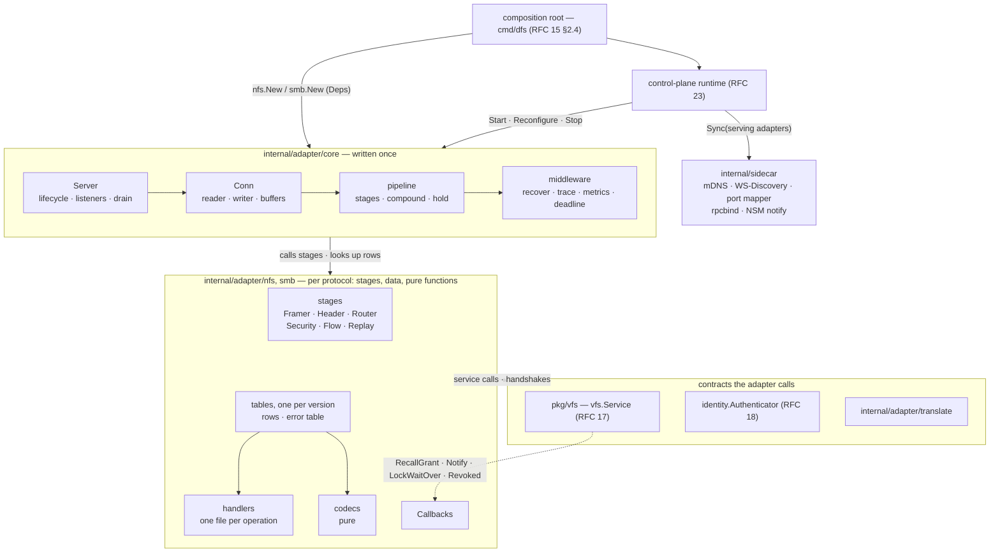
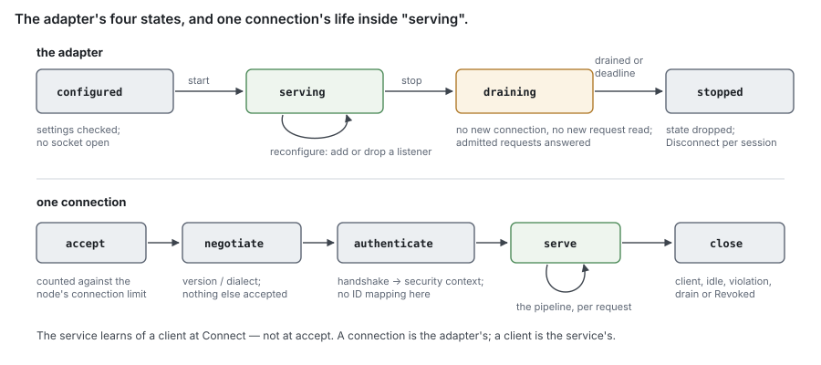
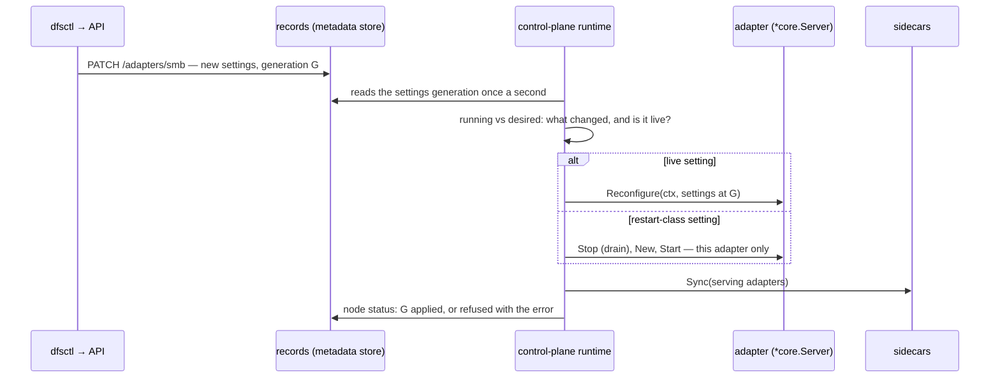
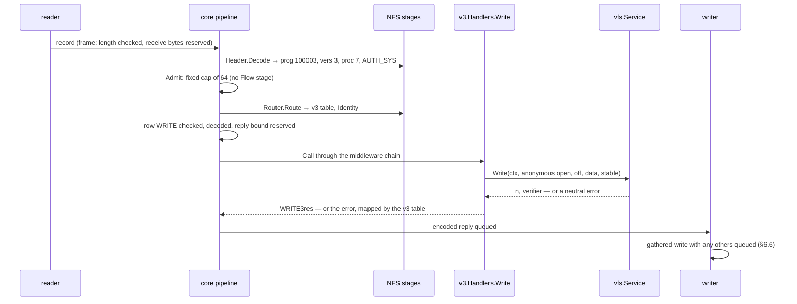

# RFC 20 — the adapter model

**Status:** draft. [§11](#11.%20Open%20questions) lists what is known to be undecided.
**Audience:** anyone writing or changing a protocol adapter, and anyone deciding
whether a piece of logic belongs to a protocol or to the filesystem.

Conventions, RFC 2119 keywords and test tiers are set once in the
[index](rfc-index.md). This document specifies behaviour, not the current code;
[Appendix B](#Appendix%20B%20%E2%80%94%20where%20the%20current%20code%20differs) says where the code differs.

---

## Start here

*Explanatory. The rules are in §1 onward; where this section and a rule differ, the rule wins.*

### In plain words

An **adapter** is the code for one wire protocol. It accepts connections,
reads bytes, turns them into calls on the filesystem service of
[RFC 17](rfc-17-vfs.md), and turns the answers back into bytes. It decides
nothing about files: who may open one, whether a lock conflicts, how much quota
is left. Those are the service's, written once for every protocol.

[RFC 17](rfc-17-vfs.md) fixes what the service offers and what stays in
adapters. [RFC 21](rfc-21-nfs.md) and [RFC 22](rfc-22-smb.md) fix the choices
each protocol's standards leave open. This RFC is the part between: the shape
every adapter has — how it starts and stops, how a request travels through it,
how it encodes and decodes, how it handles many clients at once — and how we
prove an adapter only translates, and translates correctly.

**The problem, with one example.** alice-pc opens
`profiles/alice/ODFC_alice.vhdx` over SMB with deny-write. build01 writes to
the same file over NFSv3. RFC 17 decides, in one place, that build01's write is
a sharing violation. That decision is worth only what the adapters let through.
If the NFSv3 handler, written for a protocol with no opens, checked permissions
itself and called the content engine directly "because NFSv3 is simple", the
service's check would never run. The rule would exist and be bypassed, and
nothing would be red: the NFS suite passes, the SMB suite passes, and the
service suite tests a path the NFS adapter does not take.

With this RFC:

1. The NFS adapter's packages import the service and their own wire and session
   code, and nothing else. A handler that reached for the engine would not
   build, and a test says so (§2.3).
2. The NFSv3 `WRITE` handler decodes the arguments, builds an anonymous open
   from the caller's identity, makes **one** call, `Write`, and maps what comes
   back (§4.3).
3. The service refuses the write with `ErrShareViolation`; the adapter's error
   table turns it into `NFS3ERR_ACCES`
   ([RFC 21 §5.6](rfc-21-nfs.md#5.6%20Open-state%20and%20capacity%20errors%20on%20the%20wire)), and the table's own test proves every service error has a row (§4.5).
4. A nightly run sends the same NFSv3 and SMB sequence to a reference server and
   to DittoFS, captures both, and compares them field by field after removing
   what legitimately differs (§8). A reply that differs, and that no recorded
   decision explains, is red.

**The words you need.**

- **adapter** — the code for one wire protocol, from the listening socket to
  the service call ([RFC 17 §4.2](rfc-17-vfs.md#4.2%20Translation%20stays%20in%20adapters)).
- **codec** — the pure functions that turn bytes into a request's fields and a
  reply's fields into bytes; no I/O, no service (§5).
- **handler** — the function for one wire operation: fields in, one service
  call, fields out (§4.3).
- **connection state** — what the protocol keeps per connection or session:
  slot tables, reply caches, credits, security contexts, ID tables. The adapter
  owns it, in memory only (§2.2).
- **client-held name** — anything a client can present again after its
  connection is gone: a file handle, a stateid, a durable handle, a create
  verifier. Never the adapter's (§2.1).
- **stage** — one step of the request pipeline (§4.1); a protocol supplies its
  own implementation of a few of them (§4.7).
- **auxiliary service** — a service that answers client requests beside an
  adapter's main protocol, on any transport, and reaches the service or holds
  client state that protocol depends on: today MOUNT, NLM and NSM beside NFS
  (§3.1).
- **sidecar** — something run beside one or more adapters that reaches no
  service and holds no client state: it helps clients find an adapter or tells
  them something happened — discovery, the port mapper, NSM's restart notice
  (§3.5).
- **reference server** — a widely deployed implementation of the protocol whose
  wire behaviour this one is compared against (§8).


**What this RFC promises.**

- Every adapter has the same lifecycle, the same request pipeline and the same
  drain on stop, so a fix to one stage is a fix for both protocols.
- An adapter holds no filesystem logic, and the build proves it: its imports
  are checked, its handlers make at most one mutating service call, and every
  service error has a row in its error table.
- A slow or silent client costs its own connection, never a worker another
  client needs.
- An adapter's tests test translation; the service's tests test semantics; and a
  wire comparison against a reference server catches what neither can.

### Scenarios

**A handler is tempted to compose.** An SMB `CREATE` with
`FILE_OPEN_IF` and deny-write arrives.

1. The handler could look the name up, create it if absent, then open it — three
   calls, and two clients could interleave between them.
2. It may not: a handler makes at most one mutating call (§4.3). It builds one
   `OpenRequest` carrying the disposition, the access, the deny mode and the
   lease wanted, and calls `Open` once
   ([RFC 17 §4.1](rfc-17-vfs.md#4.1%20The%20operation%20set%20is%20the%20union%2C%20not%20the%20intersection)).
3. If the service could not express the operation atomically, the fix is a
   service operation, never a sequence in the adapter.

Outcome: the atomicity SMB promises is the service's to keep, for both
protocols.

**The node is told to stop while build01 is unpacking a tarball.** build01
runs `tar -xf src.tar` onto its NFS mount: thousands of `CREATE`, `WRITE` and
`SETATTR` requests, dozens in flight at any moment, when an operator drains the
node for an upgrade.

1. The adapter stops accepting connections and stops reading new requests from
   the ones it has (§3.2).
2. Requests already handed to the service run to their answer, bounded by the
   drain deadline; their replies are sent. A `WRITE` acknowledged is a `WRITE`
   applied.
3. Each connection is then closed. NFS clients, on hard mounts, retry against
   whichever node next answers the address; SMB clients reconnect and reclaim
   their durable opens ([RFC 14 §8](rfc-14-open-state.md#8.%20What%20is%20durable)).
4. Nothing the adapter held is written anywhere: slot tables, reply caches and
   sessions are gone, as RFC 21 §3.2 and RFC 22 §4.3 already accept.

Outcome: `tar` pauses while the client retries, then carries on against the
next node; a stop loses only what a crash would, and no acknowledged write.

**A Windows client sends a reply-size edge the spec leaves vague.**

1. The nightly wire run sends the same `QUERY_DIRECTORY` with a 1 KiB output
   buffer to the reference SMB server and to DittoFS.
2. The reference answers `STATUS_BUFFER_OVERFLOW` with one partial entry;
   DittoFS answers `STATUS_INVALID_PARAMETER`.
3. After normalisation (§8.3) the two replies differ in status, and no entry in
   the divergence list names a decision for it. The run is red, with both
   captures attached.

Outcome: a difference no unit test would have looked for is found before a
Windows user hits it.

## In short

- An adapter is wire, sessions and encoding. It holds only connection state, in
  memory, and calls only the service ([RFC 17](rfc-17-vfs.md)).
- Two questions place every piece of logic: could another protocol observe it,
  and can the client present it back after its connection is gone? Yes to
  either and it is not the adapter's.
- Every adapter has one lifecycle — configured, serving, draining, stopped — and
  one pipeline: frame, decode, admit, replay check, resolve, call, map, encode,
  send.
- The composition root builds each adapter once from its `Deps`; handlers are
  methods on per-version handler sets that hold the service. A protocol version
  is an operation table, chosen from the request's header, never a branch in a
  handler.
- A handler makes at most one mutating service call. A compound is a sequence
  of handlers, run by the adapter's compound runner, never one handler doing
  several things.
- Codecs are pure, bounded and fuzzed, and anchored by golden vectors taken from
  the specifications and from reference captures, not by round trips alone.
- One reader and one writer per connection; bounded work in flight per
  connection, set by the protocol's own flow control; no worker waits on a
  client.
- Speed comes from what the adapter does not do: no serialising of a
  connection's requests, no payload copies, no shared lock on the request path.
  Buffers are pooled by size class, replies are sent in gathered writes, and
  Nagle's algorithm is off.
- Tests run in layers: codecs, the shared runtime on a toy protocol, handlers
  against a recording service, the boundary checks, third-party suites, kernel
  clients end to end, and wire tests that compare with a reference server field
  by field, every accepted difference recorded. Benchmarks against a null
  service give the adapter's own ceiling.

---

## 1. Purpose

Two adapters written separately grow the same parts twice — a listener, a
connection loop, a drain, a request budget, an error table — and grow them
differently. The second copy is where a check goes missing: a deadline one
protocol enforces and the other does not, a drain that waits on one and drops
the other. This RFC fixes the shape both share, so it is written once, and
fixes how we show that an adapter does nothing else.

### 1.1 Non-goals

This RFC **MUST NOT** be read as specifying:

- the service's operations, their order or their errors — those are
  [RFC 17](rfc-17-vfs.md)'s;
- a protocol's own choices — versions, dialects, transfer sizes, slot and credit
  counts, attributes, names — those are [RFC 21](rfc-21-nfs.md)'s and
  [RFC 22](rfc-22-smb.md)'s;
- how a principal is authenticated against a directory, or how it is mapped to
  numeric IDs and SIDs — that is [RFC 18](rfc-18-identity.md)'s. This RFC fixes only that the
  adapter runs the protocol's handshake and hands the service what it proved
  (§4.4);
- memory budgets and buffer pool sizes — [RFC 24 §2](rfc-24-resources.md#2.%20The%20node%20memory%20budget)'s. This RFC fixes where
  the bounds apply, not their values (§6);
- the test runner, tiers and grading — [RFC 29](rfc-29-test-harness.md)'s. This
  RFC states the checks.

## 2. The boundary

### 2.1 Two questions place every piece of logic

A piece of behaviour belongs to the service, not the adapter, when either of
these is true:

1. **Another protocol could observe it.** A deny mode, a lease, a lock, a
   pending delete, a stream, a DOS attribute, a timestamp held suspended
   through an open: the other protocol must see it, so it is decided where both
   are visible. That is the purpose of the whole design — the protocols are
   interoperable wherever the semantics allow — and an adapter that decides one
   of these alone makes it invisible to the other.
2. **The client can present it back after its connection is gone.** A file
   handle, a stateid, a client ID, a durable or persistent handle, an exclusive
   create verifier, an NLM grant: the client keeps the name and sends it again
   after a reconnect — to this node after a restart, or to another after an
   address takeover. Whatever the name refers to **MUST** outlive the
   connection, so it is [RFC 7](rfc-7-namespace-metadata.md)'s or
   [RFC 14](rfc-14-open-state.md)'s, never the adapter's memory.

Everything else is the adapter's: what the protocol's specification alone
defines, kept per connection or session, and gone when they are.

The second question is not "must it survive a node failure". Much of what an
adapter holds is lost on a restart by decision — NFSv4.1 reply caches
([RFC 21 §3.2](rfc-21-nfs.md#3.2%20The%20reply%20cache%20is%20per%20session%2C%20in%20memory)), SMB sessions
([RFC 22 §4.3](rfc-22-smb.md#4.3%20Reconnect%20after%20a%20node%20is%20lost)) — and
that is right, because the protocol already tells the client to rebuild them:
`NFS4ERR_BADSESSION`, a new SMB session setup. The test is whether the client
holds a name for the thing. A client that holds a name it can never rebuild
must find the thing still there.

> decision: placement is decided by observability and by client-held names,
> not by which protocol uses a feature. A feature only SMB triggers — a deny
> mode, delete on close, an alternate data stream — is still the service's,
> because NFS must see its effect. Move a feature into an adapter only when both
> questions answer no, and say so in that protocol's RFC.

**Worked example.** Six details, placed by the two questions:

| Detail | Could the other protocol observe it? | Does the client present it back? | Lives in |
| --- | --- | --- | --- |
| alice-pc's deny-write on her container | yes — build01's NFSv3 write must be refused | — | the service ([RFC 14](rfc-14-open-state.md)) |
| a named stream `report.docx:summary` | yes — removing the file over NFS removes its streams | — | the service ([RFC 7](rfc-7-namespace-metadata.md)) |
| build01's exclusive create verifier | no | yes — the `OPEN` is resent after a reconnect | the service ([RFC 7 §2.10](rfc-7-namespace-metadata.md#2.10%20Exclusive%20create)) |
| the cached reply in build01's slot 7 | no | no — after node loss the client is told `NFS4ERR_BADSESSION` and opens a new session | the adapter, in memory |
| the 512 credits granted to alice-pc's connection | no | no — credits end with the connection | the adapter, in memory |
| the name `a:b` shown to SMB as `a` U+F022 `b` | no — NFS sees the stored name | no — the mapping is computed, nothing is held | the adapter's codec |

### 2.2 What an adapter may hold

An adapter **MAY** hold, in the memory of the `protocol` node serving the
connection, and nothing else:

| Kind | Examples |
| --- | --- |
| Transport | listeners, connections, framing state, TLS or transport-encryption state |
| Security contexts | an RPCSEC_GSS context, an SMB session's keys, signing and encryption state, a handshake in progress |
| Flow control | NFSv4.1 slot tables, SMB credits, per-connection in-flight counts |
| Exactly-once state | the NFSv4.1 reply cache, SMB message IDs and channel sequence |
| ID encodings | the wire form of a stateid, an SMB `FileId`, a tree ID, a session ID, a `READDIR` cookie and its verifier — each a translation to and from a service value |
| Compound state | NFSv4 current and saved filehandles, SMB related-request chaining |
| Requests in progress | an SMB request answered `STATUS_PENDING` and re-driven ([RFC 17 §3.2](rfc-17-vfs.md#3.2%20Callbacks)), a waiting lock's wire identity |

None of it is written to the metadata store, and none is replicated. Every ID
encoding **MUST** be reversible from the connection's own tables to the service
value it stands for, or refused with the protocol's stale or bad-ID error: an
adapter never guesses which open a wire ID meant.

An adapter **MUST NOT** hold a cache of anything the service returns — an
attribute, a permission decision, a lookup result, a directory listing — beyond
the request that read it. A cached attribute is the most common way one
protocol's client sees another's change late; the client's own caching rules
([RFC 21 §9.2](rfc-21-nfs.md#9.2%20Close-to-open%2C%20and%20what%20the%20server%20guarantees), RFC 22's leases) are the
only caching there is.

> ponytail: no adapter-side attribute cache. Every `GETATTR` and every reply's
> post-operation attributes reach the service. Add one, keyed by the file's
> `Version` and invalidated by the service's change stream, only when a profile
> on the reference box shows attribute reads at the primary limiting a
> metadata-heavy workload.

### 2.3 What an adapter may import

An adapter's packages **MUST** import only:

- the service's interface and value types ([RFC 17 §3](rfc-17-vfs.md#3.%20Interface)),
  and the neutral types it names;
- the adapter's own codecs, session and connection code;
- `core`, the shared adapter code of this RFC — listeners, connections, drain,
  pipeline, middleware, buffers (§2.5);
- the standard library and wire-format libraries that do no file I/O.

They **MUST NOT** import a metadata store, the open-state tables, the content
engine, the topology or routing code, the configuration store, or another
adapter. Two adapters that need the same helper — the ACL translation between a
security descriptor or an NFSv4 ACL and the neutral ACL
([RFC 19 §5.1](rfc-19-authorization.md#5.1%20One%20translation%2C%20two%20spellings)),
a time conversion — take it from a shared translation package that itself
imports only neutral types.

A test **MUST** enforce this list from the import graph, and fail naming the
package and the forbidden import (§7.1). A rule nobody checks drifts the first
week someone is in a hurry.

### 2.4 Protocol details that stay in the adapter

What both questions answer no to, listed so the line is not re-argued per
feature:

| Detail | Why it is the adapter's |
| --- | --- |
| Name presentation: names SMB cannot carry, invalid UTF-8 hidden ([RFC 22 §12.3](rfc-22-smb.md#12.3%20Names%20SMB%20cannot%20carry)) | a reversible mapping of a stored name; the stored name is the service's |
| NFSv4 owner strings `user@domain` | the encoding of an identity; the mapping is [RFC 18 §4.5](rfc-18-identity.md#4.5%20NFSv4%20owner%20strings)'s |
| Security descriptors and NFSv4 ACLs | spelled by the one shared translation ([RFC 19 §5.1](rfc-19-authorization.md#5.1%20One%20translation%2C%20two%20spellings)); what an ACL means, and what a set of one may hold, are RFC 19's |
| Attribute bitmaps, SMB information classes, `FSINFO` and volume replies | formatting what the service returned |
| `READDIR` and `QUERY_DIRECTORY` reply trimming to the client's buffer | the service resumes from a cursor ([RFC 17 §4.7](rfc-17-vfs.md#4.7%20Callable%20across%20the%20network)); fitting a reply is the protocol's |
| SMB control codes | each translated into one service call — copychunk to `Copy`, zero data to `Deallocate`, allocated ranges to `Seek` ([RFC 22 §10](rfc-22-smb.md#10.%20Control%20codes)) |
| IPC$ and its RPC services | an RPC endpoint calling `ListShares` and identity lookups; it reaches no file ([RFC 17 §4.9](rfc-17-vfs.md#4.9%20Shares%2C%20mounts%20and%20trees)) |
| Port mapper, MOUNT's empty `DUMP` | no file state: the port mapper is a sidecar (§3.5), `DUMP` an auxiliary service's answer ([RFC 21 §6.3](rfc-21-nfs.md#6.3%20MOUNT)) |

And what looks protocol-only but is not:

| Detail | Why it is the service's |
| --- | --- |
| Exclusive create verifier | the client presents it again after a reconnect ([RFC 7 §2.10](rfc-7-namespace-metadata.md#2.10%20Exclusive%20create)) |
| `SETATTR` guarded by ctime | a compare-and-set: checked in the adapter it races the write it guards; the service takes the guard as an argument |
| Timestamp suspension (−1 / −2) | held with the open at the primary ([RFC 22](rfc-22-smb.md)) |
| Delete on close, streams, DOS attributes | NFS observes them |
| A blocked lock's wait | the waiter is open state; only its wire answer is the adapter's ([RFC 17 §3.2](rfc-17-vfs.md#3.2%20Callbacks)) |

### 2.5 Architecture and package layout

Implementing NFSv3, NFSv4.0–4.2, their auxiliary services and SMB 2.1–3.1.1 is large
enough without the layer around them adding to it. The design keeps that layer
thin with four rules:

1. **What is the same for every protocol is written once**, in one package,
   `core`: listeners, connections, the pipeline, the compound runner, held
   requests, the cross-cutting middleware, buffers, the error-table type.
2. **What differs is small parts or data, never hooks into a base class.** A
   protocol supplies a framer, its implementations of a few pipeline stages
   (§4.7) and its operation tables; per-protocol policy — which operations exist in which
   version, which need a session, which may be held — is table columns.
3. **Protocol code is pure where it can be.** Codecs are pure functions (§5.1);
   a handler is one function that makes one service call (§4.3). Neither holds
   a connection.
4. **An interface only where there are two implementations.** `vfs.Service`
   (the service, the recording fake, the null service), the authenticator (the
   local store, a domain, a fake), a protocol and its stages (NFS's RPC
   protocol, SMB, the toy protocol of §7), a sidecar (§3.5). Everything else is
   a concrete type.



**`internal/` and `pkg/`.** The rule is who may import it:

- **`pkg/`** holds contracts several components build against: `pkg/vfs`, the
  service interface and its value types (RFC 17), and `pkg/vfs/vfstest`, its
  generated recording fake and null service (§7.2, §6.10). Nothing adapter-
  specific is in `pkg/`.
- **`internal/adapter/`** holds every line of adapter code. Only the
  composition root, in `cmd/dfs`, imports a protocol's `New`; no package under
  `pkg/` imports anything under `internal/adapter/`. The control plane drives
  adapters through an interface it declares itself (§3.4), so it needs no
  import of them.

The import test of §7.1 checks both directions.

```text
pkg/vfs/                    the service interface (RFC 17)
pkg/vfs/vfstest/            the recording fake and the null service
internal/adapter/
  core/                     one package, a file per concern:
    server.go               Server: lifecycle, listeners, accept, drain, health (§3)
    deps.go                 Deps (§3.4)
    conn.go                 Conn: reader, writer, write deadline (§6.1, §6.2)
    protocol.go             Protocol, Framer, Stages: what a protocol plugs in (§4.7)
    pipeline.go             the stages, in §4.1's order
    dispatch.go             OpTable, Op, Invocation, Bind: operation code to handler (§4.2, §4.7)
    compound.go             the compound runner (§4.3)
    hold.go                 held requests (§4.6)
    middleware.go           recovery, trace, metrics, deadline, in one fixed order
    errors.go               ErrorTable and its totality check (§4.5)
    buf.go                  reference-counted buffers over RFC 24's pools (§6.8)
  translate/                ACL, access-mask, time and attribute translation: neutral types only
  adaptertest/              toy protocol, import test, golden-vector and capture helpers (§7)
  nfs/
    nfs.go                  New: builds the stages, handler sets and operation tables; returns a *core.Server
    wire/                   pure codecs, generated from the XDR: the RPC header and credentials, one file per program
    rpc/                    the ONC RPC Protocol and its stages: record-mark framer, router by (program, version), AUTH_SYS, RPCSEC_GSS
    v3/                     Handlers, table, errors; one file per procedure
    v4/                     Handlers, table, errors; one file per operation
    v4/session/             sessions, slots (flow), reply cache (replay)
    mount/ nlm/ nsm/        auxiliary services: each its Handlers and an OpTable on rpc's Protocol
    callbacks.go            Callbacks for NFSv4.1 and NLM (§3.3)
  smb/
    smb.go                  New
    wire/                   pure codecs, hand-written: NetBIOS frame, SMB2 and transform headers, one file per command
    session/                the SMB Protocol and its stages: framer, router by dialect, signing and encryption, credits, channel sequence
    handlers/               Handlers, table, errors; one file per command; ioctl/ one file per control code
    dcerpc/                 DCE/RPC over IPC$ pipes: NDR codecs, srvsvc, lsarpc; imports no SMB package (§3.1)
    callbacks.go
internal/sidecar/           mdns/ wsd/ portmap/ rpcbind/ nsmnotify/: one package each (§3.5)
```

**Files are small.** One wire operation per file, its handler and nothing
else; its codec in the codec package, its error rows in the one table. A
non-test file **SHOULD** stay under 500 lines. The import test of §7.1 also
lists every adapter file over 800 lines, against a checked-in allowlist that
may only shrink, so the rule does not drift the first week someone is in a
hurry.

**`wire` is pure, in both protocols.** `wire/` holds the codecs and nothing
else: no state, no I/O, no import beyond the standard library and `core`'s
buffers, which the import test checks (§7.1). Every golden vector and fuzz
target is there (§5.4). What holds state — a GSS context, a session, a credit
window — is in `rpc/` or `session/`, the protocol's stages.

> ponytail: a line count, not a complexity measure. A 500-line file of table
> rows is fine and a 300-line handler that composes is not; §4.3 and §7.4 catch
> the second. Replace the count with a per-function measure only if the
> allowlist stops shrinking.

**Patterns, and the ones deliberately not used.**

| Pattern | Where | Why here |
| --- | --- | --- |
| composition root, constructor injection | `New(Deps, Settings)` (§3.4) | every dependency visible in one struct; a test builds an adapter from fakes |
| consumer-defined interface | `runtime.Adapter` in the control plane; `vfs.Service` in `pkg/vfs` | the side that calls declares what it needs; implementations return concrete types |
| table-driven dispatch, typed by generics | `Op`, `Bind` (§4.7) | one row per operation; the decoder, handler and encoder of a row are type-checked together; versions are data (§4.8) |
| small strategies, nil for the default | `Stages` (§4.7) | each stage is one job and one unit test; a protocol without replay or credits leaves that stage nil |
| middleware chain | recovery, trace, metrics, deadline (§4.2) | cross-cutting work in one fixed order, written once |
| reference counting | `core.Buf` (§6.8) | a buffer has several borrowers — the request, the service, the writer — and the last one frees it |
| plain settings struct | `Settings` (RFC 13) | validated once at `New`; no functional options for a value built in one place |

| Not used | Because |
| --- | --- |
| a service locator or runtime registry handed to handlers | a handler reaching "the stores" through it is how the boundary leaked (Appendix B) |
| a base adapter type to embed and override | the shared part is a component the protocol is given, not a parent it inherits from |
| capabilities discovered by type assertion | a capability that silently does not exist passes every test; a stage is a field, present or nil |
| a worker pool | §6.6's ponytail |
| a package per concern inside `core` | the concerns call each other; one package with a file per concern has no import cycles to manage |


## 3. Common lifecycle

### 3.1 The adapter's states

Every adapter runs through the same four states, driven by the control plane
([RFC 23 §2.3](rfc-23-control-plane.md#2.3%20The%20runtime%20reconciles%3B%20it%20does%20not%20take%20orders)):



- **configured** — settings validated ([RFC 13](rfc-13-configuration.md)), no
  socket open. A setting the adapter cannot apply **MUST** fail here, not at the
  first request.
- **serving** — listeners open, connections accepted. Start succeeds only once
  every configured listener is bound; a partial bind is a failed start, and
  closes what it opened.
- **draining** — no new connection is accepted and no new request is read from
  an open one. Requests already handed to the service run to their answer, and
  their replies are sent. Draining ends when none is left or at the drain
  deadline, whichever is first.
- **stopped** — every connection closed, every connection's state dropped,
  `Disconnect` called for each SMB session that ended
  ([RFC 17 §3.1](rfc-17-vfs.md#3.1%20Operations)).

A request still running at the drain deadline is abandoned: its context is
cancelled, its reply is not sent, and the client retries as after a lost reply.
The adapter **MUST NOT** answer it with an error the client would treat as
final, since the service may still apply it; a retry meets the service's
dedup ([RFC 17 §4.7](rfc-17-vfs.md#4.7%20Callable%20across%20the%20network)) or the protocol's own replay
rules.

**Reconfigure** adds or removes listeners without a restart. Removing an
address closes its listener and every connection accepted on it — exactly what
a namespace move's release asks of an adapter
([RFC 17 §3.2](rfc-17-vfs.md#3.2%20Callbacks), [RFC 27 §2.2](rfc-27-namespace-migration.md#2.2%20The%20move%2C%20step%20by%20step)) — and
leaves the others serving.

**Auxiliary services are part of their adapter.** An auxiliary service
answers client requests beside the adapter's main protocol. Today they are
NFS's: MOUNT, NLM and NSM, each an ONC RPC program
([RFC 21 §2.1](rfc-21-nfs.md#2.1%20Versions%20served)). Nothing in `core`
assumes RPC: a service on another transport — HTTP, say — is another
`Protocol` (§4.7) on a listener of the same adapter.

- **It belongs to one adapter**, because it shares that adapter's state: an NLM
  lock names an NFS file handle, and NSM is how NLM learns a host restarted.
  Something that serves several adapters, or none of their requests, is a
  sidecar (§3.5).
- **It runs through the same pipeline**, with its own `Protocol` or its own
  operation tables on the main one — NFS's auxiliary services are tables on
  the same RPC protocol, routed by program number — and under the same handler
  rules and tests.
- **It starts with the adapter, all or none**: one that cannot bind its listener
  fails the adapter's start, and it stops with it.
- A datagram listener — NLM and NSM over UDP while §11's question 5 stands —
  reads into a bounded queue and drops a datagram that arrives at a full one:
  the client retries.

**`IPC$` is SMB's, and its RPC is kept separable.** Share enumeration and
name lookups from Windows — srvsvc's `NetShareEnum`, lsarpc's SID and name
lookups — are DCE/RPC (MS-RPCE) carried over SMB named pipes: a tree connect to
`IPC$`, a `CREATE` of the pipe, then `WRITE`, `READ` or a pipe-transceive
`IOCTL`. It shares only a name with NFS's ONC RPC, and no NFS client uses it,
so it stays under the SMB adapter, behind two seams:

- **SMB sees a pipe as a byte stream.** The SMB handlers move bytes in and
  out of an open pipe and know nothing of DCE/RPC; `smb/dcerpc/` imports no
  SMB package.
- **Its services are handlers like any other.** Each interface is an
  `OpTable` keyed by opnum (§4.7), each operation one service call —
  `NetShareEnum` to `ListShares`, a lookup to the identity interface — under
  the same rules and tests as every other handler (§4.3, §7.2).

> decision: DCE/RPC is served over `IPC$` only, never on its own TCP port
> through an endpoint mapper. The Windows clients this serves enumerate shares
> and look up names over the pipe. Were a client found that needs the TCP
> transport, it is a new `Protocol` over the same `dcerpc` package, which does
> not change.

What runs beside an adapter but reaches no service and holds no client
state — discovery, the port mapper, a restart notice — is a sidecar (§3.5).

**Health.** An adapter is healthy when it is serving with every listener
bound, its auxiliary services' included. Draining reports not ready
([RFC 25 §3.6](rfc-25-observability.md#3.6%20Readiness)), so that whatever steers new
clients — an address takeover ([RFC 15 §5.3](rfc-15-topology.md#5.3%20Client%20addressing)), a load balancer — stops sending
them before the drain ends.

**A setting is live or restart-only.** Each adapter setting is marked as one or
the other in [RFC 13](rfc-13-configuration.md#Appendix%20B%20%E2%80%94%20the%20settings)'s table. A live setting applies to connections and sessions set
up after the change; one already set up keeps what it negotiated — its dialect,
signing, encryption and sizes — until it ends. A restart-only setting is applied
by a drain and a start, never by changing a serving connection under its client.

### 3.2 A connection's lifecycle

The lower half of the drawing above:

1. **accept** — the connection is charged its fixed cost to the node's
   connection-state pool and counted against the node's connection limit and
   its address's quarter of it (§6.4,
   [RFC 24 §4.4](rfc-24-resources.md#4.4%20Connections)); past any of them, the
   connection is closed at once, before any byte is read.
2. **negotiate** — the protocol's version or dialect exchange. Requests other
   than the negotiation are refused as the protocol says until it completes.
3. **authenticate** — the protocol's security handshake (§4.4). NFS's
   per-request credentials make this a per-request step for AUTH_SYS and a
   context setup for RPCSEC_GSS; SMB's is per session.
4. **serve** — the request pipeline of §4.
5. **close** — by the client, by an idle timeout, by a protocol violation, by a
   drain, or by a `Revoked` callback naming the address
   ([RFC 17 §3.2](rfc-17-vfs.md#3.2%20Callbacks)). Closing cancels the context of
   every request still in progress on the connection, drops the connection's
   state, and, for the last channel of an SMB session, calls `Disconnect`.

The service learns of a client at the protocol's own moment
([RFC 17 §3.1](rfc-17-vfs.md#3.1%20Operations) `Connect`) — not at accept, since
an NFS client's identity spans connections and an SMB client's spans sessions.
A connection is the adapter's; a client is the service's.

**Cleanup comes before reconnect, and blocks only the session it is for.** A
closing connection's cleanup — `Disconnect` for each session whose last channel
it was, its ID tables dropped — completes before a reconnect of the same session
is served on another connection, so the reconnect never meets half-ended state.
The wait is keyed by the session: one client's slow cleanup never delays another
client's setup.

### 3.3 Callbacks are the adapter's to deliver

Almost everything an adapter does is a client asking and the service answering.
A **callback** is the other direction: the service needs a client to do
something the client did not ask about, and only the adapter knows how to reach
it. The service never imports an adapter, so at `Connect` the adapter hands it
a `Callbacks` value for that client
([RFC 17 §3.2](rfc-17-vfs.md#3.2%20Callbacks)), and the service calls up
through it.

| Callback | Why the service calls it | SMB on the wire | NFS on the wire |
| --- | --- | --- | --- |
| `RecallGrant` | alice-pc holds a read-write-handle lease on `report.docx`; build01 writes the file over NFSv3. The lease must be broken before the write | lease break notification on alice-pc's session | `CB_RECALL` on the NFSv4.1 back channel |
| `Notify` | Explorer watches `projects/`; build01 creates a file in it | `CHANGE_NOTIFY` response to the request alice-pc left pending | `CB_NOTIFY` (NFSv4.1, optional) |
| `LockWaitOver` | build01 waits for a lock alice-pc holds; alice-pc unlocks | the pending `LOCK` request finally answered | `NLM4_GRANTED` RPC to build01's lock manager |
| `Revoked` | build01's lease expired, an administrator revoked its client, the share moved | pending requests answered with the protocol's error; the connection closed for a moved address | same, by the protocol's own errors |

Each protocol implements the interface once, on a small per-client value that
knows the client's connection or host and nothing about files:

```go
// smbCallbacks is what the SMB adapter registers at Connect for one client.
type smbCallbacks struct {
	sess *session.Session // the client's session: its channels' writers, its pending requests
}

func (c *smbCallbacks) RecallGrant(ctx context.Context, g metadata.CachingGrant, to vfs.GrantKind) error {
	msg := wire.LeaseBreak{Key: leaseKey(g), NewState: leaseState(to)}
	return c.sess.Notify(ctx, &msg) // encoded and queued on a live channel's writer (§6.2); none live is an error
}
```

The callback returns once the message is queued — never after the client's
acknowledgement, which arrives later as an ordinary request (`AckBreak`,
`DELEGRETURN`). The shared connection runtime does the sending; each protocol
reaches the client its own way:

- **SMB and NFSv4.1** send on a connection the client opened: a lease break or
  change notification on a channel of the SMB session, `CB_RECALL` on the
  NFSv4.1 back channel
  ([RFC 21 §3.4](rfc-21-nfs.md#3.4%20The%20back%20channel%20and%20where%20callbacks%20go)).
  The callback is encoded and sent on that connection's writer (§6.2); a client
  with no such connection live is a callback that failed.
- **NLM** callbacks — `NLM4_GRANTED`, `NLM4_GRANTED_MSG`, the `*_RES` replies —
  are RPCs the server makes to the host's own NLM service, not replies on the
  connection that carried the request, which may have closed since. The adapter
  connects out to the host, from the floating address the host used
  ([RFC 21 §6.1](rfc-21-nfs.md#6.1%20NLM)), as §6.6's decision says; a host it
  cannot reach is a callback that failed.
- **NFSv4.0** has no callback path: none is ever opened
  ([RFC 21 §4.1](rfc-21-nfs.md#4.1%20SETCLIENTID%20and%20the%20callback%20path)).

A callback **MUST** return within its context's deadline whether or not the
client answers; the service handles a failed callback as the client not
answering.

`Revoked` is the adapter's prompt to answer what it holds pending on the
revoked state — a waiting lock, an outstanding notification, a held request —
with the protocol's error, and, for a moved share's address, to close the
listener and its connections (§3.1).

### 3.4 Interface

Signatures are indicative; the obligations are normative. Two surfaces: what
the control plane drives, here, and what a protocol plugs into `core` (§4.7).

The control plane declares the interface it drives, beside its own code, so
it imports no adapter (§2.5):

```go
package runtime // pkg/controlplane/runtime (RFC 23)

// Adapter is what the runtime moves through RFC 20 §3.1's states. *core.Server
// implements it for every protocol.
type Adapter interface {
	// Start moves configured to serving: every listener bound, or none, and
	// the error names what failed.
	Start(ctx context.Context) error

	// Reconfigure adds and removes listeners and applies live settings to
	// connections set up after it returns (§3.1). A restart-only setting is
	// refused; the runtime applies it by Stop and Start.
	Reconfigure(ctx context.Context, s config.Adapter) error

	// Stop moves serving to draining to stopped. ctx's deadline is the drain
	// deadline; requests still running at it are abandoned (§3.1).
	Stop(ctx context.Context) error

	// Health is ready when serving with every listener bound; draining reports
	// not ready (RFC 25 §3.6).
	Health() Health

	// Connections lists the connections open now — protocol, remote address,
	// session, since — for the API's client list. It is read from core's
	// connection registry, never written by protocol code.
	Connections() iter.Seq[ConnInfo]
}
```

What an adapter is built from:

```go
package core // internal/adapter/core

// Deps is what an adapter is handed. It builds no other component (RFC 23 §2.1).
// A field is an interface where it has two implementations, a concrete type
// where it has one.
type Deps struct {
	Service vfs.Service            // RFC 17: the only way to a file (§2.3)
	Auth    identity.Authenticator // RFC 18 §3.1: what a handshake needs a secret or directory for
	Pools   *resources.Pools       // RFC 24 §2.3: receive, reply, connection state
	Metrics *metrics.Registry      // RFC 25 §2
	Logger  *slog.Logger
	// Dial opens an outbound connection from a given local address: NLM's
	// callbacks to a host, from the floating address it used (§3.3). A test
	// supplies one returning a pipe.
	Dial func(ctx context.Context, from netip.Addr, to netip.AddrPort) (net.Conn, error)
}
```

Each protocol has one constructor. It validates the settings, builds its stages
and operation tables, and opens nothing:

```go
func nfs.New(d core.Deps, s config.NFS) (*core.Server, error) // configured
func smb.New(d core.Deps, s config.SMB) (*core.Server, error)
```

`New` fails on a setting the adapter cannot apply, so the failure is at
configured, not at the first request (§3.1). Settings arrive in exactly two
places: `New` and `Reconfigure`.


### 3.5 Sidecars

A **sidecar** runs beside one or more adapters, reaches no service and holds
no client state: it tells clients where an adapter is, or that something
happened. It may answer queries — mDNS and the port mapper do — but never about
a file. Each is tied to the adapters it serves:

| Sidecar | Runs while | Does |
| --- | --- | --- |
| mDNS advertiser | `nfs` or `smb` is serving | one responder per node, advertising `_nfs._tcp` and `_smb._tcp` for whichever of them is serving |
| WS-Discovery responder | `smb` is serving | answers Windows network-browse probes |
| port mapper | `nfs` is serving, on a host without its own rpcbind | answers `GETPORT` over UDP and TCP with the ports of NFS and its auxiliary services |
| system rpcbind registration | `nfs` is serving, on a host that runs its own rpcbind | registers the NFS auxiliary services' ports, and unregisters them before the adapter drains |
| NSM restart notice | `nfs` becomes serving | sends `SM_NOTIFY` to every monitored host, so NLM clients reclaim their locks ([RFC 21 §6.2](rfc-21-nfs.md#6.2%20NSM)) |

The control-plane runtime runs sidecars, not an adapter: it already knows
which adapters are serving, and a sidecar that serves both protocols belongs to
neither. The runtime declares what it drives:

```go
package runtime // pkg/controlplane/runtime

// Sidecar runs beside adapters, reaches no service and holds no client state.
type Sidecar interface {
	Name() string       // "mdns", "wsd", "portmap", "rpcbind", "nsm-notify": for logs and health
	Adapters() []string // the adapters it serves: {"nfs"}, {"smb"}, {"nfs", "smb"}
	// Sync is called with those of Adapters now serving, whenever that set or
	// their listeners change, and with none to stop. It returns once the
	// sidecar matches, and is idempotent.
	Sync(ctx context.Context, serving []Serving) error
}

// Serving is one adapter as a sidecar sees it: what to advertise or answer.
type Serving struct {
	Adapter   string                    // "nfs"
	Listeners map[string]netip.AddrPort // by service: "nfs", "mount", "nlm", "nsm"
}
```

- **Order.** The runtime calls `Sync` after an adapter is serving and before it
  starts draining, so nothing is advertised that cannot be reached, and an
  advertisement is withdrawn while the adapter still answers.
- **A failing sidecar fails only itself.** It raises `sidecar_failed` naming it
  (§3.7); the adapters keep serving. A client that cannot find the server by
  discovery can still be given its address.
- **Enabled is a live setting** of each sidecar
  ([RFC 13](rfc-13-configuration.md#Appendix%20B%20%E2%80%94%20the%20settings)):
  a disabled one is synced with the empty set.
- Sidecars are built by the composition root, one package each under
  `internal/sidecar/`, and import no adapter; one that speaks a protocol's
  encoding, as the port mapper speaks XDR, imports that protocol's `wire`
  package, which is pure (§2.5). One is tested by calling `Sync` with each set
  and asserting what it advertises, answers or sends.

**Auxiliary service or sidecar.** One question decides:

| | Auxiliary service (§3.1) | Sidecar |
| --- | --- | --- |
| Reaches the service, or holds client state the adapter's protocol depends on? | yes | no |
| Belongs to | one adapter, built by its `New` | the control-plane runtime, built by the composition root |
| Runs through | the adapter's pipeline, stages and operation tables | its own code |
| Serves | its one adapter | one adapter or several |
| If it fails | the adapter fails to start | it alone, `sidecar_failed` (§3.7) |
| Today | MOUNT, NLM, NSM | mDNS, WS-Discovery, port mapper, rpcbind registration, NSM restart notice |

> decision: two kinds, not one. Folded into one "companion", every rule above
> becomes a flag whose two values behave oppositely — who builds it, whether its
> failure stops the adapter, whether it may reach the service — and every
> reader of the code has to find the flag. In the code only `Sidecar` is a type;
> an auxiliary service is no type at all, only more operation tables on its
> adapter's `core.Server`. Revisit if a third kind appears that fits neither.

### 3.6 Changing settings while serving

An operator changes an adapter through the management API, and the API never
calls the adapter: it writes a record, and the control-plane runtime applies
the difference on every node it concerns
([RFC 23 §2.3](rfc-23-control-plane.md#2.3%20The%20runtime%20reconciles%3B%20it%20does%20not%20take%20orders)):



Three kinds of change, and only two reach the adapter:

| Kind | Examples | Takes effect | By |
| --- | --- | --- | --- |
| share policy | a share's encryption requirement, its grants, read-only, netgroups | the next request | the service, which reads the share list by version per request ([RFC 17 §4.9](rfc-17-vfs.md#4.9%20Shares%2C%20mounts%20and%20trees)); no adapter is touched |
| live adapter setting | listen addresses, signing required, dialect range, idle timeout, connection limit, a sidecar enabled | listeners at once; connections and sessions set up afterwards | `Reconfigure` |
| restart-class adapter setting | what [RFC 13](rfc-13-configuration.md#Appendix%20B%20%E2%80%94%20the%20settings)'s table marks restart-only | after that adapter alone drains and starts | `Stop`, `New`, `Start` |

**Inside the adapter, settings are one immutable snapshot.**

```go
type Server struct {
	settings atomic.Pointer[config.Adapter]
	// …
}

func (s *Server) Reconfigure(ctx context.Context, next config.Adapter) error {
	if err := validate(next); err != nil {
		return err // refused; what is running is unchanged
	}
	if restartOnly(*s.settings.Load(), next) {
		return ErrRestartRequired // the runtime drains and starts instead
	}
	if err := s.listeners.open(added(next)); err != nil {
		return err // all or none
	}
	s.settings.Store(&next)            // read by the next accept
	s.listeners.close(ctx, removed(next)) // and their connections (§3.1)
	return nil
}
```

- A connection loads the snapshot once, at accept, and a session at setup;
  neither reads it again. A request therefore never sees two settings, and no
  lock is on the request path.
- New listeners open before the snapshot changes and removed ones close after,
  so a moved address is never unserved between the two.
- A refusal leaves the running adapter as it was; the runtime reports it on the
  node's status record
  ([RFC 23 §2.4](rfc-23-control-plane.md#2.4%20What%20a%20node%20reports)).
- `core`'s tests cover it on the toy protocol: an open connection keeps its
  settings, a new one gets the new ones, a removed address's connections close,
  and a bind that fails changes nothing.

### 3.7 Health and probes

What health means is [RFC 25 §3](rfc-25-observability.md#3.%20Health)'s, and
the endpoints are
[RFC 23 §2.5](rfc-23-control-plane.md#2.5%20Health%20and%20readiness%20endpoints)'s.
An adapter contributes three things, all from `core`, none from protocol code:

| Answer | What the adapter supplies |
| --- | --- |
| **liveness** ([RFC 25 §3.5](rfc-25-observability.md#3.5%20Liveness)) | each accept loop and each connection's reader report a turn to the watchdog, or report idle; a loop that does neither for 60 s fails liveness. Nothing else the adapter does can fail it |
| **readiness** ([RFC 25 §3.6](rfc-25-observability.md#3.6%20Readiness)) | `Health()`: ready when serving with every listener bound; not ready while configured or draining. The node's `protocol` role is ready when every enabled adapter is |
| **conditions** ([RFC 25 §3.1](rfc-25-observability.md#3.1%20Conditions)) | `adapter_listener_lost`, a listener whose socket failed while serving, `unhealthy`; `sidecar_failed` (§3.5), `degraded`. Each derived from current evidence and cleared when it no longer holds |

A sidecar's failure and a single client's trouble are not readiness: a node
that serves files is ready whether or not mDNS is advertising it.

> decision: no self-probe. An adapter does not send itself an NFS `NULL` or an
> SMB `NEGOTIATE` to prove it answers. A probe over loopback tests loopback,
> not the client's path; a pipeline wedged on one connection would pass it; and
> what it would catch — a stuck accept loop or reader — the liveness watchdog
> already does. Orchestrators probe the HTTP endpoints, never the protocol
> ports: a TCP probe on 445 or 2049 opens a connection the adapter charges,
> counts and logs. An external monitor that wants a protocol-level check runs
> the scripted client of §8.2 from outside. Revisit if a wedge is found that the
> watchdog misses and a protocol probe would catch.

## 4. Dispatch

### 4.1 One pipeline

Every request, in either protocol, passes the same stages in this order,
in three groups:


1. **Protocol only** — touch no file, call no service operation. A request
   refused here is refused for protocol reasons and leaves no trace at the
   primary.
   - **frame** — read one record (RPC record mark, NetBIOS header). Its length
     is checked against the protocol's cap
     ([RFC 21 §2.3](rfc-21-nfs.md#2.3%20Transfer%20sizes),
     [RFC 22 §3.3](rfc-22-smb.md#3.3%20Sizes%20and%20credits)) and its bytes
     reserved from the receive pool before the body is read
     ([RFC 24 §3.2](rfc-24-resources.md#3.2%20Receive%3A%20charged%20at%20frame%2C%20and%20the%20reader%20waits)).
   - **decode header** — the RPC header and credential, or the SMB2 header
     (the transform header, for an encrypted SMB message).
   - **unwrap** — decrypt, verify a signature or checksum (§5.5).
   - **admit** — charge the connection's flow control (§6.3).
   - **replay check** — NFSv4.1 slot and sequence; SMB replay and channel
     sequence.
   - **decode args** — the operation's arguments, through its codec (§5).
   - **resolve IDs** — wire IDs to service values: a stateid or `FileId` to an
     `OpenRef`, a tree ID to its root handle.
2. **The call** — **call service**: the handler (§4.3), the only stage that
   reaches a file.
3. **The answer** — **map error** (§4.5), **encode** into the reply buffer
   (§5.3), **wrap** — sign or encrypt (§5.5) — and **send** through the
   connection's writer (§6.2).

How each stage refuses:

| Stage | Refused as |
| --- | --- |
| frame | length past the cap: connection closed. No room in the receive pool: not refused — the record is not read until room frees |
| decode header, decode args | the protocol's garbage-args or invalid-parameter answer |
| unwrap | SMB: `STATUS_ACCESS_DENIED` on the request's message ID, connection kept ([RFC 22 §4.1](rfc-22-smb.md#4.1%20Signing%20in)). `RPCSEC_GSS`: `RPCSEC_GSS_CREDPROBLEM`; a sequence number outside the window dropped unanswered ([RFC 21 §10](rfc-21-nfs.md#10.%20RPCSEC_GSS)) |
| admit | not refused — the connection is not read until a request completes |
| replay check | the cached reply, or the protocol's sequence error |
| resolve IDs | the protocol's bad- or stale-ID answer |
| send | connection closed |

The pipeline is one implementation, parameterised per protocol by its framer,
header codec, flow control, replay check and error table. Two adapters **MUST
NOT** each write their own: a stage missing in one is the drift §1 describes.

### 4.2 The operation table

Each protocol registers one table from operation code to handler. An operation
the table lacks is answered the protocol's not-supported status, by the
pipeline, before argument decoding. An operator may also switch operations off
by name, a live setting of the adapter (§3.6); the pipeline answers a switched-off
operation as one the table lacks, so no handler checks the setting. Version and dialect gating — an NFSv4.2
operation in a 4.1 compound, an SMB 3.x command on a 2.1 connection — is a
column of the table, not a check in the handler.

Each row also carries the preconditions the pipeline checks before the handler
runs, so that no handler repeats them:

| Column | Meaning | Example |
| --- | --- | --- |
| allowed before | whether it may arrive before negotiation or authentication completes | `NEGOTIATE`, `SESSION_SETUP`, `EXCHANGE_ID` |
| needs | session, tree connect, current filehandle — refused with the protocol's status when absent | SMB `READ` needs a session and a tree; NFSv4 `PUTROOTFH` needs no filehandle |
| versions | the first and last version or dialect that serve it | NFSv4.2 `SEEK` from minor version 2 |
| mutates | whether the handler may make its one mutating call (§4.3) | `WRITE` yes, `GETATTR` no |
| cacheable | whether its reply goes in the replay cache | NFSv4.1 `CREATE`, `REMOVE`, `RENAME` |
| reply bound | the largest reply it can produce for its arguments, before running it | `READ`: the count asked plus its header |

A test asserts every row fills every column.

Cross-cutting work — tracing, metrics, deadlines, panic recovery — wraps every
handler the same way, in the pipeline, in this fixed order outside in:
recovery, trace span, metrics, deadline. A handler never opens its own span or
records its own latency ([RFC 17 §7](rfc-17-vfs.md#7.%20Observability) owns
operation latency).

A handler that panics **MUST** be answered with the protocol's server-fault
status, logged at error with the operation and the stack, and **MUST NOT** take
down the connection's other requests.

### 4.3 A handler makes at most one mutating call

A handler is the function for one wire operation:

```go
// Handler is indicative; the obligations around it are normative. Handlers are
// methods on their version's handler set, which holds the service (§4.7); r
// carries what is per request: the Identity, the version, the session's ID
// tables and the compound state.
type Handler[Req, Rep any] func(ctx context.Context, r *core.Request, req *Req) (*Rep, error)
```

- It **MAY** make zero service calls, for operations that are the protocol's
  own: `NULL`, `ECHO`, `NEGOTIATE`, `SEQUENCE`, `CANCEL`, session setup.
- It **MUST** make at most one service call that changes state. A wire
  operation the service cannot express in one call is a missing service
  operation ([RFC 17 §4.1](rfc-17-vfs.md#4.1%20The%20operation%20set%20is%20the%20union%2C%20not%20the%20intersection)), never a sequence in the handler.
  An SMB `LOCK` of several elements is the case in point: it is one `Lock` or
  one `Unlock` call carrying every element's range, and the service — not the
  handler — releases the ranges it took when a later one fails
  ([RFC 22 §7](rfc-22-smb.md#7.%20Byte-range%20locks)).
- It **MAY** make further read-only calls only to fill fields the reply
  carries, and only where the service's mutating call does not already return
  them. Where it does — pre- and post-operation attributes, the change
  attribute, `MaximalAccess` — the handler uses what it got.
- It **MUST NOT** branch on a file's attributes, mode, ACL or type to decide
  whether the operation is allowed. It may branch on them to format the reply.

**Example.** The NFSv3 `WRITE` handler, whole:

```go
func (h *Handlers) Write(ctx context.Context, r *core.Request, a *WRITE3args) (*WRITE3res, error) {
	o := vfs.Anonymous(r.Identity, a.File) // NFSv3 has no opens (RFC 17 §4.1)
	n, v, err := h.svc.Write(ctx, o, int64(a.Offset), a.Data, stability(a.Stable))
	if err != nil {
		return nil, err // mapped once, by the table (§4.5)
	}
	after, _ := h.svc.GetAttr(ctx, r.Identity, a.File) // read-only, for the reply's attributes
	return &WRITE3res{Count: uint32(n), Committed: a.Stable, Verf: v, After: after}, nil
}
```

The service is a field of the handler set, given once by the composition root
(§4.7), not reached through the connection or the context: a connection holds
connection state only (§2.2), and a handler test builds `Handlers{svc: fake}`
with no connection at all (§7.2).

It looks up no share, checks no permission, tests no lock and calls no engine.
A version that did any of them fails the import test (§7.1) or the recording
service's expectations (§7.2).

**A compound is a sequence of handlers.** NFSv4 `COMPOUND` and SMB compounded
requests are run by the adapter's compound runner, one handler per operation,
carrying the compound state of §2.2 between them. The runner stops at the first
failure as NFSv4 requires, and applies SMB's related-request rule. It holds no
state between operations beyond that compound state: no lock is held across
two operations of one compound, and two operations of one compound are two
service calls, admitted separately
([RFC 17 §4.9](rfc-17-vfs.md#4.9%20Shares%2C%20mounts%20and%20trees)).

- A compound longer than the protocol's operation cap is refused before any of
  its operations runs; the cap is the protocol RFC's.
- **The reply budget is checked before each operation, not after.** In an
  NFSv4.1 compound the runner compares the operation's reply bound (§4.2) with
  what is left of the session's `ca_maxresponsesize`, and refuses an operation
  that would not fit before it runs (`NFS4ERR_REP_TOO_BIG`). When the
  `SEQUENCE` set `sa_cachethis`, it checks the same bound against
  `ca_maxresponsesize_cached` too, and refuses with
  `NFS4ERR_REP_TOO_BIG_TO_CACHE`
  ([RFC 21 §3.1](rfc-21-nfs.md#3.1%20Slot%20tables)). A mutation applied whose
  reply then cannot be sent, or cannot be cached when the client asked, is a
  mutation the client will send again.
- **SMB has no compound-wide reply budget.** A command's output-length field —
  `READ`'s `Length`, the `OutputBufferLength` of `QUERY_INFO`,
  `QUERY_DIRECTORY`, `IOCTL` and `CHANGE_NOTIFY` — bounds that command's output
  data only, not its header or the compound, and is answered by the command's
  own rule (MS-SMB2 3.3.5) — truncation with `STATUS_BUFFER_OVERFLOW`, or
  `STATUS_INFO_LENGTH_MISMATCH` / `STATUS_BUFFER_TOO_SMALL` before it runs. A
  command without one, `CREATE` or `CLOSE`, has a reply bounded by its own
  structure and the create contexts the server returns. The whole
  message is bounded by the negotiated sizes
  ([RFC 22 §3.3](rfc-22-smb.md#3.3%20Sizes%20and%20credits)).

**Example: an SMB compound.** Explorer reading a file's properties sends
`CREATE`, `QUERY_INFO` and `CLOSE`, related. The runner calls `Open`, keeps the
returned open as the compound's current file, answers `QUERY_INFO` from
`GetAttr` through it, then calls `Close`: three handlers, three service calls,
each admitted. If `Open` fails, the related `QUERY_INFO` and `CLOSE` are answered
with the same status, as SMB requires, and reach no service call.

> ponytail: compounds run as sequences of single calls. A `LOOKUP`-`GETATTR`-`OPEN`
> chain is three round trips to the primary in a split deployment. Batch them
> into one service call only when RFC 17 §9's open question is answered by a
> measurement showing compound round trips limiting a split deployment.

### 4.4 Identity

The adapter runs the protocol's security handshake — AUTH_SYS credential
decoding, the RPCSEC_GSS context exchange, SMB's NTLM or Kerberos session setup
— and hands the service an `Identity` holding what the handshake proved, and
nothing more ([RFC 17 §3](rfc-17-vfs.md#3.%20Interface)): the protocol, the
flavour and level, the principal or numeric IDs the credential carried, the
client's address.

The adapter **MUST NOT** map a principal to numeric IDs or SIDs, apply
squashing, or decide that a principal is privileged. Those are the service's,
per share, by [RFC 18 §6](rfc-18-identity.md#6.%20Resolution%20per%20share)'s
resolution. Where the handshake itself needs a directory — verifying an NTLM
response, a Kerberos ticket against a keytab — the adapter calls the
authentication interface RFC 18 defines
([RFC 18 §3.1](rfc-18-identity.md#3.1%20The%20authentication%20interface)), and
holds only the result in its security context. A handshake that fails is
answered as the protocol's logon failure, and never becomes an anonymous or
guest session.

An `Identity` **MUST** be built afresh for each request from the connection's
security context. Any cache keyed on identity carries every field the
`Identity` has, so two principals that share numeric IDs never share an entry.

### 4.5 One error table per protocol

Each adapter maps the service's neutral errors
([RFC 17 §4.3](rfc-17-vfs.md#4.3%20Errors%20are%20neutral%20values)) through one
table, keyed by error and, where the protocol needs it, by operation and
version:

- every error the service can return **MUST** have a row in every adapter's
  table, checked by a test that enumerates the service's errors (§7.3);
- an error with no row — a bug in the service or the table — is answered the
  protocol's server-fault status and logged at error;
- an `ErrDelay` is mapped by the cause it carries
  ([RFC 17 §4.3](rfc-17-vfs.md#4.3%20Errors%20are%20neutral%20values)), never by the operation;
- expected refusals — `ErrNotFound`, `ErrExist`, `ErrAccess` and the like — are
  logged at debug, unexpected ones at error.

Who writes which rows: a protocol RFC states the rows whose answer is a
protocol choice — which status makes a client retry, reclaim or give up
([RFC 21 §5.6](rfc-21-nfs.md#5.6%20Open-state%20and%20capacity%20errors%20on%20the%20wire),
[RFC 22 §6.6](rfc-22-smb.md#6.6%20Service%20errors%20on%20the%20wire)). The rest follow
from the protocol's own specification, are not restated in any RFC, and live
only in the adapter's table. This RFC fixes that there is exactly one table per
protocol and that it is total (§7.3).

*Illustrative rows; the authoritative ones are in the protocol RFCs:*

| Service error | NFSv3 | NFSv4 | SMB |
| --- | --- | --- | --- |
| `ErrNotFound` | `NFS3ERR_NOENT` | `NFS4ERR_NOENT` | `STATUS_OBJECT_NAME_NOT_FOUND` |
| `ErrExist` | `NFS3ERR_EXIST` | `NFS4ERR_EXIST` | `STATUS_OBJECT_NAME_COLLISION` |
| `ErrAccess` | `NFS3ERR_ACCES` | `NFS4ERR_ACCESS` | `STATUS_ACCESS_DENIED` |
| `ErrDelay` with a conflict cause | `NFS3ERR_JUKEBOX` | `NFS4ERR_DELAY` | held, then by cause (§4.6) |
| no row | `NFS3ERR_SERVERFAULT` | `NFS4ERR_SERVERFAULT` | `STATUS_INTERNAL_ERROR` |

### 4.6 Held requests

Where the protocol has no retry signal, as for SMB, the adapter holds a request
answered `ErrDelay`, sends the interim response, and re-drives the call
([RFC 17 §3.2](rfc-17-vfs.md#3.2%20Callbacks)). The re-drive is a pipeline
mechanism, not handler code:

- a held request holds no worker between attempts; it is a timer, the
  decoded request and the receive buffer its arguments point into, which it
  keeps until its final answer (§5.3);
- each attempt re-runs the held `Invocation`'s `Resolve` and `Call` (§4.7) —
  the same decoded arguments, the wire IDs resolved again, so an open closed
  meanwhile is seen;
- how long a request is held, per cause, is RFC 17 §3.2's table, applied by the
  pipeline from the cause the `ErrDelay` carries; a handler never chooses;
- a client `CANCEL` or a closed connection ends the hold, and for a waiting lock
  calls `CancelLock` before answering ([RFC 17 §3.2](rfc-17-vfs.md#3.2%20Callbacks)).

### 4.7 Wiring: what a protocol plugs into `core`

**Who builds what.** The composition root builds the service, the
authenticator and the pools, then each adapter with `New(Deps, Settings)`
(§3.4). `New` builds the protocol's stages, its handler sets — one per program
and version for NFS, one for SMB — each holding `Deps.Service`, and their
tables, and returns a `*core.Server` that runs them. Nothing is looked up
later: no registry, no global, no service in a context value. §2.5's drawing
shows the whole.

**A protocol is a framer and its stages, one job each.** `core` runs §4.1's
pipeline and calls a protocol's implementation of each stage in order. A stage
a protocol does not need is left nil and takes its default, so the auxiliary
services supply only the two that are required:

```go
package core

// Protocol is what one listener speaks: ONC RPC for NFS and its auxiliary
// services, SMB2 for SMB. A datagram listener runs the same stages, one record
// per datagram.
type Protocol interface {
	Framer() Framer
	NewConn(c *Conn) Stages // at accept; c is what the stages send on (callbacks)
}

type Framer interface {
	HeaderLen() int
	BodyLen(hdr []byte) (int, error) // past the protocol's cap: an error, and the connection closes
}

// Stages are a protocol's implementations of §4.1's stages for one
// connection. core fills each nil stage with its default at accept, so the
// pipeline never checks for nil.
type Stages struct {
	Header   HeaderCodec // required: decode the request header, encode the reply's
	Router   Router      // required: the version's table and the Request (§4.4, §4.8)
	Security Security    // §5.5; nil: messages pass unchanged
	Flow     FlowControl // §6.3; nil: the fixed cap of 64
	Replay   ReplayCache // nil: no replay check
	OnClose  func(ctx context.Context) // drop the connection's state; nil: nothing
}

type HeaderCodec interface {
	Decode(rec *Buf) (Header, error)
	Encode(h Header, s Status, out *Buf) error
}
type Router interface {
	Route(h Header) (*OpTable, *Request, error)
}
type Security interface {
	Unwrap(h Header, rec *Buf) (Header, error) // decrypt or verify; an encrypted SMB message yields its inner header
	Wrap(h Header, reply *Buf) error           // sign or encrypt, in place
}
type FlowControl interface {
	Admit(ctx context.Context, h Header) (release func(), err error) // slot, credit or cap; the reader waits here
}
type ReplayCache interface {
	Lookup(h Header) (*Buf, error) // a cached reply, a sequence error, or nil, nil to run
	Store(h Header, reply *Buf)    // after wrap, for a cacheable row
}
```

| Stage | NFSv3, MOUNT, NLM, NSM | NFSv4.x | SMB |
| --- | --- | --- | --- |
| Header | RPC call and reply header | RPC header | SMB2 header (and transform header) |
| Router | (program, version) to table; AUTH_SYS or GSS to `Identity` | minor version to table | dialect to table; session to `Identity` |
| Security | GSS where the flavour is `RPCSEC_GSS`, else nil | GSS, else nil | signing and encryption |
| Flow | nil: the cap of 64 | 4.0: nil; 4.1: the session's slots | credits |
| Replay | NFSv3: a duplicate-request cache (§11 Q4); the others nil | 4.0: the same cache; 4.1: the slot's reply cache | channel sequence and replay |

Each stage is tested alone, without a socket: header codecs and security on
golden and specification vectors, flow and replay as state machines, the
router on a table of versions (§7).

**Sessions span connections; the protocol owns them.** An SMB session with
several channels, an NFSv4.1 session bound to several connections: a
`Protocol` owns one session registry and hands it to every connection's stages
at `NewConn`. A connection's `OnClose` drops its reference to each session it
carried; the last drop calls `Disconnect`, and the per-session cleanup wait of
§3.2 lives in the registry. ID tables that belong to a session — `FileId`s,
stateids — live with the session, not the connection.

**A row is typed, and keeps its stages apart.** An operation table maps an
operation code to a row; the row's `Decode` returns an `Invocation`, so the
pipeline can reserve the reply bound before the call, a held request can re-run
from resolve, and the compound runner can loop over operations:

```go
type OpTable struct {
	Ops    map[uint32]*Op
	Errors *ErrorTable // §4.5; per operation table, so NFSv3 and NFSv4 map differently
	Holds  bool        // §4.6: ErrDelay is held and re-driven (SMB), not answered at once (NFS)
}

type Op struct {
	Code      uint32
	Name      string
	Versions  Range // first and last version or dialect served
	Before    Phase // what may still be incomplete: negotiation, authentication
	Needs     Needs // session, tree, current filehandle
	Mutates   bool
	Cacheable bool
	Decode    func(body []byte, v Version) (Invocation, error)
}

// Invocation is one decoded operation.
type Invocation interface {
	Bound() int                                 // the reply bound (§4.2)
	Resolve(r *Request) error                   // wire IDs to service values
	Call(ctx context.Context, r *Request) error // the handler
	Encode(out *Buf, v Version) error
}

// Bind joins a row's codec pair and handler, type-checked against each other.
func Bind[Req, Rep any](
	dec func(b []byte, v Version, req *Req) error,
	bound func(req *Req) int,
	resolve func(r *Request, req *Req) error, // nil: the operation names no wire ID
	h Handler[Req, Rep],
	enc func(rep *Rep, v Version, out *Buf) error,
) func([]byte, Version) (Invocation, error)
```

A table is built beside its handlers, one line per operation:

```go
func (h *Handlers) OpTable() *core.OpTable {
	return core.NewOpTable(errorTable, false,
		&core.Op{Name: "WRITE", Code: proc3Write, Mutates: true,
			Decode: core.Bind(xdr.DecodeWRITE3args, writeBound, nil, h.Write, xdr.EncodeWRITE3res)},
		// … one row per procedure
	)
}
```

**The pipeline is short because the stages are.** One request, error handling
elided — each `err` is answered as §4.1's table says:

```go
h, err := stages.Header.Decode(rec)
h, err = stages.Security.Unwrap(h, rec)
release, err := stages.Flow.Admit(ctx, h); defer release()
if cached, err := stages.Replay.Lookup(h); cached != nil { conn.Send(cached); return }
tbl, r, err := stages.Router.Route(h)
op := tbl.Ops[h.Op()]               // absent: not supported
err = check(op, h, r)               // Versions, Before, Needs (§4.2)
inv, err := op.Decode(body(rec), h.Version())
err = reserveReply(ctx, inv.Bound()) // RFC 24 §3.3
err = inv.Resolve(r)
if err == nil { err = chain(inv.Call)(ctx, r) } // middleware; held and re-driven from Resolve when tbl.Holds
reply := encode(stages.Header, h, tbl.Errors.Map(err, op, h.Version()), inv)
err = stages.Security.Wrap(h, reply)
if op.Cacheable { stages.Replay.Store(h, reply) }
conn.Send(reply)
```

For NFSv4 the RPC procedure is `COMPOUND`, whose row hands the operations to
the compound runner with the minor version's operation table; SMB's related
requests reach the same runner from the framer. The runner repeats the steps
from `check` to `encode` per operation, carrying the compound state in the
`Request`.

**Cross-cutting work is a middleware chain**, built once by `core` in one
fixed order — recovery, trace span, metrics, deadline — that a test pins:

```go
type Call func(ctx context.Context, r *Request) error
type Middleware func(next Call) Call
```

**One request, end to end.** An NFSv3 `WRITE`:



### 4.8 Several versions of one protocol

A version is a table, not a branch in a handler. The table is chosen by the
protocol's `Router` (§4.7) from the decoded header, before any argument is
decoded:

| Protocol | Table chosen by | Not served is answered |
| --- | --- | --- |
| NFS and its auxiliary services (MOUNT, NLM, NSM) | the RPC header's (program, version): one table per pair | unknown program `PROG_UNAVAIL`; known program, version not served `PROG_MISMATCH` naming the lowest and highest served; unknown procedure `PROC_UNAVAIL` |
| NFSv4 minor versions | one table for program 100003 version 4; `COMPOUND`'s minor version selects each row's `Versions` column | minor version not served: `NFS4ERR_MINOR_VERS_MISMATCH`, nothing run ([RFC 21 §2.1](rfc-21-nfs.md#2.1%20Versions%20served)); an operation outside its minor versions: the status RFC 21 names |
| SMB dialects | one table; the dialect `NEGOTIATE` fixed for the connection selects each row's `Versions` column | a command outside the dialect: `STATUS_NOT_SUPPORTED`; dialects not served are never negotiated ([RFC 22 §3.1](rfc-22-smb.md#3.1%20Dialects)) |

Where versions share a handler and where they do not:

- **Same request to the service, different wire.** NFSv4.0 and 4.1 `READ`,
  SMB 2.1 and 3.1.1 `READ`: one handler, one row spanning the versions. The
  codec takes the version (§5.1) and the handler never branches on it.
- **Different request to the service.** NFSv4.0's `OPEN_CONFIRM` and
  `SETCLIENTID`, NFSv4.1's `SEQUENCE` and `EXCHANGE_ID`: separate handlers and
  rows, each with its own range. A handler that branches on the version to
  decide what to ask the service is two handlers.
- **NFSv3 and NFSv4** are different programs with different arguments and
  share no handler; what they share is the service call each makes and the
  shared translation package (§2.3).

Adding a version is adding rows, or a table, and their golden vectors (§5.4);
no handler for another version changes.

### 4.9 Sharing code across versions and protocols

Code is shared by extracting **pure functions over neutral types**, never by a
shared handler that branches on the protocol or version. A shared handler is
where one protocol's fix becomes another's regression; a shared pure function
is tested once, on its own.

| Shared | Between | Where | What it is |
| --- | --- | --- | --- |
| everything above the handler | all protocols | `core` | connections, pipeline, compound runner, held requests, middleware, buffers, metrics, spans (§2.5) |
| neutral ↔ wire values | all protocols | `translate` | ACLs and security descriptors ([RFC 19 §5.1](rfc-19-authorization.md#5.1%20One%20translation%2C%20two%20spellings)), access masks, times, file types and modes, `metadata.File` to the attributes each protocol reports |
| fitting a listing to the client's buffer | `READDIR`, `READDIRPLUS`, NFSv4 `READDIR`, SMB `QUERY_DIRECTORY` | `translate` | `Fit(entries, budget, size func(Entry) int)`: how many entries of the service's iterator fit; each protocol supplies its encoded size |
| the RPC layer | NFSv3, NFSv4, the auxiliary services | `nfs/rpc`, `nfs/wire` | record marking, RPC header, AUTH_SYS, `RPCSEC_GSS`, routing by program and version |
| XDR primitives | every NFS program | `nfs/wire` | integers, opaques, strings, bitmaps, file handles — generated |
| file handles, cookies, verifiers | NFSv3, NFSv4 | `nfs/wire` | opaque bytes from the service ([RFC 17 §4.4](rfc-17-vfs.md#4.4%20Handles%20are%20opaque)); one encoding |
| handlers | SMB 2.1 to 3.1.1 | `smb/handlers` | one handler per command for every dialect (§4.8) |
| handlers | NFSv4.0 to 4.2 | `nfs/v4` | one handler per operation for every minor version it spans (§4.8) |
| error tables' type and totality test | all protocols | `core` | the rows are each protocol's; the check is one (§4.5) |
| test helpers | all protocols | `adaptertest` | golden vectors, the recording service, the toy protocol (§7) |

**Not shared: NFSv3 and NFSv4 handlers.** A v3 procedure and the v4
operation it resembles make the same service call with different arguments
and replies — v3 `READ` returns attributes and an EOF flag, v4 `READ` takes a
stateid and returns neither — so each is ten lines over the same
`translate` functions, and nothing between them is worth a common function.

**Branch on a capability, never on a version number.** What differs between
SMB dialects or NFSv4 minor versions is resolved once, at negotiation, into a
capabilities value the connection carries:

```go
// smb/session: computed at NEGOTIATE, read by handlers and stages
type Caps struct {
	Signing      SigningAlg // HMAC-SHA256, AES-CMAC, AES-GMAC
	Encryption   Cipher     // none, AES-128/256-CCM/GCM
	Leases       LeaseKind  // none, file, directory
	Durable      DurableKind
	Multichannel bool
	LargeMTU     bool
}
```

A handler asks `r.Caps.Leases`, not `dialect >= 0x0300`. Adding a dialect is
then one function from dialect and negotiate contexts to `Caps`, tested on its
own, and no handler changes. NFSv4 does the same for what a minor version adds:
sessions (4.1) are a `Flow` and `Replay` stage, not a check in each handler.

## 5. Encoding and decoding

### 5.1 Codecs are pure

A codec is a pair of functions per message: decode bytes into fields, encode
fields into bytes. A codec **MUST NOT** do I/O, call the service, read a clock
or consult a setting; what it needs — the negotiated dialect, the minor version,
the connection's maximum sizes — is passed in. Pure codecs are what make §5.4's
golden vectors and fuzzing possible.

Codecs **MAY** be generated from the protocol's machine-readable definitions —
XDR specifications for the NFS family — or written by hand where none exists,
as for SMB2. Either way the constants — operation codes, status codes, flag
bits, structure sizes — are taken from the specification once, in one place per
protocol, and every use names them.

### 5.2 Decoding is bounded

A decoder **MUST** check every length, count and offset against both the bytes
remaining and the protocol's cap before it allocates or reads: an array count
of four billion in a 200-byte request is refused, not allocated. Caps are the
protocol RFCs' sizes ([RFC 21 §2.3](rfc-21-nfs.md#2.3%20Transfer%20sizes),
[RFC 22 §3.3](rfc-22-smb.md#3.3%20Sizes%20and%20credits)). A decoder refuses
trailing bytes the protocol forbids and accepts the ones it allows, as the
specification says for each message — SMB's 8-byte alignment padding, XDR's
4-byte padding.

A malformed request is refused with the protocol's garbage-arguments or
invalid-parameter status. A framing error the protocol cannot recover from —
a record length past the cap, a broken NetBIOS header — closes the connection.

**Example.** An NFSv4 `GETATTR` arrives in a 200-byte request claiming a
bitmap of 300 words. The decoder needs 1,200 bytes for it, finds 160 left, and
refuses the request `NFS4ERR_BADXDR` before allocating anything. A `READDIR`
asking for a 4 GiB reply is not refused: the size asked is clamped to the
session's reply size, since a client may ask for more than it gets.

### 5.3 No copies on the data path

`READ` and `WRITE` payloads are not copied by the adapter
([RFC 17 §4.5](rfc-17-vfs.md#4.5%20No%20copies%20on%20the%20data%20path)):

- a `WRITE`'s data is a slice of the receive buffer, lent to the service for
  each call. The request, not the call, owns the buffer: it is released only
  when the request has its final answer — a held request (§4.6) keeps it
  across every re-drive — and the service's last borrower has released it.
  Released after the first attempt, the pool could refill it before a re-drive,
  which would then write another request's bytes;
- a `READ`'s reply is encoded as a header followed by the buffer the service
  filled, sent as one gathered write, with the protocol's padding appended, not
  copied in.

Receive and reply buffers come from pools whose sizes are
[RFC 24 §2.3](rfc-24-resources.md#2.3%20The%20pools)'s. A buffer
lent to the service is never reused before its request is answered and every
borrower has released it, and a buffer
holding a reply is never reused before the writer has sent it.

Encryption and signing, where a protocol wraps the whole message, necessarily
read every byte; they are the one copy the data path makes, and they write into
the reply buffer rather than a further one.

### 5.4 How codecs are tested

- **Golden vectors.** Each message kind has fixed bytes for fixed fields:
  decoding them gives the fields, encoding the fields gives the bytes. Vectors
  come from the specifications' own examples where they have them, and from
  captures of the reference server (§8) for the rest — never only from the
  codec under test, which would certify its own mistakes.
- **Round trips.** `decode(encode(x)) = x` for generated values. A round trip
  shows only that the two halves agree with each other; it is a check on the
  codec's consistency, never on its correctness, and never stands in for a
  golden vector.
- **Fuzzing.** Every decoder has a fuzz target seeded with its golden vectors
  and the reference captures. A decoder that panics, allocates past the cap, or
  accepts what it then cannot encode, fails.

### 5.5 Message transforms

Some protocol features change a message's bytes without changing what it means:
SMB 3.x encryption and signing, `RPCSEC_GSS` integrity (`krb5i`) and privacy
(`krb5p`). They are kept out of codecs and handlers, in one pair of pipeline
stages — **unwrap** after decode header, **wrap** after encode — so a codec
always sees plain bytes and a handler never knows whether the message was
encrypted.

| Transform | Unwrap (receive) | Wrap (send) | Keyed by |
| --- | --- | --- | --- |
| SMB encryption ([RFC 22 §3.2](rfc-22-smb.md#3.2%20Algorithms%2C%20and%20what%20is%20not%20offered)) | the transform header names the session; decrypt in place; the inner SMB2 header becomes the request's header | encrypt in place into the reply buffer, transform header in front | the session's keys |
| SMB signing ([RFC 22 §4.1](rfc-22-smb.md#4.1%20Signing%20in)) | verify the header's signature over the message; no bytes change | write the signature field | the session's or channel's signing key |
| `RPCSEC_GSS` header verifier ([RFC 21 §10](rfc-21-nfs.md#10.%20RPCSEC_GSS)) | check the verifier and the sequence window | write the reply verifier | the GSS context |
| `krb5i` | check the body's checksum, strip it | append the checksum to the results | the GSS context |
| `krb5p` | decrypt the body in place | encrypt the results in place | the GSS context |

Each protocol supplies them as its `Security` stage (§4.7), one per
connection; `Unwrap` returns the header the rest of the pipeline uses — for an
encrypted SMB message, the inner one. A connection with no transform has no
`Security` stage, and messages pass unchanged.

- **What the client chose, the adapter checks.** Whether a message must be
  encrypted or signed — the session's or share's requirement — is decided by
  the protocol RFCs and checked in unwrap; a plain message where one is
  required is refused there, with the protocol's status, before the replay
  check.
- **Unwrap runs on the reader**, because SMB's credit charge (admit) is in the
  inner header. **Wrap runs on the worker**, before the reply is queued: both
  protocols need only a unique nonce or sequence number per message, not an
  order, so replies are sealed in parallel and the writer only sends (§6.2).
- **In place.** Both directions write into the buffer they read from (§5.3);
  that is the one pass over the payload the data path allows.
- Each transform is tested on its own with the specifications' test vectors
  (MS-SMB2 and RFC 3961 publish them), and the pipeline's tests run every
  message kind through each transform and back.

> ponytail: unwrap on the reader. One connection's receive rate is capped by
> one core's decryption, about 2 GB/s for AES-GCM; multichannel and NFS
> `nconnect` spread a client over several readers. Move decryption to the
> worker, with admission re-checked after it, when a single-connection
> encrypted write benchmark (§6.10) shows the reader CPU-bound.

**What is not here.** Compression and encryption of stored content are
[RFC 5](rfc-5-transforms.md)'s transforms, below the service: an adapter
neither sees nor configures them, and a `READ` reply carries plaintext whatever
the share stores. SMB compression is not offered
([RFC 22 §3.2](rfc-22-smb.md#3.2%20Algorithms%2C%20and%20what%20is%20not%20offered));
were it added, it is another unwrap/wrap pair.

**TLS is below the pipeline, not in it.** NFS over TLS (RFC 9289) is served
today and stays: a client sends a `NULL` call with the `AUTH_TLS` flavour, the
server answers, and the same TCP connection is upgraded to TLS before any
other request. `core.Conn` offers that upgrade once, to the stage that asked —
`StartTLS(cfg)`, called by NFS's `Header` stage after the reply is sent — and
from then on the reader and writer read and write through TLS; frame and every
stage above it are unchanged.

It is configured on the NFS adapter, as today:

```yaml
adapters:
  nfs:
    tls:
      cert_file: /etc/dittofs/tls/tls.crt
      key_file:  /etc/dittofs/tls/tls.key
      client_ca: /etc/dittofs/tls/ca.crt  # optional: mutual TLS
      min_version: "1.3"                   # RFC 9289's floor
      mode: opportunistic                  # or require
```

| Setting | Means | Class |
| --- | --- | --- |
| `cert_file`, `key_file` | the server's certificate; DittoFS loads files and issues nothing | live: the files are re-read when they change, and handshakes begun afterwards use the new pair; a connection already upgraded keeps its session |
| `client_ca` | require and verify a client certificate | live, for handshakes begun afterwards |
| `mode: opportunistic` | a client that sends the `AUTH_TLS` probe is upgraded; one that does not is served in plaintext | live, for connections accepted afterwards |
| `mode: require` | any call before the upgrade but the `AUTH_TLS` probe is refused and the connection closed | as above |
| `min_version` | TLS 1.3 by default | live, as `cert_file` |

The certificate loading and reload are the shared `tlsconfig` code the control
plane's own listener uses ([RFC 23](rfc-23-control-plane.md)); the adapter adds
none.

> decision: a client certificate authenticates the connection, not the caller.
> Mutual TLS proves which host connected; the RPC credential still names the
> principal, and AUTH_SYS over TLS proves nothing more about the user than it
> did in plaintext ([RFC 18 §3.2](rfc-18-identity.md#3.2%20AUTH_SYS%20and%20AUTH_NONE%20prove%20nothing)).
> Map a certificate to a principal, and let shares require TLS as Linux exports
> do with `xprtsec=`, when an installation asks for host authentication without
> Kerberos; both are RFC 21's to add, and neither changes this layer.

**SMB has no TLS** and needs none: SMB 3 encryption (above) protects the
message, and SMB over QUIC, its TLS transport, is not offered
([RFC 22 §3.2](rfc-22-smb.md#3.2%20Algorithms%2C%20and%20what%20is%20not%20offered)).

## 6. Concurrency and the network

### 6.1 One reader, workers, one writer


Each connection has one reader, which frames and decodes headers, and one
writer, which serialises replies onto the socket. Requests decoded by the
reader run concurrently, up to the connection's flow-control bound (§6.3).
Both protocols allow replies out of order, and the adapter **MAY** send them so;
NFSv4.1 slots and SMB message IDs say which request each reply answers.

The pipeline's work for one request runs on a worker. A worker **MUST NOT**
wait on a client — not for a callback's answer, not for a socket a slow client
does not drain:

- callbacks are sent on the client's connection writer with a deadline, and a
  missed deadline is the client not answering ([RFC 17 §3.2](rfc-17-vfs.md#3.2%20Callbacks));
- a reply that cannot be written because the client stopped reading waits in
  that connection's writer, not in the worker; once the writer's queue is full,
  the reader stops reading that connection (§6.3), and past the write deadline
  the connection is closed.

A slow client therefore costs its own connection and nothing else.

### 6.2 The writer

The writer owns the socket's write side. It sends whole messages, never
interleaves two, and transforms none: a reply reaches it already signed or
encrypted (§5.5). It has a bounded queue and a write
deadline (§6.4). A failed write closes the connection.

**Order where the protocol needs it.** When answering a request makes the
service send a callback on the same connection — an SMB lease break to the very
client whose request caused it — the callback is queued ahead of that request's
reply, so the client never sees an answer before the break it depends on. That
is the only order the writer keeps between messages; every other reply goes out
as it completes.

### 6.3 Flow control is the protocol's own

The bound on requests in flight per connection is the protocol's own mechanism
wherever it has one — NFSv4.1 slots ([RFC 21 §3.1](rfc-21-nfs.md#3.1%20Slot%20tables)),
SMB credits ([RFC 22 §3.3](rfc-22-smb.md#3.3%20Sizes%20and%20credits)). Where it has
none — NFSv3, NFSv4.0, the auxiliary services — the adapter imposes a fixed
per-connection cap of **64** requests in flight
([RFC 24 §3.4](rfc-24-resources.md#3.4%20The%20per-connection%20cap%20for%20protocols%20without%20flow%20control)),
and a connection at its cap is simply not read until a request completes, so
TCP's own window pushes back on the client.

Node-wide bounds — bytes held in request and reply buffers, held requests
([RFC 17 §5.9](rfc-17-vfs.md#5.9%20Copy%20and%20clone)), open state — are
[RFC 24](rfc-24-resources.md)'s, and none is an unbounded queue. Receive bytes are charged
at **frame** (§4.1), before a request's body is read: a reader that cannot
reserve them waits, its connection is not read, and no answer is owed
([RFC 24 §3.2](rfc-24-resources.md#3.2%20Receive%3A%20charged%20at%20frame%2C%20and%20the%20reader%20waits)).
Reply bytes are reserved before the service is called
([RFC 24 §3.3](rfc-24-resources.md#3.3%20Reply%3A%20charged%20before%20the%20call%2C%20and%20the%20call%20waits)).
The busy answers are the service's, never the adapter's: a call refused for a
node memory pool — the share cap, open state, a reply reservation's deadline —
returns `ErrDelay` with `DelayResources`, and one past its hold budget
`DelayHoldBudget` ([RFC 17 §4.3](rfc-17-vfs.md#4.3%20Errors%20are%20neutral%20values)).
The error table answers both at once and holds neither
([RFC 21 §5.6](rfc-21-nfs.md#5.6%20Open-state%20and%20capacity%20errors%20on%20the%20wire),
[RFC 22 §6.6](rfc-22-smb.md#6.6%20Service%20errors%20on%20the%20wire)):
`DelayResources` is `NFS4ERR_DELAY`, `NFS3ERR_JUKEBOX`, `NLM4_DENIED_NOLOCKS`
or `STATUS_INSUFFICIENT_RESOURCES`.

> ponytail: a fixed cap of 64 per connection for protocols without flow control.
> One NFSv3 client on one connection is limited to the cap however idle the node
> is. Raise it, or size it from the receive pool, when a single-client NFSv3
> benchmark on the reference box is limited by it.

### 6.4 Deadlines and limits

| Limit | Applies to | On expiry |
| --- | --- | --- |
| request deadline | every service call, carried in its context ([RFC 17 §4.3](rfc-17-vfs.md#4.3%20Errors%20are%20neutral%20values)); a held request (§4.6), a waiting lock and an SMB `CHANGE_NOTIFY` run on their own budgets instead | the service's answer at the deadline is mapped as any other |
| frame deadline | the rest of a request once its first byte has arrived | connection closed: a client that trickles a request holds a receive reservation (§4.1) |
| idle timeout | a connection with no request and no held state | closed |
| write deadline | the writer, per message | connection closed |
| handshake deadline | negotiate and authenticate | connection closed |
| connection limit | per node, `connection_limit`, and a quarter of it per address ([RFC 24 §4.4](rfc-24-resources.md#4.4%20Connections)) | new connections closed at accept, never left in the listen backlog |
| accept failure | an `Accept` error the listener can recover from, such as no file descriptor left | retried after a backoff from 10 ms doubling to 1 s; failing for 60 s raises `adapter_listener_lost` (§3.7) |
| drain deadline | draining (§3.1) | remaining requests abandoned |

Each is a setting with a default in [RFC 13](rfc-13-configuration.md#Appendix%20B%20%E2%80%94%20the%20settings),
the same name for every protocol, overridable per protocol where the protocol
RFC says why. A connection holding state the client relies on — an NFSv4.1
back channel, an SMB session with durable opens — is not idle while that
state lives.

### 6.5 Cancellation

A client cancel (SMB `CANCEL`), a closed connection or a drain deadline
cancels the request's context. The service decides what a cancelled context
means for a call already in progress. What the adapter does with the reply
depends on which it was:

- **A client cancel is answered.** The connection is live and the client still
  waits for the request's final response, so the adapter **MUST** send one:
  the call's own result if it took effect — a waiting lock granted before
  `CancelLock` returned is success
  ([RFC 22 §7](rfc-22-smb.md#7.%20Byte-range%20locks)) — and
  `STATUS_CANCELLED` only when the service reports it did not. `CANCEL` itself
  has no response.
- **A closed connection or an expired drain abandons.** There is no one to
  answer, or no answer that is safe (§3.1): the adapter stops waiting and drops
  the reply.

Either way, a mutation that the service applied after the cancel is applied:
the adapter **MUST NOT** report to the client that it was not.

### 6.6 Throughput and latency

What makes an adapter fast is mostly what it does not do. In the order of what
each buys:

1. **Many requests per connection.** Both protocols multiplex: requests in
   flight on one connection are matched to their replies by XID, slot or
   message ID. The adapter runs them concurrently up to the flow-control bound
   (§6.3) and replies as each completes. It **MUST NOT** serialise a connection's
   requests beyond what the protocol requires — SMB related operations of one
   compound, and one NFSv4.1 slot's sequence. Order between requests on one file
   is the service's ([RFC 17 §4.8](rfc-17-vfs.md#4.8%20One%20primary%20per%20file)).
2. **Many connections per client.** Clients open several connections for
   bandwidth — NFS clients with several connections per mount, NFSv4.1 trunking
   ([RFC 21 §3.3](rfc-21-nfs.md#3.3%20Trunking%2C%20server%20owner%20and%20scope)), SMB multichannel
   ([RFC 22 §4.2](rfc-22-smb.md#4.2%20Multichannel%20only%20within%20one%20node)). Each connection has its own reader and
   writer, and a session's state shared across its channels is never locked
   across a service call, so a client's connections run on different cores.
3. **No copies of payload** (§5.3). A `READ` reply is the header and the buffer
   the service filled, sent in one gathered write; a `WRITE`'s data is decoded in
   place in the receive buffer.
4. **Buffers pooled by size class.** Receive and reply buffers come from pools
   in four classes, each with the protocol's headers
   ([RFC 24 §3.1](rfc-24-resources.md#3.1%20Buffer%20classes)) — small, 4 KiB, a
   header with attributes; directory, 64 KiB, a directory page; transfer,
   1 MiB; large, 8 MiB, SMB past 1 MiB — so the transfer and large classes are
   drawn only for `READ` and `WRITE`. A buffer goes back to its pool when its
   last borrower, the writer or the service, releases it, never before; a buffer
   larger than the largest class its protocol uses is not pooled. How much
   memory each pool may hold is
   [RFC 24 §2.3](rfc-24-resources.md#2.3%20The%20pools)'s; how the pools are
   built is §6.8.
5. **Coalesced sends.** When several replies are queued, the writer sends them
   in one gathered write, so a burst of small replies costs one system call. This
   is why Nagle's algorithm is off (§6.7): batching is the writer's, where it
   adds no delay.
6. **No shared lock on the request path.** ID tables are per connection or per
   session, so two connections never contend on one. Node-wide tables — the
   session table, the connection registry — are read without a lock held across
   the service call.
7. **Identity from the security context.** `Identity` is built per request from
   what the handshake established (§4.4), with no directory call per request.

> ponytail: one goroutine per request, bounded by the connection's flow control
> and [RFC 24](rfc-24-resources.md#6.1%20Goroutines)'s node-wide budget; no worker pool. A pool adds a queue and a
> handoff to every request and bounds nothing the budgets do not already bound.
> Add one only when a profile on the reference box shows per-request scheduling
> or allocation limiting the small-operation rate.

> ponytail: one accept loop per listener. Accepting is not a limit at a file
> server's connection counts. Spread accepts over several loops sharing the port
> only if a reconnect storm after a failover is shown queueing in the listen
> backlog.

> decision: an adapter keeps no connection pool. A file server is the passive
> end, and clients choose how many connections to open. The only connections an
> adapter opens are NLM's: callbacks to a host's NLM service, its port looked up
> through the host's port mapper (`GETPORT` for NLM version 4 over TCP), and
> NSM's `SM_NOTIFY`, each from the floating address the host used
> ([RFC 21 §6.1](rfc-21-nfs.md#6.1%20NLM),
> [§6.2](rfc-21-nfs.md#6.2%20NSM)). It keeps one NLM callback connection per
> host while that host has a grant or `*_RES` reply to send, and closes it
> after. NFSv4.0 callback connections are never opened
> ([RFC 21 §4.1](rfc-21-nfs.md#4.1%20SETCLIENTID%20and%20the%20callback%20path)),
> and NFSv4.1 and SMB call back on connections the client opened. Connections
> between `protocol` and `storage` nodes belong to the shard service
> ([RFC 15](rfc-15-topology.md)), not to an adapter. Revisit if a client
> protocol is added whose callbacks need a server-opened connection other than
> NLM's.

The ceilings above are measured on the reference box
([index](rfc-index.md#Test%20tiers)) by four benchmarks, each per protocol:
small operations (`GETATTR`, `LOOKUP`, SMB `QUERY_INFO`) per second on one
connection and on the node; 1 MiB sequential read and write throughput on one
connection and on four; and the p99 latency of a 4 KiB write with the node at
half its request budget.

### 6.7 TCP

| Option | Setting | Why |
| --- | --- | --- |
| Nagle's algorithm | **off** (`TCP_NODELAY`) on every connection, **MUST** | a request-reply protocol: Nagle holding a small reply until the client's delayed acknowledgement arrives adds up to that timer, tens to hundreds of milliseconds, to a `GETATTR`; batching is the writer's instead (§6.6) |
| keepalive | on, with a probe period shorter than the shortest lease or session timeout it must detect | finds a peer that vanished without closing, so its connection and any back channel it held are closed; the protocol's own lease still decides what happens to state |
| send and receive buffers | left to the kernel's autotuning; **MUST NOT** be fixed by default | fixing them caps the window and switches autotuning off on common kernels; a 1 MiB transfer over a long round trip needs more window than any fixed default |
| user timeout | where the platform offers it, equal to the write deadline (§6.4) | unacknowledged data then fails the connection when the writer would have |
| listen backlog | the system's maximum | a reconnect storm after a failover arrives at once ([RFC 15 §5.3](rfc-15-topology.md#5.3%20Client%20addressing)) |
| address reuse | on for listeners | a restarted node binds its port while old connections sit in their closing wait |

Each is a setting in [RFC 13](rfc-13-configuration.md#Appendix%20B%20%E2%80%94%20the%20settings) with the default above, except Nagle's algorithm,
which is fixed. NFS is served over TCP only
([RFC 21 §2.2](rfc-21-nfs.md#2.2%20TCP%20only)); RDMA, QUIC and SMB Direct are not offered
([RFC 22 §3.1](rfc-22-smb.md#3.1%20Dialects)).

**What decides throughput, in order.** Most of a file server's TCP throughput
is decided outside the socket options above:

1. **Several connections per client.** One TCP flow is held to one receive
   queue, one core and one congestion window; the NIC hashes a flow to one
   queue. NFS `nconnect` and SMB multichannel are the biggest lever there is,
   and §6.6 is what lets the adapter use them.
2. **Large transfers.** 1 MiB for NFS, up to 8 MiB for SMB
   ([RFC 21 §2.3](rfc-21-nfs.md#2.3%20Transfer%20sizes),
   [RFC 22 §3.3](rfc-22-smb.md#3.3%20Sizes%20and%20credits)): fewer requests,
   fewer headers, fuller windows.
3. **A window that can grow.** Autotuning, left on (above), up to the host's
   maximum, which is the host's to raise (below).
4. **Few system calls per byte.** Gathered writes (§6.6) and batched small
   reads (§6.8).

**On the host** *(non-normative; the deployment guide's)*. DittoFS sets none of
these: they are the machine's, and the same for every process on it.

| Setting | Value | Why |
| --- | --- | --- |
| `net.core.rmem_max`, `wmem_max`; `net.ipv4.tcp_rmem`, `tcp_wmem` (third field) | 64 MiB or more on 25 GbE and above | the window autotuning may grow to; the defaults cap a long round trip well below line rate |
| `net.ipv4.tcp_slow_start_after_idle` | 0 | file traffic is bursty: a client idle for a moment otherwise restarts from a small window at every burst |
| `net.ipv4.tcp_congestion_control` | `bbr` across a WAN or lossy link; the default `cubic` on a LAN | BBR keeps a long, lossy path full where loss-based control backs off |
| `net.ipv4.tcp_mtu_probing` | 1 | recovers from paths that drop ICMP and black-hole large segments |
| `net.core.somaxconn` | 4096 or more | the listen backlog (above) is capped by it |
| MTU | 9000 where every hop carries it | fewer segments and interrupts per byte |
| NIC offloads and queues | TSO, GSO, GRO on (the defaults); RSS across as many queues as cores, IRQs spread | the kernel's work per byte, and several connections on several cores |

**On the client** *(non-normative)*. Linux NFS: `nconnect=8` to `16`,
`rsize=wsize=1048576`. Windows and macOS SMB: multichannel, on NICs that report
RSS. Both listed in the user guides.

**Not used, and what would bring each in:**

> ponytail: no zero-copy send (`MSG_ZEROCOPY`, `sendfile`). Replies come from
> pooled buffers, not files, and zero-copy completion must be awaited before a
> buffer returns to its pool — worth it only for large sends. Add for `READ`
> replies past 64 KiB when a profile on the reference box shows kernel copy time
> limiting read throughput.

> ponytail: no `TCP_NOTSENT_LOWAT`, `SO_BUSY_POLL` or per-socket congestion
> control. The first keeps queued replies in user space where the writer can
> reorder them, the second trades a core for latency, the third is the host's
> setting. Add one as an adapter setting when a benchmark of §6.10 is shown
> improved by it on the reference box.

### 6.8 Buffer pools, in code

Two things are kept apart: the **budget**, RFC 24's pool, a counter of bytes
reserved that waits or refuses at its ceiling
([RFC 24 §2.5](rfc-24-resources.md#2.5%20Memory%20is%20reserved%20before%20it%20is%20used)); and
the **allocator**, which hands out the bytes. The budget bounds memory; the
allocator only avoids allocating it again.

```go
package core // buf.go

// Buf is one pooled buffer, shared by reference count. Its reservation is
// released with its bytes, so budget and memory never disagree.
type Buf struct {
	B     []byte              // len is the record's or reply's; cap is the class size
	class uint8
	refs  atomic.Int32
	res   resources.Reservation
}

func (p *Pool) Get(ctx context.Context, n int) (*Buf, error) // reserve n's class, then take a buffer: refs = 1
func (b *Buf) Retain() *Buf                                  // a new borrower: the service, the writer, a held request
func (b *Buf) Release()                                      // the last release returns the bytes and the reservation
```

- **One free list per class.** Each class of
  [RFC 24 §3.1](rfc-24-resources.md#3.1%20Buffer%20classes) has a
  `sync.Pool` of `*Buf`, so a buffer idle across collections is returned to the
  heap rather than held forever. The reservation, not the free list, is the
  bound: `Get` reserves first and waits there, never in the allocator.
- **Who holds a reference.** The request holds one from frame until its final
  answer, across every re-drive of a held request (§4.6). The service holds one
  for each call it was lent the payload in (§5.3). The writer holds one from
  queueing until the bytes are on the socket. Whoever is last returns it.
- **Reading.** Each connection reads through one small-class buffer (§3.1),
  so a burst of small requests — a `GETATTR` storm — costs one system call for
  many records. A record that fits in what was read is cut from it; for a
  larger one the reader copies the part already read into a buffer of the
  record's class and reads the rest straight into it with `io.ReadFull`, so a
  `WRITE`'s payload is never copied past its first few kilobytes. A `WRITE`'s
  data is a sub-slice of `B`, decoded in place.
- **Writing.** A reply is a small header buffer plus, for a `READ`, the buffer
  the service filled. The writer sends both, and the padding, as one
  `net.Buffers` write — `writev` — with no copy into a combined buffer.
- **Encryption** seals into a reply-class buffer in place where the cipher
  allows it, the one copy §5.3 permits.
- **Leaks and use-after-release.** Every test that runs the pipeline ends by
  asserting the pools' reserved bytes are zero
  ([RFC 24 §2.5](rfc-24-resources.md#2.5%20Memory%20is%20reserved%20before%20it%20is%20used)).
  Under the race detector, `Release` fills the buffer with a poison byte, so a
  borrower reading after release sees garbage in the test and not in
  production. A second `Release` past zero panics.

> ponytail: `sync.Pool` per class behind the reservation counter. Garbage
> collection still scans and frees idle pooled buffers. Replace with a
> fixed-size slab per class, allocated once at start, only when a profile on
> the reference box shows collection time from transfer-class buffers limiting
> throughput.

### 6.9 Concurrency, in code

The rules of §6.1–§6.6 come to a small set of mechanisms:

| Concern | Mechanism | Ceiling, and what replaces it |
| --- | --- | --- |
| requests in flight per connection | a goroutine per admitted request; the reader blocks in `Admit` (§4.7) on a slot, a credit or a counting semaphore of 64 | node-wide count bounded by the receive pool ([RFC 24 §6.1](rfc-24-resources.md#6.1%20Goroutines)) |
| replies | one writer goroutine per connection reading a bounded channel; on each wake it drains every queued message into one `net.Buffers` and writes once | one system call per burst; a deeper queue only if a profile shows writers blocked with the socket idle |
| per-connection ID tables (`FileId`, stateid, tree ID) | a map under the connection's mutex, held for the lookup only, never across the service call | one connection's requests contend with each other only |
| node-wide tables (sessions, connection registry) | a map under a read-write mutex, read without holding it across the service call | shard by session ID when a mutex profile shows it |
| NFSv4.1 slots, SMB message IDs | owned by the session; each slot's entry is touched only by the request in that slot | none needed: the protocol serialises a slot |
| deadlines and cancellation | one context per request, derived from the connection's; closing the connection cancels it (§6.5) | — |
| metrics on the request path | counters resolved per protocol and operation once, at table build, and incremented atomically; no label lookup per request | — |
| held requests and lock waits | a record and a timer, no goroutine ([RFC 24 §6.1](rfc-24-resources.md#6.1%20Goroutines)) | — |

**What a change must show.** A change to the connection, pipeline or pool code
runs §6.10's micro-benchmarks and reports allocations per request and the mutex
and block profiles from the small-operation benchmark. Lock contention is found
by `go test -mutexprofile`, not by reading code: the rule "no lock across the
service call" is checked by the profile showing no adapter mutex in the
service's wait.

### 6.10 Benchmarks

Two kinds, with different jobs:

| Benchmark | Measures | Runs | Gate |
| --- | --- | --- | --- |
| **codec micro** — `BenchmarkDecode*`, `BenchmarkEncode*` per message | ns and allocations per message | per change, in the unit suite | `READ`, `WRITE`, `GETATTR`, SMB `READ`/`WRITE`/`QUERY_INFO` decode and encode at **0 allocations**, asserted with `testing.AllocsPerRun` |
| **pipeline micro** — the whole pipeline over loopback against a *null service*, a `vfs.Service` answering every call at once from memory | the adapter's own cost per request, with no storage underneath | per change | allocations per request asserted ≤ a checked-in number that may only fall |
| **adapter ceiling** — the null service, real NFS and SMB clients, on the reference box | the most this adapter can serve if storage were free | nightly, dedicated host ([RFC 29 §4.10](rfc-29-test-harness.md#4.10%20Benchmarks%20and%20long%20runs)) | tracked, not gated |
| **end to end** — the composed node with its real stores | §6.6's four numbers: small operations per second on one connection and on the node; 1 MiB sequential read and write on one and four connections; p99 of a 4 KiB write at half the request budget | nightly, dedicated host | tracked; three nights below the 7-day median opens an issue (RFC 29 §4.10) |
| **reference** — the same clients against the kernel NFS server and Samba (Appendix C) on the same box | the ratio DittoFS / reference for each end-to-end number | weekly | tracked |

How the load is made:

- **Small operations** are driven by the scripted client of §8.2, with a fixed
  number of requests in flight per connection — not by a kernel mount, whose
  attribute cache would answer most of them without sending anything.
- **Throughput** uses kernel clients: `fio` sequential 1 MiB on an NFSv3, an
  NFSv4.1 and an SMB 3.1.1 mount, with `nconnect` or multichannel for the
  four-connection run.
- **Latency under load** runs the 4 KiB write probe while a second client holds
  the node at half its request budget.

The null service is what makes a regression attributable: a fall in the
adapter ceiling is the adapter's; a fall in end to end with a steady ceiling is
below the service.

## 7. Tests

An adapter is tested in layers, cheapest first. Each layer catches something
the ones above it cannot, and none stands in for another:

| Layer | Proves | How | Runs |
| --- | --- | --- | --- |
| codec | bytes ↔ fields, as the specification and the reference server have them | golden vectors, round trips, fuzzing (§5.4) | per change |
| stages | each protocol stage alone (§4.7): header codecs and security on golden and specification vectors; flow control and replay caches as state machines; routers on a table of versions | unit tests, no socket | per change |
| runtime | lifecycle, drain, flow control, writer order, slow-client isolation, panic recovery, cancellation, no buffer leaked | a **toy protocol** in `adaptertest` — length-prefixed records, an echo table — over loopback, against a fake service with scripted delays | per change |
| handler | translation: the right service call with the right arguments, and the right reply for each answer | a recording service (§7.2) | per change |
| boundary | imports, error-table totality, one mutating call | §7.1, §7.3, §7.4 | per change |
| in-process | an adapter on the real service and in-memory stores, driven by §8.2's scripted client over loopback; no root, no kernel client | Go tests | per change |
| conformance | the protocol as third-party clients see it: pynfs, cthon04, nfstest, smbtorture, WPTS, pjdfstest | [RFC 21 §12](rfc-21-nfs.md#12.%20Conformance), [RFC 22 §17](rfc-22-smb.md#17.%20Conformance), run by [RFC 29](rfc-29-test-harness.md#4.3%20Tiers) | per change on the production profile, nightly on all |
| end to end | the scenarios of this RFC with kernel clients on a composed node (§7.6) | `test/e2e` | after merge and nightly |
| wire diff | field-by-field agreement with reference servers | §8 | nightly |

The runtime layer is tested without NFS or SMB on purpose: a drain bug found
through the toy protocol is a runtime bug, and both adapters share its fix.

**What the recording service is worth, and what it is not.** A handler test
against a fake service catches what no other layer does cheaply:

- **argument translation.** An SMB `CREATE` whose deny mode is dropped on the
  way to `OpenRequest` still opens the file against a real service, and every
  single-client test passes; only the recorded call shows the field missing.
  The same for an offset truncated to 32 bits, a stability level mapped wrong,
  a disposition swapped.
- **the one-call rule.** A handler that composes (§4.3) still works against a
  real service, until two clients race; the recorded calls show it at once.
- **reply edges the store cannot easily produce** — a size past 2^32, a time
  before 1970, every service error on every operation — scripted in one line.

It proves nothing about semantics, which are the service suite's, and nothing
about whether a client accepts the bytes, which are the golden vectors' and the
wire tests'. Its cost is brittleness, so a handler test pins the **mutating**
call exactly, with its arguments, and read-only calls by name only — a handler
free to fetch attributes once rather than twice does not break its test.

These boundary checks run per change:

### 7.1 Imports

A test walks the import graph of every adapter package and fails, naming the
package and the import, on anything §2.3 forbids. It is seeded with one
deliberate violation in its own test data and must report it, so a check that
silently matches nothing is caught. The same test lists adapter files over 800
lines and fails on one not in its allowlist (§2.5).

### 7.2 Handlers against a recording service

Each handler is tested against a fake `vfs.Service` that records every call
and returns scripted answers. A handler test asserts three things:

1. the decoded request produced exactly the expected mutating call, with the
   expected arguments, or none where none is expected (§4.3);
2. for each scripted answer, including each error, the encoded reply is the
   expected bytes or golden fields;
3. no other mutating call was made; read-only calls are checked by name only.

The recording fake is generated from the service interface, so a new service
method is recorded without hand edits. A handler test **MUST NOT** use a real
store or engine: a handler that works only because a real store did the
checking is exactly the leak this RFC forbids. Semantics are tested once, in
the service's suite ([RFC 17 §8](rfc-17-vfs.md#8.%20Conformance)).

**Example.**

```go
func TestWrite3(t *testing.T) {
	svc := vfstest.Record(t)                          // generated from the interface
	h := &v3.Handlers{svc: svc}                       // what nfs.New would build (§4.7)
	svc.Expect("Write").Args(anyCtx, anonOpen, int64(8192), data4k, vfs.FileSync).
		Return(4096, verf, nil)                       // the mutating call, pinned with its arguments
	svc.Allow("GetAttr").Return(attrs, nil)           // read-only: by name
	rep := runGolden(t, h.OpTable(), "write3-4k.call") // golden request bytes through the row
	svc.AssertDone()                                  // that Write, and no other mutating call
	assertGolden(t, rep, "write3-4k.reply")

	svc.Expect("Write").Return(0, nil, vfs.ErrShareViolation)
	rep = runGolden(t, h.OpTable(), "write3-4k.call")
	assertStatus(t, rep, NFS3ERR_ACCES)               // the table's row, not a guess
}
```

### 7.3 The error tables are total

A test enumerates every error the service declares and asserts each adapter's
table has a row, for every operation and version the table distinguishes. A new
service error fails this test until each protocol says what it means on its
wire.

### 7.4 One mutating call

The recording fake of §7.2 counts mutating calls per handler invocation, and the
handler suite fails any handler that makes more than one. Each handler's test
names the service call it expects, so a handler that silently makes none —
answering from adapter state — is caught too.

### 7.5 Cross-protocol, through both adapters

The cross-protocol rows of RFC 17 §8 are driven once more through both adapters
on the composed node ([index](rfc-index.md#Test%20harness)): an NFS write against
an SMB deny mode, an NFS lock against an SMB lease, a rename over NFS of a
directory marked delete on close over SMB. The service suite proves the rule;
these prove neither adapter routes around it.

### 7.6 End to end

Kernel clients against one composed node, in `test/e2e`, registered with the
harness as one suite ([RFC 29 §4.1](rfc-29-test-harness.md#4.1%20The%20registry%3A%20%60test%2Fsuites.yaml%60)).
Each check is a behaviour of this RFC that no lower layer can show, because it
needs a real client's retries, caching or socket:

| Requirement | Check | Fails without the rule |
| --- | --- | --- |
| §3.1 drain | Extract a source tarball onto an NFSv3 hard mount and onto an SMB 3.1.1 mount; stop the node mid-extraction with a 30 s drain deadline; start it again. Assert both extractions finish and the trees match a local extraction byte for byte. | a drain that drops in-flight requests, or answers them with a final error |
| §6.1 slow client | Client A reads a 1 GiB file over SMB and stops reading its socket. Client B runs `GETATTR` in a loop on another connection. Assert B's p99 within 2× its unloaded p99, and A's connection closed after the write deadline. | a worker blocked on a client's socket |
| §6.4 connection limit | Open `connection_limit` + 1 connections. Assert the last is closed before any byte is read, and `adapter_connection_closes_total{reason="limit"}` rose by one. | a limit checked after negotiation |
| §3.2 reconnect | Restart the node under an SMB client holding a durable open and an NFSv4.1 client holding a session. Assert the SMB client reclaims its open and the NFS client gets `NFS4ERR_BADSESSION` and opens a new session, with no grace. | adapter state assumed durable |
| §6.5 cancel | Over SMB, a blocking lock on a range another client holds, then `CANCEL`. Assert `STATUS_CANCELLED`, and the range lockable by a third client. | a cancelled request left unanswered or its waiter left behind |
| §6.2 order | An SMB client holding a lease opens the same file through a second handle in a conflicting way. Assert the lease break arrives before the `CREATE` reply. | a reply sent ahead of the break it depends on |
| §3.1 reconfigure | Remove one of two listen addresses. Assert its connections close and the other address's clients see no error. | a reconfigure that restarts the adapter |
| §6.7 Nagle off | 10^4 sequential `GETATTR`s from the scripted client over a real network interface. Assert p99 under 10 ms. | small replies held for a delayed acknowledgement |

| §5.5 TLS | Mount NFSv4.1 with `xprtsec=tls`; capture the connection and assert no RPC is readable after the `AUTH_TLS` probe. With `mode: require`, assert a plaintext mount fails. Replace the certificate files and assert a new mount presents the new certificate while the first stays mounted. | TLS dropped in the move, or a certificate change that needs a restart |

The drain, limit and reconfigure checks run after every merge; the rest nightly.

## 8. Wire tests

### 8.1 What they are for

Unit tests, golden vectors and the standard conformance suites check what their
authors thought to check. Clients depend on more: the exact status of an edge
case, the order of fields a dissector never looks at, a flag the specification
calls optional and every client sends. The way to find those is to put this
implementation beside a reference server and compare what each says to the same
client.

### 8.2 Differential runs

A wire test is a **script** — a sequence of requests, written against a scripted
client that can send exactly what it is told — run twice: once against a
reference server (Appendix C), once against DittoFS, each on a fresh share with
the same starting tree. Both runs are captured on the wire, decoded by a
protocol dissector into fields, normalised (§8.3), and compared field by field,
request by request.


- Scripts drive the protocol, not a kernel client. A kernel client's caching,
  retries and timing differ between runs and hide the reply under test. The
  kernel clients are exercised by the protocol suites
  ([RFC 21 §12](rfc-21-nfs.md#12.%20Conformance), [RFC 22 §17](rfc-22-smb.md#17.%20Conformance)).
- A script may also be derived from a capture of a real client's session:
  allowed only for traffic with no security context, since a signed or
  encrypted session cannot be replayed into a new session's keys.
  Authenticated scripts are run live against both servers instead.
- **A capture-derived script rebinds what the server issued.** Every value a
  request carries that an earlier reply issued — file handles, stateids,
  client, session and tree IDs, `FileId`s, `READDIR` cookies and verifiers —
  **MUST** be taken from the live run's own replies, by the same bindings §8.3
  tokenises, never re-sent as captured. A captured `LOOKUP` then `READ` re-sent
  verbatim sends the first server's handle to the second, which answers a
  stale handle instead of the read; normalising the replies cannot repair the
  requests.
- Encryption and signing are switched off where the protocol allows, so the
  dissector sees the messages; one script per protocol runs them on, to compare
  the security exchange itself.

### 8.3 Normalisation

Two correct servers differ in values that mean nothing to a client. Before
comparison each is replaced by a stable token, consistently within a run, so
that "the handle this `LOOKUP` returned is the one that `READ` sent" still
compares:

- times, nonces, verifiers, GUIDs, session and tree IDs, client IDs;
- file handles, `FileId`s, `READDIR` cookies;
- the `other` field of an ordinary stateid. Its `seqid` is compared, since a
  client acts on its increments
  ([RFC 21 §5.2](rfc-21-nfs.md#5.2%20Stateids)): a server that steps it 1→3
  where the reference steps 1→2 differs. The special stateids — all zeros, all
  ones, the current stateid — are compared as they are;
- numeric file IDs and `fsid`s;
- signatures, encrypted payloads, and the lengths of fields that carry only
  these;
- server names, domain names and scopes.

Everything else is compared: statuses, flags, which optional fields are
present, attribute sets and values, sizes, counts and offsets, credit grants,
the order of entries a reply lists. A normalisation rule **MUST** name a field,
never a message: masking a whole reply to make it match is masking the test.

**Example.** The same SMB `CREATE` reply, from each server:

```text
                        reference                    DittoFS                       normalised
Status                  SUCCESS                      SUCCESS                       compared: equal
FileId                  0x00000a3c:0x00007f11        0x00000001:0x0000001d         FILE#1 = FILE#1
CreationTime            2026-10-15T10:03:11.402Z     2026-10-15T10:03:11.981Z      TIME#1 = TIME#1
MaximalAccess           0x001f01ff                   0x001f01ff                    compared: equal
Lease state             RWH                          RW                            compared: DIFFERS
```

The IDs and times become tokens and compare equal. The lease state is
compared and differs: the run is red, unless the divergence list has an entry
for this script and field citing the rule that grants `RW` here.

### 8.4 Divergences are recorded decisions

A difference that survives normalisation is one of two things:

1. **a bug**, and the run is red; or
2. **a recorded divergence** — an entry naming the script, the field, the two
   values, and the protocol RFC rule that makes this implementation differ: no
   short names generated, no UDP, no courtesy clients, no referrals. An entry
   with no rule to cite is not accepted.

The divergence list follows the known-failure rules of the
[index](rfc-index.md#Test%20tiers): an entry excuses one named field in one named
script, a difference it does not name still fails, and an entry that no longer
differs fails until it is removed.

Where the reference server itself departs from the specification, the
specification wins and the entry says so; where two reference servers disagree
(Appendix C), the one clients are known to depend on wins, and the entry names
the client.

### 8.5 What wire tests cover, and when they run

Each protocol keeps a script per area its RFC owns — negotiation and security
setup, opens and caching grants, locks, directory listing at buffer edges,
attribute and information queries, errors for every status its error table
produces, and the operations it answers not supported. A new status in an error
table needs a script that provokes it.

Wire tests run nightly, against the reference servers of Appendix C, and on
demand against a single script. A red run keeps both captures and the
normalised diff as artifacts; a run that could not reach a reference server is
a failure, never a skip.

The reference captures are also the source of §5.4's golden vectors: a field
the reference sends that a codec decodes wrongly is found by the codec's own
tests, per change, without waiting for the nightly run.

## 9. Invariants

| # | Invariant |
| --- | --- |
| A1 | An adapter imports only what §2.3 lists, and holds no metadata view, open state, engine or routing. |
| A2 | Nothing an adapter holds is written to the metadata store or replicated; everything a client can present back after its connection ends is held below the service. |
| A3 | An adapter caches nothing the service returned beyond the request that read it. |
| A4 | Every request passes the pipeline's stages in §4.1's order, through one implementation shared by every adapter. |
| A5 | A handler makes at most one service call that changes state, and decides nothing on a file's attributes, mode or ACL. |
| A6 | A compound runs as a sequence of handlers, each admitted separately, with no lock held across them. |
| A7 | Every service error has a row in every adapter's error table; an error with no row is answered server fault and logged at error. |
| A8 | Decoders allocate nothing a length field claims before checking it against the bytes remaining and the protocol's cap. |
| A9 | The adapter does not copy `READ` or `WRITE` payloads, apart from encryption and signing. |
| A10 | No worker waits on a client; a slow client blocks only its own connection, and a connection at its flow-control bound is not read. |
| A11 | A drained or cancelled request is never answered with a final error the service may contradict, and a request cancelled by its client on a live connection is always answered. |
| A12 | The adapter maps no identity, applies no squash and grants no privilege; it hands the service what the handshake proved. |
| A13 | Every wire divergence from the reference server that survives normalisation is a red run or a recorded entry citing a protocol RFC rule. |
| A14 | Nagle's algorithm is off on every connection, and the socket buffers are left to the kernel unless a setting fixes them. |
| A15 | Every operation-table row fills every column, and no handler checks a precondition the table carries. |
| A16 | An adapter reaches the service only through the `Deps.Service` it was built with; nothing looks the service up while serving. |
| A17 | A version or dialect selects a table; no handler branches on the version to decide which service call to make. |
| A18 | A pooled buffer returns to its pool, with its reservation, only at its last borrower's release; an idle node's pools hold zero reserved bytes. |
| A19 | A sidecar reaches no service and holds no client state, runs only while one of its adapters serves, and its failure fails neither an adapter nor readiness. |
| A20 | A connection reads the adapter's settings once, at accept, and a session at setup; a settings change never alters one already set up. |

## 10. Observability

What is measured, and how it is exported, is
[RFC 25](rfc-25-observability.md)'s. This section is the adapter's part, and
all of it lives in `core`: no protocol code records a metric, opens a span or
builds a log key. A protocol supplies names — its operations, through its
tables — and `core` does the rest.

### 10.1 Metrics

Metric names follow [RFC 25 §2](rfc-25-observability.md#2.%20Metrics) and are
shown without the `dittofs_` prefix the exporter adds
([RFC 25 §2.1](rfc-25-observability.md#2.1%20Names)). Operation latency is
the service's ([RFC 17 §7](rfc-17-vfs.md#7.%20Observability)); the adapter
measures only what happens before and after the service call.

| Answers | Metric | Type |
| --- | --- | --- |
| How many connections, per protocol and state? | `adapter_connections{protocol, state}` | gauge |
| How often are connections refused or closed, and why? | `adapter_connection_closes_total{protocol, reason}` | counter |
| How much is in flight per protocol? | `adapter_requests_in_flight{protocol}` | gauge |
| How often is a request refused before the service? | `adapter_refusals_total{protocol, stage}` | counter |
| How often are replays answered from the cache? | `adapter_replay_hits_total{protocol}` | counter |
| How long are requests on the wire around the service call? | `adapter_wire_seconds{protocol, stage}` | histogram |
| How often does a handler fault? | `adapter_handler_panics_total{protocol, op}` | counter |
| How often does an error have no row? | `adapter_unmapped_errors_total{protocol}` | counter |
| Bytes in and out | `adapter_bytes_total{protocol, direction}` | counter |

`adapter_wire_seconds` takes the `request` bucket set
([RFC 25 §2.6](rfc-25-observability.md#2.6%20Histogram%20buckets)). The
`reason` of `adapter_connection_closes_total` is a closed set that includes
[RFC 24 §10](rfc-24-resources.md#10.%20Observability)'s `pool`, `limit` and
`per_address` for connections closed at accept. No metric carries a client,
principal, share or path label.

`adapter_unmapped_errors_total` and `adapter_handler_panics_total` are zero in
a healthy node; any increase is a bug, and alerts as one.

**How they are recorded.** The reader and writer count connections and bytes;
the pipeline counts refusals by stage and replay hits; the metrics middleware
(§4.7) times the stages around the call. Every series a request can touch is
resolved once — per protocol, and per operation when the table is built — so
recording on the request path is an atomic add or a histogram observe, with no
label lookup and no allocation (§6.9). `protocol` is one of `nfs3`, `nfs4`,
`smb`, with NFS's auxiliary services under `nfs3`
([RFC 25 §2.4](rfc-25-observability.md#2.4%20Labels)).

### 10.2 Spans

Tracing is [RFC 25 §6](rfc-25-observability.md#6.%20Tracing)'s; a trace starts
at the adapter, since neither protocol carries a client's trace context.

```text
nfs4 COMPOUND                      request span: frame → send, opened by the pipeline
├─ SEQUENCE                        one child per operation, opened by the trace middleware
├─ PUTFH
├─ WRITE
│  └─ vfs.Write                    the service's span (RFC 17 §7), and below it the store's and engine's
└─ GETATTR
   └─ vfs.GetAttr
```

- **The request span** is opened when a record is framed and ended when its
  reply is handed to the writer, or when it is dropped. The sampling decision
  is made there, once, and travels with the context
  ([RFC 25 §6.3](rfc-25-observability.md#6.3%20Sampling%20and%20cost)).
- **One child per operation** in a compound, opened by the trace middleware
  (§4.7); a single-operation request has none. A handler opens no span.
- **A held request** (§4.6) keeps its request span across its re-drives, with
  one child per attempt, so the wait shows as the gaps between them.
- **Attributes** are the closed-set fields: protocol, version or dialect,
  operation, status, request and reply bytes, the stage that refused. Never a
  path, a name, a principal or a client address
  ([RFC 25 §5.4](rfc-25-observability.md#5.4%20What%20is%20never%20logged)).
- **Unsampled costs nothing.** With tracing off or a request unsampled, the
  span calls allocate nothing and read no clock beyond the trace ID; §6.10's
  pipeline benchmark asserts it.

### 10.3 Logs

Every request-scoped log line carries the request's trace ID, sampled or not,
so a line joins its trace when one was kept. Expected refusals log at debug,
unexpected errors at error (§4.5); a misbehaving client is logged once per
connection, not once per request
([RFC 25 §5.2](rfc-25-observability.md#5.2%20Volume%20is%20bounded%20per%20incident%2C%20not%20per%20request)).

## 11. Open questions

1. **Generated SMB codecs.** SMB2 has no machine-readable definition. Whether to
   write one, from MS-SMB2's structure tables, and generate the codecs from it
   is unmeasured against the cost of hand-written codecs with golden vectors.
2. **A reference SMB server in nightly runs.** The reference whose behaviour
   Windows clients depend on is a licensed server; whether the nightly tier can
   host one, or runs the second reference of Appendix C and a weekly run against
   the first, is open.
3. **Where the compound runner meets batching.** If RFC 17 §9 adds a batch call,
   the compound runner is where it is used; whether the runner then still
   admits each operation separately (A6) is open with it.
4. **Duplicate-request caches for NFSv3 and NFSv4.0.** Today both keep one in
   adapter memory, keyed by client address, XID and a checksum of the call, so
   a retransmitted `REMOVE` or `CREATE` on a hard mount is not answered
   `NOENT` or `EXIST`. The service's dedup table covers forwarded calls
   ([RFC 17 §4.7](rfc-17-vfs.md#4.7%20Callable%20across%20the%20network)),
   not a single node's. For parity §4.7's `Replay` stage carries such a cache
   for both; whether the service's dedup should cover it instead is RFC 21's
   to settle.
5. **NLM and NSM over UDP.** Served today, and needed by clients that send lock
   requests only over UDP; [RFC 21 §2.2](rfc-21-nfs.md#2.2%20TCP%20only) forbids
   it. Parity keeps it until RFC 21 decides which clients lose locking.

## Appendix A — prior art

*Non-normative.*

- **Samba** — the SMB protocol layer (`smbd`'s request processing) calls a VFS
  layer for every file operation, and keeps sessions, tree connects and
  `FileId` tables in its own memory; its `smbtorture` suite is a long-lived
  example of protocol-level tests separate from file-system tests.
- **NFS-Ganesha** — one dispatcher for every NFS program and version, request
  queues per transport with a fixed worker pool, the protocol layer calling the
  FSAL and nothing else.
- **The Linux NFS server** — the `svc` layer handles transport, record marking
  and the duplicate request cache, and dispatches to per-version procedure
  tables. Its NFSv4 compound processing reads a per-operation table of flags —
  allowed without a filehandle, modifies state, cacheable, handles wrong
  security — and a per-operation reply-size estimate, checked before each
  operation runs against the session's reply limit: the model for §4.2's columns
  and §4.3's reply budget. A transport is served by one thread at a time, so
  requests on one connection are read in order and run in parallel. Its newer
  XDR codecs are generated from the specifications' XDR.
- **Samba's SMB2 server** — one dispatch table whose rows say whether a command
  needs a session, a tree connect or a file ID, and whether it changes state;
  checked before the command's handler runs. Interim responses and re-driven
  requests are a mechanism of the request layer, not of each command.
- **Wireshark and its dissectors** — the de facto field-level description of
  both protocols, and what makes the differential runs of §8 cheap to build.

## Appendix B — where the current code differs

*Non-normative.* The code on the branch this RFC was written against, by section.

**The goal is feature parity, not a port.** Every feature a client sees today
— each protocol version, operation, side behaviour and setting — is served
after the move to this shape, and the conformance suites that pass today still
pass. The code is not carried over for its own sake: a mechanism of today's
adapters survives only where a feature needs it, and then in the place this
RFC gives it. A mechanism no feature needs is deleted, and the table below says
which.

| § | This RFC | The code today |
| --- | --- | --- |
| §2.3, §7.1 | adapters import only the service | handlers reach the metadata service directly at about 70 call sites, the lock manager in 15 files, the block store in about 30, through runtime interfaces that return the concrete metadata service; no import check exists for adapters (the block packages have one, the pattern to copy) |
| §2.5 | one operation per file, under 500 lines | 66 of 453 non-test adapter files are over 500 lines; the largest, SMB session setup, about 2,400 |
| §2.5 | adapter code under `internal/` only; `pkg/` imports none of it | each protocol is split across `pkg/adapter/{nfs,smb}` — connection loops, dispatch, the reply cache, NLM, in files of 40–52 KB — and `internal/adapter` — handlers and codecs — with no rule between them |
| §3.4, §4.7 | built once from `Deps`; handler sets hold the service; small per-protocol stages | each protocol has one handler struct holding a runtime registry that hands out the stores; SMB's also holds the session tables; framing, signing, credits and replay are inline in each connection loop |
| §2.4, RFC 17 §5.1 | the service orders a write | the prepare-write, block-store write, commit-write, flush sequence is repeated in the NFSv3, NFSv4 and SMB write handlers and in SMB copychunk and sparse handlers, through shared write helpers |
| §2.4 | conflicts are the service's | SMB handlers check locks for I/O in six places and lock directly; NFSv3 handlers break caching grants themselves before write, read, remove and rename; NFSv4 locks through its own state manager |
| §2.4, RFC 17 §4.9 | admission is the service's | share admission runs in four places — NFSv3 dispatch, the NFSv4 auth-context builder, MOUNT, SMB tree connect — and share-permission policy is written twice |
| §2.3 | one shared translation | ACL translation, access-mask conversion and attribute conversion are each written per protocol, access masks twice within NFS |
| §3.1 | one lifecycle | one accept-and-drain shell is shared; each protocol's stop sequence and auxiliary listeners are hand-ordered per adapter |
| §3.5 | sidecars run by the control plane, each declaring its adapters | each adapter runs its own sidecar group: NFS the port mapper, system rpcbind registration and NSM notify, SMB mDNS and WS-Discovery; mDNS is wired separately in each adapter; the port mapper is already a sidecar that fails soft, as §3.5 has it |
| §2.5 | `wire/` pure codecs in both protocols | NFS codecs under `xdr/` and the RPC layer mixed with dispatch; SMB codecs split between `smbenc`, `header` and handlers |
| §4.2 | a crashed handler is answered server fault | recovered and logged per connection; the slot is freed, no reply is sent, nothing is counted — **replace** with the recovery middleware |
| §3.1 | draining lets requests finish | stop cancels every request's context at once and sets a 100 ms read deadline on every connection — **replace** |
| §6.4 | connections past the limit closed at accept | at the limit the accept loop stops calling `Accept`, so clients wait in the backlog; no per-address limit; NFS checks a second, live limit per accept and logs each refusal — **replace** with one limit in the settings snapshot |
| §3.6 | settings read once per connection | NFS re-applies its live settings to shared state on every accept — **replace** with `Reconfigure` |
| §6.4 | frame deadline, accept backoff | both exist (a read deadline per request; backoff from 10 ms to 1 s) — **keep**; the backoff never reports a lost listener |
| §6.4 | the request deadline on every call, held requests exempt | a fixed 30 s deadline set at the block-store calls only, so SMB's async requests are not cut off — **replace** |
| §3.2 | cleanup waited on per session | one handler-wide counter every `SESSION_SETUP` waits on, for at most 3 s — **replace** with the session registry's wait (§4.7); the behaviour stays, since without it a reconnect meets `STATUS_DELETE_PENDING` |
| §2.2, A3 | no cached permission decisions | the NFSv3 handlers cache share-permission results per credential with a TTL — **delete**: admission is the service's, per request |
| §3.6 | share policy read per request by the service | the SMB adapter re-checks every session and tree on a goroutine when grants change — **delete** |
| §3.2 | the client registry fed by `core` | each adapter writes the control plane's client table from its connection loop — **replace** with `Connections()` (§3.4) |
| §4.2 | operations switched off by a setting, answered as absent | an NFS per-adapter block list, checked in the dispatchers — **replace** |
| §5.5 | TLS below the pipeline | NFS over TLS with opportunistic and required modes, mutual TLS and certificate reload — **keep**, through `Conn.StartTLS` |
| §7 | the recording service and toy protocol | shared fixtures in `internal/adapter/testruntime` build real stores — **replace**; the fixture is where the recording service starts |
| §4.1 | one pipeline | two dispatch stacks with nothing shared above the socket; the connection loops are near-identical copies |
| §4.2 | precondition columns | SMB's table carries needs-session and needs-tree; NFSv4 looks operations up in three per-version maps with a per-share block list; NFSv3 gates in its dispatcher |
| §4.3 | reply budget before each operation | the NFSv4.1 compound enforces the reply size; the per-compound cap is 128 operations |
| §4.4 | no identity mapping in adapters | squashing and identity mapping run in the NFS adapter; SMB resolves SIDs through its own paths |
| §4.5 | one total table per protocol | three status tables (NFSv3, NFSv4, SMB), no totality test |
| §5.1 | codecs from one place | NFS codecs are hand-written, with a reflection-based XDR library still used for the RPC envelope and MOUNT; SMB uses one encoder in most handlers and raw byte order in a few |
| §5.3, §6.6 | no payload copy, gathered writes | replies are copied into a fresh buffer (NFS) or a pooled frame (SMB); no gathered writes; a three-class buffer pool exists |
| §5.4 | golden vectors and fuzzing | one fuzz target (RPC auth); no golden vectors for handler messages |
| §6.8 | reference-counted buffers behind a reservation | a three-class `sync.Pool` of raw byte slices behind package-level `Get` and `Put`; no reservation and no reference count |
| §6.10 | codec and pipeline allocation gates; a null-service ceiling | no allocation assertion in adapter tests; no null service |
| §6.1, §6.3 | flow control is the protocol's | one goroutine per connection and one per request, bounded by a per-connection cap of 100 for both protocols; slots (64) and credits exist; no node-wide in-flight bound |
| §6.7 | TCP options | Nagle off and keepalive at 15 s already; socket buffers untouched |
| §7.2 | handlers against a recording service | handler tests run on real in-memory stores and engines; four fakes in total |
| §8 | differential wire tests | a capture corpus with a normaliser exists for Kerberos, LDAP, NFSv4 ACLs and SMB security descriptors only; standard suites run nightly; the interop playbook is manual |
| RFC 21 §2.2 | every NFS-family program over TCP only | NFS itself is TCP only, but MOUNT, NLM and NSM are also served over UDP |

## Appendix C — the reference profile for wire tests

*Non-normative; a profile.*

| Protocol | First reference | Second reference | Why |
| --- | --- | --- | --- |
| SMB | Windows Server, current long-term release | Samba, current release | Windows clients are written against Windows Server; Samba is what a nightly run can host freely, and departs from Windows in places the divergence list then names |
| NFS | the Linux kernel NFS server | NFS-Ganesha | the kernel server is what Linux and macOS clients are tested against; Ganesha is a second userspace implementation |

Capture with `tcpdump`, decode with `tshark`'s dissectors into fields (its JSON
output), normalise and compare with a small matcher; on a non-standard port
`tshark` needs the port hinted to its dissector. The interop playbook in the
debugging guide is the manual form of the same run.
