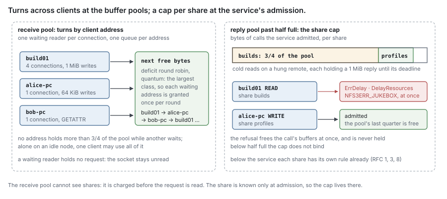

# RFC 24 — resources and concurrency

**Status:** draft. [§11](#11.%20Open%20questions) lists what is known to be undecided.
**Audience:** anyone adding a buffer, a cache, a queue, a goroutine or a worker
to any component, and anyone sizing a node or reading why it refused work.

Conventions, RFC 2119 keywords and test tiers are set once in the
[index](rfc-index.md). This document specifies behaviour, not the current code;
[Appendix B](#Appendix%20B%20%E2%80%94%20where%20the%20current%20code%20differs) says where the code differs.

---

## Start here

*Explanatory. The rules are in §1 onward; where this section and a rule differ, the rule wins.*

### In plain words

A DittoFS node is one process with a fixed amount of memory, a fixed number of
cores and a fixed number of open files. Every component wants some of each: the
adapters hold request and reply buffers, the filesystem service holds requests
it is waiting on, open state holds opens and locks, the metadata store keeps a
cache, the journal keeps an index of what it holds, and the syncer keeps chunks
in flight to and from the remote tier. Each of those RFCs already bounds its
own part. None of them can say whether the parts add up to less than the
machine.

This RFC is the arithmetic. It takes **one memory limit** for the process,
divides it into named **pools**, gives each pool a fraction, a floor and a rule
for what happens when it is full, and fixes where in a request's path each pool
is charged. It does the same, more briefly, for CPU, goroutines and file
descriptors. And it states the rule that makes overload survivable: **no queue
anywhere is unbounded**, so a node that has more work than it can do slows its
clients down or tells them to retry, and never grows until the kernel kills it.

**The problem, with one example.** P1 runs in a container with an 8 GiB memory
limit, serving `builds` over NFS and `profiles` over SMB. On Monday morning the
remote store behind `builds` slows to a crawl, and build01 starts a large build
that reads hundreds of cold files at once.

Each component is within its own bounds. The NFS adapter allows 64 requests per
session, and build01 has four sessions; each cold read waits up to the request
deadline for its chunks, holding a 1 MiB reply buffer. The syncer's fetch pool
is full, so further fetches wait in its bounded queues. Meanwhile 40 users sign
in to their profile disks over SMB, each with 512 credits, and their writes
arrive while the per-share journal limit is near and writes are paced. The
metadata store sized its cache from the machine's memory, and so did the
journal's index; neither knows the other did.

Without a node budget, the sum of those bounds is larger than 8 GiB. The heap
grows, the garbage collector cannot keep up, and the container is killed. Every
share on the node is gone, and on restart every client reconnects at once into
the same state.


**The words you need.**

- **process memory limit** (*L*) — the memory this process may use, learned
  once at start (§2.1). Every share below is a fraction of it.
- **pool** — a named part of *L* that one kind of memory is charged to (§2.3).
  A pool is a counter of bytes reserved, not an allocator.
- **reservation** — bytes charged to a pool **before** the memory is used, and
  released when it is freed (§2.5). Memory nobody reserved is the unpooled
  quarter's.
- **ceiling** — a pool's fraction of *L*. **floor** — a size a pool keeps
  however small *L* is (§2.4).
- **client key** — what fairness counts as one client: the connection's remote
  address (§4.1).
- **backpressure** — slowing the producer instead of buffering its output: not
  reading a socket, pacing a write, making a transfer wait for a worker (§5).

**What this RFC promises.**

- The memory the pools may hold adds up to at most three quarters of *L* —
  and, during grace only, one sixteenth more for reclaims (§4.6) — whatever the
  number of shares, clients, connections or journals.
- Every pool says what happens at its ceiling, and it is one of four things: a
  reader stops reading, a call waits within its deadline, a call is refused
  retry-later with a named cause, or a cache evicts.
- No client, connection or share can be granted more than three quarters of a
  request pool while another is waiting for it, and the next free buffer goes round in
  turns.
- No queue is unbounded, and the [table in §5.1](#5.1%20No%20queue%20is%20unbounded)
  names every one with its bound.
- Each bound another RFC already states — the journal's index, the syncer's
  pools — is composed here, not redefined: this RFC sets its
  fraction and checks at start that the configuration fits.

**How the rest is organised.** §1 gives the purpose and non-goals. §2 is the
budget: the limit, the pools, floors and reservations. §3 is request and reply
buffers, the largest pool on the request path. §4 is admission and fairness —
across clients, shares, held requests, connections and open state. §5 is
backpressure: the queue inventory and the chain from the socket to the remote
tier. §6 is goroutines, CPU and file descriptors. §7 composes the storage RFCs'
bounds into the budget. §8 says what the reference box measures to set the
defaults. §9 is the invariants and the test of each, §10 the metrics; §11
lists open questions. Appendix A is prior art, Appendix B where the current code differs.

### Scenarios

**A share's remote store hangs while another share is busy.** P1, 8 GiB, the
remote behind `builds` stops answering; `profiles` is on a different store.

1. build01's cold reads each take a 1 MiB reply reservation (§3.3) and wait in
   the fetcher's queue for `builds`'s flow
   ([RFC 3 §2.9](rfc-3-syncer.md#2.9%20Workers%20are%20shared%20fairly%20across%20flows)).
2. The reply pool, 512 MiB, passes half full. From then on the share cap binds:
   once `builds`'s calls hold 384 MiB of it, the service refuses the next
   `builds` call with `ErrDelay` naming `DelayResources` (§4.2), before it
   takes any more memory. build01 is answered `NFS3ERR_JUKEBOX` and retries
   seconds later.
3. Each waiting read ends at its deadline
   ([RFC 0 §10.3](rfc-0-data-lifecycle.md#10.3%20Every%20wait%20on%20a%20request%20ends%20at%20a%20deadline)),
   releasing its reservation; build01's retries take them again, up to the cap.
4. alice-pc's reads and writes on `profiles` find 128 MiB of the reply pool and
   all of the receive pool's turns they are owed.

Outcome: the hung store costs `builds` its throughput and nothing else.

**P1 starts in a container.** The container's memory limit is 8 GiB; no
runtime soft limit is set in the environment.

1. P1 reads the limit from its control group: 8 GiB, source `container`
   (§2.1).
2. It sets the runtime's soft memory limit to 7.5 GiB, fifteen sixteenths of
   it, so the collector works harder as the heap nears the limit rather than
   letting it pass.
3. It derives every pool (§2.3) and the defaults that follow from them: the
   journal's index bound, 1 GiB at 51 bytes an entry for its one journal, about
   19 million entries with their excess (§7.1); the syncer's worker counts, reduced from 128 so
   both halves and their staging fit 1 GiB (§7.2); the connection limit (§4.4).
4. It logs each pool, its fraction and its source, and exports them as gauges
   (§10).

Outcome: an operator reads in one place what the node will hold, and why.

**One client opens thousands of connections.** A misconfigured load generator
on one address opens connections to P1 in a loop.

1. Each connection is charged its fixed cost to the connection-state pool at
   accept (§4.4).
2. Once the address holds a quarter of the connection limit, its further
   connections are closed at accept, before any byte is read.
3. Every other address can still connect: the limit's other three quarters, and
   the pool behind them, are not this address's to take.

Outcome: one address cannot lock other clients out of the node.

**A share is frozen while SMB clients keep writing.** `profiles` is frozen for
a move for 20 s, and the SMB adapter holds each write pending
([RFC 20 §4.6](rfc-20-adapters.md#4.6%20Held%20requests)).

1. Each SMB write the adapter holds keeps its receive reservation while its
   connection is within its floor of 256 requests and 32 MiB
   ([RFC 22 §3.3](rfc-22-smb.md#3.3%20Sizes%20and%20credits)).
2. Past the floor, the held write's whole charge is reserved from the hold pool,
   a sixteenth of *L*, and only then released from the receive pool (§4.3); the
   receive pool gets it back for other clients.
3. With the hold pool full too, the adapter answers a further past-floor write
   `STATUS_INSUFFICIENT_RESOURCES` at once, as RFC 20 §4.6 and RFC 22 state.

Outcome: a freeze holds what the floors and the hold pool allow, and the rest of
the node keeps reading.

---

## 1. Purpose

Every component RFC bounds its own memory. The syncer bounds its workers
([RFC 3 §2.2](rfc-3-syncer.md#2.2%20The%20pool%20size%20is%20a%20memory%20bound)),
the journal its index
([RFC 1 §4.2](rfc-1-journal.md#4.2%20The%20index%20is%20bounded%20by%20extent%20count%2C%20not%20by%20bytes)),
the adapters their held requests
([RFC 20 §4.6](rfc-20-adapters.md#4.6%20Held%20requests)) and their
flow control ([RFC 20 §6.3](rfc-20-adapters.md#6.3%20Flow%20control%20is%20the%20protocol%27s%20own)).
A bound that is correct for its component says nothing about the process:
eight correct bounds, each sized from the machine's whole memory, add up to
eight machines. This RFC owns the sum. It fixes one limit, divides it, says
where each part is charged, and says what each refusal looks like on the wire,
so that overload has a specified outcome instead of an out-of-memory kill.

### 1.1 Non-goals

This RFC **MUST NOT** be read as specifying:

- the internals of a bound another RFC owns — the index's entry rules, the
  syncer's scheduling, the adapters' counting of held requests — only their
  fraction of the budget and how their defaults derive from it;
- local disk space — the journal's capacity and its pacing are
  [RFC 1 §6](rfc-1-journal.md#6.%20Capacity)'s and
  [RFC 8 §10.2](rfc-8-engine.md#10.2%20A%20capacity%20refusal%20comes%20back%20here)'s;
  disk appears here only where it holds back memory;
- quotas, which are logical limits on what users store
  ([RFC 17 §5.6](rfc-17-vfs.md#5.6%20Quota)), not resources of a node;
- per-share or per-user quality-of-service weights; all clients and shares
  weigh the same (§11);
- the protocols' own flow-control numbers — slots, credits, transfer sizes —
  which are [RFC 21](rfc-21-nfs.md)'s and [RFC 22](rfc-22-smb.md)'s; this RFC
  states what they cost.

## 2. The node memory budget

### 2.1 One limit, learned once

A node has one **process memory limit**, *L*. It is a bootstrap fact
([RFC 13 §2.2](rfc-13-configuration.md#2.2%20A%20host%20holds%20only%20its%20bootstrap)),
read once at start: the **lowest** of those that are set —

1. the soft memory limit the runtime is told by the environment;
2. the container's limit: the lowest memory limit on the process's control-group
   path, taking the lower of the throttling limit and the hard limit where both
   are set, and treating "unlimited" as unset;
3. the host's physical memory.

The source recorded is the one that was lowest. The node **MUST** record it,
and **MUST** expose *L* and its source (§10). A limit changed while the node runs takes effect at the next
start; the pools are never resized while serving.

**The runtime is told.** Whichever source supplied *L*, the node **MUST** set
the runtime's soft memory limit to **fifteen sixteenths of *L*** before it
serves, so the collector works harder as the heap approaches
*L* rather than letting a burst of garbage pass it, and the sixteenth above it
is left for memory the runtime does not manage. The node **MUST NOT** change
the collector's growth target from its default.

> ponytail: the runtime limit is a fixed fifteen sixteenths of *L*, not tuned.
> Move it when §8's M4 shows resident memory well under *L* at the soak's peak,
> or collector CPU high while the heap sits at the limit.

> decision: *L* is read once, not tracked. A pool that shrinks while serving
> must take back memory it has handed out, which means evicting live requests,
> and a resize that only ever grows is no help when a container is resized
> down. Restarting to resize costs a drain. Revisit if an orchestrator is shown
> resizing a running node's memory as routine.

> decision: on a host shared with other processes, the host's memory is the
> wrong limit and the node cannot tell. The operator sets the runtime soft
> limit, which is source 1. The node does not guess a fraction of the host for
> its neighbours.

### 2.2 What is outside the budget

*L* is the process's own memory. Three things the kernel charges to the
process, or to its container, are not pooled:

- **the page cache** of journal and store files: the kernel reclaims clean
  pages before it kills a process, and the journal's syncs bound the dirty ones
  ([RFC 1 §5.2](rfc-1-journal.md#5.2%20Syncing));
- **goroutine stacks beyond the flat part §3.1 charges, the runtime's own
  structures and the collector's headroom** — the garbage that lives between
  two collections;
- **code, and memory-mapped files** whose pages the kernel can drop.

Two bounded consumers are not pooled either, because they are fixed by count:

- **the event rings** of [RFC 25 §4.3](rfc-25-observability.md#4.3%20From%20the%20emit%20point%20to%20the%20spool):
  16,384 `access`, 4,096 `quota` and 4,096 `logon` entries of at most 1 KiB
  each, allocated at start — at most 24 MiB per node, whatever the load;
- **management-API calls**, at most 64 at once
  ([RFC 23 §4.3](rfc-23-control-plane.md#4.3%20Writes)), which draw on none of
  the pools.

The unpooled quarter of *L* (§2.3) is the margin for all of these, and, during
grace only, for the open-state pool's reclaim allowance (§4.6), at most one more
sixteenth. It is not reserved by anyone and nothing waits for it.

### 2.3 The pools

| Pool | Holds | Fraction of *L* | Floor | At its ceiling |
| --- | --- | --- | --- | --- |
| **receive** | request buffers from frame until the call returns, writes' payloads included (§3.2) | 1/16 | 16 MiB | the connection's reader waits; the socket is not read, and TCP pushes back on the client |
| **reply** | reply buffers from before the call until the writer has sent them (§3.3) | 1/16 | 16 MiB | the call waits, within its deadline; at the deadline `ErrDelay` with `DelayResources` |
| **hold** | held requests' bytes past their connection's floor ([RFC 20 §4.6](rfc-20-adapters.md#4.6%20Held%20requests)) | 1/16 | none | the adapter answers the request at once, holding nothing: `STATUS_INSUFFICIENT_RESOURCES` over SMB (§4.3) |
| **connection state** | each connection's fixed cost; sessions and their reply caches; security contexts (§4.4, §4.5) | 1/16 | 4 MiB | new connections closed at accept; a new session refused retry-later or granted fewer slots |
| **open state** | opens, byte-range locks, lock waiters, caching grants, quota reservations; **(cluster)** the routed-request dedup table (§4.6) | 1/16 | 4 MiB | new state refused with `ErrDelay` and `DelayResources`; no caching grant offered; never a close or unlock; a reclaim only past its allowance |
| **metadata store** | the store's in-process memory: caches, write buffers, compaction (§7.3) | 3/16 | 64 MiB | the store evicts; it never refuses |
| **journal index** | the placement index of every journal ([RFC 1 §4.2](rfc-1-journal.md#4.2%20The%20index%20is%20bounded%20by%20extent%20count%2C%20not%20by%20bytes)) (§7.1) | 1/8 | none | the index's own refusal ([RFC 1 §4.2](rfc-1-journal.md#4.2%20The%20index%20is%20bounded%20by%20extent%20count%2C%20not%20by%20bytes)), answered retry-later |
| **transfers** | both syncer halves and the staging budget ([RFC 3 §2.2](rfc-3-syncer.md#2.2%20The%20pool%20size%20is%20a%20memory%20bound)) (§7.2) | 1/8 | eight workers per half, and the staging they imply | the syncer's own wait or refusal ([RFC 3 §2.3](rfc-3-syncer.md#2.3%20Backpressure%20propagates%3B%20it%20does%20not%20buffer)) |
| *unpooled* | §2.2 | 1/4 | — | — |

The "at its ceiling" column follows one rule: **a link waits when what it would
hold is not yet held, and refuses when it is.** A reader that has not read the
request waits, holding nothing; a call that already holds its buffers and would
hold more refuses, freeing them. A wait is chosen where the client pays only
time, a refusal where waiting would keep memory another client needs.

Five pools are counted at run time — receive, reply, hold, connection state,
open state — and are `Budget`s (§2.5). The other three are **sizes**: the
composition root hands each its figure at construction, and its owner enforces
its own bound (§7). Nothing reserves from them.

The fractions are **fixed**, not settings. On a 64 GiB node they are 4 GiB
each for the five small pools, 12 GiB for the metadata store, 8 GiB each for
the index and transfers, and 16 GiB unpooled; on an 8 GiB container, 512 MiB
each, 1.5 GiB, 1 GiB each and 2 GiB unpooled.

Every node holds all eight pools, because every node composes everything they
hold ([RFC 15 §2.1](rfc-15-topology.md#2.1%20One%20node%20type)).

> ponytail: fixed fractions, the same on every node. The metadata store's
> fraction is the guess most likely wrong — a namespace-heavy workload wants more, a
> streaming one less. Move fractions by measurement when §8's M3 shows the store's
> hit rate limiting a workload while another pool sits below half its ceiling;
> make a fraction a setting only when two named workloads want different values
> on the same hardware.

> decision: the hold pool is a sixteenth of *L*, derived, not a setting; a
> test sizes it by setting the process limit, 128 MiB giving 8 MiB. Sized from
> [RFC 22 §3.3](rfc-22-smb.md#3.3%20Sizes%20and%20credits)'s freeze case, 40
> users at queue depth 8 of 1 MiB writes, 320 MiB on a 64 GiB node's 4 GiB; what
> each held request is charged is §4.3's. Revisit the fraction when §8's measurements
> show freezes or stalls refusing writes with the pool full while other pools
> sit below half their ceilings.

> ponytail: the hold pool is first come, first served past the floors, so one
> connection's burst can take all of it and leave another refused past its
> floor while that one holds gigabytes. Cap each connection's share of the pool
> when `adapter_hold_refusals_total` counts refusals on connections other than
> the one holding most of it.

### 2.4 Floors

A pool's ceiling is its fraction of *L* or its floor, whichever is larger. Floors
exist so that a small *L* still serves: the receive and reply floors are two of
the largest request any adapter accepts, SMB's 8 MiB
([RFC 22 §3.3](rfc-22-smb.md#3.3%20Sizes%20and%20credits)), so one such request
always fits with another beside it.

**The budget is checked on the ceilings, not on the floors.** The fractions
already sum to three quarters of *L*, so any floor that binds takes the pools
past it, however small the floors' own sum. At start the node **MUST** compute
the **ceilings' sum** — every pool's larger of its fraction of *L* and its floor —
and compare it, not the floors' sum, with three quarters of *L*.

**A limit below the floors does not stop the node.** When the ceilings' sum
exceeds three quarters of *L* — below about 880 MiB, where the transfers floor,
about 110 MiB at §7.2's figures, binds first, and the metadata store's below
about 340 MiB — the node starts, runs each pool at its ceiling, and raises the
health condition `memory_limit_below_floors` naming *L* and the ceilings' sum.
It may then exceed *L*.

> decision: a limit below the floors starts the node anyway, raising
> `memory_limit_below_floors`, because refusing would make every small test
> container unstartable, and the floors are what one request of each class
> needs. The node may then pass *L*. Refuse to start instead, below a fixed
> minimum, if a production deployment is shown running degraded with the
> condition raised.

### 2.5 Memory is reserved before it is used

A pool is a counter, not an allocator. Each consumer of a counted pool **MUST**
reserve the bytes it is about to hold from its pool **before** it holds them,
and release them when it frees them:

```go
package resources // internal/resources

// Budget is one counted pool (§2.3): waits or refuses at its ceiling, as the pool's row says.
type Budget struct{ /* name, ceiling, waits bool, reserved, per-key DRR queues */ }
func NewBudget(name string, ceiling int64, waits bool) *Budget
// Reserve charges n bytes for key. A waiting budget waits within ctx; a refusing one refuses at once.
func (b *Budget) Reserve(ctx context.Context, key netip.Addr, n int64) (Reservation, error)
// Reclaim charges n past the ceiling, refusing only past twice it; a durable one never refuses (§4.6).
func (b *Budget) Reclaim(n int64, durable bool) (Reservation, error)
func (b *Budget) Reserved() int64 // for gauges and the leak check (§2.7)

// Reservation is a value; Release is idempotent and returns n to key's count too.
type Reservation struct{ b *Budget; key netip.Addr; n int64 }
func (r *Reservation) Release()

// Pools is what an adapter is handed (RFC 20 §4.7): the four budgets on the request path.
type Pools struct{ Receive, Reply, Conn, Hold *Budget }
```

- Whether a budget waits or refuses is fixed by its pool's row (§2.3), so one
  `Reserve` serves both. A refusing budget ignores `key`; its callers pass the
  zero `netip.Addr`.
- `Reservation` is a value, so taking one allocates nothing. It keeps its
  key, so a release lowers that key's count, which §4.1's cap reads.
- `Reclaim` is the open-state table's, for a reclaim during grace (§4.6): it
  never waits, refuses a volatile reclaim only past the reclaim allowance, and
  never refuses a durable one. Every other create calls `Reserve`, which refuses
  at the ceiling and so also while restored state holds the pool above it.
- A reservation is in bytes of memory held, rounded up to the buffer class
  (§3.1) where a pooled buffer backs it.
- **Charged, not measured.** No pool reads the heap to decide. A charge is
  exact for buffers, and a fixed per-kind cost for state (§4.4, §4.6), which
  §8 measures.
- Every reservation **MUST** be released on every path, a cancelled context and
  a panic included. A pool's reserved bytes are exported (§10), and a pool that
  reads above zero on an idle node is a leak.

> ponytail: one mutex per budget over the count and its turns. Take the fast
> path as one atomic step with no waiter when B1 shows the lock limiting
> `GETATTR` rate at 64 cores.

### 2.6 Reservations are taken in one order

Along one request's path, reservations are taken in this order and released in
the reverse:

1. **connection state**, at accept, for the connection's life (§4.4);
2. the connection's own **flow control** — slots, credits, the fixed cap —
   checked before the next request is read
   ([RFC 20 §6.3](rfc-20-adapters.md#6.3%20Flow%20control%20is%20the%20protocol%27s%20own));
3. **receive**, at frame, before the request's body is read (§3.2);
4. **reply**, once the arguments are decoded and the reply's bound is known,
   before the service is called (§3.3);
5. the **share cap**, at the service's admission (§4.2);
6. **open state**, when the call creates state (§4.6);
7. below the service: the journal's capacity and its index, then the syncer's
   transfers, in the engine's own order.

Waits are entered only at the connection's flow control (step 2), the receive
pool, the reply pool and the engine's waits (step 7). Every other pool refuses
at once, so it adds no edge to a wait graph, and **MAY** be charged at any
point: connection state at a session, the hold pool, the share cap and open
state. A wait **MUST NOT** be entered while holding a reservation later in this
order. Each wait ends:

- flow control and receive when calls return or a held call's hold bound ends;
- reply when the writer sends or the write deadline closes the connection;
- the engine's waits at the call's deadline.

So no wait is unbounded and none forms a cycle.

### 2.7 Wiring and lifecycle

The node
([RFC 23 §2.2](rfc-23-control-plane.md#2.2%20Start%20and%20stop)) builds the
budget in two phases, inside the start order
[RFC 23 §2.2](rfc-23-control-plane.md#2.2%20Start%20and%20stop) owns:

- **(a) before that order opens the metadata store**, because the store's size
  is one of the figures: learn *L* (§2.1), set the runtime's soft limit, and
  compute the fixed fractions, which need only *L*;
- **(b) once the settings are read**: check `upload_workers`, `fetch_workers`,
  `ExtentLimit` and `connection_limit` against their figures (§4.4, §7), and
  build the budgets.

```go
lim, err := resources.Detect()                     // (a) §2.1; refuses an unreadable control group
debug.SetMemoryLimit(lim.Bytes * 15 / 16)          // (a) before any pool fills
sp := resources.SplitFor(lim)                      // (a) §2.3, §2.4: the fractions and floors
st, _ := metadata.Open(ctx, kv, metadata.Options{CacheBytes: sp.Meta /* … */}) // a size, §7.3
err = sp.Check(settings)                           // (b) §4.4, §7: refuses what does not fit
pools := &resources.Pools{
	Receive: resources.NewBudget("receive", sp.Receive, true),
	Reply:   resources.NewBudget("reply", sp.Reply, true),
	Conn:    resources.NewBudget("connection", sp.Conn, false),
	Hold:    resources.NewBudget("hold", sp.Hold, false),
}
ost := openstate.New(openstate.Deps{Budget: resources.NewBudget("open", sp.Open, false) /* … */})
svc, _ := vfs.New(vfs.Deps{Shares: resources.NewShareCap(pools.Receive, pools.Reply) /* … */})
// every adapter is handed pools as core.Deps.Pools (RFC 20 §3.4); the journals take
// sp.Index and the syncer sp.Transfers as sizes (§7.1, §7.2); CPU tokens are a
// semaphore.Weighted over sp.Tokens (§6.2)
```

| Component | Built by | Owned by | Lifecycle |
| --- | --- | --- | --- |
| `Limit` | the root, first | the root | read once; never changes |
| `Split` | the root, from `Limit` | the root, a value | recomputed only at the next start |
| `Pools`: receive, reply, connection state, hold | the root | shared by every adapter's `core` | none; checked at zero after the adapters stop |
| open-state `Budget` | the root | the open-state table; **(cluster)** also the dedup table | as above |
| `ShareCap` | the root, over receive and reply | the service's admission, in `*vfs.Server` | entries dropped at zero |
| CPU tokens | the root, from `Split` | shared by background workers | none |
| sizes: metadata store, index, transfers | the root, from `Split` | the store, each journal, the syncer | handed at construction; the owner sizes itself |

- **A consumer takes only the budgets it charges**, as fields of its own
  `Deps`, never the whole set: `core.Deps` takes `Pools`, `openstate.Deps` the
  open-state budget, `vfs.Deps` the share cap; the store, the journals and the
  syncer take a size, not a budget.
- **Nothing here has a lifecycle.** `Detect`, `SplitFor` and `NewBudget` start
  no goroutine and open nothing; a release grants the next waiter on the
  releasing goroutine. There is no `Start` or `Close`. After the adapters and
  the service have stopped, the root logs any budget whose `Reserved()` is not
  zero, and the test harness fails on it.
- **Shared budgets are the root's.** The receive, reply, connection-state and
  hold budgets are shared by every adapter; no adapter may replace or close
  one, and an adapter restarted by the node gets the same ones back.
- **Reconfiguration.** *L* and the split change only at a restart (§2.1). A
  live setting a figure bounds — `connection_limit` — is checked against the
  split when the node applies it, and refused there as at start.
- **Failure halfway.** Phase (a) fails before anything is opened, and phase (b)
  before anything serves, so a start refused here closes only what RFC 23's
  order already opened.

| Failure | Behaviour |
| --- | --- |
| a control-group file exists but cannot be parsed | start refused, naming the file |
| a budget not at zero at close | logged at error with the pool and bytes; tests fail on it |
| a release past zero | panics in tests; clamps to zero and is counted in production |

### 2.8 Package layout

```text
internal/resources/
  limit.go        Limit, Detect: the runtime limit, the control group, the host (§2.1)
  split.go        Split, SplitFor, Check: fractions, floors, the ceilings' sum, settings (§2.3, §2.4, §7)
  budget.go       Budget, Reservation, Pools: counted pools and their turns (§2.5, §4.1)
  sharecap.go     ShareCap, WithCharge, ChargeOf (§4.2)
  fd.go           the open-file split and fd_limit_low (§6.3)
  metrics.go      memory_*, cpu_* (§10)
  budget_test.go  the turns property test and B1
```

- **One package, no subpackages, a leaf.** It imports only the standard
  library and the metrics registry; its consumers import it, never the reverse.

## 3. Request and reply buffers

### 3.1 Buffer classes

Receive and reply buffers come in a few classes, as
[RFC 20 §6.6](rfc-20-adapters.md#6.6%20Throughput%20and%20latency) has them, each
its size plus the protocol's headers:

| Class | Size | Drawn for |
| --- | --- | --- |
| small | 4 KiB | headers with attributes; most metadata operations |
| directory | 64 KiB | a directory page (`dtpref`, [RFC 21 §2.3](rfc-21-nfs.md#2.3%20Transfer%20sizes)), large attribute and security replies, a one-credit SMB transfer |
| transfer | 1 MiB | `READ` and `WRITE` up to 1 MiB: NFS's largest ([RFC 21 §2.3](rfc-21-nfs.md#2.3%20Transfer%20sizes)), and the size SMB clients commonly use |
| large | 8 MiB | SMB `READ` and `WRITE` past 1 MiB, up to SMB's largest ([RFC 22 §3.3](rfc-22-smb.md#3.3%20Sizes%20and%20credits)) |

A request draws the smallest class that holds it. A buffer larger than the
largest class its protocol uses is not pooled, and is charged its exact size.

Each request is charged its buffer's class size plus a fixed **per-request
overhead** for what the request holds besides its buffer — its goroutine's
stack, its decoded arguments, its context. The overhead is proposed at 8 KiB,
and settled by §8's M1. So a node's requests in flight are bounded by the
receive pool divided by the smallest charge: on an 8 GiB node, 512 MiB over
12 KiB, about 43,000.

> ponytail: stacks are charged a flat 8 KiB per request inside its overhead,
> not measured, so a request whose stack grows past it is under-charged. Charge
> the measured p99 stack when M1 shows stacks past an eighth of the unpooled
> quarter at the receive pool's ceiling.

### 3.2 Receive: charged at frame, and the reader waits

The frame stage
([RFC 20 §4.1](rfc-20-adapters.md#4.1%20One%20pipeline)) learns the record's
length from its header — the RPC record mark, the NetBIOS session header —
before it reads the body. The reader **MUST** reserve the record's charge from
the receive pool before it reads the body, and **MUST** refuse a length past the
protocol's cap before reserving anything
([RFC 20 §5.2](rfc-20-adapters.md#5.2%20Decoding%20is%20bounded)).

**A record in several fragments is reserved at its cap.** An RPC record mark
gives one fragment's length, not the record's, and a record may span several
fragments. When the first fragment's header does not mark it the last, the
reader **MUST** reserve the class that holds the protocol's largest request
before it reads the first fragment, and **MUST NOT** grow that reservation
later; a fragment that would take the record's total past that cap, or a
record past a fixed number of fragments, is a framing error and closes the
connection ([RFC 20 §5.2](rfc-20-adapters.md#5.2%20Decoding%20is%20bounded)).
The remaining fragments **MUST** arrive within the frame deadline
([RFC 20 §6.4](rfc-20-adapters.md#6.4%20Deadlines%20and%20limits)), counted
from the first fragment's header; a record still partial then closes the
connection and releases its reservation. So no reader waits for receive bytes
while holding part of a record. A NetBIOS session header gives the whole
message's length, so SMB is always reserved exactly.

> ponytail: a multi-fragment record is charged its protocol's largest class
> however small it turns out — for NFS, one transfer-class buffer. Common NFS
> clients send each record as one fragment. Reserve incrementally, with a
> cumulative cap, when §8's M1 shows multi-fragment records a measurable share
> of the receive pool on a named client.

**At the receive ceiling the reader waits; it does not refuse.** A reader that
cannot reserve stops reading its connection. The client's data stays in the
socket, TCP's window closes, and the client slows. No request is half-read and
no reply is owed for it. Waiting readers are granted in turns (§4.1).

Nothing on the node waits on a waiting reader: it holds no reservation beyond
its connection's, no worker and no request. Its wait ends when the requests
holding the pool finish, and each of those ends at its deadline, or a held one
at its hold bound
([RFC 0 §10.3](rfc-0-data-lifecycle.md#10.3%20Every%20wait%20on%20a%20request%20ends%20at%20a%20deadline)),
so the wait is bounded by the longest deadline or hold bound in flight, though
no deadline of its own runs: the request it would read has not started.

> decision: memory at the receive ceiling is backpressure, not an error. An
> answer the client must retry costs a read of the whole request it then
> discards — up to 8 MiB of a link's time — and an NFSv3 client pauses
> seconds after `NFS3ERR_JUKEBOX`; a closed window costs the client only the
> wait. This is what a kernel NFS server does when it has no thread or reply
> space: it leaves the transport unread. Refuse instead only if a client is
> shown to time out a connection whose window stays closed within the request
> deadline.

A request's receive reservation is released with its buffer's last reference
([RFC 20 §6.8](rfc-20-adapters.md#6.8%20Buffer%20pools%2C%20in%20code)) — the
request, the service it was lent to, and the writer of a small reply it carries
each hold one — except a held request's, which follows §4.3.

### 3.3 Reply: charged before the call, and the call waits

The reply's size is known before the call runs: it is the operation's **reply
bound**, a column of the operation table
([RFC 20 §4.2](rfc-20-adapters.md#4.2%20The%20operation%20table)) — for a `READ`
the count asked plus its header, for a compound the bound the reply budget
already computes. Once its arguments are decoded, a request **MUST** reserve its
reply bound from the reply pool before the service is called. The service and
the engine fill that buffer and add no copy of their own
([RFC 17 §4.5](rfc-17-vfs.md#4.5%20No%20copies%20on%20the%20data%20path)).

A reply that fits the small class needs no wait: it is charged with the receive
reservation, as part of the request's overhead, and that reservation is then
held until the writer has sent or discarded the reply (§3.2), so a small reply
queued to a client that does not read stays charged. A larger reply waits for its
reservation, in the same turns as receive (§4.1), and the wait ends at the
call's deadline with `ErrDelay` naming `DelayResources`.

The reservation is released when the writer has sent the reply, or discarded it
with its connection
([RFC 20 §6.2](rfc-20-adapters.md#6.2%20The%20writer)). A reply queued at a
writer whose client does not read holds its reservation until the write
deadline closes the connection
([RFC 20 §6.4](rfc-20-adapters.md#6.4%20Deadlines%20and%20limits)); that is
the slowest way a reply is freed, and it needs no other reservation.

Receive and reply are two pools rather than one so that a flood of large writes
cannot leave no room for the reads that would let clients finish, and so that a
reply's wait never waits on a receive reservation (§2.6).

### 3.4 The per-connection cap for protocols without flow control

The per-connection cap where a protocol has no flow control, and on which
connections it applies, is
[RFC 20 §6.3](rfc-20-adapters.md#6.3%20Flow%20control%20is%20the%20protocol%27s%20own)'s:
**64**, fixed. A connection at its cap is not read.

The cap bounds one connection; the receive and reply pools bound the node. At
the transfer class, 64 requests is about 64 MiB per connection, so on an
8 GiB node eight connections at their caps fill the receive pool, and the
turns of §4.1 decide who goes next. RFC 20 §6.3's ponytail names the cap's
ceiling; §8's M7 settles it.

### 3.5 What a transfer size costs

A transfer is charged its whole class, whatever bytes it actually moves, so
[RFC 21 §2.3](rfc-21-nfs.md#2.3%20Transfer%20sizes)'s 1 MiB NFS transfer and
[RFC 22 §3.3](rfc-22-smb.md#3.3%20Sizes%20and%20credits)'s 8 MiB SMB transfer
are what bound how many large requests a node runs:

| Workload on an 8 GiB node | Charge per request | In flight at the ceiling |
| --- | --- | --- |
| NFS `WRITE` of 1 MiB | receive: transfer class and overhead, about 1 MiB | about 500 node-wide |
| NFS `READ` of 1 MiB | reply: transfer class; receive: small | about 500 node-wide |
| SMB `WRITE` of 8 MiB | receive: large class, about 8 MiB | about 64 node-wide |
| SMB `WRITE` of 64 KiB, one credit | receive: directory class and overhead, about 72 KiB | about 7,000 node-wide |
| `GETATTR`, `QUERY_INFO` | small class and overhead, about 12 KiB | about 43,000 node-wide |

Raising a transfer size raises every large request's charge with it, so fewer
fit. That is the cost [RFC 21 §2.3](rfc-21-nfs.md#2.3%20Transfer%20sizes)'s
ponytail names, and the reason a transfer size is a constant of the protocol's
RFC and not a share setting.

> ponytail: a request is charged its whole class, not its bytes, so a 1 MiB
> class buffer charged for a 72 KiB write wastes the difference. Classes keep
> the pool's arithmetic and the buffer allocator the same thing. Add a class
> between 64 KiB and 1 MiB when §8's M1 shows the receive pool filling with
> partly used transfer buffers on a mixed workload.

## 4. Admission and fairness

### 4.1 Across clients: turns at the buffer pools

The receive and reply pools are shared by every client. Whoever waits gets the
next free bytes by **deficit round robin** over **client keys**, the design
[RFC 3 §2.9](rfc-3-syncer.md#2.9%20Workers%20are%20shared%20fairly%20across%20flows)
already uses for transfers:

- **One waiter per connection, one queue per client key.** A connection's reader
  waits for at most one receive reservation at a time, and a request for at most
  one reply reservation, so a key's queue is bounded by its connections and
  their flow-control bounds.
- **Turns in bytes.** When bytes free, the pool visits the next key with a
  waiter, adds a quantum to its deficit, and grants from the head of its queue
  while the head's charge fits. The quantum is the largest class any adapter
  uses, so every waiting key is granted at least once per round.
- **No key holds more than three quarters of a pool while another key waits
  for it.** A key at that cap is skipped until it releases; with no other key
  waiting the cap does not bind, so one busy client on an idle node uses the
  whole pool. A key already above the cap when another arrives is not
  preempted; it is granted nothing more until it falls below, which its
  requests' deadlines bound.
- **The client key is the connection's remote address.** NFS clients open
  several connections, an NFSv4.1 client trunks sessions, an SMB client opens
  channels; counting by connection would give each connection its own turn, and
  a client with sixteen connections sixteen turns.

> decision: clients are told apart by address, not by identity. The receive
> pool is charged before anything authenticates the request, and an address is
> all the frame stage knows. A NAT or a multi-user host behind one address is
> one client to the turns; its users compete within its share. Key by the
> session's client identity at the reply pool, where it is known, if a
> multi-user host is shown starved by its own address's cap while the node has
> room.

### 4.2 Across shares: the share cap at admission

A share that cannot finish its calls — its remote hung, its metadata stalled —
holds buffers for as long as their deadlines allow, and the turns of §4.1 do not
see shares. The service therefore counts, per share, the receive and reply bytes
of the calls it has admitted to that share, and at admission
([RFC 17 §4.9](rfc-17-vfs.md#4.9%20Shares%2C%20mounts%20and%20trees)):

- a call whose admission would take its share past **three quarters** of the
  receive pool or of the reply pool — the share's count **plus this call's own
  receive and reply reservations** — **MUST** be refused with `ErrDelay` naming
  `DelayResources`, while that pool is more than half full and another share
  holds bytes of it;
- below half full, or with no other share holding bytes of that pool, the cap
  does not bind, so one share on an otherwise idle node uses the whole pool. A
  share already past the cap when another share's call is admitted is not
  preempted; it is admitted nothing more until it falls below, which its calls'
  deadlines bound, as for a key (§4.1);
- the check and the addition of the call's bytes to the share's count **MUST**
  be one atomic step, so that concurrent admissions to one share cannot each
  pass against the same total;
- the refusal frees the call's buffers at once, and is counted with the share in
  a log line, at most once a minute per share (§10).

The cap is a refusal, not a wait, because the call already holds its receive
reservation: waiting would keep it, and the memory is what the cap protects.

> decision: the cap binds only beside another share, because refusing a share
> that is alone frees memory nobody is waiting for, and an SMB `WRITE` refused
> `STATUS_INSUFFICIENT_RESOURCES` reaches a profile disk's guest as failed I/O,
> not a retry. Beside another active share a profile write past the cap is
> still refused that way. Hold such a write within its connection's floor
> (§4.3) instead if `memory_pool_refusals_total{reason="share_cap"}` is seen
> rising on a share carrying profile disks.

> decision: the share is known only at admission, after the reply wait, so a
> call may wait for reply bytes to its deadline and then be refused by its
> share's cap. It holds only a small-class receive charge meanwhile. Check the
> cap before the reply wait if the adapter is ever told a call's share before
> calling the service.

**How the service learns a call's bytes.** `core` attaches the call's receive
and reply charge to the call's context once, before the service is called, as
it already passes a call's hold bound (`vfs.WithHold`,
[RFC 17 §5.9](rfc-17-vfs.md#5.9%20Copy%20and%20clone)). The server's admission reads it
and adds each half to the share's count for its pool in the same step that
checks the cap:

```go
func WithCharge(ctx context.Context, receive, reply int64) context.Context
func ChargeOf(ctx context.Context) (receive, reply int64) // 0, 0 for an internal caller no adapter reserved for

// ShareCap is the server's per-share count (§4.2): one per service, built over the
// receive and reply budgets, whose fill it reads. A map entry exists only while a share
// has a call in flight, so a removed share leaves nothing behind.
type ShareCap struct{ /* mu; per share: receive bytes, reply bytes */ }
func NewShareCap(receive, reply *Budget) *ShareCap
func (c *ShareCap) Admit(ctx context.Context, share uint64, exempt bool) (release func(), err error)
```

The share key is a plain integer, because `resources` imports nothing of the
service's.

> decision: the charge rides in the context because otherwise every `Service`
> method grows a parameter that only admission reads. It is a pair of counts,
> receive and reply, kept apart because each is capped against its own pool; the
> service reads them and applies no policy, so it is not the hold-policy hook
> RFC 17 rejected. Make it a field of the call if a value other than the charge
> has to travel the same way.

**A call that releases or reclaims state is not refused by the cap.** A call
whose operations only end state — a close, an unlock, a lock cancel, a grant or
layout return, a freed state ID — or reclaim it during grace, with the
sequencing, filehandle and attribute operations that carry them, **MUST** be
admitted past the cap, and its bytes still counted with its share. Steps 1–4 of
[RFC 17 §4.9](rfc-17-vfs.md#4.9%20Shares%2C%20mounts%20and%20trees) — the
share's state, its flavour and client rules, resolution — and authorisation
apply to it unchanged; only the memory check is skipped. A compound that also
carries any other operation is admitted against the cap as a whole. Such a call
needs only a small reply (§3.3), so no reply wait can refuse it either.

> decision: release and reclaim are exempt from the share cap because refusing
> them keeps the very state the share is short of memory for, and a reclaim
> refused until grace ends is a lost lock. The exemption is worth only what
> those calls hold — one small-class request each, bounded by the receive pool's
> turns. Withdraw it if a release operation is shown to carry a payload, which
> none of the three protocols defines.

`DelayResources` is the one cause for the share cap, the open-state pool and a
reply reservation's deadline; the hold pool's refusal is the adapter's own
(§4.3). It is never held, since holding it would spend the hold pool on the very
share that is short of memory. Each protocol's status for it is its RFC's
([RFC 21 §11.5](rfc-21-nfs.md#11.5%20Errors),
[RFC 22 §16.5](rfc-22-smb.md#16.5%20Errors)).

Below the service, every share-wide resource already has its own share rule:
the journal's capacity per share ([RFC 1 §6](rfc-1-journal.md#6.%20Capacity)),
the syncer's per-flow caps and turns
([RFC 3 §2.9](rfc-3-syncer.md#2.9%20Workers%20are%20shared%20fairly%20across%20flows)),
the speculation budget per share
([RFC 8 §7.4](rfc-8-engine.md#7.4%20The%20speculator)), and the work scheduler's
weights ([RFC 8 §6.1.1](rfc-8-engine.md#6.1.1%20The%20shared%20work%20scheduler)).
The share cap is the one that was missing: the request-path memory above them.



### 4.3 Held requests: where their bytes go

The SMB adapter counts the requests it holds per connection against a floor,
and past it against the node's hold pool
([RFC 20 §4.6](rfc-20-adapters.md#4.6%20Held%20requests)), whether a request
waits between re-drives or inside the service behind a clone. The service
counts nothing about holds. This RFC fixes which pool holds the bytes:

- **Within its connection's floor**, a held call keeps its receive reservation. The
  floor is a guarantee that the call is held, and its memory stays in the
  receive pool, under the receive pool's turns and caps.
- **Past the floor**, the adapter reserves the call's whole receive charge —
  buffer class and per-request overhead, as charged at frame — from the hold
  pool and, only once that succeeds, releases the receive reservation, so the
  charge is never absent. Failing, it refuses the call, and the receive
  reservation is released with it. The charge never shrinks: the buffer it
  backs is not shrunk by being held, so a 100 KiB write in a transfer-class
  buffer charges the hold pool about 1 MiB.
- The adapter's per-connection floors in requests and bytes count the write's
  bytes, at least 64 KiB; that is a logical count of what a connection may have
  held, and it is kept apart from the hold pool, which counts memory. Past
  both, the adapter refuses the request at once and holds nothing.
- A held call holds no reply reservation between attempts; each re-run takes one
  as a new call would (§3.3).

So held requests can never take the receive pool from other clients beyond the
floors, and the floors themselves are bounded by the receive pool's
three-quarter cap per key.

### 4.4 Connections

**Each connection is charged a fixed cost** to the connection-state pool at
accept — its reader's and writer's state, the reader's small-class read buffer
([RFC 20 §6.8](rfc-20-adapters.md#6.8%20Buffer%20pools%2C%20in%20code)) included, its ID tables when empty, its
security context — proposed at 64 KiB and settled by §8's M2. A connection that
cannot be charged is closed at accept, before any byte is read
([RFC 20 §3.2](rfc-20-adapters.md#3.2%20A%20connection%27s%20lifecycle)).

**The connection limit** of
[RFC 20 §6.4](rfc-20-adapters.md#6.4%20Deadlines%20and%20limits) is the setting
`connection_limit`, per node. Its default is derived, the least of:

- half of what the connection-state pool can charge: its ceiling over twice
  the connection cost, 4,096 on an 8 GiB node, so half the pool is left for
  sessions and their reply caches;
- half the process's open-file limit (§6.3).

A value set above either is refused at start, naming the bound it passes.

> ponytail: half the pool for connections is a guess. Settle the split when
> §8's M2 measures heap per connection and per session on the reference
> workloads, or sessions are seen refused below the connection limit.

**No address holds more than a quarter of the connection limit.** A connection
from an address already holding a quarter is closed at accept, counted under its
own reason (§10).

> decision: a quarter per address. A multi-session desktop host or a build
> farm's NAT legitimately opens many connections, but no one address needs more
> than a quarter of a node, and without a per-address bound one client in a
> reconnect loop takes every connection. The ceiling: a NAT or proxy fronting
> more than a quarter of the node's connections is refused past it. Raise it
> when a named deployment shows one address needing more of one node; never
> remove it.

### 4.5 Sessions and reply caches

An NFSv4.1 session is charged, at `CREATE_SESSION`, to the connection-state
pool:

- a fixed **session cost**, for the session object and its channel state;
- a fixed **slot cost** per slot of each channel, for its slot-table entry,
  whatever reply it caches;
- each channel's reply cache — slots times the cached reply size, at most
  64 × 8 KiB = 512 KiB on the fore channel
  ([RFC 21 §3.1](rfc-21-nfs.md#3.1%20Slot%20tables)).

The two fixed costs are proposed at 4 KiB and 256 bytes and settled by §8's M2.
They are charged however small a cache the client asks for, so a session that
caches nothing still costs its slots. Whether the session fits is decided on
the sum of all three. Where the pool cannot charge the slots asked for,
the session is granted the slots it can charge, at least one; where it cannot
charge one, `CREATE_SESSION` is answered `NFS4ERR_DELAY`. The charge of every
slot the client retires is released.

> ponytail: no pressure-driven slot shrinking; a full pool grants fewer slots
> or refuses. Lower targets above seven eighths when M2 shows sessions refused
> while their slots sit idle.

An SMB session is charged the same session cost at setup, beside its
connection's;
its credits cost nothing here, because what they let a client send is charged to
the receive pool as it arrives.

### 4.6 Open state

Opens, byte-range locks, lock waiters, caching grants, watches and quota
reservations at a primary are each charged a fixed per-kind cost to the open-state pool when
created, and released when they end. The costs are proposed at 1 KiB per open
and 256 bytes per lock range, waiter, grant or reservation, settled by §8's M6.

The open-state table ([RFC 14](rfc-14-open-state.md)) is the pool's one owner:
it takes the open-state `*Budget` in its `Deps`, charges at each create — a
reclaim through `Reclaim` (§2.5) — and releases at each end. **(cluster)** The
route envelope's dedup table takes the same budget in its own `Deps`
([RFC 15 §4.3](rfc-15-topology.md#4.3%20The%20route%20envelope)) and is charged
per entry.

At the ceiling:

- a call that would create an open, a lock or a lock waiter is refused with
  `ErrDelay` naming `DelayResources`, before it changes anything;
- an open that would be offered a caching grant is answered without one, as at
  the per-client grant budget
  ([RFC 14 §5.5](rfc-14-open-state.md#5.5%20A%20client%27s%20grants%20are%20bounded));
- a close, unlock, grant return, cancel or expiry is **never** refused: each
  frees the pool;
- a **reclaim** during grace may take the pool past its ceiling, up to a
  **reclaim allowance** of one more ceiling — the pool at twice its fraction, the
  excess taken from the unpooled quarter. A reclaim of state a durable record
  holds — a durable or persistent open and its locks
  ([RFC 14 §8](rfc-14-open-state.md#8.%20What%20is%20durable)) — is never
  refused, since the records bound it. A reclaim of volatile state that would
  pass the allowance **MUST** be refused with `ErrDelay` naming
  `DelayResources` before it changes anything, and is counted; the client
  retries it within grace, as it retries any `ErrDelay`. The pool is over its
  ceiling until the restored state ends, and new state waits for it.

> decision: a volatile reclaim is bounded by an allowance of one more ceiling,
> not proved against what the client held, since volatile state leaves no
> durable count ([RFC 14 §8](rfc-14-open-state.md#8.%20What%20is%20durable));
> twice the ceiling covers a restart that halves *L*. The ceiling: one eligible
> client claiming state it never held can spend the allowance and leave
> another's reclaims refused until it closes. Charge reclaims against a durable
> per-client count in RFC 14's client record if a client is shown doing that,
> or a restart is shown cutting *L* by more than half.

## 5. Backpressure

### 5.1 No queue is unbounded

Every queue, wait list, table and buffer that grows with load **MUST** have a
stated bound, and a link at its bound **MUST** either wait, holding nothing
later in §2.6's order, or refuse with a named cause. No component may add a
queue without adding its row here, or to the RFC that owns it with a citation
from here. The inventory, from the socket down:

| Queue or wait | Bound | Owner | At the bound |
| --- | --- | --- | --- |
| listen backlog | the system's maximum | [RFC 20 §6.7](rfc-20-adapters.md#6.7%20TCP) | the kernel refuses |
| connections | `connection_limit`, a quarter per address | §4.4 | closed at accept |
| socket receive buffer | the kernel's autotuning | [RFC 20 §6.7](rfc-20-adapters.md#6.7%20TCP) | TCP window closes |
| requests read on one connection | its flow control: slots, credits, 64 | [RFC 20 §6.3](rfc-20-adapters.md#6.3%20Flow%20control%20is%20the%20protocol%27s%20own), §3.4 | not read |
| readers waiting for receive bytes | one per connection | §3.2, §4.1 | turns |
| requests waiting for reply bytes | the requests admitted | §3.3 | the call's deadline, then `DelayResources` |
| the writer's queue | the connection's flow-control bound | [RFC 20 §6.2](rfc-20-adapters.md#6.2%20The%20writer) | the reader stops; the write deadline closes |
| datagram listeners (the port mapper, NLM and NSM over UDP) | a fixed queue | [RFC 20 §3.1](rfc-20-adapters.md#3.1%20The%20adapter%27s%20states) | dropped; the client retries |
| held SMB requests | the floor per connection, the hold pool | [RFC 20 §4.6](rfc-20-adapters.md#4.6%20Held%20requests), §4.3 | `STATUS_INSUFFICIENT_RESOURCES`, from the adapter |
| blocked lock waiters | 1,024 per client per primary, charged to the open-state pool | [RFC 14 §5.5](rfc-14-open-state.md#5.5%20A%20client%27s%20grants%20are%20bounded), §4.6 | `DelayResources` |
| directory watches, and the changes each holds undelivered | 1,024 watches per client per primary, charged to the open-state pool; 64 changes or 64 KiB per watch | [RFC 14 §2.5](rfc-14-open-state.md#2.5%20Watch) | a new watch `DelayResources`; past a watch's bound its changes collapse to one rescan |
| recalls not yet sent (the open-state outbox) | 4,096 per primary | [RFC 14 §5.4](rfc-14-open-state.md#5.4%20How%20a%20grant%20is%20obtained%2C%20and%20where%20it%20pays) | a request that would start another recall `DelayResources`; no deadline runs while a recall waits |
| callbacks to clients | the writer's queue, the callback deadline | [RFC 20 §3.3](rfc-20-adapters.md#3.3%20Callbacks%20are%20the%20adapter%27s%20to%20deliver) | the client is not answering |
| access-audit, quota and logon events | rings of 16,384, 4,096 and 4,096 entries of at most 1 KiB, allocated at start (§2.2) | [RFC 25 §4.4](rfc-25-observability.md#4.4%20Bounds%2C%20drops%20and%20gap%20records) | dropped, counted, a gap record written |
| a write paced before capacity | the caller's deadline | [RFC 8 §10.2.1](rfc-8-engine.md#10.2.1%20Writes%20are%20paced%20before%20the%20limit%2C%20not%20stopped%20at%20it) | `ErrDelay` |
| group commit | `G` files | [RFC 8 §5.2](rfc-8-engine.md#5.2%20Group%20commit%20is%20bounded%2C%20and%20retries%20only%20the%20files%20that%20conflict) | the next group |
| background work items | one entry per key, and a fixed total per scheduler instance ([RFC 13](rfc-13-configuration.md#Appendix%20B%20%E2%80%94%20the%20settings)'s figure), all of it reserved: each source its part, and within it each tenant at least one entry, so the total also bounds the tenants one instance serves | [RFC 8 §6.1.1](rfc-8-engine.md#6.1.1%20The%20shared%20work%20scheduler) | coalesced; past the tenant's reservation, dropped, counted and re-derived by its source |
| transfers waiting for a worker | four times the pool per flow and class, eight times per half | [RFC 3 §2.10](rfc-3-syncer.md#2.10%20Two%20settings%2C%20and%20everything%20else%20fixed) | refused |
| staging reservations | the staging budget in memory ([RFC 3 §2.2](rfc-3-syncer.md#2.2%20The%20pool%20size%20is%20a%20memory%20bound)), then `backups.spill_max` on disk | [RFC 3 §2.2](rfc-3-syncer.md#2.2%20The%20pool%20size%20is%20a%20memory%20bound) | spills, then waits, holding no worker |
| background CPU | three quarters of the cores (§6.2) | §6.2 | waits, holding its worker |
| **(cluster)** a forwarded call's stream | the call's own reservation | §5.3 | the stream's window closes |

A queue whose entries hold a reference rather than bytes — a transfer waiting
for a worker, a work item — is bounded by count, and its memory is in the
unpooled quarter. A queue whose entries hold bytes is bounded by a pool.

### 5.2 The chain from the socket to the remote


A slow remote reaches the client in one of three forms: a closed TCP window
(receive pool, §3.2), a slower acknowledgement (pacing,
[RFC 8 §10.2.1](rfc-8-engine.md#10.2.1%20Writes%20are%20paced%20before%20the%20limit%2C%20not%20stopped%20at%20it)),
or a retry-later answer (share cap §4.2, hold pool §4.3). At no link does the
node accept work it has no room for.

### 5.3 Forwarding **(cluster)**

A `protocol` node that forwards a call to its primary
([RFC 15 §4.3](rfc-15-topology.md#4.3%20The%20route%20envelope)) streams its
payload. Its in-flight bytes are bounded as follows, answering
[RFC 15 §11](rfc-15-topology.md#11.%20Open%20questions)'s first question:

- at the forwarding node, the payload is the request's receive buffer, already
  reserved at frame (§3.2); the stream adds no buffer of its own beyond one
  chunk in flight, charged to the same reservation;
- at the primary, a forwarded call is charged to the primary's receive and reply
  pools as any call is, under the client key of the original client the envelope
  carries, not the forwarding node's — otherwise every client of one gateway
  node would be one client to the primary's turns;
- a stream whose receiver cannot reserve closes its window, which reaches the
  forwarding node as a slow call, and through it the client.

([RFC 0 §1.4](rfc-0-data-lifecycle.md#1.4%20The%20single-node%20profile):
binds only once a second node can serve a share.)

## 6. Concurrency

### 6.1 Goroutines

Every goroutine the process runs is one of these, and no other:

| Goroutine | Count bound |
| --- | --- |
| a connection's reader and writer | two per connection: `connection_limit` × 2 |
| an admitted request | the receive pool over the smallest charge (§3.1) |
| a pool worker — syncer halves, the work scheduler's runs, GC's | the pools' sizes ([RFC 3](rfc-3-syncer.md), [RFC 8 §6.1.1](rfc-8-engine.md#6.1.1%20The%20shared%20work%20scheduler)) |
| a fixed loop — listeners, a journal's sync and seal loops, timers, health, each sidecar's loop ([RFC 20 §3.5](rfc-20-adapters.md#3.5%20Sidecars)) | a constant per component, or per journal |
| an outbound NLM callback connection's reader and writer | two per host with a grant or reply to send ([RFC 20 §3.3](rfc-20-adapters.md#3.3%20Callbacks%20are%20the%20adapter%27s%20to%20deliver)), closed after; counted in `connection_limit` |

A held request, a blocked lock, a queued transfer, a work item, a waiting reader
and a pending callback **MUST NOT** have a goroutine of their own: each is a
record and a timer, and is run by one of the goroutines above when its turn
comes ([RFC 20 §4.6](rfc-20-adapters.md#4.6%20Held%20requests),
[RFC 17 §3.2](rfc-17-vfs.md#3.2%20Callbacks)). A component **MUST NOT** start a
goroutine per item of work whose count grows with load.

There is no worker pool on the request path
([RFC 20 §6.6](rfc-20-adapters.md#6.6%20Throughput%20and%20latency)'s ponytail):
the receive pool bounds how many requests run, so a pool of goroutines would
bound nothing more.

### 6.2 CPU

The runtime's default parallelism — container-aware, which the runtime may
update while running — is used and **MUST NOT** be overridden; the
background-token count is three quarters of it as read at start.

> ponytail: tokens are counted from the parallelism read at start; resize them
> on change if a container's CPU limit is shown changed while serving.

Hashing, compression, encryption, signing and checksums run on the goroutine
that needs them, with no pool of their own. They are bounded by the request
count on the request path, and by the pools' workers below it. One more limit
applies to **background** CPU work — offload's encoding, relocation, a copying
backup's re-encoding, repack's checksums, GC's verification:

- at most **three quarters of the runtime's parallelism**, and at least one,
  may be inside background CPU work at once; a worker takes one **CPU token**
  for the encode or hash of one chunk and returns it before its next network
  wait;
- a worker waiting for a token holds its worker and nothing else; tokens are
  granted in arrival order;
- request-path CPU — a demand read's verification and decoding, a client
  message's signing and encryption — takes no token.

So offload's 128 upload workers, each encoding a chunk at once on an
eight-core node, cannot take every core from clients' requests. The token is not
a second limiter on transfers in [RFC 3 §2.1](rfc-3-syncer.md#2.1%20A%20worker%20pool%20is%20the%20only%20concurrency%20control)'s
sense: it bounds the CPU time of a transfer's encode, not how many transfers run,
and on a node whose link is the bottleneck no token is ever waited for.

> decision: a quarter of the cores is kept for the request path, by holding back
> background work, not by reserving cores. The scheduler gives the rest to
> whoever runs. The ceiling: a node whose request path is idle still keeps a
> quarter of its cores from background work. Move the fraction when §8's M5
> shows foreground p99 latency rising under full offload with tokens never
> waited for, or offload throughput limited by tokens while foreground cores
> idle.

> ponytail: tokens are granted strictly in arrival order (a FIFO weighted
> semaphore), with no priority by flow. Give each flow its own turns when M5
> shows one flow's encodes starving another's.

### 6.3 File descriptors

The node relies on the runtime raising its soft open-file limit to the hard
limit at start, and divides the result:

| Share of the open-file limit | Holds |
| --- | --- |
| a quarter | journal segment descriptors, `DescriptorLimit` ([RFC 1 §7.4](rfc-1-journal.md#7.4%20Open%20descriptors)) |
| a half | client connections: the ceiling on `connection_limit` (§4.4) |
| a quarter | everything else: listeners, the metadata store's files, remote-store connections, one per transfer worker, logs |

If the last quarter is smaller than `upload_workers` plus `fetch_workers`
plus 256, the node starts and raises the health condition `fd_limit_low`
naming the limit and the figure it needs. A descriptor refused by the system
anyway is a failed accept or a failed transfer, counted, never a crash.

## 7. Composing the storage bounds

### 7.1 The journal's index

[RFC 1 §4.2](rfc-1-journal.md#4.2%20The%20index%20is%20bounded%20by%20extent%20count%2C%20not%20by%20bytes)
bounds each journal's index by `ExtentLimit` entries of about 51 bytes. This RFC
gives the index pool's ceiling to the node's journals in proportion to each
journal's maximum footprint
([RFC 1 §6](rfc-1-journal.md#6.%20Capacity)):

- `ExtentLimit`'s default is the journal's part of the index pool divided by the
  entry cost and by nine eighths, so the bound and its excess together fit: on a
  64 GiB node with one journal, 8 GiB, about 150 million entries; on an 8 GiB
  node, about 19 million;
- an `ExtentLimit` set so that the node's journals together exceed the pool —
  the bound plus its eighth of excess
  ([RFC 1 §4.2](rfc-1-journal.md#4.2%20The%20index%20is%20bounded%20by%20extent%20count%2C%20not%20by%20bytes)),
  times the entry cost, summed over journals — **MUST** be refused at start,
  naming the journals and the pool.

The index's own refusal, answered retry-later, is its ceiling rule; nothing here
adds a second one.

### 7.2 The syncer and staging

[RFC 3 §2.2](rfc-3-syncer.md#2.2%20The%20pool%20size%20is%20a%20memory%20bound)
gives the syncer's peak memory from its two worker counts, and the staging
budget from the fetcher's per-flow cap. The transfers pool holds both:

- when `upload_workers` and `fetch_workers` are unset, each defaults to
  [RFC 3 §2.10](rfc-3-syncer.md#2.10%20Two%20settings%2C%20and%20everything%20else%20fixed)'s
  128, reduced in equal proportion, if needed, until both halves' peak and the
  staging budget fit the pool, and to at least eight each. At about 2 MiB per
  upload worker and twice that per fetch worker, doubled on the fetch side for
  its detached buffers
  ([RFC 3 §2.2](rfc-3-syncer.md#2.2%20The%20pool%20size%20is%20a%20memory%20bound)),
  128 of each and their staging come to about 1.7 GiB, so on an 8 GiB node each
  defaults to about 75;
- a count set explicitly whose total does not fit **MUST** be refused at start,
  naming the pool, *L* and the figure the counts imply, as
  [RFC 8 §2.4](rfc-8-engine.md#2.4%20Settings%20are%20validated%20once%2C%20and%20refused%20rather%20than%20replaced)
  refuses an invalid setting rather than replace it;
- the sizing tool ([RFC 3 §2.11](rfc-3-syncer.md#2.11%20Pool%20sizes%20are%20measured%20once%2C%20by%20a%20tool))
  prints, beside its counts, whether they fit this node's transfers pool.

The speculation budget
([RFC 8 §7.4](rfc-8-engine.md#7.4%20The%20speculator)) holds no memory of its
own: speculative bytes in flight are fetch workers' chunks, already in the
transfers pool, and the journal's space once filled.

### 7.3 The metadata store

The metadata store's in-process memory — its block and index caches, its write
buffers and memtables, its compaction's working set — **MUST** be sized from the
metadata store pool, one pool for the process however many store instances it
opens, divided equally between them. The store evicts at its ceiling and never
refuses a call for memory. Memory-mapped store files are the page cache's
(§2.2), not the pool's.

There is no read cache of file content in memory. The journal is the read cache,
on its device, with the page cache above it.

> decision: no in-memory content cache. A content cache in the heap competes
> with every pool here for the same *L*, duplicates what the page cache already
> holds of the journal's segments, and is one more thing to invalidate on
> write. Add one, as its own pool, when a read workload on the reference box is
> shown limited by journal reads that the page cache does not absorb.

## 8. Defaults, and what the reference box measures

Each proposed value here is settled on the reference box
([index](rfc-index.md#Test%20tiers)) by one measurement:

| # | Measures | Settles |
| --- | --- | --- |
| M1 | heap per request in flight beyond its buffer, and p99 stack per request in flight, at 1,000 and 10,000 small requests in flight per protocol; the share of transfer-class buffers less than half used on the mixed workload | the per-request overhead, 8 KiB; whether a fourth buffer class is needed |
| M2 | heap per idle connection, per protocol and dialect, with an empty and a typical ID table, with and without transport encryption; heap per NFSv4.1 session and per slot with a zero-size reply cache, and per SMB session | the connection cost, 64 KiB; the session cost, 4 KiB; the slot cost, 256 bytes |
| M3 | the metadata store's hit rate and operation latency against its pool size, at 1/16, 3/16 and 5/16 of *L*, on the many-small-files and the profile workloads | the metadata store's fraction |
| M4 | resident memory and collector CPU against *L* in the overload soak (§9, R2), at 2 GiB and 16 GiB | the unpooled quarter, and the claim that pools at their ceilings stay under *L* |
| M5 | foreground p99 latency and offload throughput with compressible data, at a quarter, half and three quarters of the cores in background work | the background CPU fraction |
| M6 | heap per open, per lock range, per grant and per waiter, at 10⁵ of each | the open-state costs, 1 KiB and 256 bytes |
| M7 | small-operation rate and 1 MiB throughput on one NFSv3 connection at caps of 32, 64 and 128 | the per-connection cap, 64 |

Three benchmarks bound what the budget itself costs:

| # | Measures | Target |
| --- | --- | --- |
| B1 | `Reserve`/`Release` pairs per second on the receive pool, in parallel at 8 and 64 cores, with no waiters and with 1,000 | zero allocations |
| B2 | 4 KiB `GETATTR` rate and 1 MiB `READ` throughput with the budgets on and off | *proposed, settled by the reference box:* the budgets cost under 2% |
| B3 | p99 latency of one grant by the turns, with 10⁴ waiting keys | *proposed, settled by the reference box:* under 10 µs |

A fraction of *L* that a measurement moves is changed here, for every node; it
does not become a setting (§2.3's ponytail).

## 9. Invariants, and the test of each

The tests are evidence for the requirements that fail silently. They run at the
tiers [RFC 29 §4.3](rfc-29-test-harness.md#4.3%20Tiers) names, `pr` unless a
row says otherwise; a timing claim runs on the reference box only. Every
system-level one runs on the composed node, against a real journal and a remote
that can be slowed and stopped, because a fake store that always answers at
once cannot fill a pool.

| # | Invariant | Test |
| --- | --- | --- |
| R1 | The process memory limit is learned once at start, the lowest of the runtime's soft limit, the container's and the host's memory, and the runtime is told fifteen sixteenths of it. | Start in a container limited to 512 MiB with no runtime limit set: assert *L* is 512 MiB, source `container`, and the runtime's soft limit reads 480 MiB, fifteen sixteenths of it. Set the runtime limit to 256 MiB: assert it wins, source `runtime`, and the runtime's soft limit reads 240 MiB. Set the runtime limit to 1 GiB in a 512 MiB container: assert *L* is 512 MiB, source `container`. |
| R2 | The pools' ceilings — each pool's larger of its fraction of *L* and its floor — sum to at most three quarters of *L*, and during grace one sixteenth more (§4.6); where they sum to more, the node raises a health condition naming that sum. | *Daily.* In a 2 GiB container, for an hour: 200 NFS clients writing 1 MiB, the `builds` remote stalled, an SMB share frozen every five minutes, 10⁵ opens, a metadata walk of 10⁷ entries. Assert the process is never killed, resident memory stays under *L*, every pool stays within its ceiling, every request is answered or retried, and the goroutine count stays within §6.1's bounds. Revert the receive pool's reservation to a no-op — 200 clients at 64 requests of 1 MiB is 12.5 GiB against a 2 GiB *L* — and assert the run fails on resident memory. |
| R3 | Memory held on behalf of a request, a connection, a session, open state or a held call is reserved from its pool before it is held, and released on every path; a size-bounded owner stays within the figure it was handed (§7). | Every pipeline test ends asserting every budget's reserved bytes are zero ([RFC 20 §6.8](rfc-20-adapters.md#6.8%20Buffer%20pools%2C%20in%20code)); a fuzz of the frame stage with random cancellations and panics asserts the same. |
| R4 | No wait is entered while holding a reservation later in §2.6's order; a refusing pool may be charged anywhere. | Fill the reply pool with replies to a client that stops reading, and the receive pool with writes waiting on a stalled journal: assert both drain once the write deadline closes the stalled client, and no reservation waits past its deadline. |
| R5 | No queue, wait list or table that grows with load is unbounded; each has a row in §5.1 or in the RFC it cites. | Under constant write load, stop the remote for ten minutes: assert every pool's reserved bytes and every counted queue's length stay within their bound at every sample. Insert an unbounded queue at offload's posting in a test build: assert it is caught by its own length gauge, not by a heap slope. Remove 10⁶ files with the remote stopped: assert the engine's scheduler holds at most its total, `engine_work_items_dropped_total` rises, and every removal completes once the remote returns. |
| R6 | At the receive ceiling the socket is not read; no request is read that cannot be reserved, and a record in several fragments is reserved at its protocol's largest class before its first fragment is read. | An RPC record in three fragments whose first is 1 KiB: assert the receive pool is charged the transfer class before the first fragment is read, and a fragment past the cap closes the connection with the reservation released. A fuzz over record marks and fragment sequences asserts no reservation leaks and the cap holds. |
| R7 | No client key is granted bytes of the receive or reply pool that take it past three quarters while another key waits; waiting keys are granted in turns. | A unit property test of `Budget`: for random waiters of random classes over N keys, with random releases, a visit grants a key no more bytes than its deficit holds; a waiting key below the cap whose head fits the free bytes is granted before any other key is visited twice; and no key past three quarters is granted while another waits. As a smoke test, one address with 16 connections at their caps of 1 MiB writes and 20 other addresses sending `GETATTR`: assert each other address is served, and the busy address is granted nothing further while above three quarters of the receive pool. |
| R8 | While the receive or reply pool is more than half full and another share holds bytes of it, no call is admitted that would take its share past three quarters of it, counting the call's own reservations and checked atomically with their charge; it is refused with `DelayResources` at once. A call that only releases or reclaims state is exempt (§4.2). | `builds`'s remote black-holed, build01 reading cold at depth 64 on four connections, alice-pc writing to `profiles`: assert `builds` holds at most three quarters of the reply pool, build01 is answered `NFS3ERR_JUKEBOX` and `memory_pool_refusals_total{reason="share_cap"}` rises. With `builds` one call below its cap, 64 1 MiB reads on new connections arriving at once: assert `builds` still holds at most three quarters. Close an open and unlock a range on `builds`: assert both succeed. Stop alice-pc and let `builds` alone fill the pool: assert none of its calls is refused by the cap. On the reference box, alice-pc's p99 write latency stays within twice its unloaded figure. |
| R9 | A held call past its connection's floor holds its bytes in the hold pool, not the receive pool, charged its whole receive reservation — buffer class and overhead — never less. | With the receive pool at 64 MiB, freeze `profiles` and hold 300 64 KiB writes on one connection: assert the receive pool holds the floor's 256 and the hold pool the rest. Repeat with 100 KiB writes: assert the hold pool is charged a transfer-class buffer and its overhead per write past the floor. |
| R10 | No address holds more than a quarter of the connection limit. | One address opening connections in a loop: assert it is held at a quarter of the limit and another address still connects. |
| R11 | A close, unlock, grant return, or reclaim of durable state is never refused for memory; a reclaim of volatile state is refused, retry-later, only once the open-state pool holds twice its ceiling. | Fill the open-state pool to nine tenths, restart with half the *L*, reclaim: assert every reclaim succeeds and a new open is `DelayResources` until the pool falls. Then have one eligible NFSv4.0 client reclaim opens it never held: assert its reclaims are refused `DelayResources` once the pool reaches twice its ceiling, resident memory stays under *L*, and a persistent open's reconnect still succeeds. |
| R12 | No held request, blocked lock, queued transfer, work item or waiting reader has a goroutine of its own. | Covered by R2's assertion that the goroutine count stays within §6.1's bounds. |
| R13 | Background CPU work holds at most three quarters of the runtime's parallelism at once; request-path CPU takes no token. | Offload compressible data with 128 workers on four cores while a client sends `GETATTR`: assert the tokens' high-water mark, kept in test builds, is at most three. On the reference box, the `GETATTR` p99 stays within twice its idle figure. |
| R14 | A configured worker count or index bound that does not fit its pool is refused at start, never reduced silently. | Set `upload_workers` to 4096 under a 1 GiB *L*, and an `ExtentLimit` past the index pool: assert each start is refused, naming the pool and the figure. |

## 10. Observability

Metric names are shown without the `dittofs_` prefix the exporter adds; names,
labels and histogram buckets follow
[RFC 25 §2](rfc-25-observability.md#2.%20Metrics).

| Answers | Metric | Type |
| --- | --- | --- |
| What limit is the node running under, and where did it come from? | `memory_limit_bytes{source}` — `source` one of `runtime`, `container`, `host` | gauge |
| How full is each pool, against its ceiling? | `memory_pool_reserved_bytes{pool}`, `memory_pool_ceiling_bytes{pool}` | gauge, gauge |
| How often, and how long, does a reservation wait? | `memory_pool_wait_seconds{pool}` | histogram (`request`) |
| How often is a call refused for memory, and why? | `memory_pool_refusals_total{pool, reason}` — `reason` one of `share_cap`, `ceiling`, `deadline`, `reclaim_allowance`, every series exported from start at zero | counter |
| Is background work dropping hints for want of room? | `engine_work_items_dropped_total{source}` ([RFC 8 §6.1.1](rfc-8-engine.md#6.1.1%20The%20shared%20work%20scheduler)) | counter |
| Is background work waiting for CPU? | `cpu_background_tokens_in_use`, `cpu_background_waits_total` | gauge, counter |

Connections closed at accept for a pool, the limit or the per-address quarter
are `adapter_connection_closes_total{reason}`
([RFC 20 §10](rfc-20-adapters.md#10.%20Observability)), with the reasons
`pool`, `limit` and `per_address`. Held-request metrics are the adapters'
([RFC 20 §10.1](rfc-20-adapters.md#10.1%20Metrics)). Resident memory and open
descriptors are the stock process collectors'
([RFC 25 §2.1](rfc-25-observability.md#2.1%20Names)).

No metric carries a share or client label. A share refused by its cap, and an
address at its connection quarter, are named in a log line at warning, at most
once a minute each, so the noisy share or client is found without a label per
share.

Health conditions: `memory_limit_below_floors`, when the ceilings' sum passes
three quarters of *L* (§2.4), `fd_limit_low` (§6.3),
and `memory_near_limit` while resident memory stays above the runtime's soft
limit for a minute — which, with every pool within its ceiling, means memory
outside the pools has grown, and is a bug.

## 11. Open questions

1. **Fractions that move.** Fixed fractions leave idle what a workload does not
   use — a streaming workload's metadata-store fraction (§2.3). A
   budget that lends an idle pool's ceiling to a busy one must take it back
   under load, which is eviction by another name; whether a measured workload
   pays for that is open.
2. **Weights.** Every client and share weighs the same. Deficit round robin
   takes a weight per key without other change; who sets it, and how it meets
   RFC 13's scopes, is open until an operator asks.
3. **Kernel pressure signals.** The pools are sized once from *L*. Reading the
   kernel's memory-pressure signal to shrink the metadata store's cache early,
   before the page cache is squeezed, is unmeasured.
4. **Registered memory for RDMA.** If NFS over RDMA or SMB Direct is offered
   ([RFC 21 §15](rfc-21-nfs.md#15.%20Open%20questions)), registered buffers are
   pinned and cannot be shared with the heap's pools; they would be a pool of
   their own, sized by connection, and the buffer classes of §3.1 would be
   theirs.

## Appendix A — prior art

*Non-normative.*

- **The Linux kernel NFS server** — a transport is not read until a thread is
  free and the reply's space can be reserved on its socket (`svc_reserve`), so
  memory pressure becomes a closed TCP window rather than an error: the model
  for §3.2 and §3.3.
- **API-server priority and fairness** in Kubernetes — one shared concurrency
  limit, per-flow queues, fair turns, a borrowing cap, and a full queue refused;
  also the model [RFC 3 §2.9](rfc-3-syncer.md#2.9%20Workers%20are%20shared%20fairly%20across%20flows) took.
- **The Go runtime's soft memory limit** (`GOMEMLIMIT`, Go 1.19) and its
  container-aware `GOMAXPROCS` (Go 1.25) — the runtime mechanisms §2.1 and §6.2
  rely on; neither bounds what a program holds, only how hard the collector
  works.
- **Ceph's OSD memory target** — one memory target per daemon, with its caches
  resized to keep the process under it; DittoFS fixes the split instead of
  autotuning it.
- **Envoy's overload manager** — resource monitors with thresholds that trigger
  named actions: stop accepting connections, shrink buffers, refuse requests.
  §2.3's "at its ceiling" column is the same idea, one action per pool.
- **Windows Server's SMB server** — answers `STATUS_INSUFFICIENT_RESOURCES`
  when asynchronous work would exceed its resources (MS-SMB2 3.3.4.2), which
  §4.2 and RFC 22 use.
- **ZFS's ARC** — a content cache sized as a fraction of memory and shrunk under
  pressure: the content cache §7.3 decides not to have, the page cache over the
  journal taking its place.

## Appendix B — where the current code differs

*Non-normative.* The code on the branch this RFC was written against, by section.

| § | This RFC | The code today |
| --- | --- | --- |
| §2.1 | one limit, from the runtime limit, the container or the host; the runtime told | a system detector reads the cgroup v2 `memory.max` only (no `memory.high`, no cgroup v1), else `/proc/meminfo` or `sysctl`, with a silent 4 GiB fallback on failure; nothing reads or sets `GOMEMLIMIT` |
| §2.3 | one budget, fixed shares | each consumer sizes itself from the detected memory, independently, and nothing sums them: a per-share read buffer of 1/8 of memory **each** (64 MiB floor), Badger block and index caches of 15% and 7.5% **per store** (clamped to 512–4096 and 256–2048 MiB), and a per-share append-log pressure budget of 1/4 of memory (on disk) |
| §3.1, §3.2 | charged at frame, before the body is read | a three-class `sync.Pool` (4 KiB, 64 KiB, 1 MiB), neither bounded nor charged; NFS reads each record into a pooled buffer before taking its per-connection semaphore, so one record past the cap is held per connection; SMB reads each message into a fresh allocation of up to `max_message_size`, 64 MiB by default, before its semaphore, then copies it into a pooled buffer |
| §3.3 | reply reserved before the call | no reply accounting; NFS replies are copied into a fresh buffer |
| §3.4 | a fixed cap of 64 | `max_requests_per_connection`, 100 by default, for both protocols, SMB included alongside its credits |
| §4.1, §4.2 | turns across addresses, a cap per share | no node-wide in-flight bound and no fairness across clients or shares above the block layer |
| §4.4 | a derived connection limit, a quarter per address | NFS `max_connections` 1024, SMB unlimited by default with a live-settings check at accept; no per-address bound |
| §4.5 | sessions charged their reply cache | SMB `max_sessions` exists as a setting; NFSv4.1 sessions are not charged |
| §4.6 | open state charged, new state refused at the ceiling | no bound on opens or locks; RFC 14's grant budget not implemented |
| §6.2 | the runtime's default parallelism, background CPU tokens | `GOMAXPROCS` is the runtime's default (Go 1.26, container-aware, updated while running), as §6.2 asks; no background CPU limit; fetch parallelism defaults to the larger of 8 and twice the CPU count |
| §7.2 | two fixed worker pools within the transfers pool | upload concurrency is adaptive — a goodput controller resizing a semaphore — not a fixed pool; the read buffer runs four prefetch workers per share with a 64-entry request channel |
| §7.3 | no in-memory content cache | a per-share in-memory LRU of blocks, the read buffer above, consulted on every read |
