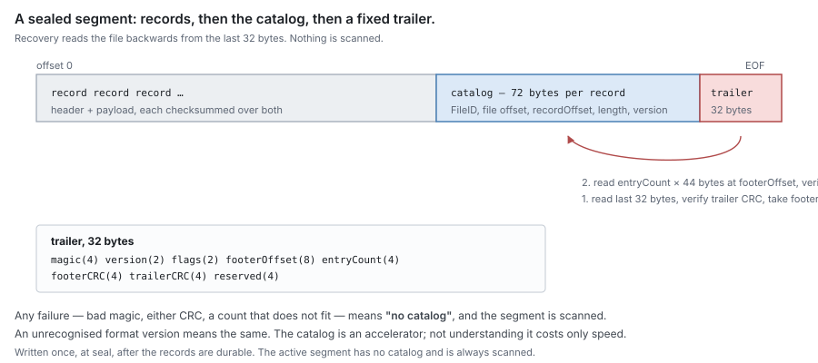

# RFC 28 — the journal's on-disk format and recovery

**Status:** draft. [§5](#5.%20Open%20questions) lists what is undecided.
**Audience:** anyone implementing the journal's files on disk, or how it recovers
from them after a crash. What the journal promises, its interface, its index,
durability, capacity, reclamation and locking are [RFC 1](rfc-1-journal.md); this
RFC is how the journal lays its state out on disk and rebuilds it when it opens.
Conventions and test tiers are in [the RFC index](rfc-index.md).

---

## Start here

*Explanatory. The rules are in §1 onward; where this section and a rule differ, the rule wins.*

### In plain words

The journal keeps its state in a few plain files in one directory. Think of a
stack of numbered notebooks. Each entry ends with a check digit, so a smudged
entry is noticed, not misread. A full notebook gets a table of contents at the
back, so a restart can skim it instead of reading every page. The analogy has a
limit: the table of contents is only a shortcut. Where it and the pages
disagree, the pages win. After any crash, the journal rebuilds everything from
these files alone, asking no other component.

```text
 0041.seg  [entries ...][seal][table of contents]   full, sealed
 0042.seg  [entries ...]                            being written
```

**What this is.** DittoFS is a file server. It answers a client's write once the
bytes are in its **journal**: a handful of files in one directory on a fast local
disk ([RFC 1](rfc-1-journal.md)). Later the bytes are uploaded to an object store,
and the local copy can be dropped. This RFC says what those files contain, byte
by byte, and how the journal rebuilds its view of them when it starts again —
after a clean stop, a killed process or a power cut — from the files alone.

**The problem, in one example.** Node N1's journal holds Alice's 30 GB virtual
disk `ODFC_alice.vhdx`, the file of [RFC 1](rfc-1-journal.md)'s example. Its
directory holds a small `format` file naming the journal, a full and sealed
segment `0041.seg`, and `0042.seg`, the segment new records are appended to.

1. **09:00.** Alice's desktop writes 64 KiB at offset 2 GiB. The journal appends
   one **record** to `0042.seg`: a 96-byte header naming the file, the offset,
   the length and the record's version numbers, with two checksums, then the 64
   KiB. The desktop flushes, and the journal forces the segment to the disk
   before it answers.
2. **09:00:01.** The desktop writes again, and the power fails before the next
   flush. That second record reached the disk only in part.
3. **The restart.** The journal reads `format` to learn whose journal this is.
   For the sealed `0041.seg` it reads only the **catalog** at the segment's end,
   a list of the records inside, instead of every record. It reads `0042.seg`
   record by record: the first record's checksums verify, so it is held. The
   torn second record was never synced, so never promised durable, and it is
   cut off as a **torn tail**, not reported as damage, and the segment is sealed before anything new
   is appended.
4. **Months later** a disk fault flips one bit inside a record of `0041.seg`
   that was synced long ago. That is corruption, not a torn tail: the journal
   stops claiming the extent and reports it. If those bytes were already
   uploaded, the next read fetches them back; if not, the read fails loudly. The
   journal never serves the bad bytes, and never serves zeros in their place.

```text
 journal directory on N1's NVMe disk
   format     journal identity, installation ID, checksum
   0041.seg   [header][record][record]…[seal][catalog][trailer]   sealed
   0042.seg   [header][record][torn…]                             newest
                               ▲
                recovery cuts here, then seals the segment
```

**The words you need.**

- **segment** — an append-only file of records, created at a fixed size and
  sealed when full ([§2.2](#2.2%20Segments)).
- **record** — one write, removal or mark as stored: a header and, for content,
  the bytes ([§2.3](#2.3%20Records)).
- **seal marker**, **catalog** — what sealing writes after the last record: a
  marker that no record follows it, then a list of the segment's records so that
  recovery need not read them ([§2.4](#2.4%20The%20segment%20catalog),
  [§2.5](#2.5%20Catalog%20layout)).
- **torn tail** — the end of a newest segment that a crash left half-written;
  never synced, so never promised durable, and cut off rather than reported
  ([§3.3](#3.3%20Torn%20and%20corrupt%20records)).
- **reseed** — after a restart, the engine telling the journal again which
  extents are offloaded ([§3.2](#3.2%20Offload%20state%20after%20recovery)).

**What this RFC promises.**

- Every structure on disk has a fixed byte layout under a checksum, so damage is
  detected and never served.
- After a crash the journal rebuilds itself from its own directory alone, and
  every write it acknowledged as durable is held again.
- A crash's torn tail is never reported as damage, and damage to records that
  were synced is never cut off as a torn tail.
- A directory it cannot identify, or a journal that has gone, is refused, never
  opened as an empty journal.

**How the rest is organised.** §1 is the purpose. §2 is the on-disk format: the
directory and its `format` file, segments, records, the catalog and its byte
layout, then the benchmark that decides between segments and one staging file per
dirty slice. §3 is recovery: rebuilding the index, offload state after a restart,
torn and corrupt records, and files recovery cannot attach. §4 holds the checks
and benchmarks of both, §5 the open questions, and Appendix A how sync and
allocation work on each platform.

### Scenarios

**The DittoFS process is killed, but N1 keeps running.**

1. alice-pc's last writes were acknowledged but not yet synced. They still sit
   in the operating system's cache, and verify when the journal reopens
   ([§3.1](#3.1%20Rebuilding)).
2. A later power cut could still take them. So recovery syncs the newest segment
   of each stream first ([§3.1](#3.1%20Rebuilding)).
3. It then re-reads every record past the last proven sync point, bypassing the
   cache, and checks its checksums ([§3.1](#3.1%20Rebuilding)).
4. A record that verifies stays where it is. One that does not is re-appended
   to a new segment from the copy that verified at first read
   ([§3.1](#3.1%20Rebuilding)).
5. Re-appends draw on the repack reserve, not on a share's limit. So a journal
   killed while full still opens ([§3.1](#3.1%20Rebuilding)).

Outcome: "verified at open" means "on the device", and the common case
re-appends nothing.

**N1 boots with the journal's disk not mounted.**

1. The journal directory is a directory on the NVMe disk, not its mount root
   ([RFC 1 §3](rfc-1-journal.md#3.%20Interface)). With the disk not mounted, only the empty mount point is
   there, and the journal directory does not exist.
2. The caller opens the journal with the identity it recorded for this
   directory. Since that is not zero, the missing directory fails the open
   ([§3.4](#3.4%20Unattachable%20files)).
3. Open never creates a fresh journal there. A fresh one would answer every
   unuploaded write as never written ([§3.4](#3.4%20Unattachable%20files)).
4. Only after an operator acknowledges a real loss does the caller run the
   initialisation step again ([§3.4](#3.4%20Unattachable%20files)).

Outcome: a wrong mount stops the start loudly, instead of silently serving
stale bucket content where acknowledged writes were.

**One write fails in the middle while its neighbours succeed.**

1. Several writers append to one segment at once, each at a slot reserved in
   order ([§2.2](#2.2%20Segments)).
2. One write gets a device error. Its slot stays zeros, and its `WriteAt`
   returns the error, so it is never acknowledged ([§2.2](#2.2%20Segments)).
3. The records after it were written, and may have been synced and
   acknowledged ([§2.2](#2.2%20Segments)).
4. At the next open, a scan meets the zero slot. It searches forward, at each
   8-byte boundary, for a header that verifies ([§3.3](#3.3%20Torn%20and%20corrupt%20records)).
5. It finds the next record, steps over the zeros, and attaches everything
   after them. The zeros are reported as neither damage nor a torn tail
   ([§3.3](#3.3%20Torn%20and%20corrupt%20records)).

Outcome: one failed write never takes the acknowledged writes behind it with
it.

**The power fails while an old segment is being recycled.**

1. Repack retires a full segment, and the pool of spare segments is short, so
   the segment is reused as a spare ([§2.2](#2.2%20Segments)).
2. It is first renamed to a fresh id, above every id in the directory, and the
   directory is synced ([§2.2](#2.2%20Segments)).
3. The power fails before its header and trailer slots are zeroed.
4. At open, its old records name the old segment id, so none verifies under the
   new name ([§2.2](#2.2%20Segments)).
5. Recovery re-adopts the file as a spare, and zeroes both slots before any
   stream takes it ([§3.1](#3.1%20Rebuilding)).

Outcome: the segment's old life is never read back as live data.

## 1. Purpose

The journal ([RFC 1](rfc-1-journal.md)) keeps its state in one directory of
plain files, and those files are all that survives a crash: the placement index
is in memory and is rebuilt at every open. This RFC specifies the files — their
names, their byte layouts, and the order they are written in, so that every crash
leaves something recovery can read — and how open rebuilds the journal from them
alone. It adds no interface: every operation it serves is
[RFC 1 §3](rfc-1-journal.md#3.%20Interface)'s.

## 2. On-disk format

### 2.1 Layout

One directory per journal, containing:

| Name | Is |
| --- | --- |
| `format` | the format version, the **journal identity** — a random 128-bit value chosen when the journal is created and never changed — and the **installation ID** the explicit initialisation step wrote ([RFC 1 §3](rfc-1-journal.md#3.%20Interface)), all covered by a checksum; byte layout below. From the replication extension's version on it also holds the journal's **generation**, which only that extension changes: it is raised, and swapped into the metadata store, at every open of the journal and every acquisition and renewal of its node's lease — at open and acquisition before anything is served from it — and a journal whose swap loses serves nothing more ([RFC 10 §2.2](rfc-10-journal-replication.md#2.2%20One%20journal%20carries%20many%20shards)). An unrecognised version, or a checksum that does not verify, **MUST** fail the open, not be upgraded or repaired silently. |
| `<id>.seg` | a segment: its id ([§2.2](#2.2%20Segments)) in 20 decimal digits, zero-padded, so names sort as ids do |

An implementation **MUST NOT** require any other file to reconstruct its state
([§2.4](#2.4%20The%20segment%20catalog)). A file it does not recognise **MUST** be left alone, not deleted.

**Byte layouts.** Every on-disk structure in §2 is packed without padding, with
integers little-endian. A content version ([RFC 1 §4.3](rfc-1-journal.md#4.3%20Versions)) is stored as two
64-bit integers, the epoch then the counter, each little-endian, not as one
little-endian 128-bit integer; this holds in the record header, the catalog
entry and a `clone target` payload's `AsOf`. **CRC32C** is the Castagnoli CRC of RFC 3720 §B.4 (reflected,
initial value and final XOR all ones), stored as a little-endian 32-bit integer.
Where a checksum is **seeded with the journal identity**, it is the CRC32C of
the 16 identity bytes followed by the bytes it covers; otherwise it is the CRC32C
of those bytes alone. Magic values are ASCII. Reserved bytes are written as zero
and covered by their structure's checksum, which every structure puts last.

**The `format` file — 56 bytes.**

| Offset | Size | Field |
| --- | --- | --- |
| 0 | 4 | magic, `DJF1` |
| 4 | 2 | format version: 1 for this RFC; each later version names what it adds |
| 6 | 2 | reserved, zero |
| 8 | 16 | journal identity |
| 24 | 16 | installation ID, a 128-bit value |
| 40 | 8 | generation; zero, and never read, below the replication extension's version |
| 48 | 4 | reserved, zero |
| 52 | 4 | CRC32C over bytes `[0, 52)`, not seeded |

Open reads the version first and fails on one it does not recognise; for
version 1 a file of any length but 56 bytes fails the open like a bad checksum.
**The file is replaced whole, never edited in place.** `Init`, and every later
rewrite (`Restamp` after a lost store, [§3.4](#3.4%20Unattachable%20files), and the replication extension's
generation), writes the
new content to `format.tmp`, syncs it, renames it over `format`, and syncs the
directory before returning, so a crash leaves the old file or the new one
whole, never a mix. Open ignores a `format.tmp`, the next rewrite overwrites
it, and `Init` does not count it when it requires an empty directory
([RFC 1 §3](rfc-1-journal.md#3.%20Interface)).

### 2.2 Segments

A segment is append-only, capped at a fixed size — one constant of the
implementation, not a setting; its value is open ([§5](#5.%20Open%20questions), question 2) — and **sealed** when the
cap is reached. A sealed segment **MUST NOT** be appended to again.

**A file spans segments; a record does not.** Nothing ties a file to one
segment: its extents land wherever its stream stood, and the placement index
maps each to its segment ([RFC 1 §4](rfc-1-journal.md#4.%20The%20placement%20index)). A write that does not fit in what remains of
the current segment is split at the cap into records, one per segment, each
carrying its own file offset and the write's version, so each verifies and
recovers on its own. `WriteAt` returns only once every piece is written, and the
pieces are synced as one write's record is ([RFC 1 §5.1](rfc-1-journal.md#5.1%20Ordering%20rules)). A crash between the pieces leaves the write partly held,
which is what a torn write is to a client that was not answered.

At most a bounded number of segments per file-stream are open for append at one
time; every other segment is sealed. Writes to one `FileID` **MUST** be
serialised; writes to different `FileID`s **MAY** proceed concurrently, and the
number of independent append streams is configurable ([RFC 13 Appendix B](rfc-13-configuration.md#Appendix%20B%20%E2%80%94%20the%20settings)).

**A segment is allocated whole when it is created.** The journal creates a
segment at its cap and allocates every byte of it at once, with the
platform's allocation call or by writing zeros
([Appendix A](#Appendix%20A%20%E2%80%94%20platform%20profile)). Records are then written into space the filesystem already
allocated, so an append never needs the filesystem to find space, and the file
never grows: the speculative allocation some filesystems make past the end of a
growing file, and later trim on their own schedule, never applies, and
the journal's accounting is the cap, exactly ([RFC 1 §7.3](rfc-1-journal.md#7.3%20Accounting)). An allocated region no
record has reached reads as zeros. **A header slot of zeros is not proof that
nothing follows**: concurrent appenders write at positions reserved in order, so a
write that failed — `EIO`, or `ENOSPC` from a copy-on-write filesystem that
allocates anew on overwrite — can leave zeros at its slot while later records
around it were written, synced and acknowledged. That failed write's `WriteAt`
returns the error and is never acknowledged; the slot stays zeros, and a scan
steps over it ([§3.3](#3.3%20Torn%20and%20corrupt%20records)).

**A segment is made ahead of need, as a spare.** The headroom and the repack
reserve ([RFC 1 §6](rfc-1-journal.md#6.%20Capacity)), and the next segment of every stream, are held as
**spares**: segments allocated at their cap and taken by no stream yet. **A
spare is made under a temporary name and renamed into place only once whole**:
it is created as `<id>.spare.tmp`, allocated, zero-filled where Appendix A
requires it and synced, then renamed to `<id>.seg` and the directory synced, so
a crash leaves either no `<id>.seg` or a whole one; open unlinks any
`.spare.tmp` it finds. A spare's id is drawn when it is made; its header slot
is zeros until a stream takes it. So making a segment happens off the write
path, and a roll costs only the take.

**A retired segment is recycled as a spare.** A segment **sealed full** — one
its stream left because the next record did not fit — keeps its cap: the seal
writes its trailer at the cap's last 32 bytes ([§2.5](#2.5%20Catalog%20layout)) and returns no tail, so it
stays full-size and allocated, accounted at its cap. A segment **sealed early**
— idle ([§3.1](#3.1%20Rebuilding)) or at recovery ([§3.3](#3.3%20Torn%20and%20corrupt%20records)) — always returns its free tail
([RFC 1 §7.3](rfc-1-journal.md#7.3%20Accounting)), and is unlinked when retired, never recycled. Whether a
full-size segment is recycled is decided when repack or reclamation retires it,
never at seal: it becomes a spare while the pool is below its target, and is
unlinked otherwise. Recycling closes the segment's descriptors as for an
unlink ([RFC 1 §7.4](rfc-1-journal.md#7.4%20Open%20descriptors)), renames it to a fresh `<id>.seg` and syncs the directory,
**then** overwrites its header slot and its trailer slot — the cap's last 32
bytes — with zeros and syncs it. Renamed first, a crash between the steps
leaves a file whose name no longer matches the segment id its old header,
records and seal marker carry, so none of them verifies there ([§2.3](#2.3%20Records)), its old
trailer is not accepted ([§2.4](#2.4%20The%20segment%20catalog)), and recovery re-adopts it as a spare
([§3.1](#3.1%20Rebuilding)); zeroed first, a crash would leave the old name with records that
still verify. Its blocks are already allocated and written, so it needs no
zero-fill, and a sustained load pays one segment's write per segment, not two.
**A recycle that fails is an unlink.** If any step fails — the rename, the
directory sync after it, the zeroing or its sync — the segment is not a spare
and is never taken: the journal unlinks it under whichever of its two names it
finds, since a failed rename may or may not have happened. A crash before that
unlink is durable leaves the old name, as a crash before any unlink's directory
sync does, or the new name, which open re-adopts as a spare ([§3.1](#3.1%20Rebuilding)).
Only growing the pool — at `Init`, when the journal's maximum is raised, or when
no full-size retired segment is to hand — makes a new spare and pays the fill.
**A fresh id exceeds every id the directory names**: the id of a new spare or
of a recycle is above that of every `.seg` and `.spare.tmp` file in the
directory, those found at open included, so no record on disk ever carries the
id a recycle takes.

**A recycled segment's old life never verifies.** Its old records and seal
marker name the old segment id, so none verifies here; its trailer slot is
zeros, and a trailer is accepted only behind a seal marker that verifies for
this segment ([§2.4](#2.4%20The%20segment%20catalog)), so neither its old trailer nor its old footer is ever
read as the new life's catalog. While it is a stream's active segment, the old
life's bytes past its newest record are a torn tail at recovery
([§3.3](#3.3%20Torn%20and%20corrupt%20records)), cut off and never reported as damage. What a fresh segment
guarantees and a recycled one does not is that the bytes past its newest record
are zeros. **A failed append ends its segment, as a failed sync does**
([RFC 1 §5.3](rfc-1-journal.md#5.3%20A%20failed%20sync)), fresh or recycled: its slot may hold bytes the zero-slot rule of
[§3.3](#3.3%20Torn%20and%20corrupt%20records) cannot step over, or zeros no later synced-through offset may pass, so
nothing could prove a record appended after them synced ([§3.3](#3.3%20Torn%20and%20corrupt%20records)). The stream
takes no further append there and continues in a new segment naming no
predecessor; the records written to the segment since its last successful sync
are re-appended or failed by [RFC 1 §5.3](rfc-1-journal.md#5.3%20A%20failed%20sync); a stream's synced-through offset
never advances past a slot whose write failed or has not completed, so no record proves that slot
synced and recovery finds it torn or steps over it, never corrupt; and the segment is never
sealed. What becomes of it after that is [RFC 1 §5.3](rfc-1-journal.md#5.3%20A%20failed%20sync)'s rule for a failed
segment, not an exception to it: a repack candidate once its window is
resolved, unlinked, never recycled, only after repack has carried forward the
records synced into it before the failure.

**A roll that finds no spare ready is refused, at once.** A content write that
needs a new segment while no spare is ready is refused with `ErrNoSpace` naming
the spare pool — the limit `spare`, its own name, never the journal's
maximum — without waiting ([RFC 1 §6](rfc-1-journal.md#6.%20Capacity)), and the engine answers it
retry-later ([RFC 8 §10.2](rfc-8-engine.md#10.2%20A%20capacity%20refusal%20comes%20back%20here)) while the pool is refilled off the write path.
A pool that cannot be refilled for lack of device space is not that case: once
making a spare has failed with `ENOSPC` and no full-size retired segment is to
hand, a roll that finds no spare is refused with `ENOSPC`, which the engine
answers as a full device, no space at once ([RFC 8 §10.2](rfc-8-engine.md#10.2%20A%20capacity%20refusal%20comes%20back%20here)), until a spare is
made again. Header-only records go on drawing on the allocated headroom.
`spare_refusals` counts each refusal naming `spare`, so a pool too small for
the write rate shows before it costs a client.

> ponytail: segments are a constant size (proposal 256 MiB), so a stream
> writing at an NVMe drive's 5 GB/s rolls about twenty times a second, each
> roll a seal's syncs, which a transfer that flushes only at its end
> never asked for. Upgrade to a larger constant, chosen by J1's sequential row
> and J8's repack amplification measured at two or three sizes, when
> `spare_refusals` or J1's sequential row shows the roll rate at the device's
> speed.

Every segment begins with a fixed-size header, written once, when a stream
takes the segment, and covered by its own checksum; the stream's next sync makes
it durable with the first records after it. It **MUST** identify:

- the journal identity of [§2.1](#2.1%20Layout);
- the segment's own id;
- its **predecessor**: the id of the segment its append stream sealed before
  opening this one, or none. A stream that leaves a segment after a failed sync
  ([RFC 1 §5.3](rfc-1-journal.md#5.3%20A%20failed%20sync)), or after a failed append that ended it (above), names none: that segment is never sealed, so
  recovery treats it as one that could have been open at a crash, and its
  unsynced tail as torn ([§3.3](#3.3%20Torn%20and%20corrupt%20records)).

**The segment header — 48 bytes at offset 0.** The first record slot is at 48.

| Offset | Size | Field |
| --- | --- | --- |
| 0 | 4 | magic, `DJH1` |
| 4 | 2 | format version of the journal that created the segment ([§2.1](#2.1%20Layout)) |
| 6 | 2 | reserved, zero |
| 8 | 16 | journal identity |
| 24 | 8 | segment id, the one in its name; ids start at 1 and ascend across all streams in the order segments are created |
| 32 | 8 | predecessor's segment id, or 0 for none |
| 40 | 4 | number of the append stream that opened it, for reporting only: the predecessor, not this number, links a stream's segments |
| 44 | 4 | CRC32C over bytes `[0, 44)`, **not seeded** |

The header checksum is deliberately not seeded with the journal identity: a
seeded one would make another journal's segment fail its checksum and be
reported as damage, where [§3.1](#3.1%20Rebuilding) needs it to verify and be recognised as
foreign by the identity it names. A segment whose version this binary does not
recognise, or that is newer than the `format` file's, fails the open.

**A new file's name is durable before its records are.** Syncing a file makes
its bytes durable, not its entry in the directory: after power loss a synced
segment whose directory entry was never synced is simply gone. So after creating
a segment, or the `format` file, the journal **MUST** sync the directory before
any `Sync` covering a record in that file returns. **A failed directory sync is a
failed sync window**: the new segment's name is not known to be durable, so
every record written to it is not durable either, and the journal re-appends
them to another segment whose directory entry it then syncs, or fails them, by
[RFC 1 §5.3](rfc-1-journal.md#5.3%20A%20failed%20sync). A spare's entry is synced when the spare is made, so taking one
needs no directory sync.

**An unlink is durable before anything relies on it.** A removal record whose
retention counted a segment as still on disk ([RFC 1 §7.2](rfc-1-journal.md#7.2%20Repack)) **MUST NOT** be dropped until
that segment's unlink is durable, by a directory sync; otherwise a crash can
bring back the segment without the removal that covered it. Before unlinking a
segment, the journal **MUST** close every descriptor it caches for it
([RFC 1 §7.4](rfc-1-journal.md#7.4%20Open%20descriptors)); on platforms where an open file cannot be unlinked, segments **MUST** be
opened with sharing that permits deletion.

Sealing writes a **seal marker** after the last record. The marker is not a
record and has no kind in [§2.3](#2.3%20Records): it carries no file, extent or version, and the
index never holds it. It **MUST**
be durable before a successor naming the segment is taken. Bytes after a seal
marker belong to the footer, never to records. A segment named as another's
predecessor is therefore known to have been sealed, which is how recovery tells a
crash from a truncation ([§3.3](#3.3%20Torn%20and%20corrupt%20records)).

**The seal marker — 32 bytes, at a record slot just past the last record.**

| Offset | Size | Field |
| --- | --- | --- |
| 0 | 4 | magic, `DJS1` |
| 4 | 4 | reserved, zero |
| 8 | 8 | segment id |
| 16 | 8 | the marker's own offset in the segment |
| 24 | 4 | reserved, zero |
| 28 | 4 | CRC32C over bytes `[0, 28)`, seeded with the journal identity |

A scan tells a slot by its first four bytes: `DJR1` a record header ([§2.3](#2.3%20Records)),
`DJS1` a seal marker, all zeros the zero-slot rule of [§3.3](#3.3%20Torn%20and%20corrupt%20records), anything else damage. A
seal marker verifies only if its checksum does under this journal's identity and
its segment id and own offset are the segment and offset it was read at, so a
copy of one inside a payload never ends a scan.

**Records, once written, are immutable.** No operation modifies a record in
place — not offload, not release, not recovery. The offloaded bit of [RFC 1 §2](rfc-1-journal.md#2.%20The%20model%20it%20presents) is
persisted by appending an **offloaded record** ([§2.3](#2.3%20Records)), never by changing the record
it describes.

### 2.3 Records

Each record carries a header; a write or fill record carries a payload of
content, a loss record a fixed payload naming the record it drops ([RFC 1 §3.8](rfc-1-journal.md#3.8%20Loss%20events)), a
clone target record a fixed payload carrying its clone spec ([RFC 1 §3.6](rfc-1-journal.md#3.6%20Truncate%2C%20deallocate%20and%20delete)), and a hold,
unhold or stamp record the cut number it is for ([RFC 1 §3.11](rfc-1-journal.md#3.11%20Snapshot%20holds)). The header
**MUST** identify:

- the record's kind: write, fill, release, truncate, deallocate, delete, clone
  target ([RFC 1 §3.6](rfc-1-journal.md#3.6%20Truncate%2C%20deallocate%20and%20delete)), offloaded, unmark ([§3.2](#3.2%20Offload%20state%20after%20recovery)), loss ([RFC 1 §3.8](rfc-1-journal.md#3.8%20Loss%20events)), hold, unhold, stamp
  ([RFC 1 §3.11](rfc-1-journal.md#3.11%20Snapshot%20holds)) or forget ([RFC 1 §3](rfc-1-journal.md#3.%20Interface))
- the segment it was written into, and its own offset in that segment
- the `FileID` it belongs to, and the tag of its share ([RFC 1 §3](rfc-1-journal.md#3.%20Interface)); a forget record names
  only the tag, with a zero `FileID`
- the file offset it begins at, and its length, both 64-bit: a removal can cover
  any extent of a file
- its sequence number and its content version ([RFC 1 §4.3](rfc-1-journal.md#4.3%20Versions)): for a release, the version
  released; for an offloaded record, the newest version it marks
  ([§3.2](#3.2%20Offload%20state%20after%20recovery))
- the stream's **synced-through offset**: the offset in this segment up to which
  a sync had completed when the record was written ([§3.3](#3.3%20Torn%20and%20corrupt%20records))
- a checksum of the payload
- a checksum of the header

The header checksum **MUST** cover every other header field, the payload
checksum included, so between them the two cover the whole record. An
implementation **MUST NOT** exclude any header field from coverage.

They are separate so that a scan can trust a record's boundaries without reading
its payload: the header verifies on its own, and a scan reads the length from it
and steps over a payload it has no reason to check, such as one wholly covered by
a later record (below).

**One payload checksum covers the whole payload**, so a record verifies only
while every byte of its payload is intact. No operation frees or alters part of
a record's payload; storage is freed in whole segments only ([RFC 1 §7.1](rfc-1-journal.md#7.1%20Releasing%20storage)).

**No byte leaves a record unverified.** Every path that hands a record's bytes
to anyone — `ReadAt`, `Offered` ([RFC 1 §3.3](rfc-1-journal.md#3.3%20Offload)), a repack copy ([RFC 1 §7.2](rfc-1-journal.md#7.2%20Repack)), a re-append after
a failed sync ([RFC 1 §5.3](rfc-1-journal.md#5.3%20A%20failed%20sync)) — **MUST** first read that record's whole payload and verify
its payload checksum, and **MUST NOT** hand out or copy any part of a record
that does not verify. A partial read or a partial copy that checks only the part
it moves would carry rotted bytes forward under a fresh, valid checksum.

> [!note] ponytail
> A read of 4 KiB from a 1 MiB record reads and checks the whole megabyte. Records
> are as large as the writes that made them, so random small reads of content
> written in large writes pay up to the record's size per read. Upgrade to a
> payload checksum per 64 KiB of payload, each covering its own piece, when
> J3's warm small-read rate over large records misses its target.

An unrecognised record kind fails the open like an unrecognised format ([§2.1](#2.1%20Layout)).
**A kind added later is a new format version**: a newer binary opens a journal of
the older version, and an older binary refuses the newer one. The replication
kinds of [RFC 10](rfc-10-journal-replication.md#2.3%20The%20journal%20extension) are added this way: the extension's format version brings its request-entry and
per-shard forget kinds, and the per-record fields it needs (shard, request ID,
digest, result), as that version's own body, none of which this version's
header carries. The numeric values are in the kinds
table below. The kind is read only once the header verifies — a header that does
not is damage ([§3.3](#3.3%20Torn%20and%20corrupt%20records)) — and a verifying header whose kind the segment's format version
does not define fails the open in every range, the extension range included. It
is never skipped by its length: an unknown kind may be a removal, and stepping
over a removal resurrects what it removed.

**A record, field by field.** For alice-pc's 64 KiB write at 1 GiB:

| Field | Example | What it is for |
| --- | --- | --- |
| kind | `write` | what the record does: stage bytes (`write`, `fill`) or remove or mark them (`release`, `truncate`, `deallocate`, `delete`, `clone target`, `offloaded`, `unmark`, `loss`, `hold`, `unhold`, `stamp`, `forget`) |
| segment id | 42 | which segment the record was written into; a record found anywhere else is not this segment's |
| record offset | 183 500 864 | where in its segment the record starts; a record read at any other offset is not this one, so a write the device put at the wrong place in the segment is caught |
| `FileID` | `7c1e…` (alice.vhdx) | which file the bytes belong to |
| share tag | 7 (the `profiles` share's tag) | which share's limits the bytes count against ([RFC 1 §3](rfc-1-journal.md#3.%20Interface)) |
| file offset | 1 073 741 824 | where in the file the bytes start |
| length | 65 536 | how many bytes; for a `deallocate` or `clone target`, how far it reaches. A `truncate` and a `delete` reach to the end of the file and write 0, which no extent can mean, since a zero-length `deallocate` or `clone target` is refused ([RFC 1 §3.6](rfc-1-journal.md#3.6%20Truncate%2C%20deallocate%20and%20delete)) |
| sequence number | 51 207 | the order this journal appended records in |
| content version | (0, 9 314) | which bytes these are, and which of two overlapping records is newer ([RFC 1 §4.3](rfc-1-journal.md#4.3%20Versions)) |
| synced-through offset | 183 500 800 | how far this segment was synced when the record was written; lets recovery tell a torn tail from corruption ([§3.3](#3.3%20Torn%20and%20corrupt%20records)) |
| payload checksum | CRC32C | detects damage to the bytes |
| header checksum | CRC32C | detects damage to every field above, payload checksum included |
| modification time | 2026-10-07 09:05:00.123 | `write` only: the `mtime` the write sets, or zero when the open suspended it; covered by the payload checksum |
| payload | 64 KiB of data | the bytes themselves; only `write` and `fill` carry content. A `loss` record's payload is 16 bytes: the sequence number of the record it drops, then a flag word whose lowest bit says the dropped record was synced ([RFC 1 §3.8](rfc-1-journal.md#3.8%20Loss%20events)). A `clone target` record's payload is 56 bytes: the source `ShareID`, the source `FileID`, the source offset and `AsOf`, a 16-byte content version like the header's; its file offset and length are the spec's `DstOff` and `Len` ([RFC 1 §3.6](rfc-1-journal.md#3.6%20Truncate%2C%20deallocate%20and%20delete)) |

Only `write` and `fill` carry content. Every other kind — `loss`, `clone
target`, `hold`, `unhold` and `stamp` with their fixed payloads included — changes what the earlier records mean: a `release` stops holding an extent, an
`offloaded` marks it offloaded, a `truncate` drops everything past an offset.

**The record header's byte layout.** All integers little-endian, packed without
padding; 96 bytes.

| Offset | Size | Field |
| --- | --- | --- |
| 0 | 4 | magic, the ASCII bytes `DJR1` |
| 4 | 1 | record kind |
| 5 | 3 | reserved, zero |
| 8 | 8 | segment id |
| 16 | 16 | `FileID` |
| 32 | 8 | file offset |
| 40 | 8 | length |
| 48 | 8 | sequence number |
| 56 | 8 | content version, epoch half ([RFC 1 §4.3](rfc-1-journal.md#4.3%20Versions)) |
| 64 | 8 | content version, counter half |
| 72 | 4 | share tag |
| 76 | 8 | synced-through offset |
| 84 | 4 | payload checksum |
| 88 | 4 | the record's own offset in its segment; 32 bits, as the catalog's `recordOffset` ([§2.5](#2.5%20Catalog%20layout)) |
| 92 | 4 | header checksum, over bytes `[0, 92)` |

**Record kinds.** Values are stable: a value is never reassigned, nor reused once
its kind is retired. 0 is never a kind, so a zero slot never reads as one. 15–127
are reserved for later core kinds and 128–255 for extensions ([RFC 10](rfc-10-journal-replication.md#2.3%20The%20journal%20extension)),
each assigned with the format version that introduces it. A field this table
gives as 0 is written as zero.

| Value | Kind | `FileID` | file offset, length | content version | After the header |
| --- | --- | --- | --- | --- | --- |
| 1 | `write` | the file | the extent written | the version written | 8-byte modification time, then `length` bytes |
| 2 | `fill` | the file | the extent filled | the `v` given to `Fill` | `length` bytes |
| 3 | `release` | the file | one extent released; one record per extent | the version released | none |
| 4 | `truncate` | the file | the new size, 0 | its version | none |
| 5 | `deallocate` | the file | the extent punched | its version | none |
| 6 | `delete` | the file | 0, 0 | its version | none |
| 7 | `clone target` | the destination | `DstOff`, `Len` | its version | 56 bytes: source `ShareID`, source `FileID`, source offset, `AsOf` (16 bytes, epoch then counter) |
| 8 | `offloaded` | the file | one extent marked; one record per extent | the newest version marked | none |
| 9 | `unmark` | the file | one extent unmarked; one record per extent | the version of the content unmarked | none |
| 10 | `loss` | the dropped record's | the extent dropped | the version dropped | 16 bytes: dropped sequence number, then a flag word — bit 0 synced, bit 1 its offloaded bit was set, bits 8–15 the reason: 1 corrupt, 2 stale, 3 failed sync window; the rest zero |
| 11 | `hold` | the file | 0, 0 | the hold mark | 8 bytes: the cut number ([RFC 6](rfc-6-block-metadata.md)'s `SnapshotCut`) |
| 12 | `unhold` | zero | 0, 0 | zero | 8 bytes: the cut number |
| 13 | `stamp` | the file | 0, 0 | `through` | 8 bytes: the cut number |
| 14 | `forget` | zero | 0, 0 | zero | none |

The share tag field carries the share in every kind; it is all a `forget`
names, and all an `unhold` names besides its cut.

A `write` record is followed, before its payload, by an 8-byte **modification
time**: nanoseconds since the Unix epoch, UTC, that the write sets as the file's
`mtime`, or zero when the caller's open has suspended modification-time updates
([RFC 14 §2.2](rfc-14-open-state.md#2.2%20Open)). The payload checksum covers it. The
existence commit and a replay after a crash set `mtime` from the newest write's
value, and never from the clock at commit, so a suspended time stays suspended and a
replayed write keeps the time the client saw. No other kind carries the field.

A record starts at a multiple of 8 bytes within its segment: the modification
time for `write`, then the payload, of `length` bytes for `write` and `fill`, 16 bytes for `loss`, 56 for `clone target`, 8 for `hold`, `unhold` and `stamp`, and none otherwise, is followed by zero
padding to the next multiple of 8, which no checksum covers and a reader ignores.
Both checksums are CRC32C **seeded with the journal identity**: each is the CRC32C
of the 16-byte journal identity of [§2.1](#2.1%20Layout) followed by the bytes it covers. A
header verifies only if its magic matches, its checksum verifies under this
journal's identity, and its segment id and own offset are the segment and offset
it was read at. So bytes
that merely look like a record — a client file that contains a copy of a journal
segment, held in some record's payload, or a segment of another journal — never
verify as one of this journal's records, which is what lets a scan resume past
damage ([§3.3](#3.3%20Torn%20and%20corrupt%20records)). A header slot that is all zeros is not damage unless a later verifying record's
synced-through offset lies past it, and marks the end of what was written only where no verifying header follows it ([§2.2](#2.2%20Segments), [§3.3](#3.3%20Torn%20and%20corrupt%20records)).

A record whose payload checksum does not verify **MUST NOT** be used to serve a
read. A record wholly covered by a release, truncate, deallocate, delete, clone target
or synced loss record that outranks it ([RFC 1 §4.3](rfc-1-journal.md#4.3%20Versions)), named by a loss record, or of a
tag a later forget record names, is not held, and recovery **MUST NOT** verify or
report its payload.

### 2.4 The segment catalog

The in-memory **placement index** ([RFC 1 §4](rfc-1-journal.md#4.%20The%20placement%20index)) serves every read. The **segment catalog**
is an on-disk copy of what one sealed segment contains, and exists only so that
recovery can rebuild the placement index without reading every record.

The mapping from file extents to record locations is **derived state**. It
**MUST** be reconstructible from the segments alone, and a persisted copy of it
**MUST NOT** be authoritative: where a persisted copy and the segments disagree,
the segments win, unconditionally.

Scanning is not fast enough at scale ([§3.1](#3.1%20Rebuilding)), so an implementation **SHOULD**
persist an index, under the rules below.

**The persisted index is the segment catalog**, written into a footer at the end
of the segment. When a segment is sealed it becomes immutable ([§2.2](#2.2%20Segments)), and an
implementation **SHOULD** then append a catalog describing every record in it: for each, the `FileID`, file offset, length, kind, sequence number and content
version, and the record's offset within the segment. An entry carries no
payload: a header-only record whose payload the index needs — a `loss` record's
dropped sequence number and flags, a `clone target`'s spec, a `hold`'s, an
`unhold`'s or a `stamp`'s 8 bytes — is read at its `recordOffset` and verified
like any record ([§2.3](#2.3%20Records)). Those kinds are not rare — a stamp per file per
existence commit, a hold per dirty file per cut — so a catalog read is one small
read per segment plus one per such record, and J6 reports their count; a write's modification time is read
from its record only when `Since` yields it.

- The footer **MUST** be written and made durable **after** the records it
  describes, and a segment whose footer is absent or does not verify **MUST** be
  scanned instead. A missing footer is never an error.
- The footer **MUST** carry its own checksum, and **MUST** identify the extent of
  the segment it describes, so that a footer describing fewer records than the
  segment holds is detectable rather than silently truncating.
- The active, unsealed segment has no footer and **MUST** be scanned.
- The footer is part of the segment file and **MUST** be accounted in capacity
  with it ([RFC 1 §7.3](rfc-1-journal.md#7.3%20Accounting)).

**Locating it.** The footer **MUST** be findable without scanning. A segment that
carries one **MUST** end with a fixed-size trailer giving a magic value, the
footer's length, and a checksum over the trailer itself. Recovery reads the last
trailer-sized bytes, and on a valid trailer reads backwards by the stated length.
A trailer that does not verify, or a length that does not fit within the file,
**MUST** be treated as "no footer" and the segment scanned. **A trailer is
accepted only behind this segment's seal marker**: the 32 bytes just before the
footer it names **MUST** be a seal marker that verifies for this segment's id and
that offset ([§2.2](#2.2%20Segments)), seeded with the journal identity, or the trailer is "no
footer". The trailer's own checksum is not seeded and names no segment, so
without this a trailer left from a recycled segment's old life
([§2.2](#2.2%20Segments)) would verify, and recovery would read the old life's catalog in place
of the records the new one holds.

**Writing it.** Sealing forbids further *records* ([§2.2](#2.2%20Segments)); appending the footer is
the one write permitted to a sealed segment, and it **MUST** happen at most once.
An implementation **MAY** write a footer for a segment sealed by a previous
process — a segment sealed at a crash legitimately has none — and **MUST** verify
by scanning before doing so. It **MUST NOT** rewrite or extend a footer that
already verifies.

An implementation **MUST NOT** place this index in a separate file or keep any
second durable log of it: the record headers already are that log.

A catalog describes records, not held extents; recovery applies precedence
([RFC 1 §4.3](rfc-1-journal.md#4.3%20Versions)) to decide what is held. Reading a catalog verifies the layout, not each
payload, so corruption is caught at the first read rather than at open ([§2.3](#2.3%20Records),
[§3.3](#3.3%20Torn%20and%20corrupt%20records)). A read **MUST** check the record header it finds against the catalog entry
that sent it there; a mismatch is corruption.

### 2.5 Catalog layout

All integers are little-endian and packed without padding.

**Trailer — the last 32 bytes of the segment file.** A seal writes the footer
entries immediately after the seal marker, and the trailer is always the
file's last 32 bytes. A segment sealed early, idle or at
recovery ([§3.3](#3.3%20Torn%20and%20corrupt%20records)), takes its trailer immediately after the footer and is
then truncated to end there ([RFC 1 §7.3](rfc-1-journal.md#7.3%20Accounting)). A segment sealed
full is not truncated ([§2.2](#2.2%20Segments)): its trailer is written at the cap's last 32
bytes, and `footerOffset` still names the footer just past the seal marker; the
bytes between footer and trailer — zeros, or the old life's on a recycled
segment — belong to neither. A stream seals a segment while what remains still
holds the seal marker, a footer entry for every record in it, and the trailer.

| Offset | Size | Field |
| --- | --- | --- |
| 0 | 4 | magic, `DJT1` |
| 4 | 2 | catalog layout version, 1 for this layout; independent of the `format` file's |
| 6 | 2 | flags; none defined, so a nonzero value is read as an unrecognised version |
| 8 | 8 | `footerOffset` — absolute offset of the first footer entry: just past the seal marker, which itself begins just past the last record ([§2.2](#2.2%20Segments)) |
| 16 | 4 | `entryCount` |
| 20 | 4 | CRC32C over the footer entries |
| 24 | 4 | reserved, zero |
| 28 | 4 | CRC32C over trailer bytes `[0, 28)` |

Both catalog checksums are plain CRC32C, not seeded ([§2.1](#2.1%20Layout)): which journal a
segment belongs to is settled by its header ([§2.2](#2.2%20Segments)), and every entry is checked
against the seeded record header it leads to ([§2.4](#2.4%20The%20segment%20catalog)).

**Entry — 72 bytes, repeated `entryCount` times, ascending by `recordOffset`.**

| Offset | Size | Field |
| --- | --- | --- |
| 0 | 16 | `FileID` |
| 16 | 8 | file offset of the record's first byte |
| 24 | 4 | `recordOffset` — the record's offset within this segment |
| 28 | 8 | length |
| 36 | 8 | sequence number |
| 44 | 8 | content version, epoch half ([RFC 1 §4.3](rfc-1-journal.md#4.3%20Versions)) |
| 52 | 8 | content version, counter half |
| 60 | 1 | record kind ([§2.3](#2.3%20Records)) |
| 61 | 3 | reserved, zero |
| 64 | 4 | share tag ([RFC 1 §3](rfc-1-journal.md#3.%20Interface)) |
| 68 | 4 | reserved, zero |

A 32-bit `recordOffset` caps a segment below 4 GiB, far above any useful segment
size ([§2.2](#2.2%20Segments)).

At 72 bytes per record, a 256 MiB segment of 1 MiB records carries an 18 KiB
footer, and one of 64 KiB records carries 288 KiB — about 0.1% either way.
An implementation **MAY** compress or dictionary-encode the `FileID` column,
whose values repeat heavily; it **MUST NOT** do so in a way that prevents the
whole footer being validated by the single CRC in the trailer.



**Reading.** Read the final 32 bytes; verify the trailer CRC; check the magic.
Then check that the 32 bytes at `footerOffset` − 32 are a seal marker that
verifies for this segment at that offset ([§2.4](#2.4%20The%20segment%20catalog)), read `entryCount × 72` bytes at
`footerOffset` and verify the footer CRC.
Any failure — short file, bad magic, either CRC, no verifying seal marker before
the footer, an `entryCount` that does not
fit between `footerOffset` and the trailer — **MUST** be treated as "no footer"
and the segment scanned. **An unrecognised format version is also "no footer",
not an error**: the footer is an accelerator, so a reader that does not
understand it loses speed and nothing else.

**Writing.** At seal: make every record durable; then append the seal marker,
the footer and the trailer and make them durable; then, for a segment sealed
early, truncate the file past the trailer and make that durable. A full seal
needs as few as two syncs and an early one three; an implementation **MAY**
split a step into more. The second step needs no order among its writes: a
crash that keeps only part of them is "no footer" above, and the segment, which
no successor names yet ([§2.2](#2.2%20Segments)), is scanned as its stream's newest. A failed
sync in the first two steps is a failed sync ([RFC 1 §5.3](rfc-1-journal.md#5.3%20A%20failed%20sync)): the segment is never
sealed and its successor names none. **The seal is complete after the second
step**, and a successor may be taken then: a failed truncation sync does not
end the segment, whose marker and catalog are durable already, and leaves it
accounted at its cap ([RFC 1 §7.3](rfc-1-journal.md#7.3%20Accounting)). The first step comes first because a
catalog made durable over a record that never reached the device would report
that torn record as corruption ([§2.4](#2.4%20The%20segment%20catalog)).

### 2.6 Segments or staging files, chosen by benchmark

Two shapes can sit behind the interface of [RFC 1 §3](rfc-1-journal.md#3.%20Interface) — `WriteAt`, `Sync`, `ReadAt`,
`Offload`, `Fill`, `Release` and the rest unchanged — and both keep content
versions ([RFC 1 §4.3](rfc-1-journal.md#4.3%20Versions)) and the offloaded bit ([RFC 1 §2](rfc-1-journal.md#2.%20The%20model%20it%20presents)), so [RFC 2](rfc-2-carver.md), [RFC 3](rfc-3-syncer.md) and [RFC 8](rfc-8-engine.md) do
not change with the choice:

| | **A: segments** (this RFC) | **B: staging files** |
| --- | --- | --- |
| Unit on disk | records appended to shared segments ([§2.2](#2.2%20Segments)) | one small file per dirty slice on a local filesystem, written then synced; its header carries `FileID`, file offset and content version |
| Eviction | `Release` stops holding; storage returns when repack retires a segment ([RFC 1 §7](rfc-1-journal.md#7.%20Reclamation%20mechanisms)) | an unlink of the slice's file |
| Removes | — | the segment format, the catalog, the index rebuild from catalogs, and repack |
| Costs | repack's copies; catalog and recovery machinery | many small files; one sync per file plus a directory sync for each new one |

B is one file per dirty slice, not a single log. **B is eligible for the
benchmark only as a design that provides all of the following**; a B missing
one is not measured, because it would win by doing less:

| B must provide | Because |
| --- | --- |
| every record kind of [§2.3](#2.3%20Records), header-only ones included: removals, `offloaded`, `unmark`, `loss`, `hold`, `unhold`, `stamp`, kept in a per-journal append-only **header log** of fixed-size entries, synced like a segment and bounded by live state ([RFC 1 §7.3](rfc-1-journal.md#7.3%20Accounting)) | removal markers, offloaded bits, loss events by exact record and snapshot holds survive a restart only as records ([RFC 1 §3.6](rfc-1-journal.md#3.6%20Truncate%2C%20deallocate%20and%20delete), [§3.2](#3.2%20Offload%20state%20after%20recovery), [RFC 1 §3.8](rfc-1-journal.md#3.8%20Loss%20events), [RFC 1 §3.11](rfc-1-journal.md#3.11%20Snapshot%20holds)) |
| one journal-wide sequence counter, carried in every slice file's header and every header-log entry, with content versions as in [RFC 1 §4.3](rfc-1-journal.md#4.3%20Versions) | precedence between a slice and a header-only record is decided by the two numbers alone |
| reclamation: a slice file is unlinked only once nothing in it is held, retained or offered, after the records that made it so are durable; a slice partly released is rewritten whole-record-only, its held part as a new slice, like repack; header-log entries are dropped by the rule of [RFC 1 §7.2](rfc-1-journal.md#7.2%20Repack) | the same safety as [RFC 1 §5.1](rfc-1-journal.md#5.1%20Ordering%20rules)'s ordering rules |
| recovery from the directory alone: torn slice files, slice files whose directory entry was not synced, and a torn header-log tail, by the rules of [§3](#3.%20Recovery) | [§3.1](#3.1%20Rebuilding) |
| capacity, headroom and the repack reserve of [RFC 1 §6](rfc-1-journal.md#6.%20Capacity), per share | [RFC 1 §6](rfc-1-journal.md#6.%20Capacity) |
| a superseded slice kept until its superseding write is synced, and a failed window reported once per file | [RFC 1 §3.8](rfc-1-journal.md#3.8%20Loss%20events), [RFC 1 §5.3](rfc-1-journal.md#5.3%20A%20failed%20sync) |
| offered bytes stable and verified, and every check of [RFC 1 §9.4](rfc-1-journal.md#9.4%20The%20checks) and [§4.2](#4.2%20The%20checks) | [RFC 1 §3.3](rfc-1-journal.md#3.3%20Offload) |

> decision: segments are the specified shape until a benchmark says otherwise. Both shapes
> are measured on three workloads: many small files, each followed by a `Sync`
> for a client COMMIT; one large sequential stream; and random in-place
> overwrites inside one large file behind one long-lived handle — a 30 GiB file
> taking 64 KiB random overwrites, then read cold. The gate is one-sided: **B is
> adopted only if, on every workload, it is no more than 5% worse than A on each
> gate measure, at the median and at p99.** The gate measures are COMMIT latency,
> small-file throughput, recovery time to first read after a crash at 1 TiB held
> (J6), and space amplification — local storage allocated per byte held, at
> steady state under the eviction-heavy load of J8. Being better on one measure
> does not buy being worse on another. Otherwise A stands. A is expected to win
> the first two: a group commit makes one sync cover many files' writes, where B
> pays a sync per slice file plus a directory sync for each new one, and random
> overwrites append to one segment where B creates or rewrites a file per slice.
> B's case is code it removes and repack it never pays, which the last two
> measure.

## 3. Recovery

### 3.1 Rebuilding

On open, the journal **MUST** reconstruct its placement index, including a
removal marker for every truncate, deallocate and delete record on disk
([RFC 1 §3.6](rfc-1-journal.md#3.6%20Truncate%2C%20deallocate%20and%20delete)), and the fill floor buckets, each at the highest content version on disk or in the floor ([RFC 1 §3.4](rfc-1-journal.md#3.4%20Fill)). Settling is not persisted, so every
rebuilt marker starts unsettled and the caller settles it again. Where two
records cover the same byte, precedence decides ([RFC 1 §4.3](rfc-1-journal.md#4.3%20Versions)).

Recovery **MUST NOT** consult any component outside the journal, and **MUST NOT**
require the process that wrote the segments to have exited cleanly.

**A segment from another journal is not attached.** A segment whose header
names a journal identity other than the one in `format` **MUST NOT** contribute
to the index; it is reported and left alone ([§3.4](#3.4%20Unattachable%20files)). Content from another journal
never enters this format version's journal.

A header that does not verify is damage, not evidence of a foreign segment: the
segment is reported as damaged, its records are attached on their own checksums
([§2.3](#2.3%20Records)), and with its predecessor unknown it is treated as one that could have
been open at a crash ([§3.3](#3.3%20Torn%20and%20corrupt%20records)).

**A segment with no record is a spare again.** A segment under a name this
journal produces whose header slot is zeros — a spare no stream took — or whose
header does not verify, or verifies and names this journal's identity, with the
segment id of its file name or another — a recycle a crash interrupted after the
rename (§2.2) — and in which no record header verifies anywhere — a take whose
first records a crash lost — holds nothing that was ever durable: a take is made
durable only with the records after it. A segment whose header verifies and
names another journal is never one, whatever its records: it is foreign (above),
and is left alone. The identity is checked first because no record of another
journal verifies here, its checksums being seeded with that journal's identity,
so the test for a record-less segment alone would take a foreign segment for a
spare and zero its slots, destroying what may be the only copy of another
journal's content. A spare reaches its `.seg` name only once whole (§2.2), but recovery still
checks its size against the cap and, where the platform reports it, that no
extent is left unallocated or unwritten; one that fails is unlinked and made
again rather than adopted. A re-adopted spare whose header slot or trailer slot
is not zeros — a recycle interrupted before its zeroing was synced — has both
slots zeroed and synced before a stream may take it ([§2.2](#2.2%20Segments)). Recovery **MUST** re-adopt a segment that passes as a spare ([§2.2](#2.2%20Segments)), counted toward the
headroom, the repack reserve or a stream's next segment, and **MUST NOT** treat it
as an orphan: unlinking it after an age gate would leave the reserves the re-appends
below draw on short at the very start that needs them.

**The version floor.** The journal is opened with a floor supplied by its
caller: the highest content version recorded in metadata for any file the journal
may serve, across all its shares ([RFC 8 §2.5](rfc-8-engine.md#2.5%20Start%20in%20order%2C%20stop%20in%20reverse%2C%20and%20join%20before%20closing)). It is one number, not one per file,
and not a dependency. The next content version assigned **MUST** exceed both the
floor and every one on disk ([RFC 1 §4.3](rfc-1-journal.md#4.3%20Versions)); without it a restored directory would
reissue versions already recorded for other content, and a reseed would mark new
writes offloaded. The journal does not compare the floor with what it holds —
released content leaves nothing on disk — and a restored directory shows up at
reseed instead, as stale extents ([§3.2](#3.2%20Offload%20state%20after%20recovery)). A share attached later is attached by
[RFC 0 §1.4](rfc-0-data-lifecycle.md#1.4%20The%20single-node%20profile)'s attach rule before it is served.

Recovery also rebuilds each file's retained extents ([RFC 1 §3.11](rfc-1-journal.md#3.11%20Snapshot%20holds)), applies every loss
record by the rule of [RFC 1 §3.8](rfc-1-journal.md#3.8%20Loss%20events), which decides what a loss reaches, and applies
every forget record to the records of its tag below it ([RFC 1 §3](rfc-1-journal.md#3.%20Interface)). The
replication extension's discard and epoch records are rebuilt as
[RFC 10 §2.3](rfc-10-journal-replication.md#2.3%20The%20journal%20extension) states, its per-(shard, tag) forget record's liveness included;
this format adds none of their rules. Recovery decides nothing else about a share's removal: re-running
`Forget` for a tag a removal row marks forgotten is the caller's, at start and
before any share attaches ([RFC 1 §3](rfc-1-journal.md#3.%20Interface)).

There are two sources for the index. An implementation **MUST** be able to scan
alone, and **SHOULD** read catalogs where they verify:

| Source | Cost at open | Available when |
| --- | --- | --- |
| **Segment catalogs** ([§2.4](#2.4%20The%20segment%20catalog)) | one small read per sealed segment, plus a scan of each active segment | a segment carries a verifying catalog |
| **Scan** | reads enough of every segment to touch every record header | always |

**Both MUST produce an identical index**; a catalog is an optimisation that any
failure demotes to a scan, and a conformance check builds the index both ways and
asserts equality ([RFC 1 §9](rfc-1-journal.md#9.%20Conformance)). A scan's cost grows with content held, and for densely
packed small records approaches reading everything the journal holds.

**The active segments are always scanned**, because they carry no footer; an
active segment that was recycled still holds its old life's trailer bytes only
if a crash dropped the zeroing, and a trailer is accepted only behind a seal
marker of this segment ([§2.4](#2.4%20The%20segment%20catalog)), so it is never read as sealed. An
active segment that has taken no append for 30 s **MUST** be sealed once the
bytes it holds beyond its last catalogued point pass
`journal.idle_seal_bytes` (proposal: 16 MiB), so the unavoidable scan stays bounded — with the proposed
16 streams, at most 16 segments' tails. The seal returns the segment's unwritten tail
([RFC 1 §7.3](rfc-1-journal.md#7.3%20Accounting)), so an early seal strands no space. An idle segment below the
threshold stays open: sealing it would cost a footer and a new segment every
30 s for a trickle of writes, and scanning it costs little.

> decision: the 30 s idle time is a constant of the implementation and, like the default
> of `journal.idle_seal_bytes`, unmeasured: long enough that a stream taking
> steady writes never seals early, short enough that an idle tail is usually
> catalogued before a restart. Overturned by J6 showing active-segment scans
> dominating time to first read, or by a trickle workload whose early seals
> show up in footer writes.

**Recovery does not trust a tail it cannot prove synced.** After the process
died but the host did not, records written and never synced are still in the
operating system's cache: they verify at reopen, and a later power loss takes
them. So in the newest segment of each stream, every record past the highest
synced-through offset any verifying record names ([§2.3](#2.3%20Records)) — past the last point
a sync is proven to have reached — is **verified in place** before the journal
serves: the journal syncs the segment, then re-reads each such record bypassing
the page cache (direct I/O, [Appendix A](#Appendix%20A%20%E2%80%94%20platform%20profile)) and checks it against its checksums.
A record that verifies there is on the device and stays where it is. Only a
record that does not — or every record of the tail, when the sync fails, which is
a failed sync window ([RFC 1 §5.3](rfc-1-journal.md#5.3%20A%20failed%20sync)) — **MUST** be re-appended, keeping its numbers
([RFC 1 §4.3](rfc-1-journal.md#4.3%20Versions)), from a copy that verified at the first read, to a new segment that is
then synced with the directory; one that verified at neither read is dropped by
[§3.3](#3.3%20Torn%20and%20corrupt%20records). Once its tail is proven, the segment is sealed after its last verifying
record, unless its sync failed ([RFC 1 §5.3](rfc-1-journal.md#5.3%20A%20failed%20sync)). The re-appends draw on the repack reserve ([RFC 1 §6](rfc-1-journal.md#6.%20Capacity)), never on a share's
limit, so a journal opened at its maximum after the process was killed still
opens. The cost is one sync and one read of the writes past the last proven
sync point per stream — at most one sync bound's worth — and it makes "verified at open" mean "on the device"; in the
common case it re-appends nothing, and leaves no duplicate copies behind.

### 3.2 Offload state after recovery

Offloaded bits survive a restart. Every time the journal marks extents — a
`report` during offload or a `MarkOffloaded` ([RFC 1 §3.3](rfc-1-journal.md#3.3%20Offload)) — it appends an **offloaded
record** naming the file, the extents and the newest version marked, except
below half the headroom, where it appends none ([RFC 1 §6](rfc-1-journal.md#6.%20Capacity)) and the bits are
lost with the next crash, as below. Recovery
sets a held extent's bit where an offloaded record covers it and no held content in
it is newer than that version, and where the extent was filled ([RFC 1 §3.4](rfc-1-journal.md#3.4%20Fill)). An
implementation **MUST NOT** infer a bit from anything else: not the record's
age, its segment's seal state, or the absence of a crash.

An offloaded record need not be synced when written. If a crash loses it, the bit is
lost with it, and the journal errs in the safe direction ([RFC 1 §2](rfc-1-journal.md#2.%20The%20model%20it%20presents)): the extent is
offered again, and costs a redundant upload unless the reseed marks it first
([RFC 8](rfc-8-engine.md)).

`MarkOffloaded` and `Unmark` are [RFC 1 §3.3](rfc-1-journal.md#3.3%20Offload)'s; this section gives their
recovery semantics. `MarkOffloaded` names, for each extent, the content versions
recorded on the ref that covers it ([RFC 6 §4.4](rfc-6-block-metadata.md#4.4%20Commits%20for%20one%20file%20apply%20in%20order)). After a restart the engine calls it over what it holds — the **reseed** — and
offers and evicts a file only once the reseed has visited it
([RFC 8 §2.5](rfc-8-engine.md#2.5%20Start%20in%20order%2C%20stop%20in%20reverse%2C%20and%20join%20before%20closing)): a bit set by an offloaded record whose ref a lost metadata
commit took is cleared only by the reseed, and eviction before it would drop the
only copy. The journal enforces nothing here; the ordering is the engine's. Two rules apply whenever it is
called:

- **Mark only what is not newer.** The journal marks an extent only where no held
  content in it is newer than `newest`. Marked by position alone, a newer write
  covered by an older ref would become evictable and be lost.
- **Drop what is older.** Every extent an offload offered has a version of at
  least the pass's `Oldest`, repack keeps versions, and a fill carries its ref's,
  so in normal operation no held content is older than the `oldest` of the ref
  covering it. Content that is older came from a restored segment or directory.
  The journal **MUST** drop such an extent from
  the index, exactly as it drops a corrupt one ([§3.3](#3.3%20Torn%20and%20corrupt%20records)), and report it as a stale
  loss event ([RFC 1 §3.8](rfc-1-journal.md#3.8%20Loss%20events)). The next read resolves it as **Remote** and fetches the
  current content.

Restored content with a version between `oldest` and `newest` is not caught. It
is marked offloaded, which is safe, and it can be served until it is evicted. That
needs an edit from outside ([§4.4](#4.4%20Corruption%2C%20crashes%20and%20edits%20from%20outside)); normal operation never produces it.

**`MarkOffloaded` only sets bits; `Unmark` clears them.** `MarkOffloaded` never clears
a bit, whatever it is called with. Where the engine's reseed finds a bit set that
no ref justifies — metadata that lost a commit the journal was told of — it calls
`Unmark` over that extent, and the journal clears the bit and appends an **unmark
record** for it. Recovery decides a bit from the offloaded and unmark records
covering an extent: set only where the one with the highest sequence number among
those whose version is at or above the content's is an offloaded record. Without
`Unmark`, a bit no ref justifies would let eviction drop content whose only copy
is here. An unmark is safe in every case: it costs at most a redundant offload.

### 3.3 Torn and corrupt records

**A torn tail is not corruption.** In the newest segment of a stream — the only
one that could have been open for append at a crash — the **torn tail** is
everything after the last record that verifies, and a bad record before it is a
**torn slot** unless a later record proves it synced (below). Both **MUST** be
treated as never written and **MUST NOT** be reported as damage. Unsynced writes
may survive out of order, so a record that verifies after a torn slot is whole and
may have been answered: it is attached, never cut off with the slot, and a later sync
may already have made it durable.

**A torn tail is cut off and its segment sealed before anything is appended.**
Recovery **MUST** truncate the segment at the start of the torn tail — never below
a record that verifies, and so never below the highest synced-through offset any
verifying record in it names — make the truncation durable, and seal the segment, with
its seal marker, footer and trailer written after the last verifying record. The
stream then continues in a new segment. Without it, the next append would land
after bytes a scan cannot cross, and a second crash would lose acknowledged
writes behind the first one's debris. This truncation and the seal's are the
only storage inside a segment the journal ever frees ([RFC 1 §7.1](rfc-1-journal.md#7.1%20Releasing%20storage)). **A torn
slot that is not zeros before a record that verifies ends the segment instead
of sealing it** — a recycled segment whose later append persisted before an
earlier one at a crash, or a fresh one after a short write: a sealed segment
read later without its catalog would find that slot and report corruption, so
recovery truncates the tail as above but writes no seal marker, and the segment
is left as after a failed append ([§2.2](#2.2%20Segments)).

**Unless a later record proves it was synced.** Every record header carries the
stream's synced-through offset ([§2.3](#2.3%20Records)). A bad record that lies below the
synced-through offset of any later record that verifies was synced before that
record was written, so it cannot be a torn tail: it is corruption, and **MUST**
be reported as such, with the rest of the tail treated as the scan rules below
say. Without this, damage to synced records near the end of the newest segment
would be truncated silently, along with every acknowledged write after it.

**A zero header slot ends a scan only where no verifying header follows it.**
On a header slot of zeros, a scan searches forward at each 8-byte boundary, as it
resynchronises past a bad record (below), for a header that verifies, to the end
of the segment. If one does, the zeros are the slot of a write that failed and was
never acknowledged ([§2.2](#2.2%20Segments)): they are stepped over, reported as neither damage
nor a torn tail, and the records after them are attached. Only zeros with no
verifying header anywhere after them are the end of what was written. Zeros
below the synced-through offset a later verifying record names are neither:
the offset never passes a failed slot ([§2.2](#2.2%20Segments)), so they are synced content the
device lost, corruption by the rule above.

> [!note] ponytail
> The synced-through offset stops at a failed or unfinished slot, so in a
> segment a failed append ended, nothing on disk proves the records synced
> above that slot: at the next open, one the device later loses reads as a
> failed write and one it later damages as a torn slot or tail, a loss nobody
> reports. Bounded by that segment's life, since repack carries those records
> forward once its window is resolved. Upgrade to a record naming the failed
> slot, a format change, when failed appends are seen in the field.
>
> The forward search reads the whole unwritten remainder of each newest segment
> at open, up to one segment cap per stream. Upgrade to bounding it by the
> stream's largest in-flight reservation — a later record can start no further
> past a failed slot than the bytes reserved ahead of it — when J6's recovery
> time at open shows the zero scan.

Everything else is corruption, including an unverifiable record or a missing
seal marker in a segment named as another's predecessor ([§2.2](#2.2%20Segments)): it was sealed
before its successor existed, so it has been truncated or damaged since. A torn
footer after the seal marker is only "no footer" ([§2.4](#2.4%20The%20segment%20catalog)).

#### The response is to stop holding the extent

When a record is found not to verify, the journal **MUST** remove the extents it
backs from the placement index, so that the journal no longer claims to hold
them, and **MUST NOT** serve any byte from that record.

That is the whole of the recovery action, and it is sufficient because the
residency function ([RFC 0 §4.2](rfc-0-data-lifecycle.md#4.2%20The%20residency%20function)) resolves both cases correctly from the journal
simply not holding the extent:

| The extent's offloaded bit was | Metadata says | Resolves to | Outcome |
| --- | --- | --- | --- |
| set — offloaded | the block is stored | **Remote** | fetched on next read; the damage is repaired |
| unset — dirty | no current chunk covers it | **Lost** | reads fail, loudly and correctly |

The journal **MUST NOT** attempt to distinguish these itself, and **MUST NOT**
substitute zeros in either case. It drops what it cannot produce; the two oracles
decide what that means.

The two cases are not equally serious, and the journal **MUST** report them
distinguishably as loss events ([RFC 1 §3.8](rfc-1-journal.md#3.8%20Loss%20events)): corruption of an offloaded extent costs a
refetch; corruption of a dirty one destroys this journal's copy of content not
yet offloaded, which is data loss unless another journal holds it.

#### Scope of the refusal

Where record boundaries are known independently of the damaged record — from the
segment's catalog ([§2.4](#2.4%20The%20segment%20catalog)) — the refusal **MUST** be confined to the records that
do not verify. The catalog gives each record's offset and length, so one bad
record says nothing about its neighbours.

Where boundaries are not known independently — a scanned segment, where the next
record is found by trusting the current one's length — a scan that meets a record
that does not verify **MUST** refuse that record and **resynchronise**: search
forward, at each 8-byte boundary, for the next header that verifies ([§2.3](#2.3%20Records)), and
resume there. A record found so is attached on its own checksums like any other.
Bytes from the damaged record to the next verifying header are refused; the
records after it are not. Discarding the rest of the segment instead would turn
one flipped bit into the loss of every dirty record behind it. In the newest
segment of a stream the torn-tail rule above still decides whether the bad one is
torn or corrupt: a record found past it that names a synced-through offset beyond
it proves it synced.

Each record dropped as corrupt is a loss event with a loss record ([RFC 1 §3.8](rfc-1-journal.md#3.8%20Loss%20events)),
**unless another copy of it verifies.** A re-append ([RFC 1 §5.3](rfc-1-journal.md#5.3%20A%20failed%20sync), [§3.1](#3.1%20Rebuilding)) or a carried
header-only record ([RFC 1 §7.2](rfc-1-journal.md#7.2%20Repack)) leaves copies with equal numbers; among them recovery
uses one that verifies, and a copy that does not verify while another with its
sequence number does is damage to a dead copy — reported with its segment, not a
loss, and no loss record is appended for it. Only when no copy verifies is the
record lost. Otherwise a stale original left on a failed segment, rotting before
that segment is unlinked, would append a loss naming the sequence number and so
mask the good copy. A
segment holding one or more unreadable records **MUST** be reported and
**MUST NOT** be selected by a reclamation pass while it still backs held extents
it cannot produce. Once the unreadable records' extents have been dropped as
above, the segment holds only extents it can produce, and repack **MAY** proceed
normally — carrying forward what is still live and unlinking the rest.


### 3.4 Unattachable files

A `.seg` file that recovery cannot attach and does not re-adopt as a spare
([§3.1](#3.1%20Rebuilding)) — a header naming another journal, or a name it did not write —
is an orphan. An implementation **MAY** unlink an orphan it is
certain it wrote, **MUST** age-gate that decision, and **MUST NOT** unlink a
file whose name it could not itself have produced.

A directory that holds a segment file but no `format` file ([§2.1](#2.1%20Layout)) is not a journal
this implementation can identify, and open **MUST** fail on it with `ErrUnidentified`. An
implementation **MUST NOT** treat such a directory as an empty journal: that
turns data it cannot read into data it silently no longer holds, and the first
write then mixes its own segments into the unknown ones. A directory with neither
holds no journal: `Open` fails on it and changes nothing in it. `Init` creates
one only in an empty directory, so a journal is never laid over files it did
not write ([RFC 1 §3](rfc-1-journal.md#3.%20Interface)).

**A journal that has gone is not replaced silently.** The journal is opened
with the identity its caller has recorded for the directory (`expect`), as it
is opened with a floor; it consults nothing else. When `expect` is not zero,
open **MUST** fail if the directory holds no journal — empty, or missing — or
one with a different identity, and **MUST NOT** create a new journal there. An
empty directory where a journal was recorded is a lost device, a wrong mount or
a deleted directory: opening it as new would answer every unoffloaded extent of
every share on it as never written, and the shares would then serve stale
remote content or zeros where acknowledged writes were. Only the caller, once
an operator has acknowledged the loss, runs the explicit initialisation step
again ([RFC 8 §2.5](rfc-8-engine.md#2.5%20Start%20in%20order%2C%20stop%20in%20reverse%2C%20and%20join%20before%20closing)).

**A journal its caller has no record of means the metadata store is lost.**
`expect` zero says the caller's metadata store records no journal for this
directory. `Open` with `expect` zero **MUST** fail: on a directory holding a
journal, with an error naming the journal identity and installation ID its
`format` file holds ([§2.1](#2.1%20Layout)) — the journal of an installation whose metadata
store is missing or was replaced, not a first start — and on one holding none,
as uninitialised. It **MUST NOT** create a journal in either case. A start that
reaches this cannot proceed until an operator says what happened: a store
volume that mounted late, a store lost, or a device moved from another
installation. The error also says whether the directory holds any segment.

**The way out is to record the identity, then open with it.** Neither case
needs a new journal, and none is created:

- **An interrupted `Init`.** `Init` writes the `format` file before its caller
  records the identity ([RFC 1 §3](rfc-1-journal.md#3.%20Interface)), so a crash between the two leaves a journal
  with no record and no segment. Nothing in it was ever acknowledged. A caller
  whose own installation ID is the one the error names, and whose directory
  holds no segment, **MAY** record the identity and open with it as `expect`
  without an operator.
- **A lost store.** Once an operator has acknowledged the loss and a recovery
  import has rebuilt the store ([RFC 26 §2.3](rfc-26-catalog-backups.md#2.3%20Restore)), the caller records the identity
  the error names for this directory and, since the rebuilt store carries a new
  installation ID, calls `Restamp` with that identity as `expect`: it rewrites
  the `format` file's installation ID by the whole-file replace of [§2.1](#2.1%20Layout),
  refusing a directory whose journal identity is not `expect`. Without it every
  later start would report the journal foreign. It then opens with that
  identity — every adopted journal, before the import publishes any share —
  and raises the rebuilt store's tag counter above every tag their `Stats`
  name; only then are the recovered shares published and their tags minted
  ([RFC 1 §3](rfc-1-journal.md#3.%20Interface)). The journal
  serves under tags no share of the rebuilt store claims, and
  [RFC 1 §3](rfc-1-journal.md#3.%20Interface)'s rule for such tags, run at
  [RFC 8 §2.5](rfc-8-engine.md#2.5%20Start%20in%20order%2C%20stop%20in%20reverse%2C%20and%20join%20before%20closing) step 5, strands them before anything is served, then
  salvages and forgets them while serving.

Every other case — a segment present, or another installation's ID — stays
refused until an operator acts.

## 4. Conformance

The kinds of test, the environments a check set must cover, what must not stand in
for real storage and what CI checks instead of timing are
[RFC 1 §9](rfc-1-journal.md#9.%20Conformance)'s and apply here unchanged. This section holds
the checks of the on-disk format and of recovery.

### 4.1 Edge cases

Beyond the named checks, the unit, model and fault tests **MUST** reach these, as well as
[RFC 1 §9.2](rfc-1-journal.md#9.2%20Edge%20cases)'s.

- a write larger than what remains of its segment, and one larger than a whole segment: assert each is split into records at the caps, reads back whole, and that a crash between the pieces leaves it partly held and never misplaced ([§2.2](#2.2%20Segments));

**Opening**: an empty directory, one holding only a `format` file, and one from an older format; `Init` on each.

### 4.2 The checks

Grouped by what a failure *costs*, as in [RFC 1 §9.4](rfc-1-journal.md#9.4%20The%20checks).

#### Group A — silent data loss

A check here fails by **serving or destroying the wrong bytes without an error**.

| Requirement | Check |
| --- | --- |
| [§3.3](#3.3%20Torn%20and%20corrupt%20records) corrupt, dirty | After reseed, corrupt a record whose extent is dirty; assert the read reports the extent `missing`, the sentinel in `p` is untouched, and the event names the file and extent as data loss. |
| [§3.3](#3.3%20Torn%20and%20corrupt%20records) corrupt, offloaded | After reseed, corrupt a record whose extent's offloaded bit is set; assert the read reports the extent `missing` and the event is reported as repairable. |
| [§2.2](#2.2%20Segments) directory entry survives | Create a segment, write and `Sync`; crash at the seam dropping every directory change not synced; assert the segment and its record survive. |
| [§2.4](#2.4%20The%20segment%20catalog) footer is not authoritative | Corrupt a sealed segment's footer; assert recovery scans that segment and reaches the same index. Then write a verifying footer whose entry disagrees with its record's header; assert the read through that entry is refused as corruption. |
| [§3.2](#3.2%20Offload%20state%20after%20recovery) unmark clears | Offload and mark an extent; `Unmark` it; assert `Release` refuses it, and still does after a crash and reopen. Call `MarkOffloaded` with extents that do not cover a marked extent; assert that extent's bit is unchanged. |
| [§2.3](#2.3%20Records) write carries its mtime | Write A with modification time T1 and B with zero (suspended); crash before any existence commit and reopen. Assert replay yields T1 for A and leaves B's file `mtime` unchanged, and that flipping a byte of either time fails the payload checksum. |
| [§3.1](#3.1%20Rebuilding) unproven tail verified at open | Write A and B and sync neither; reopen with the seam keeping them readable as a dead process's cache would, and make the device-level read of B fail to verify; then drop every write the seam never saw synced and reopen again. Assert A and B read back both times with their original sequence numbers, A was verified in place and not re-appended, and B was re-appended. Repeat with the journal at its maximum: assert the open succeeds. Repeat with A and B on a segment whose sync failed, the process dying before the failed window is resolved; no later segment names it as predecessor ([§2.2](#2.2%20Segments)), so assert the same. A recovery that trusts what verified at the first open loses them at the second. |
| [§2.2](#2.2%20Segments) failed directory sync is a failed window | Fill a segment so the stream creates the next; fail the directory sync at the seam; write A into the new segment and `Sync`. Assert the `Sync` either fails with A dropped as a loss or returns only after A is re-appended into a segment whose directory entry synced, and that after a crash dropping unsynced directory changes A reads back or its `Sync` failed. |
| [Appendix A](#Appendix%20A%20%E2%80%94%20platform%20profile) directory flush on NTFS | On an NTFS volume, on real storage with a power cut, never at the seam alone ([RFC 1 §9.5](rfc-1-journal.md#9.5%20What%20must%20not%20stand%20in%20for%20the%20real%20thing)): make a spare, recycle a segment by rename, and create the `format` file by its replace, each followed by the directory flush of Appendix A; cut power once each flush has returned. Assert every renamed or created name survives under its new name. A platform that does not honour the flush on a directory opened with backup semantics fails, and the journal then needs another way to make a rename durable there. |
| [§3.3](#3.3%20Torn%20and%20corrupt%20records) a zero slot is not the end | Start three concurrent appends to one stream, each of a different file; hold the middle one's write at the seam and let the third complete. If the third's `Sync` returns while the middle is held, write a fifth file into the same segment and let its `Sync` return too. Then fail the middle write, leaving its slot zeros; write a fourth; crash and reopen. Assert the middle write's `WriteAt` returned an error, no append reserved after the failure landed in that segment and the fourth went to a new one, nothing is reported as damage, and every write whose `Sync` returned reads back with no truncation below it; a third whose `Sync` waited was re-appended or failed by [RFC 1 §5.3](rfc-1-journal.md#5.3%20A%20failed%20sync). A scan that stops at the zero slot truncates the synced third write, and a synced-through offset that passes the held slot reports the zeros as damage. Separately, append and `Sync` A, then B, crash with the segment unsealed, zero A's slot, and reopen; assert A is reported as corruption. |

#### Group B — wedging and unbounded resource use

A check here fails by **reaching a state it cannot leave**, or by consuming without bound.

| Requirement | Check |
| --- | --- |
| [§3.3](#3.3%20Torn%20and%20corrupt%20records) segment reclaimable | After the dropped extents, assert repack can select the segment and that its storage is recovered. |

#### Group C — recovery

A check here fails by **coming back up describing something other than what is on disk**.

| Requirement | Check |
| --- | --- |
| [§3.1](#3.1%20Rebuilding) rebuild | Write a non-zero pattern, `Sync` part of it, simulate a crash ([RFC 1 §1.3](rfc-1-journal.md#1.3%20It%20is%20testable%20on%20its%20own)) mid-write and reopen; assert every extent covered by a returned `Sync` reads its pattern and the last verified record is the tail. |
| [§3.1](#3.1%20Rebuilding) sources agree | Build the placement index from catalogs and by full scan of the same store; assert both are identical. |
| [§3.3](#3.3%20Torn%20and%20corrupt%20records) synced damage is not a torn tail | In the newest segment, sync records A and B, write C, then corrupt A's payload; reopen; assert A is reported as corruption, not truncated as a torn tail, and B is still held. |
| [§3.2](#3.2%20Offload%20state%20after%20recovery) bits survive restart | Offload and mark an extent, write another and leave it dirty, crash and reopen; before any `MarkOffloaded`, assert `Release` permits the first and refuses the second. Crash before the offloaded record syncs; assert the extent comes back unmarked, never the reverse. |
| [§3.2](#3.2%20Offload%20state%20after%20recovery) reseed by version | Offload A, overwrite with B, crash before B is offloaded; `MarkOffloaded` the extent at A's versions; assert B stays unmarked and `Release` refuses it. |
| [§2.5](#2.5%20Catalog%20layout) trailer torn | Truncate a segment mid-footer, and separately corrupt one entry byte; assert both are treated as "no footer", the segment is scanned, and the resulting index is identical to the footer-read one. |
| [§3.3](#3.3%20Torn%20and%20corrupt%20records) truncated sealed segment | Truncate a segment that a later one names as its predecessor, mid-record and with its footer gone; assert it is reported as corruption, not as a torn tail. Truncate the newest segment of a stream the same way; assert it is treated as a torn tail. |
| [§3.1](#3.1%20Rebuilding) foreign segment | Copy a valid segment from another journal into the directory; assert it is not attached, no read serves its bytes, it is reported and left on disk. |
| [§3.1](#3.1%20Rebuilding) version floor | Reopen with a floor above every version on disk; assert the next write's version exceeds the floor, and that `MarkOffloaded` with the floor as `newest` leaves that write unmarked. |
| [§3.2](#3.2%20Offload%20state%20after%20recovery) stale extent | Write A into one segment and offload it; write B over it into a later segment, offload and release it, and let reclamation unlink B's segment; restore A's segment from a copy taken before; reopen and `MarkOffloaded` at B's versions; assert A is dropped, reported as stale, and the read reports the extent missing. |
| [§3.4](#3.4%20Unattachable%20files) unidentified directory | Open a directory holding segments and no `format` file, and separately one holding only unrelated files; assert both fail to open, nothing in either is modified or deleted, and `Init` refuses both. Assert an empty directory fails to open and that `Init` creates a journal there whose `format` carries the installation ID given. |
| [§3.4](#3.4%20Unattachable%20files) journal gone | Create a journal, record its identity, write and close; delete the directory's contents, then separately the directory itself, then replace it with another journal. Open each with the recorded identity; assert every open fails, nothing is created in the directory, and only `Init` then creates a new journal. Open the original journal with `expect` zero; assert it fails naming its journal identity and installation ID, and creates nothing. A design that opens an empty directory as new, or adopts a journal its caller has no record of, fails. |
| [§3.1](#3.1%20Rebuilding) spares are re-adopted | Open a journal so it makes its spares; crash once with every spare untaken, and once after a stream takes one but before its first sync; reopen each. Assert every record-less segment is a spare again, the headroom and repack reserve are whole without new allocation, nothing is reported as an orphan or as damage, and a later roll takes a spare. A design that age-gates them as orphans comes back with its reserves short. |
| [§2.2](#2.2%20Segments) a spare is whole or absent | Crash at the seam at every step of making a spare — after create, allocation, zero-fill, sync, rename — dropping unsynced allocations and directory changes; reopen. Where one seam call both allocates and zero-fills, the two are one step and one crash point: every crash before the rename leaves only a `.spare.tmp` that open unlinks, so a crash between them could show nothing new. Assert every `<id>.seg` found is at its cap and fully allocated, no `.spare.tmp` survives, and a release appended into a re-adopted spare at a full filesystem succeeds. Then hold a spare after its sync and before its rename, let another operation's directory sync make its `.spare.tmp` entry durable, and crash; assert open unlinks the `.spare.tmp` and the next spare's id is above its id. A design that names the spare before it is whole re-adopts a short one. |
| [§2.2](#2.2%20Segments) retired segments are recycled | Run sustained writes and repack until segments retire, with the pool below its target, at it, and moving across it between seal and retirement, and with some segments sealed early when idle; assert no segment sealed full is truncated, every segment sealed early is, each full-size segment is recycled exactly when the pool is below its target at its retirement and unlinked otherwise, and every recycled `<id>.seg` is at its cap and fully allocated with an id above every id the directory named. Assert the seam sees a rename, then a zeroed header slot and trailer slot per recycle, and no zero-fill; crash between the rename and the zeroing sync, and after it; assert each reopen re-adopts the segment as a spare, reports nothing as damage and attaches no old record, and that a segment whose sync or append failed is unlinked, never recycled. Fail each step of a recycle in turn — the rename, the directory sync, the zeroing sync; assert the segment is never taken and is unlinked, and that a crash before that unlink's directory sync reopens holding no record again that a durable removal covered, and the segment back under its old name, a spare under its new one, or gone. Hold spare-making at the seam; assert a write needing a roll is refused at once with `ErrNoSpace` naming `spare`, `spare_refusals` counts it, and a header-only record still appends. Then fail spare-making with `ENOSPC` with no full-size retired segment to hand; assert the roll is refused with `ENOSPC`, not `spare`. |
| [§2.2](#2.2%20Segments) a recycled segment's old catalog is never read | Fill a segment so it is sealed full, retire and recycle it, let a stream take it, append and `Sync` records that stop short of the old seal marker; stop cleanly and reopen, then crash and reopen. Assert each reopen scans the segment, reads every new record, and attaches no record of the old life; that the old trailer and footer are not read, even with the trailer slot's zeroing dropped at the seam; and that the old bytes past the new records are cut off as a torn tail and not reported as damage. Fail an append into a recycled segment at the seam while a later append completes, after records were appended and synced there before the failure; assert the stream leaves the segment, the later record is re-appended or failed by [RFC 1 §5.3](rfc-1-journal.md#5.3%20A%20failed%20sync), and a reopen reports no damage; assert the segment is not retired until repack has carried the pre-failure records forward, is then unlinked, never recycled, and those records read back after its retirement and again after a reopen. Repeat with a short write on a fresh segment at the seam, and with a failed write there that leaves its slot zeros. Crash with a later append into a recycled segment persisted and an earlier one not; assert the reopen attaches the later record, writes no seal marker there, and the stream continues in a new segment naming no predecessor. A design that zeroes only the header, or accepts a trailer without its seal marker, reads the old catalog and loses the synced records. |
| [§3.4](#3.4%20Unattachable%20files) interrupted `Init` | Crash after `Init` writes `format` and before the caller records its identity; reopen with `expect` zero. Assert the open fails naming the identity and this installation's ID, and that no segment is present; record the identity and open with it; assert the journal opens empty and serves. Repeat with a segment in the directory; assert it stays refused. |
| [§2.5](#2.5%20Catalog%20layout) unknown version | Write a trailer with a future format version; assert the segment is scanned and the open succeeds. |
| [§3.3](#3.3%20Torn%20and%20corrupt%20records) neighbours survive | With a catalog present, corrupt one record; assert every other record in that segment still reads. |
| [§3.3](#3.3%20Torn%20and%20corrupt%20records) a scan resynchronises | Without a catalog, in a sealed segment, corrupt one record's length field; reopen; assert that record is reported as corruption, every record after it still reads, and `scan_resyncs` counts one. Write a file whose content is a byte copy of a segment of this journal; crash so its record is scanned; assert no record inside its payload is attached. In a sealed segment without its catalog, copy a verifying record over another record of the same size that has records after it; reopen; assert the copy is not attached there, `scan_resyncs` counts one, the segment is reported as damaged, and the original still reads back. |
| [§3.3](#3.3%20Torn%20and%20corrupt%20records) torn tail cut off | Tear the last record of the newest segment; reopen; write and `Sync` A; crash again and reopen. Assert A reads back, `torn_tails` counted one, and the torn segment is sealed. A design that appends after the torn bytes loses A to the second scan. |
| [§3.3](#3.3%20Torn%20and%20corrupt%20records) a bad copy does not mask a good one | Write A, fail its sync and resolve by re-appending; corrupt the original on the failed segment; crash before that segment is unlinked and reopen. Assert A reads back, no loss record names its sequence number, and the damage is reported against the failed segment. |
| [§2.3](#2.3%20Records) record layout | Encode a record of every kind; assert the bytes match the committed golden headers, a header checksummed under another journal identity does not verify, and every record starts at a multiple of 8. |
| [§2.3](#2.3%20Records) kind values | Golden vectors, one per kind of the kinds table, with fixed identity, `FileID`, tag, offsets, version and payload: assert each encodes to the committed bytes and decodes back, that the kind byte is the table's value, and that every payload and zero field is as the table gives. Flip a verifying header's kind to 15 and to 128, re-checksumming it; assert both fail the open and neither is skipped. |
| [§2.2](#2.2%20Segments) segment header and seal marker | Golden vectors for a segment header with and without a predecessor, and for a seal marker: assert the committed bytes. Write a segment under another identity; assert its header verifies and the segment is reported as foreign, not damaged. Copy a seal marker into a write's payload; assert a scan does not stop at it. |
| [§2.1](#2.1%20Layout) `format` file | Golden vector for a version-1 `format` file: assert the committed 56 bytes. Assert a 55- or 57-byte file, a bad checksum and version 2 each fail the open. Crash after `format.tmp` is synced but before the rename, and again after the rename before the directory sync; assert each reopen sees the old file or the new one whole. |
| [§2.5](#2.5%20Catalog%20layout) trailer | Golden vector for a trailer over two entries: assert magic `DJT1`, version 1, and `footerOffset` equal to the seal marker's offset plus 32. |

### 4.3 Benchmarks

Setup, method and what each result records are [RFC 1 §9.6](rfc-1-journal.md#9.6%20Benchmarks)'s.

The J numbers are shared with RFC 1: J6, J7 and J9 are here, the rest there, and
no number is reused.

| # | Measures | Setup | Proposed target |
| --- | --- | --- | --- |
| J6 | recovery | reopen after 1 GiB, 100 GiB and 1 TiB held, from catalogs and by scan | from catalogs at 1 TiB: first read within 30 s. A scan, about 17 minutes at 1 GB/s, is reported with no target |
| J7 | reseed | `MarkOffloaded` every held extent after reopen ([§3.2](#3.2%20Offload%20state%20after%20recovery)), 10^4 to 10^7 extents | ≤ 1 µs per extent, journal side, with reads, writes and eviction served throughout |
| J9 | journal shape | the three workloads of [§2.6](#2.6%20Segments%20or%20staging%20files%2C%20chosen%20by%20benchmark), on segments and on a staging-file design that provides everything [§2.6](#2.6%20Segments%20or%20staging%20files%2C%20chosen%20by%20benchmark) lists | per workload: COMMIT latency and small-file throughput at the median and p99, recovery time (J6) and space amplification (J8), each for both shapes; the gate is [§2.6](#2.6%20Segments%20or%20staging%20files%2C%20chosen%20by%20benchmark)'s |

### 4.4 Corruption, crashes and edits from outside

Three kinds of damage, each injected systematically, not by example.

**Bit corruption.** One bit is flipped in turn in every region on disk, and
each region has its own required outcome:

- a record header or payload: caught at open by a scan, otherwise on the read
  that would serve it; the extent is dropped and reported as data loss or as
  repairable, by its offloaded bit ([§3.3](#3.3%20Torn%20and%20corrupt%20records));
- a catalog entry, footer or trailer: recovery scans the segment instead
  ([§3.1](#3.1%20Rebuilding)) and no byte served changes;
- a segment header: the segment is reported as damaged and its records are still
  attached ([§3.1](#3.1%20Rebuilding));
- a seal marker: the segment is corrupt if a successor names it ([§3.3](#3.3%20Torn%20and%20corrupt%20records));
- the `format` file: its checksum fails, and so does the open.

No flip may produce a read that returns bytes other than the ones written.

**Crashes.** Through the storage seam ([RFC 1 §1.3](rfc-1-journal.md#1.3%20It%20is%20testable%20on%20its%20own)), never by killing the process:

- *lost writes*: every write since the last sync is dropped, at every sync point of every operation that syncs: `WriteAt`, each of a seal's syncs, repack copy, repack unlink, each directory sync, and those of `Open` itself: the sync of an unproven tail, the truncation of a torn tail and the seal after it, a re-append, and the zeroing of a re-adopted spare's slots — so a created segment's entry and an unlink are each lost when their directory sync was not reached;
- *torn writes*: the last unsynced write survives only in part, cut at every byte of the final record and of the trailer;
- *reordered writes*: any subset of the unsynced writes survives, so a later write can survive without an earlier one. The seam cannot tell which orders a filesystem allows, so it allows them all.

After each, the reopened journal is compared with the reference model of
[RFC 1 §9.1](rfc-1-journal.md#9.1%20Kinds%20of%20test): everything a returned `Sync` covered is held and reads its exact bytes; anything
else is held record by record, each record whole or not at all. A write split
at a segment cap is several records ([§2.2](#2.2%20Segments)), so it can come back partly held,
but only as a prefix of its pieces: a segment's seal marker is durable before
its successor is taken, so a later piece is never held without every earlier
one, and never a piece in part.

**Edits from outside.** An operator, a backup tool or a stray script can change
the directory while the journal is closed or open. Record checksums cover
header and payload ([§2.3](#2.3%20Records)), so an edit that changes bytes is caught when
those bytes are read. Most of these checks therefore
assert *when* the journal notices, not *whether*:

| Edit | Noticed | Outcome |
| --- | --- | --- |
| bytes of a record changed | on the read that serves it; not at open when a catalog is used ([§2.4](#2.4%20The%20segment%20catalog)) | the extent is dropped and reported ([§3.3](#3.3%20Torn%20and%20corrupt%20records)) |
| a segment deleted | not by the journal | its extents are no longer held, and dirty ones resolve as **Lost** at the engine on read ([RFC 0 §6.1](rfc-0-data-lifecycle.md#6.1%20Resolution)) |
| the `format` file removed or changed | at open | open fails ([§2.1](#2.1%20Layout), [§3.4](#3.4%20Unattachable%20files)) |
| the whole directory deleted, emptied or replaced | at open, by the identity the caller expects ([§3.4](#3.4%20Unattachable%20files)) | open fails; no new journal is created until an operator acknowledges the loss |
| a file the journal did not name added | at open | left alone ([§2.1](#2.1%20Layout)) |
| a sealed segment truncated | at open, when a later segment names it as predecessor ([§3.3](#3.3%20Torn%20and%20corrupt%20records)) | reported as corruption; the newest segment of a stream is indistinguishable from a crash and is treated as one |
| a valid segment copied in from another journal | at open, by its journal identity | not attached, reported, left alone ([§3.1](#3.1%20Rebuilding)) |
| the whole directory restored from an old copy | at reseed, by version ([§3.2](#3.2%20Offload%20state%20after%20recovery)) | stale extents are dropped and refetched; new versions start above the floor, so no new write can be taken for offloaded |
| one old segment of this journal restored | at reseed, by version ([§3.2](#3.2%20Offload%20state%20after%20recovery)) | its extents are dropped as stale and refetched; before reseed reaches a file, a read of it can still serve the old bytes, and an offloaded record restored with them can let them be evicted, which is safe |

Checksums detect accidents, not intent: anyone who can write to the journal's
directory is trusted with its content.

## 5. Open questions

1. ~~**Scrub.**~~ Declined on one node: no background pass reads the journal to
   verify it. No dirty record reaches the remote tier unverified: an offload
   reads and verifies it whole before any byte of it is uploaded
   ([RFC 1 §3.3](rfc-1-journal.md#3.3%20Offload)), and damage to offloaded content is refetched ([§3.3](#3.3%20Torn%20and%20corrupt%20records)). Content
   held longer (through a remote outage, a store refusal, a stranded tag) is
   no better served by a pass: one node holds no second copy to repair it from,
   so a pass would only report the same loss sooner. Nor can a pass repair a
   header-only record: nothing in memory keeps one once it is synced
   ([RFC 1 §5.3](rfc-1-journal.md#5.3%20A%20failed%20sync)), and a settled removal's marker is gone ([RFC 1 §3.6](rfc-1-journal.md#3.6%20Truncate%2C%20deallocate%20and%20delete)). A lost
   release only holds offloaded content again ([RFC 1 §3.5](rfc-1-journal.md#3.5%20Release)); what a lost
   truncate, deallocate or delete would bring back is recovery's to handle, not
   a pass's. Overturned if one node ever keeps a second local copy to repair
   from.
   **(cluster)** Whether a replica, which can repair by rejoining, scrubs its
   dirty content is [RFC 10 §16](rfc-10-journal-replication.md#16.%20Open%20questions)'s.
2. **Segment size** ([§2.2](#2.2%20Segments)). With descriptors bounded separately ([RFC 1 §7.4](rfc-1-journal.md#7.4%20Open%20descriptors)), segment
   size has two remaining effects, and both push the same way: it sets
   reclamation granularity, and it bounds the worst-case active-segment scan at
   recovery ([§3.1](#3.1%20Rebuilding)). Smaller is better on both counts, against the cost of more
   segments and more frequent sealing. The right default is unmeasured.
3. **Footer cost** ([§2.4](#2.4%20The%20segment%20catalog)). Neither the footer's write cost at seal nor the
   recovery time it saves has been measured against a header-only scan.
4. **Journal shape** ([§2.6](#2.6%20Segments%20or%20staging%20files%2C%20chosen%20by%20benchmark)). Segments or one staging file per dirty slice,
   decided by J9.
5. **Idle seal** ([§3.1](#3.1%20Rebuilding)). The 30 s idle time and `journal.idle_seal_bytes`
   (proposal: 16 MiB) are unmeasured against recovery time at open and against
   a trickle workload's footer writes.

---

## Appendix A — platform profile

The journal frees storage only by unlinking whole segments ([RFC 1 §7.1](rfc-1-journal.md#7.1%20Releasing%20storage)), so it needs
no hole punching or sparse files from the filesystem; what differs by platform
is how a sync reaches the device, how an open file is unlinked, and how a
segment is allocated whole ([§2.2](#2.2%20Segments)). Suitable journal filesystems: ext4, XFS or
Btrfs on Linux; APFS on macOS; NTFS on Windows.

Allocation, per platform: on Linux, `fallocate` then writing zeros over the
whole segment and syncing it, so no extent is left unwritten — or one
zeroing allocation where the kernel offers one that leaves the extents
written —; on XFS the
`fallocate` also rules out speculative allocation past the end of the file, since
the file never grows. `fcntl(F_PREALLOCATE)` then setting the size on macOS;
setting the file's allocation size, then its end of file, then its valid data
length to the end (or writing zeros where that call is not permitted), on
Windows, since an append past the valid data length commits filesystem metadata
at every flush. A spare is made ahead of need and a retired segment is recycled
as one ([§2.2](#2.2%20Segments)), so the zero-fill is paid only when the pool grows, off the
write path.

> decision: zero-filled on Linux because `fallocate` alone leaves unwritten extents on
> ext4 and XFS: the first write into each converts it in a filesystem-journal
> transaction, so every `fdatasync` after new appends would also force a
> filesystem-journal commit, and [RFC 1 §5.2](rfc-1-journal.md#5.2%20Syncing)'s one flush per `Sync` would not
> hold. Written zeros make an append an overwrite of allocated, written blocks
> whose size never changes, which `fdatasync` makes durable with the data alone.
> Zero-filling every new segment would write each segment twice, so above half
> the device's bandwidth spares would run out and the fill would land on the
> write path; recycling retired segments ([§2.2](#2.2%20Segments)) pays it only when the pool
> grows. Every segment sealed full stays recyclable, and the choice is made at
> its retirement by the pool's level then, so a pool that was full when a
> segment sealed does not cost it later. Settled by J8 — J1 against a capacity
> well below the data written, so segments retire and are recycled, which J1
> alone never does — run sustained past the device's write cache, with
> recycling, against a fill of every segment: if recycling cannot keep
> `spare_refusals` at zero there, the pool target is raised; and by J1's
> `Sync`-per-write row with and without the fill, which overturns the fill if
> unwritten-extent conversions cost less than its writes.

**On a copy-on-write filesystem**, such as Btrfs, allocation reserves space but
a write into allocated bytes may still allocate anew, so a write can meet
`ENOSPC` inside a segment ([§2.2](#2.2%20Segments)), and the headroom of [RFC 1 §6](rfc-1-journal.md#6.%20Capacity) is not guaranteed.
The journal's directory **MUST** have copy-on-write disabled before any file is
created in it (`chattr +C` on Btrfs, which new files inherit; it does not apply
to a file that already holds data), and **MUST** be excluded from filesystem
snapshots: a snapshot shares every extent it covers, and the next write into a
shared extent is copied again whatever the attribute says. On Btrfs the journal's
directory is excluded by making it its own subvolume, since a snapshot does not
descend into a nested one. An implementation **MUST** check the attribute at
`Init` and at open and refuse a directory without it on such a filesystem, and
**MUST** refuse, on Btrfs, a directory that is not a subvolume's root; a snapshot
taken of that subvolume itself by an operator is not detectable, and voids the
headroom for as long as it is kept. Open **MUST** refuse a copy-on-write
filesystem mounted without cache flushes (`nobarrier` on Btrfs), as for Linux
below.

Snapshots and thin provisioning below the filesystem defeat allocation the same
way: an APFS local snapshot shares the journal's blocks, and a thin-provisioned
device (a thin pool, a deduplicating volume, a thin LUN) can fail a write into
space the filesystem allocated. The journal cannot detect either everywhere;
it reports a journal on a device the platform names as thin-provisioned as a
health condition, and the deployment owns keeping snapshots off the journal's
volume.

Sync and unlink, per platform ([§2.2](#2.2%20Segments), [RFC 1 §5.2](rfc-1-journal.md#5.2%20Syncing)):

- **macOS**: `fsync` does not flush the device's write cache; the journal uses
  `fcntl(F_FULLFSYNC)` for every sync, the directory's included.
- **Linux**: `fdatasync` on the file ([RFC 1 §5.2](rfc-1-journal.md#5.2%20Syncing)), and `fsync` on the directory's
  descriptor after a create, a rename or an unlink. Open **MUST** refuse a
  filesystem mounted without cache flushes where the mount options say so
  (`nobarrier` or `barrier=0` on ext4, `nobarrier` on older XFS): there no sync
  reaches the device, and a synced record does not survive power loss.
- **Windows**: segments are opened with `FILE_SHARE_DELETE`, so one can be
  deleted while a reader still holds it; `FlushFileBuffers` is the sync. There
  is no directory sync: a create, rename or unlink is made durable by opening the
  directory with backup semantics and calling `FlushFileBuffers` on it, which
  NTFS honours. Open **MUST** refuse a volume whose write-cache buffer flushing
  is turned off by policy, where the platform reports it, as for `nobarrier`.

Reading past the page cache, for the open-time tail check ([§3.1](#3.1%20Rebuilding)): `O_DIRECT`
on Linux, `F_NOCACHE` on macOS, `FILE_FLAG_NO_BUFFERING` on Windows.
