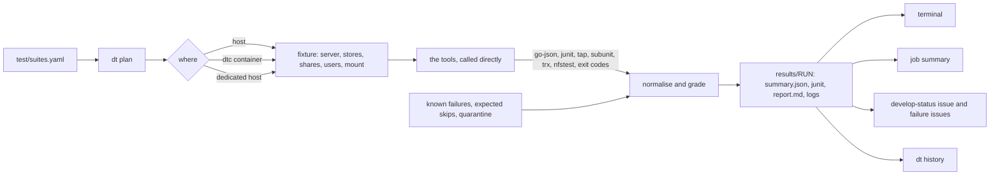

# RFC 29 — one test harness, with a suite registry, one runner and one result format

**Status:** reviewed: accepted (#2975), revision 5: the questions §9 held are settled. Nothing here is
implemented yet; §8 orders the work.
**Discussion:** #2975, and the pull request that settled §9.

## Summary

**The problem.** DittoFS has many good test suites, but no single way to run them and no
reliable way to tell what they found.

- **Every suite is run its own way.** 18 workflows and about 30 jobs per pull request, with 35
  glue scripts (about 8,900 lines) between CI and the test tools.
- **Green doesn't always mean tested.** A check of every test workflow's latest green runs found
  14 cases that pass without testing what they claim. S3 cells never reach S3, Kerberos tests skip,
  and 70 WPTS tests never execute. All are filed (#2986 to #3000); #2986, #2989, #2990, #2993,
  #2998 and #3000 are fixed.
- **Red goes unnoticed.** The nightly conformance run has failed every night since 2026-09-10,
  and the AD-DC suite failed on every develop run after #2914. Nobody was told.
- **Most tests don't decide merges, and PRs are slow.** A PR waits 25–40 minutes, and only unit,
  integration, lint and security checks can block it.

**The proposal.**

- **One command, `dt`, written in Go,** runs every suite the same way on a laptop and in CI.
- **One file, `test/suites.yaml`, lists the 15 suites.** A variant of a suite is an option of it,
  and sets of suites are groups.
- **`dt` builds the DittoFS server each suite needs** (the fixture) and calls each test tool
  directly. The per-suite scripts go.
- **A suite can't pass without running.** A missing prerequisite, a failed setup check or, in a
  suite that keeps a known-failure list, an unexpected skip is reported as "not run", never as a
  pass.
- **One result format:** CTRF JSON, with JUnit for CI tools. Results are graded against known
  failures and expected skips kept as YAML, and history answers "is this flaky?".
- **Three tiers.** A quick run on every PR, on the production storage profile only, aiming at 20
  minutes or less. The full set after every merge. The long suites nightly. One gate check decides
  merges.
- **One develop-red issue, updated in place,** plus an issue per failing test with guardrails.
  Red gets noticed, without the floods that got the last alarm removed (#1705).

**Decided:** Go from the start, CTRF, and GitHub issues with the project board for tracking (team
call and reviews, 2026-10-08).
**Settled (§9, 2026-10-13):** smbtorture is sharded, merge runs queue and the test set
never changes with load, a fixture's setup is never retried, the Go suites grade their skips
package by package from e2e, the dedicated host is `ditto`, and the gate becomes required after
two green weeks.
**Plan (§8):** seven steps, conformance first. Each step ships on its own, and an old CI job keeps
running beside its replacement until their results match.

## About this document

Read this before adding a test suite, changing a test workflow, or touching `test/harness/`. It
describes the harness we want to end up with, and how to get there from what exists, suite by
suite.

**Builds on:** the `dt` harness on `dev/test-harness` (`1b9d49b9`, and since 2026-10-13
`ce1a6781`, which drops the conformance Postgres and the separate KMIP step) as a reference, the conformance
graders and their tests, the system scenarios in `test/scenarios/`, and `dfsbench` (`cmd/bench`).
**Checked against:**
- `develop` at `d0efaa75` (at `e33edad6` for #2955) and `dev/test-harness` at `1b9d49b9`, on
  2026-10-07;
- `develop` at `0d8dbdd8` and the logs of each test workflow's latest green develop runs, on
  2026-10-08;
- `develop` at `7d6acc81` and the 2026-10-12 PR and E2E runs, for revision 4.

Appendix A lists what was checked and what turned out different from what was assumed. The
revision history is in the pull request's description.

---

## Start here

*Explanatory. The rules are in §1 onward; where this section and a rule differ, the rule wins.*

### In plain words

DittoFS has 15 test suites, and today each one is started its own way and
reports its own way. `dt` is one command that runs them all the same way, on a
laptop or in CI. It reads one file, `test/suites.yaml`, which lists every suite.
For each suite it builds the DittoFS server the tests need, the **fixture**,
and runs the test tool. It grades the results against lists of known failures
and expected skips. Think of one report card for every subject: each teacher grades
differently, but the card uses one scale. On this card "absent" is never written
as "passed": a suite that did not run says so. Where the analogy stops, `dt`
also remembers past runs, so "is this test flaky?" has an answer.

### Scenarios

**A pull request breaks one pjdfstest test.**

1. The PR runs the `pr` tier, the quick set; pjdfstest runs there on the
   production profile, `badger-s3`, only ([§4.3](#4.3%20Tiers)).
2. The failing test is on no known-failure list, so it is graded a new failure
   and its cell exits 1 ([§4.4](#4.4%20The%20command%20line)).
3. No retry runs on a pull request, so a flaky test cannot sneak in
   ([§4.7](#4.7%20Grading%3A%20known%20failures%2C%20expected%20skips%2C%20quarantine%2C%20retries)).
4. The `gate` job fails, because a blocking cell did not exit 0
   ([§4.8](#4.8%20CI)).

Outcome: the PR shows one red gate, and its report names the test.

**The bucket for a `badger-s3` cell refuses writes.**

1. Before the first test, the fixture checks itself: the server answers, and
   the bucket accepts a write and a read
   ([§4.2](#4.2%20Fixtures%3A%20the%20DittoFS%20a%20suite%20runs%20against)).
2. The bucket check fails, so no test runs.
3. The cell exits 2, "not run", never a pass
   ([§4.4](#4.4%20The%20command%20line)).
4. A failed fixture step is never retried; someone re-runs the cell by hand
   ([§4.2](#4.2%20Fixtures%3A%20the%20DittoFS%20a%20suite%20runs%20against)).

Outcome: a cell that tested nothing shows as "not run" instead of green.

**A test fails once on develop, then passes.**

1. After a merge, the `merge` tier runs with `--retry 1`, which re-runs only the
   failed tests ([§4.8](#4.8%20CI)).
2. The test passes on retry, so it is graded flaky: no develop-red issue opens,
   and `dt history` counts it
   ([§4.7](#4.7%20Grading%3A%20known%20failures%2C%20expected%20skips%2C%20quarantine%2C%20retries)).
3. Flaky twice in a week on develop, it becomes a quarantine candidate
   ([§4.7](#4.7%20Grading%3A%20known%20failures%2C%20expected%20skips%2C%20quarantine%2C%20retries)).
4. Quarantined, with an issue and an expiry date, it still runs but never fails
   a run or alerts
   ([§4.7](#4.7%20Grading%3A%20known%20failures%2C%20expected%20skips%2C%20quarantine%2C%20retries)).

Outcome: a flaky test is tracked, not ignored, and wakes nobody up.

**A merge really breaks develop.**

1. The `merge` run still has a new failure after its retry, so it exits 1
   ([§4.8](#4.8%20CI)).
2. One issue labelled `develop-red` opens, or the open one is updated. Its body
   is the current failing set, rewritten in place ([§4.8](#4.8%20CI)).
3. A test failing 2 runs in a row also gets an issue of its own, unless more
   than 10 tests fail at once ([§4.4](#4.4%20The%20command%20line)).
4. The develop-red issue closes once every test in its set passes again in the
   tier that runs it, or is listed known or quarantined ([§4.8](#4.8%20CI)).

Outcome: red is noticed once, through one issue, without a flood of mail.

**A pull request changes only documentation.**

1. `dt plan --base` compares the branch with the PR's base ([§4.8](#4.8%20CI)).
2. Every changed path is documentation, so the plan has no cells
   ([§4.8](#4.8%20CI)).
3. The `gate` job passes with nothing to wait for ([§4.8](#4.8%20CI)).

Outcome: a docs-only PR is not held up by test suites.

## 1. Why

Every suite has its own entry point, its own setup and its own way of saying how it went:

- **Many entry points.** Unit, integration and e2e tests run as inline `go test` lines in their
  workflows, and lint as inline steps in `lint.yml`. Conformance runs through
  `test/conformance/run.sh`, scenarios through `test/scenarios/setup.sh`, and `dfsbench` through
  `cmd/bench`. `dt` wraps most of them, but it lives on an unmerged branch. The repository has 18
  workflows, and a non-docs PR starts about 30 jobs across them.
- **Wrappers around wrappers.** A conformance cell in CI runs `test/conformance/run.sh`, which runs
  the suite's scripts, which run the tool. The Makefile's `test-*` targets wrap the same scripts
  once more, and no workflow uses them.
- **The same work written several times.** The server setup (log in, add the stores) is written
  in at least five places: the two `bootstrap.sh`, `setup-posix.sh`, and two jobs of
  `smb-client-compat.yml`. The conformance matrix is resolved separately in `conformance.yml` and
  `nfs-pynfs.yml`. Ten workflow steps write their own job summary inline, and two of them
  (`smb-client-compat.yml`, Linux and macOS) print a hard-coded all-green table under
  `if: always()`.
- **Green results that test nothing.** A check of every test workflow's latest green develop runs
  on 2026-10-08 found these. Each is filed:

  | What reports green | What actually happens | Issue |
  |---|---|---|
  | pjdfstest and pynfs `badger-s3` cells | Nothing creates their bucket. Localstack answers every request with `NoSuchBucket` and receives no upload; the NFSv4 pjdfstest cell graded 8,789 tests green this way | #2986, fixed by #3013 |
  | NFS `sec=krb5` conformance | The client can't load the NFS module in its container, prints "skipping test", exits 0, and has done so on every retrievable run | #2987 |
  | SMB Kerberos e2e | 11 subtests skip on every run (`mount error(126)`), at least since July, while their parents report PASS | #2989, fixed by #3027 |
  | `TestRealKDC` (tag `kerberos`) | No job built the tag, so it fell behind three server changes and neither compiled nor passed | #2990, fixed by #3002 |
  | WPTS BVT | 70 of 335 tests never execute, graded as skips with no list of which are expected | #2995 |
  | pynfs | Only the `all` flag runs: 601 of 689 tests in 4.0, 184 of 266 in 4.1; delegations, reboot and blocking locks never run | #2996 |
  | e2e | The NFSv4 ACL, nightly dedup and stress tests skip on every run; 19 cross-protocol error cases skip; several tests can't fail on what they're named for | #2991, #2992, #2993 (fixed by #3026) |
  | smb-client-compat, Windows | The `net use` step has skipped on most runs since mid-September, because port 445 is taken on hosted runners, and the job still passes | #2994 |
  | portmap system test | Its result is replayed from the Go test cache | #2998, fixed by #3024 |
  | performance and allocation gates | They skip under `-race` and `-short`, and no job runs them otherwise | #2999 |

  In each, a setup problem, a missing tool or a skip reads as a pass.
- **The tools' own results go unread.** Nothing writes JUnit XML or a run summary. pynfs writes
  JSON, and its grader parses the text log instead. pjdfstest is graded from prove's text summary,
  and smbtorture's subunit lines by a hand-written parser. Only fio's JSON is read, by `dfsbench`.
  Nothing records which tests failed in which run, so "is this flaky?" has no answer except
  reading old logs.
- **Most tests don't gate merges.** Until 2026-10-08 the required checks were lint and security
  only. Since then `Unit Tests` and `Integration Tests` are required too, and #2972 moved their
  path filters inside the jobs so a PR that doesn't need them isn't blocked. Conformance, e2e and
  the scenarios still gate nothing.
- **Nobody hears when develop goes red.** The develop-red e-mail and issue were removed in #1705,
  because flaky smbtorture subtests set them off constantly. Since then:
  - the nightly conformance run has failed every night since 2026-09-10, because its baseline job
    pushes to develop and the ruleset refuses, while its summary job stays green (#2997);
  - the AD-DC suite failed on every develop run from #2914 on, because one test still asked for
    the removed memory metadata store (fixed in #2980).

  Nothing said so.
- **Scenarios carry no signal.** The 42 system scenarios run twice a day on a dedicated host, and
  in no CI job. About half fail by design, because they reproduce open issues, but no list says
  which. A red run looks the same whether something regressed or not.
- **PRs are slow.** On 2026-10-07 (300 PR workflow runs) Conformance Suites took 23 min median
  and 39 min at p90, NFS Protocol Conformance 17 and 25, Unit Tests 14. A PR waits 25–40 min for
  its slowest workflow.

## 2. Requirements

| # | Requirement | Met when |
|---|---|---|
| R1 | One entry point, run the same way on a laptop and in CI | every CI test step is a `dt` command a developer can paste |
| R2 | One registry file of suites, in YAML, with its format specified | §4.1 is the format; `dt` refuses a file that doesn't match it |
| R3 | A new suite is one line | the one-line form in §4.1 runs with defaults |
| R4 | Runs and failures are tracked by the harness itself | every run writes §4.6's results; `dt history` answers "since when, how often" |
| R5 | Everything else is automatic | services, matrix, fixtures, grading, retries and reports need no per-suite code |
| R6 | A quick tier on PRs, the full suite after every merge to develop, more each night | §4.3's tiers and §4.8's workflow; no selection by changed layer |
| R7 | An alert when develop goes red, without the flood that removed the last one | §4.8's single issue, after retry, excluding quarantined tests |
| R8 | External-tool suites first, and green | pjdfstest, pynfs, WPTS, smbtorture, the system scenarios and fio report no new failures |
| R9 | Adapt the harness; keep what's tested, replace what isn't | the graders' rules carry over with their tests; each suite's scripts give way to a fixture (§4.2) once its results match, and are deleted in the same change |
| R10 | Not run is never passed | an unmet need, a fixture that fails its own check, a suite that ran no tests, or, in a suite with a `known` file, a test that skips without being an expected skip ends in exit 2 (§4.4, §4.7) |
| R11 | Each component RFC names the suites that cover it | every RFC under `docs/internals/rfcs/` has a section naming its harness suites or groups (§4.9), once #2894 lands them there |

"Green" means no new failures, no unexpected skips and no unexpected passes (§4.7). Every failing
test is either fixed or listed as a known failure, and in a suite that keeps a known-failure list
every skipping test is listed as an expected skip, each with its reason (§4.7).
That's how the conformance suites already handle failures, and it's the only definition that lets
a suite which reproduces open bugs be green.

## 3. Decision: a command-line tool, written in Go

### A CLI, not an API service

The entry point is a CLI, `dt`. An HTTP service that runs tests would need a host, authentication
and a deployment, and a developer's laptop would talk to it differently from CI. That breaks R1.
The tools this harness is compared with are all commands run the same way everywhere:
`bazel test //...`, Kubernetes' `make test` over `hack/` scripts, xfstests' `./check -g quick`,
LTP's runtest files.

The machine-facing part, what other programs build on, is a set of files with versioned formats:

- **input:** the registry (§4.1) and the known-failure files (§4.7);
- **output:** `summary.json` in CTRF, JUnit XML generated from it, and a Markdown report per run
  (§4.6);
- **status:** the exit code (§4.4).

CI, the dedicated host, an issue bot or a future dashboard read those files. If a dashboard is ever
built, it reads results; it doesn't run tests.

### In Go, from the start

`dt` on `dev/test-harness` is one 1,270-line bash script. What R2–R11 add is data handling:
- parsing YAML and expanding a matrix;
- setting up fixtures;
- reading `go test -json`, TAP, subunit, TRX, JUnit, nfstest's and fio output;
- grading against lists;
- writing JSON and JUnit, and reading history.

In bash that needs `yq` and `jq` (the Nix dev shell has neither) and can't be unit-tested in any
reasonable way. In Go:

- the dependencies are already direct ones in `go.mod`: `gopkg.in/yaml.v3` and `cobra`;
- every piece is a package with `go test` tests, which the repository already expects of its code;
- it runs natively on Linux, macOS and Windows, where the Windows unit tests and the SMB
  client-compatibility job run.

The team decided on 2026-10-08 to write it in Go from the start. The bash `dt` is not landed first
and rewritten later: the branch is the reference for the commands people already use and the
behaviour they expect, and it stays unmerged.

Shell keeps what is shell by nature: the `dtc` container, the service containers and the
scenario host. Starting a DittoFS server on a store profile, adding its shares and users, and
mounting it move into Go as the fixture (§4.2). Today that setup is shell, copied into each
suite's scripts, and it is where §1's silent passes come from.

`dt` is the one entry point, and it calls each tool itself. No suite keeps a script between `dt`
and its tool, and none gains one: a need the fixture can't express becomes a new fixture field in
`dt`, with a test, not a setup script.

What carries over:

- **The commands people use today, as aliases:** `dt unit` is `dt run unit`, and
  `dt pynfs --profile badger` is `dt run pynfs/badger`.
- **What the scripts know that isn't written down anywhere else.** Each item moves into `dt` with a
  test:
  - pynfs's 4.1 tree tests NFSv4.2 unless `--minorversion` is given;
  - pjdfstest needs NFSv4 delegations off;
  - adapter settings need a restart, or a wait for the server's 10-second settings watcher;
  - e2e output goes to a file, because a leftover process holding a pipe hangs its reader;
  - a scoped pynfs run that skipped the tests it named isn't a pass;
  - smbtorture's connection failures on a starved runner are reclassified;
  - NFSv4.0 callbacks need a non-loopback server address, because DittoFS refuses loopback
    callbacks;
  - pjdfstest mounts with `noac,sync,lookupcache=none`, and with `nolock` on NFSv3;
  - a kernel Kerberos mount needs `rpc.gssd` restarted once `/etc/krb5.keytab` exists, since its
    unit only starts then, and a root SMB mount reads its ticket from root's default cache, never
    from `KRB5CCNAME` (#3027).
- **The grading rules** (known-failure matching, smbtorture's connection-failure filter and
  truncation handling) move into Go, with the graders' test cases as test data. The shell
  self-tests (`run_test.sh`, `run-e2e-selftest.sh`, the parser and grader tests) become Go tests
  of `dt`, case by case.
- **The rest:** the known-failure lists (as data, §4.7), `setup.sh` for the scenarios (Radu's),
  and `dfsbench`.

What goes: 35 of the 92 shell scripts under `test/` and `.github/scripts/`, about 8,860 lines.

- **The dispatcher:** `test/conformance/run.sh`, with `suites.json`, `check-docs.sh` and their
  tests. `dt` plans the cells, and the registry holds the profiles, PR subsets and known-failure
  paths.
- **Each suite's setup, run and grading scripts:**
  - `setup-posix.sh`, `run-posix.sh`, `teardown-posix.sh`;
  - the two `bootstrap.sh`, `compose-env.sh`;
  - `smb-conformance/run.sh`, `smbtorture/run.sh`, `run-pynfs.sh`, pynfs's `baseline-knfsd.sh`;
  - `nfs-conformance/run.sh`;
  - the four `parse-results.sh` and `common/known-failures.sh`, with their tests.
- **#3008's cthon04 and nfstest entries** in `suites.json`, with their glue and Markdown lists. They
  become registry suites, with its named mount-option sets as a `matrix` axis (§4.2).
- **The NFS `sec=krb5` conformance job:** its client test and its KDC entrypoint. The e2e suite's
  kernel-client Kerberos tests cover the same mounts, over krb5, krb5i and krb5p and NFSv3 and v4,
  and they pass.
- **The runners around `go test`:** both `run-e2e.sh` and its self-test, and the `run.sh` of
  ad-dc, kerberos and portmap. The KMIP service's start and certificate scripts become
  `dt services` code.
- **Targets that only call scripts:** the Makefile's `test-*` targets, the two conformance
  Makefiles and `flake.nix`'s `dfs-posix`.

What stays, because it isn't an entry point:
- the 42 scenarios, `setup.sh` and `lib/report.sh`;
- the tests and tools written in shell: the two crash rigs, `edge-test.sh`, the NLM interop driver
  and `pcap-diff.sh`;
- the three entrypoints of the KDC and AD-DC service containers;
- the repository checks lint runs: `required-tests.sh`, `new-package-tests.sh`,
  `commit-type-matches-diff.sh` and `no-ai-attribution.sh`;
- `combined-tree.sh`.

nfstest's `baseline-knfsd.sh` stays too, though it is an entry point, with `nfs-knfsd-baseline.yml`:
a dispatch-only evidence job outside the registry, which nfstest's known list cites. Its export goes
to namespaced clients and its report compares each known-failure row, so it stays until a `knfsd`
fixture has `clients` and `dt` has a per-row comparison.

### Getting `dt`

`dt` is a Go command in the main module, `cmd/dt`. `test/harness/bin/dt` stays the path people
type: a shim that builds `./cmd/dt` with `go build` and runs it, so a developer needs nothing but
Go, and the build is cached after the first call. It doesn't use `go run`, which turns every
failing exit status into 1 and would hide `dt`'s (§4.4). CI builds it once per job with
`go build -o`.

`dt` runs as the user who started it. Only the steps that need root call `sudo -n`, one by one: the
fixture's mounts and unmounts, starting the server with the one capability that binds port 445 for
WPTS (§4.2), restarting `rpc.gssd`, and the commands of a suite whose own `needs` name `root`.
Unless its format is `go-json`, such a suite runs each command as
`sudo -n env -C DIR NAME=value ... CMD`, as pjdfstest's `prove` must run. `env` enters the suite's
`dir` as root, since the user may have no access to it, as to a mount whose share grants that user
nothing; `sudo`'s own `--chdir` would need a `runcwd` in sudoers, which few hosts grant. The needs a
fixture implies (§4.2) don't make its commands run as root, and a suite that needs root doesn't run
on a namespaced client yet: no suite does. A Go suite whose tests need root themselves, like e2e,
which mounts from inside `go test`, runs with `go test -exec 'sudo -n env ...'`: `go` builds the
test binaries as the user, and runs only each binary under `sudo -n`, in its package's directory and
with the flags `go test` gives every binary. The e2e tests start `dfs` and `dfsctl`, and today build
them from inside the test binary; run as root, those builds would write root's files into the user's
Go caches, and fail on the modules only the binaries use. So before a root suite runs, `dt` builds
both as the user into `{bin}` and passes it as `DITTOFS_E2E_BIN`, and the e2e helpers take the
binaries from there rather than building them. Root never runs `go build`: the Go caches and the
results stay the user's, and the `root` need (§4.5) means passwordless sudo, not running `dt` under
sudo.

`sudo` resets the environment by default (`env_reset`), so nothing reaches a command run under it
by inheritance. `dt` passes what the command needs explicitly, as `sudo -n env NAME=value ...`:
the suite's `env` (e2e's `DITTOFS_E2E_REQUIRE_*` and `DITTOFS_E2E_NIGHTLY`), the variables of
the services the suite needs (`LOCALSTACK_ENDPOINT`, for one, so e2e uses the Localstack its
`service:` need found rather than starting its own), `DITTOFS_E2E_BIN` and `PATH`. The commands of a
suite that isn't `go-json` get its `env` and `PATH` only, as they get neither of the others when
they run as the user. Today's e2e job does the same by hand, with `sudo -E env "PATH=$PATH" ...`. A
fixture sets no variables: it gives its values as placeholders (§4.2), and a suite that needs one in
a variable puts it in its `env`, as `fio-verify` puts `{mount}` in `BENCH_DIR`. A secret never goes
on a command line, where any user can read it while the process runs: the server started under
`sudo` for port 445 gets the admin's password from `dt`'s environment, through
`sudo -n --preserve-env=NAME`.

## 4. Design



The tools are the ones the suites already use: `go test`, `prove` with pjdfstest, `pynfs`,
`smbtorture` and WPTS in their containers, `fio`, `dfsbench`, and `setup.sh` for the scenarios.
The registry, the planner, the fixtures, normalising, grading and the result files are the new
parts.

### 4.1 The registry: `test/suites.yaml`

One file lists every suite. A suite is a command that runs many tests. Tests inside a suite are
found by the suite, not listed here: Go tests by `go test`, scenarios and fio jobs by a file glob,
pynfs tests by pynfs. Adding a test is adding a file, and touches no shared file.

There are few suites. A variant of a suite is an **option** of it, not a suite of its own: the
portmap, Kerberos and AD-DC integration tests are options of `integration`, the Kerberos run is an
option of `smbtorture`, and the Windows unit run is an option of `unit`. **Groups** name sets of
suites to run together.

This is the format. The values show the intended first version.

```yaml
# test/suites.yaml: every test suite, one entry each. `dt list` prints it; `dt plan` expands it.
version: 1

defaults:            # any suite field; a suite's own value wins
  format: exit       # how results are read (§4.6)
  tier: merge        # the smallest tier that runs the suite: pr < merge < nightly; manual never auto
  timeout: { test: 30m, cell: 60m }   # each test, and the whole cell

groups:              # `dt run GROUP` runs every suite in it
  lint: [lint-go, lint-repo, shellcheck]
  go: [unit, integration, e2e, operator]
  conformance: [pjdfstest, pynfs, wpts, smbtorture]
  perf: [fio-verify, bench-smoke]

suites:
  # The one-line form, for a hypothetical suite: a name and a command. Exit status 0 is a pass.
  nfs-mount-smoke: { cmd: test/nfs/mount-smoke.sh, tier: pr, needs: [linux, root, nfs-client] }

  # Lint. `job` keeps the check names the develop ruleset requires; each job runs `dt run NAME`.
  lint-go:
    job: Go Checks
    tier: pr
    cmd:
      - go mod verify                           # the module cache still matches go.sum
      - { sh: 'test -z "$(gofmt -s -l .)"' }   # a command that needs a shell says so
      - go vet ./...
      - go vet -tags=e2e,integration,ad_dc,portmap_system,kerberos,stress ./...   # tagged tests compile
      - go run ./test/spec-citations
      - test/required-tests.sh
      - golangci-lint run --timeout=5m          # the version lint.yml pins
  lint-repo:
    job: Repo Checks
    tier: pr
    cmd:
      - test/new-package-tests.sh {base}
      - test/commit-type-matches-diff.sh {base}
      - test/no-ai-attribution.sh {base}
      - dt docs --check                         # was check-docs.sh
      - dt doctor                               # fails on an expired quarantine entry (§4.7)
      - .github/scripts/combined-tree.sh selftest
      - go test ./test/harness/...              # dt's own tests, which absorb the shell self-tests
  shellcheck:                           # *.sh, and the executables without an extension that start with a shell's #!
    job: ShellCheck
    tier: pr
    cmd:
      sh: |
        git ls-files -s | while read -r mode _ _ f; do
          [ -f "$f" ] || continue
          case "${f##*/}" in
            *.sh) ;;
            *.*) continue ;;
            *) [ "$mode" = 100755 ] && head -n1 "$f" | grep -Eq '^#! */[^ ]*/(env *)?[abk]*sh' || continue ;;
          esac
          printf '%s\0' "$f"
        done | xargs -0 shellcheck --severity=warning

  unit:
    job: Unit Tests (1.26.x)            # the name the ruleset requires, until it requires the gate (§4.8)
    format: go-json
    cmd: go test -race {args} -timeout=25m -coverprofile={out}/coverage.txt ./pkg/... ./internal/... ./cmd/... ./test/...   # the profile Codecov gets (§4.8)
    args: { pr: "-short" }              # pull requests run the short suite, as today
    tier: pr
    options:
      windows:                          # dt run unit --windows; dt plan gives it a Windows runner
        cmd: go test -short -race -p 2 -timeout=25m ./...
        needs: [windows]
        blocking: { pr: false }         # reported on PRs, blocking after merge (§9)
      nonrace:                          # the throughput and allocation gates that skip under -race
        cmd: "go test -timeout=25m -run=^(TestBLAKE3FasterThanSHA256|TestSealChunk_AllocBounded)$ ./pkg/block/ ./pkg/block/middleware/compression/"
        tier: nightly
  integration:
    job: Integration Tests (1.26.x)
    format: go-json
    cmd: go test -tags=integration -p 1 -timeout=20m {packages}
    packages: { tag: integration }      # the packages whose tests the tag changes, from `go list`
    tier: pr
    needs: [docker, "service:postgres", "service:kmip"]
    options:
      portmap:  { cmd: go test -tags=portmap_system -timeout=2m ./test/integration/portmap/..., needs: [linux, rpcbind] }
      kerberos: { cmd: go test -tags=kerberos -timeout=5m ./test/integration/kerberos/, needs: [docker] }
      ad-dc:    { cmd: go test -tags=ad_dc -timeout=20m ./test/integration/ad-dc/, needs: [linux, docker, smb-client], tier: merge }
  operator:                             # its own Go module; the kustomize render check becomes a make target
    cmd: make -C k8s/dittofs-operator test lint manifests-verify
    tier: pr
  e2e:
    format: go-json
    cmd: go test -tags=e2e -timeout=30m ./test/e2e/...
    env:
      DITTOFS_E2E_REQUIRE_NLM: "1"      # a missing prerequisite fails instead of skipping
      DITTOFS_E2E_REQUIRE_KERBEROS: "1" # the same for Kerberos mounts
      nightly: { DITTOFS_E2E_NIGHTLY: "1" }
    needs: [linux, root, nfs-client, smb-client, nfs4-acl-tools, "service:localstack"]
    options:
      stress: { cmd: "go test -tags=e2e,stress -timeout=60m ./test/e2e/...", tier: nightly }   # quoted: a comma ends a flow value
      kerberos:                         # the Kerberos mounts, on pull requests that can affect them
        cmd: go test -tags=e2e -run Kerberos -timeout=30m ./test/e2e/
        tier: pr
        paths:
          - internal/adapter/**
          - pkg/adapter/**
          - pkg/metadata/**
          - internal/auth/**
          - pkg/auth/**
          - pkg/identity/**
          - pkg/controlplane/**             # export auth policy, users and identity mappings
          - internal/controlplane/**        # the identity mapping and provider API
          - pkg/config/**                   # the Kerberos keytab and principal
          - cmd/dfs/**                      # the server's Kerberos capability at start
          - "test/e2e/*kerberos*"
          - test/e2e/framework/kerberos.go
          - test/integration/kerberos/**

  # Conformance. Each tool is called directly, against the suite's fixture (§4.2). `matrix`
  # replaces suites.json's profiles. Commands are shortened: the flags each tool needs are in its
  # script today, and move here with it. Conformance runs the production profile, badger-s3,
  # only (§4.3).
  pjdfstest:
    format: tap                         # each test file prints TAP; no prove summary to parse
    cmd: prove -v {test}
    dir: "{mount}"                      # run in the mounted share
    tests: "{tools}/pjdfstest/tests/*/*.t"
    matrix: { profile: [badger-s3], nfs: ["3", "4", "4.1"] }
    fixture:
      profile: "{profile}"
      nfs: { version: "{nfs}", options: "noac,sync,lookupcache=none" }   # mounted at {mount}; v3 adds nolock
      squash: none                      # root keeps its privileges, as pjdfstest needs (§4.2)
      users: [65532, 65533, 65534]
      delegations: false                # the server must see every operation
    known: test/posix/known.yaml
    tier: pr
    needs: [linux, root, nfs-client]
  pynfs:
    format: junit                       # pynfs writes JUnit itself with --xml
    cmd: "{tools}/pynfs/bin/pynfs-4.{minor} {server}:{nfs-port}/export --minorversion {minor} --security sys --uid 0 --gid 0 --rundeps --maketree --xml {out}/junit.xml {names}"
    names: all                          # what {names} holds when a run names no tests
    matrix: { profile: [badger-s3], minor: ["0", "1"] }
    fixture: { profile: "{profile}", nfs: export, squash: none, lease: 30s, users: [1] }   # pynfs mounts nothing; uid 1 is its second client
    known: test/nfs-conformance/pynfs/known.yaml
    tier: pr
    needs: [linux]
    options:
      knfsd:                            # the same tests against the kernel's NFS server, for comparison
        matrix: { minor: ["0", "1"] }   # an option replaces `matrix` too: knfsd has no profile
        fixture: { server: knfsd, nfs: export, squash: none, lease: 30s }   # as pynfs's baseline-knfsd.sh sets knfsd up
        tier: manual
        blocking: false
  wpts:
    format: trx                         # WPTS's own TRX file
    image: mcr.microsoft.com/windowsprotocoltestsuites:fileserver-v8   # its entrypoint runs the tests
    env:                                # its entrypoint only lists the tests unless DryRun is false,
      Usage: RunTestCases               # and writes these over the config's, so they repeat the fixture's
      Filter: TestCategory=BVT
      DryRun: "false"
      SutComputerName: "{server}"
      SutIPAddress: "{server}"
      DomainName: localhost             # without a dot, WPTS stays in workgroup mode: the fixture has no domain controller
      AdminUserName: "{user}"
      PasswordForAllUsers: "{password}"
    matrix: { profile: [badger-s3] }
    fixture:
      profile: "{profile}"
      smb: { encryption: preferred, port: 445 }   # WPTS connects to 445 only
      shares: test/smb-conformance/shares.yaml    # the 8 shares and their flags, as data
    templates: test/smb-conformance/ptfconfig/*.template   # WPTS's own config, filled in by dt
    volumes: { "{out}/config": /data/fileserver }
    known: test/smb-conformance/known.yaml        # failures, and the expected not-executed tests
    tier: pr
    needs: [linux, docker]
  smbtorture:
    format: subunit                     # smbtorture's test:, success: and failure: lines
    image: quay.io/samba.org/samba-toolbox:v0.8
    cmd: "smbtorture //{server}/{share} -p {smb-port} -U{user}%{password} {test}"
    tests: test/smb-conformance/smbtorture/tests.txt   # the list smbtorture/run.sh holds today, with each test's share and name prefix
    timeout: { test: 5m }               # run.sh's one limit for each test of its list
    matrix: { profile: [badger-s3] }
    fixture: { profile: "{profile}", smb: { port: 445 }, shares: test/smb-conformance/shares.yaml, reset: each }   # its multichannel test dials 445
    known: test/smb-conformance/smbtorture/known.yaml
    tier: pr
    shards: 2                           # over two runners, in every tier (§9)
    needs: [linux, docker]
    options:
      kerberos:                         # dt run smbtorture --kerberos
        cmd: "smbtorture //{server}/{share} -p {smb-port} -U{user}@{realm}%{password} --use-kerberos=required {test}"
        volumes: { "{krb5-conf}": /etc/krb5.conf }   # where smbtorture finds the KDC
        tests: [smb2.session, smb2.read, smb2.lock]
        timeout: { test: 20m }          # as run.sh --kerberos gives each
        matrix: {}                      # one cell: it pins its profile
        fixture: { profile: badger-s3, smb: true, shares: test/smb-conformance/shares.yaml, kerberos: true }
        known: test/smb-conformance/smbtorture/known-kerberos.yaml
        tier: merge
        shards: 1                       # its three tests in one cell

  # #3008's suites: what a kernel client sees through an untuned mount, one change at a time.
  # Each runs as the user dt runs as, on a namespaced client, so NFSv3 locks reach the server.
  cthon04:
    tests: test/nfs-mount/cthon04/tests.txt   # each program on its own, with its command line
    cmd: "{test-args}"
    dir: "{tools}/cthon04"
    matrix:
      profile: [badger-s3]
      mount-options:                    # #3008's named option sets, each NAME: its options
        - default: ""                   # none: the kernel negotiates
        - v3: vers=3,tcp,mountproto=tcp
        - v4.0: vers=4.0
        - v4.1: vers=4.1
        - v4.1-noac: vers=4.1,noac
        - v4.1-smallio: vers=4.1,rsize=32768,wsize=32768
    fixture:
      profile: "{profile}"
      nfs: { options: "{mount-options}" }    # mounted at {mount}, at the version vers= gives
      shares: test/nfs-mount/shares.yaml     # everyone reads /export, as a squashed root must to mount it
      users: [self]
      client: namespace
      rpcbind: host
    known: test/nfs-mount/cthon04/known.yaml
    timeout: { test: 10m }
    tier: pr
    needs: [linux]
  nfstest:
    format: nfstest
    tests: test/nfs-mount/nfstest/tests.txt   # the modules, each with the option sets it runs on
    cmd: "{tools}/nfstest/bin/nfstest_{test} --server {server} --port {nfs-port} --export /export --nfsversion {nfs} --mtpoint /tmp/dittofs-test --mtopts {mtopts} --rmtraces --notty {test-args}"
    matrix:
      profile: [badger-s3]
      mount-options:                    # the same sets as nfstest's flags: it mounts by itself
        - default: { nfs: "4.2", mtopts: hard }
        - v3: { nfs: "3", mtopts: "hard,tcp,mountproto=tcp" }
        - v4.0: { nfs: "4.0", mtopts: hard }
        - v4.1: { nfs: "4.1", mtopts: hard }
        - v4.1-noac: { nfs: "4.1", mtopts: "hard,noac" }
        - v4.1-smallio: { nfs: "4.1", mtopts: "hard,rsize=32768,wsize=32768" }
    fixture: { profile: "{profile}", nfs: export, shares: test/nfs-mount/shares.yaml, users: [self], client: namespace, clients: 2, rpcbind: host }
    known: test/nfs-mount/nfstest/known.yaml
    timeout: { test: 20m }
    tier: nightly
    needs: [linux]

  # Each OS's own clients mount the fixture's share, and the workloads run over the mount. Replaces
  # smb-client-compat.yml once its results match. The suite itself is the Linux run, with every
  # workload; macOS and Windows run a smoke test (§9).
  clients:
    tests: test/clients/*               # the workloads: today's smb-client-compat checks
    cmd: "{test} {mount}"
    fixture: { profile: badger-s3, smb: { mount: true }, nfs: "4.1" }
    needs: [linux, root, smb-client, nfs-client]
    tier: nightly
    options:                            # hosted macOS runners have no Docker, and Windows runners run Windows containers only, so no S3 there
      macos:   { needs: [macos], fixture: { profile: memory, smb: { mount: true }, nfs: "4" } }     # macOS mounts NFS 3 and 4.0
      windows: { needs: [windows], fixture: { profile: memory, smb: { mount: true }, nfs: "3" } } # net use /TCPPORT, no port 445; NFS 3 only

  # The system scenarios: a real server in a container, real clients, faults injected.
  system:
    cmd: { sh: 'test/scenarios/setup.sh "$(basename {test})"' }   # setup.sh takes a scenario's file name
    tests: test/scenarios/[0-9][0-9]-*.sh
    select: { merge: "[0-8]?-*.sh" }    # nightly runs all; the 0x smoke group joins pr once timed
    env: { SLACK_DIR: /nonexistent }    # dt reports the run; setup.sh posts to Slack on its own runs only (§4.6)
    known: test/scenarios/known.yaml
    needs: [linux, podman]
    needs_by_test:                      # the long runs only fit the dedicated host (§4.5)
      "9?-*.sh": ["host:dedicated", "disk:110"]
    timeout: { test: size, cell: 90m }  # test: from the size in the file name; cell: per shard (below)
    shards: 4                           # split over 4 CI jobs
  fio-verify:
    cmd: "fio --output-format=json --output={out}/{test}.json {test}"
    tests: bench/workloads/*.fio
    exclude: [bench/workloads/layout.fio]   # a preparation job, not a test
    fixture: { profile: badger-s3, nfs: "4.1" }
    env: { BENCH_DIR: "{mount}" }       # the job files write to ${BENCH_DIR:-/mnt/bench}
    metrics: fio-json                   # numbers recorded; a job with a non-zero `error` fails, a failed verify included
    tier: nightly
    needs: [linux, root, nfs-client]
    options:
      smb: { fixture: { profile: badger-s3, smb: { mount: true } }, needs: [linux, root, smb-client] }
  bench-smoke: { cmd: go run ./cmd/bench run --smoke, metrics: dfsbench-json, tier: pr, blocking: false }   # bench-smoke.yml today
```

| Field | Meaning | Default |
|---|---|---|
| `cmd` | A command, or a list of commands, from the repository root or inside `image`. Every command of a list runs, in order, and the cell fails if any of them failed, so one run reports every problem, as the lint jobs do today. A command is a string, split into arguments at spaces, and never passes through a shell; `{ sh: "..." }` runs one through `sh -c` (Git Bash on Windows) when it needs pipes or `$(...)`. Its placeholders are below | required, unless the image provides one |
| `dir` | The directory the commands run in, such as `{mount}`. With `image`, the commands run in the container, so `dir` is a directory inside it, given to `docker run -w` | the repository root; with `image`, the image's own working directory |
| `format` | How each test's result is read: `exit`, `go-json`, `junit`, `tap`, `subunit`, `trx`, `nfstest` (§4.6) | `exit` |
| `metrics` | A reader of numbers the tool reports: `fio-json`, `dfsbench-json` (§4.6) | none |
| `tier` | The smallest tier that runs the suite (§4.3) | `merge` |
| `blocking` | `false`: results are recorded and reported, but never fail the gate. May be per tier | `true` |
| `timeout` | `test`: each test's limit; `cell`: the whole cell's, including the fixture. The two keys are set separately: an option, suite or default that sets one keeps the other from the level above. `test: size` takes it from a scenario's size class (below). A `.txt` test list may give a test its own | `{ test: 30m, cell: 60m }` |
| `needs` | What the machine must offer (§4.5) | none |
| `needs_by_test` | Extra needs for the tests matching a glob; `dt plan` puts those tests in cells of their own, on a place that meets them (§4.5) | none |
| `paths` | On pull requests, run only when the change touches a path matching one of these globs (`dir/**` for a whole tree). Only for a narrow suite that changes elsewhere can't break, as `e2e --kerberos` | every pull request |
| `tests` | A glob, one test per matching file; a list of names; or a `.txt` file of names, one per line, with what each line gives its test (below). A glob holding a placeholder, such as `{tools}`, lists its tests when the cell runs, not when it's planned, and names each by its path below the glob's fixed directory (`chmod/00.t`), as the known-failure lists name them. Nothing that needs the tests when the cell is planned works with such a glob: its suite can't set `shards`, `needs_by_test`, `timeout: { test: size }` or a `select` glob, and its cell's limit isn't raised to the sum of its tests' limits: it is `cell`, or one test's limit plus the fixture's 5 minutes if that is more | none: the suite is one test, or finds its own |
| `exclude` | Globs of files `tests` matches that aren't tests | none |
| `matrix` | Axes and their values; `dt plan` makes one cell per combination. A value may be `NAME: VALUE`: it names its cells, `select`'s values and a known entry's `where` by NAME, and fills `{axis}` with VALUE, or, when VALUE is a mapping, fills each of its keys' placeholders instead, as an option set gives nfstest both a version and mount options. An axis's named values all fill the same placeholders | one cell |
| `select` | Per tier below the suite's widest: a narrower glob for `tests`, or the `matrix` values that tier runs | every match, every value |
| `options` | Named variants of the suite. An option is a copy of the suite with each field it sets replaced as a whole: a `needs`, `env`, `fixture` or `matrix` it sets replaces the suite's, and isn't merged into it. It runs as its own cells, and alone with `dt run SUITE --OPTION`. An option doesn't take the suite's `job`, which names the suite's own fixed job, and an option that sets `matrix` doesn't keep the suite's `select`, which narrowed the matrix it replaced | none |
| `fixture` | The DittoFS server the tests run against (§4.2) | none: the suite starts what it needs itself |
| `image` | A container image to run `cmd` in, on the network the fixture's server is on: the host's (`--network host`) on Linux, or `dtc`'s (`--network container:NAME`) when `dtc` runs on a bridge network, as on Docker Desktop | none: the host, or `dtc` |
| `volumes` | Mounts into `image`, host path to container path | none |
| `templates` | Files filled in with the placeholders into `{out}/config` before the first test: a tool's own configuration, such as WPTS's. They use the same `{x}` placeholders as commands, in place of the `${X}` that `envsubst` fills today. WPTS's become: `${DITTOFS_HOST}` and `${CLIENT_IP}`, `{server}`, since WPTS runs on the server's network and its own address is the server's, as both are loopback today; `${ADMIN_USER}`, `{user}`; `${TEST_USER}`, `{user2}`; `${TEST_PASSWORD}`, `{password}` | none |
| `packages` | `{ tag: T }`: the Go packages whose tests the build tag `T` changes, found with `go list` | none |
| `env` | Environment variables, for every tier, or per tier under the tier's name | none |
| `args` | Text per tier, put where `{args}` appears | empty |
| `names` | What `{names}` holds when a run names no tests, for a tool that finds its own tests and takes their names as arguments, as pynfs takes `all` or test codes | none |
| `known` | The suite's known failures and expected skips (§4.7) | none |
| `shards` | Split `tests` over this many CI jobs | `1` |
| `job` | Run in a CI job of this fixed name, outside the matrix: for checks the branch ruleset requires by name. `unit` and `integration` keep theirs only until the ruleset requires the gate (§4.8) | none: a matrix cell |

**Placeholders.** `dt` fills them once per cell, before the first test, and `{test}` again for
each test. Each value is one argument, never split again, except `{packages}`, `{args}`, `{names}` and
`{test-args}`, which hold lists and become one argument per item. Inside `{ sh: "..." }`, each value is
shell-quoted. An unknown placeholder is a registry error (exit 3), and so is `{test}` anywhere but
`cmd` and `volumes`, or `{test-args}` anywhere but `cmd`: `env`, `dir`, the templates and the
fixture are filled before the first test, when neither has a value.

| Placeholder | Value |
|---|---|
| each `matrix` key | the cell's value on that axis, or what its named value fills |
| `{test}` | one test's file name or list entry |
| `{test-args}` | the words after `--` on a test's line in a `.txt` list, each filled like the command, as cthon04's programs take their own arguments |
| `{names}` | the tests a run names, on `dt run`'s command line or for a retry, else the suite's `names`, which doesn't count as naming tests. A run that names no tests grades every test the tool reports. A run that names tests, on `dt run`'s command line or for a retry, grades only those: a named test that skipped because of a test it depends on is not run (exit 2), and any other skip is graded against the expected skips. pynfs runs with `--rundeps`, so a named test's dependencies run too, and it lists every other test as OMIT; neither is graded, and a scoped pynfs run that skipped what it named isn't a pass (§3) |
| `{args}` | the tier's `args` |
| `{base}` | the ref a change is compared against: in CI, a pull request's base branch, a merge group's base commit, or for a push to develop the commit before it; `origin/develop` locally. There is none on the schedule, on `workflow_dispatch`, or for a push without a previous commit, and a command that uses it is then skipped (§4.8) |
| `{bin}` | a directory with `dfs` and `dfsctl` built from the checkout, as the user; a root suite gets it as `DITTOFS_E2E_BIN` (§3) |
| `{tools}` | the pinned test tools (pjdfstest, pynfs, cthon04, nfstest) at the revisions `flake.lock` pins: built with `nix build .#NAME` on Linux runners and laptops with Nix, as CI does today, or the copies in the `dtc` image (§4.5). Only Linux cells use them. A suite gets the tools it names under `{tools}`, and only those are built and laid out; it names each by its path there, as pynfs does with `{tools}/pynfs/bin/pynfs-4.{minor}`. Each tool is one link, but for cthon04: `{tools}/pjdfstest` is pjdfstest's `share/pjdfstest` tree, its binary beside its `tests`, where pjdfstest's `misc.sh` looks for it, `{tools}/pynfs` is pynfs's tree, with its `bin`, `{tools}/cthon04` is a copy of cthon04's built tree that the user `dt` runs as can write, as the scripts' copy is, since its general tests `cp` their sources to the mount, keeping their modes, and Nix's store holds them read-only, and `{tools}/nfstest` holds a `bin` with a program per module, on Python 3.12, since nfstest's remote execution, which its lock and delegation modules set up first, breaks from 3.13 on |
| `{out}` | the cell's results directory, as an absolute path: a tool may change directory, as pynfs's wrappers do |
| `{packages}` | the package list `packages` gives |
| `{server}`, `{nfs-port}`, `{smb-port}`, `{mount}`, `{share}`, `{user}`, `{user2}`, `{password}`, `{realm}`, `{krb5-conf}`, `{client2}` | from the fixture (§4.2) |

For the pynfs cell `badger-s3/1`, for example:

```text
cmd:  {tools}/pynfs/bin/pynfs-4.{minor} {server}:{nfs-port}/export --minorversion {minor} --security sys --uid 0 --gid 0 --rundeps --maketree --xml {out}/junit.xml {names}
runs: /home/runner/work/dittofs/dittofs/test/harness/results/20261008T160000Z-0d8dbdd8/tools/pynfs/bin/pynfs-4.1 10.1.0.4:12049/export --minorversion 1 --security sys --uid 0 --gid 0 --rundeps --maketree --xml /home/runner/work/dittofs/dittofs/test/harness/results/20261008T160000Z-0d8dbdd8/pynfs-badger-s3-1/junit.xml all
```

**A `.txt` test list.** A line is a test's name and then, in any order, at most one each of: its
own timeout; `share=NAME`, the share it runs on, its `{share}` (§4.2); `prefix=NAME`, the part of
a name the tool leaves off what it reports for the test; and, per matrix axis, `AXIS=V1,V2`, the
values of the cells it runs in, as nfstest's modules run on some option sets only. Last, after
`--`, come the words that are its `{test-args}`. Anything else on a line is an error, as are an
empty value and a value its axis lacks, and a line that starts with `#` is a comment. These are
lines of smbtorture's, nfstest's and cthon04's lists:

```text
smb2.acls_non_canonical share=smbnoncanon prefix=acls_non_canonical
cache mount-options=v3 -- --client {client2}
basic/test1 -- env NFSTESTDIR={mount}/basic basic/test1 -t
```

**smbtorture's test list.** `tests.txt` holds what `smbtorture/run.sh` holds today: each test or
sub-suite; `share=` when it runs on a share other than the first, as `smb2.acls_non_canonical`
runs on `smbnoncanon`; and `prefix=` for the part of a name smbtorture leaves off what it reports.
Run as `smb2.oplock`, it reports `batch1`; `prefix=oplock`, and the `smb2.` the reader puts before
a name that lacks it, as today's grader does, make that `smb2.oplock.batch1`, the name the known
list uses. `run.sh` gives every test of its list one limit, 5 minutes, so the suite's
`timeout.test` holds it, and a line gives its own only to differ. The comments on why some tests
aren't run stay in the file.

**Scenario timeouts.** A scenario's size class is in its file name (`test/scenarios/README.md`):
`xs` under 10 s, `s` under 1 min, `m` under 5, `l` under 15, `xl` under 1 h. With `test: size`, its
timeout is twice its class's bound plus 2 minutes for the container's setup, so 32 minutes for an
`l`. An `xxl` scenario has no bound, so only the cell's timeout applies to it. Those 2 minutes
assume `setup.sh`'s images and caches are there, and a hosted runner starts without them: the
cell's first scenario, which pulls and fills them, also gets the fixture's 5 minutes, which the
cell's limit counts (below) though `system` has no fixture.

**A cell outlasts its tests.** A cell runs its tests one after another, so `dt plan` never gives
it a limit shorter than the sum of its tests' limits plus the fixture's 5 minutes (§4.2); it raises
the cell's limit and says so. A test with no bound counts as the cell's own limit. So the 9x cell,
which `needs_by_test` gives the dedicated host, gets 5 h 7 min whatever `cell` says: 2 h 2 min for
its `xl` scenario, the cell's 90 minutes for each of its two `xxl` ones, and 5 for the fixture.

Rules `dt` enforces when it loads the file:
- names are `[a-z0-9-]+`;
- unknown fields are refused, so a misspelt field fails rather than being ignored;
- a `version` newer than `dt` knows is refused;
- every `known`, `shares` and `templates` path exists;
- every `{test}` has a `tests`, and is in `cmd` or `volumes`;
- every `dfs` fixture names its `profile`, since a fixture without one is a mistake in the file,
  not an environment problem;
- every group names existing suites;
- a `go-json` command begins with `go test`, so `dt` can add `-json -count=1` after it, and
  `-exec` to run each test binary under `sudo` when it needs root (§4.6);
- every `matrix` axis is used by the cell's command, fixture or `env`, so an axis an option doesn't
  need can't multiply identical cells;
- no option is named like one of `dt run`'s flags (`--ci`, `--tier`, `--only` and the rest), since
  each option is a flag of its own.

**One file, or a file per test?** One registry of suites, and no per-test file. Merge conflicts in
a central file come from adding tests, and tests are found from their own files. The registry only
changes when a suite is added, which is rare. What belongs to a single test lives in that test:
a scenario's size is in its file name, a fio job's parameters in its job file.

**YAML or JSON?** `suites.json` chose JSON so that Actions could `fromJSON()` it and scripts could
read it with `jq`. Workflows never parse the file itself, though; they parse `run.sh --matrix`
output. `dt plan --json` gives them the same, from YAML.

`suites.json` goes with `run.sh`: its profiles become `matrix`, and its known-failure paths
`known`. `test/conformance/check-docs.sh`, which renders the documentation's
tables from it, becomes `dt docs --check` in step 3 (§8), as the conformance suites move: the
tables always describe what CI runs, and until then CI runs those suites from `suites.json`. Its
other reader, `ci-health.yml`, takes from it only the names of the workflows it watches. Those are
workflows, not suites, so the registry doesn't hold them. When `suites.json` goes in step 3 (§8),
the list moves into `ci-health.yml` itself, whose trigger already repeats it, and names `tests.yml`
and any workflow still outside it (§4.8). Until then `suites.json`'s list names `tests.yml` too.

**What isn't registered, and why.** Each has a reason or an issue:
- **The NFS `sec=krb5` conformance job:** e2e covers the same mounts (§3).
- **The crash rigs, the edge tests and the reproductions:** they stay runnable by hand, as today,
  and come back as `manual` suites when someone needs them in a run.

### 4.2 Fixtures: the DittoFS a suite runs against

A fixture is the server a suite's tests run against: `dfs` built from the checkout, on a store
profile, with its shares and users, and mounted when the suite needs a mount. `dt` sets it up in Go
before a cell's first test and removes it after the last. A suite says what it needs; it doesn't
carry a script that builds it.

| Field | Meaning |
|---|---|
| `server` | `dfs` (the default), or `knfsd` for the pynfs comparison: the kernel's NFS server, serving NFSv4.0, 4.1 and 4.2 over TCP on 2049, its `{nfs-port}`, and not NFSv3. `rpc.nfsd` still reads the host's `/etc/nfs.conf` for the rest, so a listener it adds there, such as RDMA's, is the host's. It exports a tmpfs of its own to `{server}` alone, as the NFSv4 root, with `/export` in it, since the kernel won't export the overlay file system a container's `/tmp` is. Where the kernel's tmpfs has no POSIX ACLs, as Docker Desktop's, the server has none either, and pynfs's ACL tests skip, which the cell reports. A `knfsd` fixture sets `nfs: export`, and at most `squash: none` and `lease`; it gives `{server}` and `{nfs-port}`, and no `{bin}`. It implies `root`, `knfsd` and `port:2049` (below), so the kernel's server that `dt` starts and stops is its own. It fails when the kernel's list of versions lacks one of the three, since `rpc.nfsd` only logs a version the kernel refuses. It sets the server's grace period to 10 seconds, the least, and waits it out before the first test. The lease and grace times are the kernel's for every server on that network stack, so `dt` restores them when it stops the server |
| `profile` | The store profile: `memory`, `badger` or `badger-s3`. Required for a `dfs` fixture. For an S3 profile `dt` creates the bucket |
| `nfs` | Mount the share over NFS at this version (`3`, `4`, `4.1`), or `{ version, options }` with mount options, which may be a `matrix` placeholder (#3008's named option sets are one axis). An NFSv3 mount adds `nolock`, except from a namespaced `client`, which has NLM of its own. A `nolock` mount answers every lock in the client, so a test of NFSv3 locking runs from a namespaced `client`, or it tests the client rather than the server. In the mapping the version may be left out, for options that name it: their `vers=` gives it, and with none the kernel negotiates it, as cthon04's `default` set does. `export` exports the share without a mount, for pynfs and nfstest, which mounts by itself |
| `smb` | `true` enables the SMB adapter; `{ encryption: preferred }` also sets SMB encryption; `{ port: 445 }` serves SMB on that port rather than a free one, for WPTS, which connects over TCP to 445 whatever its configuration says, and smbtorture, whose multichannel test opens its extra connections to 445 whatever `-p` gives, so `dt` starts that server as the user with one capability, `CAP_NET_BIND_SERVICE`, held as an ambient capability: `sudo -n setpriv --reuid=UID --regid=GID --init-groups --inh-caps=+net_bind_service --ambient-caps=+net_bind_service -- {bin}/dfs ...` (§3). Nothing on the host changes, so nothing needs restoring. A file capability on `{bin}/dfs` would put the binary in secure mode, where Go prints no trace when the server panics, and lowering `net.ipv4.ip_unprivileged_port_start` would let every process on the host bind low ports; `{ mount: true }` mounts the share at `{mount}` with the machine's own SMB client: `mount.cifs` on Linux, `mount_smbfs` on macOS, `net use /TCPPORT` on Windows |
| `shares` | A file of shares and their settings, as data (below); the default is one share, `/export` |
| `users` | UIDs to create, each with a read-write grant on every share; `self` is the user `dt` runs as, in its own group, so a suite's tests run under an ordinary user's permissions rather than root's. `dt` running as root, as in `dtc`, has no such user to give, and a fixture with `self` doesn't start: run `dt` there as an ordinary user with passwordless sudo |
| `squash`, `delegations`, `lease` | Export and adapter settings, as the server has them today (below) |
| `kerberos` | `true` starts a KDC before the server: a container of `test/smb-conformance/kdc`'s image, on the server's network and a free port, with the server's principal `cifs/{server}` and `{user}`'s, with `{password}`. The server gets its keytab and turns Kerberos on, and maps `{user}@{realm}` to `{user}`, as the scripts' bootstrap does, since a client given the principal sends it as its NTLM user name too. That is what SMB needs. A kernel mount with Kerberos also needs `rpc.gssd` restarted once `/etc/krb5.keytab` is in place, and a test user's ticket where the kernel's upcall reads it (§3): that comes with the first suite whose fixture mounts with Kerberos, since e2e's Kerberos mounts set up their own KDC |
| `reset` | `each`: remove a test's share and create it again, with its settings and grants, before the test runs, as smbtorture's runner does today. A test whose share fails to reset doesn't run; like every fixture step, the reset isn't retried |
| `client` | `namespace`: the cell's mounts and commands run on a client in a network namespace of its own, with its own rpcbind, `rpc.statd`, hostname and NFS client identifier, joined to the host by a bridge. A client on the server's own stack loses NLM, since its lockd takes the server's registration, and its traffic can't be told from the server's. Its mount and UTS namespaces, with a private `/run`, are kept in files, and each command enters them through `sudo -n nsenter`, in the cell's `dir`, as the user `dt` runs as, with the suite's `env` given explicitly. The bridge's alias names the `dt` process that owns it, and a fixture first removes the clients of a `dt` that is gone, as one that was killed leaves them |
| `clients` | `2` adds a second namespaced client at `{client2}`, which the user `dt` runs as can reach over ssh, with a key of the fixture's own that only the first client's ssh configuration names, which there takes the place of the user's own too, since ssh reads the user's first, for suites that drive two clients, such as nfstest's cache and delegation tests. Its traffic is copied into the first client's interface, as on a shared segment |
| `rpcbind` | `host`: the server registers MOUNT and NLM with the host's rpcbind, so an NFSv3 client on another network stack can lock, and serves them over UDP too, as NSM needs. The fixture checks that the host's rpcbind lists them on the server's port, and names the port another lock manager holds NLM on, as the host's own lockd does while the host serves NFS or has an NFSv3 mount that locks. The host has one registration of each, which a second such server would take, so cells with `rpcbind: host` run one at a time |

There is no field for a setup script. A suite that needs something these fields can't say gets a
new field in `dt`, with a test, so the setup stays in one place that has tests. WPTS shows this
works: its 8 shares are plain `dfsctl share create` flags, and its encryption is one adapter
setting. The client namespaces are the same case: they replace the shell that builds them today,
for e2e's NLM interop test (`test/e2e/testdata/nlm/nlm_axis_interop.sh`) and, with #3101, for
cthon04 and nfstest, and none of it needs a test account of its own, since `dt` already runs as an
ordinary user with passwordless sudo (§3).

**Shares.** A `shares` file is a YAML list. Each share has a `name` and the settings
`dfsctl share create` takes as flags, by the flag's name; the stores come from `profile`. The first
share is the default `{share}`.

```yaml
# test/smb-conformance/shares.yaml: four of the eight shares bootstrap.sh creates
- name: /smbbasic                                # the share smbtorture runs on unless told otherwise
- { name: /smbencrypted, encrypt-data: true }
- { name: /hideunread, access-based-enumeration: true }
- { name: /smbnoncanon, acl-canonicalize-inherited: false }
```

In a `shares` file, `{user}` owns each share's root and holds the `admin` grant on it, as
`wpts-admin` does today: ownership lets it write at the root, and `admin` lets `smb2.acls` take
ownership. `{user2}` has a uid of its own, the same password and no grant: WPTS's non-admin user,
and the restricted principal of `smb2.acls.ACCESSBASED`. On the default share, `/export`, `{user}`
has a uid of its own and no grant, as `{user2}` does. No suite uses `{user}` there yet; the first
that does, `clients` with its SMB mount (§8 step 4), adds what it needs with its own change to this
RFC.

**Settings.** A fixture sets only settings the server has. The storage RFCs (#2894) ask that
fixtures use only the settings RFC 13, 14 and 16 define, which fix the NFSv4 lease at 90 seconds
and let a share squash none, root or all. A fixture follows the server: when the server drops a
setting, the fixtures that use it change in the same pull request. Until then pynfs keeps
`lease: 30s`, so its lease-expiry tests each wait 30 seconds rather than 90. pjdfstest and pynfs
use `squash: none`, RFC 16's none, which the server treats as it treats `root_to_admin` today:
root keeps its privileges, as both suites need.

**Needs a fixture implies.** A fixture adds to its cell's `needs` what its fields require, so the
cell doesn't start without them and `dt plan` places it where they're met: `service:localstack` for
an S3 profile, `root` and `nfs-client` for an NFS mount or a namespaced `client`, `rpcbind` for
`rpcbind: host`, `root` and `smb-client` for an SMB mount, `root` and `port:445` for
`smb: { port: 445 }`, and `docker` for `kerberos`, whose KDC is a container. They are for the
fixture's own steps: only a suite's own `needs` make its commands run as root (§3).

`dt` applies the adapter settings before enabling the adapter. Otherwise it restarts the adapter,
because the server's settings watcher polls every 10 seconds and the tests would start before it
notices.

The fixture gives the command these placeholders:
- `{server}`: the address the tools reach it at, without a port. It's the host's non-loopback
  address, so NFSv4.0 callbacks to the client can be dialed; DittoFS refuses loopback callback
  addresses, which is why pynfs's delegation tests can't run today (#2996). From a namespaced
  `client` it's the host's bridge address. Until step 3 the suites' scripts still reach their
  server at `localhost`, and WPTS and smbtorture reach it inside the server's container. When
  step 2's exit criterion compares results through `dt` with the scripts' (§8), a difference that
  comes from the address, or from where the server runs, has its cause listed beforehand. The
  scripts stay as they are, except that they save each cell's exit status and grades for the
  comparison (§8), and that pynfs's, until they went in step 3, gave its reference run the host's
  address as its `--server`, so a difference in the delegation tests wasn't hidden behind the
  address. With `kerberos`, `{server}` is the machine's name instead, which a Kerberos client
  names the server's principal after: Samba's client never uses Kerberos with an address.
- `{nfs-port}` and `{smb-port}`: the ports its adapters listen on, free ones chosen per fixture,
  unless a field sets one, so cells can run side by side (§4.4). Cells whose fixtures set the same
  port, or `rpcbind: host`, run one at a time.
- `{client2}`: the second client's address, with `clients: 2`.
- `{mount}`: where the share is mounted, a path as short as today's `/tmp/dittofs-test`, so a
  test of path length such as pjdfstest's `open/03.t` measures the server, not the mount point.
- `{realm}` and `{krb5-conf}`: with `kerberos`, its KDC's realm, and a `krb5.conf` that names the
  KDC, for a tool's container to mount at `/etc/krb5.conf`.
- `{share}`: the share a test runs on: its `share=` in a `.txt` list, else the fixture's first
  share, without its leading `/`.
- `{user}` and `{password}`: a test user whose password is generated per run, in place of the
  WPTS password now written in six places. `{user2}`: a second user, with a uid of its own, that
  password and no grant.

Before the first test, the fixture checks itself, and a failed check ends the cell with exit 2,
never a pass (R10):
- the server answers;
- with `kerberos`, its KDC answers before the server starts, and `{server}`, a name then, reaches
  the server's SMB port;
- an S3 profile's bucket accepts a write and a read;
- the mount is there at the version asked for;
- every `needs` holds.

The silent passes in §1 are each a case of a missing check: the bucket, the NFS module, the
Kerberos upcall.

The fixture's own steps (package installs, image pulls, building `{bin}`, the server's start)
share one short timeout of their own, 5 minutes by default: the fixture's 5 minutes that a cell's
limit counts (§4.1). A stalled package mirror then fails the cell as "not run" within minutes,
instead of using up the cell's whole timeout, as one did for 15 jobs on 2026-10-07 (#2977).
A failed fixture step is never retried (§9): DittoFS starts inside the fixture, so a retry could
hide its flakiness. The cell is reported as not run, and someone re-runs it by hand. A test is
never retried on a pull request (§4.7).

`dt` stops only the processes it started. Today `teardown-posix.sh` kills every `dfs start` on the
machine, a developer's own server included. A server started under `sudo` (port 445) outlives a
`dt` that is killed, since the signal that ends a child with its parent doesn't cross `sudo`; it
holds the port until it is stopped by hand. Each cell's results go to its `{out}`, the same layout
for every suite, where today five workflow steps look for the newest directory with `ls -td`, and
its server's output goes beside them, to `{out}/dfs.log` (§4.6).

### 4.3 Tiers

| Tier | Runs on | Contains | Budget (wall clock) |
|---|---|---|---|
| `pr` | every pull request (and `merge_group`, if a merge queue is ever available) | suites and options with `tier: pr`, narrowed by `select.pr` | p90 ≤ 20 min |
| `merge` | every push to develop, that is, every merge, and to `main` and `feat/storage-v2` | `pr` plus `tier: merge`, every profile | ≤ 60 min |
| `nightly` | schedule, and the dedicated host | everything except `manual` | ≤ 4 h |
| `manual` | `dt run NAME`, or `workflow_dispatch` | benchmarks, comparisons, long simulations | none |

Each tier contains the one below it: a quick run on every PR, the full set after every merge, and
the long and heavy suites each night.

**Conformance runs the production profile only.** In every tier, pjdfstest, pynfs, WPTS,
smbtorture, with its Kerberos option, cthon04 and nfstest run only `badger-s3`, the profile
production uses: the team decided on 2026-10-19 to drop `memory` and `badger` from the conformance
matrix. Since the bucket fix (#3013, for #2986) they reach S3; before it they tested nothing more
than `badger`. smbtorture gains a `badger-s3` profile for this, and cthon04, nfstest and the
Kerberos option, which ran on `memory`, move to it. The `clients` suite runs `badger-s3` on Linux;
its macOS and Windows options stay on `memory`, since their hosted runners can't run Localstack.

**Blocking and non-blocking.** Within a tier, a suite or option with `blocking: false` runs and is
reported, with its new failures annotated on the PR, but never fails the gate, and the gate doesn't
wait for it (§4.8). That's the place for a check that should be seen before it can be trusted to
block, such as the Windows unit run on PRs (§9). `blocking` may differ per tier.

**Budgets.** These are proposals, against today's 25–40 min. Every result records its duration,
and `dt history` gives p50 and p90 per suite, so moving a suite between tiers is a one-word change
made on measured numbers. Two things didn't fit, and §9 settles both: smbtorture alone took 21
and 23 minutes on a PR run on 2026-10-12, over the `pr` budget, so it is sharded; and the
budgets are wall clock per run, while every run draws on the same shared runners, so merge runs
queue rather than change what they test. `dt plan --estimate` gives a tier's runner-minutes from
`dt history`, so a tier's cost is known before it changes.

**No selection by changed layer.** The components depend on each other too much for "this PR only
touched NFS" to be safe. The full set after every merge is what catches the cross-component
regressions a small PR tier misses. The one exception is a narrow suite whose `paths` name what can
break it: e2e's Kerberos run is a protocol feature that a change under `pkg/block` can't affect, so
it runs on pull requests that touch the adapters, the metadata (auth metadata included), the
authentication code, the control plane, the configuration or the server's start-up, and after
every merge.

### 4.4 The command line

```text
dt list [--tier T] [--json]                    suites, options, groups, tier, format and needs; whether they can run here
dt plan --tier T [--base REF] [--shard I/N]    the cells a tier runs, each with its place; CI turns --json into its matrix;
   [--json]                                    --base REF compares the branch with REF for docs-only PRs and `paths`
   [--estimate]                                and the tier's runner-minutes, from dt history
dt run SUITE|GROUP[/CELL] [--OPTION] [TEST...] run, grade and write results; exit status below
   [--tier T] [--only A,B] [--skip A,B] [--parallel N]
dt run --tier T --place P                      the cells of tier T that dt plan gives place P (the dedicated host)
dt report [RUN] [--format text|md|json]        show a run; CI appends --format md to the job summary
dt report [RUN...] --failures                  only the new failures; --post CELL,... posts them, given a tier
   [--post CELL,...]                           run's planned cells and its runs
dt history [SUITE[/TEST]] [--ci] [--last N]    pass, fail, skip and flaky counts over past runs, with durations
dt doctor                                      which `needs` this machine meets, and how to meet the rest
dt known prune SUITE [--ci] [--last N]         remove entries that matched no failing or skipping test in recent runs
dt known import FILE.md KNOWN.yaml             convert a Markdown known-failure list into a known file, once;
   [--where AXIS=V,...]                        --where sets where its entries apply
dt known baseline SUITE/CELL [RUN]             write a cell's results as its baseline file (smbtorture's)
dt docs [--check]                              write the documentation's suite tables, or check them
```

The environment commands stay as they are: `dt services`, `dt stack`, `dt cleanup`, `dt hooks`,
and `dtc` for the container.

**Which run.** RUN is a run's directory in `test/harness/results/`, or the path to one. Without it,
`dt report` and `dt known baseline` read the latest run there: the last by name, since a run's
name begins with the time it started.

**History.** `dt history` reads the last N runs, 10 by default: the runs in `test/harness/results/`,
or with `--ci` the last N finished runs of `tests.yml` on develop, through the GitHub API with the
token in `GITHUB_TOKEN`. A run a pull request started is left out, since one from a fork's branch
called develop is listed as develop's too, and so is a cancelled run, as a push replaced while it
waits has no result (§4.8). Of each run it reads the first attempt's `summary.json` (§4.7), and a
cell skipped for needs it didn't meet counts in nothing. It counts what each test did, not its
grade: a known or quarantined failure is a fail, an unexpected pass a pass, every skip a skip, and a
pass on a retry a pass that is also flaky. Without SUITE it gives a row per suite, with the p50 and
p90 of its cells' durations (§4.3); with SUITE, a row per test, with the p50 and p90 of its own; and
with SUITE/TEST, also each of that test's results, run by run, which shows since when it fails.
`dt known prune` reads the same runs. It judges each entry of the known files of the suite and its
options on the results that matched its `test` in the cells the file grades and the entry's `where`
applies to, at each cell's option, matrix values, tier and OS as `dt run` grades it. It removes a
known failure when one of them passed and none failed, and an expected skip when one of them ran,
passing or failing, and none skipped. Any other result shows nothing, so an entry stays unless its
test ran where it applies and did otherwise, and an `intermittent` one is never removed, since its
test passes on some runs by definition; a file none of whose cells has results in those runs is
left as it is. It edits the YAML only: while a suite keeps
its Markdown list (§4.7), the Go test that compares the two names the rows to remove.

**Cells.** `dt plan` names each cell by its suite, then its option, then its matrix values in the
order the axes are written, then, for tests a `needs_by_test` entry sends elsewhere, the place they
go to, and last `shard-I` when the suite has shards: `pjdfstest/badger-s3/4.1`,
`smbtorture/kerberos`, `system/shard-2`, `system/dedicated`. `dt run pynfs/badger` runs every cell
whose name begins with those segments. Shards split the tests of a cell on a shared place, dealt
in turn so long and short tests spread evenly; a dedicated host runs its tests as one cell.
`dt plan --shard I/N` deals the tier's cells the same way, for splitting a run across machines.

A cell's place comes from its `needs`: `windows` and `macos` cells go to those runners, a cell
needing `host:dedicated` or more disk than a runner's 14 GB to the dedicated host, and the rest
to Ubuntu. `dt plan --json` prints the tier and its cells:

```json
{ "tier": "nightly", "cells": [
  { "name": "system/dedicated", "suite": "system", "place": "dedicated",
    "needs": ["linux", "podman", "host:dedicated", "disk:110"], "blocking": true,
    "tests": ["test/scenarios/90-smb-hour-holds-xxl.sh", "test/scenarios/91-smb-125gb-file-sync-xxl.sh",
              "test/scenarios/92-smb-fslogix-container-xl.sh"],
    "test_timeout": "size", "timeout_minutes": 307,
    "notes": ["cell timeout raised from 90m to 5h7m: the sum of its tests' limits plus 5m for the fixture"] } ] }
```

A cell lists `tests` only when it runs part of its suite's; `matrix`, `option`, `job` and `tools`,
the test tools it takes from `{tools}`, appear when the cell has them. CI turns `place` into the
job's runner and `timeout_minutes` into its `timeout-minutes`.

**Selecting what runs.** `dt run conformance` runs every suite in the group, and
`dt run conformance --skip wpts` or `--only wpts,pynfs` narrows it. `--parallel N` runs up to N
cells at once. That is safe only because each fixture gets its own ports, mount point and results
directory. Today the suites share them and must run one at a time (`Makefile:108-111`).

**The tier of a run.** `dt run` runs each suite or option it names at `--tier T`, `pr` by default,
or at the suite's own tier when that is wider; `manual` counts as the widest, so
`dt run pynfs --knfsd` runs at `manual`. The tier sets its `args`, its per-tier `env` and its
`select`: `dt run unit` runs the short tests, as on a pull request, and `dt run system` the 0x-8x
scenarios, as after a merge. A name that gives matrix values runs those values whatever `select`
keeps, so `dt run pynfs/badger` runs both of `badger`'s cells. In CI every `dt run` passes the tier
of the workflow run it belongs to, the fixed-name jobs (§4.8) included, so a push to develop runs
`unit` without `-short`, as today.

**Posting failures.** `dt report --failures --post` opens a GitHub issue for each new failure, or
comments on the one already open for it, and lists them in the develop-status issue (§4.8). It
takes the cells one tier run planned, and its runs, as in CI each cell's job writes a run of its
own. A cell in several runs, a job re-run by hand, counts from the last by name, and a planned cell
with no run, as one whose job died before it wrote its results, didn't run. With no run at all it
fails and posts nothing, since no run shows it is develop's. Its token is `GITHUB_TOKEN`, and a
request GitHub answers with a 5xx is sent once more. The first version is narrow, so it can't flood
the tracker as #1705's alarm did:
- it posts only from develop and nightly runs, never from PRs or laptops: it refuses a run whose
  checkout wasn't on `develop` or whose tier isn't `merge` or `nightly`, and only `tests.yml`'s
  `post` job and the dedicated host pass `--post`;
- a test gets an issue only after it fails 2 runs in a row of its cell, which the develop-status
  issue counts; an issue already open for it gets a comment instead. Either happens once: the
  develop-status issue links the issue from then on. `dt` never closes a test's issue; whoever
  fixes the test does;
- known, quarantined and flaky tests never get one: only a result graded `new` does;
- issues are found again by a label and the test's ID, so a test has one issue: the label
  `develop-red`, and the title `CELL TEST fails on develop`, cut to the 256 characters GitHub
  allows. The ID is the cell and the test, as CTRF names a test by its suite, so a test failing in
  two cells has an issue in each. A test's issue GitHub refuses doesn't stop the post: the other
  tests' issues and the develop-status issue are still written, and the post fails after them;
- a tier run with more than 10 new failing tests posts no issue per test: something systemic broke,
  and the failing set goes to the develop-status issue only;
- an issue carries the test, the failing line (its message's first line), the commit and the log
  link (its workflow run's page), and nothing about customers or deployments, because issues are
  public. Planning detail of that kind goes in the project board's private draft items.

| Flag | Effect |
|---|---|
| `--ci` | non-interactive; GitHub annotations for new failures and unexpected passes, each by name, and for a cell that failed or didn't run with no test to name, once, with its note; a suite that can't run here is an error, not a skip. The job summary comes from `dt report` (§4.6) |
| `--retry N` | re-run failed tests up to N times (default 0; CI passes 1 on develop and the schedule, never on pull requests, §4.7) |
| `--in host\|container\|auto` | where to run; `auto` uses `dtc` when the host lacks a need the container provides |
| `--results DIR` | where results go (default `test/harness/results/`, gitignored) |

| Exit status | Meaning |
|---|---|
| 0 | no new failures, no unexpected skips and no unexpected passes (known, quarantined and flaky ones are reported, not counted) |
| 1 | at least one new failure, a test that timed out or crashed the code under test included: once the fixture's check passed, a hung operation or a crash is a regression until shown otherwise (§4.6). Also an unexpected pass (§4.7) |
| 2 | something didn't run: unmet needs (with `--ci`), a fixture that failed its check or timed out, nothing ran, tests the cell's timeout left unstarted, a test whose output stopped before its result without a crash of the code under test (§4.6), or, in a suite with a `known` file, a test that skipped without being an expected skip |
| 3 | usage or registry error |

Status 1 is a regression, or a list that no longer says what the server does; status 2 is an
environment problem or lost coverage. A cell with both exits 1, and its report lists both. The
alert in §4.8 treats them differently, which is the main defence against another flood.

### 4.5 Where a suite runs

`needs` names what a suite requires:
- **platforms:** `linux`, `windows`, `macos`;
- **privileges:** `root` (passwordless sudo);
- **container engines:** `docker`, `podman` (5.6 or later, which the scenarios need, or Docker to
  run it in its own image, below);
- **system services and tools:** `rpcbind`, `knfsd`, `nfs-client`, `smb-client`,
  `nfs4-acl-tools`, `kerberos`, `dm-flakey`;
- **resources:** `disk:<GB>`, `port:<n>` (nothing listens on it; a port below those an ordinary
  user may bind is checked by connecting to it on loopback, since only the fixture's capability binds
  it);
- **hosts:** `host:dedicated`, met only by the dedicated test host;
- **infrastructure:** `cloud:<provider>` (credentials and provisioned infrastructure), and
  `service:<name>` for the services `dt services` starts (`localstack`, `postgres`, `kmip`).

`dt doctor` reports which are met. For an unmet need, `dt run` either moves to the `dtc` container
(when it provides it and `--in` allows), or reports the suite as not run, with the reason. It is
never reported as passed. Without `--ci` such a cell is skipped: the run's status comes from the
cells that ran, so `dt run go` on a laptop still checks what it can, and a run where nothing ran
is exit 2. With `--ci` it is an error, exit 2 (§4.4). In CI, `dt plan` gives each cell its place from the same list: `windows`
and `macos` get those hosted runners, a cell needing `host:dedicated` or more disk than a runner has
gets the dedicated host, and everything else Ubuntu. A `needs_by_test` entry splits its tests into
cells of their own, so the 9x scenarios go to the host and the rest of `system` stays on runners.

There are three places to run:

| Place | Gives | Used for |
|---|---|---|
| A developer's machine | the host, or `dtc` (pinned Linux toolchain, privileged) | anything the machine can meet; macOS runs Linux-only suites in `dtc` |
| GitHub-hosted runner | Linux, 4 CPU, 16 GB RAM, 14 GB SSD (public repositories); the Ubuntu 24.04 image has Docker, podman 4.9.3 and Go 1.26.8. Windows runners are Windows Server 2025, and macOS runners are available | the `pr` and `merge` tiers, the nightly suites that fit, and the `clients` options |
| Dedicated test host | a large disk and long run times | nightly suites a runner can't hold: the 9x long runs, such as scenario 92, which grows a 30 GB file |

**Windows clients on a hosted runner.** The runner's own system owns TCP port 445, which is why
`smb-client-compat.yml`'s Windows job skipped `net use` on most runs from mid-September (#2994),
until it was dropped: it tested nothing. Since Windows Server 2025, which the hosted runners are,
the SMB client can connect on another port: `net use \\localhost\share /TCPPORT:12445`, or
`New-SmbMapping -TcpPort`. So the fixture mounts on DittoFS's own port, and port 445 isn't needed.
This still needs one run to prove it end to end.

**Scenarios on a runner.** They need podman 5.6 or later (`test/scenarios/README.md`), and the
hosted image has 4.9.3. So on a runner they use the path the README already gives for macOS:
`setup.sh` inside `quay.io/podman/stable`, privileged. The README limits that to a VM, never a
shared host, and a hosted runner is a single-use VM, so macOS and CI share one code path.
`dt` takes that path itself. A machine whose podman is missing or older than 5.6 meets the
`podman` need with Docker, and `dt` then runs each of the cell's commands in that image, at a
pinned version, as the README's command does: privileged, as the image's user `podman`, with
podman's own configuration, the checkout at `/src/dittofs`, and the README's two volumes, which
keep podman's images and `setup.sh`'s cache from one scenario to the next. Before the first test
it pulls the image and gives the cache volume and all in it to that user, as fixture steps (§4.2). A
host whose own podman is new enough, as the dedicated host's, runs `setup.sh` on it, and one whose
podman fails doesn't meet the need, so neither starts the privileged container. On macOS, `dtc`
gives the cell its Linux and Docker its podman. Until `setup.sh` stops running `apt-get update` for
every scenario, which stalls for minutes on hosted runners, `system` is `blocking: false`: reported
and annotated, never failing the gate.

**The dedicated host is not a self-hosted runner.** GitHub's guidance is that "self-hosted runners
should almost never be used for public repositories", because any pull request could run code on
them. The host runs `dt run --tier nightly --place dedicated` from cron, on develop's latest commit
only: just the cells hosted runners can't take, so it doesn't repeat the hosted nightly. It
publishes its summary to the develop-status issue (§4.8) with a token that can only write issues.

**Versions come from one place.** Today Go is `1.26.0` in `go.mod`, `1.26.x` in the workflows,
`1.26.8` in the `dtc` image, and a floating `1.26` in the e2e-linux image. The pjdfstest and pynfs
revisions are copied into Dockerfiles from `flake.lock`, and CI builds the tools with
`nix build .#pjdfstest` and `.#pynfs`. Proposed: one Go pin (a `toolchain` line in `go.mod`), read
by the workflows and the images. The test tools stay pinned in `flake.lock`: CI and laptops with
Nix build them from it, as today, and `lint-repo` fails a Dockerfile whose copied revision differs
from it. Only Linux cells use the tools, so no macOS or Windows cell needs Nix.

### 4.6 Results

Each run writes one directory. Results are local files, gitignored; CI uploads them as artifacts,
and nothing is committed. The one exception is smbtorture's baseline file, which
`dt known baseline` writes and which is committed through a pull request (§4.8).

```text
test/harness/results/20261007T201500Z-d0efaa75/
  summary.json        CTRF: the run, every test of every cell, and how each was graded
  junit/*.xml         one file per cell, generated from summary.json
  report.md           what `dt report --format md` prints
  logs/*.log          one per cell, with the command, commit, exit status and duration
  CELL/               each cell's {out}: what its tool writes, and dfs.log, its server's output
```

A fixture's `dfs` writes its output to `dfs.log` in its cell's `{out}`, beside the cell's results,
and `dt` keeps it after the server stops, whatever the cell's result. So the server's own log is
one file per cell, apart from `dt`'s log of the cell in `logs/`, and a check of what the server
logged, such as a search of its lines for a planted secret, reads it there.

```json
{
  "reportFormat": "CTRF",
  "specVersion": "0.1.0",
  "generatedBy": "dt",
  "results": {
    "tool": { "name": "dt" },
    "summary": { "tests": 8789, "passed": 8787, "failed": 1, "skipped": 1, "pending": 0,
                 "other": 0, "flaky": 1, "start": 1791404100000, "stop": 1791405934000 },
    "tests": [
      { "name": "chmod/12.t", "suite": ["pjdfstest", "badger-s3", "4.1"], "status": "failed",
        "duration": 2140, "message": "not ok 7", "extra": { "grade": "new" } },
      { "name": "unlink/14.t", "suite": ["pjdfstest", "badger-s3", "4.1"], "status": "skipped",
        "rawStatus": "failed", "duration": 860,
        "extra": { "grade": "known", "reason": "NFSv4 silly rename: unlinking an open file renames it, so its link count stays 1" } },
      { "name": "rename/09.t", "suite": ["pjdfstest", "badger-s3", "4.1"], "status": "passed",
        "duration": 3310, "flaky": true, "retries": 1 }
    ],
    "environment": { "commit": "d0efaa75", "branchName": "develop", "osPlatform": "linux",
                     "osRelease": "6.17.0-1022-azure" },
    "extra": {
      "run": "20261007T201500Z-d0efaa75", "dirty": false, "tier": "merge", "in": "host", "exit": 1,
      "cells": [
        { "suite": "pjdfstest", "cell": "badger-s3/4.1", "result": "failed", "seconds": 912,
          "note": "1 new failure: chmod/12.t",
          "log": "logs/pjdfstest-badger-s3-4.1.log", "junit": "junit/pjdfstest-badger-s3-4.1.xml" }
      ]
    }
  }
}
```

The numbers and outcomes above are illustrative; the passing tests are left out. `osRelease` is the
kernel the run was on, as `uname -r` gives it. A cell's `result` is `passed`, `failed`, `skipped`
or `not run`, and its `note` says why, as `dt run` prints it. A cell that a cancel or an interrupt
stops is `not run` and keeps no per-test results: what its tests report after the interrupt can
come from the interrupt itself.

**Formats.** A format is a standard way a tool reports per-test results, not a kind of suite.
There are seven, each read by one reader in `dt`:

| Format | Read from | Test case | Suites |
|---|---|---|---|
| `exit` | the exit status | each file or entry in `tests`; without `tests`, each command of a `cmd` list, named by its first line, as the registry writes it | lint, operator, system, fio-verify, bench-smoke, cthon04, one-line suites |
| `go-json` | `go test -json` (test2json events); `dt` adds `-json -count=1` after the command's `go test`, so no result is replayed from Go's test cache. A suite whose tests need root (e2e) runs as `go test -json -count=1 -exec 'sudo -n env ...'`, which builds as the user, runs each test binary under `sudo`, and gives the same events | each test and subtest, with skips and their reasons | unit, integration, e2e |
| `junit` | every JUnit XML file the tool writes under `{out}` | each test case, named by its `code` attribute when it has one, as pynfs's lists are keyed on it, else by `classname.name` | pynfs (`--xml`) |
| `tap` | `prove -v`'s report on each test file, the file's TAP included | each test file, as the known-failure lists name them | pjdfstest |
| `subunit` | smbtorture's `test:`, `success:`, `failure:`, `error:` and `skip:` lines | each smbtorture test | smbtorture; its connection-failure filter and truncation handling move into Go with their test cases |
| `trx` | WPTS's TRX file, wherever under `{out}` it writes it, including the tests it didn't execute | each WPTS test | wpts |
| `nfstest` | each nfstest module's own report: its `TEST: Running test` lines, a `PASS:` or `FAIL:` line per assertion, a traceback after `FAIL:`, and its closing tally | each assertion, named `module/subtest: message`, as the known lists name them | nfstest; its grader's naming moves into Go with its test cases |

nfstest's report is a format of its own because none of the others fits it. nfstest can write
xUnit, but names a case by its assertion's message alone, without its module, and a traceback by
its whole text, and a module that doesn't finish writes none.

**What a reader decides.** For every format but `exit`, the results the tool writes decide, not
its exit status, which is non-zero whenever a test failed. Each reader keeps the rules of today's
grader:
- `tap`: a file whose TAP has a bail-out, a parse error or a plan it didn't meet is incomplete,
  and so is one whose report `prove` didn't finish, without its `Files=` and `Result:` lines, or
  that `prove` failed without naming a failed assertion or exit status. A file with clean TAP whose
  run still exits non-zero failed, as `prove` calls it dubious. A file that timed out failed. A
  file whose plan skips all its tests, `1..0 # SKIP reason`, which `prove` reports as
  `skipped: reason` and `Result: NOTESTS`, is skipped with that reason, so it is graded as a skip
  (§4.7); today's grader, which reads one report for every file, passes it. pjdfstest's own
  `quick_exit`, for a feature the file system lacks, prints `1..1` and `ok 1` instead, so it reads
  as a pass, which no reader can tell apart.
- `junit`: pynfs writes its file only after a clean finish. It lists every test it knows: a
  FAILURE as `<failure>`, an OMIT as `<skipped>`, and WARNING and UNSUPPORTED with no child, so
  they pass, as they do today. The tests its flags didn't select are OMIT too, so pynfs's list
  names them as expected skips (#2996). A file in which every test skipped ran nothing, and the
  cell is not run, as today. An `<error>`, which pynfs doesn't write, fails its test as a
  `<failure>` does.
- `subunit`: a `test:` line with no result is incomplete. When an entry of `tests.txt` reaches its
  timeout, the test it had open failed, and no known-failure entry excuses it, since the entry's
  later tests never ran. A client that crashes (exit 129 or more) fails nothing by
  its exit; the test it left open is incomplete. One that crashes with no test open, as between
  two tests, loses what the entry would have reported after its last result, so the entry is
  incomplete, named `<entry> (exit)`, apart from a test the entry names alone, whose own result a
  known-failure entry is still judged on; today's grader never sees the exit status and passes it
  on the tests that reported. A failure in the client's own connection setup,
  which the connection-failure filter finds, is incomplete too: there is no server result. The
  self-contradictory `smb2.replay.channel-sequence` draw (`CSN 0x7fff`) is an expected skip the
  reader grades itself. An entry that reports no test at all, as smbtorture does for a name it
  doesn't know, didn't run, so a test the image's smbtorture lacks is lost coverage (exit 2).
- `trx`: `Passed` passes; `Failed`, `Error`, `Timeout` and `Aborted` fail; `NotExecuted` and any
  other outcome skip, with the outcome kept as `rawStatus`. A run that `dotnet test` aborted, as
  when its testhost process crashed, writes no result for the tests it didn't reach, and its
  counters and test definitions count only the results it wrote, so none of them shows the tests
  missing. Its run-level message with the outcome `Error` does (`The active test run was aborted.
  Reason: Test host process crashed`), and the cell is not run, exit 2, unless a result it wrote
  fails it. Today's grader passes such a run on the tests that reported.
- `nfstest`: a name drops the `(N passed, M failed)` a subtest's line ends with and the
  `subtest - ` it starts with, and has each `|` as `+`, so it stays the same from run to run. A
  traceback is named by its exception's type and last line, with addresses as `<ip>` and numbers
  as `N`, so an entry excuses that exception only. A module without its closing tally didn't
  finish, and one whose tally disagrees with the lines read may hide a failure: either is
  incomplete.

A crash of the code under test is a failure, exit 1, as a hang is (§4.4): a Go test binary that
panics or dies on a signal fails the test it was running, and the fixture's server exiting during a
test fails that test. Until `dt` names that test, the server's exit fails the cell as a whole,
exit 1, with a note that the server exited, and it always does when no test was running, as when
the server exits between two tests. Otherwise a test whose output stopped before its result is
graded `incomplete`, exit 2: its client, such as smbtorture or pynfs, died or never reached the
server. No known-failure entry excuses either. A cell whose tool wrote no results, or results with
no test in them, is not run, exit 2, and so is one whose container didn't start (`docker run`
exits 125 to 127). docker passes a command's own exit status through, so a command in an image
that exits 126 or 127 itself is not run too: by the shell's convention, a command it called
couldn't run or wasn't found, which is lost coverage, not a regression. So is a command `dt` can't
start, as when its program isn't there or its `dir` can't be entered, and one that runs as root and
exits 125 to 127, `env`'s statuses for the same: the tests it stopped have no results, and the
cell's note gives why once, however many it stopped. A name with several results in one cell is
graded at each of them: smbtorture reports four subcases as `smb2.charset.Testing`, and three pass
where one fails.

The `system` suite is `exit` per scenario file. When another run holds its lock, `setup.sh` runs
nothing and exits 75 (since #3018; it used to exit 0, #3000). `dt` reads 75 as not run, exit 2, and
doesn't take the lock itself, so `setup.sh` stays the lock's only owner. The suite's `env` sets
`SLACK_DIR` to a directory that doesn't exist, so `setup.sh` posts nothing to the scenarios' Slack
channel from a run through `dt`, which reports its results itself; its own runs, such as the
dedicated host's schedule, keep their messages.

**Metrics.** `metrics` reads numbers, not results: `fio-json` takes bandwidth, IOPS and latency
per job from fio's JSON, and fails a job whose `error` field is non-zero, a failed verify
included. `dfsbench-json` takes dfsbench's per-cell results. Numbers are recorded for `dt history`
and never grade a run on their own (§4.10).

**Grades in CTRF and JUnit.** `dt` grades each result of each test, and writes the grade in
`extra.grade`:

| Grade | The result | CTRF | JUnit | The cell |
|---|---|---|---|---|
| none | passed, and no entry of the `known` file matches it; or the entry that matches it is `intermittent`, or matched a result in the cell that didn't pass | `passed` | a pass | passes |
| `new` | failed, and no known-failure entry matches it; or it crashed the code under test (§4.6) | `failed` | `<failure>` | exits 1 |
| `known` | failed, and a known-failure entry matches it; or it failed only because its subtests did, and each of them is `known` or `quarantined` | `skipped`, `rawStatus: failed`, the entry's reason and issue in `extra` | `<skipped>` with the reason | passes |
| `quarantined` | failed or passed, and an entry of the quarantine list matches it, unless a known-failure entry grades it first (§4.7) | failed: `skipped`, `rawStatus: failed`; passed: `passed`; in `extra` the reason "quarantined as flaky, see #N" and the entry's issue | failed: `<skipped>` with the reason; passed: a pass with a `quarantined` property, the issue | passes |
| `unexpected_pass` | passed, and the known-failure or expected-skip entry that matches it isn't `intermittent`, and every result it matched in the cell passed (§4.7) | `failed`, `rawStatus: passed` | `<failure>` | exits 1 |
| `expected_skip` | skipped, and an expected-skip entry matches it, unless a run named it and it skipped because of a test it depends on (§4.7) | `skipped`, with the reason | `<skipped>` with the reason | passes |
| `unexpected_skip` | skipped, in a suite with a `known` file, and no expected-skip entry matches it | `other` | `<error>` | exits 2 |
| `ungraded` | skipped, in a suite without a `known` file: a Go suite until it opts in (§4.7) | `skipped`, with the tool's reason | `<skipped>` | passes |
| `incomplete` | its output stopped before its result, and the code under test didn't crash (§4.6) | `other` | `<error>` | exits 2 |

A Go test fails whenever one of its subtests fails, so an entry that names only a subtest excuses
its parent too: a parent with no entry of its own is `known` when every subtest that failed under
it is `known`. A subtest that crashed or hung is `new`, and so is its parent. go test reports a
parent that also failed on its own assertion the same way, so that failure is excused as well.

A test that failed and then passed on retry is `passed` with `flaky: true` and its `retries`, and a
pass with a `flaky` property in JUnit; the summary's `flaky` counts them. A new failure that failed
every retry keeps its grade, with its `retries`. A quarantined test is shown as a known failure,
with the grade `quarantined`. A reader of CTRF or JUnit then counts as failed only what makes the
cell exit 1, and as an error only what makes it exit 2.

**Why CTRF, with JUnit beside it.** Decided in the 2026-10-08 call.
- JUnit XML began with Java's JUnit. It has no formal specification, tools write it in their own
  dialects, and it has no field for a retry or a flaky pass.
- It is still what CI services read, whatever the language: GitLab's test reports and Codecov Test
  Analytics accept JUnit XML and nothing else. GitHub has no reader of its own, so the reporting
  actions read JUnit.
- CTRF (Common Test Report Format) is a JSON schema with retries, flaky passes and the tool's own
  status as fields, which is what grading needs. `ctrf-io/github-test-reporter` writes job
  summaries and PR comments from it. No CI service reads it natively yet.

So `summary.json` is CTRF, with our grading in its `extra` fields. The JUnit files are generated
from it for whatever reads JUnit: Codecov, for one, which the unit job already uploads coverage to.
CTRF is at version 0.1.0, so `dt` writes one pinned version (§7).

**In CI**, a step after `dt run` that runs even when it failed or was stopped (`if: always()`)
appends `dt report --format md` to the job summary. It is the summary's only writer: `dt run --ci`
writes none, and `dt` rewrites `summary.json` after every cell, so a run that a timeout or a cancel
stops still reports the cells it finished. This one shared step replaces the ten inline summary
steps, including the two that always print green. `summary.json` and `junit/` are uploaded
as artifacts. `dt history --ci` reads the last N develop runs' artifacts through the GitHub API;
the default 90-day retention covers flake rates. Benchmark trends need longer, and can move to a
data branch when they do.

### 4.7 Grading: known failures, expected skips, quarantine, retries

**Known failures and expected skips** live in one YAML file per suite (`known:`). It replaces the
Markdown lists: the documentation's suite table, which `dt docs` writes, links each suite's known
file, and `dt known import` converts the old lists once.

```yaml
# test/posix/known.yaml
- test: unlink/14.t
  status: fail                 # fail | skip
  fix: wontfix                 # planned | wontfix
  category: proto              # bug | feature | env | proto | permanent
  reason: "NFSv4 silly rename: unlinking an open file renames it, so its link count stays 1"
  where: { nfs: ["4", "4.1"] } # optional: the matrix values, tiers, options or OS it applies to
  # intermittent: true        # optional: it fails on some runs only; a pass is reported, not failed
- test: utimensat/09.t
  status: fail
  fix: wontfix
  category: proto
  reason: NFSv3 nfstime3 uses uint32 seconds and cannot represent values >= 2^32
  where: { nfs: ["3"] }
```

```yaml
# test/smb-conformance/smbtorture/known.yaml
- test: smb2.notify.rec
  status: fail
  fix: planned
  category: bug
  reason: "a buffered backlog arrives per operation: 5 changes in one reply, where it expects 9"
  issue: "#3136"               # required for a planned entry
```

```yaml
# a Go suite's list, once it grades its skips (§9)
- test: TestManifestSoak_NoLegitimatePathOverlaps   # skips under -short, which only PRs pass
  status: skip
  fix: wontfix
  category: env
  reason: "a 24-seed soak; skipped with -short"
  where: { tier: [pr] }
```

- **Every entry says whether it will be fixed:** `fix: planned` or `fix: wontfix`. A missing
  `fix` is an error, so nothing is left unclassified by accident. Today the lists carry this in
  their Category column, with different words in each (`bug`, `feature`, `proto`, `env`, `suite`,
  and WPTS's Expected and Permanent). `dt known import` maps them:

  | Row in today's list | `category` | `fix` |
  |---|---|---|
  | `bug` | `bug` | `planned`, with the row's issue |
  | `feature`, `proto`, `env` | the same | `wontfix` |
  | pynfs's `suite`: a check a conformant server needn't pass | `proto` | `wontfix` |
  | in WPTS's or smbtorture's "Permanently Unimplementable" appendix | `permanent` | `wontfix` |
  | above smbtorture's appendix, where its policy requires an issue | `bug` | `planned`, with the row's issue |
  | of those, the upstream known-fails that fail against Samba too (`smb2.charset.Testing`, `smb2.session.reauth5`, and the Kerberos list's `smb2.reauth5`) | `proto` | `wontfix` |
- **Every entry has a reason**, which says why it fails or skips, and a category. A reason helps
  whoever fixes a planned entry too, and no list today has an entry without one. The `where`
  field replaces today's separate lists per NFS version. Besides matrix values it takes `tier`,
  `option` and `os`, because some skips depend on those: Go tests skip under `-short`, which only
  PRs pass, and some skip on Windows.
- **A planned entry names its issue, as `issue: "#1234"`; a won't-fix entry needn't.** Today most
  rows have no issue: 16 of 16 and 10 of 10 in the POSIX lists, 3 of pynfs's 3, and the WPTS list
  has no issue column.
- **Importing the old lists.** `dt known import FILE.md KNOWN.yaml --where AXIS=V,...` converts one
  Markdown list into a suite's known file, adding to the entries it holds, with `where` set from the
  flag; the file is written only if every entry is valid. A suite's lists per version are imported
  one by one into its one file (`KNOWN_FAILURES.md` with `--where nfs=3`, `KNOWN_FAILURES_V4.md`
  with `--where nfs=4,4.1`), and entries that differ only in `where` merge into one. An entry takes
  its row's issue, the first `#N` in the Issue column, whatever its `fix`. Rows that can't name a
  test, those of a table whose first column isn't headed `Test Name`, such as a changelog table's
  rows or WPTS's status legend, are reported and left out. So is a row that matched tests, all of
  which passed in the runs the first lists are written from, and it leaves the Markdown list in the
  same change; a row whose tests skipped in those runs becomes an expected skip, and its row stays.
  Both are edits to the imported file, made from the per-test verdicts of the suite's latest runs
  on develop, in every cell, which `dt known import` doesn't read.
- **Markdown and YAML side by side.** A suite's scripts read its Markdown list until step 3
  deletes them (§8), so both lists exist until then. A Go test of `dt` fails when a row of a
  Markdown list's tables of tests has no entry in its `known.yaml` that applies where the list does,
  or a known failure in `known.yaml` that applies there has no row in the list, so a change to one
  is made to both; an expected skip needs no row. An entry applies there unless its `where` gives
  the list's axis other values. The hand-written Markdown lists go with the scripts, and the
  test with smbtorture's, the last it read.
- **One matcher.** An entry's `test` matches as a row of today's lists does: an exact name; a
  trailing `.*`, which matches every name that starts with what comes before it (`smb2.lock.*`
  matches `smb2.lock.rw` and also `smb2.locking`); a shell glob (`flock/*`, `utimensat/0?.t`); and
  a pattern `N` with no `*` that doesn't end in `.t` also matches `N.t` and `N/...`
  (`open/etxtbsy` matches `open/etxtbsy.t`, and `utimensat/0?` matches `utimensat/09.t`). The Go
  matcher shares golden fixtures with today's `test/common/known-failures_test.sh` until that goes,
  so the two parsers can't drift. Today `run.sh` resolves a suite's list but never passes it on,
  each runner picks its own file again, and WPTS's grader doesn't use the shared matcher at all.
  With `known` in the registry, `dt` reads the list itself and is the only matcher.

**Expected skips.** In a suite with a `known` file, a test that skips, or doesn't execute, must be
listed as an expected skip, with its reason. A skip that isn't listed makes the cell exit 2 (R10). A
run that names no tests grades every test the tool reports. A run that names tests, on `dt run`'s
command line or for a retry, grades only those: a named test that skipped because of a test it
depends on is not run (exit 2), and any other skip is graded against the expected skips. The
conformance suites and `system` have `known` files from the start. The Go suites have hundreds of
skips (331 `Skip` calls on develop, and 71 test files that branch on `testing.Short()`), so they opt
in package by package, starting with e2e (§9); until a Go suite opts in, its skips are reported and
counted but not graded (`ungraded`, §4.6). Step 2 grades the skips of the suites with a `known`
file; how a Go package opts in is settled with e2e's list, after step 2. This is what turns §1's
silent cases into visible ones: WPTS's 70 not-executed tests, the 19 error-conformance cases and the
11 Kerberos e2e subtests would each have shown as lost coverage the day they started skipping. The
first lists are written from today's runs, each entry with a reason, so the suites start green and a
new skip stands out. An expected skip's reason is the tool's own message, or what the test needs
that the run doesn't give, such as an option, a second address or a domain. When the skip hides
something DittoFS does or lacks, the reason says so, and `fix: planned` names the issue that makes
the test run. A pattern is used only where one reason covers every test it matches, and it matches
no test that runs where it applies. pynfs writes an OMIT with no message, and OMITs more than its
flags leave out: a test of another minor version, and one whose own check fails, as GSS's do under
`--security sys`; pynfs's entries say which.

**Quarantine.** For a flaky test, failing some runs and not others:
- `test/harness/quarantine.yaml` lists it with the suite, the test, an issue and an expiry date:
  `{ suite: integration, test: TestName, issue: "#1234", expires: 2026-12-31 }`. An entry covers
  the suite's options too. Its test is one test's name, matched exactly, not a pattern as a known
  entry's may be, so a Go test's name never covers its subtests; a name with `*`, `?` or `[`, or a
  suite's test listed twice, is a registry error. The date is at most 90 days ahead, and a later
  one is a registry error, so an entry can't stay forever: it is renewed while its issue is open.
- A quarantined test still runs and its result is recorded, but its failure never fails a run and
  never alerts: the failure is graded `quarantined` (§4.6), unless a known-failure entry for the
  test grades it `known` first. A pass passes, graded `quarantined` too, so CTRF, JUnit and
  `dt history` show whether the test still fails, and an entry whose test only passes can go. A
  crash or a hang of the code under test isn't such a failure: it stays new, since no entry
  excuses it (§4.6). A skip is graded as any skip.
- An expired entry is an error from `dt doctor`, which `lint-repo` runs, so the list can't become a
  dumping ground: the registry check finds it, and only `dt doctor` fails on it. An entry expires
  at the start of its date in UTC. From then on it excuses nothing, so its test fails as new and
  the gate goes red on that test and on Repo Checks, while every other `dt` command still runs.

The AD-DC keytab race (#2968) is what it's for, once that suite reports through `dt`. The other
AD-DC failure of 2026-10-06/07 wasn't flaky: `TestSMBNTLMNetlogonPassthrough` failed on every run
from #2914 on, and is fixed in #2980.

**Retry.** None on pull requests. A test that fails on a PR fails the PR unless it's quarantined,
so a PR can't merge a flaky test it introduced. On develop and the schedule, `--retry 1` runs only
the failed tests again: `go test -run '^(A|B)$'`, the one scenario, the one test file or test code.
A pass on retry there is flaky: it doesn't open the develop-red issue, and `dt history` counts it.
An unexpected pass isn't retried, nor is a known failure: only new failures are.

- **How a test is named.** Each format's own way: a Go test by its top-level test, through `-run`;
  a test of a tool that takes test names, as pynfs takes codes, through `{names}`; and any other by
  the `{test}` that reported it, so an smbtorture failure runs its whole `tests.txt` entry again. A
  test none of these can name isn't retried: a command of a list without `tests`, a test of WPTS's
  one run, and a Go package that failed outside its tests.
- **Where it runs.** On the cell's own fixture, before it stops, and within the cell's limit. A
  new failure whose test passed in every result of a retry passes, flaky; the results its retry
  gives for other tests, and what else it meets, such as a skip or no results, don't count.
  Only a retry that runs a test whole again clears the test's timeout: a retry by name runs the
  failed tests, not those the timeout left unrun, so the timeout still fails the cell. A retry by
  name runs the same command, so the result files the attempt before it wrote under `{out}` are
  kept as `FILE.attempt-N`, a name no reader reads.

A test flaky twice in a week on develop is a quarantine candidate.

That retry replaces `ci-health.yml`'s re-run of failed jobs for `tests.yml`: re-running a job as
well would run a failing test up to four times before the alert. A job that is re-run anyway, by
hand, writes its results under a directory of its own attempt (`RUN-a2`), so it never overwrites
the first attempt's `summary.json`, which `dt history` reads.

**Unexpected pass.** A known failure that passes, or an expected skip that runs and passes, fails
the cell (exit 1): its entry no longer says what the server does, and a list that keeps it would
hide the test's next regression. A fix PR removes its own entry, and its run fails until it does.
An entry is judged on every result it matched in the cell, and passes unexpectedly only if all of
them passed: a pattern that matches five tests, one of them still failing, stays known, and so does
a name with several results, one of them a failure (§4.6). An entry whose test fails on some runs
and passes on others, for a known reason, says `intermittent: true`: its pass is reported, not
failed, so it doesn't turn a cell red while the old scripts stay green. A flaky test with no entry
belongs in quarantine. An expected skip that runs and fails is a new failure, unless a
known-failure entry covers it too.

**Scenarios.** Each one that fails today gets a known-failure entry naming its issue. The suite is
then green, a regression shows as a new failure, and a fix shows as an unexpected pass.

### 4.8 CI

One workflow, `tests.yml`, runs every registered suite:

- **Triggers:** `pull_request` runs tier `pr`, a push `merge`, the schedule `nightly`, and
  `workflow_dispatch` the tier it's given. Pull requests and pushes are those to `develop`, `main`
  and `feat/storage-v2`, as the workflows it replaces take them. Only develop's results alert or
  post: the develop-status issue, a test's own issue (§4.4) and `ci-health.yml` read develop's
  runs alone.
- **Jobs:**
  - `plan` runs `dt plan --tier T --json`.
  - `run` is a matrix over its cells, each `dt run CELL --tier T --ci` on the runner `dt plan`
    named (`ubuntu-latest` for `ubuntu`), less the cells it places on the dedicated host, which runs
    them itself (§4.5), with `--retry 1` on develop and the schedule, never on
    PRs, nor on a dispatch. Each job is named after its cell, and uploads its results as the
    artifact `dt-run-CELL-ATTEMPT`, the cell's name with `-` for `/`, without `{bin}` and `{tools}`.
    A cell with `tools` gets nix and the shared nix cache; on a push it builds them as
    `.#NAME` and publishes them to the cache, as the old jobs did, and a pull request or a
    dispatch only reads it.
  - `gate` needs every job that runs a blocking cell, and always runs. It merges the summaries
    into one report: its job summary is each blocking cell's `report.md`, one after another, from
    the cell's latest attempt. It
    fails unless `plan` passed and every other job it needs passed or was skipped: a `run` job
    passes only when its cell exited 0, and a fixed job (below) is skipped when the plan has no
    cell of its suite.
  - Non-blocking cells run in a second matrix the gate doesn't wait for, so a slow non-blocking
    cell, such as the Windows unit run, doesn't lengthen the PR. Their new failures are annotated,
    and a failed job still shows on the PR. It is the job `non-blocking`, and its artifacts
    `dt-non-blocking-CELL-ATTEMPT`, so the gate's report doesn't take them. It has
    `continue-on-error`, so a failed one doesn't fail the workflow run, whose result is what
    `ci-health.yml` reads as develop's.
  - `post` runs after `gate`, on a push to develop and on the schedule only, and not for a
    cancelled run: `dt report --failures --post` over the blocking cells `plan` gave and the results
    of every job `gate` waits for, whichever they are, with a token that can write issues and
    nothing else (§4.4). It runs when `plan` or `gate` failed too, and fails when it has nothing to
    post. It has `continue-on-error`, so a failed post, as when
    GitHub answers a request with a 5xx twice in a row, doesn't turn the run red, and a
    concurrency group of its own that cancels nothing, so posts run one at a time and a merge run's
    and a nightly run's never overwrite each other's. Non-blocking cells don't post: they never
    fail the gate, so they never make develop red.
- **Moving in:** while the suites move into `tests.yml` (§8 step 3), `plan` keeps only the cells
  of the suites that have moved, pynfs first. A suite joins by being added to that filter, less
  the options that move later, with any step its cells need that `run` doesn't give yet, such as
  a service or a package; the filter goes once every suite runs there.
- **Concurrency:** as the other workflows: a newer run of a pull request cancels the older, and
  a scheduled run has a group of its own, so it and a push never replace each other. A push waits
  for the run in progress, and a newer push replaces it while it waits: pushes that land faster
  than a run are tested together by the next one (§9), and the replaced run, cancelled, has no
  result, which `ci-health.yml` passes over.

  Because the gate needs every blocking job, a failing job can't hide behind a green summary, as
  the nightly's baseline job did from 2026-09-10 (#2997).
- **Lint:** the suites with a `job` run as fixed jobs of that name: `Go Checks`, `Repo Checks` and
  `ShellCheck`, each `dt run NAME --tier T --ci`, with the workflow run's tier and retry. They move here from `lint.yml` with their names, so the
  develop ruleset's required checks don't change. They don't wait for `plan`, so a docs-only
  change, which plans no cell, still has its commits and the suite tables checked. `Go Checks`
  also vets every build-tagged test, as #3002 added, and runs `go mod verify`, as the unit jobs
  did. `unit` and `integration` run the same way, as `Unit Tests (1.26.x)` and
  `Integration Tests (1.26.x)`, until the ruleset requires the gate, except that each waits for
  `plan` and is skipped when the plan has no cell of its suite, which passes the required check.
  When `plan` fails they run, so a required check never passes on a plan that wasn't made.
  `Integration Tests (1.26.x)` starts its services with `dt services up postgres kmip`, and runs
  `integration`'s Kerberos and portmap options as steps after the suite, each even when one
  before it failed, as the old job ran them, rather than as `run` cells, which only `gate` waits
  for. `Unit Tests (1.26.x)` uploads the coverage profile `unit` writes to its `{out}` to Codecov, as
  the unit job did, unless a retry rewrote it with the retried tests' alone. A fixed job's
  artifact is `dt-run-SUITE-ATTEMPT`, and `gate` needs every fixed job, so its report has theirs
  too. On a push to develop,
  `{base}` is the commit before the push, so the commit checks still cover commits pushed straight
  to develop. The new-package check, which runs on pull requests only today, runs on pushes too,
  by intent: the commit before a push is as good a base for its merge base. Where there is no
  `{base}` (the schedule, `workflow_dispatch`, a push without a previous commit), the commands that
  use it are skipped, as `lint.yml` skips the commit checks today, and say so in the log. A
  skipped command neither fails the cell nor leaves it not run: there is no change to check. A
  cell whose every command is skipped this way passes.
- **Docs-only PRs:** given `--base` (the PR's base), `dt plan` compares the branch with it, and when every changed path is documentation (`docs/**`, `*.md`, images, `LICENSE`, `.gitignore`, the paths the workflows ignore today) it returns no cells, and `gate` passes.

**Merging.** Since 2026-10-08:
- develop requires `Unit Tests (1.26.x)` and `Integration Tests (1.26.x)` beside the lint and
  security checks, with their path filters moved inside the jobs so they always report (#2972);
- it requires one approving review and up-to-date branches;
- auto-merge is enabled for the repository, so a PR that turns it on merges once it's green,
  approved and up to date.

`Tests / gate` replaces the per-workflow test checks as the required one, once the `pr` tier has
been green for two weeks (§9). The PR that makes it required also drops `Unit Tests (1.26.x)` and
`Integration Tests (1.26.x)` from the ruleset and their `job` names from the registry, in one
change, so no PR waits for a check that no longer reports, and `integration`'s Kerberos and portmap
options go back to being cells of the plan. A single gate that always runs avoids
GitHub's path-filter trap by construction.

GitHub's merge queue is "available in any public repository owned by an organization". This
repository is owned by a user account, so it can't be enabled here; up-to-date branches stand in
for it. Every merge to develop therefore makes open PRs re-run, which a fast `pr` tier keeps cheap.
`combined-tree.yml` covers part of what a queue would: every three hours from 07:20 to 19:20 UTC
it merges combinations of open same-repository PRs and builds, vets and tests them, catching two
green PRs that break each other. If the repository moves to an organization: enable the queue, add
`merge_group` to `tests.yml`'s triggers, and drop the up-to-date rule.

**Baselines.** smbtorture's `baseline-results.md` is a snapshot of DittoFS's own results on
`badger-s3`, the one profile conformance runs (§4.3), and the pynfs knfsd run compares the same
tests against the kernel's server. Neither changes from one night to the next: the smbtorture
file was last written on 2026-10-20, from a `badger-s3` run. Both are manual:
- `dt known baseline smbtorture/badger-s3` writes the file, in `test/smb-conformance/smbtorture/`,
  from that cell's results in a run, its shards' together, and it lands through a pull request
  like any change. It counts each result as the nightly job's script did: a failure by its grade,
  `known` or `new`, and a `quarantined` one as known; a pass by the tool's own status, so an
  unexpected pass is a pass; and anything else as a skip. Its header gives the run's date, commit
  and platform, the cell, and the smbtorture version from the cell's log. It refuses a run of a
  checkout with changes, whose commit doesn't say what ran, and a cell or shard that didn't run
  to its end, whose lost tests would leave the file without a trace: one whose note gives any
  reason but new failures and unexpected passes, as a `not run` cell always does, such as a limit
  that stopped it, a crash or a test that didn't run;
- `dt run pynfs --knfsd` runs the comparison, graded against pynfs's own known list: its known
  failures are the tests both servers fail, its new failures those only the kernel's server fails,
  and its unexpected passes the entries the kernel's server passes, which are DittoFS's alone. Its
  results are a run's like any other's; pynfs's `baseline-knfsd.sh` and the `baseline-knfsd.md`
  it writes go with `nfs-pynfs.yml`'s baseline job (§8 step 3).

The nightly job that pushes the file to develop goes. It has failed every night since the ruleset
began requiring pull requests.

**What moves when.** The AD-DC and Kerberos runs and the performance gates are options of
registered suites, and their workflows move into `tests.yml` after the main ones (§8 step 3); until
then they keep running as they are. The Windows run, and integration's Kerberos and portmap
options, ran in the unit and integration workflows, and move with them.

Four things stay outside the registry:
- **the security scans,** gitleaks and CodeQL (Analyze (go)), which are GitHub actions;
- **combined-tree,** which picks open PRs to merge and build together (its self-test runs in
  `lint-repo`);
- **the canary** on `dev/test-harness`, which watches a live deployment rather than a commit;
- **nfstest's knfsd baseline,** `nfs-knfsd-baseline.yml`, a dispatch-only evidence job (§3).

`smb-client-compat.yml` keeps running until the `clients` suite's results match it, and then goes.

**Develop goes red.** `tests.yml`'s `post` job does this for `tests.yml`, and the dedicated host for
its own cells (§4.5). A workflow still outside `tests.yml` runs no `dt`, so it has no failing set
to post: it keeps `ci-health.yml`'s warning on pull requests until it moves in.

- A merge-tier or nightly run that still exits 1 after `dt`'s retry, with new failures or
  unexpected passes, opens one issue labelled `develop-red`, or updates it if one is open. It is
  the develop-status issue, titled `develop is red`, since the earlier alarm's issues carry the
  label too. It is always the same issue: the first post creates it, and later posts reopen and
  close it, so it remembers a cell not run once while develop is green.
- The issue body is the current failing set, from `summary.json`, with links to each failure's own
  issue (§4.4), and, as JSON in a comment at its end, the set and the run posted last, which the
  next post reads: a re-run of the same workflow run posts nothing, so a run counts once. A cell
  that failed with no test to name is in the set as itself, as `dt run --ci` annotates it. The body
  is rewritten, not commented, so watchers get one notification per change, not per run. A comment
  is added only when the set of failing tests changes while the issue stays open; opening and
  closing it notify by themselves. The body keeps 50 entries, the alerting ones first, then by cell
  and test, within what GitHub allows.
- A run sets the entries of the cells it ran and keeps the rest; a cell that didn't run keeps its
  tests' entries, since it says nothing of them. The issue closes once nothing in its failing set
  fails a run on develop any more, in whichever tier runs it: each new failure has passed again, or
  been listed as a known failure or quarantined; each unexpected pass has had its entry removed; and
  a test that no longer exists (renamed or deleted) leaves the set. A green run of another tier
  doesn't close it: a merge-tier run doesn't include the nightly suites, so it would close a nightly
  failure that reopens the next night. Closing the issue by hand clears its set but for the cells
  not run once: that is how the entries of a cell that no longer exists leave it.
- Exit 2 (an environment problem or lost coverage) alerts only after two consecutive runs of the
  cell.
- Known failures, expected skips and quarantined tests never alert.
- E-mail comes from GitHub's own issue notifications: repository watchers, and anyone the issue
  mentions. No mail secrets in the repository.

The removed alarm already retried once and kept a single issue. It still flooded, because it sent
mail on every red run and couldn't tell a flaky subtest from a regression (#1705). Here a flaky
test is quarantined and never counts, a known failure never counts, and a notification goes out
only when the failing set changes.

### 4.9 Adding things

- **A suite:** one line in `test/suites.yaml`, such as `nfs-mount-smoke` above. `dt list`
  shows it, and `dt run nfs-mount-smoke` runs it. A variant of an existing suite is an option of
  it, not a new suite.
- **A test to an existing suite:** add its file. A scenario script, a fio job file
  (`bench/workloads/*.fio`, which `dfsbench` also embeds), or a Go test. No registry change.
- **New fio workloads,** such as mailbox-style I/O mixes: job files in `bench/workloads/`.
  `fio-verify` checks their data, and `dfsbench` can measure them.
- **A known failure or an expected skip:** one entry in the suite's `known.yaml`, with its reason,
  and an issue if it's a bug.
- **A component:** its RFC under `docs/internals/rfcs/` names the suites and groups that cover it
  (R11), so whoever implements the journal, say, knows which suite to extend and adds it to the
  `journal` group. Groups for the components (`journal`, `syncer`, `engine`) are added this way,
  as their RFCs are revised.

### 4.10 Benchmarks and long runs

Performance is tracked, not gated. Hosted runners share hardware and are too noisy to fail a PR on
a percentage.
- **Checks that the benchmarks still work:** `bench-smoke` (`dfsbench run --smoke`, documented as
  needing no secrets) runs on PRs, non-blocking, as `bench-smoke.yml` does today. `unit --nonrace`
  runs nightly: the throughput and allocation gates that skip under `-race` and `-short` today
  (#2999). The aggregate random-write gate joins once it has a baseline: without one it passes
  whatever it measures.
- **Comparisons** run on the dedicated host. A suite whose result is more than an agreed margin
  below its 7-day median for three nights in a row adds a note to the develop-status issue.
- **Manual suites on the dedicated host:** the metadata-scale benchmark (many files, metadata
  only) and the journal simulation (many small files against large segments under heavy writes).
  They use the same result format, so runs compare over time.

## 5. What this doesn't change

- **The tests and what they are graded against.** pjdfstest, pynfs, WPTS, smbtorture, the
  scenarios and the Go tests run as they are, against the same known failures (as data) and the
  same grading rules. What changes is around them: their setup scripts give way to fixtures
  (§4.2), and their skips are now graded.
- **`setup.sh`.** The `system` suite runs it as it is. Since #3018 it exits 75 when another run
  holds its lock, which `dt` reads as not run (§4.6).
- **The required check names.** Go Checks, Repo Checks and ShellCheck keep their names and their
  steps, which run through `dt` from the registry instead of inline YAML. The security scans,
  gitleaks and CodeQL (Analyze (go)), stay GitHub actions as they are.
- **The workflows with special hosts, for a while.** Their suites are registered at once, but their
  workflows keep running until §8's step 3 moves them.

## 6. Alternatives considered

- **An API service that runs tests.** Rejected in §3: it breaks "same command everywhere", and
  needs hosting.
- **Bash first, then Go.** The previous plan landed the bash `dt` first. Rejected in the 2026-10-08
  call: it means writing the harness twice.
- **A descriptor file per test.** Rejected in §4.1: tests are already found from their own files.
- **A suite per variant.** The second draft had 30 suites, with `integration-portmap`,
  `kerberos-integration`, `smbtorture-kerberos`, `unit-windows` and the baselines each a suite of
  their own. Options say the same thing in fewer suites (§4.1).
- **A result kind per tool.** The second draft had nine kinds, including `pynfs` and `scenarios`.
  Formats are the standard ways tools report (§4.6); pynfs writes JUnit, and a scenario is an exit
  status.
- **Selecting suites by changed layer.** Rejected in §4.3: the components depend on each other too
  much.
- **Keeping `suites.json` as the registry.** Rejected in §4.1: it was JSON for `fromJSON()`, and
  `dt plan --json` covers that. Its content moves into the registry.
- **Keeping each suite's scripts and wrapping them.** This was the first draft's R9. Rejected: a CI
  cell would run `dt`, then `run.sh`, then the suite's scripts, then the tool. The setup copied
  between those scripts is where the silent passes in §1 come from.
- **make or a task runner (Taskfile) as the structure.** Rejected: they give named commands, which
  `dt run NAME` gives too, but not the matrix, `needs`, fixtures, grading or results. The
  Makefile's `test-*` targets show the limit: they pass `$(ARGS)` to the scripts, and no workflow
  uses them. Task isn't in the dev shell either.
- **Commands as shell strings.** Revision 3 ran every command through bash and quoted each
  placeholder as one value. That breaks a list placeholder such as `{packages}`, and leaves `dt`
  editing free text to add `-json -count=1`. Commands are argument lists, with `{ sh: ... }` when a
  shell is needed (§4.1).
- **Markdown known-failure lists.** Not kept, not even as a rendered view: the documentation's
  suite table links each suite's known file (§4.7). The source is YAML, which `dt` checks against
  a schema, and a rendered copy would only restate it.
- **JUnit XML as the main result format, or a JSON schema of our own.** JUnit has no field for a
  retry or a flaky pass, and our own schema would be one more format to specify and render. CTRF
  has both fields and a GitHub reporter, and JUnit is generated from it (§4.6).
- **Retrying failed tests on pull requests.** Rejected in §4.7: a PR could merge a flaky test it
  introduced.
- **An issue for every failing test on every run.** Rejected in §4.4: issues only from develop and
  nightly runs, after two failures in a row, one per test.
- **A self-hosted runner on the dedicated host.** Rejected in §4.5, on GitHub's own guidance for
  public repositories.
- **A merge queue now.** Not available, for the owner-type reason in §4.8.

## 7. Risks

- **One bug in `dt` breaks all of CI.** A workflow moves only once its `dt` cells match its old
  job (§8), so the old job is there until then, unless it ran the commands `dt` runs, as the unit,
  integration, operator and lint jobs did. `dt`'s own tests run in `lint-repo` on every PR.
- **The `pr` tier misses something.** The merge tier runs after every merge, and the alert names
  the failing set. The cost is a red develop for one merge, not a lost regression.
- **Expected-skip lists grow into a dumping ground.** Every entry needs a reason and a category,
  `dt known prune` removes the ones no recent run needed (§4.4), and `dt history` shows skips per
  suite.
- **The known-failure lists rot.** Bug entries name an issue, an unexpected pass fails the run until
  its entry goes (§4.7), and `dt known prune` removes the entries no recent run needed (§4.4).
- **Quarantine hides real bugs.** Entries expire, need an issue, and quarantined results are still
  recorded and shown in `dt history`.
- **Posted issues flood the tracker or leak.** §4.4's guardrails limit when and how often; issues
  carry test output only. Anything about customers or deployments goes in the board's private
  drafts.
- **A fixture misses something a setup script did.** §3 lists what the scripts know that isn't
  written down elsewhere; each of those moves into `dt` with a test. A suite's old job runs beside
  its `dt` cells until their per-test results match on 5 consecutive runs, and only then are its
  scripts deleted.
- **CTRF changes under us.** It is at 0.1.0. `dt` writes one pinned version, and the JUnit files,
  which carry the same results, don't depend on it.

## 8. Plan

Each step ships on its own and has an exit criterion. `dt` is Go from the first step; the bash
`dt` on `dev/test-harness` stays unmerged, as the reference for the commands and behaviour to keep.

**In parallel, now.** The silent passes in §1 are filed as #2986 to #3000, and are fixed suite by
suite, whoever takes them. They don't wait for the harness, and each fix makes a suite's first
`dt` results honest. Done so far:
- #2980: the AD-DC suite;
- #3002: `TestRealKDC`, now in CI, and the vet of every build-tagged test;
- #3013: the bucket for the pjdfstest and pynfs `-s3` cells (#2986);
- #3024: the portmap system test runs with `-count=1` (#2998);
- #3018: `setup.sh` exits 75 instead of 0 when another run holds its lock (#3000);
- #3026: the 19 cross-protocol error cases run (#2993);
- #3027: the SMB Kerberos e2e mounts run, and a failed Kerberos mount fails instead of skipping
  (#2989, #3029).

1. **Registry and runner.** `test/suites.yaml` with groups and options, and `dt list`, `plan` and
   `run` in Go, for the `exit` and `go-json` formats. `lint.yml`'s steps become the command lists
   of the lint suites, and its jobs run them with `dt run NAME --tier T --ci` under their names
   until step 3 moves them into `tests.yml`. Every suite is registered, and the commands
   people use today become aliases.
   *Exit:* `dt plan --tier pr --json` yields today's PR cells, less the `memory` and `badger`
   conformance cells (§4.3).
2. **Fixtures, formats and results.**
   - The fixture (§4.2), with its self-check, its setup timeout and its non-loopback server
     address, and the fields the conformance suites' cells use: `profile`, `nfs`, `smb` without
     `mount`, `shares`, `users`, `squash`, `delegations`, `lease` and `reset`. `kerberos` and
     `server: knfsd` come in step 3 with the options that use them, as do `client`, `clients` and
     `rpcbind` with cthon04 and nfstest; `smb: { mount: true }` comes with `clients` in step 4.
   - The `junit`, `tap`, `subunit` and `trx` formats, with the graders' rules moved into Go against
     their existing tests.
   - `known.yaml` with expected skips, `dt known import`, and graded skips.
   - CTRF with JUnit generated from it, and `dt report`.

   *Exit:* each conformance suite gives the same results through `dt` as through its scripts on 5
   consecutive runs, every profile, and every CI job that runs a suite through `dt`, the lint jobs
   and the parity jobs, publishes through `dt report`.
   - **The same results,** per cell: the same verdict (green or not), the same new failures, the
     same known failures and the same tests run, counted as the tests that passed or failed,
     expected skips excluded, as smbtorture's failed `CSN 0x7fff` draw is (§4.6). A
     difference whose cause is listed beforehand doesn't reset the count: what `dt` grades that
     the scripts don't, such as skips and tests with no result (§4.6, §4.7), a known failure whose
     entry is `intermittent` (§4.7), and where the server runs (§4.2). So `dt`'s skips and tests
     with no result aren't compared, and a `dt` cell they alone leave not run is as green as the
     scripts'. An `intermittent` entry's test fails on some runs only, on some kernels for
     instance, and the two sides of a cell may run on different ones, so it isn't compared as a
     known failure, while the cell's verdict and its tests run still are. A cell whose scripts'
     grader stopped before grading each test, as it does when one has no result, compares only its
     verdict, and differs when the scripts pass it. pynfs's scripts reached the server at the
     host's address, as `dt` does (§4.2); a test whose difference comes from where its server runs
     is named, with the cause, in the comparer before the runs it is excused in. None is named yet.
   - **Where:** non-blocking parity jobs beside the scripts' jobs in `conformance.yml` and
     `nfs-pynfs.yml`, on the schedule and on `workflow_dispatch` only, not on pushes to develop.
     They run the cells of the workflow's suites that `dt plan --json` gives, less their options,
     which come in step 3: each `dt run CELL --ci`, at the tier the scripts run at, `nightly` on
     the schedule and on a dispatch naming a suite, and `merge` on another dispatch. cthon04 and
     nfstest, whose scripts run after no merge, have parity cells at `nightly` only, as
     smbtorture's Kerberos option had from step 3 until it moved. A last job
     compares the two sides' results for each planned cell, writes the comparison to its summary,
     and fails when a cell differs, as a planned cell missing on either side does, or when there
     is none to compare: its result is what the 5 runs count. None of these jobs fails the
     workflow run, so develop's status is still the scripts'. A suite's parity jobs go when it
     moves into `tests.yml` (step 3).
   - **The comparer** is `test/conformance/parity`, and goes with `run.sh`. It pairs the cells by
     name, as the scripts' results directories name them (`pjdfstest/badger-s3-4.1` for `dt`'s
     `pjdfstest/badger-s3/4.1`). For it, `run.sh` saves each cell's exit status and the kernel it
     ran on, and each grader its grades: each failure, known or new, and the tests run.
     smbtorture's Kerberos job, which ran its three filters one at a time without `run.sh`, saved
     its exit status and grades for its one cell, with the tests run only when each filter's grader
     counted them. The comparison names the kernel each side ran on, `dt`'s from its run's
     `osRelease` (§4.6).
   - For the conformance suites, these are the 5 runs step 3 asks for. The CI jobs that don't run
     through `dt` yet publish through `dt report` when step 3 moves them.
3. **One workflow and a gate.** `tests.yml` with plan, run and gate.
   - Move `nfs-pynfs.yml` first, as the smallest, then `conformance.yml`, then the unit, Windows,
     integration, operator and lint jobs, the lint, unit and integration jobs keeping their names.
     These move without running beside their old jobs: those ran the commands `dt` runs, and a job
     that keeps its check name can't report beside an old job of that name. Then AD-DC, the Kerberos runs, the performance gates and `bench-smoke.yml`. When pynfs's
     cells move, `nfs-pynfs.yml` keeps only its knfsd baseline, on dispatch, until
     `dt run pynfs --knfsd` replaces it (§4.8), and leaves `ci-health.yml`'s lists, since it no
     longer tests a commit.
   - `ci-health.yml` watches `tests.yml` beside the workflows still outside it, from its own list
     once `suites.json` goes (§4.1), and stops re-running `tests.yml`'s failed jobs, since `dt`'s
     retry replaces that.
   - The suites move in parallel. Each old job runs beside its `dt` cells until their results
     match on 5 consecutive runs (for the conformance suites, step 2's), and the PR that removes
     the old job deletes that suite's scripts. A script that an old job still running uses stays
     until that job moves too, as smbtorture's, the Compose stack they ran on and their Markdown
     lists stayed until its Kerberos job moved.
   - `dt docs` replaces `check-docs.sh` as the conformance suites move, and not before, so the
     documentation's suite tables always describe what CI runs (§4.1).
   - `run.sh`, `suites.json`, the NFS `sec=krb5` job and the Makefile's `test-*` targets go with
     the last of them; a target whose script goes earlier goes with that script.
   - `dt known baseline` replaces the nightly job that pushes smbtorture's baseline file to
     develop, which fails every night (#2997).
   - Make the gate required, in the same change that drops `Unit Tests (1.26.x)` and
     `Integration Tests (1.26.x)` from the ruleset and makes `integration`'s options plan cells
     again (§4.8).

   *Exit:* PR p90 ≤ 20 min over a week, the gate required, and none of §3's 35 scripts left.
4. **System scenarios, clients and fio.** The `system` suite, its known list, its exit 75 read as not
   run, and the podman-in-container path on runners. The `clients` suite on Linux, macOS and Windows,
   and then `smb-client-compat.yml` goes. Groups 0x–8x run in the merge tier, sharded over runners;
   the 9x long runs run nightly on the dedicated host, through `needs_by_test` and
   `dt run --tier nightly --place dedicated`. Then `fio-verify` against the fixture's mount.
   *Exit:* the merge tier includes the system scenarios, and has no new failures.
5. **Alerting, flakes and issues.** The develop-status issue, quarantine, `dt history`,
   `dt report --failures --post`, and `dt known prune`, which reads `dt history`'s recent runs
   (§4.4).
   *Exit:* two weeks with one alert per real regression and none from flakes.
6. **Benchmarks.** `bench-smoke` and `unit --nonrace` nightly; tracked runs on the dedicated host.
7. **Component RFCs name their suites.** Once #2894 lands them under `docs/internals/rfcs/`, each
   RFC gets its section (R11), and the component groups follow.

Conformance comes first, in steps 1–3, because its suites are already graded, then the system
scenarios and fio (R8).

## 9. Settled questions

The questions the third review left open were settled with the team on 2026-10-12 and 2026-10-13.
Changing any of them is a pull request to this section.

From the third review:

- **The PR budget against smbtorture.** smbtorture took 23 minutes on `memory` and 21 on `badger`
  on a PR run on 2026-10-12, over the 20-minute p90 on its own. Decided: it is split over two
  runners (`shards: 2`, the same tests), in every tier, since `shards` isn't set per tier, and
  measured with `dt plan --estimate`. Runners are shared, so sharding helps only while they
  aren't the bottleneck. If it doesn't pay off, or turns out complicated, PRs run a `select.pr`
  subset and the full set runs after merge.
- **The merge tier on shared runners.** Every run draws on the same runner pool. On the full run
  set of #2652 (2026-09-15, 29 jobs), no more than 10 jobs ran at once, jobs spent longer queued
  (9,664 s) than running (9,014 s), and protocol conformance was 91% of the job-seconds. Decided:
  merge runs queue, and the test set never changes with load. Each workflow's concurrency group
  already does this: one run in progress and at most one waiting, a newer merge replacing the
  waiting run, so merges that land faster than a run are tested together by the next one.
  `tests.yml` keeps that setting, and no time-based cancelling is needed. On 2026-10-12, a merge took a median of 33 minutes to its last
  check (20 to 47, over 13 merges), inside the 60-minute budget.
- **Retrying a fixture's setup.** Decided: never. DittoFS starts inside the fixture, so a retry
  could hide flakiness in it. A failed setup is reported as not run (exit 2) and re-run by hand.
  The stall that blocked 15 jobs on 2026-10-07 (#2977) was a package mirror, before DittoFS
  started; tools built from `flake.lock` through a cache make that rarer.
- **Which Go suites grade their skips.** Decided: `unit`, `integration` and `e2e` report their skips
  without grading them, and opt in package by package, each with a known list using
  `where: { tier, os }`, starting with e2e, where the silent cases in §1 were.
- **The dedicated host.** Decided: `ditto`, a server Cubbit rents, stays the dedicated host, with a
  token that can only write issues. If it has to move, cloud spot VMs are the alternative. Whatever
  runs it needs x86_64 Linux with passwordless sudo, the kernel NFS and SMB clients, podman, about
  110 GB of free disk for the long scenarios, and its own bucket and credentials.

Carried over from earlier reviews:

- **The tier budgets:** 20 minutes p90 for `pr`, 60 for `merge` and 4 hours for `nightly`, adjusted
  on measured numbers.
- **The operator and Windows jobs on PRs:** the operator job (about 3 minutes) blocks on PRs. The
  Windows unit run (about 17 minutes of runner time) is non-blocking on PRs and blocking after
  merge.
- **The `clients` suite:** Linux is the default and runs every workload. macOS and Windows run a
  smoke test each; on Windows it is the fio mailbox workload, through a PowerShell runner (#3050).
  cthon04 and nfstest come in as suites of their own, on Linux (#3008).
- **When the gate becomes required:** after two green weeks of the `pr` tier.
- **The bar for deleting a suite's scripts:** 5 consecutive runs with matching results.
- **The e2e nightly tier and the stress tests:** they start in `nightly` with known-failure entries.
  Fixing them is outside this RFC; the dedup tests broken at setup are #2992.
- **History:** stays in GitHub artifacts for now, and moves to a data branch only if benchmarks
  need more than their 90 days.

Settled before revision 4:
- CTRF: decided in the 2026-10-08 call.
- Which profiles conformance runs: `badger-s3` only, on PRs, and since 2026-10-19 in every tier.
- WPTS's setup: it fits the fixture's fields.
- The NFS `sec=krb5` job: it goes.
- Real Windows and macOS mounts: the `clients` suite, on hosted runners, on the `memory` profile,
  since those runners can't run Localstack, which `badger-s3` needs.
- Where the test tools come from: `flake.lock`, built with Nix on Linux as today (§4.5).
- The scenario lock: `setup.sh` owns it and exits 75, since #3018 (§4.6).

## Appendix A. What was checked

These were checked against the repository and CI, at the commits in the header. Where the
assumption was wrong, the design follows what was found. It records how the design was reached;
§1–§9 stand without it.

| Assumed | Found | Where |
|---|---|---|
| `dt` covers every tier, on `dev/test-harness` | True: 48 files, +4,445 lines; `test/harness/bin/dt` is 1,270 lines. No `wpts` or `smbtorture` command; they are `dt smb wpts\|smbtorture` | `test/harness/bin/dt` |
| CI's unit, integration and e2e jobs call `dt` | True on the branch only; develop calls `go test` inline | branch `unit-tests.yml:75`, `integration-tests.yml:71`, `e2e-tests.yml:117` |
| One command runs everything | None does. The closest, `dt-batch container`, runs 8 protocol and e2e runs (about 72 min) without unit, integration or lint, and exits 0 whatever they did | branch `dt-batch:79-94`, README reference results |
| KMIP interop runs only in the harness | Since #2955 CI's integration list includes it | `e33edad6` |
| The client-compatibility checks can be run locally | Only by hand: they are 601 lines of inline steps across three jobs, not scripts | `smb-client-compat.yml` |
| `dt` grades conformance results | No: `run.sh` and the per-suite graders do; `dt` calls them | `run.sh:18-20`, `test/common/known-failures.sh` |
| `suites.json` covers 5 suites, with per-event tiers | True for 5 suites. Only `pull_request` is ever narrowed, and smbtorture's PR set is both its profiles | `suites.json:31-33, 39, 56` |
| JSON so Actions can `fromJSON()` it | Stated, but Actions parse `run.sh --matrix` output, not the file; and `jq` is not in the Nix dev shell | `suites.json:9-10`, `conformance.yml:106` |
| 43 scenarios | 42 scripts plus `setup.sh`, sizes xs to xxl | `test/scenarios/` |
| Scenarios can run in CI as they are | They need podman ≥ 5.6; the hosted image has 4.9.3 | `test/scenarios/README.md`, runner image notes |
| The scenario runner reports what ran | Not always: `setup.sh` exited 0 having run nothing when another run held its lock (#3000). Since #3018 it exits 75 | `setup.sh:103` |
| The fio bench is not wired to anything | It has a `Makefile` target, path filters and unit tests, but no CI job runs it. `dfsbench` lives in `cmd/bench`, not `bench/` | `Makefile:77-78`, `cmd/bench` |
| Machine-readable results exist somewhere | No JUnit and no run summary. The tools write some: WPTS's TRX, pynfs's JSON (which nothing reads; pynfs also has `--xml`, JUnit-shaped) and fio's JSON (read by `dfsbench`) | `run-pynfs.sh:283`, `internal/dfsbench/fio/run.go:87` |
| Develop-red alerting was removed after floods | True: added in #1170 (e-mail and issue), removed in #1705 after flaky smbtorture subtests | `684f97f4`, `ci-health.yml:3-5` |
| `ci-health` watches develop | Three workflows only. AD-DC failed on every develop run from #2914 (`77062d90`) to `0d8dbdd8`, 7 runs, with no signal; fixed in #2980 | `ci-health.yml:22-30`, Actions history |
| The nightly conformance run is green | It has failed every night since at least 2026-09-10: the baseline job's push to develop is refused ("Changes must be made through a pull request"), and the summary job, which doesn't need it, stays green (#2997) | `conformance.yml:521-562` |
| Only lint and security gate merges | Until 2026-10-08. `Unit Tests` and `Integration Tests` are required since then, with their path filters moved inside the jobs by #2972; develop also needs one approval, and auto-merge is enabled | ruleset `Protect develop` |
| Enable the merge queue | Not available on a user-owned repository; up-to-date branches are required instead | GitHub docs, ruleset |
| `smb-client-compat` tests the Windows client | Mostly not: its `net use` step skips because port 445 is owned by the runner's kernel, and the job passes, on most runs since mid-September (#2994). Its Linux job mounts SMB 2.1 while its summary says 3.1.1. The hosted Windows runner is Windows Server 2025, whose SMB client supports `net use /TCPPORT` | `smb-client-compat.yml:104, 114, 149-164` |
| Tool versions are pinned once | Go is pinned four different ways; pjdfstest and pynfs revisions are copied from `flake.lock` | `go.mod:3`, `lint.yml:56`, `dev.Dockerfile:12, 24, 54` |
| The conformance `-s3` cells exercise S3 | No: the bucket they name is never created. pjdfstest (v3, v4, v4.1) and pynfs (4.0, 4.1) all graded green with localstack answering `NoSuchBucket`, and no upload accepted (#2986, fixed in #3013) | `setup-posix.sh:282`, run 37661151652 and 37661151773 |
| The NFS `sec=krb5` job mounts with Kerberos | No: it exits 0 when the client container can't load the NFS module, on every retrievable run; its bootstrap also calls two `dfsctl` commands that don't exist (#2987) | `test-nfs-krb5.sh:52-56`, `nfs-conformance/bootstrap.sh:54, 63` |
| The Kerberos e2e tests test Kerberos | NFS: yes, 12/12 and 7/7 with kernel mounts. SMB: no, 11 subtests skipped on every run since at least July with `mount error(126)`, while their parents passed (#2989). For a root mount `cifs.upcall` never reads `KRB5CCNAME`, so the ticket wasn't found, and `rpc-gssd` never started because its unit needs `/etc/krb5.keytab`. Fixed in #3027: all 11 pass, and a failed mount fails | `smb_kerberos_test.go`, `smb3_kerberos_test.go`, `cross_protocol_kerberos_test.go` |
| Every test in the repository builds somewhere | No: the `kerberos` tag was built by no job, and `TestRealKDC` fell behind three server changes, the header MIC (#883), the RFC 1964 token ID and sealed krb5p tokens (#2686) (#2990, fixed in #3002) | `kerberos_integration_test.go` |
| A green WPTS cell ran its tests | 70 of 335 never execute, and the grader counts each as a skip with no expected list; the config also marks the implemented `FSCTL_SET_ZERO_DATA` and AppInstanceId as unsupported (#2995) | TRX counters, `ptfconfig/CommonTestSuite.deployment.ptfconfig.template:143, 146` |
| pynfs runs its whole suite | Only the `all` flag: 601 of 689 tests (4.0), 184 of 266 (4.1). Its delegation tests can't get a delegation on loopback, because DittoFS refuses loopback callbacks (#2996) | pynfs output, `v4/state/callback.go:136` |
| Green e2e tests test what they're named for | Not all: some can't fail (authorization denial, permission enforcement, delegation, replay; #2991); the ACL, nightly dedup and stress groups skip on every run (#2992); 19 cross-protocol error cases skip (#2993) | e2e logs, run 37674324486 |
| Go test results are fresh | Not for the portmap system test: its result is replayed from Go's test cache (#2998, fixed in #3024) | `integration-tests.yml:210` |
| The performance gates run | No: they skip under `-race` and `-short`, and the Phase 19 gate has a 0.0 baseline and returns without asserting (#2999) | `hash_bench_test.go`, `phase19_test.go:51, 94-104` |
| Known failures each name an issue | Most don't: no issue on 19 of 19 and 13 of 13 POSIX rows, and on 4 of 8 pynfs rows; the WPTS list has no issue column | `test/posix/KNOWN_FAILURES*.md`, `smb-conformance/KNOWN_FAILURES.md` |
| The suite scripts can be reused as they are | No: the server setup is written five times; the Kerberos bootstrap calls commands that don't exist; the POSIX teardown kills every `dfs start` on the machine; five workflow steps find results with `ls -td`; the WPTS password is written in six places | `nfs-conformance/bootstrap.sh:54, 63`, `teardown-posix.sh:64`, `conformance.yml:176, 244, 477, 530` |
| The shell scripts are entry points | 92 under `test/` and `.github/scripts/`: 35 are glue between a workflow and a tool, or belong to the dropped `sec=krb5` job (about 8,860 lines); the other 57 are tests, tools, service-container entrypoints, the repository checks lint runs, and Radu's `setup.sh` and `report.sh` | `git ls-files '*.sh'` |
| The smbtorture baseline records a reference implementation | No: it is DittoFS's own smbtorture results on `memory`, last changed 2026-06-22 | `conformance.yml:521-538` |
| smbtorture fits a 20-minute PR tier | No: 23 min on `memory` and 21 on `badger` on a PR run on 2026-10-12 | run 38241347064 |
| The Go suites skip rarely | No: 331 `Skip` calls on develop, and 71 test files branch on `testing.Short()` | `git grep` on `7d6acc81` |
| `fio-verify` tests DittoFS | Not as revision 3 wrote it: no fixture or mount, so the jobs write to `/mnt/bench`; none of the 8 job files sets `verify`; `layout.fio` prepares files and isn't a test | `bench/workloads/*.fio` |
| `dfsbench run --smoke --local` runs | No: the two flags are refused together; `bench-smoke.yml` runs `--smoke` on PRs and develop pushes | `internal/dfsbench/run/bench.go:44` |
| cthon04 and nfstest wait for the harness | No: #3008 added them to `suites.json`, with their own glue and named mount-option sets; cthon04 runs on PRs on `memory` | `test/conformance/suites.json` |
| The CI tools come from the images | On runners, from Nix: `nix build .#pjdfstest` and `.#pynfs`; the images copy the same revisions | `conformance.yml:352`, `nfs-pynfs.yml:164` |
