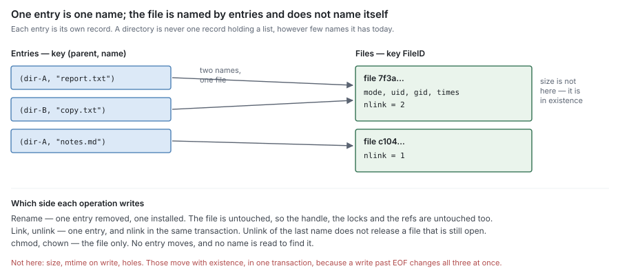
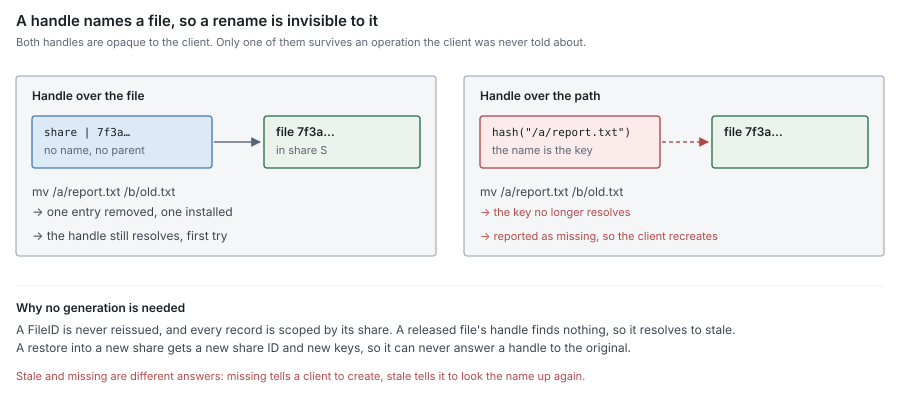

# RFC 7 — namespace metadata

**Status:** draft.
**Audience:** anyone changing the namespace entities, the handle format or the
permission path — and anyone writing the filesystem service ([RFC 17](rfc-17-vfs.md)) that
consumes them.

[RFC 6](rfc-6-block-metadata.md) owns the records that describe a file's content; this document owns the
entities that describe the file. [RFC 16](rfc-16-metadata-store.md) owns how every metadata entity is
persisted — the store contract, key layout and codecs — and [RFC 14](rfc-14-open-state.md) owns open
state and locks. Conventions, RFC 2119 keywords and test tiers are set once in
the [index](rfc-index.md). This document specifies behaviour, not the current code;
[Appendix A](#Appendix%20A%20%E2%80%94%20where%20the%20current%20code%20differs) lists where the code differs, as defects to fix, never rules to
build around.

---

## Start here

*Explanatory. The rules are in [§1](#1.%20Purpose) onward; where this section and a rule differ, the rule wins.*

### In plain words

The namespace is the part of DittoFS that holds names, folders and permissions.
A name is only a pointer; the file behind it has its own random ID that never changes.
Think of a library: catalogue cards carry titles, and each card points at a book by its number.
Renaming a file rewrites one card; the book does not move.
A client holds a **handle**, a slip naming the book's number, so a rename never breaks it.
A book is thrown out only when no card points at it and nobody still has it out.
Unlike a library, a book's number is random and never reused, so an old slip never fetches another book.

```text
 profiles/alice/ODFC_alice.vhdx ──entry──► File f7 ◄── handle (profiles, f7)
 rename: the entry moves               f7 stays    the handle still works
 last entry gone + nobody has it open ──► release: content is let go
```

This RFC specifies the part of the metadata that clients see as a filesystem:
names, directories, files and their attributes, the handles clients hold, and
who may do what. It also decides the moment a file stops existing, which is the
moment its content may start to be destroyed.

In outline: clients write to DittoFS over a file protocol, whichever adapter
serves it ([RFC 20](rfc-20-adapters.md)); writes land in a local journal and are later cut into
chunks, packed into blocks and uploaded to an S3 (Simple Storage Service)
bucket; a metadata store records which file holds which chunks
([RFC 0](rfc-0-data-lifecycle.md)). Content is keyed by a file's identity,
never by its name. This RFC owns the mapping from names to that identity.

### The problem, in one example

The `profiles` share serves desktops whose clients expect names compared
without case, and is configured case-insensitive. alice's folder `profiles/alice/` holds
her profile disk `ODFC_alice.vhdx`, 30 GB.

1. **Sign-in.** alice-pc opens `alice\odfc_alice.VHDX`. The name is resolved
   one directory at a time, with a permission check at each. In the share's
   root, the name `alice` is folded to one case and looked up: one read finds
   the entry, a second reads the directory it names. In that directory,
   `odfc_alice.VHDX` folds to the same key as the stored `ODFC_alice.vhdx`, so
   one more lookup finds the entry and the file it names. The name is not
   changed: a listing still shows `ODFC_alice.vhdx`.
2. **The handle.** alice-pc is given a handle naming the share and the file's
   identity, a random 128-bit ID that is never reused. All day, every 64 KiB
   write goes by handle, and resolving it reads the file directly: no name, no
   directory.
3. **A rename.** At noon an administrator renames the folder to `alice.old`.
   That moves one entry, in one transaction, and nothing else. A handle built
   from the path would now point at nothing, and alice's open disk would fail
   mid-session. The handle names the file, so alice-pc keeps writing.
4. **A temporary file.** alice-pc opens `~tmp1.dat` twice, the first time with
   delete-on-close, and closes that open first. The file becomes *delete
   pending*: its name still shows in a listing, but new opens are refused. When
   the second open closes, the name is removed by an ordinary unlink. That unlink drops the file's link count to
   zero and, in the same transaction, writes a **pending release**. No open
   holds the file, so the release runs: its content references are dropped and
   its records deleted.
5. **A crash.** Had N1 crashed between that unlink and the release, nothing
   would be leaked: recovery finds the pending release and runs it once no
   open can still claim the file.

Without these rules the same day goes wrong quietly: a path inside the handle
breaks alice's disk on the rename; case folded differently by two protocols
shows one file as two; an unlink acknowledged but recorded nowhere leaks
every chunk of the file, because nothing is left to find them by.

```text
 alice-pc ── open "alice\odfc_alice.VHDX" on share profiles
   │
   │  Lookup(root, "alice")              entry  root / alice ──► dir d1
   │  Lookup(d1, "odfc_alice.VHDX")
   │      key fold("odfc_alice.VHDX")    entry  d1 / odfc_alice.vhdx
   │      value "ODFC_alice.vhdx"               │
   ▼                                            ▼
 handle = (profiles, f7) ───────────────► File f7: regular, Nlink 1,
   every write resolves f7 directly        Size 30 GB, owner alice
   no name, no directory read

 rename alice → alice.old: one entry moves; f7 and its handle do not
 last name of a file removed: Nlink 0 + pending release, same transaction
   no open holds it ──► release: refs dropped, records deleted
```

### The words you need

- **[File](rfc-0-data-lifecycle.md#Glossary)**: one object a name can resolve
  to, with its attributes; its identity is a random ID, never reused, that
  survives rename ([§2.1](#2.1%20File)).
- **Entry**: one name in one directory, pointing at a file. A file with two hard
  links has two entries ([§2.2](#2.2%20Entry)).
- **Handle**: what a client holds to name a file: the share and the file's ID,
  never a path ([§6.1](#6.1%20A%20handle%20names%20a%20file%2C%20never%20a%20path)).
- **Nlink**: the number of entries naming a file, kept exact in the same
  transaction as every entry change ([§4.1](#4.1%20%60nlink%60%20is%20exactly%20its%20entries)).
- **Open state**: who holds a file open, owned by
  [RFC 14](rfc-14-open-state.md). It is the only other thing that keeps a file
  alive ([§4.2](#4.2%20Open%20state%20is%20the%20second%20holder)).
- **Pending release**: a record saying a file has lost its last name and its
  content is still to be released. It keeps nothing alive
  ([§4.3](#4.3%20Release%20is%20what%20block%20metadata%20sees)).
- **Folded name**: on a case-insensitive share, an entry is keyed by its name
  folded to one case, and stores the name as given ([§3.3](#3.3%20Case)).

### What this RFC promises

- A handle keeps working across rename and restart. Once its file is gone it
  resolves as stale, never as another file and never as "not found".
- A file is released when, and only when, no name and no open refer to it. The
  release is recorded before it runs, so a crash resumes it.
- A rename happens wholly or not at all, and no directory can end up inside
  itself, even when two renames race.
- A name comes back exactly as it was given. On a case-insensitive share, names
  that differ only in case are one entry, found with one read.
- Every permission decision, for every protocol, is made in this component,
  against the file the operation will act on.

### Scenarios

Each runs on node N1.

**build01 deletes an object file the linker still has open.**

1. On the `builds` share, an unlink of `out/app.o` removes its only entry; in the same transaction its link count, `Nlink`, drops to zero ([§4.1](#4.1%20%60nlink%60%20is%20exactly%20its%20entries)).
2. That transaction also writes a pending release and makes the linker's open durable, so it survives a crash ([§4.3](#4.3%20Release%20is%20what%20block%20metadata%20sees)).
3. No name finds `app.o` now, but the linker keeps reading it through its handle ([§4.2](#4.2%20Open%20state%20is%20the%20second%20holder)).
4. When the linker closes it, the release runs and checks again, inside its own transaction, that nothing holds the file ([§4.3](#4.3%20Release%20is%20what%20block%20metadata%20sees), [§4.5](#4.5%20A%20release%20re-checks%20its%20holders%20inside%20its%20own%20transaction)).
5. The release drops the file's content references and deletes its records ([§4.3](#4.3%20Release%20is%20what%20block%20metadata%20sees)).

Outcome: the name goes at once; the content goes only after the last close.

**An editor saves by renaming a temporary file over a document bob has open.**

1. bob has `report.docx` open; alice's editor writes `~report.tmp`, then renames it over `report.docx` ([§5.4](#5.4%20Rename%20over%20an%20existing%20entry)).
2. One transaction removes the old entry, installs the new one and takes the old file's `Nlink` to zero ([§5.1](#5.1%20One%20transaction)).
3. The same transaction writes the old file's pending release, since it lost its last name ([§5.1](#5.1%20One%20transaction)).
4. bob's open keeps the old file alive, and he still reads the old text through his handle ([§4.2](#4.2%20Open%20state%20is%20the%20second%20holder)).
5. bob closes it, and the old file is released ([§4.3](#4.3%20Release%20is%20what%20block%20metadata%20sees)).
6. A later request on bob's old handle is answered "stale", never "not found" and never with the new file ([§6.3](#6.3%20Staleness%20is%20reported%2C%20never%20guessed)).

Outcome: no reader sees half a save, and bob's client knows to look the name up again.

**Two administrators move two folders into each other at the same moment.**

1. One renames `projects/a` into `projects/b`; the other renames `projects/b` into `projects/a` ([§5.2](#5.2%20The%20loop%20check%20is%20inside%20the%20transaction)).
2. Each rename walks its destination's parents, inside its own transaction, to make sure it is not moving a folder into itself ([§5.2](#5.2%20The%20loop%20check%20is%20inside%20the%20transaction)).
3. Each guards every parent it reads, so each depends on a record the other writes ([§5.2](#5.2%20The%20loop%20check%20is%20inside%20the%20transaction)).
4. The second to commit finds that record changed, retries, sees the loop and is refused ([§5.2](#5.2%20The%20loop%20check%20is%20inside%20the%20transaction)).

Outcome: one move succeeds; there is never a folder loop that no path can reach.

**N1 restarts while the linker still holds the deleted object file.**

1. `out/app.o` has no name, a pending release and a durable open record when N1 goes down ([§4.2](#4.2%20Open%20state%20is%20the%20second%20holder), [§4.3](#4.3%20Release%20is%20what%20block%20metadata%20sees)).
2. On restart N1 finds the pending release through an index, without scanning the share ([§4.3](#4.3%20Release%20is%20what%20block%20metadata%20sees)).
3. It releases nothing until the grace period ends, the window in which clients reclaim their opens ([RFC 14 §9.2](rfc-14-open-state.md#9.2%20A%20new%20primary%20releases%20nothing%20before%20grace%20ends)).
4. The linker's handle still resolves, since handles survive a restart ([§6.2](#6.2%20A%20handle%20is%20stable%20across%20restart)).
5. If the linker reclaims its open, the file stays until it closes; if not, it is released when grace ends ([§4.3](#4.3%20Release%20is%20what%20block%20metadata%20sees)).

Outcome: a restart neither leaks the file nor pulls it from under an open.

### How the rest is organised

[§1](#1.%20Purpose) states what this component answers and what it must not
hold. [§2](#2.%20The%20entities) defines the entities: file, entry, ACL
(access-control list), extended attributes and streams, the share as one
filesystem with its quotas. [§3](#3.%20Names) covers names: lookup, validation,
case and listings. [§4](#4.%20What%20keeps%20a%20file%20alive) is what keeps a
file alive and how it is released; [§5](#5.%20Rename) is rename;
[§6](#6.%20Handles) handles; [§7](#7.%20Permissions) permissions.
[§8](#8.%20Open%20state%2C%20as%20the%20namespace%20sees%20it) and
[§9](#9.%20Attributes%20and%20what%20is%20not%20one) cover open state and
attributes as this component sees them; [§10](#10.%20Invariants) lists the
invariants. On a first read, skip [§2.8](#2.8%20A%20share%20is%20one%20filesystem)–[§2.10](#2.10%20Exclusive%20create), [§3.5](#3.5%20A%20cookie%20survives%20concurrent%20mutation)–[§3.8](#3.8%20Names%20every%20protocol%20of%20a%20share%20can%20use), [§5.5](#5.5%20A%20recycle%20bin%20is%20a%20rename%2C%20and%20keeps%20three%20constraints), [§6.5](#6.5%20A%20protocol%27s%20numeric%20file%20id%20is%20a%20stored%20number%2C%20never%20reused), [§7.5](#7.5%20A%20cached%20decision%20is%20keyed%20by%20everything%20it%20read)–[§7.8](#7.8%20Immutable%20and%20append-only%20flags%20are%20enforced%20at%20the%20chokepoint),
[§9.4](#9.4%20The%20change%20attribute%20and%20ctime%20never%20move%20backward)–[§9.6](#9.6%20setuid%20and%20setgid%20are%20cleared%20when%20an%20unprivileged%20caller%20changes%20the%20file) and [§11](#11.%20API%20surface%20and%20observability) onward.

## 1. Purpose

Namespace metadata answers, for any client operation:

> **What entries exist, what are they called, which file does a name resolve
> to, and may this caller do this?**

Everything a client can name, it names through this component. It is the only
component that knows about paths, and it is the only component that decides
whether an operation is allowed to happen at all.

It is also the component that decides when a file stops existing, and records
that decision as a pending release; the release that drops its content is the
engine's `Delete` ([§4.3](#4.3%20Release%20is%20what%20block%20metadata%20sees)). Nothing else in the set may make that
decision, and nothing else may keep content alive behind this component's back
([§4.4](#4.4%20There%20is%20no%20third%20holder)).

**This component is a leaf.** It calls no other component and declares no
interface on one: the store holds its records and answers for them, and every
join with content or open state — `GetAttr`'s overlay, the release, `SEEK_HOLE`
— is made by the filesystem service ([RFC 17](rfc-17-vfs.md)) at the file's primary.

Every entity here is **protocol-neutral**. A protocol's vocabulary — its user
and group numbers, security identifiers, attribute bits, security descriptors,
filesystem identities, statuses — is translated by the adapters and the
filesystem service ([RFC 17](rfc-17-vfs.md)); nothing in this document is shaped by one
protocol. The model may hold more than one protocol needs — a creation time, a
set of stored markers, named streams — and each such feature is defined here by
what the namespace stores and enforces, never by a protocol's field. A rule only
one protocol needs, which the namespace need not enforce for the others, is that
protocol's RFC's; a rule that must hold whichever protocol reaches the file is
stated here. How each protocol's fields and statuses map onto these entities and
onto the neutral errors of [§11.3](#11.3%20Neutral%20errors) is [RFC 21 §11.3](rfc-21-nfs.md#11.3%20Namespace)'s and [RFC 22 §16.3](rfc-22-smb.md#16.3%20Namespace)'s.

### 1.1 Non-goals

Namespace metadata **MUST NOT**:

- hold content bytes, or know where they are — local placement is [RFC 1](rfc-1-journal.md)'s,
  residency is computed and never stored ([RFC 0 §4.2](rfc-0-data-lifecycle.md#4.2%20The%20residency%20function));
- hold chunks, refs, blocks or refcounts — those are [RFC 6](rfc-6-block-metadata.md)'s, and this component
  never reads them: the filesystem service joins the two ([§2.5](#2.5%20Where%20%60size%60%20lives), [§4.3](#4.3%20Release%20is%20what%20block%20metadata%20sees));
- hold opens, locks, caching grants or watches — those are [RFC 14](rfc-14-open-state.md)'s; this
  component only asks whether an open keeps a file alive ([§8](#8.%20Open%20state%2C%20as%20the%20namespace%20sees%20it));
- decide what to offload, evict or sweep;
- encode or decode a wire protocol. A handle is opaque at this boundary and
  *stays* opaque above it ([§6](#6.%20Handles));
- choose keys or encodings — that is [RFC 16](rfc-16-metadata-store.md)'s;
- import another component in this set ([RFC 0 §1.2](rfc-0-data-lifecycle.md#1.2%20Component%20autonomy)).

### 1.2 Why it is a separate RFC from block metadata

[RFC 6 §1.2](rfc-6-block-metadata.md#1.2%20Why%20it%20is%20a%20separate%20RFC%20from%20the%20namespace) gives the reason and the table: the two are usually one database,
often one transaction, and they are specified apart because their write patterns
differ in kind. This document does not restate it.

The consequence that matters here is directional. Block metadata **MUST NOT** be
told about names ([RFC 6 §6.5](rfc-6-block-metadata.md#6.5%20Who%20owns%20a%20ref)); it learns of a deletion only when this component
releases a file. So every rule below about what keeps a file alive is also a
rule about when content may be destroyed.

## 2. The entities

The namespace is specified as Go entities: plain structs a
caller reads whole. How many records hold each one, and under which keys, is
[RFC 16](rfc-16-metadata-store.md)'s choice and invisible here. What a *write* touches is decided by the
operation, never by the struct: no interface offers `Put(File)`, because a
caller that could write the whole struct would read-modify-write it and conflict
with every change to fields it never meant to touch.

| Entity | Identified by | Holds | Written by |
| --- | --- | --- | --- |
| **File** ([§2.1](#2.1%20File)) | `FileID` | type, owner, group, mode, flags, times, version, `Nlink`, parent (directories), size, charged bytes, applied version and write times (write path) | attribute operations, link and unlink ([§4](#4.%20What%20keeps%20a%20file%20alive)); size, charge, applied version and write times only by an existence commit ([§2.5](#2.5%20Where%20%60size%60%20lives)) |
| **Entry** ([§2.2](#2.2%20Entry)) | `(parent FileID, name)` — the folded name on a case-insensitive share ([§3.3](#3.3%20Case)) | the name as given, child `FileID`, child type | create, link, unlink, rename ([§3](#3.%20Names), [§5](#5.%20Rename)) |
| **ACL** ([§2.6](#2.6%20ACL%2C%20and%20how%20it%20agrees%20with%20the%20mode)) | `FileID` | the file's one access-control list | set-ACL, and `chmod` on a file that has one |
| **Xattr** ([§2.7](#2.7%20Extended%20attributes%20and%20named%20streams)) | `(FileID, name)` | one small named value | set and remove xattr |
| **Pending release** | `FileID` | nothing but its existence | the unlink or rename that removes a file's last entry; deleted only by the release transaction ([§4.3](#4.3%20Release%20is%20what%20block%20metadata%20sees)) |

A named stream is a `File` ([§2.7](#2.7%20Extended%20attributes%20and%20named%20streams)); a share's root is a `File`, and its capacity
and quotas are `FilesystemInfo`, `Usage` and `Quota` ([§2.8](#2.8%20A%20share%20is%20one%20filesystem)).



### 2.1 File

One struct for every object a name can resolve to: regular file, directory,
symlink, device, FIFO, socket, and a named stream.

```go
type File struct {
	ID    FileID // RFC 0 §3: a UUID, never reissued, stable across rename and relink
	Share ShareID
	Type  FileType

	// Owner and permissions. Mode agrees with the ACL when one exists (§2.6).
	Owner, Group Principal
	Mode         uint32    // permission bits only; the type is Type
	Flags        FileFlags // enforced: immutable, append-only (§7.8); stored markers: hidden, system, archive, read-only, sparse

	// Times. Birth is set once at create; Change advances on every metadata
	// or content change; Modify only on content change (§9.2).
	Birth, Access, Modify, Change time.Time

	// Version rises on every change to the file, metadata or content:
	// every existence commit advances it, as every attribute change does.
	// It is drawn from the journal's version counter (§9.4), so it is a
	// journal version, 128 bits with the epoch half zero (RFC 1 §4.3); the
	// change counter every adapter reports is its counter half.
	Version JournalVersion

	// Size, Charged, Applied, Modify and the Change a write sets are owned by
	// the write path: only an existence commit sets them (§2.5, RFC 6 §3),
	// except Charged, which the transaction that finishes a removal also
	// sets (RFC 6 §2.4).
	Size int64

	// Charged is the bytes this file charges to Owner, Group and Project
	// (§2.8): its logical bytes, holes excluded, in full whether or not its
	// chunks are shared. The existence commit that moves Size or the holes
	// moves Charged with them; a removal reads only the holes in its own
	// extent, at most K of them, past which the masked holes' bytes are
	// given back as they leave (RFC 6 §6.2), never the file's. What a
	// removal's batches change, a clone's source holes included, gathers in
	// its Removal record and is folded here once, by the transaction that
	// sets it done (RFC 6 §2.4, §6.6).
	Charged int64

	// Applied is the newest journal version whose existence change this File
	// records (RFC 6 §2.4); it only moves forward.
	Applied JournalVersion

	// MaxSpan is the length of the longest hole this file has ever had
	// (RFC 6 §2.4), raised by the transaction that writes a longer one — a
	// deallocate's phase 1 raises it to its merged hole, edge holes joined
	// (RFC 6 §6.2) — and never lowered, so every hole over an offset starts
	// within MaxSpan below it, live or in history (RFC 16 §4.2).
	MaxSpan int64

	// MaxOverwrite is the same bound for overwrite records alone, kept apart
	// so one long hole does not widen the window a removal's history scan
	// and a snapshot read search for overwrite records (RFC 6 §6.2).
	MaxOverwrite int64

	// Nlink is the number of entries naming this file: its hard links (§4.1).
	// A symlink pointing at the file is not a link to it and is not counted.
	Nlink uint32

	Parent FileID // Type Directory only: the directory holding its one entry, so ".." needs no search

	// Subdirs is the number of entries in this directory that name a
	// directory (Type Directory only), so an adapter can report a POSIX link
	// count without listing it (§4.1). It changes by delta, as the times do
	// (§9.2): the stored value plus the deltas not yet folded. Signed, so a
	// fold always stores what the deltas sum to, below zero included; reads
	// report 2 + max(0, Subdirs).
	Subdirs int64

	// Shard is the group of files one primary serves at a time
	// (RFC 11). Zero, the default, means the whole share is one shard. Set at
	// create; unchanged by rename; changed only by a move between shards (RFC 11
	// §4), which rewrites it in bounded batches, never in one transaction. A
	// per-child or range shard (RFC 11 §2.2, Appendix C) is created the same way.
	Shard ShardID

	// Project is the tree quota this file is charged to (§2.8): inherited
	// from the parent at create, or set on an empty directory by SetProject,
	// which makes it the project's root. Zero: none.
	Project ProjectID

	// Number is the file's 64-bit numeric id within its share (§6.5): set at
	// create, never changed, never reused in the share. Never zero.
	Number uint64

	// Incomplete is set by a share-level clone or restore for a file its
	// source snapshot lists incomplete (RFC 12 §2.3), never by a by-reference
	// clone or copy, which refuses an Incomplete source with ErrIncomplete
	// before anything changes (RFC 17 §5.9): reads of the file fail naming it rather
	// than serve it as if whole. Versioned like every File field, so a
	// snapshot of the clone still sees it; cleared by a truncate to zero, and
	// gone with the file.
	Incomplete bool

	// CreateVerifier is the verifier of the exclusive create that made the
	// file (§2.10); nil when it was not made exclusively, and cleared by the
	// first SetAttrs.
	CreateVerifier []byte

	// Type-specific fields: each is set for its type only and empty otherwise.
	Target   []byte   // Type Symlink: the target, stored as given, never resolved here
	Device   DeviceID // Type BlockDevice, CharDevice: major and minor
	StreamOf FileID   // Type Stream: the file it belongs to (§2.7)
}

type FileType uint8

const (
	Regular FileType = iota + 1
	Directory
	Symlink
	BlockDevice
	CharDevice
	FIFO
	Socket
	Stream // a named stream (§2.7); never has an entry
)
```

**It is protocol-neutral.** Owners are principals ([RFC 16](rfc-16-metadata-store.md)), not uid/gid pairs.
A `Principal` is an **opaque ID minted by the store and never reissued**, as a
`FileID` is: a UID, GID or SID is a row of the store's protocol-ID index that
maps to a principal, never the principal itself, and the adapter resolves
through that index. So a file, an ACL entry or a quota never carries a number
another installation may have given to someone else, and an import maps
principals by ID and refuses one that collides ([RFC 26 §3.1](rfc-26-catalog-backups.md#3.1%20Layout)).

`Mode` stays as permission bits because every served protocol exposes them, but it is not the authority when an ACL
exists ([§2.6](#2.6%20ACL%2C%20and%20how%20it%20agrees%20with%20the%20mode)). `Birth` is the file's creation time: set by the create, and
changed only by an explicit set.

**`Flags` holds two kinds of bit.** The **enforced flags**, immutable and
append-only, are rules this component applies to every caller and protocol
([§7.8](#7.8%20Immutable%20and%20append-only%20flags%20are%20enforced%20at%20the%20chokepoint)). The **stored markers** — hidden, system, archive, read-only and sparse
— are an attribute set the namespace stores, returns and changes on a
set-attribute, and never interprets beyond that: no marker grants, refuses or
changes any other operation here, read-only included. An adapter maps its
protocol's attribute bits onto them ([RFC 21 §11.3](rfc-21-nfs.md#11.3%20Namespace), [RFC 22 §16.3](rfc-22-smb.md#16.3%20Namespace)); a protocol with no spelling
for a marker leaves it unchanged. A link a protocol represents as a special
kind of file is a `Symlink`; a special-file kind no `FileType` holds is refused
by its adapter before it reaches this component.

> decision: the read-only marker refuses nothing, for every protocol: the
> namespace stores and returns it, and enforces only the immutable and
> append-only flags. A protocol whose own servers refuse writes and deletes of
> a read-only file sees them succeed here. Enforce it, as a rule here for every
> protocol, when an application is shown to rely on the refusal.

**There is no generation.** A generation exists where file IDs are reused, to
tell a handle to a released file from one to its successor. A `FileID` is a
UUID that is never reissued, and every per-file key is scoped by its share
([RFC 16](rfc-16-metadata-store.md)), so a handle to a released file finds nothing and resolves stale
([§6.3](#6.3%20Staleness%20is%20reported%2C%20never%20guessed)). A restore makes a new share with a new `ShareID` and so new keys
([RFC 26 §2.3](rfc-26-catalog-backups.md#2.3%20Restore)), and cannot alias a handle to the original; nothing rolls a share
back in place ([RFC 26 §1.1](rfc-26-catalog-backups.md#1.1%20Non-goals)), so a released file's handle never resolves again. What clients do need is a
per-file change counter, and that is `Version`.

A file **MUST NOT** carry its own name, its own path, or a list of the entries
that name it. It is named *by* entries; it does not name itself. A name stored
on the File is a second copy of the entry, and rename then has to keep two
records in step for no gain.

`Parent` exists only for directories, and only because `..` has to resolve
without a search. It is exact, because a directory has exactly one entry naming
it ([§4.1](#4.1%20%60nlink%60%20is%20exactly%20its%20entries)).

Whether a file has an ACL is not a field: it is the store's own flag. A caller
asks for the ACL, and always gets one ([§2.6](#2.6%20ACL%2C%20and%20how%20it%20agrees%20with%20the%20mode)).

### 2.2 Entry

```go
// Entry is one name in one directory. A file with two hard links has two
// entries and one File.
type Entry struct {
	Parent FileID
	Name   []byte   // the bytes as given, validated at the boundary (§3.2); the key may be folded (§3.3)
	Child  FileID
	Type   FileType // copy of the child's type, written with the entry
}
```

One entry is one name in one directory. The child type is carried so that a
listing does not have to read every file it returns; it is a copy, and it
**MUST** be written in the same transaction as the entry, never refreshed later.

An entry points at its file (`Child`); a file does not point back at its
entries. The one exception is a directory's `Parent`. Nothing on a request path
needs the reverse: a request names its file by handle, or carries the path it
resolves. No reverse index — the names of a file — is written or reserved
([§13](#13.%20Open%20questions)).

**An entry is its own record.** An implementation **MUST NOT** store a
directory's entries as one value, one document or one row holding the list. This
is [RFC 6 §2.1](rfc-6-block-metadata.md#2.1%20ChunkRef)'s rule with a different key, and it fails the same two ways: a
directory of *N* entries costs O(*N*²) to fill, and the list becomes a key that
every concurrent create, unlink and rename in that directory contends on.

**The entry is not merged into the file, and this was measured.** Creating a file
writes two records, a `File` and an `Entry`, in one transaction. Inlining the
file into its entry was benchmarked against it ([RFC 16](rfc-16-metadata-store.md), Appendix A):

- **Creates:** no difference within noise, serial or parallel. What limits a
  create is the parent directory's times ([§9.2](#9.2%20Timestamps)), not the number of keys.
- **Reads:** inlining is faster — a lookup 2.2×, a listing with attributes 5.5×.
- **What inlining cannot keep:** clients address files by handle, not by name,
  so an inlined layout still needs a key from `FileID` to its entry, written on
  every create and rewritten on every rename — the second record returns, and
  `GetAttr` by handle becomes two reads. A hard link forces the file out of the
  entry into its own record: a second code path for one file.

So the split stays, and the one real cost — a listing with attributes reading
each child — is paid down by reading the children in one batched pass
(`EntriesPlus`, [§3.4](#3.4%20Enumeration)), not by changing the records.

A directory is large because a user made it large. Nothing else in this system
lets one client's behaviour choose the cost of another's.

### 2.3 The name is not the identity

Every other component in the set keys content by `FileID` ([RFC 0 §3](rfc-0-data-lifecycle.md#3.%20Identity)). This is
the component that owns the mapping from a name to that identity, and it is the
only one allowed to hold it.

A path **MUST NOT** appear in a handle ([§6.1](#6.1%20A%20handle%20names%20a%20file%2C%20never%20a%20path)), in a lock ([RFC 14](rfc-14-open-state.md)), in a ref
([RFC 6 §6.5](rfc-6-block-metadata.md#6.5%20Who%20owns%20a%20ref)) or in a journal key ([RFC 1](rfc-1-journal.md)). Each of those outlives a rename, and a
path does not.

### 2.4 Attributes, and who writes them

| Attribute | Changed by | Written in the transaction of |
| --- | --- | --- |
| `Owner`, `Group` at create | the create: the caller's principal, and the credential's group, the principal's primary group or, with neither, the caller's own principal; under a setgid parent, the parent's group | the create |
| `Mode`, `Owner`, `Group`, `Flags` | chmod, chown, set-flags, ACL change; setuid and setgid also cleared by an unprivileged caller's write ([§9.6](#9.6%20setuid%20and%20setgid%20are%20cleared%20when%20an%20unprivileged%20caller%20changes%20the%20file)) | its own operation |
| `Access` | read, and only if the policy records it ([§9.2](#9.2%20Timestamps)) | its own operation |
| `Size`, `Charged`, `Applied`, `Modify`, and `Change` and `Version` on write, and an explicit set of size or `Modify` | a client write, truncate, deallocate, clone or copy into the file, a set-attribute | **existence** ([§2.5](#2.5%20Where%20%60size%60%20lives)) |
| `Change`, `Version` on attribute change | chmod, chown, set-flags, ACL and xattr change, link, unlink, rename: each draws a `Version` and stores it in the File in its own transaction ([§9.4](#9.4%20The%20change%20attribute%20and%20ctime%20never%20move%20backward)) | its own operation |
| `Nlink` | link, unlink, rename over an existing entry | the entry change that caused it ([§4.1](#4.1%20%60nlink%60%20is%20exactly%20its%20entries)) |
| a directory's `Modify`, `Change`, `Version` | create, unlink, rename in it | the entry change, as a delta ([§9.2](#9.2%20Timestamps)) |
| `Number` | create only; never changed ([§6.5](#6.5%20A%20protocol%27s%20numeric%20file%20id%20is%20a%20stored%20number%2C%20never%20reused)) | the create |
| `CreateVerifier` | set by an exclusive create; cleared by the first `SetAttrs` ([§2.10](#2.10%20Exclusive%20create)) | the create; the `SetAttrs` |

**A new file's owner and group come from the caller.** A create **MUST** set
`Owner` to the caller's principal. It **MUST** set `Group` to the parent
directory's `Group` when the parent has the setgid bit, and otherwise to the
credential's group: the group the request's credential names, where the
credential carries one, resolved to its principal,
and the principal's primary group ([RFC 16 §2.3](rfc-16-metadata-store.md#2.3%20Server-wide%20and%20control-plane%20entities)) where it does not; which
credentials carry a group is the adapters' ([RFC 21 §11.3](rfc-21-nfs.md#11.3%20Namespace), [RFC 22 §16.3](rfc-22-smb.md#16.3%20Namespace)). A
credential group that resolves to no principal counts as no group on the
credential, so the primary group applies. A
principal with neither — no group on the credential and no primary group — gets
its own principal as `Group`, a group of one, so the file is shared with nobody
the owner did not choose; the create is not refused. A
directory created under a setgid parent is itself setgid, so the rule carries
down the tree. The rule is the same for every protocol, applied to what each
protocol's credential carries. A fixed default group **MUST NOT** be used: it
hands every file to whoever else holds that group, and makes the same user's file
differ by the protocol that created it. An owner or group the create request
itself names is applied after this rule as a change of owner or group
in the create's own transaction, permitted or refused exactly as that change
would be on the new file; a create whose named owner or group is refused fails
whole, and is never made under another owner instead.

> decision: a creator with no group gets itself as the file's group rather than
> a refused create, because principals with no primary group are common under
> some identity sources, and refusing would make them unable to create anything. It grants nothing
> beyond what the owner already has. Refuse instead if an identity source is
> shown to report "no primary group" for principals that do have one, where the
> fallback would hide a mapping fault.

**A setgid bit is not inherited by a non-member.** When a non-directory is
created with the set-group-ID bit in its requested mode, and the caller is
neither a member of the `Group` the file gets nor privileged ([§7.4](#7.4%20The%20identity%20arrives%20resolved)), the create **MUST** clear the
bit, as POSIX kernels have since CVE-2018-13405. Under a setgid parent the file takes the
parent's group whatever the creator's memberships, so without this rule a user
outside `finance` creating a file with mode 2755 in a mode-3777 `finance`
directory makes a program that runs with `finance`'s rights. Likewise a `chmod`
that sets the set-group-ID bit on a non-directory **MUST** clear it when the
caller is neither a member of the file's `Group` nor privileged, as POSIX
`chmod` permits. A directory keeps the bit in both cases: on a directory it
names the group new entries take, and grants nothing to run.

The offload commit appears nowhere in that table, and **MUST NOT** ([RFC 6 §5.1](rfc-6-block-metadata.md#5.1%20No%20record%20is%20written%20by%20both%20paths)).
Offloading changes where content is, not what it is, and a File it could write
would be a record the client path and a background pass share, which
[RFC 6 §5](rfc-6-block-metadata.md#5.%20Write%20sets) forbids.

The table names where `Version` is stored, not when a client first sees it move.
A write advances the `Version` that `GetAttr` returns when the primary accepts
it, through the engine's overlay, before the existence commit stores it
([RFC 17 §5.7](rfc-17-vfs.md#5.7%20GetAttr)). How `Version` is drawn, so that it never moves backward across
restarts and primaries, is [§9.4](#9.4%20The%20change%20attribute%20and%20ctime%20never%20move%20backward).

### 2.5 Where `size` lives

**`size` is a field of `File`, stored once, and read with the rest of it.**
`Files.Get` is one read of the file's record ([RFC 16](rfc-16-metadata-store.md)) and, for a directory, a scan of
its deltas not yet folded, bounded by the fold backlog ([§9.2](#9.2%20Timestamps)): nothing else is
joined and nothing is computed. This is the one statement of its cost; others
cite it. It is the write path's field — only an existence commit
sets `Size`, `Charged`, `Applied`, `Modify` and the `Change` a write causes, and
advances `Version` with them ([RFC 6 §3](rfc-6-block-metadata.md#3.%20Existence)); `Charged` is also set by the
transaction that finishes a removal ([RFC 6 §2.4](rfc-6-block-metadata.md#2.4%20FileData%20and%20holes)) — and every other operation
leaves the write fields alone.

Until the journal's writes to a file are committed, the committed `Size` lags
them. `GetAttr` is therefore the filesystem service's join ([RFC 17](rfc-17-vfs.md)), made at the
file's primary: `Files.Get`, then, while the primary's engine holds uncommitted
writes to the file, the engine's overlay of their size, write times and
`Version` applied over it. When the engine holds none, which is the usual case,
the File record is the whole answer. This component never asks for the overlay:
it is a leaf ([§1](#1.%20Purpose)), and one join, in one place, is the only read path for
size.

**The join reads one state of the file.** The primary serialises a file's
existence commits ([RFC 8 §5.1](rfc-8-engine.md#5.1%20Commit%20is%20answered%20by%20the%20journal)), and a commit moves operations out of the overlay
into the File record. A join that read the File before such a commit and the
overlay after it misses the committed writes in both, and reports a lower size
and `Version` than one it already returned, which breaks a client's
close-to-open check. The join **MUST** therefore read both under the file's
commit serialisation, as a sequence lock: read the file's commit sequence, which
is odd while a commit is applying; read the File; read the overlay; read the
sequence again; and retry when the two sequence reads differ or either is odd. A
join that keeps retrying past a bound takes the serialisation for one read.
Neither waits on a client.

**Every attribute a client sees is that join.** `Lookup`, `Create`, `SetAttrs`
and the listings return the File record this component holds; the filesystem
service applies the join before any of it reaches a client ([RFC 17 §5.7](rfc-17-vfs.md#5.7%20GetAttr)). A
committed File returned while the primary holds uncommitted writes to it reports
a size and a `Version` older than a `GetAttr` already returned.

Three rules, in order of how much they cost to get wrong:

1. **`size` and the hole set move together.** A write past EOF grows `size` *and*
   adds a hole for the gap it skipped ([RFC 6 §3.5](rfc-6-block-metadata.md#3.5%20Operations%20that%20make%20holes)). Both **MUST** be written by
   the same existence commit. Written apart, the crash between them leaves a
   `size` covering an extent no hole records and no journal holds — content
   claimed to exist that was never written, which resolves **Lost** and fails a
   read that should have returned zeros.
2. **Only the write path writes `size`.** A `SetAttrs` that changes size is
   applied through an existence commit, never by writing the File directly. A
   `chmod` and a write to one file therefore both write its record, and conflict;
   the conflict is retried ([RFC 0 §9.2](rfc-0-data-lifecycle.md#9.2%20Conflicts%20and%20their%20retries)). Keeping the two halves in separate
   records to avoid that rare conflict cost 25% on `GetAttr` and 60% on listings
   with attributes when measured, and is not done.
3. **There is one copy.** An implementation **MUST NOT** keep a second `size`
   anywhere — "for `GetAttr` speed", in a cache refreshed in the background, or
   on an entry. `GetAttr` and a read would answer from different records, and
   the disagreement is silent in both directions.

### 2.6 ACL, and how it agrees with the mode

```go
// ACL is the one access-control list a file has. Its model — entry kinds,
// rights, flags, what a stored ACL may hold — how one decision is evaluated,
// how the mode and the ACL imply each other, and how inheritance is computed
// are RFC 19's. This component stores it, keeps Mode in agreement with it, and
// evaluates it only at the one chokepoint (§7.1).
type ACL struct {
	Entries []ACE
	Flags   ACLFlags // protected, auto-inherited, …
	Audit   []ACE    // audit and alarm entries: never grant or deny; they select audit events (§7.6)
}

type ACE struct {
	Type  ACEType // allow, deny, audit, alarm
	Flags ACEFlags
	Mask  AccessMask
	Who   Principal
}
```

**`Mode` and the ACL always agree, and neither is updated alone.**

- A file with no stored ACL is governed by `Mode`. Asked for its ACL, this
  component returns the one `Mode` implies (`ACLFromMode`,
  [RFC 19 §4.1](rfc-19-authorization.md#4.1%20The%20ACL%20a%20mode%20implies)),
  so there is always an ACL to evaluate and never a flag to check first.
- Setting an ACL writes the ACL and the `Mode` it implies in one transaction.
- `chmod` on a file with an ACL **merges** into it — it limits entries and never
  replaces the ACL ([RFC 19 §4.3](rfc-19-authorization.md#4.3%20Setting%20mode%20and%20ACL))
  — and stores the ACL and `Mode` in one transaction.
- A new file whose parent has inheritable entries gets its ACL and the `Mode` it
  implies in the create's transaction
  ([RFC 19 §4.4](rfc-19-authorization.md#4.4%20Inheritance)).
- `Mode` lives on the File, so `GetAttr` never reads the ACL.
- **Rights arrive mapped.** A requested mask, and an entry's mask a client sets,
  reach this component in entry rights
  ([RFC 19 §2.4](rfc-19-authorization.md#2.4%20Rights)); a protocol that carries
  generic rights maps them before the call ([RFC 22 §16.3](rfc-22-smb.md#16.3%20Namespace)).
- The ACL is evaluated only behind `Files.Authorize` and `Files.Granted` (§7.1),
  by [RFC 19 §3](rfc-19-authorization.md#3.%20Evaluation); well-known principals
  have fixed IDs ([RFC 16 §2.2](rfc-16-metadata-store.md#2.2%20Identity%20types))
  and match as [RFC 18 §2.1](rfc-18-identity.md#2.1%20Kinds%20and%20well-known%20principals) says.

An implementation **MUST NOT** use "last writer wins" — whichever of `Mode` or
the ACL was set last being the authority, the other silently stale. A client
may read either, and one that reads one and acts
on the other gets a permission it was never granted. A merge that rewrote only
the owner, group and everyone entries would fail the same way: `chmod 600`
would keep granting a named user access, and the ACL's implied mode would no
longer equal `Mode`.

### 2.7 Extended attributes and named streams

```go
// Xattr is one small named value on a file.
type Xattr struct {
	File  FileID
	Name  []byte
	Value []byte // bounded by a setting (RFC 13); larger data is a named stream
}
```

Each xattr is its own record, never a list on the File ([§2.2](#2.2%20Entry)'s rule, again).
A share setting bounds how many a file may have, as another bounds its streams,
so the release that deletes them stays one bounded transaction ([§4.3](#4.3%20Release%20is%20what%20block%20metadata%20sees)).

A **named stream** is a second, named content of a file, so it is a `File`
with its own `FileID`, `Type` `Stream` and `StreamOf` set. Its bytes go through
the journal and [RFC 6](rfc-6-block-metadata.md) like any file's; nothing in the content path learns that
it is a stream. Where identity shows, it follows the file it belongs to:

- it has no entry, and is reached only by listing its file's streams;
- it has no owner, group, mode or ACL of its own: every check on it is a check
  on its base file;
- the file id reported for it is its base file's;
- it has no entry and so `Nlink` zero, yet is never released by that: the base
  file's release writes its pending release, and it is then released as a file
  of its own ([§4.3](#4.3%20Release%20is%20what%20block%20metadata%20sees)).

How a stream is named on a wire, and which protocols reach streams at all, is
the adapters' ([RFC 21 §11.3](rfc-21-nfs.md#11.3%20Namespace), [RFC 22 §16.3](rfc-22-smb.md#16.3%20Namespace)).

### 2.8 A share is one filesystem

**Its root is a File.** A share's root is a `File` of type `Directory` with no
entry: the share names it, and its `Parent` is itself, so `..` at the root
stays at the root. Each share reports its own filesystem identity, derived
from its `ShareID`, which each protocol spells in its own field ([RFC 21 §11.3](rfc-21-nfs.md#11.3%20Namespace),
[RFC 22 §16.3](rfc-22-smb.md#16.3%20Namespace)). The pseudo-filesystem, the synthetic tree joining every share where a
protocol needs one, is **not stored**: the filesystem service
builds it from the share list ([RFC 17 §4.9](rfc-17-vfs.md#4.9%20Shares%2C%20mounts%20and%20trees)), and a lookup that crosses from it into a share lands on
that share's root. Shares are disjoint trees; one share is never an entry in
another, and no share's path is an ancestor of another's
([RFC 16 §2.3.1](rfc-16-metadata-store.md#2.3.1%20Share%20names%2C%20paths%20and%20state)).

```go
// FilesystemInfo is what a share reports about itself: its capabilities,
// usage and limits, which every protocol's filesystem queries read.
type FilesystemInfo struct {
	Share        ShareID
	Capabilities Capabilities // from configuration (RFC 13), fixed while mounted
	Usage        Usage        // counted (RFC 16); the share's, or its project's as below
	Quota        Quota        // the share-wide limit, if any, or its project's as below
}

type Capabilities struct {
	CaseSensitive, CasePreserving bool
	MaxNameBytes                  int
	ACLs, Xattrs, Streams, Links  bool
	TimeGranularity               time.Duration
}

type Usage struct {
	Bytes, Files int64
}

// Quota is one limit: on the share, on a user or group in it, on every user
// or every group in it without one of its own, or on a tree. A share-wide
// quota has none of Principal, Default and Project set; its key carries the
// share tag, beside the principal, default and project ones (RFC 16 §4.2.1).
// Limits are written by the management API; usage is counted. They are
// separate because they have different writers.
type Quota struct {
	Share     ShareID
	Principal Principal     // a user or group quota; zero otherwise
	Default   PrincipalKind // User or Group: the limit of each such principal with no quota of its own; zero otherwise
	Project   ProjectID     // a tree quota; zero otherwise
	Hard      Limit         // refused beyond it
	Soft      Limit         // allowed beyond it for Grace, then refused as Hard
	Grace     time.Duration // how long usage may stay above Soft
	Advisory  Limit         // never refused: crossing it only produces a quota event, which the filesystem service emits (§7.6)
	Version   uint64        // the writing commit's, as ShareGrant's; RFC 23's entity tag
}

// Limit is a byte and a file count; zero in either means no limit on it.
type Limit struct {
	Bytes, Files int64
}

// ProjectID numbers a tree quota within its share: allocated by SetProject,
// never reused in the share, never zero.
type ProjectID uint64

// PrincipalUsage is one principal's usage in one share: what per-principal
// quota queries report and quota checks enforce.
type PrincipalUsage struct {
	Share     ShareID
	Principal Principal
	Usage
}
```

**What is charged is logical bytes, per file**: a file's size with its holes
excluded, held in `File.Charged` and charged to its `Owner`, its `Group` and its
`Project`. Each file is charged **in full**, whether its chunks are shared with
another file — by a clone, a copy or a deduplication hit — or not. Deduplication
and compression **MUST NOT** reduce a principal's usage; their savings are
reported for the share. A user's usage then depends neither on other users' data
nor on when GC runs. The existence commit that changes the size or the holes
changes `Charged` and the usage by the same delta. A truncate or a punch lowers
the charge in its removal's phase 1, which reads up to K holes inside its
extent, untracked, to learn how many of the removed bytes were charged, and
writes O(1) keys whatever their number; past K it lowers the charge by the whole
extent, and each masked hole's bytes are given back by whichever transaction
drops or replaces it, so usage reads low, never high, until the removal is done
([RFC 6 §6.2](rfc-6-block-metadata.md#6.2%20Truncation%20and%20deallocation)). A clone charges the destination extent whole in its phase 1, and
its batches gather a lowering for each source hole they write, so usage reads
high only while the clone runs ([RFC 6 §6.6](rfc-6-block-metadata.md#6.6%20Clone%20and%20server-side%20copy)). What a removal's batches gather is
folded into `Charged` and the usage once, by the transaction that sets it done. No charge is computed by a scan of the file's holes
outside the extent changed.

`chown` and `chgrp` move exactly `Charged` from the old principal to the new one
in the transaction that changes the owner. How usage is counted without a hot key
is [RFC 16](rfc-16-metadata-store.md)'s. Enforcement is the filesystem service's, at the file's primary
and at write time, against an in-memory reservation per principal, per project and per share
released when the write's existence commits ([RFC 17](rfc-17-vfs.md)): a write is checked
before the charge exists, so the overshoot is bounded by each primary's
reservation slack, and that bound is stated, not hidden.

**Limits stack; none is nested in another.** A write is checked against every
quota that covers it — the share-wide one, its owner's, its group's and its
project's — and refused if any would be exceeded. So a share capped at 10 TiB
with each user capped at 100 GiB is two quotas, and neither is derived from
the other: the per-user limits may sum to more than the share's.

**Default quotas.** A principal's limit is its own quota if it has one, and
otherwise the share's default for its kind, `Default` User or Group; with
neither it has no limit. Its own quota **replaces** the default rather than
adding to it, so one user can be given more than the default as well as less.
A default is one record, whatever the number of principals it covers, and
usage stays counted per principal: nothing is written per principal until it
is charged.

**Projects.** `SetProject` makes an empty directory the root of a new
project: it allocates a `ProjectID` and writes it to the directory's
`Project`, in one transaction that range-guards the directory's entries as a
removal does ([§3.6](#3.6%20A%20structural%20change%20guards%20the%20directory%20it%20depends%20on)), so a create racing it either lands first and refuses
the `SetProject` with `ErrNotEmpty`, or lands after and inherits the project.
A directory already inside a project is refused with `ErrInvalid`: projects
do not nest, since a file is charged to one project and a nested tree would
escape its outer project's limit. A rename or link whose file's `Project`
differs from the destination directory's is refused with `ErrCrossProject`,
with one exception: a project's root — a directory whose `Project` differs
from its source parent's — may move to a destination outside every project.
A project outlives its root: its quota stays until `SetQuota` deletes it, and
its usage reads zero once its files are gone. `SetProject` on a directory that
is already its project's root — its `Project` differs from its parent's —
returns that project's `ProjectID` and writes nothing, so a caller that lost
the reply can retry it; any other directory inside a project is refused.

**A project reports itself as a filesystem.** `Info` asked for a share and a
project reports, for bytes and for files each, the share-wide quota and usage or
the project's, whichever leaves less room under its hard limit, so `statfs`
on a directory inside a project shows the tighter of the two, as a local
filesystem reports a project-quota tree. A project with no quota, and a share with none, leave no
room bound and are never the tighter. The project's usage is the sum of its
per-shard counters, the same read a quota check makes
([RFC 16 §4.4](rfc-16-metadata-store.md#4.4%20Counters%20that%20many%20writers%20change)).

> decision: `SetProject` takes only an empty directory, so a quota cannot be
> put on a tree that already holds files; the operator creates the project and
> copies the tree into it, which a client's `mv` already does on the
> cross-device refusal. Relabelling a populated tree means rewriting every
> file's `Project` and moving its charge in bounded batches while renames run
> across the boundary — the shape of a move between shards
> ([RFC 11 §4](rfc-11-ownership.md#4.%20Moving%20files%20and%20primaries)). Build it that way when operators need quotas on trees too large
> to copy.

**Writing limits.** The management API sets a quota with `SetQuota`, and a
quota that limits nothing — every `Limit` zero — deletes it rather than being
stored; `Quotas` lists a share's quotas, the share-wide one and the defaults
included ([RFC 16](rfc-16-metadata-store.md)).

**Soft and advisory limits.** Usage above `Soft` is allowed for `Grace`,
measured from when it first rose above `Soft`, a time recorded with the usage
([RFC 16](rfc-16-metadata-store.md)) and cleared when it falls back; after that, `Soft` is refused as
`Hard` is. The grace is the usage's, so under a default each principal has
its own, never one shared by every principal the default covers. A change of
the `Soft` in force restarts the grace — a `SetQuota` that changes it, and a
principal gaining or losing a quota of its own: the time becomes the change's
own if usage is above the new `Soft`, and is cleared if it is not, since when
usage rose above the old limit says nothing about the new one. A change to
any other field of the quota leaves a running grace as it was. `Advisory` is never refused. Crossing any limit, a grace that
expires, and every refusal produce a quota event, which the filesystem service
emits where it enforces the quota ([§7.6](#7.6%20Decisions%20are%20observable), [RFC 17 §3.3](rfc-17-vfs.md#3.3%20Event%20hooks)), so an operator learns
of a full tree before its users do.

### 2.9 Methods on File and Entry

Entities carry **pure** methods — no I/O, no context, no store — so that a rule
stated once here is written once in code:

```go
func (f File) IsDir() bool                      // and IsRegular, IsSymlink, IsStream, IsSpecial
func (f File) IsRoot() bool                     // Type Directory and Parent == ID
func (f File) HasContent() bool                 // Regular or Stream: goes through the content path
func (f File) HasFlag(x FileFlags) bool         // and IsHidden, IsReadOnly, IsImmutable, IsAppendOnly
func (f File) FSMode() fs.FileMode              // type bits plus Mode, for io/fs and logs
func (f File) Validate() error                  // type-specific fields set only for their type
func (f File) Apply(a Attrs) File               // the File a SetAttrs would produce

func (t FileType) String() string               // "regular", "directory", …

// Entry implements io/fs.DirEntry.
func (e Entry) Name() string
func (e Entry) IsDir() bool
func (e Entry) Type() fs.FileMode

func ACLFromMode(mode uint32) ACL                        // the ACL a file with no ACL has: OWNER@, GROUP@ and EVERYONE@ entries only
func (a ACL) Mode(owner Principal) uint32                // the Mode this ACL implies on a file owner owns
func (a ACL) WithMode(mode uint32, owner Principal) ACL  // chmod's merge (§2.6) on a file owner owns

func (a Attrs) WithMode(m uint32) Attrs         // builders set the mask; and WithOwner, WithTimes, WithSize, …
func (u Usage) Exceeds(l Limit) bool            // and Add
```

Permission evaluation is deliberately not a method: it needs the principal's
groups and the share's grant, so it happens behind the one chokepoint ([§7.1](#7.1%20One%20chokepoint)).
No entity has `Save`, `Reload` or a pointer to the store.

### 2.10 Exclusive create

An exclusive create may carry a **create verifier**: an opaque value of
bounded size, chosen by the client so that a retry of a create whose
reply was lost can be told from a second client's create of the same name.
Which protocols carry one, and in which field, is [RFC 21 §11.3](rfc-21-nfs.md#11.3%20Namespace)'s. The
create stores the verifier in the File's `CreateVerifier`, in its own
transaction. An exclusive create that finds the name taken **MUST** succeed,
returning that file, when the file's `CreateVerifier` equals the request's,
and **MUST** fail with "exists" otherwise. The first `SetAttrs` that writes the
File record clears it, in its own transaction: a client follows an exclusive
create with that set-attribute, after which a retry is rightly an error.

The verifier **MUST NOT** be stored in a time attribute, as some servers do: the
time would read back as the verifier until the set-attribute, and a write's
`Modify` would erase the verifier before the client stopped retrying. A retried
create that crosses a failover relies on it, because the primary's dedup table
is lost ([RFC 15 §4.3](rfc-15-topology.md#4.3%20The%20route%20envelope)).

## 3. Names

### 3.1 Lookup resolves a name to a file, and that is all it does

    Lookup(parent, name) → file | none

A lookup **MUST** be O(log *n*) or better in the number of entries in the
directory, and **MUST NOT** be answered by enumerating it. A backend that
answers lookup with a scan turns every path resolution into a directory read,
so a deep path in a large tree costs the sum of every directory along it. A
lookup reads the entry, then the file it names: two reads, which is the price
of the split [§2.2](#2.2%20Entry) keeps for handles and hard links.

Resolution of a multi-component path is the caller's loop over this operation,
one directory at a time, with a permission check on each ([§7.2](#7.2%20Two%20timings%2C%20both%20allowed%3B%20one%20owner%2C%20always)). This component
**MUST NOT** offer a whole-path resolve that skips the intermediate checks.

### 3.2 A name is bytes, and it is validated at the boundary

A name is a byte string. This component **MUST** reject:

- the empty name;
- a name containing the path separator or a NUL;
- `.` and `..` as stored entries — they are resolved, never recorded ([§3.4](#3.4%20Enumeration));
- a name longer than the configured maximum.

It **MUST NOT** normalise, case-fold, transcode or otherwise rewrite a name it
was given: the name stored in the entry and returned by a listing is the one
that went in. A name that comes back different is a name the client cannot use,
and the client has no way to discover the rule that changed it. Folding the
*key* on a case-insensitive share ([§3.3](#3.3%20Case)) is not a rewrite of the name.

Validation happens here, not in the adapters, because there is more than one
adapter and a rule enforced in one of them is a rule the other does not have.

### 3.3 Case

Case sensitivity is a property of the share, decided once at configuration, and
**MUST NOT** vary between adapters reaching the same share. A case-insensitive
share **MUST** preserve the case it was given and compare without it.

**On a case-insensitive share the entry is keyed by the folded name**; the
entry's value holds the name as given. The fold rule is the share's, fixed when
the share is created and recorded in the store's format record
([RFC 16](rfc-16-metadata-store.md)), so every node and every restart folds the same way. A lookup
folds the name it is given and reads one key: there is no second index, a miss
is one read, and a create of `readme` beside `README` conflicts on the key
itself. A listing returns the stored names in the order of [§3.5](#3.5%20A%20cookie%20survives%20concurrent%20mutation). On a
case-sensitive share the key is the name. What the fold rule is, and which names
a share accepts, is [§3.8](#3.8%20Names%20every%20protocol%20of%20a%20share%20can%20use).

**A share never changes its fold rule.** Case sensitivity, and the fold rule
with it, is bound once the share holds content ([RFC 13](rfc-13-configuration.md)), so no key is ever
re-folded and no existing name is merged or split. A later upcase table is a new
rule ID that only shares created under it use ([RFC 16 §4.6](rfc-16-metadata-store.md#4.6%20Store%20format)). Names reach a
share of another rule only by copy — a client's, or a copy into a new share —
and each is a create under the destination's rule: a name that folds onto one
already in the directory **MUST** fail as existing (`ErrExist`), as any create
does, and is never merged into the other entry or renamed. An import keeps each share's own rule and digest key, so its
keys and cookies arrive unchanged ([RFC 26 §2.1](rfc-26-catalog-backups.md#2.1%20A%20backup%20is%20an%20export%20of%20one%20snapshot%27s%20metadata)); a store whose binary does not
implement an imported share's rule **MUST** refuse the import before publishing
it, and an import never re-folds a share into another rule.

Two adapters disagreeing about case on one share is not a cosmetic difference.
Under case-insensitive semantics `README` and `readme` are one entry and the
second create fails; under case-sensitive semantics they are two, and a client
that made both through one adapter then sees one of them disappear the next
time the other adapter writes.

### 3.4 Enumeration

    Entries(parent, cursor)     → entries, in order, resumable
    EntriesPlus(parent, cursor) → each entry with its File

A listing **MUST** be answered by a scan bounded by the entries returned —
O(log *n* + results) — never by reading the directory whole to return a page of
it. `EntriesPlus` serves listings that return attributes with each name: it
**MUST** read the children's File records in batches, not
one read per name.

`.` and `..` are synthesised at the boundary that needs them, from the directory
itself and its `Parent` ([§2.1](#2.1%20File)). They **MUST NOT** be stored, because a stored
`..` is a second copy of the parent pointer that rename then has to move.

### 3.5 A cookie survives concurrent mutation

A listing cursor **MUST NOT** be a positional index. It **MUST** be derived from
the ordering key of the last entry returned, so that an insert or a delete
elsewhere in the directory does not shift what the next page contains.

**The cursor is a 64-bit cookie that resolves without an index.** 64 bits is
the narrowest listing cursor a served protocol carries
([RFC 21 §7.2](rfc-21-nfs.md#7.2%20READDIR%20cookies%20and%20verifier)), and a name does not fit in them. Entries are therefore
**ordered by a digest of their key**, not by the key: a 63-bit keyed hash of the
entry's key, raised to 3 when it falls below 3 ([§3.3](#3.3%20Case)), under a hash key drawn when the share is created and
recorded with its fold rule, so every node and every restart orders alike and no
client can choose names that collide. An entry is stored under
`(parent, digest, key)` ([RFC 16](rfc-16-metadata-store.md)); a lookup computes the digest and still reads
one key. The cookie after an entry is its digest: never 0, 1 or 2, kept free for the
start of a listing and the synthesised `.` and `..`, and with the top bit
clear, so a client that holds it as a signed offset sees it positive. Resuming reads the entries whose
digest is greater than the cookie's: no record of the cookie is kept, the entry it
came from may since have been deleted, and any node can resume it.

Entries whose digests are equal form a **collision chain**, ordered by key. A page
**MUST NOT** end inside a chain: it ends before the chain or includes all of it,
so the digest alone says where to resume. A chain longer than a page is returned
whole, as an oversized page. At 63 bits a chain of two is likely only past about
4·10⁹ entries in one directory.

> decision: a listing is in digest order, not name order. A name-ordered cookie
> needs a cursor wider than 64 bits, or an index from digest to key written by
> every create and rename; the digest order costs neither, and clients sort what
> they display. Add the index if a protocol or an application is shown to depend
> on the server's order.

With a positional cursor, deleting an entry before the cursor shifts every later
entry down one, and the client silently skips one; inserting shifts them up, and
the client sees one twice. Neither is an error anyone observes — the listing just
comes back wrong, in a directory that was being written while it was read.

An entry that is created or removed during a listing **MAY** be returned or
omitted. An entry present and untouched throughout **MUST** be returned exactly
once.

The order is fixed when the share is created, so a listing verifier an
adapter reports, where its protocol has one, is a constant of the share. It
**MUST NOT** change on a mutation: a verifier that did would restart every
listing of a busy directory forever.

### 3.6 A structural change guards the directory it depends on

A directory's times change by delta ([§9.2](#9.2%20Timestamps)), so no create, link or rename
rewrites its parent's record, and the parent's record is no longer a write
every structural change in the directory collides on. What those changes still
depend on has to be made a conflict explicitly:

- **Create, link and rename-into** **MUST** guard the parent directory's File
  record ([RFC 16](rfc-16-metadata-store.md)'s `Guard`), in their own transaction. A guard is **shared**:
  guards do not conflict with each other in either commit order, and a guard
  aborts only its own transaction, when the guarded record was written after
  its snapshot. Parallel creates in one directory therefore do not serialise.
  Each **MUST** also refuse, as not found, a parent directory whose `Nlink` is
  zero and which is not the share's root: a removed directory still open keeps
  its File record ([§4.2](#4.2%20Open%20state%20is%20the%20second%20holder)), so the record being present is not the directory
  being there.
- **Removing a directory** **MUST**, in the transaction that proves it empty,
  range-guard the directory's entries (`GuardRange(F‖dir‖e‖)`, [RFC 16 §4.1](rfc-16-metadata-store.md#4.1%20One%20small%20interface%20per%20backend))
  and write the directory's File record. Each side then tracks a key the other
  writes, so whichever commits second aborts: if the create commits first, its
  entry lands under the guarded range after the removal's snapshot, and the
  removal retries and fails as not empty; if the removal commits first, it has
  written the record the create guards, and the create retries, reads `Nlink`
  zero and fails as not found.
- **The rename loop check** guards every ancestor it reads ([§5.2](#5.2%20The%20loop%20check%20is%20inside%20the%20transaction)).

Neither half is enough alone, because a guard binds only its own transaction: it
aborts the guarding side for a write committed before it, and never the writer
([RFC 0 §9.2](rfc-0-data-lifecycle.md#9.2%20Conflicts%20and%20their%20retries)). With only the create's guard, a create that commits between the
removal's snapshot and its commit is missed by the removal's scan — a scan is
not conflict-tracked — and the removal's write does not abort a guard that has
already committed; both commit, and leave an entry, and a file with `Nlink` 1,
under a removed directory. The range guard is paid only by the rare removal;
creates keep a shared point guard and stay parallel.

### 3.7 No short names

A file has the names its entries hold and no other. No abbreviated alternate
name is generated, stored or resolved: a lookup of one finds nothing, and a
file has no alternate name to report ([RFC 22 §16.3](rfc-22-smb.md#16.3%20Namespace) gives the wire answer).

> decision: short names are not generated. Each would be a second entry per
> name, kept unique per directory and moved by every rename — a cost on every
> create and rename, for a need current clients no longer have.
> Generate them, as a second entry kind, if an application in the target
> workload is shown to need one.

### 3.8 Names every protocol of a share can use

A share is reached over more than one protocol, and a name one protocol can
create another may be unable to name. The share's **name rule**, chosen at creation and recorded
with its fold rule ([§3.3](#3.3%20Case)), decides which names exist, and this component
enforces it for every protocol, at the boundary of [§3.2](#3.2%20A%20name%20is%20bytes%2C%20and%20it%20is%20validated%20at%20the%20boundary):

- **`posix`**, the default on a case-sensitive share: every name [§3.2](#3.2%20A%20name%20is%20bytes%2C%20and%20it%20is%20validated%20at%20the%20boundary)
  accepts. An adapter whose protocol cannot carry a stored name shows or hides
  it as its RFC says ([RFC 22 §12.3](rfc-22-smb.md#12.3%20Names%20SMB%20cannot%20carry)). On a case-insensitive share `posix`
  still refuses a name that is not valid UTF-8, because the fold maps UTF-16
  code units and such a name has none.
- **`windows`**, the default on a case-insensitive share: additionally refuses a
  name that is not valid UTF-8; a name containing a **reserved character** —
  `"`, `*`, `:`, `<`, `>`, `?`, `\`, `|` and the controls 0x01–0x1F;
  a name ending in a space or a dot; and a **reserved device name** — `CON`, `PRN`,
  `AUX`, `NUL`, `COM0`–`COM9`, `LPT0`–`LPT9`, in any case, alone or followed by a
  dot and anything, as `con.txt`. Such a create fails `ErrInvalid` through every
  adapter, so no client makes a name the share's other clients cannot open. The
  private-use code points U+F001–U+F07F are ordinary characters under this
  rule: they are stored and listed as themselves, never translated to the
  reserved character some clients use them for, so a client saving
  `Q3: draft.docx` under that substitution succeeds and sees its own name. An
  adapter's translation of them ([RFC 22 §12.3](rfc-22-smb.md#12.3%20Names%20SMB%20cannot%20carry)) applies on `posix` shares
  only.

> decision: the `windows` rule is enforced here, for every protocol, rather than
> by the adapter whose clients need it, because a name another protocol creates
> is one those clients cannot open, and only a rule at the shared boundary stops
> it. Overturned if a share's clients of the other protocols are shown to need
> such names; the `posix` rule then serves them.

**Neither names nor keys are normalised.** A stored name is the bytes given
([§3.2](#3.2%20A%20name%20is%20bytes%2C%20and%20it%20is%20validated%20at%20the%20boundary)). On a case-insensitive share the name's
UTF-16 code units are each mapped through a 16-bit **upcase table**, one unit for
one, with no normalisation, and the table is recorded by ID with the rule
([RFC 16 §4.6](rfc-16-metadata-store.md#4.6%20Store%20format), which names the first table and pins it by its hash). It is not
Unicode case folding: a supplementary-plane letter, whose units are surrogates,
is compared as given, and the Kelvin, Ohm and Angstrom signs and the capital
sharp s upcase to themselves rather than folding to `k`, `ω`, `å` and `ß`. So
`K.txt` and the same name spelled with the Kelvin sign U+212A are two entries;
`Straße.docx` and `STRASSE.docx` stay two entries; and a tree copied from a
case-insensitive volume that compares the same way keeps every file ([RFC 22 §16.3](rfc-22-smb.md#16.3%20Namespace)
names the volumes that do). On a case-sensitive share the key is the
bytes. On either, a name one client sends decomposed and another composed is two
entries, as on a local POSIX filesystem.

> decision: no normalisation in a stored name or in a key. Full case folding or
> NFC in the key would merge names the volumes clients copy from keep apart
> (`ß` against `SS`) and lose a file on every copy from one; the cost of leaving them out
> is that a decomposed and a composed spelling of one name are two entries,
> which users may take for one. Add a normalising fold rule, as a second
> recorded rule a share opts into ([RFC 16 §4.6](rfc-16-metadata-store.md#4.6%20Store%20format)), if clients of mixed normalisation
> are shown to create such pairs on a share.

## 4. What keeps a file alive

### 4.1 `nlink` is exactly its entries

A file's `Nlink` **MUST** equal the number of entries naming it, at every
commit point, and **MUST** change in the same transaction as the entry that
changes it.

This is [RFC 6 §6.1](rfc-6-block-metadata.md#6.1%20A%20refcount%20is%20exactly%20its%20refs)'s rule for refcounts, one level up, and it fails the same two
ways. Drifting high leaks a file and everything it references. Drifting low
releases a file a name still resolves to, so the entry survives pointing at
nothing.

A decrement that would take `Nlink` below zero **MUST** fail the transaction and
be reported as a consistency error naming the file. It **MUST NOT** be clamped:
the count was already too low before the decrement, so something else still
names the file ([RFC 6 §6.3](rfc-6-block-metadata.md#6.3%20Underflow%20is%20corruption%2C%20not%20a%20boundary)).

Hard links to directories **MUST** be refused, which is what makes `Parent`
exact and what makes the rename loop check terminate ([§5.2](#5.2%20The%20loop%20check%20is%20inside%20the%20transaction)). A directory's
`Nlink` other than a share's root is therefore 1, and `Nlink` is not what an
adapter reports for a directory.

**A directory's link count is 2 + `Subdirs`.** POSIX tools and clients
expect a directory's link count to be 2 plus its subdirectories, and some
detect a remote change by it moving. `Subdirs` counts the entries of a
directory that name a directory, and changes by delta with the directory's
times ([§9.2](#9.2%20Timestamps)): every time delta an entry change writes under a parent carries a
signed `subdirs` — +1 when the entry it adds names a directory, −1 when the
entry it removes does, so a rename moving a directory writes −1 under its old
parent and +1 under its new one, and a rename over an empty directory −1 for
the one it replaces. The fold adds the deltas into `Subdirs`, and a read adds
the unfolded ones, as for the times. Adapters report 2 + `Subdirs` for every
directory, a share's root included. A `Subdirs` that would go below zero is a
consistency error, but unlike a wrong `Nlink`, which fails only the unlink that
meets it, it **MUST NOT** wedge the directory ([RFC 6 §6.3](rfc-6-block-metadata.md#6.3%20Underflow%20is%20corruption%2C%20not%20a%20boundary)): a fold that would
take it below zero raises a consistency health condition naming the directory
and schedules a **recount**, and until the recount commits a read reports
2 + max(0, `Subdirs`) and never fails. The stored value is never clamped:
`Subdirs` is signed, so the fold stores what the deltas sum to. The recount
runs behind the directory's fold admission ([§9.2](#9.2%20Timestamps)): the primary stops
admitting the directory's structural changes, lets those in flight finish,
folds, scans the entries in batches within the key budget K, counting those
that name a directory, and writes `Subdirs`, then admits the queued changes.
With nothing admitted, no `mkdir` or `rmdir` lands in a range the scan has
passed or not yet reached, so the count is exact. It pauses the directory's
creates for the scan, a cost paid only after a consistency error. An rmdir needs nothing new: its
child is empty, and the −1 is its parent's. A count read at `GetAttr` by
listing would make every attribute read a scan of the directory.

**Two kinds of file have no entry and are never released by `Nlink`.** A share's
root ([§2.8](#2.8%20A%20share%20is%20one%20filesystem)) and a named stream ([§2.7](#2.7%20Extended%20attributes%20and%20named%20streams)) both have `Nlink` zero from the moment
they are created. Neither ever gets a pending-release record from an entry
change: a root goes only with its share, and a stream only through its base
file's release, which writes the stream's pending release ([§4.3](#4.3%20Release%20is%20what%20block%20metadata%20sees)). The
release predicate below is therefore stated over files that have a pending
release, not over every file whose `Nlink` reads zero.

### 4.2 Open state is the second holder

A file with `Nlink` zero that is still open **MUST NOT** be released. Its
entries are gone and no name resolves to it; its content is still readable
through the handles that were opened before the unlink, and stays so until the
last of them closes.

Open state is therefore a holder of the file in exactly the sense `Nlink` is,
and the release condition is both:

> A file is released when it has a pending-release record ([§4.3](#4.3%20Release%20is%20what%20block%20metadata%20sees)), `Nlink`
> is zero, **and** no open state references it.

Only the removal of a file's last entry, or its base file's release for a named
stream, writes that record, so a share root and a stream whose base still lives
are never released by this rule ([§4.1](#4.1%20%60nlink%60%20is%20exactly%20its%20entries)).

**Open state is recorded lazily**, and it is [RFC 14](rfc-14-open-state.md)'s: held in memory by the
file's primary ([RFC 11 §7](rfc-11-ownership.md#7.%20Protocol%20state)), and made a durable open record only when it keeps
content alive — when an unlink removes the last entry of an open file, or when
a file with no entry is opened ([RFC 14 §9.1](rfc-14-open-state.md#9.1%20An%20open%20keeps%20a%20file%20alive)). Opens and closes of linked files
write nothing. The durable open records are the only record of who holds an
unlinked file; this component keeps no second list ([§4.3](#4.3%20Release%20is%20what%20block%20metadata%20sees)).

### 4.3 Release is what block metadata sees

Releasing a file drops its refs and decrements the chunks they name
([RFC 0 §7](rfc-0-data-lifecycle.md#7.%20Mutation%20and%20removal), [RFC 6 §6.4](rfc-6-block-metadata.md#6.4%20Delete)), drops the journal's copy of its content, and deletes
its File, ACL and xattrs, and writes the pending release of each of its named
streams ([§2.7](#2.7%20Extended%20attributes%20and%20named%20streams)). It is the engine's `Delete`
([RFC 8 §12.1](rfc-8-engine.md#12.1%20One%20content%20interface%2C%20called%20by%20the%20filesystem%20service)), called by the filesystem service at the file's primary; this component
never calls it ([§1](#1.%20Purpose)) and never drops a ref itself. A release that drops the
refs and leaves the journal holding the file is half a release. Block metadata is
never told the name that was removed ([RFC 6 §6.5](rfc-6-block-metadata.md#6.5%20Who%20owns%20a%20ref)).

**The removal of a file's last entry always writes a pending-release record**,
in the transaction that removes the entry — an unlink, or a rename over the
file's last name — whether or not the file is open. The record names the file
and holds nothing else: no holder list and no lease. If the file is open, the
same transaction makes its opens durable ([RFC 14 §9.1](rfc-14-open-state.md#9.1%20An%20open%20keeps%20a%20file%20alive)).

When the entry's directory and the file are in different shards, the transaction
runs at the directory's primary, which cannot see the file's opens: the file's
primary makes them durable when it prepares the unlink, before the transaction
commits, and keeps doing so for opens it admits until the outcome; the transaction
writes the pending release all the same and leaves the decision to the file's
primary ([RFC 15 §4.2](rfc-15-topology.md#4.2%20Calls%20that%20touch%20two%20primaries)).

**Only the release transaction deletes it.** The filesystem service at the file's
primary runs the release ([RFC 17 §5.3](rfc-17-vfs.md#5.3%20Open%20and%20close)) once no open references the file: at once
when none does, when open state reports the last close ([RFC 14 §9.1](rfc-14-open-state.md#9.1%20An%20open%20keeps%20a%20file%20alive)), or when
grace ends with no reclaimed open ([RFC 14 §9.2](rfc-14-open-state.md#9.2%20A%20new%20primary%20releases%20nothing%20before%20grace%20ends)). That transaction is the first transaction of the engine's `Delete`
([RFC 8 §8.1](rfc-8-engine.md#8.1%20A%20removal%20is%20one%20transaction%2C%20then%20batches)): it records the removal, deletes the namespace records and
deletes the pending release `F‖id‖rel` ([RFC 16 §4.2](rfc-16-metadata-store.md#4.2%20Keys%3A%20per-file%2C%20per-share%2C%20content-addressed)); the removal then masks
the refs, and its batches drop them. A crash
anywhere between the unlink and that transaction leaves the record, and the
primary's recovery releases every recorded file that no open holds. It finds
them through its shards' range of the pending-release index
`S‖id‖pr‖shard‖file`, an entry written and deleted with each record
([RFC 16 §4.2](rfc-16-metadata-store.md#4.2%20Keys%3A%20per-file%2C%20per-share%2C%20content-addressed)), so a primary reads one row per pending release of its own shards
and never scans the share's files. An unlink
acknowledged with nothing recorded, and then forgotten, would leak every chunk
of the file with nothing left to find them by — which is why the record is
written even when the release follows at once.

**The engine reaches that transaction only through `Existence.Remove`** with a
release removal ([RFC 6 §10.1](rfc-6-block-metadata.md#10.1%20Interface)), the one view it holds over these records, so that
call carries this component's half of the release. It **MUST**, in its one
transaction: run the holder re-check of [§4.5](#4.5%20A%20release%20re-checks%20its%20holders%20inside%20its%20own%20transaction) and abort when it fails; delete
the File record, its ACL, every xattr, its stream links (`F‖id‖s‖`), its
delete-pending record and its pending release; and write the pending release of
each of its streams. The fences and whatever else stays under the file's prefix
go when its removal record is pruned ([RFC 6 §6.4](rfc-6-block-metadata.md#6.4%20Delete)). The
xattrs are a prefix of the file's own keys ([RFC 16 §4.2](rfc-16-metadata-store.md#4.2%20Keys%3A%20per-file%2C%20per-share%2C%20content-addressed)), and a share setting
bounds both them and the streams, so the transaction stays bounded. A
`Remove` that dropped the content records and left any of these would leave a
File no handle can reach and no release will find.

A pending-release record is not a holder: it keeps nothing alive, it only
remembers a release that has not yet run.

**Streams are released with their file, each as a file.** A named stream has its
own `FileID` and its own content ([§2.7](#2.7%20Extended%20attributes%20and%20named%20streams)), so dropping the base file's refs
leaves the stream's. An open of a stream counts as an open of its base for
[§4.2](#4.2%20Open%20state%20is%20the%20second%20holder), so a base with an open stream is not released. The base's release
transaction **MUST** write a pending-release record for each of its streams, and
each stream is then released as a file of its own, by the same engine `Delete`
the filesystem service runs for any pending release. A share setting bounds the
streams a file may have, so that transaction stays bounded.

### 4.4 There is no third holder

`Nlink` and open state are the only things that keep a file alive, with one
named exception: a clone's **destination** is held while the clone runs, by
its unfinished clone `Removal` record ([RFC 6 §6.6](rfc-6-block-metadata.md#6.6%20Clone%20and%20server-side%20copy)), as its source is held by a
clone-kind durable open. That record is checked inside the release transaction
like the durable opens ([§4.5](#4.5%20A%20release%20re-checks%20its%20holders%20inside%20its%20own%20transaction)), so it is a holder the release reads, not a list
beside it. An implementation **MUST NOT** add any other mechanism — a hold list,
a pin set, a protected-file table, an extra root consulted by a sweep. [RFC 6 §6.5](rfc-6-block-metadata.md#6.5%20Who%20owns%20a%20ref) (M12)
gives the reason: a second mechanism fails open. A snapshot's content is held by
counted history refs ([RFC 6 §6.5](rfc-6-block-metadata.md#6.5%20Who%20owns%20a%20ref)), and an open-but-unlinked file is an ordinary
file with zero entries; both are already alive by the rules above.

### 4.5 A release re-checks its holders inside its own transaction

Deciding that no open holds a file, and then releasing it, are two steps, and an
open can arrive between them: a file with no entry can still be opened by
handle, and that open is recorded as a durable open ([RFC 14 §9.1](rfc-14-open-state.md#9.1%20An%20open%20keeps%20a%20file%20alive)). A release that
acted on the earlier observation would delete a file an open now holds.

- The release transaction **MUST** verify, inside itself, that the file's
  `Nlink` is zero, that its pending-release record exists, and that no durable
  open record names the file or one of its streams, and that no clone
  `Removal` of the file is unfinished, and **MUST** abort, releasing nothing, if
  any check fails. It finds the durable opens and removals by scans, so it also
  **MUST** range-guard the durable open records of the file and of each of its
  streams (`GuardRange(F‖id‖op‖)`, [RFC 16 §4.1](rfc-16-metadata-store.md#4.1%20One%20small%20interface%20per%20backend)) and the file's removal
  records (`GuardRange(F‖id‖rm‖)`), and it deletes the File record. A clone
  whose phase 1 commits first is seen and the release waits for the clone; a
  release that commits first deleted the File the clone's phase 1 rewrites, so
  the phase aborts and the clone fails before it changed anything.
- An open of a file that has lost its last entry — `Nlink` zero, not a share
  root; for a named stream, an open whose base file has lost its last entry,
  guarding the base's File record — **MUST** guard the File record
  ([§3.6](#3.6%20A%20structural%20change%20guards%20the%20directory%20it%20depends%20on)) in the transaction that writes its durable open record, and **MUST**
  fail as stale when the File is gone. Each side tracks a key the other writes:
  if the open commits first, its record lands under the release's range guard
  and the release aborts; if the release commits first, it has deleted the
  record the open guards, and the open aborts and fails as stale.
- `Link` **MUST** refuse, as stale, a target whose `Nlink` is zero: a released
  file cannot be given a name back through a handle, and a link racing the release
  would name a deleted file.

Both guards are needed, not only the check, for the reason [§3.6](#3.6%20A%20structural%20change%20guards%20the%20directory%20it%20depends%20on) gives: a scan
of open records is not conflict-tracked, and a guard binds only its own
transaction, so with one side guarding the race is closed in one commit order
only.

These guards keep the metadata consistent, but the release's journal `Delete`
runs before its transaction, and an abort cannot put dropped bytes back. So the
open must be stopped before the `Delete`, not only detected after it: the file's
primary marks the file releasing in its open table, and refuses opens by handle
as stale from then on ([RFC 8 §8.1](rfc-8-engine.md#8.1%20A%20removal%20is%20one%20transaction%2C%20then%20batches), step 1). The in-transaction check is the
backstop for an open that table never admitted.

## 5. Rename

### 5.1 One transaction

Rename removes the source entry, installs the destination entry, and adjusts
every count those two changes imply — in **one transaction**:

- the source entry is removed;
- the destination entry is installed, replacing an existing entry if one is
  there;
- the replaced entry's file has `Nlink` decremented, and, if that was its last
  entry, its pending release is written ([§4.3](#4.3%20Release%20is%20what%20block%20metadata%20sees));
- a renamed directory's `Parent` is updated;
- both directories' `Modify`, `Change` and `Version` advance (as deltas, [§9.2](#9.2%20Timestamps)),
  and the renamed file's `Change` and `Version` advance;
- the destination directory is guarded ([§3.6](#3.6%20A%20structural%20change%20guards%20the%20directory%20it%20depends%20on));
- a rename whose two directories are in different shares is refused
  `ErrCrossShare`, as a link across shares is: shares are disjoint trees
  ([§2.8](#2.8%20A%20share%20is%20one%20filesystem));
- a rename into a different `Project` is refused, a project's root moving out
  of every project excepted ([§2.8](#2.8%20A%20share%20is%20one%20filesystem));
- an existing destination is replaced only as [§5.4](#5.4%20Rename%20over%20an%20existing%20entry) allows.

Partial application **MUST NOT** be observable. A rename visible at neither name
loses a file that was never deleted; a rename visible at both makes one file
reachable by two paths with `Nlink` one, and the first unlink of either then
releases content the other still names.

### 5.2 The loop check is inside the transaction

Renaming a directory into its own descendant **MUST** be refused, and the check
**MUST** be evaluated in the same transaction that performs the rename. The
check walks the destination's ancestors through their `Parent`, and **MUST**
guard every ancestor it reads ([§3.6](#3.6%20A%20structural%20change%20guards%20the%20directory%20it%20depends%20on)).

Guarding is what makes the check hold concurrently. Renaming A under B writes
A's record and reads B's ancestors; renaming B under A writes B's and reads A's.
The write sets are disjoint, so with the reads untracked both would commit and
leave a cycle. With the ancestors guarded, each rename tracks a record the other
writes, so whichever commits second finds a guarded record written after its
snapshot, retries, and is refused — in either commit order.

A check made before the transaction is vacuous: it walks the ancestors of the
destination, finds the source absent, and by the time the rename applies a
concurrent rename has moved the destination under the source. The result is a
cycle of directories that no path reaches, that `Nlink` says are alive, and that
nothing will ever release.

This is the same failure as [RFC 6 §7.1](rfc-6-block-metadata.md#7.1%20Conditional%20retirement)'s blind delete — a condition read before
the operation that changes it — and it needs the same remedy, not a lock taken
around the read.

### 5.3 Rename moves an entry and nothing else

A rename **MUST NOT** change a handle ([§6.1](#6.1%20A%20handle%20names%20a%20file%2C%20never%20a%20path)), invalidate a lock ([RFC 14](rfc-14-open-state.md)), touch a
ref ([RFC 6 §6.5](rfc-6-block-metadata.md#6.5%20Who%20owns%20a%20ref)), or move a byte. Everything below this component keys on the
file, which did not change.

An implementation that has to do work proportional to a file's size or its lock
count on rename has put the name somewhere it does not belong, and [§2.3](#2.3%20The%20name%20is%20not%20the%20identity) names
where to look.

### 5.4 Rename over an existing entry

Rename replaces a destination entry only when the two agree in kind, and checks
it in its own transaction:

- a directory **MAY** replace only an empty directory, and a non-directory only a
  non-directory; any other pairing fails, as "is a directory" or "not a
  directory";
- replacing a directory **MUST** prove it empty, range-guard its entries and
  write its File record in the rename's transaction, exactly as removing it does
  ([§3.6](#3.6%20A%20structural%20change%20guards%20the%20directory%20it%20depends%20on)): if a create racing into it commits first, the range guard aborts
  the rename, which retries and fails as not empty; if the rename commits first,
  the create, which guards the record the rename wrote, aborts and finds the
  directory gone. The replaced directory's `Nlink` falls to zero and its pending
  release is written ([§4.3](#4.3%20Release%20is%20what%20block%20metadata%20sees));
- a rename whose source and destination are entries of one file **MUST** succeed
  and change nothing, as POSIX requires.

Without the write, a create that commits after the rename is not stopped;
without the range guard, one that commits between the rename's snapshot and its
commit is not. Either leaves a file with `Nlink` 1 under a released directory.

### 5.5 A recycle bin is a rename, and keeps three constraints

A recycle bin turns an unlink into a rename into a bin directory, stamping a
deletion time, an original path and a deleting user. Nothing below the namespace
has to know a file is in one. No bin is required, and whether one is built
here or above this component is open ([§13](#13.%20Open%20questions)). **If** a bin is built,
wherever it sits, it keeps three constraints:

- a bin directory **MUST NOT** be owned by whichever user deletes into it first,
  so one user's deletion never decides who may read another's;
- a move into the bin that fails **MUST** surface the underlying refusal — an
  access error, not an I/O error — so the client keeps the file and says why;
- an option restricting the bin to administrators **MUST** be enforced by this
  component's permission check ([§7.1](#7.1%20One%20chokepoint)), or not offered.

## 6. Handles

### 6.1 A handle names a file, never a path

A handle is opaque ([RFC 0](rfc-0-data-lifecycle.md)'s rule for the set, and this component's to keep). It
is generated here and resolved here. No adapter parses one, constructs one, or
derives one from another.

A handle **MUST** encode:

- the **share** it belongs to, so a node can find the share without interpreting
  the rest;
- the **file**, by `FileID`.

**A `FileID` MUST be unguessable**: minted from a random source, never derived
from a counter, a clock or its parent's ID. A handle is a bearer token for a
protocol that accepts one without a prior lookup
([RFC 21 §7.1](rfc-21-nfs.md#7.1%20File%20handles)), and a guessable `FileID` lets a client that learned one handle
reach its neighbours without ever looking a name up. Minting IDs near their
parent's, to keep a create's records in one key range, is not adopted unless handles
are authenticated by a MAC the store keeps.

Nothing else is needed to refuse a handle to a released file: a `FileID` is
never reissued, and every per-file record is scoped by its share, so a released
file's handle finds no file and resolves stale ([§6.3](#6.3%20Staleness%20is%20reported%2C%20never%20guessed)). A restore into a new
share gets new keys under a new `ShareID`, so it can never answer a handle to the
original ([§2.1](#2.1%20File)).

A handle **MUST NOT** encode a path, a name, a parent, or an offset into a
directory. All four change while the file does not, so a handle carrying one is
a handle that breaks on an operation that was supposed to be invisible to it.

**A handle carries no shard, not even as a hint.** A file's shard changes when it
moves between shards ([RFC 11 §4](rfc-11-ownership.md#4.%20Moving%20files%20and%20primaries)), and a handle carrying it
would change its bytes when a lookup after the move minted it again: one file,
two handles, which the one-spelling rule below forbids and which a client
comparing handles byte for byte takes for two files. The filesystem service
routes a handle by the file's `Shard` ([§2.1](#2.1%20File)), read through its route cache
([RFC 15 §6](rfc-15-topology.md#6.%20Learning%20primaries)).

> decision: no shard hint in the handle, at the cost of one routing read per
> uncached file on a node that is not its primary. Carry a hint only in a part of
> the handle clients never see change, if that read shows in a split deployment's
> profile.

**A `FileID` is never on a wire outside a handle.** Every other identifier a
protocol reports — a numeric file id, a wider file id, an object id — is
derived as [§6.5](#6.5%20A%20protocol%27s%20numeric%20file%20id%20is%20a%20stored%20number%2C%20never%20reused) states. A `FileID` reported in clear hands anyone who can
query a file's information the secret half of its handle.

**Pseudo-filesystem handles are the one other kind.** A directory of the
pseudo-filesystem ([RFC 17 §4.9](rfc-17-vfs.md#4.9%20Shares%2C%20mounts%20and%20trees)) is not a `File`: it has no `FileID`, no
share and no existence apart from its path, so its path *is* its identity and
the rule above does not reach it. Its handle is a distinct kind carrying a
digest of the installation's identity ([RFC 16 §2.3](rfc-16-metadata-store.md#2.3%20Server-wide%20and%20control-plane%20entities)) and the path, minted and resolved here
like any other; it resolves by finding a share path under that path, and is
stale when none remains. No handle of this kind names a file, so routing never
looks for a share in it.

**A handle has one spelling.** Decoding a handle **MUST** accept exactly one
byte form for each file, or canonicalise before the handle is used, and handles
**MUST** be compared by what they decode to. A parser that accepts several
spellings of one identity turns byte comparison into a lie: two handles for one
directory compare unequal, a lock keyed on the handle stops serialising, and a
rename between them takes the wrong path.



### 6.2 A handle is stable across restart

A handle **MUST** remain valid across a server restart for any file that still
exists. It follows from `FileID` and `ShareID` being durable ([RFC 0 §3](rfc-0-data-lifecycle.md#3.%20Identity)).

A handle derived from anything a restart re-derives — a table index, a pointer,
a hash of in-memory state — is a handle that every client has to rediscover
after a restart it was not told about.

### 6.3 Staleness is reported, never guessed

Resolving a handle returns one of three answers, and they are distinct:

| Answer | When | Reported as |
| --- | --- | --- |
| the file | it exists in the handle's share | success |
| **stale** | no file with that `FileID` exists in that share: it was released | `ErrStale` |
| **not this share** | the handle's share is not the one asked | `ErrWrongShare` |

A handle whose file is gone **MUST NOT** resolve to another file, and **MUST
NOT** be reported as a missing file. "Not found" tells a client to create;
"stale" tells it to look the name up again. Answering the first for the second
makes a client recreate a file that a rename had merely moved.

### 6.4 Resolution does not touch the namespace

Handle resolution **MUST** be a direct lookup of the file, O(1) or O(log *n*),
and **MUST NOT** walk directories, resolve a path, or consult an entry record.

Every operation on an open file resolves a handle first. A resolution that walks
the namespace makes the cost of reading a file depend on how deep it was put and
how large the directories above it are, for the whole time it is open.

### 6.5 A protocol's numeric file id is a stored number, never reused

Some protocols report a fixed-width integer identifying a file, narrower than
the handle. It is never derived from the handle or the `FileID`: a truncated
hash of either is a silent aliasing of two files. Clients that treat the id as
identity — hard-link detection, `find -samefile`, backup tools deciding two
paths are one file — then conclude that two unrelated files are one, and back
up or restore only one of them.

**It is a stored number.** Every file carries `Number` ([§2.1](#2.1%20File)), a 64-bit
integer allocated at create from the share's allocator ([RFC 16 §4.2](rfc-16-metadata-store.md#4.2%20Keys%3A%20per-file%2C%20per-share%2C%20content-addressed)), which
each shard's primary reserves from in ranges so that creates do not contend on
it. A number is **never reused** within its share: a range a failed primary
had not used up is abandoned, not handed out again. Being a field, it is the
same across restart, failover and a move between shards, and a restore into a
new share may keep it, since it is unique only within a share. A restore that
keeps numbers **MUST** raise the destination share's allocator above the highest
`Number` it imports, in the import's transaction and before any create in the
share; otherwise the next create is issued a number a restored file holds, and
two files report one id.

- Every protocol's 64-bit file id is `Number` ([RFC 21 §11.3](rfc-21-nfs.md#11.3%20Namespace), [RFC 22 §16.3](rfc-22-smb.md#16.3%20Namespace)).
- A wider file id a protocol reports is a 64-bit keyed digest
  of the `ShareID` under an installation secret, followed by `Number`, so it is
  unique across the installation and reveals neither the `ShareID` nor a
  `FileID`.
- A named stream reports its base file's id ([§2.7](#2.7%20Extended%20attributes%20and%20named%20streams)).
- A file seen through a snapshot reports ids that differ from the live file's
  and from every other snapshot's ([RFC 12 §2.5](rfc-12-snapshots.md#2.5%20Browsing%20a%20snapshot)). The allocator issues numbers
  below 2⁴⁸. A snapshot's 64-bit id is the top bit set, then 15 bits of the
  snapshot's **ordinal**, then the 48-bit `Number`. The ordinal is assigned with
  the cut by [RFC 12 §2.5](rfc-12-snapshots.md#2.5%20Browsing%20a%20snapshot)'s rule, the one place it is defined: unique among
  the snapshots visible at any one path — so two subtree snapshots of disjoint
  subtrees may share one — and quarantined for 24 h after its snapshot is
  deleted, so at most 2¹⁵ snapshots are visible at one path at once, not 2¹⁵ per
  share. Each snapshot of a file
  therefore reports its own id, and each snapshot also reports its own
  filesystem identity, derived from the share and the snapshot's ordinal, never
  the share's. The high half of its wider id is a keyed digest of the
  `ShareID` and the cut under the same secret.

`Number` is not an index: nothing resolves a number to a file.

> decision: a snapshot ordinal is reused, but only 24 h after its snapshot is
> deleted ([RFC 12 §2.5](rfc-12-snapshots.md#2.5%20Browsing%20a%20snapshot)), so a client that cached an id from a deleted snapshot
> meets it again only past the horizon at which it is assumed to have dropped
> it, as a client meets a reused inode number. Never reusing ordinals needs
> more bits than the id has beside a 48-bit `Number`, and 2⁴⁸ numbers is
> 2.8·10¹⁴ creates over a share's life. Revisit if a path is shown to approach
> 2¹⁵ visible snapshots, or a share 2⁴⁸ creates.

> decision: opening by numeric id is not offered, and an adapter refuses a
> request for it as not supported ([RFC 22 §16.3](rfc-22-smb.md#16.3%20Namespace)). It needs an index from number to `FileID`, one more record per
> create, and it turns a guessable number into a way to reach a file without
> traversing to it ([§6.1](#6.1%20A%20handle%20names%20a%20file%2C%20never%20a%20path)). Add the index, checked against the traversal rules,
> if a workload's clients are shown to open by id.

## 7. Permissions

### 7.1 One chokepoint

Every permission decision is **made** in this component. A protocol handler
**MUST NOT** evaluate a mode, an ACL or a share's read-only flag itself, and
**MUST NOT** be able to reach an operation that was never authorised.

There is more than one adapter. A check that lives in an adapter is a check the
other adapter does not have, and the only way anyone discovers that is a client
reaching data through the protocol nobody audited.

### 7.2 Two timings, both allowed; one owner, always

Protocols differ on *when* they check, and this component accommodates both:

| Timing | The check | Later operations |
| --- | --- | --- |
| **per operation** | runs on every call, against the file | each is checked |
| **at open** | runs once, and the granted access is the result | gated on the grant |

Neither is wrong. An open-time grant is how a handle-oriented protocol is
specified, and re-deriving it per operation would change the semantics the
client was promised — an access revoked after the open would start failing
writes that the protocol says must keep succeeding.

What **MUST NOT** differ is the owner. A grant computed at open is a decision,
so this component computes it; it is stored with the open it belongs to
([RFC 14](rfc-14-open-state.md)) and evaluated here on the operations it gates. An adapter that
computes its own grant and passes the verdict back in as a flag has moved the
decision out of the one place [§7.1](#7.1%20One%20chokepoint) requires it to be, and the other adapter
cannot see the grant at all.

A grant **MUST** name the file it was computed against, and an operation
**MUST NOT** be gated on a grant computed against a different one.

### 7.3 The decision is against the file, not the name

A check **MUST** read the file the operation will act on, in the state the
operation will act on it. Checking a name, then acting on whatever that name
resolves to later, is two observations of a thing that can change between them.

For a path of several components, each directory is checked for traversal as it
is resolved ([§3.1](#3.1%20Lookup%20resolves%20a%20name%20to%20a%20file%2C%20and%20that%20is%20all%20it%20does)). The checks are not collapsible into one check on the leaf:
a caller with no right to enter a directory has no right to what is inside it,
however the leaf's own mode reads.

### 7.4 The identity arrives resolved

This component receives a resolved identity and applies it. It **MUST NOT** know
about export policy, squashing, authentication flavours or netgroups. Those are
applied by the filesystem service on every call, before this one
([RFC 17 §4.9](rfc-17-vfs.md#4.9%20Shares%2C%20mounts%20and%20trees)), and the identity that arrives here is
what the caller already is on this share — RFC 18's `Caller`
([RFC 18 §6.1](rfc-18-identity.md#6.1%20From%20Identity%20to%20caller)).

**The share grant is not export policy, and arrives with the identity.** A
`ShareGrant` ([RFC 16](rfc-16-metadata-store.md)) is a record of this store naming a principal's access to a
share. The filesystem service reads the caller's grants on every call, in RFC 18
§6.4's order, and the identity carries the access they give — narrowed to
read-only where admission narrowed it, by a client rule or the export
policy's `ReadOnly` flag ([RFC 16 §2.3](rfc-16-metadata-store.md#2.3%20Server-wide%20and%20control-plane%20entities), [RFC 17 §4.9](rfc-17-vfs.md#4.9%20Shares%2C%20mounts%20and%20trees)), with why it is read-only, as a field of the identity, since this component
evaluates no client rule. `Authorize` **MUST** apply that access on every call,
not only at mount or tree connect, as the share ceiling
[RFC 19 §3.2](rfc-19-authorization.md#3.2%20The%20share%20ceiling) defines,
intersected with what the file's mode or ACL grants; a write refused because the
share is read-only is `ErrReadOnly`, one refused by the grant `ErrAccess`
([RFC 19 §3.1](rfc-19-authorization.md#3.1%20One%20request%2C%20in%20order)).
A client removed from a grant is then refused on its next call, whatever handles it has cached. `Root` takes the identity, and is authorised
against the grant like every other call; the filesystem service calls it when
a client mounts or tree-connects ([RFC 17 §4.9](rfc-17-vfs.md#4.9%20Shares%2C%20mounts%20and%20trees)).

An identity **MUST** carry every field any check reads — including the ones a
particular backend's checks do not read — because the component that builds it
cannot know which check runs.

**The flags and the deny-only principals are read, never derived.** Which
callers are `authenticated`, `admin` and privileged is
[RFC 18 §6.5](rfc-18-identity.md#6.5%20What%20the%20proof%20proved%3A%20authenticated%2C%20admin%2C%20privileged)'s;
how the walk matches them and the deny-only principals is
[RFC 19 §2.3](rfc-19-authorization.md#2.3%20Principals)'s. Neither `authenticated`
nor `admin` is privilege: an `admin` caller the service has not marked
privileged walks the ACL like anyone else.

**Privilege is a field of the identity, or of an open.** A *privileged*
caller is one the filesystem service marks so — POSIX's `CAP_CHOWN`,
`CAP_FOWNER`, `CAP_DAC_OVERRIDE`, `CAP_FSETID` and `CAP_LINUX_IMMUTABLE`, as one
flag. Which callers it marks is RFC 18 §6.5's; what privilege changes in an
access decision, and how an open scoped privilege carries it to the requests made
through that open, are
[RFC 19 §3.5](rfc-19-authorization.md#3.5%20Privilege%20and%20the%20system-security%20right)'s.
Take-ownership is not privilege here: it is the **change the owner** right,
which lets a caller set the owner to itself only (below). This component reads
the flag and never derives it from a UID, a flavour or a group name. Beyond
access, it decides:

- **owner and group**: only a privileged caller, or a request through a
  privileged open, may set `Owner` to another principal. An unprivileged
  caller may set it only to itself, and only with the
  **change the owner** right, which an ACL can grant and no mode bit implies
  ([§7.7](#7.7%20What%20a%20caller%20may%20be%20asked%20for%2C%20and%20what%20removing%20a%20name%20needs)). The owner, or a caller with that right, may set `Group` to a group
  the caller is a member of; any other group needs privilege. Setting either to
  its current value is allowed. Anything else is refused with `ErrPerm`
  ([RFC 17 §4.3](rfc-17-vfs.md#4.3%20Errors%20are%20neutral%20values)). The
  right each change first asks of `Authorize` is RFC 19 §3.1's;
- whether setgid survives a create or `chmod` by a non-member ([§2.4](#2.4%20Attributes%2C%20and%20who%20writes%20them)), whether a
  write clears setuid and setgid ([§9.6](#9.6%20setuid%20and%20setgid%20are%20cleared%20when%20an%20unprivileged%20caller%20changes%20the%20file)), and who may set or clear the immutable and
  append-only flags ([§7.8](#7.8%20Immutable%20and%20append-only%20flags%20are%20enforced%20at%20the%20chokepoint)).

The authorisation cache key carries it ([§7.5](#7.5%20A%20cached%20decision%20is%20keyed%20by%20everything%20it%20read)).

> decision: privilege is one flag, not one per capability or per protocol
> privilege, because every caller the service marks holds all of them on the
> systems clients compare against. Split the flag when an operator needs a
> principal with some capabilities and not others, such as a backup account that
> may read everything but not change owners. That one protocol sets the owner to
> another principal more narrowly than its reference servers, failing closed, is
> [RFC 22 §11](rfc-22-smb.md#11.%20Security%20descriptors)'s decision.

### 7.5 A cached decision is keyed by everything it read

An implementation **MAY** cache a resolved identity or an authorisation result.
The key **MUST** include every field the cached value was derived from.

This is the failure that has to be named rather than implied. A key written
against the fields an identity had at the time it was written stays compiling,
stays passing, and silently starts colliding the moment the identity grows a
field — two callers whose old fields match are served one another's decision.
It fails **open**, and it is invisible to a search for the new field's name,
because the defect is in the key and the key never mentions it.

Adding a field to an identity is therefore an edit to every key derived from
one, and a key that cannot be shown to include the whole identity **MUST** be
replaced by one that does. A cached authorisation result is derived from the
share grant too, so its key **MUST** include the share's grant-list version
([RFC 16 §4.2](rfc-16-metadata-store.md#4.2%20Keys%3A%20per-file%2C%20per-share%2C%20content-addressed)'s `S‖id‖gv`), which every grant write and deletion
sets: a changed or removed grant is a different key. A grant's own version
would not do, since a removed grant leaves no record to carry one. A result computed with `via`, the directory a
handle was resolved through ([§7.7](#7.7%20What%20a%20caller%20may%20be%20asked%20for%2C%20and%20what%20removing%20a%20name%20needs)), is derived from that directory's rights too,
so its key **MUST** include `via` and the directory's whole record version, its
`Version`, which moves with its owner, group, `Mode` and ACL alike: the group
bits and the sticky rule read the owner and group too. A cached result **MUST**
hold whether an audit entry selected the decision ([§7.6](#7.6%20Decisions%20are%20observable)) beside the decision,
and a hit returns both. Keyed on the file alone,
a delete granted through one parent is served for the same file reached through
another link; keyed on the mode and ACL alone, it is served after the parent's
`chgrp` — failing open either way.

### 7.6 Decisions are observable

The chokepoint emits nothing: with every decision it makes — `Authorize`'s,
and those `Link`, `Unlink` and `Rename` make inside their own transactions
([§7.7](#7.7%20What%20a%20caller%20may%20be%20asked%20for%2C%20and%20what%20removing%20a%20name%20needs)) — it **MUST** return whether an audit or alarm entry of the file's ACL
selected it, granted or refused ([RFC 19 §3.6](rfc-19-authorization.md#3.6%20Audit%20entries%20select%20events)); a refusal's error carries
it. The filesystem service is the one emitter
([RFC 17 §3.3](rfc-17-vfs.md#3.3%20Event%20hooks)): it builds an access-audit event — principal, file, access
asked, outcome — for every decision the share's audit policy selects
([RFC 13 Appendix B](rfc-13-configuration.md#Appendix%20B%20%E2%80%94%20the%20settings)), and, when that policy honours file entries, for every
decision the chokepoint reports an entry selected. With no policy, no entry
selects anything and no event is built. Quota events ([§2.8](#2.8%20A%20share%20is%20one%20filesystem)) are the service's
too, emitted where it enforces the quota. A slow consumer drops events, counted
at the sink, rather than delaying a decision. The event stream's format and
delivery — to a log, an antivirus scanner or a ransomware detector — are
RFC 25's.

Because every decision is made here ([§7.1](#7.1%20One%20chokepoint)) and the service makes every call to
it, one emitter sees every access through every protocol; an audit emitted by
an adapter would miss the others.

### 7.7 What a caller may be asked for, and what removing a name needs

`Access`, what `Authorize` is asked for, is a mask of the rights both protocols
grant, not of mode bits: read data, write data, append, execute or traverse, read
and write attributes, read and write the ACL, change the owner, **delete**, and,
on a directory, **add a file**, **add a subdirectory** and **delete a child**. A
`Mode` grants each right its bits imply, and its owner the implicit rights of
[RFC 19 §3.1](rfc-19-authorization.md#3.1%20One%20request%2C%20in%20order); an ACL grants what its entries say. No mode bit implies **change the
owner**: on a file governed by `Mode` alone only privilege changes the owner, and
the group as [§7.4](#7.4%20The%20identity%20arrives%20resolved) allows.

Removing a name is a decision about two files, and no single `Authorize` call
can make it. `Unlink`, `Rename` and `Link` therefore authorise inside their own
transactions, against the files they act on ([§7.3](#7.3%20The%20decision%20is%20against%20the%20file%2C%20not%20the%20name)):

- removing an entry is allowed when the caller has **delete** on the file or
  **delete a child** on its directory; in a
  directory with the sticky bit, whether or not it has a stored ACL, only the owner of
  the file or of the directory, or a privileged caller ([§7.4](#7.4%20The%20identity%20arrives%20resolved)), may remove it,
  as `CAP_FOWNER` allows
  ([RFC 19 §3.1](rfc-19-authorization.md#3.1%20One%20request%2C%20in%20order));
- adding, removing or renaming a name in a directory also needs **traverse** on
  that directory, whether its ACL is stored or implied, as POSIX requires write
  and search;
- a rename needs the removal right on the source entry; **add a file**, or **add
  a subdirectory** for a directory, on the destination directory; the removal
  right on an entry it replaces; and, for a directory moved to another parent,
  write on that directory, whose `..` changes;
- a link needs **add a file** on the directory.

An adapter never pre-checks any of these with `Authorize` and passes the verdict
in ([§7.2](#7.2%20Two%20timings%2C%20both%20allowed%3B%20one%20owner%2C%20always)).

**An open that asks for delete is decided with its parent.** A protocol that
deletes and renames by opening the file with **delete** and then acting on the
open ([RFC 22 §13](rfc-22-smb.md#13.%20Rename%20and%20delete%20with%20open%20handles)) makes the open where the decision is made. `Authorize` and `Granted`, asked on a
handle the caller resolved through a directory, grant **delete** when the file
grants it or the directory grants **delete a child** (sticky rule included),
and **read attributes** when the file grants it or the directory grants **list**.
The filesystem service passes the
directory the open resolved through ([RFC 17 §4.6](rfc-17-vfs.md#4.6%20One%20chokepoint)), on `Granted` too, so a
maximal-access open carries the **delete** its parent grants. A
delete-on-close or a rename through that handle uses the open's grant: it is
not re-checked against the directory, and `Rename` takes the
open reference that carries the grant ([§11.1](#11.1%20Interface)). Without the parent, a group member of a 0775 directory cannot delete
or rename even her own file through such a protocol, since no mode bit implies **delete**
on a file and nothing here inherits an ACL that would. A cached decision made
with `via` is keyed on it ([§7.5](#7.5%20A%20cached%20decision%20is%20keyed%20by%20everything%20it%20read)).

**Setting times.** A caller with **write data** on a file may set its `Access`
and `Modify` to the server's time, as `utimensat` with `UTIME_NOW` allows a
writer. Setting them to a time the client gives needs ownership, **write
attributes** granted by an ACL entry, or privilege — or a set made **through an
open whose grant holds write attributes**, a mode bit's grant included
([RFC 19 §4.1](rfc-19-authorization.md#4.1%20The%20ACL%20a%20mode%20implies)), which stores the client's times as given. That last route serves a
protocol whose time set travels on an open and has no "server time" value to
fall back on ([RFC 22 §6.1](rfc-22-smb.md#6.1%20Opening%20a%20file)), where a group member copying onto a 0664 file
would otherwise be refused every time set. A set on no open keeps the owner
rule, as POSIX `utimensat` has it.

> decision: a write-attributes grant on an open lets its holder set
> client-given times, as the reference servers of the protocol that sets times
> on an open do; a set on no open keeps POSIX's owner rule. The cost is that a
> group writer through an open can backdate a shared file's `Modify`, which on
> no open it cannot. Withdraw the open route if a backup or sync tool is
> reported trusting `Modify` across a share both protocols write.

### 7.8 Immutable and append-only flags are enforced at the chokepoint

`Flags` holds immutable and append-only ([§2.1](#2.1%20File)), and a flag stored but enforced
nowhere is a promise to the client that nothing keeps. This component enforces
both, in `Authorize` and inside the transactions of [§7.7](#7.7%20What%20a%20caller%20may%20be%20asked%20for%2C%20and%20what%20removing%20a%20name%20needs), for every caller,
privileged or not, and for every protocol, as POSIX systems enforce their
immutable and append-only inode flags:

| Operation | Immutable file | Append-only file |
| --- | --- | --- |
| write at an offset below the size, truncate, deallocate, clone or copy into it | refused | refused |
| write that only appends | refused | allowed |
| unlink, rename of it or over it, link to it | refused | refused |
| attribute, ACL or xattr change other than the two flags | refused | refused, except `Access` and `Modify` set by the write path and the setuid and setgid clearing of [§9.6](#9.6%20setuid%20and%20setgid%20are%20cleared%20when%20an%20unprivileged%20caller%20changes%20the%20file) |
| create, link or rename into it (a directory) | refused | allowed |
| unlink or rename out of it (a directory) | refused | refused |

Whether a write only appends depends on its offset and the file's size at that
moment, which `Authorize` alone does not see. The check therefore runs where the
primary accepts the write, inside the hold of the file's accept lock
([§9.2](#9.2%20Timestamps)), against the request's offset and the size the File
overlay reports there; an offset below that size is refused. Checked anywhere
earlier, another client's append accepted between the check and the write
would leave this write's offset below the size, and the "append" would
overwrite what that client wrote.

A refusal is `ErrPerm`, never an I/O error. Only a privileged caller ([§7.4](#7.4%20The%20identity%20arrives%20resolved))
**MAY** set or clear either flag, and clearing it is the one change an immutable
file accepts. An open granted before a flag was set does not outlive it: the
grant is evaluated against the file's current `Flags` on every write it gates
([§7.2](#7.2%20Two%20timings%2C%20both%20allowed%3B%20one%20owner%2C%20always)). The read-only marker ([§2.1](#2.1%20File)) is not one of these flags and
refuses nothing.

## 8. Open state, as the namespace sees it

Opens, byte-range locks, deny modes, caching grants (delegations, oplocks,
leases), watches, client leases, grace and reclaim — including how locks are
keyed and that they never pin bytes — are specified in [RFC 14](rfc-14-open-state.md), and only
there.

### 8.1 An open keeps a file alive

Open state is the second holder of a file ([§4.2](#4.2%20Open%20state%20is%20the%20second%20holder), N2). This component does not
ask open state anything: it writes the pending release when a file loses its last
entry ([§4.3](#4.3%20Release%20is%20what%20block%20metadata%20sees)), and the filesystem service consults open state before running
the release ([RFC 14 §9](rfc-14-open-state.md#9.%20Open%20state%20and%20the%20life%20of%20a%20file)).

### 8.2 A delete on close is an ordinary unlink, later

Delete on close and delete pending are open state
([RFC 14 §9.4](rfc-14-open-state.md#9.4%20Delete%20on%20close)): they refuse new opens while the name stays, and are not
a third holder ([§4.4](#4.4%20There%20is%20no%20third%20holder)). When the last open closes, the filesystem service
unlinks the recorded entry through `Unlink`, as a client would, with two
differences: it runs as the principal of the open that set the delete mark, and
it is authorised by that open's grant ([§7.2](#7.2%20Two%20timings%2C%20both%20allowed%3B%20one%20owner%2C%20always)), not checked afresh, since the
right to delete was decided when the mark was set. `Unlink` takes that open's
reference ([§11.1](#11.1%20Interface)), its privilege included, so a delete on close through a
privileged open is not re-checked unprivileged against an ACL that
excludes its caller. The open record stores that
principal ([RFC 14 §9.4](rfc-14-open-state.md#9.4%20Delete%20on%20close)), so the unlink has an identity even when no client call
causes it — a close by lease expiry, by revocation or at the end of grace. Run as
whoever closed last, the unlink would let any principal holding an open of the
file decide whether another's deletion happens; run with no identity, it has
nothing to authorise. This component sees nothing else of it.

**A delete-pending directory takes no new entries.** While a directory is delete
pending, the filesystem service, which holds the open state, **MUST** refuse a
create, a link or a rename whose destination parent is that directory, as it
refuses new opens of it, with `ErrDeletePending`, whichever protocol the
request came over. Otherwise a client fills a directory the deleting client was told is going,
and the close-time unlink fails as not empty. A create that passed the check
before the mark was set and commits after it is caught by the removal's own
emptiness proof ([§3.6](#3.6%20A%20structural%20change%20guards%20the%20directory%20it%20depends%20on)): the unlink fails as not empty and the directory stays.
**A refused deferred unlink** — not empty, or any other refusal — is logged at
`Warn` naming the file and the open's principal, and counted once, by the
filesystem service that runs it ([RFC 17 §7](rfc-17-vfs.md#7.%20Observability)'s
`vfs_deferred_unlink_refusals_total`); the entry and the file stay. No
client is told: the close it rode on has been answered, or had no client
behind it ([RFC 14 §9.4](rfc-14-open-state.md#9.4%20Delete%20on%20close)).

> decision: delete pending refuses new opens and new entries for every
> protocol, though only one protocol can set it, because a create through
> another would fill a directory its deleter was told is going and fail the
> close-time unlink. It costs the other protocols' clients a refusal their own
> semantics would not give, mapped in [RFC 21 §11.3](rfc-21-nfs.md#11.3%20Namespace). Withdraw it only for a share
> served by one protocol.

## 9. Attributes and what is not one

### 9.1 Attributes are answers, not caches

`GetAttr` reads the File ([§2.5](#2.5%20Where%20%60size%60%20lives)), and the filesystem service applies the
engine's write overlay over it while writes are uncommitted. An implementation **MUST NOT** hold a materialised attribute row
that a background pass refreshes: it is a cache that can outlive its inputs, and
[RFC 0 §4.2](rfc-0-data-lifecycle.md#4.2%20The%20residency%20function) forbids exactly that shape for residency for exactly this reason.

### 9.2 Timestamps

`Modify`, and `Change` on write, are written with existence ([§2.5](#2.5%20Where%20%60size%60%20lives)). `Change`
and `Version` advance on every attribute and link change, `Modify` only on
content change. An implementation **MUST NOT** advance `Modify` for an operation
that changed no content — an offload, an eviction, a fill and a relocation all
leave it untouched, because none of them changed what the file is.

**A directory's times change by delta.** Every create, unlink and rename in a
directory advances its `Modify`, `Change` and `Version`. Read and rewritten in
every such transaction, the directory's record is the key every parallel create
in it contends on: measured, parallel creates in one directory fell from 111k/s
to 28k/s whatever the file layout ([RFC 16](rfc-16-metadata-store.md), Appendix A). The change is
therefore written as a delta record under the directory, in the entry change's
own transaction, without reading or rewriting the directory's record; the
transaction guards it instead, and guards do not conflict with each other
([§3.6](#3.6%20A%20structural%20change%20guards%20the%20directory%20it%20depends%20on)). The store folds deltas into the directory, and reading the directory
applies any not yet folded ([RFC 16](rfc-16-metadata-store.md)).

**A fold does not race the creates it folds.** A fold rewrites the directory's
record, and that record is what every create, link and rename-into guards, so a
fold that commits after a create's snapshot and before its commit aborts it. The directory's primary, where every
structural change of the directory runs ([RFC 15 §4.2](rfc-15-topology.md#4.2%20Calls%20that%20touch%20two%20primaries)), therefore **MUST** serialise a
fold against them in memory. Once a fold is due, the primary stops admitting
structural changes of that directory, which queue; it starts the fold when the
ones in flight have committed or aborted, and admits the queued ones once the
fold has committed. **A change that needs admission at several directories** —
a rename between two, and a rename that moves a directory, which is admitted at
that directory too — takes them in `FileID` order, the one lock order of
[RFC 17 §5.0](rfc-17-vfs.md#5.0%20One%20lock%20order), within the request's deadline; across two primaries the
cross-primary call of [RFC 15 §4.2](rfc-15-topology.md#4.2%20Calls%20that%20touch%20two%20primaries) asks each in that order. It keeps those
it holds while it waits at the next, which is safe because every change takes
them in the same order: a rename A→B and one B→A, or two crossing moves — one
moving X into Q, the other Q into X — never each hold what the other waits
for. **A draining admission** — a fold, a directory's attribute change, a
rename that moves a directory, a `Subdirs` recount — closes its directory and
waits there for the changes in flight; it counts as held at that directory
while it waits. A change that cannot take every admission by its deadline
releases all it holds and answers `ErrDelay` with the cause `DelayConflict`
([RFC 17 §4.3](rfc-17-vfs.md#4.3%20Errors%20are%20neutral%20values)). A change queued for admission holds no
accept lock: fold admission comes before the accept locks in the one lock order
of [RFC 17 §5.0](rfc-17-vfs.md#5.0%20One%20lock%20order) — the open-state serialisation of every file touched, in
`FileID` order, then fold admission, then the accept locks, in `FileID` order —
so a create queued behind its directory's fold cannot hold what the fold's
admitted changes wait for. Waiting for a moment with nothing in flight would starve the
fold under a steady stream of creates, and the backlog, and every directory read
that scans it, would grow without bound. Only a
removal of the directory, which writes the record itself, still aborts a
guarding create. The same admission orders three other changes against the
directory's creates: an attribute change of the directory and a rename that
moves it ([§9.4](#9.4%20The%20change%20attribute%20and%20ctime%20never%20move%20backward)), and a recount of its `Subdirs` ([§4.1](#4.1%20%60nlink%60%20is%20exactly%20its%20entries)).

> decision: the fold pauses the directory's creates for one transaction; folds
> are taken by backlog, not per create, so the pause is rare. Move the folded
> times to a record of their own that nothing guards — at the cost of a second
> read in every directory `GetAttr` — if that pause shows in a create benchmark.

The change is never coalesced out of its
transaction. Each delta carries the `Version` drawn for it ([§9.4](#9.4%20The%20change%20attribute%20and%20ctime%20never%20move%20backward)), and
folding takes the maximum; it also carries the signed `subdirs` change of
[§4.1](#4.1%20%60nlink%60%20is%20exactly%20its%20entries), which the fold adds into `Subdirs`. Reading a directory's times and
`Subdirs` therefore reads its record and the deltas not yet folded, a scan bounded by the fold backlog: the one-read
`GetAttr` of [§2.5](#2.5%20Where%20%60size%60%20lives) holds for a directory only when no delta is waiting.

**A directory's change info is not atomic.** A protocol may report, for every
create, remove, rename, link and creating open, the directory's `Version`
before and after the operation and whether the two bracket that operation
alone: its **change info**. The
transaction that writes the delta never reads the directory's `Version`, and a
concurrent create in the same directory commits its own delta beside it, so no
exact pair exists to report. `before` and `after` **MUST** be the directory's
`Version` read just before and just after the transaction, and `atomic`
**MUST** be false. A client given `atomic` false revalidates the directory
rather than patching its cache, which is correct under any interleaving; a
pair reported atomic that another create fell between would leave that entry
out of the client's cache.

> decision: change info is reported non-atomic, always. Exact values need the
> directory's version at commit, which only reading the directory record — the
> contention the delta removed — or a version the primary assigns could give.
> Have the directory's primary assign each delta's version in memory, in its
> serialised order, and report `atomic` from it, if clients' directory
> revalidation shows up in a profile.

**Pre-operation attributes are omitted unless captured atomically.** A protocol
may return an object's attributes before and after each change ([RFC 21 §11.3](rfc-21-nfs.md#11.3%20Namespace)), and a
client whose
cache matches the `before` patches its cache instead of revalidating. The pair
is exact only when nothing else changed the object between them, which, as above,
nothing here can show for a directory. A directory's pre-operation attributes
**MUST** therefore be omitted, which makes the client revalidate. A file's are
returned only when the primary captured them and accepted the operation inside
one hold of the file's **accept lock**: a per-file lock at the primary that every
write, truncate, attribute change and clearing of [§9.6](#9.6%20setuid%20and%20setgid%20are%20cleared%20when%20an%20unprivileged%20caller%20changes%20the%20file) takes before it draws its
`Version` ([§9.4](#9.4%20The%20change%20attribute%20and%20ctime%20never%20move%20backward)). The filesystem service holds it, at its one chokepoint
([RFC 17 §4.6](rfc-17-vfs.md#4.6%20One%20chokepoint)), across the journal call that draws the version — `WriteAt` for a
write, the engine's `Draw(file)` for every other change, which reaches the
journal's counter ([RFC 1 §4.3](rfc-1-journal.md#4.3%20Versions)) since the service never calls the journal
itself, the drawn version then passed to the namespace call that stores it
([§11.1](#11.1%20Interface), [RFC 8 §4.1](rfc-8-engine.md#4.1%20A%20write%20is%20staged%20and%20acknowledged%2C%20and%20nothing%20more)) — and the capture, never across a sync or a group
commit, so a stable overwrite does not hold the file's other changes behind its
metadata transaction; the
journal and the engine take no such lock. The commit serialisation of [§2.5](#2.5%20Where%20%60size%60%20lives) is not enough: it orders commits,
and another client's write can be accepted between a capture and the operation
without committing, so the pair would bracket two changes. Where the primary
cannot take the accept lock — the operation is forwarded, or the lock is
contended past a bound — the pre-operation attributes **MUST** be omitted too.

`Access` **MAY** be omitted, or updated on a coarse schedule. An implementation
that updates it on every read has made every read a write, on a record shared by
every reader of that file. If it is updated at all, the policy **MUST** be
configured, not per-adapter.

### 9.3 Residency is not an attribute

There **MUST NOT** be an attribute, extended attribute or flag reporting whether
a file is local, cached, evicted or remote.

Residency is computed from two oracles at the moment it is asked ([RFC 0 §4.2](rfc-0-data-lifecycle.md#4.2%20The%20residency%20function)).
Anything stored is a third answer that can disagree with both, and the first
consumer of it will be something that decides whether to read.

Reporting *allocation* to `SEEK_DATA` and `SEEK_HOLE` is the filesystem
service's, and it **MUST** be answered from [RFC 6](rfc-6-block-metadata.md)'s hole set through the engine
([RFC 8](rfc-8-engine.md)); this component holds no allocation. It **MUST NOT** be answered from
the journal, which cannot tell "never written"
from "no longer held" ([RFC 0 §4.1](rfc-0-data-lifecycle.md#4.1%20The%20two%20oracles)), and **MUST NOT** be implemented by editing
existence ([RFC 6 §3.5](rfc-6-block-metadata.md#3.5%20Operations%20that%20make%20holes)). The same holds for a sparse read and every other
allocated-range answer, and in all of them a zero ref under a newer overwrite
record counts as data: the overwrite wrote bytes there not yet offloaded, and a
sparse-aware copy told it was a hole would skip them.

### 9.4 The change attribute and ctime never move backward

A client compares the change attribute — or `Change` and `Modify` as times —
to decide whether its cache still holds. A value
that moves backward, or repeats, keeps a stale cache alive.

- **`Version` is drawn, not counted.** Every change to a file — an attribute,
  flag, ACL, xattr or link change, an accepted write, a directory delta — takes
  its `Version` from the version counter of the journal at the file's primary,
  the counter that orders content writes ([RFC 1 §4.3](rfc-1-journal.md#4.3%20Versions)), when the primary accepts
  the change, holding the file's accept lock ([§9.2](#9.2%20Timestamps)). A change to several Files
  — a create, link, unlink or rename touches its directories and the files it
  moves or replaces — draws one version per File, each from that file's own
  journal, and takes their accept locks in `FileID` order, the order [§9.2](#9.2%20Timestamps)
  admits two directories in, so two renames in opposite directions never
  deadlock; the accept locks come last in the one lock order of
  [RFC 17 §5.0](rfc-17-vfs.md#5.0%20One%20lock%20order), after the open-state serialisation and fold admission. Across
  two primaries the cross-primary call of [RFC 15 §4.2](rfc-15-topology.md#4.2%20Calls%20that%20touch%20two%20primaries) draws each at its own
  primary. A create draws twice: the parent's version from the parent's journal,
  and the new File's from the journal of the primary that will serve the new
  file — through the cross-primary call when that is another primary, as a
  rename's is — never one version for both. Stored under the parent's journal,
  a new file on another journal far behind it would keep a change attribute its
  own writes cannot move. That lock is the one
  rule for capturing pre-operation attributes; the layers above cite it
  rather than restating it. The counter only rises: a journal that opens, or
  attaches a share it did not serve when it opened, does so by the attach rule
  of [RFC 0 §1.4](rfc-0-data-lifecycle.md#1.4%20The%20single-node%20profile), which owns it.
- **A version limit is durable before a version is used.** A version can be
  reported before anything that records it is durable: the overlay reports an
  unstable write's version before its journal record syncs, and a crash then
  loses both the record and the floor's knowledge of it. The counter therefore
  **MUST** draw only below a **version limit** made durable first — the share's
  `S‖id‖vl` record ([RFC 16 §4.2](rfc-16-metadata-store.md#4.2%20Keys%3A%20per-file%2C%20per-share%2C%20content-addressed)), written by the engine before the journal serves
  the share, set a block ahead of use (proposal: 2²⁴ versions, [RFC 13](rfc-13-configuration.md#Appendix%20B%20%E2%80%94%20the%20settings)), and
  raised ahead of use; every write of it — at start, at attach and at each
  raise — is a tracked max-write, so journals serving different shards of one
  share never lower one another's limit. When it is raised, and the rule, are
  stated once, in [RFC 8 §2.5](rfc-8-engine.md#2.5%20Start%20in%20order%2C%20stop%20in%20reverse%2C%20and%20join%20before%20closing), and the attach rule raises the counter
  above the limit as well as the floor. A crash then
  skips the rest of a block, and never repeats a version any client saw.
- **Every stored `Version` is in the floor.** A change that draws a `Version`
  **MUST** store it in the File in its own transaction — a `chmod` as much as an
  existence commit — and that transaction **MUST** write the file's floor entry
  at the new `Version`, deleting the entry it supersedes ([RFC 16 §4.2](rfc-16-metadata-store.md#4.2%20Keys%3A%20per-file%2C%20per-share%2C%20content-addressed)). A
  directory delta, which never rewrites the directory's record ([§9.2](#9.2%20Timestamps)), writes
  its own floor entry at its version under its own unique key, and the fold that
  absorbs the delta replaces it with the directory's. The floor is therefore one
  entry per File at its `Version`, plus one per unfolded delta, and covers every
  `Version` the share stores. Without this a `chmod` that draws 101 after a write
  at 100 is stored where no floor sees it; after a crash the counter resumes at
  101 and the next change repeats it, and a client keeps a stale cache. A
  file's `Version` therefore rises with every change across restarts, moves and
  failovers, because the versions it is drawn from do.
- The stored `Version` is the highest drawn for the changes the File records: an
  existence commit sets it to the larger of the stored value and the newest
  version it covers, and a directory's deltas fold by maximum.
- **A drawn version is checked when it is stored.** The accept lock spans the
  draw and the capture, never the store transaction, so a change can reach its
  commit after one drawn later: a `chmod` draws 101 and releases the lock, a
  write is accepted at 102 and its group commit stores 102, and the `chmod`'s
  transaction would then store 101 under it. A transaction that stores a drawn
  `Version` therefore reads the File's stored one, and if that is at or above
  the drawn one it refuses with `ErrVersionBehind` ([§11.1](#11.1%20Interface)), never surfaced
  to a caller; the filesystem service re-draws under the accept lock and
  retries within the call's deadline ([RFC 17 §5.1](rfc-17-vfs.md#5.1%20Write)). Holding the lock across the transaction instead
  would make writes wait on metadata ([RFC 8 §4.1](rfc-8-engine.md#4.1%20A%20write%20is%20staged%20and%20acknowledged%2C%20and%20nothing%20more)). **A write staged and not
  yet committed counts as stored.** The check runs once, in the change's own
  commit transaction, and refuses `ErrVersionBehind` when the File's stored
  `Version`, or the highest version drawn by any write staged on the file and
  not yet committed, is at or above the change's drawn version; the primary
  supplies that staged version to the transaction as it commits. The overlay
  already reports a staged write's version ([RFC 17 §5.7](rfc-17-vfs.md#5.7%20GetAttr)), so storing a
  lower one under it would repeat that version with the new attributes. For a **directory**, the
  stored `Version` the check compares against is the larger of its record's and
  every unfolded delta's, read in the same transaction, and a **directory's
  attribute change, and a rename that moves a directory**, run behind the
  directory's fold admission as a fold does ([§9.2](#9.2%20Timestamps)): the primary stops
  admitting its structural changes, lets those in flight finish, then draws and
  commits, and admits the queued ones. A create in the directory that drew
  after the change and had committed only its delta would otherwise be missed
  by the scan, which is untracked, and the change would store a lower
  `Version` that the delta's then hides; guarding the delta range instead
  would abort the change under every create burst until `DelayConflict`. The
  pause is one transaction, as a fold's is. A delta itself never stores over
  the directory's `Version`, and the fold takes the maximum. A re-draw still
  refused when the call's deadline passes answers `ErrDelay` with the cause
  `DelayConflict` ([RFC 17 §4.3](rfc-17-vfs.md#4.3%20Errors%20are%20neutral%20values)), never `ErrVersionBehind`. The overlay
  reports the larger of the stored `Version` and the newest staged write's
  ([RFC 17 §5.7](rfc-17-vfs.md#5.7%20GetAttr)).
- **Only server-chosen times are clamped.** `Change` always, and `Modify` or
  `Access` when the server chooses them — set by a write, or by a set-attribute
  to server time — are set to the later of the primary's clock and one
  microsecond past the value the file already has, so a primary whose clock is
  behind its predecessor's never moves them backward. A time the client gives —
  `utimensat` with a time, or any protocol's set to a client time — **MUST** be
  stored as given, earlier or later than the current value:
  archive, copy and synchronisation tools restore past times, and a
  synchronisation tool whose restored times read back as "now" re-copies every
  file on every run.
  `Change` advances with that set as with every change, content or attribute,
  through every protocol: no open suspends it
  ([RFC 17 §5.1](rfc-17-vfs.md#5.1%20Write)).

The change attribute an adapter reports is `Version`; nothing reports a value
derived from the clock alone.

A protocol's request to suspend change-time updates on an open does not
suspend `Change`: one stored change time cannot be frozen for one protocol and
moving for the others that validate caches by it. Where that request is
accepted, and why, is [RFC 22 §9.3](rfc-22-smb.md#9.3%20Timestamps%2C%20allocation%20and%20sparse%20files)'s decision.

### 9.5 An explicit time outlives the writes staged before it

A client that sets `Modify` explicitly — `touch`, a copy or archive tool
restoring a time — expects the value to stay
until the next write. Writes staged before the set, not yet committed, would
otherwise commit after it and overwrite it with their own times.

A `SetAttrs` that sets `Modify` or `Access` to a given time **MUST** be applied
through an existence commit ([§2.5](#2.5%20Where%20%60size%60%20lives)) that first commits every write to the file
staged before it and then applies the given times in the same transaction, after
them. Writes staged later advance `Modify` as any write does. Nothing is carried
through the journal: once that commit lands no earlier write remains to overwrite
the value, and recovery re-applies only writes above the file's `Applied`
([RFC 8 §2.5](rfc-8-engine.md#2.5%20Start%20in%20order%2C%20stop%20in%20reverse%2C%20and%20join%20before%20closing)), all of which came later. The cost is one journal sync and one
transaction per explicit set on a file with staged writes.

### 9.6 setuid and setgid are cleared when an unprivileged caller changes the file

A setuid or setgid program whose bytes change keeps running with the program's
privileges, whoever changed them. POSIX kernels clear the bits on every unprivileged
change of content, the owner's included, and POSIX permits it; this component
does the same:

- a write, truncate, deallocate, clone or copy into a regular file by a caller
  that is not privileged ([§7.4](#7.4%20The%20identity%20arrives%20resolved)) — the file's owner included — **MUST** clear the
  set-user-ID bit, and the set-group-ID bit when group execute is set (without
  group execute the bit marks mandatory locking, and stays);
- a change of a regular file's owner or group **MUST** clear the same bits, in the
  transaction that makes it, whoever makes it.

The clearing is a mode change with its own `Version` ([§9.4](#9.4%20The%20change%20attribute%20and%20ctime%20never%20move%20backward)), and **MUST**
commit before the write that causes it is staged: staged first, the rewritten
program would stay executable with its privileges until the next existence
commit. The filesystem service makes it at the file's primary before handing the
write, clone or copy to the engine ([RFC 17 §5.1](rfc-17-vfs.md#5.1%20Write)): one transaction for the first such
change, none after, since the bits are then clear. A privileged caller's write
leaves the bits.

**The flags are checked before the clearing, and the clearing is exempt from
them.** The service checks the write against [§7.8](#7.8%20Immutable%20and%20append-only%20flags%20are%20enforced%20at%20the%20chokepoint)'s flags first, as a POSIX kernel
checks append-only before it clears the bits: a write the flags refuse clears
nothing, and a write they allow — an unprivileged append to an append-only
setuid file — clears the bits even though [§7.8](#7.8%20Immutable%20and%20append-only%20flags%20are%20enforced%20at%20the%20chokepoint) refuses any other mode change
on that file. Without the exemption the append fails on its own clearing.

## 10. Invariants

N33–N35 sit after N25, with the rules they belong beside, rather than in number
order; the IDs are kept as issued, because other RFCs and tests cite them.

| # | Invariant |
| --- | --- |
| N1 | A file's `Nlink` equals the number of entries naming it, changes in the transaction that changes them, and fails the transaction rather than going negative. A directory's `Subdirs`, its folded value plus its unfolded deltas, equals its entries that name a directory and is what an adapter reports, as 2 + `Subdirs`, for its link count; `Subdirs` is signed; an underflow raises a health condition and a recount behind the directory's fold admission, never fails a read, and is never clamped in the store. |
| N2 | A file is released when, and only when, it has a pending-release record, `Nlink` is zero and no open state references it; only the removal of its last entry, or its base's release for a named stream, writes that record, so a share root and a live file's streams are never released. Nothing else keeps a file alive. |
| N3 | The transaction that removes a file's last entry writes its pending release, always, holding no holder list; only the release transaction — the engine's `Delete`, which drops the refs — deletes it, so a restart or a new primary resumes it. Holders of an unlinked file are its durable opens ([RFC 14](rfc-14-open-state.md)); open state of a linked file is never written. |
| N4 | A rename applies wholly or not at all, and its loop check is evaluated inside its transaction and guards every ancestor it reads. Create, link and rename-into guard the parent; removing a directory, or replacing it by rename, range-guards its entries and writes its record in the transaction that proves it empty, so a create racing it fails in either commit order. |
| N5 | A handle names a file and a share, is stable across restart, and resolves to stale — never to another file and never to "not found" — when its file is gone. A `FileID` is unguessable and never reissued; so is a principal's ID. |
| N6 | No name, path or parent appears in a handle, a lock, a ref or a journal key. |
| N7 | Every permission decision is made in this component, against the file the operation will act on, and a grant made at open is computed and evaluated here rather than in an adapter. |
| N8 | A cached authorisation or identity is keyed by every field it was derived from, the share grant included; the grant is evaluated on every call. |
| N9 | A release verifies inside its transaction that `Nlink` is zero, its pending release exists and no durable open names the file or a stream of it, range-guarding their durable open records; an open of a file that has lost its last entry (for a stream, whose base has) guards that File record; a file's streams are released with it, each as a file. |
| N10 | Every wait in this component ends without operator action. |
| N11 | A listing is ordered by a 63-bit keyed digest of each entry's key; its cookie is that digest, at least 3 with the top bit clear, and resolves with no stored state; no page ends inside a collision chain. |
| N12 | `Size`, `Charged`, `Applied`, a file's `Modify` and its write `Change` are fields of the File, stored once, written only by an existence commit, which also advances `Version`, and, for `Charged` alone, by the transaction that finishes a removal ([RFC 6 §2.4](rfc-6-block-metadata.md#2.4%20FileData%20and%20holes)); a directory's `Modify`, `Change` and `Version` advance instead by entry deltas folded into its record ([§9.2](#9.2%20Timestamps)); `GetAttr` is `Files.Get` with the engine's overlay applied by the filesystem service. This component calls no other component. |
| N13 | An entry is its own record, and no operation's cost grows with the size of its directory beyond the results it returns. |
| N14 | Residency is not an attribute. |
| N15 | `Mode` and the ACL agree after every transaction; `chmod` merges into the ACL as RFC 19 §4.3 specifies and never replaces it. |
| N16 | A principal's usage is the sum of its files' `Charged`: each file's logical bytes, holes excluded, in full whether shared or not, unchanged by deduplication, compression or GC. While a removal or a clone runs it may differ by that operation's holes — low under a removal past K holes, high under a clone — and is exact once the operation is done, whichever transaction drops or replaces a masked hole ([RFC 6 §6.2](rfc-6-block-metadata.md#6.2%20Truncation%20and%20deallocation)). |
| N17 | On a case-insensitive share an entry is keyed by its folded name under the share's recorded fold rule, and stores the name as given. A share's fold rule never changes; names entering a share of another rule are creates under its rule, and one that folds onto an existing name fails as existing. |
| N18 | A file's numeric id is its stored `Number`: allocated at create, never changed, never reused in its share; every protocol's numeric id is derived from it and nothing resolves a number to a file. |
| N19 | An exclusive create stores its verifier in `CreateVerifier`, never in a time; a retry with the same verifier succeeds until the first `SetAttrs` clears it. |
| N20 | A file has only the names its entries hold: no short name is generated. |
| N21 | A directory's change info is reported with `atomic` false. |
| N22 | A create sets `Owner` to the caller's principal and `Group` to the credential's group, the principal's primary group or, with neither, the caller's own principal, or to the parent's group when the parent is setgid; a directory created under a setgid parent is setgid; a non-directory keeps setgid at create or `chmod` only when the caller is in its group or privileged; no fixed default group is ever assigned. |
| N23 | `Version` is drawn from the counter of the journal at the file's primary, stored in its own transaction with a floor entry at that `Version` for every change, attribute-only ones included — a transaction that finds the stored `Version` at or above its drawn one re-draws instead — each File's from its own journal, a new file's included, and never moves backward or repeats across restarts, moves and failovers; `Change` and server-chosen times never move backward; a client-given time is stored as given; no open suspends `Change`. |
| N24 | An explicit `Modify` or `Access` is applied in an existence commit after every write staged before it. |
| N25 | An unprivileged caller's write, truncate, deallocate, clone or copy into a regular file — the owner's included — and any change of its owner or group, clears setuid, and setgid with group execute, before the change is staged. |
| N26 | A rename replaces a directory only with a directory, and only an empty one, which it proves empty and writes in its own transaction; a non-directory replaces only a non-directory. |
| N27 | Removing, renaming and linking are authorised inside their own transactions, against both directories and the file. |
| N28 | A handle carries no shard; a `FileID` is on no wire outside a handle. |
| N29 | A share's name rule is enforced for every protocol; neither a stored name nor a key is normalised, and a case-insensitive key is folded unit for unit by the 16-bit upcase table its fold rule records by ID. |
| N30 | A restore that keeps numbers raises the allocator above every number it imports; a snapshot's 64-bit id carries its ordinal. |
| N31 | A delete on close unlinks as the principal of the open that set the mark, authorised by that open's grant. |
| N32 | Every attribute a client sees is the join of the File and the overlay read under the file's commit serialisation; a directory's pre-operation attributes are never reported. |
| N33 | Immutable and append-only flags are enforced at the chokepoint for every caller and protocol, and only a privileged caller sets or clears them. |
| N34 | A file's pre-operation attributes are reported only when captured under the file's accept lock in one hold with the operation. |
| N35 | A delete-pending directory takes no create, link or rename into it. |
| N36 | A write is refused if it would exceed any quota covering it: the share-wide one, its owner's and its group's — each a principal's own quota, else the share's default for its kind — and its project's. A file is in at most one project; a project's root was empty when `SetProject` made it and was in no project; no rename or link moves a file between projects, a root leaving every project excepted. |
| N37 | Every error this component returns is one of [§11.3](#11.3%20Neutral%20errors)'s neutral errors; no protocol status is returned or named here, and no rename or link spans two shares. |

## 11. API surface and observability

### 11.1 Interface

Signatures are indicative; the obligations are normative. Every call made on a
client's behalf about a file takes the resolved identity ([§7.4](#7.4%20The%20identity%20arrives%20resolved)) and is authorised
inside this component ([§7.1](#7.1%20One%20chokepoint)). Four take none: `PendingReleases` (recovery) and
`Resolve` (routing a handle to its file) act for no client, and `Info` and
`Usage` report share-wide counts that the filesystem service returns only to a
caller its share grant admits, checked on the call that asked for them.
These are the filesystem service's views ([RFC 17](rfc-17-vfs.md)); adapters never hold them.
How they are assembled into one store is [RFC 16](rfc-16-metadata-store.md)'s.

`Link`, `Unlink` and `Rename` report, with their result or their refusal,
whether an audit entry selected the decision they made (§7.6), as `Authorize`
does.

```go
type Namespace interface {
	// Names (§3). Lookup and the listings never enumerate more than they return.
	Lookup(ctx context.Context, id Identity, dir Handle, name []byte) (Handle, File, error)
	Entries(ctx context.Context, id Identity, dir Handle, after Cursor) iter.Seq2[Entry, error]
	EntriesPlus(ctx context.Context, id Identity, dir Handle, after Cursor) iter.Seq2[EntryFile, error] // §3.4
	// Every mutating call takes v, the versions the filesystem service drew,
	// one per File the call changes, each from that file's journal under that
	// file's accept lock, locks taken in FileID order (§9.4); the store writes
	// each with its floor entry in the call's transaction and draws none itself.
	// Create takes two: the parent's, from the parent's journal, and the new
	// File's, from the journal of the primary that will serve it (§9.4).
	// A call whose stored Version is at or above the one drawn for it is
	// refused with ErrVersionBehind, and the service re-draws (§9.4).
	Create(ctx context.Context, id Identity, v Versions, dir Handle, name []byte, a Attrs) (Handle, File, error) // guards dir (§3.6)
	Link(ctx context.Context, id Identity, v Versions, dir Handle, name []byte, target Handle) error // refuses a target with Nlink zero (§4.5)
	// Unlink and Rename report a file whose last entry they removed; its
	// pending release is already written (§4.3), and the filesystem service
	// runs the release once no open holds it.
	// open, on Unlink and Rename: the open the call came through (a rename
	// through an open, a delete on close), whose grant and privilege decide
	// it (§7.4, §7.7, §8.2); nil otherwise.
	Unlink(ctx context.Context, id Identity, v Versions, dir Handle, name []byte, open *OpenGrant) (Orphaned, error) // §4; of a directory, range-guards its entries (§3.6)
	Rename(ctx context.Context, id Identity, v Versions, from Handle, fromName []byte, to Handle, toName []byte, open *OpenGrant) (Orphaned, error) // §5
	PendingReleases(ctx context.Context, share ShareID, shard ShardID) iter.Seq2[FileID, error] // recovery: one shard's rows of the pending-release index (§4.3)
}

// Versions maps each File a call changes — the directories whose deltas it
// writes, the moved or linked file, a replaced target — to the version drawn
// for it from its own journal (§9.4). A call that finds a File it changes
// missing from the map is refused, so no change is stored under another
// file's journal's version.

// OpenGrant is what an open carries into a call made through it: the file it
// was granted on, the access granted at open (§7.2), whether the open is
// privileged — an open the service marked so (§7.4) — and the
// directory it was resolved through (§7.7).
type OpenGrant struct {
	File       FileID
	Granted    Access
	Privileged bool
	Via        Handle
}

// Orphaned names the file an operation left with no entry; zero when none.
type Orphaned struct{ File FileID }

type Files interface {
	Get(ctx context.Context, id Identity, h Handle) (File, error) // GetAttr: cost as §2.5 states
	// open, on SetAttrs, SetACL, SetXattr and RemoveXattr: the open the
	// request came through, as for Rename; nil for a request on no open.
	SetAttrs(ctx context.Context, id Identity, v JournalVersion, h Handle, a Attrs, open *OpenGrant) (File, error) // v: as for Namespace's mutating calls
	// SetProject makes the empty directory h a new project's root (§2.8):
	// ErrNotEmpty for a directory with an entry, ErrInvalid for one inside a
	// project it is not the root of or not a directory, ErrPerm for a caller
	// not privileged (§7.4). On a project's root it returns that project.
	SetProject(ctx context.Context, id Identity, v JournalVersion, h Handle) (ProjectID, error)
	ACL(ctx context.Context, id Identity, h Handle) (ACL, error) // synthesised from Mode if none stored (§2.6)
	SetACL(ctx context.Context, id Identity, v JournalVersion, h Handle, acl ACL, open *OpenGrant) (File, error) // ErrInvalid for a deny naming a well-known principal with no row in RFC 18 §2.1's table (RFC 19 §2.8)
	Xattrs(ctx context.Context, id Identity, h Handle) iter.Seq2[Xattr, error]
	SetXattr(ctx context.Context, id Identity, v JournalVersion, h Handle, x Xattr, open *OpenGrant) error
	RemoveXattr(ctx context.Context, id Identity, v JournalVersion, h Handle, name []byte, open *OpenGrant) error
	Streams(ctx context.Context, id Identity, h Handle) iter.Seq2[File, error] // §2.7
	// via is the directory h was resolved through, or zero; it lets delete and
	// read attributes be granted from the parent (§7.7).
	Authorize(ctx context.Context, id Identity, h, via Handle, want Access) (audited bool, err error) // share grant, then mode or ACL, every call (§7.2, §7.4); rights of §7.7; audited: an audit or alarm entry of the file selected the decision, granted or refused (§7.6)
	Granted(ctx context.Context, id Identity, h, via Handle) (Access, error)       // the whole granted set: access and maximal-access queries (§2.6)
	Root(ctx context.Context, id Identity, share ShareID) (Handle, File, error) // authorised against the share grant (§7.4)
	Resolve(ctx context.Context, h Handle) (FileID, error)                     // ErrStale, ErrWrongShare
}

type Capacity interface {
	Info(ctx context.Context, share ShareID, p ProjectID) (FilesystemInfo, error) // p zero: the share's alone; else the tighter of share and project (§2.8)
	Usage(ctx context.Context, share ShareID, p Principal) (PrincipalUsage, error) // per-principal quota queries
}

// Attrs names the fields a SetAttrs changes; unset fields are untouched.
// Size and Modify here are a client's explicit set, applied through an
// existence commit, never written to the File directly (§2.5).
type Attrs struct {
	Mask                  AttrMask
	Owner, Group          Principal
	Mode                  uint32
	Flags                 FileFlags
	Birth, Access, Modify time.Time
	Size                  int64
}

var (
	ErrStale        = errors.New("namespace: stale handle") // §6.3
	ErrWrongShare   = errors.New("namespace: handle of another share")
	ErrInconsistent = errors.New("namespace: store inconsistent") // §4.1 Nlink underflow; §11.1 a constraint the server's own state breaches
	// ErrVersionBehind: the File's stored Version is at or above the one drawn
	// for this call (§9.4). Internal: the filesystem service re-draws under the
	// accept lock and retries within the deadline; never surfaced to a client.
	// Still refused at the deadline, the call answers ErrDelay, DelayConflict.
	ErrVersionBehind = errors.New("namespace: drawn version behind stored")
	ErrCrossProject = errors.New("namespace: rename or link across tree quotas") // §2.8; surfaced as ErrCross (CrossProject)
	ErrCrossShare   = errors.New("namespace: rename or link across shares")       // §5.1; surfaced as ErrCross (CrossShare)
)
```

A serialisation conflict is retried inside the call under the caller's deadline
and never returned as a conflict ([RFC 0 §9.2](rfc-0-data-lifecycle.md#9.2%20Conflicts%20and%20their%20retries)). One still unresolved at the
deadline answers retry-later: `ErrDelay` with the cause `DelayConflict`
([RFC 17 §4.3](rfc-17-vfs.md#4.3%20Errors%20are%20neutral%20values)).

"Exists" is answered only for a key the request names — the name a create,
link or rename asks for. A uniqueness constraint that the server's own state
breaches, such as a unique index refusing a truncate or a set-attribute, is an
invariant violation, not a name collision: it answers an I/O-class error
(`ErrInconsistent`) and raises a health condition naming the record, since a
set-attribute has no "exists" answer and an application would read "file
exists" from a truncate. The conformance check is [RFC 16](rfc-16-metadata-store.md)'s, with the I8 row.

This component declares no interface on the engine or on open state, and emits
no event: it returns what selected a decision, and the filesystem service emits
([§7.6](#7.6%20Decisions%20are%20observable)). The joins
that need content or open state are the filesystem service's ([§1](#1.%20Purpose)).

### 11.2 Observability

Metric names are shown without the deployment's prefix.

| Answers | Metric | Type |
| --- | --- | --- |
| handles resolved stale ([§6.3](#6.3%20Staleness%20is%20reported%2C%20never%20guessed)) | `namespace_stale_handles_total` | counter |
| `Nlink` and `Subdirs` underflows ([§4.1](#4.1%20%60nlink%60%20is%20exactly%20its%20entries)); any nonzero value is an alert | `namespace_nlink_underflow_total` | counter |
| pending-release records held ([§4.3](#4.3%20Release%20is%20what%20block%20metadata%20sees)) | `namespace_pending_releases` | gauge |
| releases, labelled `result`; a failure is retried, not dropped | `namespace_releases_total` | counter |
| conflicts retried, by `op` | `namespace_conflict_retries_total` | counter |

Names and labels follow [RFC 25](rfc-25-observability.md)'s rules. Every label takes a closed set —
`result` is `ok` or `failed`, `op` one of the mutating calls of [§11.1](#11.1%20Interface) — and
no metric carries a share, principal, file or name label: at 10⁴ shares a share
label multiplies every series by 10⁴. A `Subdirs` underflow raises the health
condition `namespace_count_underflow`, naming the directory, beside the counter
([§4.1](#4.1%20%60nlink%60%20is%20exactly%20its%20entries)). A deferred unlink refused after the last close
([§8.2](#8.2%20A%20delete%20on%20close%20is%20an%20ordinary%20unlink%2C%20later)) is counted once, by the filesystem service's
`vfs_deferred_unlink_refusals_total`, and not again here. Translation refusals
— a name or an attribute an adapter cannot carry — are the adapters' to count
([RFC 20 §10.1](rfc-20-adapters.md#10.1%20Metrics)). Per-share figures are read through the
management API ([RFC 16](rfc-16-metadata-store.md)). Operation counts and latency are the filesystem
service's (`vfs_op_seconds`), and quota refusals are counted where the
quota is enforced, both in [RFC 17](rfc-17-vfs.md); this component does not count them again. Audit and quota
events dropped are counted at the sink (RFC 25).

An `Nlink` underflow logs the file at `Error`. A stale handle is routine for
clients and logs at `Debug`.

### 11.3 Neutral errors

Every refusal this component makes is one of the values below. Where
[RFC 17 §4.3](rfc-17-vfs.md#4.3%20Errors%20are%20neutral%20values) declares the value, this component returns that value unchanged;
`ErrCrossProject` and `ErrCrossShare` are surfaced by the filesystem service as
its `ErrCross`, with the matching kind. No protocol status is returned or named
here. Each adapter maps every row through its one error table
([RFC 20 §4.5](rfc-20-adapters.md#4.5%20One%20error%20table%20per%20protocol)): [RFC 21 §11.3](rfc-21-nfs.md#11.3%20Namespace) and [RFC 22 §16.3](rfc-22-smb.md#16.3%20Namespace).

| Error | Returned when |
| --- | --- |
| `ErrNotFound` | a name resolves to no entry; a create, link or rename into a directory that has lost its last entry ([§3.6](#3.6%20A%20structural%20change%20guards%20the%20directory%20it%20depends%20on)) |
| `ErrExist` | the name a create, link or rename asks for is taken, or folds onto a taken one ([§3.3](#3.3%20Case)); an exclusive create whose verifier differs ([§2.10](#2.10%20Exclusive%20create)) |
| `ErrNotEmpty` | removing a directory, or renaming over one, that holds an entry; `SetProject` on a directory that holds one |
| `ErrNotDir`, `ErrIsDir` | a directory operation on a non-directory, or the reverse; a rename pairing a directory with a non-directory ([§5.4](#5.4%20Rename%20over%20an%20existing%20entry)) |
| `ErrAccess` | the share grant, the mode or the ACL refuses the caller ([§7](#7.%20Permissions)) |
| `ErrPerm` | refused whatever the caller's access: the flags of [§7.8](#7.8%20Immutable%20and%20append-only%20flags%20are%20enforced%20at%20the%20chokepoint); an owner, group, mode-bit or marker change only the owner or a privileged caller may make ([§7.4](#7.4%20The%20identity%20arrives%20resolved)); `SetProject` by an unprivileged caller |
| `ErrInvalid` | a name [§3.2](#3.2%20A%20name%20is%20bytes%2C%20and%20it%20is%20validated%20at%20the%20boundary) or the share's name rule ([§3.8](#3.8%20Names%20every%20protocol%20of%20a%20share%20can%20use)) refuses; a rename of a directory into its own descendant ([§5.2](#5.2%20The%20loop%20check%20is%20inside%20the%20transaction)); a deny naming a well-known principal with no row in [RFC 18 §2.1](rfc-18-identity.md#2.1%20Kinds%20and%20well-known%20principals)'s table ([RFC 19 §2.8](rfc-19-authorization.md#2.8%20What%20a%20stored%20ACL%20may%20hold)); `SetProject` on a non-directory or inside another project |
| `ErrNameTooLong` | a name past the share's `MaxNameBytes` ([§3.2](#3.2%20A%20name%20is%20bytes%2C%20and%20it%20is%20validated%20at%20the%20boundary)) |
| `ErrStale` | a handle whose file was released ([§6.3](#6.3%20Staleness%20is%20reported%2C%20never%20guessed)); an open or link by handle of a file being released ([§4.5](#4.5%20A%20release%20re-checks%20its%20holders%20inside%20its%20own%20transaction)) |
| `ErrWrongShare` | a handle of another share than the one asked ([§6.3](#6.3%20Staleness%20is%20reported%2C%20never%20guessed)) |
| `ErrCrossShare` | a rename or link whose directories, or whose directory and target, are in different shares ([§5.1](#5.1%20One%20transaction)) |
| `ErrCrossProject` | a rename or link across tree quotas ([§2.8](#2.8%20A%20share%20is%20one%20filesystem)) |
| `ErrDeletePending` | returned by the filesystem service, which holds open state, for an open of a delete-pending file or a create, link or rename into a delete-pending directory ([§8.2](#8.2%20A%20delete%20on%20close%20is%20an%20ordinary%20unlink%2C%20later)); listed so the set the adapters map is whole |
| `ErrInconsistent` | a store invariant the server's own state breaks ([§4.1](#4.1%20%60nlink%60%20is%20exactly%20its%20entries), [§11.1](#11.1%20Interface)) |
| `ErrDelay` (`DelayConflict`) | a conflict still unresolved at the caller's deadline ([§11.1](#11.1%20Interface)) |
| `ErrVersionBehind` | internal: the filesystem service re-draws and retries, and it never reaches an adapter ([§9.4](#9.4%20The%20change%20attribute%20and%20ctime%20never%20move%20backward)) |

## 12. Conformance

Every check runs against every backend through one shared conformance suite, in
the tiers and under the rules of the [index](rfc-index.md). Checks go through the
interfaces of [§11.1](#11.1%20Interface) and never read a key.

### 12.1 Group A — wrong file, lost file, wrong caller

| Requirement | Check |
| --- | --- |
| [§4.1](#4.1%20%60nlink%60%20is%20exactly%20its%20entries) `Nlink` | Over random interleavings of create, link, unlink and rename-over, assert `Nlink` equals the entries naming the file after every transaction. |
| [§4.2](#4.2%20Open%20state%20is%20the%20second%20holder) open-unlinked | Open a file, unlink it, read through the handle. Assert the content is served and the refs are still counted. Close, assert release. |
| [§4.4](#4.4%20There%20is%20no%20third%20holder) no third holder | Delete every hold list. Assert the open-unlinked and snapshot checks still pass. A suite that passes only with the list present is testing the list. |
| [§5.1](#5.1%20One%20transaction) rename atomicity | Crash between the two entry writes. Assert the file is visible at exactly one name. |
| [§5.2](#5.2%20The%20loop%20check%20is%20inside%20the%20transaction) loop check | Rename A under B and B under A concurrently, on every backend, in both commit orders. Assert one fails and no unreachable cycle exists. Remove the ancestor guards: the check fails. |
| [§3.6](#3.6%20A%20structural%20change%20guards%20the%20directory%20it%20depends%20on) rmdir against create | Remove directory D while creating in it, on every backend, holding each between its snapshot and its commit so both commit orders run: the create first, then the removal; the removal first, then the create. Assert in each order exactly one commits and no entry or file is left under a removed directory. Remove the removal's range guard: the create-first order commits both and the check fails. Remove its write of D: the removal-first order commits both. A test that asserts the later writer fails in the create-first order tests a promise no backend makes. |
| [§6.3](#6.3%20Staleness%20is%20reported%2C%20never%20guessed) staleness | Release a file, create 10⁶ more, resolve the old handle. Assert stale, not another file and not "not found". |
| [§6.1](#6.1%20A%20handle%20names%20a%20file%2C%20never%20a%20path) restore does not alias | Restore a share into a new share. Assert no handle from the original resolves in the restored one, and a handle from the restored one is refused by the original. |
| [§7.2](#7.2%20Two%20timings%2C%20both%20allowed%3B%20one%20owner%2C%20always) grant ownership | Grant an open through one adapter, then reach the same file through the other. Assert the other adapter observes the grant. A single-adapter rig cannot fail this. |
| [§7.3](#7.3%20The%20decision%20is%20against%20the%20file%2C%20not%20the%20name) file check | Look a name up, replace the entry, then act. Assert the check ran against the file acted on. |
| [§7.5](#7.5%20A%20cached%20decision%20is%20keyed%20by%20everything%20it%20read) cache key | Two identities differing only in a field the key omits. Assert the second is not served the first's decision. A test that adds no field to the identity cannot fail. |
| [§4.3](#4.3%20Release%20is%20what%20block%20metadata%20sees) pending release | Open a file, unlink it, crash. Assert the refs are still counted until grace ends, and released after it unless the open was reclaimed. Then unlink a closed file and crash before its release runs: assert the record survives and recovery releases it. |
| [§4.2](#4.2%20Open%20state%20is%20the%20second%20holder) lazy open state | Open and close a linked file 10⁴ times. Assert no namespace record was written. |
| [§4.3](#4.3%20Release%20is%20what%20block%20metadata%20sees) release through the engine | Unlink a file the journal still holds dirty. Assert the refs are dropped and the journal holds nothing of it. |
| [§2.5](#2.5%20Where%20%60size%60%20lives) `Change` | `chmod` a file, then write it; then write it and `chmod` it. Assert `GetAttr`'s `Change` is the later change both times. |
| [§2.5](#2.5%20Where%20%60size%60%20lives) overlay | Write past EOF without committing, `GetAttr` through the filesystem service, crash, recover. Assert `GetAttr` showed the new size before the crash and the committed size and holes agree after it. |
| [§2.5](#2.5%20Where%20%60size%60%20lives) `Version` on write | Write and commit a file with no attribute change. Assert `Version` advanced, both through the overlay before the commit and in the File after it. |
| [§2.4](#2.4%20Attributes%2C%20and%20who%20writes%20them) owner and group at create | Give a user a primary group and one other membership. Create a file with a credential naming the other membership as its group, and one with a credential naming no group. Assert both `Owner`s are the user, the first file's `Group` is the credential's group and the second's the primary group, never a fixed default. Give a directory a third group and the setgid bit; create a file and a directory in it with each credential; assert all four take the directory's group and both new directories are setgid. A build that ignores the credential's gid fails the first assertion; one that ignores setgid fails the second. |
| [§2.7](#2.7%20Extended%20attributes%20and%20named%20streams) stream identity | Create a stream, `chown` its base file, release the base. Assert the stream is checked against the new owner, reports the base's file id, and is released with it. |
| [§2.8](#2.8%20A%20share%20is%20one%20filesystem) root | Resolve `..` at a share's root. Assert it is the root. |
| [§2.8](#2.8%20A%20share%20is%20one%20filesystem) logical charging | Write the same content into two files owned by two users, clone one of them to a third user, let dedup and GC run. Assert each user is charged the full logical size. Punch a hole and truncate: assert `Charged` and usage fall by the bytes removed. `chown`: assert exactly `Charged` moves. |
| [§2.8](#2.8%20A%20share%20is%20one%20filesystem) soft quota | Exceed `Soft`, write within `Grace`, then after it. Assert the first succeeds, the second is refused, and an event was emitted at each crossing. |
| [§7.4](#7.4%20The%20identity%20arrives%20resolved) share grant | Remove a principal's grant while it holds cached handles and a cached authorisation: once by setting it to `none`, once by deleting it with no group grant left to admit it. Assert its next call on each handle is refused both times; a cache keyed on the grant's own version serves the deleted one. |
| [§3.3](#3.3%20Case) case | On a case-insensitive share, create `README`, then `readme`. Assert the second conflicts, a lookup of `ReadMe` reads one key, and a listing returns `README` as given. |
| [§3.3](#3.3%20Case) fold rule fixed | Change the case sensitivity of a share holding a file: assert refused. Copy a case-sensitive share's directory holding `a.txt` and `A.txt` into a case-insensitive share: assert the second create fails as existing, the first file is intact, and nothing was renamed. Import a share whose fold rule this binary does not implement: assert refused before anything is published. Import a case-insensitive share: assert every name found by lookup and a cookie taken before the export resumes in the import. |
| [§3.5](#3.5%20A%20cookie%20survives%20concurrent%20mutation) cookie | Delete an entry before the cursor mid-listing. Assert no untouched entry is skipped or repeated. Then evict every cached cookie and assert the listing resumes rather than restarting. |
| [§6.5](#6.5%20A%20protocol%27s%20numeric%20file%20id%20is%20a%20stored%20number%2C%20never%20reused) file id | Create and release 10⁶ files across two shards, failing one primary over mid-range and restarting. Assert no number was issued twice, released ones included, and that a surviving file reports the same `Number` and wider id after the restart, the failover and a move to another shard. A derivation from the `FileID` or the handle fails the first assertion; a counter held in memory fails the second. |
| [§2.10](#2.10%20Exclusive%20create) exclusive create | Create exclusively, drop the reply, retry with the same verifier: assert success and the same file. Retry with another verifier: assert "exists". `SetAttrs`, retry with the first: assert "exists". Assert no time attribute ever read back as the verifier. Repeat the first retry across a failover. |
| [§3.7](#3.7%20No%20short%20names) short names | Create a long name; look up an abbreviated form of it. Assert not found, and that no alternate name was stored. |
| [§9.2](#9.2%20Timestamps) change info | 64 clients create in one directory. Assert every reply's change info has `atomic` false and `after` greater than `before`. |
| [§5.2](#5.2%20The%20loop%20check%20is%20inside%20the%20transaction) loop, sequential | Rename a directory under its own child with no concurrency at all. Assert refusal. This is the one check that fails a build with no loop check on every backend, independent of how the backend detects conflicts. |
| [§6.1](#6.1%20A%20handle%20names%20a%20file%2C%20never%20a%20path) one spelling | For each handle, derive every other byte form the decoder's underlying parser accepts. Assert each is refused, or resolves to the same file and compares equal, and that rename and locking through the alias behave as through the original. |
| [§4.5](#4.5%20A%20release%20re-checks%20its%20holders%20inside%20its%20own%20transaction) release race | Unlink a closed file; between the release's decision and its transaction, open the file by handle. Assert the release aborts, the open reads the content, and the release runs at the open's close. Run both commit orders. Remove the open's guard: the release-first order releases an opened file. Remove the release's range guard: the open-first order does. Link the unlinked file by handle: assert stale. |
| [§4.3](#4.3%20Release%20is%20what%20block%20metadata%20sees) streams released | Give a file two streams with content; open one stream; unlink the base. Assert nothing is released. Close the stream: assert the base and both streams are released, every one of their refs dropped, and no stream's File remains. A release that drops only the base's refs leaks the streams'. |
| [§3.5](#3.5%20A%20cookie%20survives%20concurrent%20mutation) cookie resolves | List a directory of 10⁵ entries in pages, deleting between pages the entry each cookie came from, and sending each page's request to a different node. Assert every untouched entry is returned once, every cookie is at least 3 with its top bit clear, and no cookie state was stored. With a test hash key forcing a chain of three, assert no page ends inside it. |
| [§5.4](#5.4%20Rename%20over%20an%20existing%20entry) rename over an entry | Rename a directory over an empty directory: assert success and the target released. Over a non-empty one, a directory over a file, a file over a directory: assert each refused. Race a create into the target with the rename, on every backend and in both commit orders; assert one fails and no entry survives under a released directory. Rename a file onto another link of itself: assert nothing changes. |
| [§7.4](#7.4%20The%20identity%20arrives%20resolved) privilege, owner and group | On a mode-0 file owned by alice: as unsquashed root, read it and `chown` it to bob: assert both succeed; set it immutable and write as root: assert `ErrPerm`. As alice, `chgrp` to a group she is in: assert allowed; to one she is not in, and `chown` to bob: assert `ErrPerm`. As alice, `chmod` the mode-0 file: assert allowed. As an authenticated share `admin`, through a privileged open, set the owner to another principal: assert it succeeds; through an unprivileged open: assert `ErrPerm`; as an unprivileged user granted **change the owner**, set the owner to itself: assert allowed, and to another principal: assert `ErrPerm`. A build that reads the flag only as `CAP_FSETID` fails the root read. |
| [§7.7](#7.7%20What%20a%20caller%20may%20be%20asked%20for%2C%20and%20what%20removing%20a%20name%20needs) removal rights | Remove a file with delete-a-child on its directory and no right on the file, and with delete on the file and no right on the directory; assert both allowed and refused with neither. In a sticky directory, with or without a stored ACL, remove another's file in another's directory: assert refused. Move a directory to another parent without write on it: assert refused. A build that authorises removal with one `Authorize` on the directory fails the second case. |
| [§7.7](#7.7%20What%20a%20caller%20may%20be%20asked%20for%2C%20and%20what%20removing%20a%20name%20needs) delete at open | In a 0775 directory of group `staff`, a mode-0644 file owned by bob; as alice, a `staff` member, open it through the directory asking **delete** and set delete on close, and separately open it asking **delete** and rename it through that open: assert both succeed, as an unlink and a rename on no open do. Repeat with the directory 0755: assert the opens are refused. A build that decides `DELETE` on the file alone fails the first case. |
| [§7.4](#7.4%20The%20identity%20arrives%20resolved) who is privileged | On a share that squashes the superuser and admits asserted identities, with a share grant naming principal P `admin`: as P with an asserted identity, and as the asserted superuser, read a mode-0 file, `chown` it and set a setuid mode: assert `ErrAccess` or `ErrPerm` on each. As P authenticated: assert all succeed. As P on an unprivileged open of a file whose ACL denies write: assert refused and `Granted` without write; on a privileged open: assert granted. Which flavours yield which flags is checked on the wire ([§12.5](#12.5%20Translations%2C%20fuzzing%20and%20metrics)). As privileged, open a mode-0644 file for execute: assert refused; in a sticky directory remove another user's file: assert allowed. As a group writer, set `Modify` to server time: assert allowed; to a client time: assert `ErrPerm`. |
| [§9.2](#9.2%20Timestamps) two-directory rename | With folds due on A and B, rename A→B and B→A concurrently, 1,000 times: assert each completes within one fold's time and creates in both directories keep running. |
| [§9.6](#9.6%20setuid%20and%20setgid%20are%20cleared%20when%20an%20unprivileged%20caller%20changes%20the%20file) append-only setuid | Make a file mode 4755, append-only, owned by alice; append to it as bob: assert the append succeeds and the setuid bit is clear; write below its size: assert refused and the bit unchanged. |
| [§3.8](#3.8%20Names%20every%20protocol%20of%20a%20share%20can%20use) names | On a `windows` share create `CON`, `aux.txt`, `a?b` and `dir.`: assert each `ErrInvalid`. On a `posix` share assert each is created. On a case-insensitive share create `Straße.docx`, then `STRASSE.docx`: assert two entries; create `DŽ` and look up `dž`: assert one entry, found with one read, listed as given; create `Dž` beside them: assert a second entry, since the table maps a titlecase digraph to itself. Create `K.txt` and look up the same name spelled with the Kelvin sign U+212A: assert not found; a build that applies Unicode case folding finds it. Create `café` decomposed and then composed: assert two entries. A build that folds fully or normalises the key fails the first assertion. |
| [§6.1](#6.1%20A%20handle%20names%20a%20file%2C%20never%20a%20path) no shard, no `FileID` | Mint a file's handle, move the file to another shard, look it up again: assert the two handles are byte-identical. Read every identifier each protocol reports for the file; assert none contains its `FileID`. |
| [§6.5](#6.5%20A%20protocol%27s%20numeric%20file%20id%20is%20a%20stored%20number%2C%20never%20reused) restored and snapshot ids | Restore a share keeping numbers, then create a file: assert its number exceeds every restored one. Take two snapshots of one file: assert their 64-bit ids differ from each other and from the live file's. |
| [§8.2](#8.2%20A%20delete%20on%20close%20is%20an%20ordinary%20unlink%2C%20later) delete on close identity | alice opens a file with delete on close; bob, with no right to delete it, holds a second open and closes last. Assert the file is unlinked, as alice. Repeat with alice's lease expiring before bob closes: assert it is unlinked, as alice. A build that unlinks as the last closer fails bob's close-time unlink. |
| [§2.5](#2.5%20Where%20%60size%60%20lives) join reads one state | Commit a file's writes in a loop while 16 readers `GetAttr` it. Assert no reader sees a `Size` or `Version` lower than one it saw before. A join that reads the File and the overlay without the sequence check fails. `LOOKUP` a file with uncommitted writes past its end: assert the attributes returned carry the new size. |
| [§9.2](#9.2%20Timestamps) pre-operation attributes | Create in a directory while another client creates in it. Assert no result carries the directory's pre-operation attributes. |
| [§9.4](#9.4%20The%20change%20attribute%20and%20ctime%20never%20move%20backward) attribute version survives a crash | Write and commit at version 100; `chmod` the file, reading its `Version`; kill the process before any further journal record; restart; `chmod` again. Assert the second `Version` exceeds the first. A floor that covers only refs and `Applied` returns the first value again. Then write unstable, read `Version` through `GetAttr`, and kill the process before the journal syncs; restart and `chmod`: assert the new `Version` exceeds the one read. A counter without a durable version limit repeats it. |
| [§9.4](#9.4%20The%20change%20attribute%20and%20ctime%20never%20move%20backward) client time kept | Set `Modify` to 2001-01-01 as a client time on no open, `touch -d` a past time, and set a past time through an open, each on a file whose `Modify` is now. Assert `GetAttr` returns each given time and `Change` advanced. A build that clamps every time returns now. |
| [§9.4](#9.4%20The%20change%20attribute%20and%20ctime%20never%20move%20backward) change never moves back | Stage three writes, reading `Version` after each; commit; `chmod`; restart; write; fail the shard over to a node whose clock is an hour behind; write and `chmod` again. Assert `Version` rises strictly at each change and `Change` and `Modify` never fall. Remove the clamp: `Change` falls after the failover. Count `Version` per file instead of drawing it: a commit of three writes moves it below what the overlay reported. |
| [§9.5](#9.5%20An%20explicit%20time%20outlives%20the%20writes%20staged%20before%20it) explicit time | Stage a write, set `Modify` to a past time on no open, then commit; repeat through a second open. Assert `GetAttr` returns the set time after the commit and after a crash and recovery; write again, assert `Modify` advanced. A build that writes the set time to the File directly returns the staged write's time after the commit. |
| [§9.6](#9.6%20setuid%20and%20setgid%20are%20cleared%20when%20an%20unprivileged%20caller%20changes%20the%20file) setuid cleared | Make a file mode 6755 owned by alice; write to it as bob. Assert both bits are clear before the write's reply. Repeat with mode 2745: assert setgid kept. `chown` a 4755 file: assert setuid cleared. Write as alice, the owner: assert both bits cleared. Truncate, deallocate, clone into and server-side copy into a 6755 file as alice: assert each clears them. Write as a privileged caller: assert the bits kept. A build that exempts the owner fails the alice write; one that clears in the existence commit shows the bits set between the reply and the commit. |
| [§2.4](#2.4%20Attributes%2C%20and%20who%20writes%20them) setgid for a non-member | In `/srv/drop`, mode 3777, group `finance`, create a file with mode 2755 as a user outside `finance`: assert the file's group is `finance` and setgid clear. Repeat as a member: assert setgid kept. Create a directory there as the non-member: assert it is setgid. `chmod 2755` a file of group `finance` as its non-member owner: assert setgid clear. A build that inherits the bit unchecked fails the first assertion. |
| [§2.4](#2.4%20Attributes%2C%20and%20who%20writes%20them) no group at all | Create a file as a principal with no primary group whose credential names no group, and as one whose credential's group maps to no principal and who has no primary group. Assert both creates succeed and the file's `Group` is the creator's own principal. Give the second principal a primary group and repeat: assert the file's `Group` is that primary group. |
| [§7.8](#7.8%20Immutable%20and%20append-only%20flags%20are%20enforced%20at%20the%20chokepoint) flags | Set immutable on a file as a privileged caller; as its owner, write, truncate, `chmod`, rename, link and unlink it, and write through an open taken before the flag was set: assert each refused with a permission error. Set append-only: assert an append succeeds and an overwrite, a truncate and an unlink are refused. Clear either flag as the unprivileged owner: assert refused. A build that stores the flags without checking them fails every assertion. |
| [§9.2](#9.2%20Timestamps) file pre-operation attributes | Two clients write one file in a loop at its primary. Assert every result that carries pre-operation attributes has `before` equal to the attributes after the change immediately preceding it in the file's `Version` order. Capture under the commit serialisation only: the check fails. |
| [§8.2](#8.2%20A%20delete%20on%20close%20is%20an%20ordinary%20unlink%2C%20later) delete-pending directory | Mark a directory delete on close; while the mark stands, create in it through each adapter, and rename a file into it. Assert each refused `ErrDeletePending`, and the directory removed at close. Race a create past the check: assert the close-time unlink fails as not empty and is reported. |
| [§4.1](#4.1%20%60nlink%60%20is%20exactly%20its%20entries) name freed | Unlink a name and create it again as soon as the unlink is acknowledged, on every backend including a slow remote one. Assert the create never sees the name as taken and the parent's `Version` moved. |
| [§4.1](#4.1%20%60nlink%60%20is%20exactly%20its%20entries) directory link count | In directory D create two subdirectories and a file, rename one subdirectory to another parent, rename a subdirectory over an empty one, and remove one; read D's reported link count before and after its fold, and the share root's. Assert it is 2 plus D's subdirectories at every step, folded or not, and that a fold forced to take `Subdirs` below zero raises a health condition naming D, a `GetAttr` of D still succeeds reporting at least 2, and a recount restores the true count with no operator action; run `mkdir` and `rmdir` in D throughout the recount and assert the count it writes is exact and the stored value read below zero before it. A build that stores `Subdirs` unsigned reports 2³² + 1 on the first underflow; one that recounts without holding D's admission writes a wrong count. A build that reports `Nlink` for a directory reads 1 throughout. |
| [§7.4](#7.4%20The%20identity%20arrives%20resolved) privilege covers the open | As an authenticated `admin`, open privileged a file whose ACL excludes the admin, and through that open set the owner, the group, a new ACL and an xattr, then rename it: assert each succeeds. Open another such file privileged with delete on close, then close: assert the file is unlinked; make the unlink fail (a directory gaining an entry) and assert the entry stays, a `Warn` log names the file and RFC 17's `vfs_deferred_unlink_refusals_total` rises. Through an unprivileged open, set the ACL: assert refused. As an authenticated principal mapped to the superuser, read a mode-0 file on a share that leaves the superuser unsquashed: assert allowed; on one that squashes it: refused. |
| [§7.5](#7.5%20A%20cached%20decision%20is%20keyed%20by%20everything%20it%20read) cache key after `chgrp` | Cache a delete-child decision for a group member through a 0775 directory, `chgrp` the directory to another group, delete again. Assert refused. A key holding only the directory's mode and ACL version serves the cached grant. |
| [§9.4](#9.4%20The%20change%20attribute%20and%20ctime%20never%20move%20backward) a drawn version is checked | Draw a `chmod`'s version, release the accept lock, accept and commit a write at a higher version, then let the `chmod` commit. Assert it re-draws and stores a `Version` above the write's, and the client never reads `Version` move backward or stay put across the `chmod`. Repeat with a write accepted and staged after the `chmod`'s draw and not committed when the `chmod` commits: assert the `chmod`'s transaction refuses `ErrVersionBehind`, the service re-draws above the staged write's version, and the stored `Version` ends above it; a check that reads only the stored `Version` stores 101 under the overlay's 102. Repeat on a directory under a burst of creates in it (tens per millisecond): assert the `chmod` and a rename moving the directory each commit within one fold's pause, never `DelayConflict`, and the directory's reported `Version` moves across each; run two crossing moves, one moving X into Q and the other Q into X, under that burst: assert one commits and the other is refused by the loop check, neither waits past its deadline, and no admission stays closed; a check against an untracked delta scan stores a `Version` a create's delta hides. Keep a write stream refusing every re-draw until the deadline: assert `ErrDelay` with `DelayConflict`. |
| [§9.4](#9.4%20The%20change%20attribute%20and%20ctime%20never%20move%20backward) a create draws from the new file's journal | (cluster) Create a file whose parent's journal is far ahead of the journal that will serve the file; write it and read `Version` after each write. Assert `Version` rises with every write. |
| [§2.8](#2.8%20A%20share%20is%20one%20filesystem) share-wide quota and grace | Set a share-wide quota, list the share's quotas and find it; set every limit to zero and assert it is gone. Exceed a `Soft` limit, then change `Soft`: assert the grace restarts; change `Hard` only: assert the grace runs on. |
| [§2.8](#2.8%20A%20share%20is%20one%20filesystem) limits stack | Cap a share at 10 MiB and every user at 6 MiB by a default user quota. As alice write 6 MiB: assert the next byte refused by her limit. As bob write 4 MiB: assert the next byte refused by the share's, though bob is under his. Delete alice's and bob's data, give carol her own 20 MiB quota and write as her: assert she passes the default's 6 MiB and is refused at the share's 10. |
| [§2.8](#2.8%20A%20share%20is%20one%20filesystem) default grace is per principal | Set a default user quota with a `Soft` limit and a grace. Take alice above `Soft`, wait out the grace, then take bob above it: assert alice is refused and bob is not. Give alice her own quota with a higher `Soft` she is still above: assert her grace restarts. A build that keeps one grace on the default refuses bob at once. |
| [§2.8](#2.8%20A%20share%20is%20one%20filesystem) projects | `SetProject` on an empty directory P with a 1 MiB quota; write 1 MiB under a subdirectory of P: assert the next byte refused while the share and the user are under theirs. Rename a file from P to outside and from outside into P, and link one across: assert each `ErrCrossProject`. Rename and link between two shares: assert `ErrCrossShare`. Rename P itself to another parent outside any project: assert allowed. `SetProject` on a directory holding a file: assert `ErrNotEmpty`; on a subdirectory of P: assert `ErrInvalid`; on P again: assert it returns P's `ProjectID` and writes nothing. Race a create into an empty directory with `SetProject` on it, in both commit orders: assert either the `SetProject` is refused or the new file carries the project. |
| [§2.8](#2.8%20A%20share%20is%20one%20filesystem) a project reports itself | A 10 GiB share-wide quota and a project P with a 1 GiB quota: assert `Info` for P reports P's limit and usage, and for the share alone the share's. Fill the share to 9.5 GiB outside P: assert `Info` for P reports the share's 0.5 GiB of room. Give P a file limit only: assert bytes report the share's and files P's. Delete P's quota: assert the share's. |

### 12.2 Group B — cost

| Requirement | Check |
| --- | --- |
| [§2.2](#2.2%20Entry) entry records | Create *N* entries in one directory. Assert records **written** per create is constant in *N*. A correctness assertion on the resulting listing passes a quadratic implementation. |
| [§3.1](#3.1%20Lookup%20resolves%20a%20name%20to%20a%20file%2C%20and%20that%20is%20all%20it%20does) lookup | Assert records **read** per lookup grow at most logarithmically in *N*. |
| [§3.4](#3.4%20Enumeration) listing | Assert records read per page are bounded by the page size, and that `EntriesPlus` issues batched reads, not one per entry. |
| [§2.5](#2.5%20Where%20%60size%60%20lives) `GetAttr` | Assert one record read for a regular file with no uncommitted writes, and for a directory with no unfolded delta. |
| [§9.2](#9.2%20Timestamps) directory times | 64 clients create in one directory. Assert no transaction reads the directory's record to update its times. |
| [§6.4](#6.4%20Resolution%20does%20not%20touch%20the%20namespace) resolution | Assert handle resolution reads no entry record, at any path depth. |
| [§1](#1.%20Purpose) leaf | Assert the namespace component imports no engine, journal, block-metadata or open-state component. |
| [§3.6](#3.6%20A%20structural%20change%20guards%20the%20directory%20it%20depends%20on) shared guards | 64 clients create in one directory on each backend. Assert creates/s is within 20% of creates into 64 directories, so guards did not serialise them. |

### 12.3 What must not stand in

- **A single-client rig MUST NOT stand in for [§3.5](#3.5%20A%20cookie%20survives%20concurrent%20mutation).** The failure needs two
  clients on one directory at once.
- **A single-adapter rig MUST NOT stand in for [§7.2](#7.2%20Two%20timings%2C%20both%20allowed%3B%20one%20owner%2C%20always).** A grant that only one
  protocol can see passes every test that only speaks that protocol.
- **A race run in one commit order MUST NOT stand in for [§3.6](#3.6%20A%20structural%20change%20guards%20the%20directory%20it%20depends%20on), [§4.5](#4.5%20A%20release%20re-checks%20its%20holders%20inside%20its%20own%20transaction), [§5.2](#5.2%20The%20loop%20check%20is%20inside%20the%20transaction) or [§5.4](#5.4%20Rename%20over%20an%20existing%20entry).**
  A guard binds only its own transaction, so each order is stopped by a
  different side's guard, and a build missing one of them passes the order the
  other covers. Each race holds one transaction between its snapshot and its
  commit with a test hook, and runs both orders.
- **A concurrent rig MUST NOT stand in for the sequential loop check.** The
  concurrent case exercises the guards; only the sequential one isolates the
  check itself.
- **A correctness assertion MUST NOT stand in for [§2.2](#2.2%20Entry).** A quadratic directory
  returns the right listing.

### 12.4 Benchmarks and targets

| Benchmark | Measures | Target |
| --- | --- | --- |
| Lookup in directories of 10² to 10⁷ entries | p99 latency | ≤ 100 µs at 10⁷, within 2× of the 10² figure |
| Create into directories of 10² to 10⁷ entries, 64 clients | creates/s, records written per create | records written constant; creates/s within 20% across sizes |
| Create into one directory, 64 clients | creates/s, retries per create | retries per create near zero ([§9.2](#9.2%20Timestamps)) |
| List a page of 1,000 entries | p99 latency | ≤ 5 ms at any directory size |
| `GetAttr` | p99 latency | one record read; ≤ 1.3× a raw read of the File record |
| Handle resolution at path depth 1 and 64 | p99 latency | ≤ 50 µs, independent of depth |
| Rename across directories of 10⁶ entries | p99 latency | ≤ 5 ms |

> decision: these targets, and the 20 % bound of the shared-guards row
> ([§12.2](#12.2%20Group%20B%20%E2%80%94%20cost)), are proposals, not measurements. What is normative is their shape — a
> cost independent of directory size and of path depth; the absolute values
> follow [the index's rule for proposed targets](rfc-index.md#Test%20tiers), per backend
> ([RFC 16 §7.2](rfc-16-metadata-store.md#7.2%20Targets%2C%20gates%20and%20regressions)): a miss on the first run is a design finding.

### 12.5 Translations, fuzzing and metrics

The suite above checks the neutral rules through [§11.1](#11.1%20Interface). What reaches this
component from a wire is checked at the adapter boundary, against the tables of
[RFC 21 §11.3](rfc-21-nfs.md#11.3%20Namespace) and [RFC 22 §16.3](rfc-22-smb.md#16.3%20Namespace), so that a translation cannot drift from the rule it carries:

- **Golden vectors.** Every row of those tables has one at the adapter: fixed
  protocol bytes in, the [§11.1](#11.1%20Interface) call and its fields out; and for an error row,
  the neutral error in, the protocol status out
  ([RFC 20 §5.4](rfc-20-adapters.md#5.4%20How%20codecs%20are%20tested)). Each error table is total over [§11.3](#11.3%20Neutral%20errors)'s set,
  checked by enumerating it ([RFC 20 §7.3](rfc-20-adapters.md#7.3%20The%20error%20tables%20are%20total)). At least one vector per
  table is taken from a reference server's capture, because a vector written
  from the same reading as the mapping certifies the mapping.
- **Property tests.** For every mapped field — markers, times, `Mode`, owner
  and group, file ids, the create verifier — decoding an encoding returns the
  field, and a value set through one adapter reads back the same through the
  other ([RFC 20 §7.4](rfc-20-adapters.md#7.4%20Cross-protocol%2C%20through%20both%20adapters)). A round trip shows only that two directions agree,
  which is why the captured vectors above are required too.
- **Native fuzzing at the boundary.** Name validation ([§3.2](#3.2%20A%20name%20is%20bytes%2C%20and%20it%20is%20validated%20at%20the%20boundary),
  [§3.8](#3.8%20Names%20every%20protocol%20of%20a%20share%20can%20use), the fold of [§3.3](#3.3%20Case)) and the decoding of attribute sets, access
  masks and create verifiers each have a Go native fuzz target, seeded with the
  golden vectors. Each asserts the decoder never panics and never allocates past
  its bound, and either refuses with a neutral error or yields a value this
  component accepts — and, for a name, that the adapter's verdict and this
  component's agree: a name one accepts and the other refuses is a translation
  defect.
- **Metrics** follow [RFC 25](rfc-25-observability.md) and [§11.2](#11.2%20Observability): closed label sets only, and no
  share, principal, file or name in a label.

## 13. Open questions

1. ~~**What a case-insensitive share should cost.**~~ Closed: the entry key is
   the folded name and the value holds the name as given ([§3.3](#3.3%20Case)); no second
   index is written.
2. **`Access` cost.** [§9.2](#9.2%20Timestamps) allows a coarse schedule and does not choose one.
   Whether any consumer reads `Access` at all is unmeasured; if none does,
   omitting it removes a write from the read path.
3. ~~**Placing a new file near its parent.**~~ Closed: `FileID`s are unguessable
   ([§6.1](#6.1%20A%20handle%20names%20a%20file%2C%20never%20a%20path)); placement near the parent returns only with MACed handles.
4. **Where a recycle bin sits.** Nothing below the namespace has to know a
   file is in a bin, so it is not engine policy
   ([RFC 8 §1.2](rfc-8-engine.md#1.2%20Non-goals)); whether it is built here or above this component is
   open. The constraints it keeps wherever it sits are [§5.5](#5.5%20A%20recycle%20bin%20is%20a%20rename%2C%20and%20keeps%20three%20constraints)'s.
5. **A reverse-name index** — a file's names, for repair and auditing — is not
   written and no key is reserved for it; add one, at one write per create, link
   and rename, when a consumer needs it.
6. ~~**A quota across shares.**~~ Declined for now: every quota is one share's,
   and its usage is counted under that share's keys ([§2.8](#2.8%20A%20share%20is%20one%20filesystem)). A limit on
   one principal over several shares is a new target with a counter summed
   across shares, and each write would read it from another share's
   primaries. Add it when a tenant needs one limit over several shares rather
   than one per share.

## Appendix A — where the current code differs

Descriptive, for the refactor. None is a rule to build around, and a difference
**MUST NOT** be closed by amending the requirement. The Entry/File split of
[§2](#2.%20The%20entities) already holds: File records keyed by `FileID`, entries by parent and name, no
stored path, cursor-paged listing.

| Requirement | Code today |
| --- | --- |
| [§2.4](#2.4%20Attributes%2C%20and%20who%20writes%20them) the offload commit writes no namespace record | every offload rewrites the file's attributes with the refs |
| [RFC 0 §9.1](rfc-0-data-lifecycle.md#9.1%20Records%20and%20their%20reclamation) (I7) | on one backend the file's attribute value embeds extended attributes with no cap on their count, and can outgrow what the store reclaims |
| [§2.5](#2.5%20Where%20%60size%60%20lives) `size` stored once, written only by existence | `size` has three sources reconciled at run time and is grown from the journal at every share start |
| [§2.1](#2.1%20File) protocol-neutral File | uid and gid on the file; SMB attributes and SIDs carried beside them |
| [§2.6](#2.6%20ACL%2C%20and%20how%20it%20agrees%20with%20the%20mode) `Mode` and ACL agree | the ACL records how it was created and which protocol set it last |
| [RFC 0 §9.2](rfc-0-data-lifecycle.md#9.2%20Conflicts%20and%20their%20retries) (I8) conflicts retried under the caller's deadline; a constraint the server's own state breaches is an I/O-class error with a health condition, never "exists" or a conflict ([§11.1](#11.1%20Interface)) | retried under a fixed budget, after which a conflict reaches the client as retry-later; a refusal that never clears, such as a unique index refusing the same write, is reported as a conflict and answered retry-later on every attempt |
| [§1](#1.%20Purpose) the store is a leaf | one transaction type spans namespace and content records |
| [§9.3](#9.3%20Residency%20is%20not%20an%20attribute) residency is not an attribute | a content-derived identity is a File-record column with a unique index |
| [§4.1](#4.1%20%60nlink%60%20is%20exactly%20its%20entries) one `Nlink` | a second, silently dropped copy on the attribute struct |
| [§4.3](#4.3%20Release%20is%20what%20block%20metadata%20sees) release through the engine, recorded | adapters release refs best-effort outside the transaction; no pending-release record |
| [§4.4](#4.4%20There%20is%20no%20third%20holder) no third holder | open-but-unlinked files are protected by a hold list read by GC |
| [§5.1](#5.1%20One%20transaction), [§9.2](#9.2%20Timestamps) directory times in the transaction | parent directories' timestamps are coalesced outside the transaction and can be lost |
| [§5.2](#5.2%20The%20loop%20check%20is%20inside%20the%20transaction) loop check | inside the transaction, but not serialisable on one backend's isolation level |
| [§3.6](#3.6%20A%20structural%20change%20guards%20the%20directory%20it%20depends%20on) directory guards across nodes | a directory's removal and a create, link or rename into it are kept apart by a lock inside one metadata service instance, so the guarantee holds within one instance only, not across nodes |
| [§6.1](#6.1%20A%20handle%20names%20a%20file%2C%20never%20a%20path) opaque, one spelling | a plaintext share-and-UUID string, accepting several spellings of one UUID |
| [§6.3](#6.3%20Staleness%20is%20reported%2C%20never%20guessed) stale, not missing | a released file resolves as not found |
| [§6.5](#6.5%20A%20protocol%27s%20numeric%20file%20id%20is%20a%20stored%20number%2C%20never%20reused) numeric file id | a truncated hash of the handle, no collision check |
| [§3.2](#3.2%20A%20name%20is%20bytes%2C%20and%20it%20is%20validated%20at%20the%20boundary) validation at the boundary | duplicated in protocol handlers; the share's maximum is not consulted |
| [§3.3](#3.3%20Case) case | the unique key is byte-exact on a case-insensitive share |
| [§3.1](#3.1%20Lookup%20resolves%20a%20name%20to%20a%20file%2C%20and%20that%20is%20all%20it%20does) lookup is not an enumeration | a case-insensitive miss scans the directory |
| [§3.5](#3.5%20A%20cookie%20survives%20concurrent%20mutation) the cookie is an ordering key | a hash held in a bounded in-process cache |
| [§7.2](#7.2%20Two%20timings%2C%20both%20allowed%3B%20one%20owner%2C%20always) the grant's owner | one adapter computes and stores the open-time grant and passes it back as bypass flags |
| [§9.2](#9.2%20Timestamps) `Modify` reflects the content change | frozen per file while writes are pending, so a second client's overwrite may not advance it |
