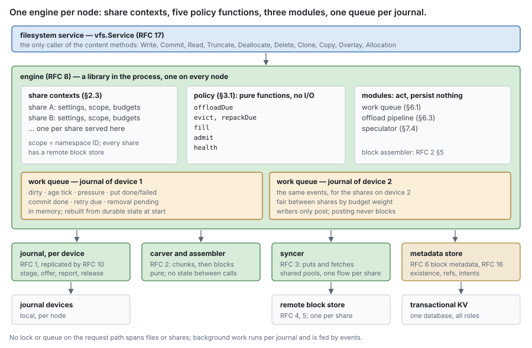
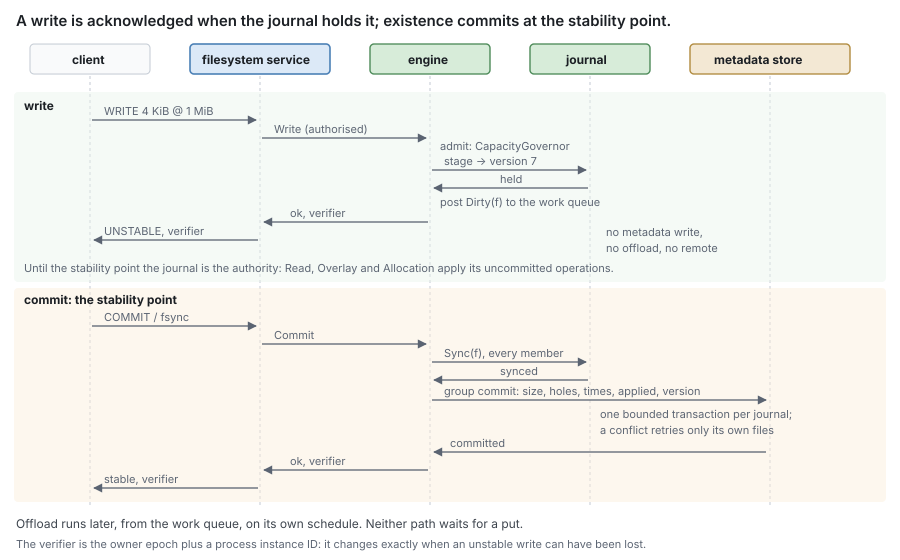
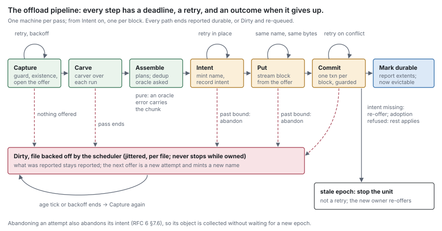
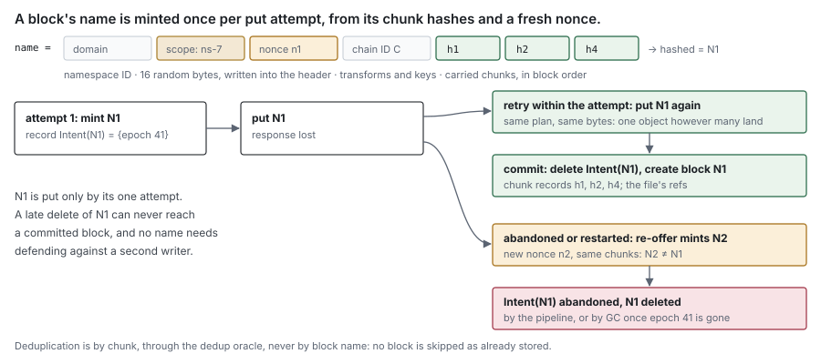
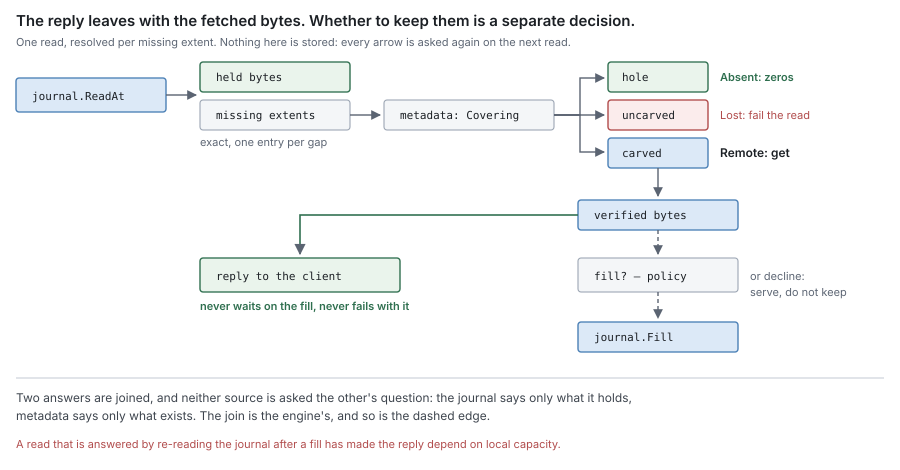
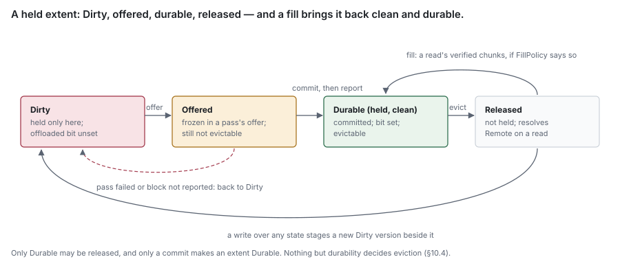

# RFC 8 — the engine

**Status:** draft.
**Audience:** anyone changing the engine, the content composition, or the
content surface the filesystem service ([RFC 17](rfc-17-vfs.md)) calls.

Conventions, RFC 2119 keywords and test tiers are set once in the
[index](rfc-index.md). This document specifies behaviour, not the current code;
[Appendix A](#Appendix%20A%20%E2%80%94%20where%20the%20current%20code%20differs) lists where the code differs, as defects to fix, never
rules to build around. Where it chooses a policy the set left open, the choice is
labelled **proposal** and names the measurement that would overturn it.

---

## Start here

*Explanatory. The rules are in [§1](#1.%20Purpose) onward; where this section and a rule differ, the rule wins.*

### In plain words

The engine decides what happens to file content on one node, and in what order.
It holds no bytes itself: the journal holds recent writes, the bucket holds what was uploaded, and the metadata store records which is where.
Its job is to call those three at the right moments: acknowledge from the journal, upload later, evict only what is safely uploaded.
On a read it asks the journal before the metadata store, so content in flight between them is never missed.
Think of a head chef who cooks nothing, but calls each order to the right station in the right order.
Where the picture breaks: after a crash the engine rebuilds its whole to-do list from the journal and the metadata store, losing time but no content.
One engine serves every share on the node, and one share must not stall another.

```text
 write ─► journal ─(later)─► upload to bucket ─► metadata commit ─► evictable
 read  ─► journal first ─► then metadata ─► fetch from bucket if needed
```

**What this is.** The engine is the coordinator of file content on a storage
node. When the filesystem service asks to write, flush or read a file's bytes,
the engine decides what happens next — acknowledge from the local journal,
upload to the remote object store (S3) later, fetch on a cold read, evict when
space runs short — and calls the components that do the work. It holds no bytes
and records no facts of its own, so a crash costs it time, never content.

**The problem, with one example.** Single-node install N1: a local journal on
NVMe, remote tier the S3 bucket `dfs-data`. On the `profiles` share, alice-pc
writes 64 KiB at offset 2 GiB of `profiles/alice/ODFC_alice.vhdx` over SMB.

1. **Write.** The engine admits the write, the journal stores it and gives it a
   version, and the engine acknowledges. No metadata transaction, no S3 request.
2. **Flush.** Windows sends an SMB `FLUSH`. The engine has the journal sync the
   file to disk. The 64 KiB overwrites content whose existence is already
   committed, so the flush also waits for the next existence commit — one
   transaction shared with every other file of that journal — which records the
   overwrite, and then answers. A write that only appends or fills a hole is
   answered after the sync, and its size and times reach metadata soon after; a
   crash before then loses nothing, because recovery re-applies them from the
   journal. No S3 request: an S3 outage never turns into a write error.
3. **Offload, seconds later.** The work queue hands the file to an offload
   pass. The pass cuts the dirty bytes into chunks (~256 KiB pieces named by the
   hash of their content), packs them into a block (~4 MiB object), records the
   block's name, puts it into `dfs-data`, and commits the refs (file offset →
   chunk → block) in one metadata transaction. Only then does it tell the
   journal the 64 KiB is offloaded, which makes the local copy evictable.
4. **Evict, days later.** The journal fills; the eviction policy picks the
   coldest offloaded extents, alice's included, and the journal releases them;
   repack then returns their space ([§10](#10.%20Local%20space)).
5. **Read.** alice signs in and Windows reads offset 2 GiB. The engine asks the
   journal first (not held any more), then metadata (a ref to a block in S3),
   fetches the chunk, verifies its hash, and streams it to alice-pc.

The ordering is the engine's whole job. Take step 5 the other way round: the
engine asks metadata first and hears "written but not yet uploaded"; before it
asks the journal, the offload commits and eviction releases the extent; the
journal then says "not held". Metadata says the bytes exist only locally, the
journal no longer has them, and the read fails as **Lost** — for content sitting
safely in S3. Asking the journal first closes that window
([§7.1](#7.1%20Resolution%20asks%20the%20journal%20first%2C%20then%20metadata)). The same care runs through every step: the journal hears
"offloaded" only after the metadata commit lands, so eviction can never drop the
only copy ([§6.8](#6.8%20The%20callback%20returns%20only%20what%20committed)).

```text
 alice-pc ──SMB──► filesystem service
                         │  Write · Commit · Read
                         ▼
 ┌──────────────────── engine on N1 ────────────────────┐
 │ policy decides · modules sequence · holds no bytes   │
 └─┬────────────┬─────────────┬───────────────┬─────────┘
   │1 stage     │2 sync, then │3 offload pass │5 read:
   │  and ack   │  commit     │  (seconds     │  journal
   ▼            ▼  size, times▼  later)       ▼  first
 journal    metadata      carve → pack ──► syncer ──► S3 dfs-data
 (NVMe)     store         commit refs, then mark the journal
   ▲                      copy offloaded; 4 evict it later
   └──────────────── release, fill ◄─────────────────────────
```

**The words you need.**

- **Journal** — the fast local store of recent writes, one per device; a write
  is acknowledged once it is there ([RFC 0 glossary](rfc-0-data-lifecycle.md#Glossary)).
- **Stability point** — a client's flush (NFS `COMMIT`, SMB `FLUSH`, `fsync`) or
  a stable write: the journal syncs the file; an overwrite of committed content
  also waits for its existence commit, and everything else is committed in
  metadata soon after ([§5](#5.%20Commit%3A%20the%20stability%20point)).
- **Offload** — the background pass that carves dirty bytes into chunks, packs
  blocks, uploads them and commits the refs ([RFC 0 §5.2](rfc-0-data-lifecycle.md#5.2%20Offload)).
- **Dirty / offloaded** — a held extent is dirty until its block's metadata
  commit lands, then offloaded and only then evictable ([§10](#10.%20Local%20space)).
- **Residency** — what a missing extent resolves to: **Absent** (a hole, reads
  as zeros), **Remote** (fetch it), **Lost** (should exist, is nowhere)
  ([RFC 0 §4.2](rfc-0-data-lifecycle.md#4.2%20The%20residency%20function)).
- **Policy component** — a small decision function (when to offload, whether
  to fill, what to evict); the mechanism it picks is safe on its own
  ([§3](#3.%20Policy)).
- **Share context** — the little the engine keeps per share: settings, policy
  state, health, budgets; one engine serves every share on the node
  ([§2.3](#2.3%20One%20engine%20per%20node%3B%20a%20share%20is%20a%20context)).

**What this RFC promises.**

- A write is acknowledged once the journal holds it, and a flush or a stable
  write once the journal has synced it and, for an overwrite of committed
  content, its existence has committed in the journal's shared group commit.
  Nothing waits for S3.
- An extent becomes evictable only after the metadata commit naming its block
  has landed. A failed upload leaves it dirty, and it is retried for as long as
  this node serves the shard.
- A read returns zeros only for a real hole. Content that should exist and
  cannot be found fails as lost; an unreachable S3 fails with a different,
  transient error; no byte of a chunk reaches the client before the chunk
  verifies.
- Nothing is persisted by the engine: after a crash it rebuilds its queue and
  plans from the journal and metadata, and re-offers what was not offloaded.
- One share cannot stall another: nothing on the request path is shared across
  files or shares, and background work is shared fairly per journal.

**How the rest is organised.** [§1](#1.%20Purpose)–[§3](#3.%20Policy) say what the engine is, how a node
composes it and how policy is split from mechanism. Then one section per
operation, rules first: write ([§4](#4.%20Write)), flush ([§5](#5.%20Commit%3A%20the%20stability%20point)), offload ([§6](#6.%20Offload) — the longest; [§6.5](#6.5%20The%20dedup%20oracle)
on deduplication is deferred and can be skipped), read ([§7](#7.%20Read)), truncate and
deallocate ([§8](#8.%20Truncate%2C%20deallocate%20and%20release)), clone ([§9](#9.%20Clone)). [§10](#10.%20Local%20space)–[§11](#11.%20Health%20and%20failure) cover local space and health, [§12](#12.%20Interface) the
interface the filesystem service calls, [§13](#13.%20Invariants) the invariants in one table. [§14](#14.%20Observability)–[§15](#15.%20Conformance)
(metrics, tests, benchmarks) and Appendix A (where today's code differs) can
wait for a second reading.

### Scenarios

Each runs on N1, with alice-pc writing to `profiles/alice/ODFC_alice.vhdx` and the bucket `dfs-data` as the remote tier.

**The bucket stops answering for an hour.**

1. alice-pc keeps writing; each write is staged in the journal and acknowledged as usual ([§11.2](#11.2%20Every%20condition%20in%20RFC%200%20%C2%A710%20has%20its%20engine%20behaviour%20here)).
2. Before each offload pass the engine asks whether the bucket accepts uploads; while not, the pass is skipped and retried ([§6.3](#6.3%20The%20offload%20pipeline)).
3. Retries never stop while N1 serves the share; the wait grows from 1 s to at most 60 s (proposed defaults) ([§6.3](#6.3%20The%20offload%20pipeline)).
4. The share reports a health condition for failing offload, separate from the bucket being unreachable ([§11.1](#11.1%20Health%20is%20derived%20from%20recent%20outcomes%2C%20offload%20included)).
5. A read of content held only in the bucket fails with a transient error, never with the "lost" error ([§7.5](#7.5%20An%20unreachable%20remote%20fails%20the%20read%2C%20distinguishably)).
6. If the journal fills, writes get retry-later, never "no space", because an outage clears by itself ([§10.2](#10.2%20A%20capacity%20refusal%20comes%20back%20here)).

Outcome: once the bucket answers, offload resumes within one backoff and drains the backlog, with no operator step ([§6.3](#6.3%20The%20offload%20pipeline)).

**N1 crashes after an upload, before its metadata commit.**

1. An offload pass minted block name B1, durably recorded a put intent (a note "about to upload B1"), and uploaded B1 ([§6.6](#6.6%20A%20block%27s%20name%20is%20minted%2C%20and%20its%20intent%20recorded%2C%20before%20the%20put)).
2. N1 dies before the metadata commit, so alice's extents never got their offloaded mark and stay dirty ([§10](#10.%20Local%20space)).
3. On restart, before serving a file, the engine re-applies from the journal the sizes and times metadata had not recorded ([§2.5](#2.5%20Start%20in%20order%2C%20stop%20in%20reverse%2C%20and%20join%20before%20closing)).
4. It rebuilds its work queue: every held extent without an offloaded mark is offered again ([§2.5](#2.5%20Start%20in%20order%2C%20stop%20in%20reverse%2C%20and%20join%20before%20closing)).
5. The re-offer mints a new name, B2; the name B1 is never used again ([§2.5](#2.5%20Start%20in%20order%2C%20stop%20in%20reverse%2C%20and%20join%20before%20closing)).
6. On a single node, N1 abandons B1's intent before serving, and GC deletes the orphan object from it ([RFC 9 §5](rfc-9-gc.md#5.%20Unrecorded%20objects)).

Outcome: the crash leaks bucket space for a while and loses no content.

**alice-pc truncates the file while its offload pass is uploading.**

1. The pass captured alice's dirty bytes under the file's guard, a short per-file lock, then started the upload ([§6.4](#6.4%20The%20offload%20guard%20is%20narrow)).
2. The truncate takes the guard next, so the journal gives it a version above everything the pass offered ([§8.3](#8.3%20A%20pass%20in%20flight%20survives%20a%20removal%20under%20it)).
3. The truncate neither waits for the upload nor cancels it ([§8.3](#8.3%20A%20pass%20in%20flight%20survives%20a%20removal%20under%20it)).
4. If the pass commits first, the truncate hides its refs and drops them later; otherwise the pass drops every ref overlapping the removed range ([§8.3](#8.3%20A%20pass%20in%20flight%20survives%20a%20removal%20under%20it)).
5. A ref straddling the new end is dropped whole; its part inside the file stays dirty and is uploaded again ([§8.3](#8.3%20A%20pass%20in%20flight%20survives%20a%20removal%20under%20it)).

Outcome: in either order, a later extend reads zeros past the truncation point; the cost is at most one chunk re-uploaded per edge.

**The journal fills faster than the bucket drains it.**

1. Writes are paced on dirty plus not-yet-reclaimed bytes: what only an upload or a repack can free ([§10](#10.%20Local%20space)).
2. Below half of the limit no write is delayed; above it, every file with dirty bytes may be offloaded at once ([§10.2.1](#10.2.1%20Writes%20are%20paced%20before%20the%20limit%2C%20not%20stopped%20at%20it)).
3. The delay grows in a straight line, from zero at half the limit to the time the journal takes to drain that write ([§10.2.1](#10.2.1%20Writes%20are%20paced%20before%20the%20limit%2C%20not%20stopped%20at%20it)).
4. If the journal still refuses a write, the engine first repacks: it copies live records out so a segment's space can be reused ([§10.2](#10.2%20A%20capacity%20refusal%20comes%20back%20here)).
5. Then it evicts uploaded extents; if the bucket is healthy, it pushes dirty files to offload at once, and retries ([§10.2](#10.2%20A%20capacity%20refusal%20comes%20back%20here)).
6. A delay that would outlast the client's deadline returns retry-later at once, instead of sleeping ([§10.2.1](#10.2.1%20Writes%20are%20paced%20before%20the%20limit%2C%20not%20stopped%20at%20it)).

Outcome: alice-pc slows down gradually instead of hitting a wall, and no acknowledged write is dropped to make room.

## In short

- The engine holds no bytes and no facts. Every byte is the journal's or the
  remote tier's; every fact is block metadata's or the namespace's.
- It is the content data path, one per node — every node runs both roles — serving every
  share whose shards that node is primary of. It decides policy through five small policy
  functions, runs three modules — the work queue, the offload pipeline and the
  speculator — and is the content **interface** that `*vfs.Server` alone calls
  ([RFC 17](rfc-17-vfs.md)). Neither the adapters nor the gateway reach it.
- Offload always carries its chunks. Cross-file deduplication is not in the
  first release; re-adding it is a later RFC's ([§6.5](#6.5%20The%20dedup%20oracle)).
- The write verifier changes exactly when an acknowledged unstable write may
  have been lost ([§4.1](#4.1%20A%20write%20is%20staged%20and%20acknowledged%2C%20and%20nothing%20more)).
- It is a library in the process, not a service, and never on the byte path.
- It owns the joins no component can own alone: residency resolution on read, the
  offload pipeline, and the ordering of a write and its stability point. Blocks
  are packed by the block assembler ([RFC 2 §5](rfc-2-carver.md#5.%20The%20block%20assembler)), which the pipeline
  drives.
- Every share has a remote block store. There is no local-only share.
- Policy chooses among safe actions. It is never the thing that makes an action
  safe.
- It persists nothing. Its queue, plans and policy state are rebuilt from the
  journal and the records after a crash; losing them costs time, never content.

---

## 1. Purpose

[RFC 0 §1.1](rfc-0-data-lifecycle.md#1.1%20The%20component%20set) gives the engine *the content data path: composition, policy, and the content facade the filesystem service calls*, and
nothing else. It answers the one question no component can:

> **Given what the two oracles say, what happens next?**

The two oracles are the two sources of truth about content ([RFC 0 §4.1](rfc-0-data-lifecycle.md#4.1%20The%20two%20oracles)):

- the **journal**, which says whether this node holds a file's bytes locally, and
  where;
- the **metadata store**, which says whether content exists, which chunk and
  block hold it, and whether that block is synced to the remote tier.

Neither may answer the other's question; the engine is where their answers are
joined. A read has two answers to join. An offload has a carver, an assembler, a
syncer and a metadata commit to sequence. A full journal has to be told what to
evict. A write has steps owned by three components. Each needs someone who sees
all the parties and belongs to none of them.

### 1.1 Neither a single point of failure nor a bottleneck

Seeing every party makes the engine a coordinator, and a coordinator is where a
system usually loses its availability or its throughput. Four rules keep it
from being either:

- **It is a library, not a service.** The engine is code in the process that
  owns the content, reached by a function call. There is no engine server to
  lose: each node runs its own engine, over the shards it is primary of
  ([RFC 15](rfc-15-topology.md), [RFC 11](rfc-11-ownership.md)).
- **It is never on the byte path.** It sequences; bytes flow from the journal
  through the carver to the syncer and back, and a write is a journal append
  and an acknowledgement ([§4.1](#4.1%20A%20write%20is%20staged%20and%20acknowledged%2C%20and%20nothing%20more)). No payload is copied through engine state.
- **Nothing on the request path spans shares or files, but three named points.**
  The engine **MUST NOT** hold a lock, a queue or any other serialisation point
  shared by more than one file, or by more than one share, across I/O or a wait
  on the path of a write, a read or a commit. The request path shares exactly
  three things, each bounded: the device journal's append stream and its sync,
  which every file of the journal uses by design ([RFC 1 §5](rfc-1-journal.md#5.%20Durability%20and%20ordering)); the
  journal's group existence commit, bounded at `G` files and split on conflict,
  which only a stability point covering an overwrite waits on, and joins rather
  than issues ([§5.1](#5.1%20Commit%20is%20answered%20by%20the%20journal), [§5.2](#5.2%20Group%20commit%20is%20bounded%2C%20and%20retries%20only%20the%20files%20that%20conflict)); and the
  capacity reservation, an atomic counter taken without a lock ([RFC 1 §6](rfc-1-journal.md#6.%20Capacity)).
  Per-file state is keyed by file and per-share state by share ([§2.3](#2.3%20One%20engine%20per%20node%3B%20a%20share%20is%20a%20context)).
  Background work runs per journal ([§6.1](#6.1%20The%20work%20queue)), and the events that feed it
  never block the request that posts them. The table of share contexts is read
  without a lock on the hot path.

  > decision: the share table is copy-on-write: a share's attach or removal
  > copies the whole table, up to 10⁴ entries, once per change, so the hot path
  > reads it without a lock. Overturned if share churn is measured in changes
  > per second.
- **Failover is not its job.** When a node dies, what its engine served moves
  with its shards: another node becomes their primary and replays from a replica
  ([RFC 10](rfc-10-journal-replication.md), [RFC 11](rfc-11-ownership.md)). The engine's state is memory by design ([§3.3](#3.3%20Policy%20state%20is%20memory%2C%20and%20disposable)), so
  the new node's engine starts correct from nothing.

[§14](#14.%20Observability) measures the third rule, and [§15.2](#15.2%20Group%20B%20%E2%80%94%20wedging) checks it.

### 1.2 Non-goals

The engine **MUST NOT**:

- define a format, an encoding or an algorithm ([RFC 1](rfc-1-journal.md), [RFC 2](rfc-2-carver.md), [RFC 4](rfc-4-remote-tier.md), [RFC 5](rfc-5-transforms.md)) —
  how chunks are packed into blocks included ([RFC 2 §5](rfc-2-carver.md#5.%20The%20block%20assembler));
- move bytes to or from the remote tier itself — that is the syncer ([RFC 3](rfc-3-syncer.md));
- hold a copy of any oracle's answer that outlives the operation that asked — no
  residency cache, no durability record ([RFC 0 §4.2](rfc-0-data-lifecycle.md#4.2%20The%20residency%20function));
- persist anything. Every durable fact is recorded by the component that owns it;
- decide when a file stops existing ([RFC 7 §4](rfc-7-namespace-metadata.md#4.%20What%20keeps%20a%20file%20alive)), or schedule GC ([RFC 9](rfc-9-gc.md)), which
  runs once per remote namespace, not per share ([§10.5](#10.5%20GC%20is%20not%20scheduled%20here));
- carry namespace features nothing below the namespace needs, such as a recycle
  bin ([RFC 7](rfc-7-namespace-metadata.md)).

## 2. Composition



### 2.1 Content composition

The process's one composition root is `node.New` ([RFC 23 §2.1](rfc-23-control-plane.md#2.1%20The%20node%20builds%20its%20components)), and
it alone names concrete component types. This section specifies what it builds
for content, on every node: one **journal per device**, the
syncer, block metadata's view, and one engine over them with a context per share
([§2.3](#2.3%20One%20engine%20per%20node%3B%20a%20share%20is%20a%20context)). Everything else holds a concrete type where there is one
implementation — `*vfs.Server` holds `*engine.Engine`
([RFC 17](rfc-17-vfs.md)) — and an interface the consumer declares only where
[RFC 0 §1.2](rfc-0-data-lifecycle.md#1.2%20Component%20autonomy) requires one: the engine declares one per component it calls, in
`Deps` ([§2.6](#2.6%20Dependencies%20and%20wiring)). Adapters hold only `vfs.Service`, and the gateway behind it never
reaches the engine. [RFC 0 §1.2](rfc-0-data-lifecycle.md#1.2%20Component%20autonomy)'s import rule binds the components composed; the
composition code imports them and nothing imports it.

**Every share has a remote block store.** The root **MUST** refuse to add a share
whose configuration names no remote block store, with an error naming the share.
There is no local-only share and no code path for one: offload always has a
target, clone always adopts refs, and an offload report always has a commit
behind it. A deployment that wants no remote service configures a remote block
store of its own ([RFC 4](rfc-4-remote-tier.md)).

**The key scope is the namespace.** Each share context carries its namespace ID as
its key scope ([RFC 2 §4.3](rfc-2-carver.md#4.3%20Key%20scope)): block names are minted under it ([§6.6](#6.6%20A%20block%27s%20name%20is%20minted%2C%20and%20its%20intent%20recorded%2C%20before%20the%20put)) and
deduplication, once re-added, would answer within it ([§6.5](#6.5%20The%20dedup%20oracle)). Content-addressed
records are partitioned by namespace ([RFC 6 §2.6](rfc-6-block-metadata.md#2.6%20The%20scope%20of%20a%20count)), so two shares of one namespace
count shared chunks on one record, and, once deduplication is added, deduplicate
against each other; shares of two namespaces never do. During a re-home a
share has two namespaces ([RFC 27 §2.7](rfc-27-namespace-migration.md#2.7%20Moving%20one%20share%20out%20of%20a%20shared%20namespace)); its **write namespace** is the one new
blocks are minted and counted in, and each ref names by its generation the
one its chunk is read from.

Composition **MUST** happen at construction. A capability **MUST NOT** be wired
onto a serving engine by a setter: that makes "this capability is absent" a
reachable state of a live share. Changing a share's backends replaces its context.

The engine supplies and consumes, at construction:

| Declared by | Need | Supplied from |
| --- | --- | --- |
| [RFC 3](rfc-3-syncer.md) | a `Store`: streamed put, verified read, health ([RFC 3 §1.3](rfc-3-syncer.md#1.3%20Interface)) | the block codec with the store's transform chain ([RFC 4 §3](rfc-4-remote-tier.md#3.%20The%20block%20format), [RFC 5](rfc-5-transforms.md)), over the share's remote block store; it maps every remote-tier and transform error onto the syncer's own error values ([RFC 3 §1.3](rfc-3-syncer.md#1.3%20Interface)), so no syncer code tests an error another component declares; a service's quota or capacity refusal (bucket quota exceeded, storage full) maps to `ErrDenied`, never `ErrInvalid`, so it counts toward put health and the engine can tell it from an outage ([§10.2](#10.2%20A%20capacity%20refusal%20comes%20back%20here)) |
| [RFC 17](rfc-17-vfs.md) | the content interface, including the one read path for size, times and version, `Overlay` ([§12.1](#12.1%20One%20content%20interface%2C%20called%20by%20the%20filesystem%20service)) | the engine |

Every capability **MUST** be a method on an interface held by declaration, and an
absent one **MUST** fail the build or construction with an error naming it
([RFC 0 §1.2](rfc-0-data-lifecycle.md#1.2%20Component%20autonomy)). A production constructor that accepts `nil` for a capability "so
tests can omit it" has made a silent fallback a production path; fixtures supply
stubs of the whole interface.

**What the engine consumes, it declares.** The engine declares, beside its own
code, one interface per component it calls, holding exactly the methods it calls,
and the composition root passes each component's concrete type as that
interface:

| Declared by | Component | What the engine calls |
| --- | --- | --- |
| [RFC 1 §3](rfc-1-journal.md#3.%20Interface) | the journal | `Share`, passed the larger of the share's version floor and version limit and the share's sync policy ([RFC 1 §5.2](rfc-1-journal.md#5.2%20Sync%20policy)); `Forget` (drops a tag's extents, markers and index entries through one header-only record `Since` never yields, refused while a handle of the tag is open, for a namespace moved away, an import attach or a share's removal, [RFC 1 §3](rfc-1-journal.md#3.%20Interface)); `Strand`; `Stats`; `Draw` and `SetVersionLimit` ([RFC 1 §4.3](rfc-1-journal.md#4.3%20Versions)); `Close`, after every handle ([RFC 1 §8.7](rfc-1-journal.md#8.7%20Shutdown)) |
| [RFC 1 §3](rfc-1-journal.md#3.%20Interface) | a share's handle on the journal | `WriteAt`, passed the write's modification time ([RFC 28 §2.3](rfc-28-journal-format.md#2.3%20Records)), `ReadAt`, `Sync`, `Offload`, `OffloadMany`, `Fill`, `Release`, `Truncate`, `Deallocate`, `Delete`, `CloneTarget` with its `CloneSpec` ([§9.1](#9.1%20Clone%20adopts%20carved%20refs%20and%20copies%20the%20rest%20locally)), `Reserve(n, writes)` and the reservation's `WriteAt` and `Close`, for a clone's copies ([RFC 1 §6](rfc-1-journal.md#6.%20Capacity)), `Close`, before the tag's `Forget`, `Since`, `Settle`, `MarkOffloaded`, `Unmark`, `Repack` with its scope, `Hold`, `Stamp`, `Files`, `DirtyFiles`, and `SetSyncPolicy`, on every handle of a share whose `sync.policy` changes live ([§2.3](#2.3%20One%20engine%20per%20node%3B%20a%20share%20is%20a%20context)) |
| [RFC 2 §2](rfc-2-carver.md#2.%20What%20one%20call%20covers), [§5](rfc-2-carver.md#5.%20The%20block%20assembler) | the carver and the block assembler | the carver's `Cut`; the assembler's fold |
| [RFC 3 §1.3](rfc-3-syncer.md#1.3%20Interface) | the syncer | `OpenFlow`, one flow per share at attach |
| [RFC 3 §1.3](rfc-3-syncer.md#1.3%20Interface) | a syncer flow | `Close`, in `ForgetShare` or `Close`; `Upload`, `Fetch`, `Prefetch`, `Healthy`, and `Health(d)` for the cause of an unhealthy direction — `ErrDenied` for quota, access or size, `ErrTransient`, `ErrCorrupt` or `ErrDrift` ([§11.1](#11.1%20Health%20is%20derived%20from%20recent%20outcomes%2C%20offload%20included), [§10.2](#10.2%20A%20capacity%20refusal%20comes%20back%20here)) |
| [RFC 6 §10](rfc-6-block-metadata.md#10.%20API%20surface%20and%20observability) | block metadata's `Existence` and `Content` views, held as two interfaces | every method of both, except `Offloaded` while deduplication is deferred |
| [RFC 16 §3](rfc-16-metadata-store.md#3.%20Interfaces%2C%20by%20consumer) | the metadata store's `Lifecycle` view | `JournalID`, the identity recorded for a device, for `Open` ([§2.5](#2.5%20Start%20in%20order%2C%20stop%20in%20reverse%2C%20and%20join%20before%20closing), step 1); `VersionLimits`, read for `Open`'s floor, and `RaiseVersionLimits`, a tracked max-write of `S‖id‖vl` within `K` keys a transaction ([§2.7](#2.7%20The%20version%20limit)); `RaiseIncarnations`, in the start transaction or at attach (step 2) |
| [RFC 16 §3.1](rfc-16-metadata-store.md#3.1%20Lookups%20by%20ID%2C%20listings%2C%20and%20who%20may%20use%20them) | the metadata store's `Inspect` view | `Refs`, for the reseed only ([§2.5](#2.5%20Start%20in%20order%2C%20stop%20in%20reverse%2C%20and%20join%20before%20closing), [RFC 6 §8.3](rfc-6-block-metadata.md#8.3%20A%20file%27s%20refs%20and%20the%20version%20floor)); every other engine transaction goes through block metadata's views or `Lifecycle` |

A call to a method no row names is a build failure, not a review comment, and a
component method no row names is unreachable from the engine. The journal's
`Init` and `Restamp` are not the engine's: the explicit initialisation step and
the recovery import ([RFC 26](rfc-26-catalog-backups.md)) call them ([§2.5](#2.5%20Start%20in%20order%2C%20stop%20in%20reverse%2C%20and%20join%20before%20closing), step 1).

`Lifecycle` is declared in [RFC 16 §3](rfc-16-metadata-store.md#3.%20Interfaces%2C%20by%20consumer).
Its four methods are the engine's only store access outside block metadata's
views and `Refs`.

**One clock and one fault interface, declared here.** The root composes the
node, so it declares the two interfaces every component takes at construction
([the index's test harness](rfc-index.md#Test%20tiers), item 1): the journal, the syncer, the engine, GC,
the snapshot cut and leases read time only through `Clock`, and every fault
seam — the journal's storage seam, the fake store, the fault transport, the
fault-injecting metadata store — implements `Fault`. A component with a private
clock cannot take part in a check that skews time across components.

**The clock is written in standard-library types only.** Each component declares
the clock it reads in its own package ([RFC 0 §1.2](rfc-0-data-lifecycle.md#1.2%20Component%20autonomy)), as the subset of these
methods it uses, so the node's one clock satisfies every such declaration as it
is, and no component needs an adapter to take it. A type of this package in a
signature would make that impossible for a component that may import nothing
but the standard library, such as the journal ([RFC 1 §1.1](rfc-1-journal.md#1.1%20Non-goals)).

```go
// Clock is the node's one source of time.
type Clock interface {
    Now() time.Time                          // wall time: record stamps, the store's Now on a store without its own
    Elapsed() time.Duration                  // monotonic time since an origin the clock chose, never persisted; every wait is sized on differences of it
    After(d time.Duration) <-chan struct{}   // fires after d on the monotonic clock
}

// Fault is consulted by a seam before each named operation, on a seeded
// schedule read from the Clock. Its results are standard-library values, so a
// seam that may import only the standard library implements it as is.
type Fault interface {
    At(op string, key []byte) (delay time.Duration, err error, tearAfter int) // zero values pass; err fails the operation; tearAfter > 0 tears a write after that many bytes
}
```

The test clock is a concrete type the harness builds; production never builds
one. It satisfies `Clock` and adds `Advance(d)` and `SetRate(r)`, where 1.05
runs it 5 % fast against every other clock.

### 2.2 Capabilities are parameters, never assertions

The engine **MUST NOT** negotiate a capability by type assertion, nor fall back to
a degraded behaviour when one is missing ([RFC 0 §1.2](rfc-0-data-lifecycle.md#1.2%20Component%20autonomy)). Here each such fallback
yields a working share and no error: an assertion failing on the remote tier
disables offload, on a transform chain uploads plaintext, on a lookup makes every
cold read linear.

### 2.3 One engine per node; a share is a context

Every node runs **one engine**, and each share it serves is a
**share context** in it, not an engine of its own. The context is the engine's
own, unexported; no caller sees it. It holds the share's ID; its key scope, the
namespace ID ([§2.1](#2.1%20Content%20composition)); its settings, validated at `SetShare` ([§2.4](#2.4%20Settings%20are%20validated%20once%2C%20and%20refused%20rather%20than%20replaced)); its
policy state — access pattern, dirty ages, backoff, frontiers ([§3.3](#3.3%20Policy%20state%20is%20memory%2C%20and%20disposable)); its
health per direction ([§11.1](#11.1%20Health%20is%20derived%20from%20recent%20outcomes%2C%20offload%20included)); its budgets — its share of journal capacity,
transfers and pacing; its journal handles and syncer flow; and its state:
adding, serving, quiesced, closing or removing ([RFC 16 §2.3.2](rfc-16-metadata-store.md#2.3.2%20Removing%20a%20share)).

Everything below the engine is already shared: the journal is per device and
accounts capacity per share ([RFC 1 §6](rfc-1-journal.md#6.%20Capacity)), the syncer's pools are shared and schedule
by class ([RFC 3](rfc-3-syncer.md)), and the remote store and the metadata store **MAY** serve many
shares. What is truly per share is small — settings, policy state, lifecycle,
health and budgets — and the context holds exactly that.

**Background work runs per journal, not per share.** Each device journal has one
work queue ([§6.1](#6.1%20The%20work%20queue)), which drives offload, removal batches, eviction, repack
and the consistency check for every share on it, weighted by their budgets and
fair between them. A node serving 10⁴ shares runs one set of loops per device,
not 10⁴ sets.

**Isolation comes from state, budgets and fairness, not from separate
engines.** A share cannot starve another because its capacity, transfers and
pacing draw on its own budgets and the queue serves shares fairly
([§1.1](#1.1%20Neither%20a%20single%20point%20of%20failure%20nor%20a%20bottleneck)); a share's failure is its context's health, not the engine's. Adding,
removing or quiescing a share changes one context and never restarts the
engine.

**`SetShare` adds a context or changes one.** For a share the engine does not
serve it attaches it ([§2.5](#2.5%20Start%20in%20order%2C%20stop%20in%20reverse%2C%20and%20join%20before%20closing)). For one it serves it applies the change: a
state change, quiesced and back; a `sync.policy` change, applied with
`SetSyncPolicy` on every journal handle the context holds for the share, within
RFC 13's live bound ([RFC 13 §5](rfc-13-configuration.md#5.%20Binding%20classes), [RFC 1 §5.2](rfc-1-journal.md#5.2%20Sync%20policy)), so records written
after it follow the new policy; or a backend change, which replaces the context
([§2.1](#2.1%20Content%20composition)). Two changes belong to a re-home ([RFC 27 §2.7](rfc-27-namespace-migration.md#2.7%20Moving%20one%20share%20out%20of%20a%20shared%20namespace)): a `SetShare`
naming a new write namespace returns once every pass captured under the old one
is joined ([§6.6](#6.6%20A%20block%27s%20name%20is%20minted%2C%20and%20its%20intent%20recorded%2C%20before%20the%20put)); one with `State: Closing` counts clones and copies admitted
from then on as refused, and returns once those admitted before it are done
([§9.1](#9.1%20Clone%20adopts%20carved%20refs%20and%20copies%20the%20rest%20locally)).

**`StopShare` ends the share's work; `ForgetShare` ends its journal tag.** The
share's removal calls `StopShare(id, keepHolds)` at its step 3
([RFC 16 §2.3.2](rfc-16-metadata-store.md#2.3.2%20Removing%20a%20share)), on each shard's primary, after admission has begun refusing
the share with `ErrStale`. `StopShare` moves the context to `removing` and
**MUST**, in this order: admit no new call, clone, copy, offload pass or removal
batch for the share, other than the offload of the hold marks below and the
phase-2 batches of a clone the join below waits on; join every call admitted before the refusal, every clone with the
share on either side, and every pass and batch in flight; cancel every
asynchronous copy reading from the share, whatever share it writes
([RFC 14 §2.7](rfc-14-open-state.md#2.7%20Copy)); and, with `keepHolds` — a removal that keeps snapshots —
offload the extents its hold marks cover before it returns. A namespace call — a create, link or
rename — enters the engine only to `Draw` its versions, which counts nothing,
so the engine cannot join it: the filesystem
service counts the calls it has admitted per share and the removal's step 3
waits for that count to reach zero as well ([RFC 17 §4.9](rfc-17-vfs.md#4.9%20Shares%2C%20mounts%20and%20trees)). Only then does the removal end the share's open
state and drop the tag, in RFC 16's order ([RFC 16 §2.3.2](rfc-16-metadata-store.md#2.3.2%20Removing%20a%20share)): once every shard of
the share has recorded its step 3 offload done (a removal that keeps no
snapshots records it with nothing to offload), it calls `ForgetShare`, which
closes the share's journal handle on the tag (`Close`, [RFC 1 §3](rfc-1-journal.md#3.%20Interface)), runs the
whole-tag `Forget`, which is refused while a handle is open, and closes the
share's flow, **before** the shard's `rm` row is advanced to forgotten. Node
stop never calls `ForgetShare`: `Close` closes handles and keeps tags. `Forget` is durable and idempotent, so a crash between
the two only repeats it, and at every start the engine runs `Forget` again for
each tag `Stats` still names whose share's `rm` rows read forgotten, before that share could attach ([§2.5](#2.5%20Start%20in%20order%2C%20stop%20in%20reverse%2C%20and%20join%20before%20closing), step 1). On one
node a journal holds one shard per tag, and the `rm` row is the only record of
the step. **(cluster)** A journal serving several of the share's shards writes a
durable per-(shard, tag) forget record for each first, runs the whole-tag
`Forget` once its last shard has one, and keeps each per-(shard, tag) record
live, through repack, until the whole-tag record exists.
Without the join, a create admitted before the mark could commit a File record
after step 4 has passed it, and nothing would delete it. From then on the
context runs nothing that takes a journal version: step 4's file drops are
metadata transactions alone.

Per-file state is keyed by file within its shard, and held at that shard's
primary, which offloads the whole file. A file is never split across shards
([RFC 0 §1.3](rfc-0-data-lifecycle.md#1.3%20The%20layers)); range shards are deferred
([RFC 11 Appendix C](rfc-11-ownership.md#Appendix%20C%20%E2%80%94%20later%3A%20per-file%20and%20range%20shards)).

> ponytail: per-file state — guards, frontiers, clone registrations, loss
> entries — lives while the file has pending existence, an offer, a
> registration, an open frontier or a loss entry above the floor, and is
> dropped after; its count is bounded by the files active in the last existence
> age plus those open. This bound is a proposal, not a measurement. Bound it
> explicitly, with eviction of idle entries, if a count of per-file states
> grows with the namespace rather than the working set.

### 2.4 Settings are validated once, and refused rather than replaced

The engine validates every setting it composes at construction, and **MUST**
refuse an invalid one with an error rather than substitute a default
([RFC 2 §3.7](rfc-2-carver.md#3.7%20Bad%20settings%20must%20be%20refused%2C%20not%20replaced)). It **MUST** record which chunking settings produced a share's content,
and **MUST** report a change to them as a migration rather than apply it
([RFC 2 §3.6](rfc-2-carver.md#3.6%20Changing%20any%20of%20this%20is%20a%20migration)).

### 2.5 Start in order, stop in reverse, and join before closing

**Start.** `New` validates settings and opens nothing. `Start(ctx, shares)` runs
the steps below over the given shares, each step completing before the next
begins. A step that fails closes in reverse what earlier steps opened and
returns its error, so the engine is either serving or as built. A share refused
at step 1 — its journal missing or foreign — does not fail `Start`: it is not
attached, and `Stats` names it and its device.

1. **Open the journal.** Read the version floor for every share the device
   journal may serve ([RFC 6 §8.3](rfc-6-block-metadata.md#8.3%20A%20file%27s%20refs%20and%20the%20version%20floor)), and the journal identity the metadata store
   records for the device ([RFC 16 §4.2](rfc-16-metadata-store.md#4.2%20Keys%3A%20per-file%2C%20per-share%2C%20content-addressed)), and open the journal with both
   ([RFC 28 §3.1](rfc-28-journal-format.md#3.1%20Rebuilding), [§3.4](rfc-28-journal-format.md#3.4%20Unattachable%20files)). The engine opens each journal itself, through
   `Deps.Open`, reading the floor and the identity from the store; the root
   opens none. A share whose removal has reached its
   offload step — its `rm` rows at offloaded or later
   ([RFC 16 §2.3.2](rfc-16-metadata-store.md#2.3.2%20Removing%20a%20share)) — is never attached at start ([RFC 1 §3](rfc-1-journal.md#3.%20Interface)): once the
   journal is open and before any share attaches, the engine runs `Forget` for
   the tag of each whose rows read forgotten, wherever `Stats` still names it
   ([§2.3](#2.3%20One%20engine%20per%20node%3B%20a%20share%20is%20a%20context)), which no open handle then refuses; one whose rows read
   offloaded is forgotten by its resumed removal. The journal recovers its index and its
   offloaded-bit ledger alone, and verifies in place every record past the
   point a sync is proven to have reached before it serves, re-appending only
   what fails ([RFC 28 §3.1](rfc-28-journal-format.md#3.1%20Rebuilding)). Start never creates a journal: only the explicit
   initialisation step calls `Init`, and its identity is recorded before
   anything written to it is acknowledged ([RFC 1 §3](rfc-1-journal.md#3.%20Interface)). An `Open` that finds an
   existing journal with nothing recorded for it reports the metadata store lost.
   **A recovery import orders its journals before its shares.** Once the import
   has rebuilt the store, it calls `Restamp` on each adopted journal with its own
   identity as `expect` ([RFC 28 §3.4](rfc-28-journal-format.md#3.4%20Unattachable%20files)) and opens it, before it publishes any
   share; it then raises the store's tag counter above every tag those
   journals' `Stats` name, and only then mints tags for the shares it publishes
   ([RFC 1 §3](rfc-1-journal.md#3.%20Interface), [RFC 26 §2.3](rfc-26-catalog-backups.md#2.3%20Restore)). So no recovered share is given a tag a journal
   still holds, and every stranded tag stays unclaimed for step 5 to strand.
   [RFC 1](rfc-1-journal.md), 16, 26 and 28 cite this order. If the open finds no journal where
   one is recorded, or a different one, the engine **MUST** refuse every share
   on that device, naming each, and **MUST NOT** open the directory as a new
   journal until an operator acknowledges the loss. After that, the shares'
   content that was never offloaded resolves **Lost**, never zeros
   ([§7.1](#7.1%20Resolution%20asks%20the%20journal%20first%2C%20then%20metadata)). The gate binds a shard with no replica, as every shard
   on a single node is ([single-node profile](rfc-0-data-lifecycle.md#1.4%20The%20single-node%20profile)). A shard whose journal is replicated
   does not wait for an operator: it rejoins from its replicas
   ([RFC 10](rfc-10-journal-replication.md)), and only one that has lost every replica is gated.

   The floor the journal opens with is, per share, the larger of the version
   floor and the share's version limit, and before any version is issued the
   engine writes every served share's version limit ([§2.7](#2.7%20The%20version%20limit)).
2. **Raise incarnations.** One transaction — the start transaction — raises the
   incarnation of every shard the node will serve as primary, before any
   verifier is returned or any grace instance named ([§4.1](#4.1%20A%20write%20is%20staged%20and%20acknowledged%2C%20and%20nothing%20more), [RFC 14 §4.2](rfc-14-open-state.md#4.2%20Grace%20makes%20volatile%20state%20safe)). A
   start that left one unraised would repeat that shard's grace instance, and a
   client's `RECLAIM_COMPLETE` from before the restart would end the new grace
   at once. A shard attached later raises its own at attach.
3. **Re-apply existence.** For each file the journal lists ([RFC 1 §3.7](rfc-1-journal.md#3.7%20State%20introspection)), read
   the operations above the file's `applied` version with `Since(id, applied)` —
   held extents and removal markers, each with its version ([RFC 1 §3.10](rfc-1-journal.md#3.10%20Settle%20and%20Since)) —
   and apply them to existence in version order, with the modification time each
   write's record carries: writes acknowledged and synced but not yet committed,
   and removals whose metadata step a crash cut off
   ([RFC 6 §3.4](rfc-6-block-metadata.md#3.4%20Ordering%20against%20the%20journal)). A clone marker — `CloneTarget`'s, yielded as `Change.Clone` —
   is a clone, never a plain removal: the engine rebuilds the clone from the spec — source extent
   registration and open reference before the source is served, then copies,
   sync and phase 1, before the destination is served
   ([§9.1](#9.1%20Clone%20adopts%20carved%20refs%20and%20copies%20the%20rest%20locally), step 4 below); applied as a removal it would leave the destination
   reading zeros. A synced loss record above `applied`, which `Since` also
   yields, has the dropped write's existence committed from it, so the extent reads **Lost**, not as
   the file was before the write ([§5.1](#5.1%20Commit%20is%20answered%20by%20the%20journal)). The existence commit syncs the file first, like every existence
   commit ([§5.1](#5.1%20Commit%20is%20answered%20by%20the%20journal)). Once it commits, call `Settle(id, applied)` with the new
   `applied`, so the journal drops the markers it covers. A release marker
   whose phase 1 aborts on a holder ([§8.1](#8.1%20A%20removal%20is%20one%20transaction%2C%20then%20batches)) is settled without its removal and
   reported as data loss naming the file: the journal's `Delete` already dropped
   its held extents, so bytes not offloaded read **Lost**, and the holder's last
   close runs the release again. Re-applied at every start, it would abort on
   the same open at every start.
4. **Resume removals and clones.** List the shard's unfinished-removal index
   `S‖id‖rr‖shard‖file‖version` rather than scanning its files — an entry
   lives until its removal is pruned
   ([RFC 16 §4.2](rfc-16-metadata-store.md#4.2%20Keys%3A%20per-file%2C%20per-share%2C%20content-addressed)): resume each removal not done, batch by batch, and the prune
   of each done one — a release's leftover keys included, which no later pass
   would find — and every unfinished clone ([RFC 6 §6.2](rfc-6-block-metadata.md#6.2%20Truncation%20and%20deallocation), [§9.1](#9.1%20Clone%20adopts%20carved%20refs%20and%20copies%20the%20rest%20locally)); a clone's
   source extent registration and open reference are rebuilt before either
   file is served, at the source's side from the source's clone-kind open
   record, which names the destination and the clone's version, and at the
   destination's from the clone spec its `Removal` record carries. A clone whose
   phase 1 had not committed keeps the copies the journal already holds above
   *v* in its destination extent, and re-makes, and reserves for, only the
   source runs none of them covers; a reservation refused for space does not
   hold up start: the clone waits, and reserves again once eviction and
   offload, which start at step 7, have freed space
   ([§9.1](#9.1%20Clone%20adopts%20carved%20refs%20and%20copies%20the%20rest%20locally), step 3). Its destination **file** is not served until the clone's
   phase 1 has committed — an open of it answers retry-later, with cause
   capacity while the clone waits for space — and its extent not until the
   clone is done; a call held behind such a clone carries the same cause
   ([RFC 17 §5.9](rfc-17-vfs.md#5.9%20Copy%20and%20clone)). Every other file is served at step 8. That is the one
   exception to step 8. No pass is in flight while the prunes run.
5. **Resolve unclaimed tags.** Once every share the journal serves is attached,
   list the tags `Stats` names that no attached share holds
   ([RFC 1 §3](rfc-1-journal.md#3.%20Interface)), and compute the unclaimed ones against the metadata store: a
   tag no share record of the installation names, not merely one not attached
   yet. For each, call `Strand` and report it with its held and dirty bytes;
   after step 8 its salvage export and then `Forget` run while serving, by
   [RFC 1 §3](rfc-1-journal.md#3.%20Interface)'s rule (`salvage.path`, a failed export a health condition
   that never withholds service). The journal alone cannot tell
   an unclaimed tag from a share attached later, so the engine passes the tags
   to forget explicitly, and an import's attach forgets none by itself: a share
   still waiting out a store outage keeps its dirty bytes.
6. **Rebuild the work queue** ([§6.1](#6.1%20The%20work%20queue)): a `Dirty` event for every file the
   journal holds with an extent whose offloaded bit is unset.
7. **Start background work**: the work queue's consumer, eviction and the
   **reseed**. The reseed reads each held file's refs ([RFC 6 §8.3](rfc-6-block-metadata.md#8.3%20A%20file%27s%20refs%20and%20the%20version%20floor)) and marks,
   through `MarkOffloaded` ([RFC 28 §3.2](rfc-28-journal-format.md#3.2%20Offload%20state%20after%20recovery)), every held extent a committed ref covers, at
   the ref's versions. **A file is offered and evicted only once the reseed has
   run for it.** Offered earlier, an extent whose offloaded record a crash lost
   unsynced is uploaded again and its block swept; evicted earlier, a bit no ref
   backs would drop the only copy. The reseed visits first the files offload or
   eviction asks for, so a journal full at restart frees space at the reseed's
   pace. A bit no ref justifies — metadata lost a commit the journal was told
   of — is reported as a ledger mismatch and cleared with `Unmark` ([RFC 28 §3.2](rfc-28-journal-format.md#3.2%20Offload%20state%20after%20recovery)), so
   the extent is offered again; `MarkOffloaded` only ever sets bits.
8. **Serve.** No file is served before step 3 has run for it.

**`SetShare` attaches a share above its floor.** Before a journal serves a share
it did not serve when it opened — a share added to the node, moved to it,
recovered onto it, or made by a clone or a restore — `SetShare` reads that
share's version floor ([RFC 6 §8.3](rfc-6-block-metadata.md#8.3%20A%20file%27s%20refs%20and%20the%20version%20floor)) and its version limit, passes the larger to
the journal's `Share` ([RFC 1 §3](rfc-1-journal.md#3.%20Interface)), which raises the version counter above it
before it returns, and writes the share's limit at the journal's, as a tracked
max-write — raising every served share's first, as [§2.7](#2.7%20The%20version%20limit) does, when the
raised counter leaves fewer versions than its raise trigger; for an imported
share, it then strands the journal's unclaimed tags as step 5 does. It opens the
share's flow and raises the shard's incarnation before it publishes the
context; a failure undoes these in reverse and publishes nothing. Only then is
the share served. Imported refs keep the versions they
were written at, and a new write staged at a lower version than an imported ref
would lose to it: reported offloaded, released, and read back as the older,
imported content.

**Restart re-offers everything without an offloaded bit.** Pipeline state lives
in memory only ([§6.3](#6.3%20The%20offload%20pipeline)). After a restart, every held extent without an
offloaded bit is offered again:

- a re-offer is a new attempt and mints a new name ([§6.6](#6.6%20A%20block%27s%20name%20is%20minted%2C%20and%20its%20intent%20recorded%2C%20before%20the%20put)). Chunks a block
  committed before the crash are carried again, and the commit finds their refs
  already committed ([RFC 6 §4.4](rfc-6-block-metadata.md#4.4%20Commits%20for%20one%20file%20apply%20in%20order)): it writes nothing for them and reports
  them offloaded, and the new block, every chunk of which already has a record, is
  born dead and retired in its own commit;
- a block that was put and never committed is named by an intent and by no
  block record. Its name is never used again, and the object is an **orphan:
  leaked space, not lost content**, which collection reclaims from its intent
  ([RFC 9 §5](rfc-9-gc.md#5.%20Unrecorded%20objects)). On a single node the restarted node abandons, before
  serving, every put intent its own shards hold, since it is their only writer
  ([single-node profile](rfc-0-data-lifecycle.md#1.4%20The%20single-node%20profile), [RFC 6 §7.6](rfc-6-block-metadata.md#7.6%20Put%20intents)); in a cluster an intent is abandoned once
  its shard record no longer names the (node, node epoch) it was written under as
  primary.

**A new primary settles before serving.** When a shard changes primary — takeover or
handover ([RFC 11](rfc-11-ownership.md)) — the new primary settles each file to the sealed or drained
point ([RFC 10](rfc-10-journal-replication.md)) and runs steps 3, 4 and 6 for it before serving it.

**Stop.** `Close(ctx)` runs these steps in one call, after `*vfs.Server` has
stopped and while the metadata store is still open, so the last group commit
can land.

1. Refuse every call with `ErrUnavailable`.
2. Stop the work queue dispatching new passes and batches, and commit every
   file's pending existence in a last group commit per journal, within the stop
   bound, so a clean stop leaves no append or hole fill for recovery to replay.
3. Cancel in-flight passes and background loops, then join them.
4. Close what the engine opened — every share's flow, then its journal handles,
   then the journals — in the reverse of the order they were opened, and nothing
   it was handed, only after every join has completed. A component **MUST NOT** be closed while any work
   that uses it is still running ([RFC 1 §8.7](rfc-1-journal.md#8.7%20Shutdown)).
5. A join that does not complete within its bound **MUST** leave the components
   it depends on open and report the failure, rather than close them under a
   live loop.

### 2.6 Dependencies and wiring

![Who builds, owns, starts and closes what: the composition root builds and owns the metadata store, the carver, the cut gate, the syncer, the ref-counted remote block stores, the clock and the filesystem service; the node starts and stops the engine and sets and stops its shares, the snapshot cut calls PrepareCut and CommitCut, and the filesystem service alone calls the content methods; the root lends the store's views, the carver, the cut gate, the syncer and the clock to the engine through Deps, and the remote block stores are reached only through the syncer's flows; the engine opens and owns the journals, one work queue per journal, the offload passes and a share table whose contexts each own their journal handles and a syncer flow; the engine moves from New, which opens nothing, through Start with its shares, serving with SetShare, StopShare and ForgetShare, to Close, and closes only what it opened](img/rfc8-composition.svg)

`node.New` ([RFC 23 §2.1](rfc-23-control-plane.md#2.1%20The%20node%20builds%20its%20components)) builds the engine with `New(Deps)`. `New`
validates the settings and opens nothing; the engine closes only what it opens:
the journals, their share handles, the flows.

```go
// Deps is what the composition root hands New. Every interface here is
// declared beside the engine's code and holds only the methods §2.1's table
// names; the root passes each component's concrete type.
type Deps struct {
	Devices   []string  // one journal directory per device; Start opens each (§2.5 step 1)
	Open      func(dir string, floor Version, expect JournalID) (Journal, error) // RFC 1 §3 Open
	Carver    Carver    // RFC 2: Cut and the block assembler's fold
	Syncer    Syncer    // RFC 3 §1.3: OpenFlow, one flow per share
	Existence Existence // RFC 6 §10; apart from Content, since both declare Commit
	Content   Content   // RFC 6 §10
	Lifecycle Lifecycle // journal identity, version limits, incarnations (§2.5 steps 1–2, §2.7)
	Refs      Refs      // RFC 16 §3.1: Inspect.Refs, for the reseed only
	Gate      Gate      // RFC 12 §2.3: the per-shard cut gate every existence commit passes
	Clock     Clock     // Now, Elapsed, After: the subset of the node's clock the engine reads
	Settings  Settings  // node-level; New refuses an invalid one (§2.4)
	Metrics   *metrics.Registry
	Logger    *slog.Logger
}
```

**Build, start and stop.** `node.New` builds, in order: the metadata store; the
remote block stores, ref-counted per configuration; the syncer; the engine with
`New(Deps)`, which opens nothing and is handed `Deps.Open`, not a journal; GC, a sibling of the engine that is
never passed into it; open state; identity; `*vfs.Server`; in a cluster,
`vfs.Serve` and the gateway; the adapters. `Node.Start`
([RFC 23 §2.2](rfc-23-control-plane.md#2.2%20Start%20and%20stop)) starts them in that order — the engine's `Start` opening the
journals and attaching the shares the records say this node serves — and
`Node.Stop` stops them in reverse, with GC drained before `*vfs.Server` stops.
The engine closes only the journals, handles and flows it opened.

**The carver is not a component.** It holds no state ([RFC 2](rfc-2-carver.md)): the offload
pipeline calls its `Cut` at the pass's Carve stage ([§6.3](#6.3%20The%20offload%20pipeline)), and it reaches
the engine as a value in `Deps`, which the node starts and stops nothing for.

**Only `*vfs.Server` calls the engine.** The adapters hold `vfs.Service`, and in a
cluster the gateway behind it forwards to the primary's `*vfs.Server`; neither
holds the engine, so no call reaches it except through the server at the
primary of the file's shard.

| Component | Composed of | Depends on | Calls | Injected | Built by → owned by | Lifecycle |
| --- | --- | --- | --- | --- | --- | --- |
| engine, `*Engine` | the share table, the journals, a work queue per journal, the passes, the speculator, verifier and fence state, the policy functions | everything in `Deps` | the journals and their handles, the carver and assembler, the share flows, `Existence`, `Content`, `Lifecycle`, `Refs`, the cut gate, `Clock` | `Deps` | root, `New` → root | `New` opens nothing → `Start(shares)` → serving → `Close`, after the filesystem service and before the syncer and the store |
| share table | the share contexts, copy-on-write ([§1.1](#1.1%20Neither%20a%20single%20point%20of%20failure%20nor%20a%20bottleneck)) | — | — | internal | engine → engine | swapped by `SetShare` and `ForgetShare` |
| share context | its journal handles and flow, settings, budgets, policy state, health, state, the clones and copies admitted into it ([§9.1](#9.1%20Clone%20adopts%20carved%20refs%20and%20copies%20the%20rest%20locally)) | journal, syncer, metadata store | its journal handles and flow | internal | engine at `Start` or `SetShare` → engine | adding → serving → removing → forgotten ([§2.3](#2.3%20One%20engine%20per%20node%3B%20a%20share%20is%20a%20context)) |
| journal, one per device | [RFC 1](rfc-1-journal.md) | its directory, `Clock`, its fault seam | its directory, `Clock` | `Deps.Devices`, `Deps.Open` | engine at `Start` step 1, once it has read the floor and identity → engine | closed by `Close` after every handle; never after a failed join ([§2.5](#2.5%20Start%20in%20order%2C%20stop%20in%20reverse%2C%20and%20join%20before%20closing), stop step 5) |
| journal handle, one per share per journal | [RFC 1 §3](rfc-1-journal.md#3.%20Interface) | its journal | — | the journal's `Share` | engine → share context | `Close` then the tag's `Forget` in `ForgetShare`; `Close` alone at node stop |
| work queue, one per journal | one instance of the shared work scheduler with the engine's source ([§6.1](#6.1%20The%20work%20queue)) | journal statistics, the policy functions | the policy functions, the offload pipeline | internal | engine at `Start` step 6 → engine | its consumer starts at step 7; it stops dispatching at `Close` |
| offload pipeline | one state machine per pass ([§6.3](#6.3%20The%20offload%20pipeline)) | the offer, carver, assembler, flow, `Existence`, `Content` | the carver, assembler, flow, `Existence`, `Content` | internal | work queue → the pass | joined by `Close`; a pass outlives no component (E13) |
| speculator | per-open-file frontiers, pre-warm plans ([§7.4](#7.4%20The%20speculator)) | journal statistics, the flow's `Prefetch` | the flow's `Prefetch` | internal | engine → engine | memory only; cancelled by `Close` |
| carver and block assembler | [RFC 2](rfc-2-carver.md) | — | — | `Deps.Carver` | a value, not a component | stateless; the offload pipeline calls `Cut` |
| syncer | [RFC 3](rfc-3-syncer.md), shared pools | the remote block stores | the remote block stores | `Deps.Syncer` | root → root | the engine opens one flow per share at attach and closes it in `ForgetShare` or `Close`; the root closes the syncer after the engine |
| remote block store | [RFC 4](rfc-4-remote-tier.md)'s codec, [RFC 5](rfc-5-transforms.md)'s transforms | — | the remote service | reached only through the share's flow | root, registered with the syncer, ref-counted per configuration → root | open while any flow names it |
| metadata store | [RFC 16](rfc-16-metadata-store.md), with [RFC 6](rfc-6-block-metadata.md)'s views | — | — | `Deps.Existence`, `Deps.Content`, `Deps.Lifecycle`, `Deps.Refs` | root → root | never closed by the engine |
| cut gate, one per shard | [RFC 12 §2.3](rfc-12-snapshots.md#2.3%20The%20cut%20is%20one%20transaction%20behind%20a%20brief%20gate) | — | — | `Deps.Gate` | root → root | — |
| clock, metrics, logger | one per node | — | — | `Deps` | root → root | — |

### 2.7 The version limit

The floor the journal opens with is, per share, the larger of the version
floor and the share's **version limit** `S‖id‖vl` ([RFC 16 §4.2](rfc-16-metadata-store.md#4.2%20Keys%3A%20per-file%2C%20per-share%2C%20content-addressed)), so the
counter restarts above every version a crash may have lost
([RFC 7 §9.4](rfc-7-namespace-metadata.md#9.4%20The%20change%20attribute%20and%20ctime%20never%20move%20backward)). At start ([§2.5](#2.5%20Start%20in%20order%2C%20stop%20in%20reverse%2C%20and%20join%20before%20closing), step 1), before any version is issued, the engine writes
every served share's limit at the journal's next version, as `Stats`
reports it ([RFC 1 §3.7](rfc-1-journal.md#3.7%20State%20introspection)), plus one block (proposal: 2²⁴ versions; the counter
is 64-bit), and passes it with `SetVersionLimit`
([RFC 1 §4.3](rfc-1-journal.md#4.3%20Versions)) once every write has committed. While the journal serves, the engine raises every served
share's limit by a block whenever `Stats` shows fewer
versions left than the larger of half a block and the journal's peak version
rate times the margin, and passes the new limit only after every share's
raise has committed. Both run in as many transactions as the key budget `K`
takes — 10⁴ shares are 2 × 10⁴ keys — never one over every share (E40). It
evaluates that trigger on every version it issues. The **peak version rate** is the highest
count of versions drawn in any one second of the last 60 s; the **margin** is
30 s plus the existence age ([§5.1](#5.1%20Commit%20is%20answered%20by%20the%20journal)) plus one second, the trigger's own
sampling: the self-fence counts from the last commit, which can precede the
stall by up to one existence age. So a metadata stall that begins just as a
raise falls due leaves at least the self-fence's 30 s of versions at the peak
rate ([§11.2](#11.2%20Every%20condition%20in%20RFC%200%20%C2%A710%20has%20its%20engine%20behaviour%20here)), and writes go on being acknowledged until the fence trips; half
a block of 2²⁴ covers about 260 000 versions a second for that 32 s margin
before the rate term raises earlier. **Every write of `S‖id‖vl` — this one at
start, the one at attach ([§2.5](#2.5%20Start%20in%20order%2C%20stop%20in%20reverse%2C%20and%20join%20before%20closing)) and every raise — is a tracked max-write**: it
writes the larger of the value it reads, tracked, and its own, never blindly.
**(cluster)** A share whose shards are served by several journals has one
limit, and a write from a journal with a lower counter would otherwise lower
it below versions another journal has reported. A write that reaches the
limit first is refused as retry-later ([§10.2](#10.2%20A%20capacity%20refusal%20comes%20back%20here)).

> decision: the headroom is sized by time, not by count alone, so that the
> version limit does not refuse writes before the 30 s self-fence would at
> any rate the last minute has seen. The block size is a proposal; overturned
> by the sustained-rate stall check of [§15.2](#15.2%20Group%20B%20%E2%80%94%20wedging) failing at a measured peak
> rate, which then sets the block.

> ponytail: the trigger looks back one minute, so a burst at a stall's start
> faster than the larger of about 280 000 versions a second (half a block
> over 30 s) and 1.07 × the last minute's peak (32 s of it over 30 s) spends
> the headroom before the fence: 500 000 a second after a minute at 100 000
> is refused retry-later about 13 s before the fence would. The cost is
> `ErrDelay` with `DelayCommit`, a retry, never a failure. Raise by a larger
> block, or size the margin from the device's peak IOPS rather than the
> last minute, when [§15.2](#15.2%20Group%20B%20%E2%80%94%20wedging)'s burst check is refused at a rate a
> deployment reaches.

### 2.8 Package layout

```text
pkg/block/engine/            the engine (this RFC)
  engine.go                  New, Start, Close (§2.5, §2.6)
  deps.go                    Deps and the interfaces it holds, each with the methods §2.1's table names
  share.go                   SetShare, StopShare, ForgetShare, the share table (§2.3)
  recover.go                 Start steps 1–8, the reseed (§2.5); the version limit (§2.7)
  write.go commit.go         Write, Draw (§4); Commit, the verifier, the loss sequence (§5.1)
  groupcommit.go             the group commit and its split (§5.2)
  cut.go                     PrepareCut, CommitCut (§5.1)
  read.go overlay.go         Read, resolution, re-resolution (§7); Overlay, Allocation
  remove.go copy.go          Truncate, Deallocate, Delete (§8); Clone, Copy (§9)
  capacity.go evict.go       admission, pacing, the refusal table (§10.2); eviction, repack (§10.1, §10.3)
  health.go fence.go         health, conditions, Stats, WaitOffloaded (§11.1, §11.4); the self-fence (§11.2)
  policy.go                  the five policy functions (§3.1)
  speculate.go               the speculator, PreWarm (§7.4)
  queue.go                   the engine's source for the shared work scheduler, per journal (§6.1)
  offload/                   the pipeline state machine (§6.3–§6.8): capture, carve, assemble, intent, put, commit, report
  arch_test.go               §15.3's architecture test
pkg/sched/                   the shared work scheduler (§6.1.1), used by the engine and GC
```

`offload/` is the one subpackage. It is the largest state machine, and its tests
import only fakes of the offer, the carver, a flow and block metadata's views, so the import
rule enforces its boundary.

## 3. Policy

### 3.1 Policy is decided here and executed below

Policy is five small functions and one small struct, all unexported. Each
takes plain inputs — statistics, the clock, a share's settings and budgets — and
returns a decision. None does I/O, holds a reference to a component or calls a
mechanism, so each is table-tested on its own:

```go
func offloadDue(now time.Time, s journalStats, shares []shareView) []offloadPass // eligibility, urgency
func evict(now time.Time, s journalStats, need int64) []evictUnit
func repackDue(s journalStats) bool
func fill(r readInfo, s journalStats) bool                                         // fill a demanded extent or not
func admit(s journalStats, sh shareView, n int64) admission                        // accept, pace, or refuse
type health struct{ /* per share, per direction */ }                              // observe(outcome), of(share) shareHealth
```

The engine **only sequences**: it gathers the inputs, calls the function, and
calls the mechanism the decision names. The functions **MUST NOT** be folded
into one policy evaluator — that is the monolith this split removes, renamed —
and none calls another; where one decision needs another's output, the engine
passes it in.

| Decision | Decided by | Carried out by |
| --- | --- | --- |
| When to offload a file | `offloadDue`: eligibility and urgency ([§6.2](#6.2%20When%20a%20file%20is%20offered)) | the offload pipeline ([§6.3](#6.3%20The%20offload%20pipeline)) over journal `Offload` ([RFC 1 §3.3](rfc-1-journal.md#3.3%20Offload)) |
| What goes in a block | the block assembler ([RFC 2 §5](rfc-2-carver.md#5.%20The%20block%20assembler)) — a fold, not a policy | the offload pipeline |
| When to put a block | as soon as it is assembled — no decision | syncer uploader ([RFC 3 §3.1](rfc-3-syncer.md#3.1%20It%20is%20triggered%2C%20not%20scheduled)) |
| Whether to fill | `fill` ([§7.3](#7.3%20Filling%20is%20a%20decision)) | journal `Fill` ([RFC 1 §3.4](rfc-1-journal.md#3.4%20Fill)) |
| What to read ahead, pre-warm | the speculator ([§7.4](#7.4%20The%20speculator)) | syncer fetcher ([RFC 3 §4.5](rfc-3-syncer.md#4.5%20Speculation%20is%20executed%20here%20and%20decided%20elsewhere)) |
| What to evict, and when | `evict` ([§10.1](#10.1%20Eviction%20is%20chosen%20here%2C%20and%20needs%20no%20new%20record)) | journal `Release` ([RFC 1 §3.5](rfc-1-journal.md#3.5%20Release)) |
| When to repack | `repackDue` ([§10.3](#10.3%20Repack%20is%20triggered%20here)) | journal repack ([RFC 1 §7.2](rfc-1-journal.md#7.2%20Repack)) |
| Whether to keep accepting writes | `admit` ([§10.2](#10.2%20A%20capacity%20refusal%20comes%20back%20here)) | journal capacity ([RFC 1 §6](rfc-1-journal.md#6.%20Capacity)) |
| What follows from ill health | `health` ([§11.1](#11.1%20Health%20is%20derived%20from%20recent%20outcomes%2C%20offload%20included)) | — |

A threshold that lives in a component's configuration is engine policy absorbed
by that component.

**Policy decides; modules act.** Three modules carry work the policy functions
only decide on. Each is specified where its operation is, with its
inputs, outputs, invariants and checks:

| Module | Does | Section |
| --- | --- | --- |
| work queue | turns events into offload passes, removal batches and retries, per journal | [§6.1](#6.1%20The%20work%20queue) |
| offload pipeline | runs a pass as an explicit state machine, with per-step retries | [§6.3](#6.3%20The%20offload%20pipeline) |
| speculator | plans read-ahead and pre-warm fetches | [§7.4](#7.4%20The%20speculator) |

A module **MAY** hold memory state and call mechanisms. It **MUST NOT** persist
anything, and **MUST** be testable with each component it calls replaced by a
stub of that component's whole interface.

### 3.2 Policy never makes an action safe

Every mechanism the engine calls is safe by its own definition: `Release` refuses
an extent whose offloaded bit is unset ([RFC 1 §3.5](rfc-1-journal.md#3.5%20Release)), `Fill` refuses to overwrite held
bytes ([RFC 1 §3.4](rfc-1-journal.md#3.4%20Fill)), an offloaded bit is set only on an offload report. A
policy gate **MUST NOT** be the only thing standing between the system and data
loss. The test: disable every gate — evict as eagerly as possible, fill
everything, offload constantly — and the Group A checks still pass ([§15](#15.%20Conformance)).

### 3.3 Policy state is memory, and disposable

Access patterns, dirty ages, offload backoff, readahead frontiers, pipeline
state, the work queue and derived health **MUST** live in memory. A restart
**MAY** lose all of it, and the engine **MUST** behave correctly from an empty
state.

## 4. Write



### 4.1 A write is staged and acknowledged, and nothing more

**Rules.**

- A write is one engine call, made by the filesystem service after it has
  authorised the write and checked open state and quota ([RFC 17 §5.1](rfc-17-vfs.md#5.1%20Write)). An
  adapter **MUST NOT** perform its steps, and a caller other than the filesystem
  service **MUST NOT** call it.
- A write **MUST NOT** wait for a metadata transaction, an offload or the remote
  tier. It waits only for admission and for the journal.
- Until the file's next stability point ([§5](#5.%20Commit%3A%20the%20stability%20point)), the journal is the authority
  for the write: `Read`, `Overlay` and `Allocation` apply the journal's
  uncommitted operations of the file over committed existence.
- The reply carries the **write verifier** (below).
- A **stable** write ([RFC 17 §5.1](rfc-17-vfs.md#5.1%20Write)) is a stability point for its
  own extent: it is answered once the journal has synced it and, when it
  overwrites committed content, once its existence has committed
  ([§5.1](#5.1%20Commit%20is%20answered%20by%20the%20journal)). The filesystem service runs it as `Write` followed by `Commit` over
  the written extent, and holds the file's accept lock
  ([RFC 7 §9.2](rfc-7-namespace-metadata.md#9.2%20Timestamps)) across the `Write` alone: the lock covers the draw of
  the version, never a sync or a group commit, so a stable overwrite does not
  hold every other change of the file behind its metadata transaction.
- A change stored outside the journal — an attribute, flag, ACL, xattr, link or
  directory change, the setuid clearing — takes its `Version` from the engine's
  `Draw(file)`, which the filesystem service calls under the same accept lock and
  passes to the namespace call that stores it with the file's floor entry
  ([RFC 1 §4.3](rfc-1-journal.md#4.3%20Versions), [RFC 7 §9.4](rfc-7-namespace-metadata.md#9.4%20The%20change%20attribute%20and%20ctime%20never%20move%20backward)). The store never draws a version of its own: one
  from its own sequence is unordered against the journal's, and a change
  attribute could fall below a write's. A call that changes several files — a
  rename, link or unlink, with both directories, the moved file and a replaced
  target — draws one version per file it changes, each from that file's
  journal, taking their accept locks in file-ID order, in the one lock order
  [RFC 17 §5.0](rfc-17-vfs.md#5.0%20One%20lock%20order) states; across two primaries it is coordinated as
  [RFC 15 §4.2](rfc-15-topology.md#4.2%20Calls%20that%20touch%20two%20primaries) orders it. A create draws the parent's version from the
  parent's journal and the new file's from the new file's own, through the
  cross-primary call when the new file lands in another shard, as a rename
  does: a version from the parent's journal would sit above or below every
  version the new file's journal later stages for it.
- **A drawn version is ordered against its commit by the store.** The accept
  lock spans the draw, never the namespace transaction, so a write can be
  accepted at a higher version between them, committed or only staged.
  [RFC 7 §9.4](rfc-7-namespace-metadata.md#9.4%20The%20change%20attribute%20and%20ctime%20never%20move%20backward)'s check, run once in the change's commit transaction against
  the stored `Version` and the highest version any staged write of the file
  drew, refuses it `ErrVersionBehind`, which the filesystem service never surfaces;
  the service draws again under the accept lock and retries, within the call's
  deadline ([RFC 7 §9.4](rfc-7-namespace-metadata.md#9.4%20The%20change%20attribute%20and%20ctime%20never%20move%20backward)). A directory's parent deltas, which the fold merges by
  their own rule, are unaffected.

**Steps.**

1. **Sample** the verifier's inputs (below).
2. **Admit.** `admit` accepts, paces or refuses the write
   ([§10.2](#10.2%20A%20capacity%20refusal%20comes%20back%20here)).
3. **Stage.** The journal stores the bytes and assigns the write its version
   ([RFC 1 §3.1](rfc-1-journal.md#3.1%20Write)), recording with them the write's modification time unless the
   caller's open suspended it ([RFC 17 §5.1](rfc-17-vfs.md#5.1%20Write)), so a replay restores `mtime`; where
   replication is composed, the primary and every replica hold them durably
   ([RFC 10 §4](rfc-10-journal-replication.md#4.%20The%20write%20path)).
4. **Post** a `Dirty` event for the file to its journal's work queue
   ([§6.1](#6.1%20The%20work%20queue)). Posting never blocks.
5. **Acknowledge**, returning the verifier. For a stable write the filesystem
   service, having released the accept lock, then calls `Commit` over the
   written extent and answers with the verifier `Commit` returns.

> **Example.** File `f` is empty: size 0. A client writes 4 KiB at offset 1 MiB.
> The journal stages it at content version 7, and the engine acknowledges. A
> `GETATTR` now joins `f`'s File record (size 0) with the engine's overlay, which
> reports size 1 MiB + 4 KiB and the new mtime; `SEEK_DATA` from 0 lands at
> 1 MiB, because `[0, 1 MiB)` is a hole in the overlay. Nothing in metadata has
> changed. The client's `COMMIT` syncs it; the write fills a hole, so [§5](#5.%20Commit%3A%20the%20stability%20point)'s group
> commit writes the size, the hole, the times and `applied = 7` in one transaction
> shortly after the commit is answered. If
> the node crashes before that, recovery re-applies version 7 from the journal
> before `f` is served ([§2.5](#2.5%20Start%20in%20order%2C%20stop%20in%20reverse%2C%20and%20join%20before%20closing)).

**The write verifier.** `Write` and `Commit` return a verifier derived from five
inputs:

- the primary's node and node epoch ([RFC 11 §7](rfc-11-ownership.md#7.%20Protocol%20state)), not the shard epoch, so a
  raise of the shard epoch that does not move the shard makes no client resend;
- a **process instance ID**, drawn at random when the process starts;
- the shard's **incarnation**: a number its shard record holds, raised each time
  a node or journal begins serving the shard as primary — every start of the
  node, which raises every shard's in its start transaction ([§2.5](#2.5%20Start%20in%20order%2C%20stop%20in%20reverse%2C%20and%20join%20before%20closing)), and every
  journal attach ([RFC 0 §1.4](rfc-0-data-lifecycle.md#1.4%20The%20single-node%20profile)) — so a shard handed away and back to
  the same process changes the verifier though neither the node nor the process
  did;
- the **loss generation** of the journal holding the file ([RFC 1 §3.8](rfc-1-journal.md#3.8%20Loss%20events)), which the
  journal raises on every loss of an extent not yet offloaded and on every sync
  window it fails ([RFC 1 §5.3](rfc-1-journal.md#5.3%20A%20failed%20sync)), and on nothing else: a loss of content the remote
  tier already holds makes no client resend.

It changes whenever an acknowledged but unstable write might have been lost —
a restart, the shard moving to another node or coming back to this one, or the
running process losing unstable writes it still holds the shard for — which is
when a client must resend its unstable writes ([RFC 14 §10](rfc-14-open-state.md#10.%20Shard%20placement)). The loss
generation is held in memory, and is **monotonic for the life of the process**:
a journal closed and opened again in the same process continues from the value it
had, so no verifier repeats one a client was already given. A restart changes the
instance ID instead.

The engine **MUST** sample every input for a `Write` before it stages the write,
so a loss between staging and the reply changes the verifier of a later call
rather than being folded, unseen, into this write's, and for a `Commit` after its
sync and every wait it makes have completed, so a loss before or during them —
a failed window included — makes the `Commit`'s verifier differ from the one its
writes returned ([RFC 17 §5.8](rfc-17-vfs.md#5.8%20The%20write%20verifier)); it **MUST** return one verifier for every
call between two changes of those inputs; and **MUST NOT** derive it from the
clock alone. On the normal path no input changes, so the verifier never does;
after a loss, each client resends its recent unstable writes once.

## 5. Commit: the stability point

### 5.1 Commit is answered by the journal

**Rules.**

- A client's flush — NFS `COMMIT`, SMB `FLUSH`, `fsync` — is a **stability
  point** and reaches the engine as `Commit`; a stable write reaches it as a
  `Write` followed by a `Commit` over its extent ([§4.1](#4.1%20A%20write%20is%20staged%20and%20acknowledged%2C%20and%20nothing%20more)).
- `Commit` **MUST** call the journal's `Sync` on the file — at the primary and every replica,
  where replication is composed ([RFC 10](rfc-10-journal-replication.md)) — over the extent the caller names (the
  whole file when it names none), and answer once the sync is done **and** the
  existence of every pending write in that extent that **overwrites committed
  content** has committed. A pending write overwrites committed content where it
  covers an offset below the committed `size` and outside the committed holes:
  exactly the runs whose existence commit writes an overwrite record
  ([RFC 6 §3.3](rfc-6-block-metadata.md#3.3%20Holes%2C%20not%20written%20extents)). The engine keeps no committed size or holes of its own: `Commit`
  asks block metadata's `Existence.Overwrites` with one read per call
  ([RFC 6 §10.1](rfc-6-block-metadata.md#10.1%20Interface)). The wait covers only pending writes at or below the version the
  `Commit`'s sync reached; a write staged after it is the next stability point's,
  so a `Commit` racing a continuous overwriter is not held by writes newer than
  itself. Appends and hole fills are not waited for: synced records are
  recoverable, and recovery re-applies them, size and modification time
  included, before the file is served ([§2.5](#2.5%20Start%20in%20order%2C%20stop%20in%20reverse%2C%20and%20join%20before%20closing)).
- **A stability point joins the group commit; it never issues its own.** One
  that must wait asks the journal's group commit ([§5.2](#5.2%20Group%20commit%20is%20bounded%2C%20and%20retries%20only%20the%20files%20that%20conflict)) to run now and waits for
  the transaction that covers its file. Stability points that arrive together
  share that transaction, across files, so a burst of `fsync`s costs one
  transaction per journal, not one per file.
- **Existence is otherwise committed lazily.** A file's pending existence is
  committed by the group commit within a bounded age of the sync that made it
  recoverable (**proposal**: 1 s, the `existence_age` setting), and always before
  an offer captures the file, before a removal's first transaction, before a size
  or time set ([RFC 7 §9.5](rfc-7-namespace-metadata.md#9.5%20An%20explicit%20time%20outlives%20the%20writes%20staged%20before%20it)), and behind a snapshot cut's closed gate.
- **The existence commit records usage, then releases the reservation.** The
  existence commit that commits a write also records the usage it adds
  ([RFC 16 §4.4](rfc-16-metadata-store.md#4.4%20Counters%20that%20many%20writers%20change)) and then calls the write's `Done`, so the filesystem
  service releases its quota reservation only once the usage is visible
  ([RFC 17 §5.6](rfc-17-vfs.md#5.6%20Quota)). A recovery commit records the usage the same way;
  nothing waits on a `Done` after a restart.
- **A cut closes the gate first, then sets a point per journal.** The pre-cut
  commit is [RFC 12 §2.3](rfc-12-snapshots.md#2.3%20The%20cut%20is%20one%20transaction%20behind%20a%20brief%20gate)'s, which owns its steps — what is synced and committed
  with the gate still open, when, and what is left behind it. It reaches the
  engine as two calls per shard: `PrepareCut`, with the gate open, and
  `CommitCut`, behind the closed gate. The gate is `Deps.Gate`
  ([§2.6](#2.6%20Dependencies%20and%20wiring)), and every existence commit passes it. Behind the closed
  gate the primary takes a **cut point** in every journal holding the shard's
  files — the position below which lies every write it has acknowledged — and
  commits the shard's remaining pending existence up to those points, in
  journal order, syncing each file first, by joining each journal's next group
  commit, within `snapshots.gate_max`
  ([RFC 12 §2.2](rfc-12-snapshots.md#2.2%20A%20snapshot%20is%20counted%20content%20and%20a%20frozen%20tree)). These pre-cut commits, and the recovery commits of a primary
  that started with its gate closed, are the primary's own and pass its own
  closed gate. **A clone in flight is part of the pre-cut commit.** A clone
  whose journal step lies below a cut point and whose phase 1 has not
  committed holds back its destination's existence above *v* ([§9.1](#9.1%20Clone%20adopts%20carved%20refs%20and%20copies%20the%20rest%20locally)). When
  its copies too are synced below the cut point, the pre-cut commit runs its
  phase 1 behind the gate as one of the primary's own, within `gate_max`, so
  the destination's writes acknowledged before the cut point are in the
  snapshot. When they are not — still running, or waiting for space — or its
  phase 1 cannot commit within `gate_max`, the snapshot lists the destination
  as incomplete ([RFC 12 §2.3](rfc-12-snapshots.md#2.3%20The%20cut%20is%20one%20transaction%20behind%20a%20brief%20gate)): its reads there fail naming it, never
  missing a write flushed before the cut. From the cut point until the gate reopens, **no existence commit
  of any kind** — a group commit, an offer's capture, a removal's or a clone's
  phase 1, an explicit time set — **MUST** commit existence above the cut point
  for the shard's files, so the snapshot holds exactly the writes acknowledged
  before its cut points: every write flushed before the snapshot was requested,
  and none acknowledged after. Data writes never wait at the gate: they are
  staged and acknowledged as always. A namespace operation waits about one group
  commit and one sync per journal; a stability point covering an overwrite
  acknowledged after the cut point waits for the gate to reopen, within its
  deadline.

- **Every existence commit** — a group commit, an offer's capture, a removal's
  or a clone's first transaction, a cut's close, recovery — **MUST** `Sync` the file first. The journal
  publishes an extent once its record is written, not once it is durable
  ([RFC 1 §8.4](rfc-1-journal.md#8.4%20What%20must%20be%20atomic)), so existence committed over unsynced records could outlive them.
- **A store that commits nothing** is [§11.2](#11.2%20Every%20condition%20in%20RFC%200%20%C2%A710%20has%20its%20engine%20behaviour%20here)'s one rule.
- **A failed sync window is reported once per file.** When the journal resolves a
  failed sync by failing its window ([RFC 1 §5.3](rfc-1-journal.md#5.3%20A%20failed%20sync)), it drops exactly the window's
  data records, named by sequence number, as loss events — the header-only
  records in it, a truncate's, release's, clone's or unmark's, are re-appended
  from memory, never failed — holds again the content
  they superseded, and raises the loss generation. The failure is reported to the
  next `Sync` of each file that had a write in the window — one waiting at the
  time, or the first to come later — and then cleared, so that file's next
  stability point fails once and its clients resend under the new verifier, even
  when no `Sync` was waiting when the timer's sync failed. A later `Sync` syncs
  what was written since and does not wait on the failed window, so the file is
  not wedged until a restart.
- **Each file has a loss sequence.** The engine keeps, in memory and monotonic
  for the life of the process, a per-file **loss sequence**, raised each time a
  loss event drops an acknowledged write of the file not yet offloaded — a
  corrupt or stale record, a failed window ([RFC 1 §3.8](rfc-1-journal.md#3.8%20Loss%20events)). `Commit` returns it,
  read after its sync, and the filesystem service hands it to open state, which
  fails one SMB flush per open that was open across the loss
  ([RFC 14 §8.1](rfc-14-open-state.md#8.1%20SMB%20durable%20and%20persistent%20opens), [RFC 17 §5.8](rfc-17-vfs.md#5.8%20The%20write%20verifier)). The engine raises it from the journal's loss events;
  so that a `Commit` never reads it before the event that should raise it, a
  `Commit` that finds the journal's loss generation above the last one the
  engine applied first drains the journal's loss ring up to it, and where the
  ring reports events missed, raises the sequence of every file of that journal.
  **A device lost whole raises every attached file's sequence.** A journal
  device that dies under the running process, or a journal found missing or
  foreign at open whose loss an operator acknowledges ([§2.5](#2.5%20Start%20in%20order%2C%20stop%20in%20reverse%2C%20and%20join%20before%20closing), step 1), writes
  no loss record, so nothing per file would raise the sequence: the engine
  raises the loss sequence of every file of every share attached to that
  journal — while running, at the loss; at a start past an acknowledged loss,
  by starting each such file's sequence at 1 rather than 0 — so each SMB open
  across the loss fails its next flush once, as for a per-record loss
  ([RFC 14 §8.1](rfc-14-open-state.md#8.1%20SMB%20durable%20and%20persistent%20opens)).
  The sequence starts at 0 with each process, so a durable copy of it would
  compare against the wrong one: open state resets a persistent open's
  `LossSeen` to 0 when it reinstates the open after a restart
  ([RFC 14 §8.1](rfc-14-open-state.md#8.1%20SMB%20durable%20and%20persistent%20opens)).

  > ponytail: the loss sequence is a journal-wide floor plus a per-file entry
  > only for files whose own loss raised them above it, so a missed ring or a
  > device loss raises the floor, not 10⁸ entries; a file's sequence is the
  > larger. Upgrade to per-file entries throughout only if a protocol needs to
  > tell two files' losses apart below the floor.
- **A commit is reported only once durable.** Every metadata transaction the
  engine commits — existence, offload, removal, intent — **MUST** be durable in
  the metadata store when the store reports it committed ([RFC 16](rfc-16-metadata-store.md)). The
  engine sets no offloaded bit, settles no marker and answers no client on a
  commit a crash of the store could undo: a bit set on a lost commit names a ref
  that does not exist, and eviction then drops the only copy.
- A stability point **MUST NOT** wait for an offload, and does not schedule one,
  carve, or touch the remote tier.
- A failed existence commit is retried by the next group commit. It fails a reply
  only through the rule for a stalled store above.

**Steps.**

1. `Sync(file)` in the journal.
2. If a pending write in the extent, at or below the version the sync reached,
   overwrites committed content (`Existence.Overwrites`), join the group
   commit and wait for the transaction that covers the file.
3. Answer, with the verifier and the loss sequence, both sampled now.
4. Otherwise later, within the existence age, the journal's group commit ([§5.2](#5.2%20Group%20commit%20is%20bounded%2C%20and%20retries%20only%20the%20files%20that%20conflict)) writes, under the primary epoch:
   `size`, holes, `mtime`, `ctime`, `applied` advanced to the newest version
   covered, and the file's version advanced ([RFC 6 §3.4](rfc-6-block-metadata.md#3.4%20Ordering%20against%20the%20journal)). It then stamps
   the covered versions in the journal with the cut the transaction read
   ([RFC 1 §3.11](rfc-1-journal.md#3.11%20Snapshot%20holds)), a replicated operation where replication is
   composed ([RFC 12 §2.4](rfc-12-snapshots.md#2.4%20A%20snapshot%20hold%20bridges%20dirty%20content%20to%20history)). A file's existence commits are serialised:
   the next does not start until the previous one's stamp is recorded, so a
   failure can leave at most the latest stamp to rebuild. A `Stamp` the journal
   cannot append — refused below half the headroom, or a failed write
   ([RFC 1 §3.11](rfc-1-journal.md#3.11%20Snapshot%20holds), [§6](rfc-1-journal.md#6.%20Capacity)) — is treated as that lost stamp: the
   existence commit it followed stands, nothing waits on it, and the stamp is
   rebuilt from metadata as for a lost one ([RFC 1 §3.11](rfc-1-journal.md#3.11%20Snapshot%20holds)).

This is the only acknowledgement policy: the journal is required to be durable
([RFC 1 §5.2](rfc-1-journal.md#5.2%20Sync%20policy)), so what it has synced survives a crash, recovery rebuilds
existence from it, and offload carries it to the remote on its own schedule. A
remote-acknowledged commit would bound every `fsync` by a put and turn a remote
outage into client write errors.

**Why an overwrite waits and an append does not.** An overwrite of committed
content needs an overwrite record before the journal can lose it: without one,
the old ref still covers the extent, and a record that fails its checksum or a
device that dies before the group commit leaves the extent reading the
superseded chunk as current, with no error — the silent loss existence is
recorded to prevent. An append or a hole fill whose synced record a loss event
drops before its existence commit is not left to read as zeros: the engine
commits that write's existence from the loss record, which names the file,
extent, version and synced flag ([RFC 1 §3.8](rfc-1-journal.md#3.8%20Loss%20events)), so the extent is uncarved
with nothing held and reads **Lost**. An unsynced one, dropped with a failed
window, was never answered as stable and reads as the file did before the write.
Either is reported through the loss generation and the loss sequence, never
older content served as newer.

> decision: appends and hole fills commit existence lazily, so a stability point
> over them costs one journal sync and no metadata transaction. The price: a
> whole journal device lost within the existence interval after a sync, which
> leaves no loss record to commit from, takes the size and times of those writes
> with it: inside the old size they read as the holes they were, past it as end
> of file, and they are reported as the journal's loss, not per file. Commit existence before every stability reply, joining the group
> commit, if a deployment runs unreplicated journals on devices that fail often
> enough for that interval to matter.

> ponytail: every stable overwrite of committed content waits for a group
> commit, so on a continuously available share — every write stable, almost
> every one an overwrite — each write pays one metadata transaction, shared
> across the burst ([§15.4](#15.4%20Benchmarks), B9). If B9 shows that cost, commit a coarse
> write-intent record per region and dirty period instead: a write inside a
> region already marked needs no transaction, and the region's overwrite
> records are written when it is cleaned.

### 5.2 Group commit is bounded, and retries only the files that conflict

**Rules.**

- Pending existence of one journal that is due together — every file synced
  since the last group commit, or captured, removed or cut meanwhile — **MUST**
  be committed in one transaction, not one per write or per file.
- A batch **MUST** be bounded: at most `G` files, and at most the key budget `K`
  of [RFC 6 §5.2](rfc-6-block-metadata.md#5.2%20Cost%20per%20commit%20is%20bounded%20by%20what%20changed) in keys written. `G` is the `group_commit.max_files` setting ([RFC 13](rfc-13-configuration.md);
  proposal: 256), overturned by B5's transactions per stability point rising at
  the bound. One file whose pending
  existence alone needs more than `K` keys — many scattered overwrites since its
  last commit — is committed over several transactions in version order, each
  advancing `applied` only to the newest version it wholly applies; a stability
  point that waits on it waits for the last.
- A conflict, or **any other per-file failure** — a missing or undecodable File
  record, a file's own refusal — **MUST NOT** fail or delay a file that did not
  fail. When the store names the failing keys, the engine resubmits the other
  files at once and retries the failing ones alone. When it does not, the engine
  splits the batch in halves and resubmits each, until every failing file stands
  alone. A file that still fails alone is backed off by itself, as O6 backs off
  an offload ([§6.3](#6.3%20The%20offload%20pipeline)), and raises a health condition naming it
  ([§11.1](#11.1%20Health%20is%20derived%20from%20recent%20outcomes%2C%20offload%20included)); its stability points answer `ErrDelay` meanwhile, and no other
  file's flush or offer waits on it.

**Why.** An existence commit rewrites the file's record, which a namespace
operation — `chmod`, a rename's `ctime`, an unlink — also writes. Without the
split, one `chmod` anywhere on the journal aborts the whole batch and delays the
existence of every file behind it.

> **Example.** 64 writers each `fsync`, and one batch carries their 64 files. A
> `chmod` on file 17 commits between the batch's reads and its commit, and the
> store reports a conflict without naming a key. The engine splits 32 / 32: the
> half without file 17 commits; the other splits 16 / 16, and so on. File 17
> ends alone and retries; the other 63 files were delayed by at most
> log₂ 64 = 6 extra transactions, and file 17 by one retry more. A store that
> names the key costs two transactions.

## 6. Offload

Offload is how dirty content becomes offloaded and therefore evictable
([RFC 0 §5.2](rfc-0-data-lifecycle.md#5.2%20Offload)). **A failure anywhere in offload leaves bytes neither offloaded nor
evictable**, and a journal that cannot evict fills and refuses writes. So:

- every dirty extent **MUST** be offered again until it is reported offloaded, for
  as long as this node is its shard's primary;
- every failure **MUST** end in one of two states: the extent reported offloaded,
  or the extent **Dirty** with its file re-queued for a retry;
- every wait **MUST** have a deadline;
- a file that cannot be offloaded **MUST** be reported by name ([§11.1](#11.1%20Health%20is%20derived%20from%20recent%20outcomes%2C%20offload%20included)).

Five parts carry this out: the work queue decides when to look ([§6.1](#6.1%20The%20work%20queue)),
`offloadDue` which files ([§6.2](#6.2%20When%20a%20file%20is%20offered)), the pipeline runs a pass
([§6.3](#6.3%20The%20offload%20pipeline)), every chunk cut is carried ([§6.5](#6.5%20The%20dedup%20oracle)), and the guard
and the fences order the commits ([§6.4](#6.4%20The%20offload%20guard%20is%20narrow)).

### 6.1 The work queue

Offload, removal batches and their retries are driven by one **in-process work
queue per device journal**: events in, work handed to the journal's workers out.

**Inputs.**

| Event | Posted by | Effect |
| --- | --- | --- |
| `Dirty(file)` | the write path, after staging ([§4.1](#4.1%20A%20write%20is%20staged%20and%20acknowledged%2C%20and%20nothing%20more)) | marks the file as holding dirty bytes |
| `AgeTick(now)` | a timer per journal | calls `offloadDue` with fresh journal statistics; re-derives due work from the journal |
| `Pressure(level)` | `admit`, crossing the soft threshold or the limit ([§10.2](#10.2%20A%20capacity%20refusal%20comes%20back%20here)) | makes every file with dirty bytes eligible; shortens backoff |
| `PutDone(block)`, `PutFailed(block, outcome)` | the pipeline's put step | advances or retries that block's attempt |
| `CommitDone(block, result)` | the pipeline's commit step | reports, retries or re-offers |
| `RetryDue(step)` | the queue's own timer | re-runs a failed step once its backoff expires |
| `RemovalPending(file, v)` | a removal's first transaction ([§8.1](#8.1%20A%20removal%20is%20one%20transaction%2C%20then%20batches)), recovery | runs the removal's next batch |

**Outputs.** Offload passes handed to the pipeline, removal batches, eviction
and repack requests from `evict` and `repackDue`, and, after a `CommitDone` for a file
whose writes replaced committed content, a pruning of that file's superseded
overwrite records ([RFC 6 §3.3](rfc-6-block-metadata.md#3.3%20Holes%2C%20not%20written%20extents)). Pruning is housekeeping: a lost one
costs lookup work, never a wrong read.

**Rules.**

- **One queue per journal**, serving every share on it, fair between shares by
  budget weight. It is not on the request path: a writer only posts.
- **Posting never blocks and never grows with bytes.** Events for one file
  coalesce into one entry, so the queue holds at most one entry per file with
  pending work plus one per block in flight.
- **The queue is not durable.** Every event is a hint about state the journal,
  the put intents and the records already hold durably. At start it **MUST** be
  rebuilt from them ([§2.5](#2.5%20Start%20in%20order%2C%20stop%20in%20reverse%2C%20and%20join%20before%20closing)): a `Dirty` for every file the journal holds with
  an unset offloaded bit, a `RemovalPending` for every removal not done or not
  yet pruned, read from the shard's unfinished-removal index
  `S‖id‖rr‖shard‖file‖version`, never by a scan of its files
  ([RFC 16 §4.2](rfc-16-metadata-store.md#4.2%20Keys%3A%20per-file%2C%20per-share%2C%20content-addressed)).
- **A lost event costs latency, never offload.** `AgeTick` asks the journal for
  its dirty files and their oldest dirty byte ([RFC 1 §3.7](rfc-1-journal.md#3.7%20State%20introspection)) and posts what is
  due, so every dirty byte is offered within the maximum age even if every other
  event were dropped.
- **Retries are scheduled events, never sleeps.** A failed step posts `RetryDue`
  at its backoff deadline and frees its worker.
- **Handlers do no I/O.** A handler calls a policy function and hands the work
  to a worker, so a slow put never delays another file's event.
- **Dispatch is the shared work scheduler's** ([§6.1.1](#6.1.1%20The%20shared%20work%20scheduler)). The queue is the
  engine's source; batching, retry timing, concurrency, fairness and rate limits
  are the scheduler's.

**Checks.**

| Requirement | Check |
| --- | --- |
| a lost event costs latency | Drop every `Dirty`, `PutDone` and `CommitDone` event at random with probability ½ under sustained writes. Assert every dirty extent is offered within the maximum age, and reported offloaded once its commit lands. |
| posting never blocks | Stall the consumer; write at full rate. Assert no write waits on the queue, memory stays within one entry per file, and writes are slowed only by capacity pacing. |
| rebuild | Crash with 10⁵ dirty files, passes in flight and removals between batches; restart. Assert every dirty file is offered, every removal resumes, and nothing else is needed to reach both. |
| fairness | Two shares on one journal, one with 10⁵ small dirty files, the other with one. Assert the other share's file is offered within one age tick. |

### 6.1.1 The shared work scheduler

Background work in the set — the engine's offload, removal batches and retries,
and GC's deleter, compactor, audit and collection ([RFC 9 §7.1](rfc-9-gc.md#7.1%20GC%20bounds%20its%20own%20work)) — is dispatched by
one **work scheduler**, specified here once. It is a library, not a component:
each component runs its own instance, so no component imports another
([RFC 0 §1.2](rfc-0-data-lifecycle.md#1.2%20Component%20autonomy)) and a stalled GC never holds up offload.

A **source** supplies the work and owns its durability. The scheduler is its own
package, which each component instantiates, so no component imports another
through it:

```go
package sched // pkg/sched

// Source is one kind of background work. The scheduler holds no durable state;
// the source rebuilds its pending work from its own durable records.
type Source interface {
	Rebuild(ctx context.Context, post func(Item)) error // re-derive pending work from durable state at start
	Run(ctx context.Context, batch []Item) []error      // one batch; one result per item
}

func New(clk Clock) *Scheduler                     // Clock: the subset of the node's clock it reads
func (s *Scheduler) Register(src Source, l Limits) // l is fixed for the source's life

type Limits struct {
	Batch       int           // items per Run
	Concurrency int           // Runs in flight
	Rate        float64       // items or bytes per second; 0 is unlimited
	Weight      int           // share of the instance under contention
	Deadline    time.Duration // bound on one item's retries (I8)
}
```

| Source | Durable state it rebuilds from |
| --- | --- |
| engine offload and removals | the journal's dirty files, the put intents and the removals not done ([§6.1](#6.1%20The%20work%20queue)) |
| GC deleter, compactor, audit, collection | the GC index keys and cursors of each GC partition whose lease it holds ([RFC 9 §3.1](rfc-9-gc.md#3.1%20Retire%20the%20records%2C%20then%20delete%20the%20object)) |

The scheduler **MUST**:

- **coalesce and batch**: items posted for one key merge into one entry, and a
  `Run` receives up to `Batch` items;
- **retry per item**: a failed item is re-posted at a backoff deadline with jitter,
  bounded by `Deadline`, never by an attempt count ([RFC 0 §9.2](rfc-0-data-lifecycle.md#9.2%20Conflicts%20and%20their%20retries)); a batch's
  successes are never retried with its failures;
- **bound concurrency and memory**: at most `Concurrency` runs per source and
  one entry per key, so posting never blocks and never grows with bytes;
- **share fairly**: under contention, sources and the tenants within them (shares,
  namespaces) receive work in proportion to `Weight`;
- **rate-limit**: a source with a `Rate` is paced to it, and a throttled result
  lowers the pace until successes return;
- **hold a fixed total** of pending entries per instance
  ([RFC 24 §5.1](rfc-24-resources.md#5.1%20No%20queue%20is%20unbounded)): a post that finds the instance full and its key absent is
  dropped and counted, and the source re-derives it.

It **MUST NOT** hold state a restart needs: every item is a hint about durable
state its source already holds, and a lost item costs latency only.

### 6.2 When a file is offered

**Rules.** `offloadDue` decides. A file becomes eligible for an offload
pass when:

- its dirty bytes reach the block target;
- its oldest dirty byte reaches the offload **maximum age**; or
- the journal is under capacity pressure ([§10.2](#10.2%20A%20capacity%20refusal%20comes%20back%20here)).

A client's request for durability is not a trigger ([§5.1](#5.1%20Commit%20is%20answered%20by%20the%20journal)).

**Proposal:** a dirty-byte threshold of one block target, and a maximum age set
by the `offload.max_age` setting ([RFC 13](rfc-13-configuration.md#Appendix%20B%20%E2%80%94%20the%20settings), proposed there), with capacity pressure making every file with dirty bytes eligible.
Overturned by a measurement showing the age bound, not the byte bound, fragments
blocks under a streaming workload.

**A pass offers at most `upload_workers` block targets of dirty bytes**, across
the files it covers, through the journal's `limit` ([RFC 1 §3.3](rfc-1-journal.md#3.3%20Offload)). A large file is
offloaded as a sequence of passes, and small files are gathered into one pass up
to the same bound, their chunks packed into shared blocks ([RFC 2 §5](rfc-2-carver.md#5.%20The%20block%20assembler)).

### 6.3 The offload pipeline



A pass is run by the **offload pipeline**: an explicit state machine per pass,
with one sub-machine per block from the intent on. It is the one place bytes
become offloaded, so every transition names what happens when it fails.

**Inputs:** a pass from `offloadDue` (files, `limit`, `widen`), the share
context, and the components it drives — journal, carver, block assembler,
syncer flow, block metadata; a deduplication lookup joins them only once
deduplication is re-added ([§6.5](#6.5%20The%20dedup%20oracle)). **Outputs:** per block, a report of the
extents it made offloaded; per pass, an outcome for `health`; `RetryDue`
events for what failed.

| State | Does | Holds | When it fails |
| --- | --- | --- | --- |
| **Capture** | under the files' guards ([§6.4](#6.4%20The%20offload%20guard%20is%20narrow)), syncs the files and commits their pending existence ([§5.1](#5.1%20Commit%20is%20answered%20by%20the%20journal)) — behind a cut's closed gate, only up to the cut point; content above it waits for the gate to reopen — then opens the offer with `OffloadMany`, passing each file's `Through` as the version that commit covered, so the journal offers nothing whose existence it did not commit ([RFC 1 §3.3](rfc-1-journal.md#3.3%20Offload)), and recording with it the share's write namespace and that namespace's chunk-ID key, which the carve uses ([§6.6](#6.6%20A%20block%27s%20name%20is%20minted%2C%20and%20its%20intent%20recorded%2C%20before%20the%20put)) | guards, briefly; then the offer | nothing was offered; the pass is retried after backoff |
| **Carve** | runs the carver over each run of the offer ([§6.7](#6.7%20A%20run%20is%20what%20the%20journal%20offers%2C%20widened%20only%20to%20re-tile)) | the offer | the pass ends; blocks already reported stay reported, the rest stay **Dirty**; retried |
| **Assemble** | folds the chunks into block plans with the block assembler ([RFC 2 §5](rfc-2-carver.md#5.%20The%20block%20assembler)), every chunk carried ([§6.5](#6.5%20The%20dedup%20oracle), V1); the pass closes no block before it reaches the target or the count cap except its last, so a pass of many small files never yields short blocks mid-pass. It also closes a block early, at a chunk boundary, when its commit's worst-case keys — counting the existing refs each new ref replaces, from a covering lookup of the run — would pass the key budget `K` ([RFC 6 §5.2](rfc-6-block-metadata.md#5.2%20Cost%20per%20commit%20is%20bounded%20by%20what%20changed)) | plans: hashes and positions, no bytes | pure; cannot fail |
| **Intent** | refuses a plan whose captured namespace is no longer the share's write namespace; mints the block's name and durably records its put intent ([§6.6](#6.6%20A%20block%27s%20name%20is%20minted%2C%20and%20its%20intent%20recorded%2C%20before%20the%20put)) | the intent | a refused plan's content is re-offered and carved again under the current namespace; a failed record is retried in place, and past the step bound the block's attempt is abandoned |
| **Put** | streams the block from the offer through the syncer ([RFC 3 §3.4](rfc-3-syncer.md#3.4%20One%20put%20per%20block)) | one chunk per worker | the syncer retries it under the same name within its own bound ([RFC 3 §2.4](rfc-3-syncer.md#2.4%20Every%20transfer%20terminates%2C%20and%20reports)); once `Upload` returns a failure the engine puts that name no more: the attempt is abandoned, and its content re-offered under a new name after the pass's backoff |
| **Commit** | under the guard, one metadata transaction per block ([RFC 6 §4.1](rfc-6-block-metadata.md#4.1%20What%20one%20commit%20records)) | guard, briefly | conflict: retried; intent missing: abandoned and re-offered; over `K` because a commit landed since the plan: applies the block with the files that fit, reports only those, and re-offers the rest; stale epoch: the shard's pipeline stops. Adoption refused cannot occur while every chunk is carried; with deduplication, the rest applies and the adopting refs are re-offered |
| **Mark offloaded** | reports the block's committed extents through `report` ([§6.8](#6.8%20The%20callback%20returns%20only%20what%20committed)) | — | a `report` error leaves the block's extents unmarked and **Dirty**, and the re-offer finds every ref already committed; a crash here is recovered by a re-offer whose commit finds every ref already committed ([§2.5](#2.5%20Start%20in%20order%2C%20stop%20in%20reverse%2C%20and%20join%20before%20closing)) |

A pass is done when every block has been reported or abandoned. What was not
reported stays **Dirty**, and the file is re-queued with a `RetryDue`.

**Rules.**

- **O1 — every step has a deadline.** A step that passes its bound fails; none
  waits forever. A stuck step is the worst failure there is: it pins its offer
  and holds nothing durable. **Proposal:** Capture and Commit are bounded by the
  metadata deadline; Put by the offload maximum age for its queue wait
  ([RFC 3 §2.9](rfc-3-syncer.md#2.9%20Workers%20are%20shared%20fairly%20across%20flows)) plus a transfer bound proportional to the block's size.
- **O2 — retries never stop.** A failed step is retried with jittered
  exponential backoff, per file, for as long as this node is the shard's primary.
  It starts at `offload.retry_min` and is capped by `offload.retry_max`, or by
  `offload.retry_max_pressure` under capacity pressure while the store is
  healthy ([RFC 13](rfc-13-configuration.md); proposal: 1 s, 60 s and 5 s); the first success resets it. Overturned by
  a measurement showing the cap either hammers a failing store or leaves a
  recovered one idle.
- **O3 — a retry within an attempt reuses its name, plan and bytes;** it is the
  syncer's retry, within the syncer's bound, and the engine adds no retry layer
  around `Upload`. An attempt abandoned mints a new name when its content is
  offered again ([§6.6](#6.6%20A%20block%27s%20name%20is%20minted%2C%20and%20its%20intent%20recorded%2C%20before%20the%20put)).
- **O4 — the pipeline abandons its own intents.** When it gives up an attempt it
  **SHOULD** abandon the attempt's intent through [RFC 6 §7.6](rfc-6-block-metadata.md#7.6%20Put%20intents)'s abandonment
  transaction at once, rather than leave it until the epoch is superseded: a
  long-lived primary would otherwise hold every abandoned object for its tenure.
- **O5 — a block's report never waits for another block**, and a failed block
  holds back no other ([§6.8](#6.8%20The%20callback%20returns%20only%20what%20committed)).
- **O6 — one file cannot sink another.** A file that fails repeatedly is backed
  off alone; while it backs off, its chunks are offered in passes of their own,
  so a block shared with other files never carries it. After five consecutive
  failed passes it is a health condition naming the file
  ([§11.1](#11.1%20Health%20is%20derived%20from%20recent%20outcomes%2C%20offload%20included)).

  > decision: five is fixed, not a setting: it only decides when a file's
  > failures are reported, never what is retried, and the backoff already
  > spaces the passes. Lowered if a stuck file is found to go unreported for
  > longer than the oldest-unoffloaded alert ([§11.4](#11.4%20How%20far%20behind%20offload%20is%2C%20is%20observable)) would catch it.
- **O7 — a stale epoch stops, it does not retry.** A commit or intent refused on
  the primary epoch means the shard has moved: the shard's passes end without
  reporting, and the new primary offers the content again.
- **O8 — it holds no bytes and persists nothing.** Its state is rebuilt by
  re-offering ([§2.5](#2.5%20Start%20in%20order%2C%20stop%20in%20reverse%2C%20and%20join%20before%20closing)).

**The put streams from the offer.** The put's source walks the plan and reads
each chunk from the offer's `Offered` reader ([RFC 1 §3.3](rfc-1-journal.md#3.3%20Offload)), and the store puts
the block as a stream — header, then bodies — with one chunk in memory per worker.
When a transform's output length is not known in advance, or the service checks a
checksum sent up front, the store walks the plan twice: once to measure, once to
send ([RFC 5](rfc-5-transforms.md)). The offered bytes stay stable for both walks, which is why the
put runs inside the `Offload` callback that offered them. The source **MUST**
recompute each chunk's hash as it reads and fail the put on a mismatch
([RFC 3 §3.5](rfc-3-syncer.md#3.5%20The%20bytes%20are%20stable%20for%20the%20duration)).

**Before a pass, the engine checks `Healthy(Put)`** on the share's flow
([RFC 3 §2.8](rfc-3-syncer.md#2.8%20An%20unhealthy%20store%20refuses%20work)) and skips the pass while the store is put-unhealthy; the skipped
pass is a `RetryDue`, not a stop.

**Checks.** The pipeline is tested with every component it drives replaced by a
fault-injecting stub, and again as production composes it.

| Requirement | Check |
| --- | --- |
| O1, O2 every step | For each state, inject in turn: one failure, failures past the step bound, a hang, and a process crash. Assert that once the fault clears, every extent is reported offloaded and evictable within the maximum age plus the backoff cap; no extent is reported without its commit; and every orphaned object is named by an intent that is later abandoned. |
| O3 unknown outcome | Lose a put's response. Assert the retry reuses the name and the bytes, and one object results. |
| no second retry layer | Make the store fail every put past the syncer's bound. Assert `Upload` is called once per attempt, the engine never calls it again with the same name, and the content is re-offered under a new name after the backoff. An engine that re-puts after `Upload` returned doubles the store's retry budget. |
| commit within `K` | Plan a block over a run whose current refs are 10⁴ 4 KiB refs, with `K` forced small. Assert the assembler closed the block early and no commit transaction exceeded `K` keys. Land a second pass's commit between plan and commit; assert the commit applies the files that fit and re-offers the rest, never exceeding `K`. |
| namespace captured | Start a re-home switch after a pass's capture and before its intent. Assert the plan is refused at intent, nothing is put under the new namespace with chunk IDs keyed by the old one, and the content is re-offered and reads back. |
| O4 own intents | Abandon an attempt past its put bound with the primary still live. Assert its intent is abandoned and its object deleted without an epoch change. |
| O6 poison file | One file's offered reader fails every read, among 10³ other dirty files. Assert the others become offloaded at the unloaded rate, and the failing file is backed off alone and reported by name. |
| O7 stale epoch | Move the shard mid-pass. Assert the pass stops, reports nothing more, and the new primary offloads the content. |
| O2 long outage | Make the remote unavailable for 24 simulated hours. Assert retries continue at the cap, the share reports the condition, and offload resumes within one backoff of recovery with no intervention. |
| soak | Run for hours with random faults at every step, and partitions to the store and to metadata. Assert every stabilised byte reads back throughout; once the faults stop, the oldest unoffloaded age falls below the maximum age; and no abandoned attempt's intent outlives its bound. |

**Snapshot holds** are [RFC 12 §2.4](rfc-12-snapshots.md#2.4%20A%20snapshot%20hold%20bridges%20dirty%20content%20to%20history)'s and [RFC 1 §3.11](rfc-1-journal.md#3.11%20Snapshot%20holds)'s. The commit step
copies the cut each extent is offered with, its `Cut`, into every ref it writes
as `born` ([RFC 6 §6.5](rfc-6-block-metadata.md#6.5%20Who%20owns%20a%20ref)); an extent offered with `Stamped` false lost its stamp,
and the commit rebuilds its `born` from the file's record by the rule of
[RFC 1 §3.11](rfc-1-journal.md#3.11%20Snapshot%20holds). Two rules keep a snapshot's versions apart:

- **A held version commits first.** The pipeline **MUST** commit a held superseded
  version no later than, and in version order before, any newer version over the
  same extent, so the newer one's commit finds it and takes its `born` as `died`.
- **A run splits at a live hold mark.** Carve **MUST NOT** let one run span a live
  hold mark of its file: the run is split there, so no ref holds versions from both
  sides of it, since a ref takes the highest `born` of its versions.

Offloading the version releases its hold.

### 6.4 The offload guard is narrow

**Rules.**

- The engine holds a per-file guard **only while capturing an offer and while
  committing**, never across the upload.
- Capturing an offer first commits the file's pending existence
  ([RFC 6 §3.4](rfc-6-block-metadata.md#3.4%20Ordering%20against%20the%20journal)), so no ref is ever written for content existence does not record.
- `Truncate`, `Deallocate`, `Delete` and `Clone` hold the destination file's
  guard across their journal step and their removal's first metadata transaction
  ([§8.1](#8.1%20A%20removal%20is%20one%20transaction%2C%20then%20batches)), so no offer is captured between the two; a clone holds it over its
  copies too. A clone does **not** hold its source's guard: it freezes the
  source by an extent registration, which offers and their commits never consult
  ([§9.1](#9.1%20Clone%20adopts%20carved%20refs%20and%20copies%20the%20rest%20locally)).
- A pass over several files takes their guards in file-identity order.
- The guard **SHOULD** be keyed by file: a striped guard serialises unrelated
  files that collide on it.
- Every metadata commit the engine makes for a file — existence, offload,
  removal — reads and, where [RFC 6 §5.4](rfc-6-block-metadata.md#5.4%20Reads%20that%20gate%20a%20commit) says so, writes the file's fence records,
  on a single node as in a cluster. It carries the **primary epoch** of the
  file's shard, and **(cluster)** block metadata refuses it when the epoch is
  stale ([RFC 6 §4.1](rfc-6-block-metadata.md#4.1%20What%20one%20commit%20records), [RFC 11 §8](rfc-11-ownership.md#8.%20Metadata%20consistency)); on a single node only that comparison is
  skipped ([RFC 0 §1.4](rfc-0-data-lifecycle.md#1.4%20The%20single-node%20profile)).

Two passes of one file may therefore upload at once; block metadata orders their
commits by content version ([RFC 6 §4.4](rfc-6-block-metadata.md#4.4%20Commits%20for%20one%20file%20apply%20in%20order)). Every offload commit writes the
file's fence `F_o` ([RFC 6 §5.4](rfc-6-block-metadata.md#5.4%20Reads%20that%20gate%20a%20commit)), so two commits of one file conflict in the store,
and the guard only spares them the retry.

**The guard is an optimisation, not a fence.** It saves commits from
conflicting and retrying; correctness **MUST NOT** depend on it. Two processes
that each believe they own a file hold two guards, and what orders their commits
is the metadata store's conflict on the file's fence records ([RFC 6 §5.4](rfc-6-block-metadata.md#5.4%20Reads%20that%20gate%20a%20commit)),
which holds on a single node too: one process runs concurrent offload commits,
removals and group commits, and nothing but those conflicts orders them.

### 6.5 The dedup oracle

**Not in the first release.** Cross-file deduplication is deferred
([RFC 0 §3.1](rfc-0-data-lifecycle.md#3.1%20Deduplication)): the engine composes no dedup oracle, and the assembler
plans every chunk it is given as carried. In the first release:

- **V1 — offload always carries.** Every chunk a pass cuts is put in the pass's
  blocks, except an all-zero chunk, which becomes a zero ref
  ([RFC 6 §3.5](rfc-6-block-metadata.md#3.5%20Operations%20that%20make%20holes)). No pass references a chunk it did not carry. The commit
  still finds a chunk record that already exists for a carried hash — the same
  bytes carried by an earlier block or another file — and counts on it, or
  repoints it when its block is retired or deleted ([RFC 6 §7.2](rfc-6-block-metadata.md#7.2%20Adoption%20is%20conditional%20on%20existence)); no
  answer it relies on came from a lookup, so none can be wrong.

Nothing in the first release may close re-adding it off: chunks stay
content-addressed and counted, and the adoption rules of [RFC 6 §7.2](rfc-6-block-metadata.md#7.2%20Adoption%20is%20conditional%20on%20existence) stay in
force for clones and restores.

**Re-adding deduplication** is a later RFC's. It adds a lookup over block
metadata's `Offloaded(hash)` ([RFC 6 §8.2](rfc-6-block-metadata.md#8.2%20Deduplication%20lookup)) in the write namespace's partition,
answering only from committed chunk records and never binding; an error carries
the chunk. Until then the engine declares no oracle, and `Offloaded` stays out of
[§2.1](#2.1%20Content%20composition)'s table.

### 6.6 A block's name is minted, and its intent recorded, before the put



**Rules.**

- The pipeline mints a block's name **once per put attempt**, by
  [RFC 2 §4.2](rfc-2-carver.md#4.2%20A%20block)'s construction, before framing begins. The scope is the write
  namespace the pass captured with its offer ([§2.1](#2.1%20Content%20composition), [§6.3](#6.3%20The%20offload%20pipeline)), together with that
  namespace's chunk-ID key, under which the carve computed every chunk ID: the
  pass's IDs, names, oracle answers and commits all stay in that namespace.
  Chunk IDs are fixed at the carve, before any put, so the namespace is fixed
  there too, not at the attempt. The Intent step **MUST** refuse a plan whose
  captured namespace is no longer the share's write namespace; its content is
  re-offered and carved again. When a re-home switches the write namespace
  ([RFC 27 §2.7](rfc-27-namespace-migration.md#2.7%20Moving%20one%20share%20out%20of%20a%20shared%20namespace)), the primary joins every pass captured under the old one
  before it acknowledges the switch: the `SetShare` naming the new write
  namespace returns only then ([§2.3](#2.3%20One%20engine%20per%20node%3B%20a%20share%20is%20a%20context)). A pass carved under one namespace whose
  blocks were put in the next would hold chunk IDs keyed under the first, which
  every later read, hashing under the second's key, fails as corrupt.
- Before the put, it durably records a **put intent** for the name, carrying the
  primary epoch and the node epoch it runs under ([RFC 6 §7.6](rfc-6-block-metadata.md#7.6%20Put%20intents)). Nothing else precedes the put.
- The commit that creates the block record deletes the intent in the same
  transaction, and fails if it is absent — the intent was abandoned — and the
  pipeline then re-offers the content.
- A retry within the attempt reuses the name, the plan and the bytes; nothing
  else ever puts that name. A new attempt — after abandonment, after a restart —
  mints a new name, even over identical chunks.
- No block is skipped as already stored. Deduplication, once added, is by
  chunk, through the oracle ([§6.5](#6.5%20The%20dedup%20oracle)), never by block name.

> **Example.** A pass offers `[0, 8 MiB)` of file `f` in namespace `ns-7`. The
> assembler returns one block plan carrying chunks with hashes `h1`, `h2` and
> `h4`; the all-zero chunk between `h2` and `h4` became a zero ref, so it is not
> in the block.
>
> 1. **Mint.** Draw a 16-byte nonce `n1`. The name is
>    `N1 = H(domain ‖ ns-7 ‖ n1 ‖ C ‖ h1 ‖ h2 ‖ h4)`, where `C` is the chain ID,
>    and `n1` is written into the block header so a whole-block read recomputes
>    and checks `N1`.
> 2. **Intent.** Record `Intent(N1) = {shard U, epoch 41, node epoch 9}`.
> 3. **Put.** The response is lost. The retry puts `N1` again, from the same plan
>    and the same bytes, so however many copies land, they are one object.
> 4. **Commit.** One transaction deletes `Intent(N1)`, creates block `N1`, the
>    chunk records of `h1`, `h2`, `h4`, and `f`'s refs.
>
> Had the put kept failing past its bound, the attempt is abandoned and so is
> `Intent(N1)`; the next pass draws `n2` and puts `N2 ≠ N1`, though the chunks are
> the same. Had the process crashed after step 3, the restarted primary mints `N3`.
> On a single node it abandons `Intent(N1)` before serving, as the shard's only
> writer; in a cluster `Intent(N1)` is under an epoch of *U*, or a node epoch, that has moved on.
> Either way collection deletes `N1` through it ([RFC 9 §5](rfc-9-gc.md#5.%20Unrecorded%20objects)). In no case is `N1` put by
> anyone but its one attempt, so a delete of `N1` that lands late can never reach
> a committed block.

**Why a fresh name per attempt.** A name nobody else can put needs no defence: not
against a second writer, a late delete, or a service without conditional puts.
The price is that two passes carrying the same chunks put two objects; the second
to commit finds a record for every chunk and is born dead, retired in its own
commit and deleted without waiting out the trash ([RFC 9 §2.2](rfc-9-gc.md#2.2%20Retirement%20is%20decided%20where%20the%20count%20reaches%20zero)). Without
deduplication that takes a re-offer of content already committed, or identical
content offloaded twice; a block that shares only some chunks commits live, its
shared copies dead weight.

### 6.7 A run is what the journal offers, widened only to re-tile

**Rules.**

- The engine offers each maximal dirty stretch the journal holds as one carver
  call, and never joins two stretches ([RFC 2 §2.1](rfc-2-carver.md#2.1%20One%20unbroken%20stretch%20per%20call)).
- It **MAY** widen a run over contiguous held bytes that are already offloaded,
  **only** so the new chunking re-tiles a ref the run partially replaces. It widens
  by passing `widen` to `Offload`, which offers those offloaded neighbours frozen,
  like the dirty bytes, and counts them in the offer's `Oldest`, so a release or
  repack cannot pull them from under the pass ([RFC 1 §3.3](rfc-1-journal.md#3.3%20Offload)).
- The engine **MUST NOT** read offloaded neighbours outside an offer.
- A neighbour is offered with its version, so a run splits on the correct side of
  a live hold mark, and with no cut: its bytes are already carved, and their
  `born` is that of the ref they come from ([RFC 6 §6.5](rfc-6-block-metadata.md#6.5%20Who%20owns%20a%20ref)). A ref the re-tiling
  writes takes the highest `born` among the bytes it covers, as any ref does.
- The engine tells `Cut` how each stretch ends, through `realEnd`
  ([RFC 2 §2.4](rfc-2-carver.md#2.4%20An%20artificial%20end%20leaves%20the%20tail%20uncut)). The end is real at a hole, at the file's settled end or at a
  offloaded neighbour; it is artificial where the offer's `limit` or age cut the
  stretch short.
- On an artificial end `Cut` returns `consumed`, the bytes it cut; the engine
  reports nothing past `consumed`, and the tail stays **Dirty** and is offered
  again from there. Once the tail's oldest byte reaches the maximum age
  ([§6.2](#6.2%20When%20a%20file%20is%20offered)), the engine passes the end as real, forcing the final cut, so no
  tail waits forever.

### 6.8 The callback returns only what committed

The offload callback **MUST** report, through the journal's `report`, exactly the
extents whose commits succeeded, as each block's commit lands, and **MUST NOT**
report any other ([RFC 1 §3.3](rfc-1-journal.md#3.3%20Offload), [RFC 6 §4.3](rfc-6-block-metadata.md#4.3%20The%20commit%20is%20the%20report%27s%20return%20edge)). A put that succeeded and whose
commit did not is not offloaded. Order does not matter: one failed block holds back
no other. Refs found already committed are reported like applied ones. A block
that carries chunks of several files makes all of them offloaded at once, and the
callback reports each file's share then.

## 7. Read

### 7.1 Resolution asks the journal first, then metadata



**Rules.**

- The engine **MUST** ask the journal before block metadata, and ask metadata
  only about what the journal does not hold.
- It **MUST** compute the resolution per request and **MUST NOT** keep it.
- It **MUST NOT** return zeros for any part but a hole or a zero ref.
- It issues a fetch per missing extent, never per window.

**Steps.** For a read of `(file, off, len)`, the engine:

1. asks the journal, and receives the bytes it holds, the exact extents it does
   not, and the version `asOf` it answered at ([RFC 1 §3.2](rfc-1-journal.md#3.2%20Read));
2. for each missing extent, asks block metadata which class covers it
   ([RFC 6 §8.1](rfc-6-block-metadata.md#8.1%20Covering%20lookup)), resolving a carved ref's chunk in the namespace its
   generation names ([RFC 6 §2.1](rfc-6-block-metadata.md#2.1%20ChunkRef));
3. resolves each part by [RFC 0 §4.2](rfc-0-data-lifecycle.md#4.2%20The%20residency%20function):

| Metadata | Residency | The engine |
| --- | --- | --- |
| hole, or a zero ref | **Absent** | returns zeros |
| uncarved, in a file whose `applied` the lookup returned above the read's `asOf`, or carrying an overwrite version above it | — | asks the journal again for the extent (below) |
| uncarved otherwise, including a ref made stale by an overwrite at or below `asOf` ([RFC 6 §3.3](rfc-6-block-metadata.md#3.3%20Holes%2C%20not%20written%20extents)) | **Lost** | fails the read, and reports data loss naming the file and extent; it **MUST NOT** fetch the stale ref's chunk |
| carved | **Remote** | gets the chunk, verified ([RFC 3 §4.1](rfc-3-syncer.md#4.1%20One%20fetch%2C%20two%20consumers)) |
| past end of file | — | returns a short read |

"Uncarved" and "past end of file" are judged against existence with the
journal's uncommitted operations applied ([§4.1](#4.1%20A%20write%20is%20staged%20and%20acknowledged%2C%20and%20nothing%20more)). The covering lookup already
applies the file's overwrite set: a ref older than an overwrite committed over
it comes back as an uncarved run carrying the overwrite's version, never as
carved.

**Existence committed after `asOf` sends the read back to the journal.** The
covering lookup returns the file's `applied` with its answer
([RFC 6 §8.1](rfc-6-block-metadata.md#8.1%20Covering%20lookup)). Where it is above the read's `asOf`, some existence the lookup
used was committed for a write staged after step 1 asked the journal — an
overwrite, a fill of a hole the reader saw, or growth past the end of file it
saw — so the bytes of any uncarved run may be held now though they were not
then, and failing the read as **Lost** would report a loss for bytes safe in the
journal. The same holds for an uncarved run whose overwrite version is above
`asOf` though `applied` is not: a file's pending existence split over several
transactions ([§5.2](#5.2%20Group%20commit%20is%20bounded%2C%20and%20retries%20only%20the%20files%20that%20conflict)) writes overwrite records for a version before `applied`
reaches it. The engine **MUST** re-run step 1 for every uncarved extent of such an
answer and resolve it again, within the read's deadline. Only an uncarved run
whose file's `applied` and whose own overwrite version are both at or below
`asOf` — existence the journal had already answered for at step 1 — makes the
extent **Lost**. Keying the re-ask on an overwrite record alone misses the hole
fill and the growing tail, which write none; keying it on `applied` alone misses
the split commit.

**Why the journal first.** Three reasons, and the third decides it:

- **The journal holds the newest bytes.** A write not yet offloaded is known only
  to the journal; whatever it holds supersedes what metadata says.
- **Most reads end there.** A read the journal answers whole costs no metadata
  lookup at all.
- **Only this order survives an offload and a release between the two steps.**
  The journal releases an extent only after its offloaded bit is set, and the bit
  only after the offload's commit ([§10.1](#10.1%20Eviction%20is%20chosen%20here%2C%20and%20needs%20no%20new%20record)). So if the journal does not hold
  an extent at step 1, anything that made it offloaded had already committed, and
  step 2, which runs later, sees that commit.

> **Example — the other order reports false data loss.** Suppose metadata were
> asked first. At step 1 it says `[0, 4 MiB)` of `f` is **uncarved**: the bytes
> were written and are only in the journal. Before step 2, a pass commits them as
> block `B`, reports them, and eviction releases them. Step 2 asks the journal,
> which no longer holds them. The engine now holds "uncarved" and "not in the
> journal" — which is **Lost** — for content that is safe in `B`. Journal first,
> the same interleaving is harmless: either step 1 finds the bytes, or they were
> released after `B`'s commit and step 2 finds `B`.

Anything else that lands between the two steps makes the read concurrent with
that operation, and either result is one it may return: a write that lands after
step 1 is not in the reply; a truncate is seen by step 2 as past end of file.

### 7.2 The reply holds only verified chunks, in file order

**Rules.**

- The engine fills the caller's `dst` in file order — held bytes, zeros for
  holes, and each remote chunk ([RFC 3 §4.1](rfc-3-syncer.md#4.1%20One%20fetch%2C%20two%20consumers)) — and `dst[:n]` holds verified
  bytes only.
- It **MUST NOT** copy any byte of a chunk into `dst` before the whole chunk has
  verified.
- It answers from the verified bytes the fetch returned, and **MUST NOT** answer
  by re-reading the journal after a fill: that makes the reply wait on the fill,
  and makes a fill failure fail a read whose bytes were correct in hand.
- A read that fails part-way returns `n`, the bytes filled in file order before
  the first part that failed, and the error. Whether a protocol can return that
  as a short read is [RFC 17](rfc-17-vfs.md)'s.

A whole-block fetch is verified the same way: the block's chunks arrive in
order, each verified against its hash as its last byte arrives.

> **Example.** A cold 8 MiB read covers 32 chunks of about 256 KiB in two
> blocks. Their fetches run at once, each chunk is copied into `dst` once it
> verifies, and the read returns when the last has: its latency is the slowest
> chunk's fetch and verification, not the sum of the 32.

**The fill takes the same chunks.** When `fill` says fill ([§7.3](#7.3%20Filling%20is%20a%20decision)), the
engine passes `Fill` exactly the verified bytes it fetched, with the `asOf`
version of step 1. The journal refuses the fill if the file changed after it, so a
write that landed meanwhile wins ([RFC 1 §3.4](rfc-1-journal.md#3.4%20Fill)). A refused fill is not an error,
and a fill never delays or fails the reply.

### 7.3 Filling is a decision

A **fill** copies bytes a read fetched from the remote into the journal, so the
next read of them is local. It costs journal capacity, which writes also need,
and a fill of bytes nobody reads again evicts bytes somebody would have.
[RFC 0 §6.2](rfc-0-data-lifecycle.md#6.2%20Fill) gives the decision to the engine, and `fill` makes it, per
demanded extent.

**Proposal — fill a demanded extent unless:**

1. the journal's free capacity is below a **low-water mark** reserved for writes;
2. the read is part of a sequential scan longer than the read-ahead window; or
3. the fetch served a pre-warm that has been asked to yield ([§7.4](#7.4%20The%20speculator)).

A declined fill still answers the read. Overturned by a hit-rate and
write-refusal measurement comparing fill-always, this rule and fill-never on a
large-file workload.

> **Examples.**
>
> - A user opens a 20 MiB spreadsheet evicted last week. Its reads fetch, and
>   fill: the next open is local. This is the case fill exists for.
> - A backup job reads a 2 TB disk image once, front to back. Once the scan runs
>   past the read-ahead window, rule 2 declines the fills: filling would push the
>   whole working set out of the journal for bytes read once. The scan is served
>   from the remote, and the working set stays.
> - The journal is 92 % full and writes are being paced. Rule 1 declines every
>   fill until repack frees space: reads are served, and writes keep the
>   capacity.
> - A fetch for `[0, 1 MiB)` starts at `asOf` version 10; a client writes the same
>   extent at version 11 before the fetch returns. The fill is refused, and the
>   written bytes stay ([§7.2](#7.2%20The%20reply%20holds%20only%20verified%20chunks%2C%20in%20file%20order)).

### 7.4 The speculator

The **speculator** plans fetches nobody has asked for yet: read-ahead for a
reader it has seen go sequentially, and pre-warm of a set of files an operator
names. It plans; the syncer's fetcher executes ([RFC 3 §4.5](rfc-3-syncer.md#4.5%20Speculation%20is%20executed%20here%20and%20decided%20elsewhere)); `fill`
still decides whether each fetched extent fills ([§7.3](#7.3%20Filling%20is%20a%20decision)).

**Inputs:** each read's `(file, off, len, time)`; pre-warm pages, each one
`PreWarm` call's list of files, which the node enumerated from a share or a
subtree and pages ([RFC 23 §4.6](rfc-23-control-plane.md#4.6%20Long-running%20operations)); the share's speculation budget; the journal's
free capacity and the write low-water mark. **Output:** fetch hints —
`(file, block)` — each labelled speculation, and cancellations of hints not yet
issued.

The speculator is an unexported struct. It takes each read's
`(file, off, len, time)` and a pre-warm's file list, and yields fetch hints
labelled speculation, and cancellations, to the syncer's `Prefetch`.

**Rules.**

- **S1 — speculation never delays demand.** Every hint is issued as the
  speculation class, which the fetcher schedules after demand and background
  ([RFC 3 §4.4](rfc-3-syncer.md#4.4%20Speculation%20does%20not%20delay%20demand)). The engine sets no other priority.
- **S2 — speculation never refuses a write.** Speculative fills stop while free
  capacity is below the write low-water mark, and queued hints are cancelled when
  a write meets capacity pressure.
- **S3 — it is bounded.** Bytes of speculation in flight per share **MUST** stay
  within the share's speculation budget, and read-ahead ahead of one reader within
  its window.
- **S4 — it is memory only.** A frontier lost to a restart is relearnt from the
  next reads; a pre-warm page that fails or is cancelled is re-issuable, and
  the node counts the pages done.
- **S5 — speculation fetches only what the journal does not hold.** A
  speculative fetch **MUST NOT** be issued for a block whose every byte the
  journal holds. For a block it holds in part, the fetch asks only for the
  chunks it does not hold, unless asking for the whole block costs fewer round
  trips ([§7.8](#7.8%20A%20cold%20read%20asks%20for%20chunks%2C%20or%20for%20the%20block)).

**Read-ahead.** The speculator keeps, per open file, the end of the last read and
a window.

> **Example — sequential detection.** A reader reads `f` at `[0, 1)`, `[1, 2)`,
> `[2, 3)` MiB. The second read starts where the first ended, so the speculator
> opens a window of one block ahead; each further read that continues where the
> last ended doubles the window, up to its cap: the read-ahead cap settings
> `readahead.max_blocks` and `readahead.max_bytes` ([RFC 13](rfc-13-configuration.md); proposal: 8 blocks or
> 64 MiB, whichever is smaller). A read at 900 MiB does not continue, and resets
> the window to zero; a second read continuing from 900 MiB opens it again.
>
>     read [0,1)    → window 0            (nothing known yet)
>     read [1,2)    → window 1 block      → hint block 1
>     read [2,3)    → window 2 blocks     → hint blocks 2, 3
>     read [3,4)    → window 4 blocks     → hint blocks 4–7
>     read [900,901)→ window 0            → cancel queued hints for f

**Pre-warm.** An explicit request over a set of files, run on a flow of its own so
it never holds the share's demand reads.

> **Example — pre-warming a directory.** An operator pre-warms
> `/datasets/train`, 10⁴ files of 64 KiB, with a budget of 2 GiB. The node
> enumerates the files and hands them to `PreWarm` a page at a time; the
> speculator plans
> by block, not by file: packed small files share blocks ([RFC 2 §5](rfc-2-carver.md#5.%20The%20block%20assembler)), so the
> 10⁴ files resolve to about 160 whole-block fetches at a 4 MiB block target. It
> issues them within the budget; the fetched blocks fill. When free capacity
> falls to the low-water mark, it pauses; when a write meets pacing, it cancels
> its queued hints. The node reports the pages done so far, and a re-issued
> pre-warm skips files the journal already holds.

**Proposal:** pre-warm fills only while free capacity is above the write
low-water mark, pauses below it, and cancels its queued fetches on a write that
meets capacity pressure. Overturned by a measurement showing a fixed reservation
churns less.

**Checks.**

| Requirement | Check |
| --- | --- |
| S1 | Saturate the fetcher with read-ahead for one file; issue a demand read of another. Assert the demand read's latency stays within its unloaded bound. |
| S2 | Pre-warm more than free capacity while writing. Assert no write is refused, and the pre-warm pauses at the low-water mark. |
| S3 | Read 10³ files sequentially at once. Assert speculative bytes in flight never exceed the share's budget. |
| S3, read-ahead window | Replay a sequential read, a random read and a strided read. Assert the window opens only for the sequential one, and a random read cancels queued hints. |
| S4, pre-warm resume | Restart during a read-ahead and a pre-warm; re-issue the pre-warm. Assert no speculative state was persisted, the window reopens from the next reads, and the pre-warm skips files already held and completes. |
| S5 | Write a file larger than the read-ahead window and keep it held; read it sequentially twice, then pre-warm it. Assert the remote sees zero requests. Release one block's extents; read again; assert exactly that block's chunks are fetched. A speculator that always asks for whole blocks refetches the held file. |

### 7.5 An unreachable remote fails the read, distinguishably

A **Remote** extent whose fetch cannot complete — the remote is unreachable, or
the demand deadline expires — **MUST** fail the read with an error distinguishable
from **Lost** ([RFC 0 §10](rfc-0-data-lifecycle.md#10.%20Failure%20model)). The first is transient; the second is data loss.

### 7.6 Allocation answers from the hole set

`SEEK_DATA`, `SEEK_HOLE`, `READ_PLUS` and other allocated-range replies are
answered from block metadata's hole set and zero refs, with the journal's
uncommitted operations applied ([RFC 7 §9.3](rfc-7-namespace-metadata.md#9.3%20Residency%20is%20not%20an%20attribute)). They **MUST NOT** be answered from what the journal holds,
which cannot tell a hole from an evicted extent. A zero ref under a newer
overwrite record **MUST** count as data ([RFC 6 §3.5](rfc-6-block-metadata.md#3.5%20Operations%20that%20make%20holes)): the overwrite wrote bytes
there that are not yet offloaded, and reporting the extent as a hole would make a
sparse-aware copy skip them.

### 7.7 An absent object is re-resolved while its location moves

**Rules.**

- When the remote tier reports the object a chunk's get named as **absent**, the
  engine **MUST** run the covering lookup for the extent again
  ([RFC 6 §8.1](rfc-6-block-metadata.md#8.1%20Covering%20lookup)) and act on its new answer.
- It **MUST** keep doing so **while each answer names a different location**,
  bounded by the read's deadline.
- If the new answer is a hole or past end of file, a removal landed meanwhile,
  and the engine answers accordingly. If it is an uncarved run of a file whose
  `applied`, or whose run's overwrite version, is above the read's `asOf`, the
  engine asks the journal again, as [§7.1](#7.1%20Resolution%20asks%20the%20journal%20first%2C%20then%20metadata) does: keyed on `applied` alone it misses
  a pending existence split over several transactions.
- It **MUST** fail the read as **Lost** when an answer names a location that
  already missed, or names a chunk with no chunk record.
- A ranged read that fails verification is **corrupt**, not stale, and **MUST
  NOT** trigger re-resolution; neither does a transport error or a timeout.

**Why a chunk moves under a reader.** GC relocates chunks out of mostly-dead
blocks into new ones, then deletes the old block ([RFC 9 §4.3](rfc-9-gc.md#4.3%20A%20reader%20can%20hold%20the%20old%20location)). A ref names
its chunk by hash, never by block ([RFC 6 §2.5](rfc-6-block-metadata.md#2.5%20Refs%20name%20hashes%2C%20never%20blocks)), so a move changes only the
chunk record, and the content is still there — at the new location. A reader
that resolved the old location before the move can find the old object gone.

> **Example.** A read of `f` resolves chunk `X` to block `B1` at 3 MiB. GC then
> moves `X` into `B2`, commits the move, and deletes `B1`. The read's get of
> `B1` finds it absent. The engine asks metadata again: `X` is in `B2` at
> 0.5 MiB, a different location, so it gets it there. Had GC moved `X` again,
> into `B3`, and deleted `B2` before that get, the get misses again, and the next
> answer, `B3`, is again different, so it tries once more. If an answer ever names
> `B1` or `B2` again, the location is not moving; it is gone, and the read fails
> as **Lost**.

A verification failure is different: a name is put only by its one attempt, whose
retries write the same bytes, so a recorded position always holds the right bytes
while its object exists ([RFC 6 §2.2](rfc-6-block-metadata.md#2.2%20Chunk)). Bytes that do not verify are corrupt,
and asking again cannot fix them.

### 7.8 A cold read asks for chunks, or for the block

A fetch names the chunks it needs, or asks for the whole block ([RFC 3 §1.3](rfc-3-syncer.md#1.3%20Interface)).
Every request pays a round trip; every byte fetched and not read is bandwidth
spent for nothing.

**Proposal:** a read asks for **only the chunks it covers** when its missing bytes
are at most a quarter of the block **and** it is not sequential — it neither
starts at the block's beginning nor continues where the file's previous read
ended. Otherwise it asks for **the whole block**. Read-ahead and pre-warm follow
the same rule over the bytes the journal does not hold, and skip a block it holds
whole (S5, [§7.4](#7.4%20The%20speculator)).

> decision: the quarter is fixed, not a setting, and borrowed from prior art
> rather than measured; a wrong threshold costs bytes fetched or one round trip,
> never correctness. Overturned by comparing bytes fetched and read latency
> across a few thresholds in B4 ([§15.4](#15.4%20Benchmarks)).

## 8. Truncate, deallocate and release

Truncate down, deallocate, release and a clone's destination are **removals**
([RFC 6 §6.2](rfc-6-block-metadata.md#6.2%20Truncation%20and%20deallocation)). A file's release ([RFC 7 §4.5](rfc-7-namespace-metadata.md#4.5%20A%20release%20re-checks%20its%20holders%20inside%20its%20own%20transaction)) is the engine's `Delete`,
which calls the journal's `Delete`, never its `Release`, which evicts
([§10.1](#10.1%20Eviction%20is%20chosen%20here%2C%20and%20needs%20no%20new%20record)).

### 8.1 A removal is one transaction, then batches

**Rules.**

- A removal holds the file's guard ([§6.4](#6.4%20The%20offload%20guard%20is%20narrow)) across its journal step and its
  first metadata transaction, and returns once that transaction commits.
- Its first transaction commits the file's pending existence with it, and syncs
  the file first ([§5.1](#5.1%20Commit%20is%20answered%20by%20the%20journal)). It is admitted through the share's cut gate: behind a
  closed gate it waits for the gate to reopen, so no removal commits existence
  above a cut point ([§5.1](#5.1%20Commit%20is%20answered%20by%20the%20journal)).
- The refs it drops are dropped later, in batches of bounded size, by version,
  never by position; until they are, the removal masks them from every read.
- After the first transaction commits, the engine calls `Settle(id, v)` at the
  removal's version ([RFC 1 §3.10](rfc-1-journal.md#3.10%20Settle%20and%20Since)), so the journal drops its marker. A crash
  before that leaves the marker for recovery ([§2.5](#2.5%20Start%20in%20order%2C%20stop%20in%20reverse%2C%20and%20join%20before%20closing)).
- A removal record is pruned by the file's primary once it is done and at or below
  the file's in-flight floor ([RFC 6 §6.2](rfc-6-block-metadata.md#6.2%20Truncation%20and%20deallocation)).

**Steps.**

1. Take the file's guard. A release also marks the file **releasing** in its
   open table at the primary, under the table's lock, having found no open
   there ([RFC 14 §9.1](rfc-14-open-state.md#9.1%20An%20open%20keeps%20a%20file%20alive)); from then on an open of the file by handle is
   answered as for a released file, stale. Every open of a file is admitted
   through that table, so no open can commit between this check and the
   journal's `Delete`, which drops bytes no abort can put back.
2. The journal removes the extent, and assigns the removal its version *v*
   ([RFC 1 §3.6](rfc-1-journal.md#3.6%20Truncate%2C%20deallocate%20and%20delete)). A release is `Delete`, a removal of `[0, ∞)`.
3. Phase 1: one transaction commits pending existence, the existence change and
   `Removal(file, v)`, and checks and writes the file's fences. For a release it
   also re-checks the file's holders and deletes its namespace records and its
   pending release, aborting if an open has arrived ([RFC 7 §4.5](rfc-7-namespace-metadata.md#4.5%20A%20release%20re-checks%20its%20holders%20inside%20its%20own%20transaction)) — a backstop
   behind step 1's mark, reached only by a durable open no table of this primary
   admitted, and then handled as start handles it ([§2.5](#2.5%20Start%20in%20order%2C%20stop%20in%20reverse%2C%20and%20join%20before%20closing), step 3); writes a pending
   release for each of the file's named streams; and deletes its File record,
   FileData fields included ([RFC 6 §6.4](rfc-6-block-metadata.md#6.4%20Delete)). Phase 1 writes no ref and drops
   none, whatever the extent's size: every ref over the extent is dropped or
   narrowed in phase 2 ([RFC 6 §6.2](rfc-6-block-metadata.md#6.2%20Truncation%20and%20deallocation)). A deallocate's phase 1 does write one
   hole: the extent's merged hole, at *v*, under the merged hole's own start key ([§8.2](#8.2%20Deallocate%20records%20a%20hole%3B%20it%20does%20not%20write%20zeros)).
4. Release the guard, `Settle(id, v)`, post `RemovalPending(file, v)` ([§6.1](#6.1%20The%20work%20queue)),
   and return.
5. Phase 2, from the work queue: batches within the key budget `K` from the
   removal's cursor, a byte offset, until done ([RFC 6 §5.2](rfc-6-block-metadata.md#5.2%20Cost%20per%20commit%20is%20bounded%20by%20what%20changed)).

### 8.2 Deallocate records a hole; it does not write zeros

The journal stops holding the extent at a new version, then phase 1 records the
removal and writes the extent's merged hole at its version *v* at once: the
extent joined with the at most two live holes that straddle or touch its edges,
under the merged hole's start key, replacing any masked hole key there and
deleting the joined edge holes' keys. An edge hole another removal not done
masks is not joined, and stays touching the merged hole until that removal
drops it. Phase 2's batches only drop the masked
refs and holes inside it ([RFC 6 §3.5](rfc-6-block-metadata.md#3.5%20Operations%20that%20make%20holes), [§6.2](rfc-6-block-metadata.md#6.2%20Truncation%20and%20deallocation)). Written by phase 2's last batch instead, the
merged hole at *v* would cover a write accepted into the extent between the
phases, which has no hole record to shrink, and those bytes would read as
zeros; written in phase 1, it is shrunk or split by that write like any other
hole. It **MUST NOT** stage zeros through the write path:
zeros staged as data consume journal capacity in proportion to the extent, so a
large deallocation could refuse writes.

### 8.3 A pass in flight survives a removal under it

**Rule.** A removal that lands while a pass is uploading **MUST NOT** wait for the
pass or cancel it, and the pass's commit **MUST** drop every ref it would write
that overlaps a removal of higher version than the ref's `newest`, report none of
those refs' extents, and apply the rest. A pass whose offered content was
entirely removed **MAY** abort before uploading.

**The argument.** Four facts, each owned elsewhere, make this safe:

- **F1 — the pass's refs are older than the removal.** A pass's refs carry the
  offer's `Newest` ([RFC 1 §3.3](rfc-1-journal.md#3.3%20Offload)). The offer was captured under the guard, and the
  removal's journal step ran under the guard afterwards, so the journal assigned
  the removal a version *v* above every version offered ([RFC 1 §4.3](rfc-1-journal.md#4.3%20Versions)).
- **F2 — the commit and phase 1 are ordered.** Both take the guard, and, whatever
  the guard does, both write the file's fence `F_o` ([RFC 6 §4.1](rfc-6-block-metadata.md#4.1%20What%20one%20commit%20records)), so they
  conflict in the store. The commit serialises either before phase 1 or after it.
- **F3 — the removal is visible for as long as the pass can commit.** Its record
  is pruned only once done and at or below the in-flight floor, the lowest `Newest`
  of the passes in flight ([RFC 6 §6.2](rfc-6-block-metadata.md#6.2%20Truncation%20and%20deallocation)). A pass of a previous process or primary
  cannot commit at all: its epoch is stale.
- **F4 — the upload's bytes do not move.** The offer's records stay on disk,
  unpunched, until the callback returns, whatever the removal did to `ReadAt`
  ([RFC 1 §3.3](rfc-1-journal.md#3.3%20Offload)).

Then, by F2, one of two cases:

1. **The commit runs first.** Its refs land and are reported, before the journal
   step (the guard orders them). Phase 1 then records the removal, which masks
   those refs at once, and phase 2 drops them, since their `newest` is below *v*
   (F1).
2. **Phase 1 runs first.** The commit finds `Removal(file, v)` (F3), and drops each
   of its refs that overlaps the extent (F1). For a release it finds no FileData,
   and drops all of the file's refs. A report naming a removed extent marks
   nothing in the journal ([RFC 1 §3.3](rfc-1-journal.md#3.3%20Offload)).

Either way no ref older than *v* survives inside the extent, so a later truncate up
reads zeros where the user was promised zeros, and the upload read stable bytes
throughout (F4). What the pass carried only for dropped refs is dead weight in its
block, for GC to reclaim; a block with nothing live commits as a sweep candidate.

**A straddling ref is dropped whole.** A ref that crosses the removal's edge
overlaps it, so the commit drops all of it, including the part outside the extent.
That part is not reported, stays **Dirty** in the journal, and is offered again:
it costs at most one chunk's re-upload per edge, and loses nothing.

**Where the argument would break**, and what forbids it: pruning a removal while
an older pass is in flight (F3 forbids it); a ref recording a version older than
its content (every ref records the offer's `Newest`); and a stale primary's commit
(the fence refuses it).

## 9. Clone

### 9.1 Clone adopts carved refs and copies the rest locally

A clone — NFSv4.2 `CLONE`, SMB's duplicate-extents request, and each chunk of
NFSv4.2 `COPY` and SMB's copychunk request ([RFC 17 §5.9](rfc-17-vfs.md#5.9%20Copy%20and%20clone)) — copies the
source's journal-held bytes into the destination through the journal and syncs
them, then removes the destination extent and adopts the source's carved refs.
This is the one clone design; [RFC 6 §6.6](rfc-6-block-metadata.md#6.6%20Clone%20and%20server-side%20copy) specifies its metadata
transactions. It never waits on the remote tier.

**The clone spec is durable.** A clone is named by its **clone spec** — source
share and file, source offset, destination offset, length and the source's change
version `asOf` ([RFC 1 §3.2](rfc-1-journal.md#3.2%20Read)) — and the spec is written twice: on the journal's clone marker for the
destination extent, by `CloneTarget` ([RFC 1 §3.6](rfc-1-journal.md#3.6%20Truncate%2C%20deallocate%20and%20delete)), and in the destination's `Removal` record,
kind clone ([RFC 6 §2.4](rfc-6-block-metadata.md#2.4%20FileData%20and%20holes)). A restart that finds the marker above `applied`
rebuilds the clone from it rather than applying a plain removal, and one that
finds the `Removal` record not done finishes it through `Resume` from block
metadata alone ([§2.5](#2.5%20Start%20in%20order%2C%20stop%20in%20reverse%2C%20and%20join%20before%20closing)).

**Rules.**

- **Admission refuses before anything changes.** A clone whose source and
  destination are one file and whose extents overlap **MUST** be refused with
  `ErrInvalid`: the destination's removal would
  mask the very source refs the adoption must read. A clone between disjoint
  extents of one file is allowed. A `CLONE` or duplicate-extents request longer
  than `clone_max_len` ([RFC 13](rfc-13-configuration.md); proposal: 1 GiB) is refused with `ErrInvalid`, so a client
  falls back to copying. A clone or copy whose destination's share does not list
  every namespace the source's share lists ([RFC 27 §2.7](rfc-27-namespace-migration.md#2.7%20Moving%20one%20share%20out%20of%20a%20shared%20namespace)) **MUST** be refused
  with `ErrCross` (`CrossNamespace`), so the
  client reads and writes the bytes itself: a ref cannot be adopted outside the
  namespace that counts its chunk, and fetching and staging every carved byte
  would make the clone wait on the remote tier. A clone or copy into a share
  whose re-home is `closing` from a source whose refs name the namespace being
  left **MUST** be refused the same way. How admission is ordered against
  `closing`, and what the finish waits for, is [RFC 27 §2.7](rfc-27-namespace-migration.md#2.7%20Moving%20one%20share%20out%20of%20a%20shared%20namespace)'s; the
  engine counts, per share, the clones and copies admitted into it, as it counts
  calls for a removal ([§2.3](#2.3%20One%20engine%20per%20node%3B%20a%20share%20is%20a%20context)), so a `SetShare` with `State: Closing` can
  return once those admitted before it are done.
- **An incomplete source is refused.** A clone or copy whose source File is
  `Incomplete` ([RFC 7 §2.1](rfc-7-namespace-metadata.md#2.1%20File)) is refused with `ErrIncomplete` before anything
  changes ([RFC 17 §5.9](rfc-17-vfs.md#5.9%20Copy%20and%20clone)). Admitted, it would have to mark the whole
  destination `Incomplete` — the flag is per file — so a 4 KiB reflink into a
  2 TB file would make every read of it fail, its own acknowledged content
  included, where a client copying the bytes fails at its first read and
  changes nothing. A share-level clone or a restore of a snapshot that lists
  the file keeps the mark ([RFC 12 §2.3](rfc-12-snapshots.md#2.3%20The%20cut%20is%20one%20transaction%20behind%20a%20brief%20gate)): there the file itself is copied.
- **(cluster) A clone across shards is refused.** A by-reference clone or copy
  whose source and destination are in different shards is refused at
  admission with `ErrCross` (`CrossShard`), whatever their primaries, changing nothing:
  two shards that share a primary at admission can be split by the next
  failover or handover. The filesystem service then copies a `COPY` or
  copychunk's bytes itself, and the adapter answers a `CLONE` or duplicate-extents request with the error
  ([RFC 17 §4.3](rfc-17-vfs.md#4.3%20Errors%20are%20neutral%20values)). A batch moving files between shards skips a file
  with an unfinished clone, as source or destination, until the clone is done,
  as it skips a hard-linked file ([RFC 11 §4](rfc-11-ownership.md#4.%20Moving%20files%20and%20primaries)), so no running clone is
  split across shards. The calls that touch two primaries
  ([RFC 15 §4.2](rfc-15-topology.md#4.2%20Calls%20that%20touch%20two%20primaries), [RFC 11 §8.1](rfc-11-ownership.md#8.1%20Operations%20across%20shards)) define rename, link, unlink and create,
  not a clone's registration, open reference and batches across them.

  > ponytail: by-reference clones stop at a shard's boundary, so a cluster
  > reflink across shards fails and a copy across them moves every byte. Add copy to the
  > two-primary calls, coordinating the source's registration and clone-kind
  > open at its own primary, when a cluster workload shows cross-shard clones
  > in its copy times.
- **The source is frozen by an extent registration, not a guard.** The clone
  registers the source extent; until the clone is done, a write, truncate,
  deallocate or clone into a registered extent answers `ErrDelay`
  ([RFC 17 §4.3](rfc-17-vfs.md#4.3%20Errors%20are%20neutral%20values)), which the filesystem service holds and retries until the
  clone ends or the request's deadline passes ([RFC 17 §5.9](rfc-17-vfs.md#5.9%20Copy%20and%20clone)), so every step reads the source as it was at `asOf`: RFC 7862
  requires a clone to be atomic, and a source written between two batches would
  leave the destination holding a state the source never had. Registration
  waits for writes already admitted to the extent to stage before `asOf` is
  read. Offers, offload commits, fills and eviction never consult the
  registration, so offload and eviction of the source continue: an extent held
  at `asOf` and released since is covered by a ref at or above its version,
  which the adoption takes — the same bytes. A same-file clone registers its
  source extent once, and takes no guard twice. The registration is in memory and
  is rebuilt at start, before the source is served, from the source's
  clone-kind open record (below), or from the journal's clone marker before
  phase 1 has written that record.
- **The source cannot be released mid-clone.** The clone holds an open on the
  source, entered in the source's open table at its primary at admission, so
  a last close or an unlink defers the source's release
  ([RFC 7 §4.5](rfc-7-namespace-metadata.md#4.5%20A%20release%20re-checks%20its%20holders%20inside%20its%20own%20transaction)) until the clone is done. Phase 1 makes it durable: its transaction
  also writes a durable open record for the source at `F‖src‖op‖openID`, the one
  key a release's holder check range-guards ([RFC 14 §8](rfc-14-open-state.md#8.%20What%20is%20durable)), and the batch
  that sets the removal done deletes it. That record is of kind **clone**, not
  a client's open, and names the destination `FileID` and the clone's version
  ([RFC 14 §2.2](rfc-14-open-state.md#2.2%20Open)): no client reclaims it, so a new primary's grace-end sweep of
  unreclaimed opens ([RFC 14 §9.2](rfc-14-open-state.md#9.2%20A%20new%20primary%20releases%20nothing%20before%20grace%20ends)) **MUST** skip it, and the source's primary —
  at start, and **(cluster)** a new one after a failover — rebuilds from it,
  and the destination's clone `Removal` it names, the source's open-table
  entry and its extent registration before it serves the source; only the
  clone's last batch removes it. Between admission and phase 1 a crash
  leaves only the journal's clone marker, and start rebuilds the open from it
  before either file is served ([§2.5](#2.5%20Start%20in%20order%2C%20stop%20in%20reverse%2C%20and%20join%20before%20closing)); so the source has a holder its release
  sees at every point of the clone, whichever shard the source is in.
- **Journal-held source bytes are copied and synced before phase 1.** Every
  source run the journal holds at `asOf` newer than any ref over it, or under no
  ref, is copied into the destination as writes above the removal's version *v*,
  and the destination is synced, before phase 1 commits; phase 1 commits their
  existence with the removal. So phase 1 records no existence for bytes not yet
  staged ([RFC 6 §6.6](rfc-6-block-metadata.md#6.6%20Clone%20and%20server-side%20copy)), a power loss after the answer loses none of them,
  and a snapshot between two batches holds them: their existence is born at the
  clone's cut, like the adopted refs and the holes each batch writes. Phase 2 is
  then metadata only.
- **The destination extent is not served until the clone is done.** A read waits
  for it or fails at its deadline, and a write into it answers `ErrDelay`, so no
  destination ref newer than the clone exists for phase 2 to overwrite.
- **Nothing removes from the destination while its clone runs.** A truncate,
  deallocate or clone of the destination file, and its release, are held until
  its clone is done, as those of the source extent are, and answer `ErrDelay`
  only past their own deadline: a batch applies refs with no removal check, so
  a later removal whose phase 2 had passed an offset would see the clone write
  an older ref there that nothing drops. A release that finds an unfinished
  clone `Removal` of its file waits for it, and its prune never deletes one
  ([RFC 6 §6.4](rfc-6-block-metadata.md#6.4%20Delete)).
- **A Lost source run is carried as Lost, never zeroed.** A run of the source
  that is uncarved and not held at `asOf` — including a ref under an overwrite
  record — is recorded in the destination as uncarved: existence over it, no
  ref, nothing in the journal, so the destination reads **Lost** there as the
  source does. Zeros there would serve a hole the client never made; the stale
  ref would serve superseded content as current. As a backstop, a source ref
  whose chunk record is gone, or names a deleted block, is carried the same way,
  counted and logged at `Error`; the counted source ref makes it unreachable in
  a correct store ([RFC 6 §7.2](rfc-6-block-metadata.md#7.2%20Adoption%20is%20conditional%20on%20existence)).
- **A clone fails only before it changes anything.** Every refusal — overlap,
  length, namespace, shard, an incomplete source, and the capacity reservation for the bytes it will copy
  ([§10.2](#10.2%20A%20capacity%20refusal%20comes%20back%20here)) — comes before the journal step and leaves the destination's prior
  content. After the journal step a clone does not fail for good: a crash or a
  store error resumes it from its durable spec, and no undo path exists. So a
  client never sees a destination that is neither its prior content nor the
  clone.
- **A clone is answered only when it is done**: phase 2's last batch has set the
  removal done. `CLONE` carries no write verifier, so a client never resends
  one it was answered for. A clone not done by its request's deadline — a
  long phase 2, or a share move's freeze holding its batches
  ([RFC 27 §2.2](rfc-27-namespace-migration.md#2.2%20The%20move%2C%20step%20by%20step)) — keeps running from its durable spec, and the request is
  answered `ErrDelay` at the deadline, never success and never failure. The
  client's retry names the same source, destination, offsets and length, and
  **MUST NOT** start a second clone: while the first runs, the retry joins it
  and is answered when it is done, or `ErrDelay` again at its own deadline; once
  the first is done, a retry whose destination extent has not been written
  since and whose source extent has no version above the first's `asOf` is
  answered success at once. Re-run in full on every retry instead, a clone whose
  phase 2 outlasts one deadline would outlast every one, and a client that
  retries forever on `ErrDelay` would never be answered.
- **A clone removes exactly the destination extent.** A write to the destination
  outside that extent, acknowledged at any point during the clone, **MUST**
  survive it, in the journal and in the refs. Phase 2 drops only refs inside
  the extent.
- A fill of the destination extent — by a demand read or by speculation
  ([§7.4](#7.4%20The%20speculator)) — whose fetch resolved before the journal step **MUST NOT**
  install: the removal at *v* excludes it as it excludes any older content
  ([RFC 1 §3.6](rfc-1-journal.md#3.6%20Truncate%2C%20deallocate%20and%20delete)).

**A copy is bounded clones; a clone is atomic.** `Clone` takes one extent, at
most `clone_max_len` (proposal: 1 GiB), and is answered only when done. `Copy`
takes the extents in order and runs each as clones of the copy chunk length,
64 MiB, fixed (decision below), in offset order, so a writer of the source
waits at most one chunk; it returns the bytes copied across them. The hold of a
writer that meets a running chunk, and the short count at the deadline, are
[RFC 17 §5.9](rfc-17-vfs.md#5.9%20Copy%20and%20clone)'s. A chunk refused at admission after earlier chunks are done
answers the short count of the chunks done, never the chunk's error; only a
refusal of the first chunk returns the error.

> decision: the copy chunk is fixed, not a setting: it bounds how long a writer
> of the source is held, and a held writer resumes when the chunk ends rather
> than after a client's retry pause, so the wait a client sees is the chunk's
> own time. 64 MiB is a proposal, not a measurement; overturned if the
> source-write wait that [§15.1](#15.1%20Group%20A%20%E2%80%94%20lost%20or%20wrong%20content)'s refusals check measures during a `COPY`,
> at the client and not at the service, shows writers stalling for a visible
> fraction of their deadline.

**Steps.**

1. **Admit.** Refuse an overlapping same-file clone, an over-length `CLONE`, a
   cross-namespace request, one from an `Incomplete` source and **(cluster)** a
   cross-shard one. Register the source extent, take an open reference on
   the source, sync the source and commit its pending existence, read `asOf`, and
   reserve the capacity for the source bytes the journal holds newer than any
   ref over them, with the destination journal's `Reserve(n, writes)` — their
   bytes, footer entries, index entries and versions ([RFC 1 §6](rfc-1-journal.md#6.%20Capacity)) — so the
   copies at step 3 draw on bytes already held and cannot be refused; a refusal
   undoes the registration and fails the clone here.
2. **Journal step**, under the destination's guard: `CloneTarget(dst, spec)`
   removes the destination extent at version *v*, its marker carrying the clone
   spec.
3. **Copy.** Resolve the source extent at `asOf`, the journal first
   ([§7.1](#7.1%20Resolution%20asks%20the%20journal%20first%2C%20then%20metadata)); copy every run held newer than any ref over it, or under no ref, into the
   destination above *v* through the reservation; sync the destination and close
   the reservation. A restart before phase 1 keeps the copies the journal already
   holds above *v*, re-makes from the spec only what they do not cover, and
   reserves for that at start step 4 ([§2.5](#2.5%20Start%20in%20order%2C%20stop%20in%20reverse%2C%20and%20join%20before%20closing)); a refusal then waits like any
   capacity refusal ([§10.2](#10.2%20A%20capacity%20refusal%20comes%20back%20here)), with what step 4 leaves unserved, and never
   fails the clone. A
   reservation holds everything its writes need — bytes, footer and index
   entries, versions — and exempts them from the headroom's half rule, so no
   copy drawn from it is refused part-way.
4. **Phase 1**, still under the destination's guard and through the cut gate,
   or behind a closed one as part of a pre-cut commit ([§5.1](#5.1%20Commit%20is%20answered%20by%20the%20journal)):
   one transaction commits the destination's pending existence — the copies
   included — and records the removal, kind clone, with the clone spec and the
   destination's existence over the extent, its holes — the source's at `asOf`
   — left to phase 2's batches ([RFC 6 §6.6](rfc-6-block-metadata.md#6.6%20Clone%20and%20server-side%20copy)), and raises the destination's
   `MaxSpan` to the extent's length, the longest hole a batch can write
   there, joined holes included. Release the guard and
   `Settle(dst, v)`.
5. **Phase 2**, batches within the key budget `K` through `Resume`, metadata only:
   each resolves its source extent by the covering lookup ([RFC 6 §8.1](rfc-6-block-metadata.md#8.1%20Covering%20lookup)).
   - **Carved:** drop the destination's refs below *v* there, write the source's
     ref re-versioned at *v*, and count its chunk, resurrecting a retired chunk's
     block ([RFC 6 §7.2](rfc-6-block-metadata.md#7.2%20Adoption%20is%20conditional%20on%20existence)).
   - **Uncarved** — copied at step 3, or Lost at `asOf` — and **a ref whose chunk
     record is gone:** drop the destination's refs below *v* there and write
     nothing else; the journal's copy serves it, or it reads **Lost**.
   - **A hole or a zero ref** stays a hole or a zero ref. The batch writes the
     source's hole as a destination hole at *v*, `born` the removal's `cut` as
     the adopted refs are, and moves each masked destination hole it replaces
     to history at that cut, so a snapshot between two batches never reads a
     hole the next batch writes as **Lost**. It adds a lowering by the hole's
     bytes below `size`, which phase 1 charged as existing, to the removal's
     `charge`; the transaction that sets `done` folds `charge` into `Charged`,
     joins the extent's edge holes and raises `MaxSpan`
     ([RFC 6 §6.6](rfc-6-block-metadata.md#6.6%20Clone%20and%20server-side%20copy)): no other batch writes the File. Usage therefore reads
     high only while the clone runs.
6. The last batch sets the removal done; drop the registration and the open
   reference, serve the destination extent, and answer.

> decision: a clone copies the source's unoffloaded bytes through the journal
> rather than offloading them first, so a clone never waits on the remote tier;
> the price is journal capacity, a second upload of those bytes, and source
> writes held for one clone's length — capped by `clone_max_len`
> for `CLONE`, by one chunk for a copy. Offload first instead, as one path, if
> clones of large dirty extents are shown to push the journal into pacing.

## 10. Local space



Capacity is the device journal's, shared by the shares on it with per-share
accounting and fair limits ([RFC 1 §6](rfc-1-journal.md#6.%20Capacity)). The engine decides per share, from each share
context's budgets ([§2.3](#2.3%20One%20engine%20per%20node%3B%20a%20share%20is%20a%20context)); pressure on the journal is pressure on every share using it. An
upload holds one chunk per worker in memory and needs no local space.

**Space returns only through repack.** A release frees nothing until its segment
holds nothing live ([RFC 1 §7.1](rfc-1-journal.md#7.1%20Releasing%20storage)). Eviction turns held bytes into **unreclaimed**
bytes — released or superseded, still on disk — and repack turns those into free
space, copying what the segment still holds forward ([RFC 1 §7.2](rfc-1-journal.md#7.2%20Repack)). Capacity has
two measures, each with one use:

- **Eviction is triggered by allocated occupancy** — the journal's `UsedBytes`,
  what its segments allocate, clean held bytes included — against the journal's
  maximum and each share's limit ([RFC 1 §3.7](rfc-1-journal.md#3.7%20State%20introspection)). A device full of clean cached
  content has no dirty and no unreclaimed bytes, and a trigger on those alone
  would refuse writes before eviction began.
- **Writes are paced on dirty plus unreclaimed bytes**: what only offload or
  repack can free ([§10.2.1](#10.2.1%20Writes%20are%20paced%20before%20the%20limit%2C%20not%20stopped%20at%20it)). Clean held bytes are not pacing pressure: eviction
  frees them without waiting on the remote.

A held extent moves through four states. **Dirty**: written, held only here.
**Offered**: frozen in a pass's offer, still Dirty as far as eviction is
concerned. **Offloaded**: its commit landed and its offloaded bit is set, so it may
be evicted. **Released**: evicted; it is no longer held, and resolves **Remote**.
A fill brings a released extent back held and already offloaded. A write over an
extent in any state stages a new, Dirty version beside it; a failed or partly
reported pass returns what it did not report to Dirty.

### 10.1 Eviction is chosen here, and needs no new record

`evict` selects what to evict, and the engine calls the journal's `Release` on it.
**Proposal:** by segment — the segments whose held bytes are oldest and fewest,
evicted together so the repack that follows copies least — and within that,
oldest first, until allocated occupancy falls below a target under the maximum.
An extent's age is the latest of its write, its fill and its last repack copy:
nothing records a read that hits held content, and neither the journal's
statistics nor its per-segment accounting ([RFC 1 §4.4](rfc-1-journal.md#4.4%20Inspection)) carries an access
time.
Evicting the oldest extents scattered over many segments frees nothing until
repack has copied everything else in each, about u/(1−u) bytes copied per byte
freed at a live fraction u: 5.7 at 85 %. Overturned by a measurement of repack
bytes per byte freed under the profile workload.

> ponytail: eviction by age is first in, first out, with a miss as the second
> chance: a read-only working set is evicted and filled again once per journal
> turnover, about 0.85 × the maximum ÷ (write + fill + repack rate) — roughly
> half an hour at 1 GB/s on 2 TB — costing one remote fetch of the hot set per
> turn, and repack makes the old content it copies look new. Upgrade to an
> in-memory access stamp per segment, updated on hits and never persisted, when
> refetches of a read-mostly hot set show up in remote-tier traffic.

The record that makes eviction safe is the offload commit, made before the
offloaded bit was set ([RFC 6 §4.3](rfc-6-block-metadata.md#4.3%20The%20commit%20is%20the%20report%27s%20return%20edge)); a carved extent the journal does not hold
resolves to **Remote**. Eviction therefore writes nothing to metadata.

### 10.2 A capacity refusal comes back here

The journal refuses a write it cannot reserve for, and does not evict for itself
([RFC 1 §6](rfc-1-journal.md#6.%20Capacity)). `admit` decides, and the engine answers:

1. repack the refused share's segments — `Repack` with the share as its scope
   ([RFC 1 §7.2](rfc-1-journal.md#7.2%20Repack)) — or, for the journal's own capacity, the segments with the most
   unreclaimed bytes ([§10.3](#10.3%20Repack%20is%20triggered%20here)), then retry;
2. evict offloaded extents by segment ([§10.1](#10.1%20Eviction%20is%20chosen%20here%2C%20and%20needs%20no%20new%20record)), repack exactly those
   segments — `Repack` with them as its scope — then retry;
3. if what is held is dirty and the remote is put-healthy, post `Pressure` so it
   is offloaded at once, then evict and repack what that made offloaded, and
   retry;
4. otherwise refuse, as the table below says.

**One table decides every capacity refusal.** [RFC 0](rfc-0-data-lifecycle.md), [RFC 1](rfc-1-journal.md), RFC 17 and the
protocol RFCs cite it rather than restate it. The cause of a put-unhealthy store
comes from the flow's `Health(Put)` ([RFC 3 §2.8](rfc-3-syncer.md#2.8%20An%20unhealthy%20store%20refuses%20work)), so a full or forbidding store
is told from an unreachable one:

| What refused the write | What can still free space | The answer |
| --- | --- | --- |
| the journal's capacity or the share's journal limit | unreclaimed bytes remain, or dirty bytes with the store put-healthy, slow, or put-unhealthy with cause `ErrTransient` (an outage the client waits out) | `ErrDelay` (retry-later), for as long as the cause lasts; it **never** becomes `ErrNoSpace` because a deadline ran out |
| the journal's capacity or the share's journal limit | nothing without an operator: the held bytes are all dirty and the store is put-unhealthy with cause `ErrDenied` of cause quota (the service is full), access (the credential is refused) or size (a body limit refusing blocks), or `ErrDrift` — a setting read back different, never a `Recheck` call that failed, which is `ErrTransient` ([RFC 3 §1.3](rfc-3-syncer.md#1.3%20Interface)) — or an operator's retention pin holds them, or the device itself is out of space — a roll that can make no spare for that reason included ([RFC 28 §2.2](rfc-28-journal-format.md#2.2%20Segments)); and any write on a node started from a copied image, before an operator has answered ([§11.2](#11.2%20Every%20condition%20in%20RFC%200%20%C2%A710%20has%20its%20engine%20behaviour%20here)) | `ErrNoSpace` at once |
| the journal's version limit ([RFC 1 §4.3](rfc-1-journal.md#4.3%20Versions)) — a `WriteAt`, `Draw` or header-only record | the raise of every served share's limit ([§2.7](#2.7%20The%20version%20limit)), already under way | `ErrDelay` (retry-later) until the raise commits; the headroom of [§2.7](#2.7%20The%20version%20limit) lasts past the 30 s self-fence at the peak version rate, so a stalled store reaches this row only after the fence of [§11.2](#11.2%20Every%20condition%20in%20RFC%200%20%C2%A710%20has%20its%20engine%20behaviour%20here) already answers writes `ErrDelay` |
| the journal's index bound ([RFC 1 §4.2](rfc-1-journal.md#4.2%20The%20index%20is%20bounded%20by%20extent%20count%2C%20not%20by%20bytes)) — a content write, or a release or deallocate that would split a held extent past its cap | offload, eviction and repack, which lower the count | `ErrDelay` (retry-later, cause capacity) for as long as they can lower it; when none can — the held extents all dirty and the store put-unhealthy for a cause the second row names — `ErrNoSpace` at once, as that row answers |
| a segment roll that finds no spare ready ([RFC 28 §2.2](rfc-28-journal-format.md#2.2%20Segments)) — refused at once with `ErrNoSpace` naming the limit `spare`, never the journal's maximum, never waited for inside the journal, and counted by the journal's `spare_refusals` ([RFC 1 §6](rfc-1-journal.md#6.%20Capacity)) | a retired segment recycled, or a spare made, in the background | `ErrDelay` (retry-later, cause capacity); a spare that cannot be made because the device is out of space is the second row's device case, `ErrNoSpace` at once |
| a logical quota on the share, principal or project ([RFC 17 §5.6](rfc-17-vfs.md#5.6%20Quota)) | — | `ErrQuota` at once, from the filesystem service before the write reaches the engine |

> decision: the first two rows split on one criterion — whether the system
> clears the cause by itself. An unreachable store comes back, and offload and
> repack free what is held, so the client waits. Quota, access, size, drift, a
> retention pin and a copied image are each cleared only by an operator — a
> credential, a body limit, a quota or a pin is a setting someone must change —
> so waiting on them would hold every writer's call open for as long as no one
> acts, and they answer `ErrNoSpace` at once. Nothing tells a credential or a
> body limit fixed in minutes from one left for days, so no criterion separates
> them from a full service, and they map alike. Revisit if a store gains a
> signal that an operator is acting, such as an acknowledged condition with a
> deadline.

A full journal during a remote outage is therefore `ErrDelay`: the outage ends,
offload drains it, and the client retries rather than failing with no space on a
share with terabytes of remote capacity. None of these is an I/O error, so a
client can tell a full store from a broken one ([RFC 0 §10.3](rfc-0-data-lifecycle.md#10.3%20Every%20wait%20on%20a%20request%20ends%20at%20a%20deadline)).

The retries are bounded by the caller's deadline ([RFC 0 §10.3](rfc-0-data-lifecycle.md#10.3%20Every%20wait%20on%20a%20request%20ends%20at%20a%20deadline)); a refusal
that would outlast it returns `ErrDelay` at once instead of waiting. **The
deadline ends the wait, never the cause's class:** an `ErrDelay` still standing
at the deadline stays `ErrDelay`, and only a permanent cause — the second row —
answers `ErrNoSpace`, at once, including a transient cause that turns permanent
while the client retries. How a protocol carries a standing `ErrDelay`, and at
what cap it gives up with which status, is the adapters' ([RFC 21 §5.6](rfc-21-nfs.md#5.6%20Open-state%20and%20capacity%20errors%20on%20the%20wire),
[RFC 22 §6.6](rfc-22-smb.md#6.6%20Service%20errors%20on%20the%20wire)). Converting at the deadline would turn a two-minute remote
outage into a write error a client treats as fatal.

### 10.2.1 Writes are paced before the limit, not stopped at it

Let *M* be the measure of [§10](#10.%20Local%20space) — dirty plus unreclaimed bytes — of the
journal or of the write's share, whichever is nearer its limit; *S* its soft
threshold and *L* its limit; *r* the rate at which *M* fell over the last window
while work was pending, floored at *r*₀; and *n* the write's length. A write is
delayed by

    d = (n / r) · (M − S) / (L − S)        for S < M < L, and 0 for M ≤ S,

so the delay rises linearly from zero at the threshold to the time the journal
takes to drain *n* bytes at the limit, where writes are admitted at the drain
rate. Above the soft threshold every file with dirty bytes is offload-eligible.
*r* is measured, not refreshed by the wait: a trickle of progress does not stretch
a delay already computed. A delay that would pass the caller's deadline returns
`ErrDelay` at once instead of sleeping. *S* is half of *L*, *r* is measured
over a 10 s window, and *r*₀ is 1 MiB/s.

> decision: these three are fixed, not settings: they change how soon and how
> steeply a writer slows, not how much the journal admits, so no operator can
> name a workload one value serves and another fails. They are proposals, not
> measurements; overturned by a curve that keeps B3's p99
> submission latency lower at the same throughput ([§15.4](#15.4%20Benchmarks)).

### 10.3 Repack is triggered here

`repackDue` requests a repack when the journal's `UnreclaimedBytes`
([RFC 1 §3.7](rfc-1-journal.md#3.7%20State%20introspection)) pass the `eviction.repack_threshold` fraction of its capacity
([RFC 13](rfc-13-configuration.md); proposal: 10 %), and the engine
runs it through the journal's `Repack(budget, scope)` ([RFC 1 §7.2](rfc-1-journal.md#7.2%20Repack)), which chooses
segments within the scope by unreclaimed bytes over held bytes and returns the
bytes it freed. The scope aims a pass: a share at its limit repacks the segments
holding its records, eviction repacks the segments it just evicted from, and an
unscoped pass lets the journal choose among all. A journal-wide pass alone would
pick other shares' segments and leave a share at its limit with its unreclaimed
bytes where they were. `Release`
frees nothing itself, so every capacity measure here reads `UnreclaimedBytes` and
`DirtyBytes`, never a release's result ([RFC 1 §7.3](rfc-1-journal.md#7.3%20Accounting), [§7.4](rfc-1-journal.md#7.4%20Open%20descriptors), [§4.2](rfc-1-journal.md#4.2%20The%20index%20is%20bounded%20by%20extent%20count%2C%20not%20by%20bytes)). It **MUST**
request one when the journal is at capacity ([RFC 1 §7.2](rfc-1-journal.md#7.2%20Repack)).

**Repack draws on the journal's repack reserve, outside every share's limit**
([RFC 1 §6](rfc-1-journal.md#6.%20Capacity)), sized to at least one segment's live payload. A share at its limit
therefore never blocks the repack that frees space for every share on the device.
Repack verifies each source record's whole payload before copying any part of it
([RFC 1 §7.2](rfc-1-journal.md#7.2%20Repack)), so a rotted byte never becomes part of a valid record.

### 10.4 Nothing but dirty content makes an extent unevictable

**Destroyed material makes a held chunk dirty again.** When transform material
is destroyed or declared lost, a held extent whose remote body depends on it is
no longer offloaded: its remote copy cannot be read, so the journal's copy
is the only one. The engine **MUST** clear its offloaded bit (`Unmark`), so it is
unevictable and offered again under current material, until a new block holding
it commits ([RFC 5 §2.7](rfc-5-transforms.md#2.7%20Failures), [Appendix B.4](rfc-5-transforms.md#B.4%20Losing%20a%20key%20loses%20the%20data)). A read of a remote-only chunk whose material is
destroyed fails as **Lost**, reported as itself and never as corruption.

Locks, deny modes, delegations, open handles and snapshots **MUST NOT** make an
extent ineligible for eviction ([RFC 14 §9.3](rfc-14-open-state.md#9.3%20Locks%20do%20not%20pin%20bytes), [RFC 6 §6.5](rfc-6-block-metadata.md#6.5%20Who%20owns%20a%20ref)). An operator's retention
pin **MAY** exclude a share from eviction, and the engine **MAY** suspend eviction
while the remote is unreachable. Both are availability policy, never what keeps
content safe ([§3.2](#3.2%20Policy%20never%20makes%20an%20action%20safe)).

### 10.5 GC is not scheduled here

GC is one service per remote namespace, partitioned by prefix across nodes,
and it schedules itself: cadence, the trash retention and the space target are
its own ([RFC 9](rfc-9-gc.md)). Retirement is not GC's to schedule at all: it happens
inside the block metadata transactions the engine's removals and commits run. It runs its own instance of the shared work scheduler
([§6.1.1](#6.1.1%20The%20shared%20work%20scheduler)). Compaction is on by default. The engine neither composes nor schedules it; GC
reaches block metadata and the remote store through its own views, and opens its
own syncer flow for the compactor.

## 11. Health and failure

### 11.1 Health is derived from recent outcomes, offload included

`health` derives the engine's view of health. Whether a store is usable is the syncer's to say ([RFC 3 §2.8](rfc-3-syncer.md#2.8%20An%20unhealthy%20store%20refuses%20work)); the engine reads
it through its flow's `Healthy(d)` and **MUST NOT** probe the store itself. The
engine opens one flow per share and **SHOULD** skip an offload pass for a share
whose store is put-unhealthy.

Health is per direction. The engine gates offload on `Healthy(Put)` and nothing
else; reads go to the syncer, which fails them at once only while the store is
get-unhealthy. A put-unhealthy store never refuses a read, and the share reports
the two directions as separate conditions. Where a direction is unhealthy the
engine reads its cause from `Health(d)` ([RFC 3 §2.8](rfc-3-syncer.md#2.8%20An%20unhealthy%20store%20refuses%20work)) and acts on it: a put
direction refused for quota, access or size, or drifted, is a store no wait will
fix, and writes waiting on it answer as no space; one with cause `ErrTransient`
is an outage writes wait out ([§10.2](#10.2%20A%20capacity%20refusal%20comes%20back%20here)). A bare healthy flag would force one
answer for both.

**A drifted service setting stops puts.** When the store's `Recheck` reports drift
([RFC 4 §4.11](rfc-4-remote-tier.md#4.11%20A%20store%20checks%20its%20service%20before%20it%20opens)), puts and deletes to the store stop until a later `Recheck` passes. The
engine treats that as put-unhealthy — it skips offload passes — and reports a
share condition naming the drifted setting; reads carry on.

Share health adds what only the engine sees:

- sustained inability to offload **MUST** be a health condition of the share
  ([RFC 0 §10.2](rfc-0-data-lifecycle.md#10.2%20No%20state%20requires%20intervention%20to%20leave)), distinguishable from the remote being unreachable — an offload
  that fails on metadata with the remote healthy is a wedge a probe cannot see;
- a file the pipeline has backed off as failing ([§6.3](#6.3%20The%20offload%20pipeline), O6) is a condition
  naming the file.

The engine raises these [RFC 25 §3.9](rfc-25-observability.md#3.9%20The%20condition%20registry) conditions: `offload_stalled` (share),
`file_offload_failing` (share, naming the file), `offload_age_exceeded` (share,
[§11.4](#11.4%20How%20far%20behind%20offload%20is%2C%20is%20observable)), `node_fenced` (node, [§11.2](#11.2%20Every%20condition%20in%20RFC%200%20%C2%A710%20has%20its%20engine%20behaviour%20here)). `Stats` reports them, per share and
for the node; nothing else does.

The engine **MAY** slow offload attempts under ill health, and **MUST NOT** stop
them without something independent that will observe recovery.

### 11.2 Every condition in RFC 0 §10 has its engine behaviour here

Only what the engine adds to [RFC 0 §10](rfc-0-data-lifecycle.md#10.%20Failure%20model):

| Condition | The engine |
| --- | --- |
| Remote unavailable | keeps accepting writes while capacity allows; backs off offloads; fails **Remote** reads distinguishably ([§7.5](#7.5%20An%20unreachable%20remote%20fails%20the%20read%2C%20distinguishably)) |
| Journal at capacity | runs [§10.2](#10.2%20A%20capacity%20refusal%20comes%20back%20here) |
| Metadata unwritable, or stalled | **The one rule for a store that commits nothing**, which [RFC 0 §10](rfc-0-data-lifecycle.md#10.%20Failure%20model) cites: writes are still staged and acknowledged; a stability point or stable write that covers an overwrite of committed content waits for its existence commit until the caller's deadline and is then answered `ErrDelay` (retry-later), never success; one that covers only appends and hole fills is answered after its sync ([§5.1](#5.1%20Commit%20is%20answered%20by%20the%20journal)). Truncate, deallocate, release and clone fail at their deadline. Offload fails and reports the offload condition ([§11.1](#11.1%20Health%20is%20derived%20from%20recent%20outcomes%2C%20offload%20included)). |
| No write transaction committed for 30 s | **The engine owns the self-fence.** It records the store time of the last write transaction any of its components committed; once a write transaction is outstanding or failing and none has committed for 30 s — the default request deadline ([RFC 17 §4.3](rfc-17-vfs.md#4.3%20Errors%20are%20neutral%20values)) — it fences the node: writes and stability points answer `ErrDelay`, reads continue, and a health condition names the store. It counts commits, not answers, so a store whose writes fail at once while its reads complete — device full, read-only remount — trips it as one that answers nothing does. The first write transaction to commit clears it, with no new node epoch and no grace. On a single node this is a local fault, never a lease loss ([RFC 0 §1.4](rfc-0-data-lifecycle.md#1.4%20The%20single-node%20profile)); **(cluster)** a node that cannot renew its lease fences at half the lease instead ([RFC 11 §9](rfc-11-ownership.md#9.%20Failure)). |
| Metadata store lost | the single node's embedded store gone with its host, or found unreadable: the engine serves no share until [RFC 26](rfc-26-catalog-backups.md)'s recovery import has run, files revert to the last catalog backup, and GC does not run until an operator acknowledges the import ([RFC 0 §10](rfc-0-data-lifecycle.md#10.%20Failure%20model)). |
| Journal sync fails | the journal fails or re-appends the window; a failed window is reported once to the next `Sync` of each file with a write in it, and raises that file's loss sequence and the journal's loss generation ([§5.1](#5.1%20Commit%20is%20answered%20by%20the%20journal)) |
| Crash | recovers, re-applies existence, rebuilds the queue, reseeds, then re-offers ([§2.5](#2.5%20Start%20in%20order%2C%20stop%20in%20reverse%2C%20and%20join%20before%20closing)) |
| Shard moved | the shard's passes stop on the stale epoch ([§6.3](#6.3%20The%20offload%20pipeline), O7) |
| Node started from a copied image | serves reads of offloaded content and refuses every write at once with `ErrNoSpace`, the second row of [§10.2](#10.2%20A%20capacity%20refusal%20comes%20back%20here)'s table, offering and evicting nothing, until an operator says whether this copy is the installation ([RFC 0 §10](rfc-0-data-lifecycle.md#10.%20Failure%20model)). Where the platform offers no machine-generation identifier ([RFC 16 §2.3](rfc-16-metadata-store.md#2.3%20Server-wide%20and%20control-plane%20entities)), the cause is the first namespace claim read that carries a nonce this installation did not record ([RFC 27 §2.1](rfc-27-namespace-migration.md#2.1%20One%20installation%20per%20namespace%2C%20proven%20by%20a%20claim)), and the engine answers it the same way from then on |

### 11.3 The engine surfaces no serialization conflict

A metadata conflict **MUST** be retried under the caller's deadline and **MUST
NOT** reach a client as an I/O error ([RFC 0](rfc-0-data-lifecycle.md) I8). One still unresolved at the
caller's deadline answers retry-later: `ErrDelay` with the cause `DelayConflict`
([RFC 17 §4.3](rfc-17-vfs.md#4.3%20Errors%20are%20neutral%20values)). An offload commit's deadline is its pass's own.

### 11.4 How far behind offload is, is observable

The engine **MUST** report, per share and summed: dirty bytes, the drain rate
over a recent window, and the time to drain at that rate; and **MUST** offer
`WaitOffloaded`, which returns once every byte written to the node before the
call is offloaded: the node's upload drain uses it. A benchmark of the write
path **MUST** stop its clock at that wait, not at the last acknowledgement ([§15.4](#15.4%20Benchmarks)).

The engine **MUST** also report the age of the oldest unoffloaded extent each
share's journal holds, from the journal's `OldestDirty` ([RFC 1 §3.7](rfc-1-journal.md#3.7%20State%20introspection)), and raise an alert when it passes a configured
bound. Drain time says how long the backlog would take; the oldest age says
whether one extent is stuck behind it — a file whose offload keeps failing while
the rest drains stays invisible to every sum.

## 12. Interface

### 12.1 One content interface, called by the filesystem service

The engine is one concrete type, `*Engine`; nothing declares it as an
interface. The filesystem server, `*vfs.Server` at the file's primary, is
the only caller of the content methods ([RFC 17 §2.1](rfc-17-vfs.md#2.1%20What%20runs%20where)); adapters never reach
the engine. The lifecycle, share and control methods are node-local. Their
callers are the node ([RFC 23 §2.1](rfc-23-control-plane.md#2.1%20The%20node%20builds%20its%20components), [§2.2](rfc-23-control-plane.md#2.2%20Start%20and%20stop)), which starts and stops the
engine, sets and stops shares and runs pre-warm and the upload drain; a share's
removal ([RFC 16 §2.3.2](rfc-16-metadata-store.md#2.3.2%20Removing%20a%20share)); and the snapshot cut ([RFC 12 §2.3](rfc-12-snapshots.md#2.3%20The%20cut%20is%20one%20transaction%20behind%20a%20brief%20gate)).

| Method | Section |
| --- | --- |
| `Start(shares)`, `Close()` | [§2.5](#2.5%20Start%20in%20order%2C%20stop%20in%20reverse%2C%20and%20join%20before%20closing) |
| `SetShare(s)`, `StopShare(id, keepHolds)`, `ForgetShare(id)` | [§2.3](#2.3%20One%20engine%20per%20node%3B%20a%20share%20is%20a%20context), [§2.5](#2.5%20Start%20in%20order%2C%20stop%20in%20reverse%2C%20and%20join%20before%20closing) |
| `Write(file, off, p)` | [§4](#4.%20Write) |
| `Draw(file)` | the version of a change stored outside the journal, [§4.1](#4.1%20A%20write%20is%20staged%20and%20acknowledged%2C%20and%20nothing%20more) |
| `Commit(file, off, n)` | the stability point, [§5](#5.%20Commit%3A%20the%20stability%20point) |
| `Read(file, off, dst)` | [§7](#7.%20Read) |
| `Truncate(file, size)`, `Deallocate(file, off, n)`, `Delete(file)` | [§8](#8.%20Truncate%2C%20deallocate%20and%20release) |
| `Clone(src, dst, x)`, `Copy(src, dst, xs)` | [§9](#9.%20Clone) |
| `Overlay(file)` | size, times and version: committed existence with the journal's uncommitted operations applied ([§4.1](#4.1%20A%20write%20is%20staged%20and%20acknowledged%2C%20and%20nothing%20more)) |
| `Allocation(file, off)` | [§7.6](#7.6%20Allocation%20answers%20from%20the%20hole%20set) |
| `PrepareCut(shard)`, `CommitCut(shard)` | the snapshot cut, [§5.1](#5.1%20Commit%20is%20answered%20by%20the%20journal) |
| `PreWarm(share, files)` | one page of a pre-warm, [§7.4](#7.4%20The%20speculator) |
| `WaitOffloaded()` | [§11.4](#11.4%20How%20far%20behind%20offload%20is%2C%20is%20observable) |
| `Stats()` | per share and journal, conditions included, [§11.1](#11.1%20Health%20is%20derived%20from%20recent%20outcomes%2C%20offload%20included) |

**`Overlay` is the one read path for size, times and version.** The filesystem
service answers an attribute request by joining the namespace's File record with
it ([RFC 17](rfc-17-vfs.md)); nothing else answers those three, and the metadata store calls
no engine method. `Overlay` reads the journal only: it makes no metadata read
and takes no lock shared across files. For a file with no uncommitted operation
it answers "nothing pending", and the service uses the File record alone. Its
cost is the file's uncommitted operations, at most those staged within one
existence age.

Offload, eviction and removal batches are not engine methods: the work queue
runs them under the hood ([§6.1](#6.1%20The%20work%20queue)), and a method only posts events.

The engine **MUST NOT** return a component to its caller: a caller holding one
can do what the engine orders, out of order.

The engine is called in-process at the primary and never across the network:
the filesystem service forwards a call to the primary before it reaches the
engine ([RFC 17 §4.7](rfc-17-vfs.md#4.7%20Callable%20across%20the%20network)). Each mutation's ctx carries its request ID, which the
journal records with the operation ([§12.2](#12.2%20A%20retried%20mutation%20is%20answered%2C%20not%20re-applied)).

Signatures are indicative; the obligations are normative.

```go
package engine // pkg/block/engine

// New validates d (§2.6) and builds the engine. It opens nothing and starts no goroutine.
func New(d Deps) (*Engine, error)

// Lifecycle: called by the node (RFC 23 §2.2), never by the filesystem service.
func (e *Engine) Start(ctx context.Context, shares []Share) error // §2.5 steps 1–8 over these shares; all or nothing
func (e *Engine) Close(ctx context.Context) error                // §2.5 Stop; before the syncer and the store close

// Shares: called by the node (RFC 23 §2.1) and by a share's removal (RFC 16 §2.3.2).
func (e *Engine) SetShare(ctx context.Context, s Share) error                     // attach above the floor, or apply a change: state, sync policy, write namespace, backends
func (e *Engine) StopShare(ctx context.Context, id ShareID, keepHolds bool) error // removal step 3: refuse, join; with keepHolds, offload what kept snapshots' holds cover
func (e *Engine) ForgetShare(ctx context.Context, id ShareID) error               // after every shard's step 3: Close the handle, Forget the tag, close the flow

// Content: called only by *vfs.Server, at the file's primary (RFC 17 §2.1).
func (e *Engine) Write(ctx context.Context, f FileID, off int64, p []byte, o WriteOpts) (Verifier, error)
func (e *Engine) Draw(ctx context.Context, f FileID) (Version, error)                                     // under the file's accept lock (§4.1)
func (e *Engine) Commit(ctx context.Context, f FileID, off, n int64) (v Verifier, lossSeq uint64, err error) // n 0: the whole file
func (e *Engine) Read(ctx context.Context, f FileID, off int64, dst []byte) (int, error)                    // n verified bytes, then the error
func (e *Engine) Truncate(ctx context.Context, f FileID, size int64) error
func (e *Engine) Deallocate(ctx context.Context, f FileID, off, n int64) error
func (e *Engine) Delete(ctx context.Context, f FileID) error // the file's release (RFC 7 §4.5); never the journal's Release, which evicts
func (e *Engine) Clone(ctx context.Context, src, dst FileID, x Extent) error            // atomic, answered when done, at most clone_max_len
func (e *Engine) Copy(ctx context.Context, src, dst FileID, xs []Extent) (int64, error) // in order, as bounded clones; short count at the deadline
func (e *Engine) Overlay(ctx context.Context, f FileID) (Overlay, error)                 // journal only; no metadata read
func (e *Engine) Allocation(ctx context.Context, f FileID, off int64) (Span, error)      // RFC 6 §2's Span, the journal's uncommitted operations applied (§7.6)

// Control: node-local.
func (e *Engine) PrepareCut(ctx context.Context, shard ShardID) error              // RFC 12 §2.3 prepare, gate open
func (e *Engine) CommitCut(ctx context.Context, shard ShardID) error               // gate closed: cut points, commit up to them; nothing above until the gate reopens
func (e *Engine) PreWarm(ctx context.Context, share ShareID, files []FileID) error // one page; the caller (RFC 23) pages and counts
func (e *Engine) WaitOffloaded(ctx context.Context) error                          // every byte written before the call is offloaded (§11.4)
func (e *Engine) Stats() Stats                                                     // per share and journal; conditions included (RFC 25 §3.9)

type Share struct { // fields indicative
	ID        ShareID
	Tag       ShareTag    // RFC 1 §3
	Namespace NamespaceID // the write namespace: key scope, minting (§2.1, §6.6)
	Store     StoreID     // its remote block store, as RFC 3 registered it
	State     ShareState  // Serving, Quiesced, Closing (a re-home's finish)
	Sync      SyncPolicy
	Settings  ShareSettings // validated by SetShare (§2.4)
}
type ShareState uint8

type WriteOpts struct {
	Suspend TimeMask // Modify, Access: times this write leaves alone
	Done    func()   // called once, by the existence commit that records the write's usage (RFC 17 §5.6); never if Write fails
}
type Extent struct{ SrcOff, DstOff, Len int64 } // RFC 17's Extent is an alias of this
type Overlay struct {
	Size         int64
	Mtime, Ctime time.Time
	Version      Version
}

// FileID, ShareID, ShardID, NamespaceID, Version, Verifier, TimeMask, Span:
// aliases of the metadata types. ShareTag, SyncPolicy, JournalID: RFC 1's.
// StoreID: RFC 3's. Errors: the engine declares none (below).
```

**The engine declares no error.** It returns these values of the errors package
it shares with the filesystem service ([RFC 17 §4.3](rfc-17-vfs.md#4.3%20Errors%20are%20neutral%20values)), which re-exports them:
`ErrLost` ([§7.1](#7.1%20Resolution%20asks%20the%20journal%20first%2C%20then%20metadata), reported as data loss), `ErrUnavailable` ([§7.5](#7.5%20An%20unreachable%20remote%20fails%20the%20read%2C%20distinguishably), transient),
`ErrCorrupt` ([§7.7](#7.7%20An%20absent%20object%20is%20re-resolved%20while%20its%20location%20moves), and the journal's `ErrOtherShare`, never retried), `ErrNoSpace`
([§10.2](#10.2%20A%20capacity%20refusal%20comes%20back%20here)), `ErrInvalid` ([§9.1](#9.1%20Clone%20adopts%20carved%20refs%20and%20copies%20the%20rest%20locally)), `ErrIncomplete` ([§9.1](#9.1%20Clone%20adopts%20carved%20refs%20and%20copies%20the%20rest%20locally)), `ErrCross` with
`CrossNamespace` or **(cluster)** `CrossShard` ([§9.1](#9.1%20Clone%20adopts%20carved%20refs%20and%20copies%20the%20rest%20locally)), and `ErrDelay` with its
`Delay` cause: `DelayCapacity`, `DelayCommit`, `DelayConflict`, `DelayClone`.

### 12.2 A retried mutation is answered, not re-applied

Every content mutation carries [RFC 15 §4.3](rfc-15-topology.md#4.3%20The%20route%20envelope)'s request ID, and a retry is
answered from the dedup table that section owns. What the engine adds: a journal
operation's request ID and result are persisted in its record
([RFC 10 §2.3](rfc-10-journal-replication.md#2.3%20The%20journal%20extension)), so a new primary answers a retry after a handover from the
journal, with no table shipped. A replica's `Apply` recognises a repetition by
its version instead; that is the journal's retry rule, not the engine's.

### 12.3 The engine writes no residency

The engine **MUST NOT** offer an operation that tells the journal an extent is
remote, cold, or pinned. Residency is computed ([RFC 0 §4.2](rfc-0-data-lifecycle.md#4.2%20The%20residency%20function)).

## 13. Invariants

| # | Invariant |
| --- | --- |
| E1 | The engine persists nothing, and no answer it gives outlives the request that asked. |
| E2 | Every capability is a declared parameter, supplied at construction; none is negotiated at run time. |
| E3 | No policy gate is the only thing preventing data loss. |
| E4 | An offload reports exactly the extents whose commits succeeded, block by block, in any order. |
| E5 | Every share has a remote block store; a share without one is refused at composition. |
| E6 | The offload guard is held only to capture an offer and to commit; removals hold it across their journal step and first metadata transaction, a clone over its copies too; a clone freezes its source by extent registration, never by the source's guard; every commit carries the primary epoch. |
| E7 | In the first release offload carries every chunk it cuts and adopts none. |
| E8 | A block's name is minted once per put attempt from domain, namespace scope, a fresh nonce, chain ID and ordered chunk hashes; no other put ever uses it, and a durable intent carrying the primary epoch and node epoch precedes the put. |
| E9 | A read returns zeros only for a hole or a zero ref, never fetches a ref an overwrite committed over, and fails distinguishably for **Lost**, corruption and an unreachable remote. |
| E10 | A read's reply never depends on the fill, and never contains a byte of a chunk that has not verified. |
| E11 | Only the offloaded bit — set after the offload commit, cleared when the remote body's material is destroyed — decides whether an extent may be evicted; journal durability never does. |
| E12 | Sustained offload failure is a health condition, distinct from an unreachable remote. |
| E13 | No background work outlives a component it uses. |
| E14 | A get that finds its object absent re-runs the covering lookup while the location changes, and fails as **Lost** only when a location misses twice or a named chunk has no record. |
| E15 | Existence is answered from the journal until committed — before the stability reply for an overwrite, lazily otherwise, up to the cut points behind a closed gate — always after the sync that made it recoverable, and re-applied at recovery before a file is served ([§5.1](#5.1%20Commit%20is%20answered%20by%20the%20journal), [§2.5](#2.5%20Start%20in%20order%2C%20stop%20in%20reverse%2C%20and%20join%20before%20closing)). |
| E16 | An upload survives a removal under it; its commit drops every ref overlapping a removal of higher version than the ref's `newest`, straddlers whole, and reports none of their extents. |
| E17 | Correctness never depends on the per-file guard; the metadata store's conflicts order commits. |
| E18 | Widening reads only offloaded neighbours the journal offered frozen. |
| E19 | Every existence commit syncs the file in the journal first. |
| E20 | An artificial stretch end leaves its tail Dirty and re-offered from `consumed`, except past the age ceiling. |
| E21 | A put-unhealthy or drifted store stops offload and never refuses a read. |
| E22 | Every offload failure ends with the extent reported offloaded or Dirty and re-queued; no step waits without a deadline, and retries never stop while this node is the shard's primary. |
| E23 | The work queue is rebuilt from durable state; a lost event delays an offer by at most the maximum age. |
| E24 | A group-commit conflict delays only the conflicting files. |
| E25 | Speculation never delays a demand read, never causes a write to be refused, and never fetches a block whose every byte the journal holds. |
| E26 | A retried content mutation is answered from its original result, never applied twice ([RFC 15 §4.3](rfc-15-topology.md#4.3%20The%20route%20envelope)). |
| E27 | The write verifier changes exactly when an acknowledged unstable write may have been lost, and on nothing else ([§4.1](#4.1%20A%20write%20is%20staged%20and%20acknowledged%2C%20and%20nothing%20more)). |
| E28 | A clone changes only its destination extent, fails only before its journal step, and is answered only when done; a copy runs as bounded clones and may answer a short count ([§9.1](#9.1%20Clone%20adopts%20carved%20refs%20and%20copies%20the%20rest%20locally)). |
| E29 | A journal serves a share it did not serve at open only by the attach rule of [RFC 0 §1.4](rfc-0-data-lifecycle.md#1.4%20The%20single-node%20profile) ([§2.5](#2.5%20Start%20in%20order%2C%20stop%20in%20reverse%2C%20and%20join%20before%20closing)). |
| E30 | A file is offered and evicted after a restart only once the reseed has run for it; the reseed marks what refs justify and unmarks what none does. |
| E31 | A stability point waits for the journal sync, and for an overwrite of committed content also its existence commit; under a stalled store it is `ErrDelay` at its deadline ([§5.1](#5.1%20Commit%20is%20answered%20by%20the%20journal), [§11.2](#11.2%20Every%20condition%20in%20RFC%200%20%C2%A710%20has%20its%20engine%20behaviour%20here)). |
| E32 | A read whose covering lookup returns uncarved runs in a file whose `applied`, or whose run's overwrite version, is above its `asOf` asks the journal again for them; an allocation answer counts a zero ref under a newer overwrite as data. |
| E33 | Eviction is triggered by allocated occupancy and writes are paced on dirty plus unreclaimed bytes; repack, scoped to a share or a segment set and drawing on a reserve outside share limits, is how space returns; a full journal or share limit answers `ErrDelay` while space can still be freed — a remote outage included — and `ErrNoSpace` only when the store's cause or an operator says none will be, by one table ([§10.2](#10.2%20A%20capacity%20refusal%20comes%20back%20here)). |
| E34 | A clone never waits on the remote tier: unoffloaded source bytes are copied through the journal and synced before phase 1 commits their existence, carved refs are adopted by metadata-only batches, and a source run uncarved and not held at `asOf`, or whose chunk record is gone, is carried into the destination as uncarved, reading **Lost** there, never zeros and never a stale ref. |
| E35 | A failed sync window drops exactly its data records, re-appending its header-only ones, is reported once to the next `Sync` of each file with a write in it, waiting or not, and raises that file's loss sequence; later syncs of the file proceed. |
| E36 | The lost-journal operator gate applies only to a shard with no surviving replica. |
| E37 | The request path shares only the journal's append stream and sync, the bounded group existence commit, and the capacity counter; no lock shared across files is held across I/O. |
| E38 | The engine fences the node once no write transaction has committed for 30 s while one is outstanding or failing, answering writes and stability points `ErrDelay` and serving reads, and clears the fence on the next commit. |
| E39 | A pass's chunk IDs, names and commits stay in the write namespace it captured with its offer; a plan whose namespace is no longer the share's write namespace is refused before its intent. |
| E40 | No engine transaction exceeds the key budget `K`: group commits, offload commits, removal and clone batches are bounded by keys written, not by files or refs. |

## 14. Observability

The engine exports what only it can see; each component exports its own. No
per-operation metric carries a share label: one engine serves every share of its
node, and at 10⁴ shares a share label multiplies every histogram by 10⁴
([RFC 16 §8.1](rfc-16-metadata-store.md#8.1%20Metrics)). Per-share figures — offload backlog, oldest unoffloaded age,
health — are gauges exported under [RFC 25 §2.5](rfc-25-observability.md#2.5%20Cardinality)'s worst-n rule, with an
unlabelled sum, and every share's are readable through the management API.
Metric names are shown without the deployment's prefix. Histograms use
[RFC 25 §2.6](rfc-25-observability.md#2.6%20Histogram%20buckets)'s sets: `request` for read and pacing latency, `background` for
pipeline states, `count` for operations per commit.

| Answers | Metric | Type |
| --- | --- | --- |
| dirty bytes, drain rate, time to drain ([§11.4](#11.4%20How%20far%20behind%20offload%20is%2C%20is%20observable)) | `engine_dirty_bytes`, `engine_drain_bytes_per_second`, `engine_drain_seconds` | gauge |
| age of the oldest unoffloaded extent the journal holds; alert past the share's bound | `engine_oldest_unoffloaded_seconds` | gauge |
| work-queue entries and events, labelled `event` ([§6.1](#6.1%20The%20work%20queue)) | `engine_queue_entries`, `engine_queue_events_total` | gauge, counter |
| offload passes, labelled `result` ([§6.3](#6.3%20The%20offload%20pipeline)) | `engine_offload_passes_total` | counter |
| time in each pipeline state, and step failures and retries, labelled `state` | `engine_pipeline_state_seconds`, `engine_pipeline_retries_total` | histogram, counter |
| attempts abandoned, and the intents the pipeline abandoned itself | `engine_attempts_abandoned_total`, `engine_intents_abandoned_total` | counter |
| files backed off as failing ([§6.3](#6.3%20The%20offload%20pipeline), O6) | `engine_failing_files` | gauge |
| passes aborted as wholly removed; commits that found their intent gone | `engine_passes_aborted_total`, `engine_intent_missing_total` | counter |
| busy time of each stage — carve, assemble, put, commit ([§15.4](#15.4%20Benchmarks)) | `engine_stage_busy_ratio` | gauge |
| stability points, the operations each committed, and group-commit splits ([§5.2](#5.2%20Group%20commit%20is%20bounded%2C%20and%20retries%20only%20the%20files%20that%20conflict)) | `engine_stability_points_total`, `engine_pending_existence_ops`, `engine_group_commit_splits_total` | counter, histogram, counter |
| reads, labelled `class` = `journal`, `hole`, `remote`, `lost`, `corrupt` or `unavailable`; read latency ([§7.2](#7.2%20The%20reply%20holds%20only%20verified%20chunks%2C%20in%20file%20order)) | `engine_reads_total`, `engine_read_seconds` | counter, histogram |
| fetches, labelled `shape` = `chunks` or `block` ([§7.8](#7.8%20A%20cold%20read%20asks%20for%20chunks%2C%20or%20for%20the%20block)), and bytes fetched against bytes read | `engine_fetches_total`, `engine_fetch_bytes_total` | counter |
| fills, labelled `result` = `done`, `declined` or `refused` ([§7.3](#7.3%20Filling%20is%20a%20decision)) | `engine_fills_total` | counter |
| speculative bytes fetched, and those read before eviction ([§7.4](#7.4%20The%20speculator)) | `engine_speculation_bytes_total`, `engine_speculation_used_bytes_total` | counter |
| re-resolutions after an absent object ([§7.7](#7.7%20An%20absent%20object%20is%20re-resolved%20while%20its%20location%20moves)) | `engine_reresolves_total` | counter |
| evictions and bytes freed; pacing delays; refusals ([§10](#10.%20Local%20space)) | `engine_evicted_bytes_total`, `engine_pacing_seconds`, `engine_write_refusals_total` | counter, histogram, counter |
| offloaded bits cleared by the consistency check ([§2.5](#2.5%20Start%20in%20order%2C%20stop%20in%20reverse%2C%20and%20join%20before%20closing)) | `engine_ledger_mismatches_total` | counter |
| time waiting on engine-internal locks, labelled `area` (file state, share context table, work queue); not labelled by share ([§1.1](#1.1%20Neither%20a%20single%20point%20of%20failure%20nor%20a%20bottleneck)) | `engine_lock_wait_seconds` | histogram |
| self-fences, labelled `reason` = `store`, and **(cluster)** `lease`, `unreachable` or `clock` ([§11.2](#11.2%20Every%20condition%20in%20RFC%200%20%C2%A710%20has%20its%20engine%20behaviour%20here)) | `engine_self_fences_total` | counter |
| work items dropped at the scheduler's fixed total, labelled `source` ([§6.1.1](#6.1.1%20The%20shared%20work%20scheduler), [RFC 24 §5.1](rfc-24-resources.md#5.1%20No%20queue%20is%20unbounded)) | `engine_work_items_dropped_total` | counter |

**Spans.** A content call opens a child of the caller's span for each stage it
waits on — journal sync, existence commit, fetch, pacing ([RFC 25 §6.1](rfc-25-observability.md#6.1%20Spans)) —
carrying the share and file by ID, the bytes and the outcome. The span names,
`engine.sync`, `engine.existence_commit`, `engine.fetch` and `engine.pace`, are
proposals. An offload pass, a removal batch, a reseed and a pre-warm page open
root spans of their own; a read that joins a fetch already in flight *links* to
that fetch's span. Waits on a file's guard, a registration or the cut gate are
span events. An unsampled span costs no allocation ([RFC 25 §6.3](rfc-25-observability.md#6.3%20Sampling%20and%20cost)).

A **Lost** or corrupt read logs the file and extent at `Error`, once per extent.
A share entering or leaving an offload health condition logs at `Warn`, and so
does a file backed off as failing. A refused write logs at `Warn`, rate-limited.
A ledger mismatch logs the file and extent at `Warn`.

## 15. Conformance

Every check runs against the engine as production composes it, in the tiers and
under the rules of the [index](rfc-index.md). The modules' own checks are with them:
the work queue [§6.1](#6.1%20The%20work%20queue), the offload pipeline [§6.3](#6.3%20The%20offload%20pipeline), the speculator
[§7.4](#7.4%20The%20speculator); the block assembler's are
[RFC 2 §5](rfc-2-carver.md#5.%20The%20block%20assembler)'s.

### 15.1 Group A — lost or wrong content

| Requirement | Check |
| --- | --- |
| [§3.2](#3.2%20Policy%20never%20makes%20an%20action%20safe) no gate is safety | Disable suspension, pins and health gating; evict as eagerly as possible; run every other Group A check. Assert all pass. |
| [§2.1](#2.1%20Content%20composition) remote required | Add a share whose configuration names no remote block store. Assert the add fails naming the share, and no context is created. |
| [§6.8](#6.8%20The%20callback%20returns%20only%20what%20committed) per-block reporting | Fail the second of three block commits. Assert the journal marks exactly the first and third blocks' extents. |
| [§4.1](#4.1%20A%20write%20is%20staged%20and%20acknowledged%2C%20and%20nothing%20more) journal authority | Write without a stability point; assert `Overlay`, `Allocation` and reads reflect the write. Crash; assert recovery re-applies it before the file is served. |
| [§2.5](#2.5%20Start%20in%20order%2C%20stop%20in%20reverse%2C%20and%20join%20before%20closing) incarnation at start | On one node, restart the process with no journal attach. Assert every served shard's incarnation rose in one transaction before any verifier was returned, and a client's NFSv4.1 `RECLAIM_COMPLETE` from before the restart does not end the new grace. A start that raises incarnations only on journal attach repeats the grace instance. |
| [§4.1](#4.1%20A%20write%20is%20staged%20and%20acknowledged%2C%20and%20nothing%20more) verifier | Write, restart the process, write again. Assert the verifiers differ. Move the shard to another node; assert they differ. Raise the shard epoch without moving it; assert they match. Two writes in one process and epoch; assert they match. |
| [§4.1](#4.1%20A%20write%20is%20staged%20and%20acknowledged%2C%20and%20nothing%20more) verifier inputs | Hand a shard away and back to the same process: assert the verifier changed. Close and reopen the journal in the same process after a loss: assert the loss generation continued and no verifier repeats an earlier one. Lose an extent already offloaded: assert the verifier unchanged. Inject a loss between staging a write and its reply: assert that write's verifier differs from the next `Commit`'s. A verifier sampled after staging returns equal ones. |
| [§4.1](#4.1%20A%20write%20is%20staged%20and%20acknowledged%2C%20and%20nothing%20more) verifier after a loss | Write unstable, then, in the same process and epoch, drop the extent as corrupt before its stability point; write again. Assert the verifiers differ. Repeat with a failed sync resolved by failing its window. Resolve a failed sync by re-appending; assert the verifier did not change. A verifier built from epoch and instance alone keeps the first two equal, and the client never resends the lost write. |
| [§6.4](#6.4%20The%20offload%20guard%20is%20narrow) guard across a removal | Stall a truncate between its journal step and its transaction; trigger an offload. Assert the offer waits, and no ref lies past `size` after both finish. |
| [§8.3](#8.3%20A%20pass%20in%20flight%20survives%20a%20removal%20under%20it) transfer survives a removal | Stall a pass's upload; truncate the file below the offered extent; release the upload. Assert the upload completes, the commit drops the refs past the new size, drops a straddler whole and re-offers its outside part, applies the rest, and the truncated extent reads as past end of file. Run both commit orders. Repeat with deallocate, release and a clone onto the file. |
| [§2.5](#2.5%20Start%20in%20order%2C%20stop%20in%20reverse%2C%20and%20join%20before%20closing) restart re-offer | Crash after a put and before its commit; restart. Assert the extents are offered again under a new name, the first object stays unrecorded with its intent, collection removes both once the epoch is superseded, and reads are correct. Crash after a commit, before `report`; assert the re-offer carries every chunk, its commit finds every ref already committed and writes none, its block is born dead, and the extents become evictable. |
| [§2.5](#2.5%20Start%20in%20order%2C%20stop%20in%20reverse%2C%20and%20join%20before%20closing) journal gone | Write to two shares on one device journal without offloading; stop; delete the journal directory; start. Assert both shares are refused, each named, and no journal is created. Acknowledge the loss; assert the shares serve, and a read of the unoffloaded extent fails as **Lost**, never zeros. Repeat with the shard's journal replicated (cluster): assert it rejoins from a replica with no operator action. |
| [§2.7](#2.7%20The%20version%20limit) version limit | Start with a block of 16 versions; assert `S‖id‖vl` is committed before the first write is accepted. Write unstably until fewer than 8 remain; assert the limit is raised in a committed transaction before the journal is given it. Block the raise's commit; assert the write that reaches the limit answers `ErrDelay`, not `ErrNoSpace`, and succeeds once the raise commits. Crash with a reported, unsynced version; restart; assert no version is issued again. |
| [§2.5](#2.5%20Start%20in%20order%2C%20stop%20in%20reverse%2C%20and%20join%20before%20closing) attach above the floor | Move a share whose refs reach version 9·10⁸ onto a node whose journal's counter is near 2·10⁶; write over an extent the imported refs cover, offload, evict, read. Assert the new write's version exceeds 9·10⁸ and the read returns the new bytes. Repeat for a clone and a restore into the node. Remove the raise: the read returns the imported content. |
| [§2.5](#2.5%20Start%20in%20order%2C%20stop%20in%20reverse%2C%20and%20join%20before%20closing) attach after a device loss | Write unstably to a share, the metadata store stalled so none commits, until its journal has reported versions far above its version floor; destroy the device, acknowledge the loss, and attach the share to a new journal whose counter starts at 0. Assert the counter is raised above the share's version limit `S‖id‖vl` as well as its floor, so no version the lost journal reported is issued again, and a write after the attach reads back. Assert too that the attach wrote the limit as a tracked max-write, the incarnation and the verifier changed, and a share whose `rm` row reads offloaded was not attached. An attach that raises only above the floor reissues those versions ([RFC 0 §1.4](rfc-0-data-lifecycle.md#1.4%20The%20single-node%20profile)). |
| [§2.5](#2.5%20Start%20in%20order%2C%20stop%20in%20reverse%2C%20and%20join%20before%20closing) reseed gates offer and eviction | Crash after an offload commit with its durable record unsynced, with the journal full; restart. Assert the block is not put again, and no extent of a file is evicted before the reseed has visited that file. Restart with a bit whose ref was deleted behind the journal: assert a ledger mismatch is reported, the bit is cleared with `Unmark`, the extent is offered again and never evicted before that offer commits. |
| [§2.5](#2.5%20Start%20in%20order%2C%20stop%20in%20reverse%2C%20and%20join%20before%20closing) recovery through `Since` | Crash after a truncate's journal step, before its removal record. Restart; assert `Since` yields the marker, existence applies it before the file is served, and `Settle` drops it. Crash a removal between batches; assert it resumes and the extent reads as removed throughout. |
| [§6.6](#6.6%20A%20block%27s%20name%20is%20minted%2C%20and%20its%20intent%20recorded%2C%20before%20the%20put) minted names and intents | Retry a put with an unknown outcome; assert the same name and bytes. Re-offer the same content in a new pass; assert a new name. Remove the intent before the commit; assert the commit fails and the content is re-offered. Delete an object once record and intent are gone, then land a delayed delete of it; assert no committed block is touched. |
| [§6.7](#6.7%20A%20run%20is%20what%20the%20journal%20offers%2C%20widened%20only%20to%20re-tile) widening | Widen a run over an offloaded neighbour and release the neighbour mid-pass; assert the release waits for the pass and the new refs read correctly. |
| [§6.7](#6.7%20A%20run%20is%20what%20the%20journal%20offers%2C%20widened%20only%20to%20re-tile) stretch ends | Stream a file across passes cut by `limit`. Assert no pass reports bytes past `consumed`, the next pass starts at a content boundary, and the chunking equals one pass over the whole file. Stop writing: assert the tail is cut and offloaded within the age ceiling. |
| [§9.1](#9.1%20Clone%20adopts%20carved%20refs%20and%20copies%20the%20rest%20locally) clone keeps writes outside its extent | Clone an extent onto `F` while a writer writes `F` past the cloned extent; stall the clone before phase 1, between the phases and between two batches, writing at each stall. Assert every acknowledged write outside the extent reads back from the journal, and again after it is offloaded and evicted. A clone that drops refs by file rather than by extent loses them cold. |
| [§9.1](#9.1%20Clone%20adopts%20carved%20refs%20and%20copies%20the%20rest%20locally) no pre-clone fill | Evict `F`; pre-warm it and stall the fetches; clone onto `F`; release the fetches. Assert no fill installs, and the extent reads the source's bytes. |
| [§6.4](#6.4%20The%20offload%20guard%20is%20narrow) guard is not a fence | Run two engines, each believing it is primary for one file, with separate guards. Assert the store refuses the stale primary's commits on both paths. |
| [§7.1](#7.1%20Resolution%20asks%20the%20journal%20first%2C%20then%20metadata) the join | Drive every row of [§7.1](#7.1%20Resolution%20asks%20the%20journal%20first%2C%20then%20metadata), including an uncarved extent the journal lost. Assert **Lost** fails — a check of the other rows passes a build that serves zeros. |
| [§7.1](#7.1%20Resolution%20asks%20the%20journal%20first%2C%20then%20metadata) stale ref | Offload `[0, 4 MiB)`, overwrite `[1, 2 MiB)` and `Commit`, then drop the journal's extent before the overwrite is offloaded. Assert the read of `[1, 2 MiB)` fails as **Lost**, no get is issued for it, and the rest reads the first write. A design whose metadata records only holes serves the old chunk here as **Remote**. |
| [§7.1](#7.1%20Resolution%20asks%20the%20journal%20first%2C%20then%20metadata) the order | Between the journal step and the metadata step of a read, commit, report and release the extent. Assert the read returns the bytes, not **Lost**. Swap the two steps in a test build; assert the check fails. |
| [§7.2](#7.2%20The%20reply%20holds%20only%20verified%20chunks%2C%20in%20file%20order) streaming, verified | Corrupt the fifth chunk of a cold read. Assert the first four chunks' bytes reach the writer, no byte of the fifth does, and the read fails as corrupt. |
| [§7.2](#7.2%20The%20reply%20holds%20only%20verified%20chunks%2C%20in%20file%20order) fill cannot fail a read | Make `Fill` fail. Assert the read returns the fetched bytes. |
| [§7.2](#7.2%20The%20reply%20holds%20only%20verified%20chunks%2C%20in%20file%20order) fill loses to a write | Stall a fetch; write the extent; release the stall. Assert the written bytes survive. |
| [§7.7](#7.7%20An%20absent%20object%20is%20re-resolved%20while%20its%20location%20moves) re-resolution | Relocate a chunk twice between a reader's resolution and its gets, sweeping each old block. Assert the read succeeds. Truncate the extent between resolution and get; assert past end of file, not **Lost**. Make a ranged read fail verification; assert a corruption error and no re-resolution. |
| [§8.2](#8.2%20Deallocate%20records%20a%20hole%3B%20it%20does%20not%20write%20zeros) deallocate | Deallocate an extent larger than free journal capacity. Assert it succeeds, reads as zeros, and consumes no journal capacity. |
| [§5.1](#5.1%20Commit%20is%20answered%20by%20the%20journal) sync before existence | Write, then `Commit`, a truncate and an offer capture, each with the storage seam dropping unsynced records at a host crash injected right after the existence commit. Assert every committed `size` is backed by synced records: no read of committed existence fails as **Lost**. Remove the `Sync`: the check fails. |
| [§12.2](#12.2%20A%20retried%20mutation%20is%20answered%2C%20not%20re-applied) retried mutation | Drop write A's reply; land write B on the same extent; retry A with its request ID. Assert A is answered with its original version and B's bytes survive. Repeat with the shard handed to another primary before the retry (cluster): assert the new primary answers it from the journal record, with no table shipped. |
| [§5.1](#5.1%20Commit%20is%20answered%20by%20the%20journal) stable write, lazy existence | Append stable, and append then `Commit`, counting metadata transactions: assert each reply follows the journal sync and precedes any transaction. Crash before the group commit; restart; assert `size` and `mtime` are the written ones before the file is served, and existence committed within the bound once serving. |
| [§5.1](#5.1%20Commit%20is%20answered%20by%20the%20journal) overwrite waits for existence | Offload `[0, 4 MiB)`, overwrite 64 KiB inside it and `Commit`; then, right after the reply and before the existence age passes, drop the journal's record as corrupt. Assert the reply came after an existence commit that wrote the overwrite record, and the 64 KiB read fails as **Lost**, never the offloaded bytes. Issue `Commit` on 64 files with overwrites at once; assert one transaction covers them. A design that answers after the sync alone serves the superseded chunk with no error. |
| [§5.1](#5.1%20Commit%20is%20answered%20by%20the%20journal) cut points | Write and flush A in one file, then write B in another, both unstable and uncommitted; request a cut. Assert the snapshot holds A and B; write C after the cut point and before the gate reopens, and assert the snapshot lacks C and no existence above the cut point committed while the gate was closed. A cut that commits nothing misses A and B. Write and flush `~tmp1`, then rename it over `report.docx`, racing the close; assert the snapshot shows the old `report.docx` or the new one with its bytes, never a zero-length one. Start a primary with its gate closed and a pre-cut commit pending; assert its own commits pass the gate. A cut that takes its points before closing the gate admits the rename against content above them. |
| [§5.1](#5.1%20Commit%20is%20answered%20by%20the%20journal), [§11.2](#11.2%20Every%20condition%20in%20RFC%200%20%C2%A710%20has%20its%20engine%20behaviour%20here) stalled store | Stall the metadata store. Assert a `Commit` over an append is answered after its sync, and one over an overwrite of committed content is answered `ErrDelay` at its deadline, never success, until the store commits. |
| [§5.1](#5.1%20Commit%20is%20answered%20by%20the%20journal) failed window | Fail one sync window under writes to a file. Assert its stability point fails, the verifier changes, and the file's next `Commit` succeeds without a restart. Fail the timer's sync with no `Commit` waiting: assert the file's next `Commit` fails once and the one after succeeds, another file's `Commit` is unaffected, and an SMB flush through an open across the loss fails once with `ErrLost` from the returned loss sequence. Fail a window over an overwrite of a flushed write: assert the flushed write reads back. A journal that keeps the window pending fails every later `Commit` of the file; one that reports only to a waiting `Sync` lets the next flush succeed over the loss. |
| [§5.1](#5.1%20Commit%20is%20answered%20by%20the%20journal) durable commits | Crash the metadata store's host right after an offload commit is reported and the journal marked it; restart both. Assert every extent the journal marks is covered by a committed ref. |
| [§7.1](#7.1%20Resolution%20asks%20the%20journal%20first%2C%20then%20metadata) existence above `asOf` | Between a read's journal step and its metadata step, stage and commit an overwrite of the extent without offloading it. Assert the read returns the old bytes or the new ones and never fails as **Lost**. Repeat with a write that fills a hole the read saw, and with one that grows the file past the end the read saw: assert the same. A build that keys the re-ask on overwrite records alone fails the last two as **Lost**. |
| [§7.6](#7.6%20Allocation%20answers%20from%20the%20hole%20set) zero ref under an overwrite | Offload an extent of zeros, write data over it and commit without offloading; ask `SEEK_HOLE` and an allocated-range query from its start. Assert data. |
| [§9.1](#9.1%20Clone%20adopts%20carved%20refs%20and%20copies%20the%20rest%20locally) clone never waits | Make the remote unavailable; write a source extent without offloading; clone it. Assert the clone completes, the destination reads the source's bytes, and no put was issued during it. Write into the destination extent, and into the source extent, during a clone: assert `ErrDelay` for both until it is done. Cut power right after the clone is answered: assert the destination reads the source's bytes after restart, never **Lost**. |
| [§9.1](#9.1%20Clone%20adopts%20carved%20refs%20and%20copies%20the%20rest%20locally) Lost source run carried | Offload `[0, 4 MiB)` of a source, overwrite `[1, 2 MiB)` and `Commit`, drop the journal's copy, clone `[0, 4 MiB)` onto a destination holding other data. Assert the clone completes, the destination's `[1, 2 MiB)` fails as **Lost**, and the rest reads the source. A clone that zeroes the run reads zeros; one that adopts the stale ref reads the first write. |
| [§9.1](#9.1%20Clone%20adopts%20carved%20refs%20and%20copies%20the%20rest%20locally) one source state | With `K` forced small, clone 1 GiB, `clone_max_len` raised to allow it; between batch 1 and batch 2, try to write the source at `[0, 1 MiB)` and `[900, 901 MiB)`. Assert both answer `ErrDelay`, and the destination equals the source as it was at the clone's start, while an offload of the source commits during the clone. Clone `f[0, 4 MiB)` onto `f[8, 12 MiB)`; assert it completes. Unlink the source and close its last handle mid-clone; assert the clone completes and the source is released after it. A clone without the registration yields a destination the source never was; one under the source's guard wedges the offload. |
| [§9.1](#9.1%20Clone%20adopts%20carved%20refs%20and%20copies%20the%20rest%20locally) overlapping clone | Clone `f[0, 8 MiB)` onto `f[1, 9 MiB)`. Assert `ErrInvalid`, and `f` reads exactly as before. A design that runs it fails it as **Lost** or zeroes the extent. |
| [§9.1](#9.1%20Clone%20adopts%20carved%20refs%20and%20copies%20the%20rest%20locally) failure leaves the destination | Make the clone's capacity reservation fail. Assert the clone fails and the destination reads its prior content. Clone an extent part dirty, part carved; crash after the journal step, after the copies, after phase 1 and between two batches, writing the source at each restart before it is served. Assert every restart finishes the clone from its spec, the destination equals the source at `asOf`, and the write answers `ErrDelay` until done. A restart that applies the marker as a plain removal leaves the destination zeroed; one that keeps the freeze in memory only clones a source written since. |
| [§9.1](#9.1%20Clone%20adopts%20carved%20refs%20and%20copies%20the%20rest%20locally) snapshot between batches | With `K` forced small, clone an extent whose source is partly dirty; take a snapshot between two batches. Assert the snapshot reads the whole clone or none of it, never **Lost** for the copied runs. Repeat with a sparse source whose holes span every batch: assert the snapshot reads no hole as **Lost**, and every hole a batch wrote carries the clone's `cut` as `born`. Clone a 100 MiB source holding 90 MiB of holes: assert the destination's `Charged` and its owner's usage fall back by the holes' bytes once the clone is done. |
| [§9.1](#9.1%20Clone%20adopts%20carved%20refs%20and%20copies%20the%20rest%20locally) removals of a cloning destination | With `K` forced small and a clone between two batches, punch a hole in the destination extent, truncate the destination, clone onto it again and unlink it with no open. Assert each is held until the clone is done, then applies, and the punched range reads zeros, never cloned bytes; assert the unlinked destination's release prune leaves the clone `Removal` until it is done, and the source's clone-kind open is deleted by the last batch. |
| [§9.1](#9.1%20Clone%20adopts%20carved%20refs%20and%20copies%20the%20rest%20locally) source registration rebuilt | Stop the process between two batches of a clone whose source and destination are in two shares; restart. Assert the source's extent registration is rebuilt from its clone-kind open record before the source is served, and a write into the frozen extent answers `ErrDelay` until the clone is done. **(cluster)** Clone across two shards that share a primary: assert `ErrCross` (`CrossShard`) and nothing changed. |
| [§9.1](#9.1%20Clone%20adopts%20carved%20refs%20and%20copies%20the%20rest%20locally) incomplete source | Restore a snapshot that lists file `f` incomplete; clone `f[0, 4 MiB)`, and copy it, into an existing 2 GiB file `g`. Assert `ErrIncomplete` for each, nothing journalled, and `g` unchanged and readable. Clone the whole share from the snapshot: assert the clone's `f` is `Incomplete` and a read of it fails naming it, never the pre-write content. |
| [§5.1](#5.1%20Commit%20is%20answered%20by%20the%20journal) clone across a cut | Clone onto `D` and stall it after its copies are synced, before phase 1; append to `D` outside the extent and flush; request a cut. Assert the snapshot holds the append and the clone, its phase 1 committed behind the gate. Repeat with the copies stalled past `gate_max`: assert the snapshot lists `D` as incomplete, a read of `D` in it fails naming it, and the append is never silently missing. A pre-cut commit that stops below the clone's *v* passes the first case's snapshot without the flushed append. |
| [§2.5](#2.5%20Start%20in%20order%2C%20stop%20in%20reverse%2C%20and%20join%20before%20closing) clone resumed at a full limit | Crash a clone of a 1 GiB dirty extent after its copies synced and before phase 1, on a share at its journal limit with the remote down; restart. Assert start re-makes no copy the journal holds, reserves nothing for them, and serves every other file; an open of the destination answers `ErrDelay` with `DelayCapacity`, and an SMB write into the source extent is held as capacity, never answered `STATUS_FILE_LOCK_CONFLICT`. Bring the remote back: assert the clone finishes and both files serve. |
| [§9.1](#9.1%20Clone%20adopts%20carved%20refs%20and%20copies%20the%20rest%20locally) refusals | Clone between shares of two namespaces: assert `ErrCross` (`CrossNamespace`) and nothing changed. `CLONE` one byte over `clone_max_len`: assert `ErrInvalid`. `COPY` 1 GiB while an NFSv3 writer writes the source: assert each source write is held and answered within one chunk's time, measured at the client, with no `NFS3ERR_JUKEBOX`, and that a write whose deadline is shorter than the chunk gets `ErrDelay`, and a deadline mid-copy answers a short count that a continuing copy completes. |
| [§10.2](#10.2%20A%20capacity%20refusal%20comes%20back%20here) retry later | Fill the journal with dirty bytes, the remote reachable: assert a write returns `ErrDelay`, never `ErrNoSpace`, and succeeds once offload and repack free space. Repeat with the remote unreachable past the caller's deadline: assert `ErrDelay` throughout, never `ErrNoSpace`, and success once it returns. Fill one share to its journal limit: assert `ErrDelay`, not `ErrNoSpace`. Make the store refuse puts with a quota error (storage full, bucket quota exceeded): assert `ErrNoSpace` at once, and that the store error reached the engine as `ErrDenied`, not `ErrInvalid`. Make a proxy refuse block puts for their size (`413`), then make the store refuse the credential (`403`): assert `ErrNoSpace` at once for each, and success once the limit is lifted or the credential restored. An engine reading a bare healthy flag answers the outage and the full store alike. |
| [§10.4](#10.4%20Nothing%20but%20dirty%20content%20makes%20an%20extent%20unevictable) destroyed material | Destroy a data key while the journal holds some chunks its blocks cover. Assert those extents lose their offloaded bit, are not evicted, are offloaded again under current material and read back; a remote-only chunk it covered fails as **Lost**, not corrupt. |

### 15.2 Group B — wedging

| Requirement | Check |
| --- | --- |
| [§11.1](#11.1%20Health%20is%20derived%20from%20recent%20outcomes%2C%20offload%20included) health per direction | Fail every put while gets succeed. Assert offload passes stop, reads of **Remote** extents succeed, and the share reports a put condition only. Make `Recheck` report drift: assert puts stop and reads continue until a later `Recheck` passes. |
| [§11.1](#11.1%20Health%20is%20derived%20from%20recent%20outcomes%2C%20offload%20included) offload health | Make every offload commit conflict with the remote healthy. Assert an offload condition, distinct from remote-unreachable, before the journal fills. |
| [§10](#10.%20Local%20space) occupancy triggers eviction | Fill the journal to its maximum with filled, offloaded content and nothing dirty or released. Assert eviction starts and a write succeeds; an engine triggering on dirty plus unreclaimed bytes sees no pressure and the write is refused. |
| [§10.3](#10.3%20Repack%20is%20triggered%20here) scoped repack | Put share A at its limit with 10 GiB unreclaimed spread over segments 90 % live with share B's data, and other segments emptier. Assert the refusal's repack, scoped to A, frees A's space and A's write succeeds. A journal-wide repack picks the emptier segments and A stays refused. |
| [§10.2](#10.2%20A%20capacity%20refusal%20comes%20back%20here) refusal loop | Fill to capacity with offloaded content spread over every segment. Assert a write succeeds after the engine evicts and repacks. Repeat with dirty content and the remote available; assert the engine offloads, evicts, repacks and accepts. An engine that evicts without repacking frees nothing. |
| [§10.3](#10.3%20Repack%20is%20triggered%20here) repack reserve | Fill one share to its limit with dirty bytes and another share's segments with released bytes. Assert repack of those segments proceeds and frees space for a third share's writes. A repack that reserves against its share's limit is refused. |
| [§10.2.1](#10.2.1%20Writes%20are%20paced%20before%20the%20limit%2C%20not%20stopped%20at%20it) pacing law | Hold *M* half-way between *S* and *L* at a measured drain rate *r*; write *n* bytes. Assert the delay is *n* / 2*r* within 10 %, and zero below *S*. |
| [§5.2](#5.2%20Group%20commit%20is%20bounded%2C%20and%20retries%20only%20the%20files%20that%20conflict) group commit | Run 64 writers with `fsync` while `chmod` hits random files of the same journal. Assert no `fsync` waits on a conflict of another file beyond the split bound. Make one file's File record undecodable: assert the other files' overwrite flushes succeed, that file alone answers `ErrDelay`, and a health condition names it. |
| [§2.3](#2.3%20One%20engine%20per%20node%3B%20a%20share%20is%20a%20context) shared journal | Two shares on one device journal; fill one. Assert the other's writes are not refused. |
| [§1.1](#1.1%20Neither%20a%20single%20point%20of%20failure%20nor%20a%20bottleneck) no cross-share slowdown | Run N shares with M writers each on one node; saturate one share with writes and cold reads. Assert every other share's p99 write and read latency stays within its unloaded baseline's bound, and `engine_lock_wait_seconds` shows no area whose wait grows with the loaded share's rate. |
| [§2.5](#2.5%20Start%20in%20order%2C%20stop%20in%20reverse%2C%20and%20join%20before%20closing) join | Close with an offload parked in a stalled put. Assert no component is closed while the pass runs. |
| [§11.2](#11.2%20Every%20condition%20in%20RFC%200%20%C2%A710%20has%20its%20engine%20behaviour%20here) self-fence threshold | Stall the store for 10 s: assert writes are still acknowledged. Stall it for 31 s: assert writes and stability points answer `ErrDelay`, reads are served, a condition names the store, and once a write commits, writes resume with the verifier unchanged. |
| [§2.7](#2.7%20The%20version%20limit) version limit under sustained load | Write at the measured peak version rate (4 KiB writes at the device's peak IOPS) and stall the store just as a raise falls due, its last commit one existence age before the stall. Assert writes are acknowledged for the first 10 s and until the self-fence trips at 30 s, never refused by the version limit first. Hold the rate below the trigger, then raise it in one step: assert the raise is due on the next draw, not on a timer. A limit raised only below half a block of 2²⁰ refuses within seconds. |
| [§2.7](#2.7%20The%20version%20limit) burst at a stall's start | With a block of 2²⁴, write at 100 000 versions a second for a minute, then stall the store and raise the rate in one step. At 250 000 a second assert no write is refused by the version limit before the self-fence trips. At 500 000 a second assert the refusals are `ErrDelay` with `DelayCommit`, never `ErrNoSpace`, and begin no sooner than the ponytail's bound, about 13 s before the fence; once the store returns and the raise commits, writes are acknowledged again. |
| [§2.1](#2.1%20Content%20composition) one clock | Run the node with two `TestClock`s — one for the embedded metadata store's `Now`, whose clamped wall clock is otherwise the node's own ([§2.1](#2.1%20Content%20composition)), and one, 5 % fast, for every other component — and run [RFC 0 §1.4](rfc-0-data-lifecycle.md#1.4%20The%20single-node%20profile)'s clock-bound check through it: assert every wait on another clock's timeout ends no sooner than its bound by the slow clock. A component that reads a private clock does not skew, and the check names it. |
| [§11.2](#11.2%20Every%20condition%20in%20RFC%200%20%C2%A710%20has%20its%20engine%20behaviour%20here) self-fence on an erroring store | Make every write transaction fail at once while reads succeed: assert the engine fences after 30 s and resumes once a write commits. Leave the node idle with no write for 60 s: assert it does not fence. A trigger on "no transaction completed" never fires on the first. |
| [§11.2](#11.2%20Every%20condition%20in%20RFC%200%20%C2%A710%20has%20its%20engine%20behaviour%20here) metadata store lost | Delete the single node's metadata store and start. Assert no share is served until the recovery import runs, files then read as of the last catalog backup, and GC waits for the operator. |

### 15.3 Group C — composition

| Requirement | Check |
| --- | --- |
| [§2.2](#2.2%20Capabilities%20are%20parameters%2C%20never%20assertions) no assertions | An architecture test scans the engine package: no type assertion or type switch on a value of a `Deps` interface type ([§2.6](#2.6%20Dependencies%20and%20wiring)), no `interface{ … }` literal in an assertion, no setter on `*Engine`. Seed one violation; assert it is reported. |
| [§2.4](#2.4%20Settings%20are%20validated%20once%2C%20and%20refused%20rather%20than%20replaced) settings | Configure `Min ≥ Target`. Assert construction fails. Change a share's profile. Assert it is reported as a migration. |
| [§2.5](#2.5%20Start%20in%20order%2C%20stop%20in%20reverse%2C%20and%20join%20before%20closing) reseed | Restart with a ledger bit no ref justifies. Assert the bit is reported and cleared, the extent is re-offered rather than released, and extents of other files are evicted as soon as the reseed has visited them. |
| [§2.1](#2.1%20Content%20composition) declared interfaces | The architecture test lists every method of every `Deps` interface ([§2.6](#2.6%20Dependencies%20and%20wiring)) and fails on one the engine never calls. Seed an unused method; assert it is reported. |

A sink that always succeeds **MUST NOT** stand in for Group A or for the
pipeline's checks, and a single-file rig **MUST NOT** stand in for [§8.3](#8.3%20A%20pass%20in%20flight%20survives%20a%20removal%20under%20it):
it needs two passes in flight at once.

> ponytail: the pure parts — read resolution ([§7.1](#7.1%20Resolution%20asks%20the%20journal%20first%2C%20then%20metadata)), the group-commit split
> ([§5.2](#5.2%20Group%20commit%20is%20bounded%2C%20and%20retries%20only%20the%20files%20that%20conflict)), the pacing law ([§10.2.1](#10.2.1%20Writes%20are%20paced%20before%20the%20limit%2C%20not%20stopped%20at%20it)), the work queue ([§6.1](#6.1%20The%20work%20queue)) and `Copy`'s
> extents — are checked by the tables above, not by fuzz or model targets.
> Proposal, unmeasured: add fuzz targets for each against a reference model —
> zeros only for a hole or zero ref; every non-failing file committed within
> 1 + ⌈log₂ G⌉ transactions; a pacing delay monotonic in *M*; one entry per
> key; a copy's count equal to the bytes the destination holds — when a table
> check misses a bug a random input would have found.

### 15.4 Benchmarks

These measure the pipeline, against a local emulator of the remote service per
change and each real service daily.

> decision: the targets' figures (80 %, 20 %, 50 ms, 500 ms, 10 %, 2 round
> trips, 1.1, 2×) are release bars proposed, not measured, and fixed rather than
> settings because they gate a release rather than tune a deployment. The first
> baseline run against each service replaces each with its measured value plus
> headroom; a target the design cannot meet on that run is a design finding,
> not a number to relax ([the index's rule for proposed targets](rfc-index.md#Test%20tiers)). Counts that follow from a rule — no transaction on an
> `fsync`'s path, ≤ 1 per journal per interval or burst, ≤ 1 + conflicting
> files × log₂ `G` — are derived from [§5.1](#5.1%20Commit%20is%20answered%20by%20the%20journal) and [§5.2](#5.2%20Group%20commit%20is%20bounded%2C%20and%20retries%20only%20the%20files%20that%20conflict), not proposals.

| # | Measures | Setup | Target |
| --- | --- | --- | --- |
| B1 | offload throughput | sustained writes of non-deduplicating data larger than the journal | offloaded MiB/s ≥ 80% of the sizing tool's raw figure ([RFC 3 §2.11](rfc-3-syncer.md#2.11%20Pool%20sizes%20are%20measured%20once%2C%20by%20a%20tool)) for the same store and pool sizes |
| B2 | small files | create, write and close 10^4 and 10^5 files of 64 KiB | files/s within 20% across directory sizes; puts per file ≤ 64 KiB / block target, rounded up |
| B3 | pacing | B1 below and above the soft threshold ([§10.2.1](#10.2.1%20Writes%20are%20paced%20before%20the%20limit%2C%20not%20stopped%20at%20it)) | p99 submission latency ≤ 50 ms, max ≤ 500 ms, offloaded throughput within 10% of B1 |
| B4 | cold reads | random 4 KiB and sequential reads of evicted content | random: one request per read, p99 ≤ 2 store round trips; sequential: bytes fetched per byte read ≤ 1.1 |
| B5 | group commit | 64 appending writers, `fsync` every 1 MiB; again with 64 writers overwriting committed content | appending: no metadata transaction on any `fsync`'s path, and metadata transactions ≤ 1 per journal per existence interval; overwriting: transactions ≤ 1 per journal per burst of concurrent `fsync`s, never one per file |
| B6 | one large file | one file sequentially written to 20× the journal's capacity | offloaded MiB/s over the last tenth within 10% of the first tenth; extents made offloaded while the file is still being written, block by block ([§6.8](#6.8%20The%20callback%20returns%20only%20what%20committed)), never only at the end of a pass |
| B7 | group commit under a `chmod` storm | B5, with 10³ `chmod`/s on random files of the same journal | `fsync` p99 within 2× of B5's; transactions per stability point ≤ 1 + conflicting files × log₂ `G` |
| B8 | cold sequential reads | cold sequential 8 MiB reads, their chunks fetched at once ([§7.2](#7.2%20The%20reply%20holds%20only%20verified%20chunks%2C%20in%20file%20order)) | p99 ≤ the slowest chunk's fetch and verification plus 10% |
| B9 | stable overwrites on a continuously available share | 64 writers of the profile workload over SMB with every write stable, rewriting committed content in place, against the same run with unstable writes and one flush per second | p99 and mean write latency, and metadata transactions per write; target: p99 within 2× of the unstable run, transactions ≤ 1 per journal per burst of concurrent writes. A miss is the evidence for the write-intent upgrade of [§5.1](#5.1%20Commit%20is%20answered%20by%20the%20journal). Run once more with a snapshot cut every 10 s: report the p99 of the writes acknowledged across a cut, each of which waits for the gate to reopen; target within `snapshots.gate_max` of the run without cuts |

> ponytail: no benchmark measures the engine's own cost per call. Proposal,
> unmeasured: a 4 KiB `Write` and `Read` of held content through `*Engine`
> against the journal handle directly, collocated, with a target of p50 within
> 5 µs and zero allocations above the journal's. Add it when a profile shows
> engine time on the request path.

Method: measure the raw link, raw object storage and the full stack on the same
hosts at the same time, and report each as a fraction of the one below; use data
that does not deduplicate; stop the clock once offloaded ([§11.4](#11.4%20How%20far%20behind%20offload%20is%2C%20is%20observable)); report every
stage's occupancy beside B1; record the network distance to the store; run long
enough to exhaust the local device's write cache.

## 16. Open questions

1. **Fill policy parameters** ([§7.3](#7.3%20Filling%20is%20a%20decision)): the low-water mark and scan threshold
   are unmeasured.
2. **Pre-warm's yield mechanism** ([§7.4](#7.4%20The%20speculator)): pause-and-cancel against a fixed
   reservation has not been run; the read-ahead cap is unmeasured.
3. **Randomised assembly** ([RFC 2 §5](rfc-2-carver.md#5.%20The%20block%20assembler)): what an observer recovers from object
   sizes at this system's block sizes is unmeasured.
4. **Offload thresholds and backoff** ([§6.2](#6.2%20When%20a%20file%20is%20offered), [§6.3](#6.3%20The%20offload%20pipeline)): the proposed bounds are
   historical defaults, and the backoff caps are unmeasured.
5. **Group-commit bound** ([§5.2](#5.2%20Group%20commit%20is%20bounded%2C%20and%20retries%20only%20the%20files%20that%20conflict)): `G` is unmeasured.
6. **Unspecified policy**: upload delay for data young enough to be overwritten,
   and manual sync.
7. **Who holds the cut gate** (`Deps.Gate`, [§2.6](#2.6%20Dependencies%20and%20wiring)): neither
   [RFC 12 §2.3](rfc-12-snapshots.md#2.3%20The%20cut%20is%20one%20transaction%20behind%20a%20brief%20gate) nor [RFC 17](rfc-17-vfs.md) names the component that holds the per-shard
   cut gate every existence commit passes.
8. **`WriteOpts.Done` or a byte count** ([§5.1](#5.1%20Commit%20is%20answered%20by%20the%20journal), [§12.1](#12.1%20One%20content%20interface%2C%20called%20by%20the%20filesystem%20service)): whether the
   engine computes the usage a write adds from the existence change and calls
   `Done`, or is told the charge as a `Charge int64`, depends on how
   [RFC 16 §4.4](rfc-16-metadata-store.md#4.4%20Counters%20that%20many%20writers%20change)'s counters are keyed by owner.

## Appendix A — where the current code differs

One line per requirement.

| Requirement | Code today |
| --- | --- |
| [§2.1](#2.1%20Content%20composition) one composition root, no setters | split between today's control-plane runtime and the engine; setters wire the remote store and metrics on a serving engine |
| [§2.1](#2.1%20Content%20composition) every share has a remote store | a share may run with a local sink that reports extents offloaded |
| [§2.2](#2.2%20Capabilities%20are%20parameters%2C%20never%20assertions) no type assertions | about fifteen capabilities negotiated by assertion, each with a silent fallback |
| [§2.3](#2.3%20One%20engine%20per%20node%3B%20a%20share%20is%20a%20context) one journal per device | one journal per share |
| [§2.4](#2.4%20Settings%20are%20validated%20once%2C%20and%20refused%20rather%20than%20replaced) settings refused | invalid chunking settings replaced by defaults; no profile record |
| [§2.5](#2.5%20Start%20in%20order%2C%20stop%20in%20reverse%2C%20and%20join%20before%20closing) start order | no floor, no existence replay, no ledger; a bounded join, then close under running loops |
| [§2.7](#2.7%20The%20version%20limit) version limit | none: no version counter is shared with metadata, so nothing bounds versions a crash may reissue |
| [§4.1](#4.1%20A%20write%20is%20staged%20and%20acknowledged%2C%20and%20nothing%20more) `Draw` | a metadata change takes its change attribute from the store's clock (`ctime`), never from the journal |
| [§9.1](#9.1%20Clone%20adopts%20carved%20refs%20and%20copies%20the%20rest%20locally) clone-kind source open | no record holds the source during a clone, and nothing holds back removals of its destination |
| [§3.1](#3.1%20Policy%20is%20decided%20here%20and%20executed%20below), [§6.2](#6.2%20When%20a%20file%20is%20offered) offload policy here | thresholds are journal configuration |
| [§4.1](#4.1%20A%20write%20is%20staged%20and%20acknowledged%2C%20and%20nothing%20more) the engine orders a write; existence at the stability point | adapters call authorise and existence around a stage-only write |
| [§6.2](#6.2%20When%20a%20file%20is%20offered), [§11.1](#11.1%20Health%20is%20derived%20from%20recent%20outcomes%2C%20offload%20included) offload never stopped | passes skipped while the remote is unhealthy, cleared only by the probe |
| [§6.4](#6.4%20The%20offload%20guard%20is%20narrow) narrow per-file guard | a striped journal lock and a striped engine lock; removals do not take it; the partition's offload lock is held for the whole pass, upload included |
| [§8.3](#8.3%20A%20pass%20in%20flight%20survives%20a%20removal%20under%20it) transfers survive removals | no removal is checked at commit |
| [RFC 2 §5](rfc-2-carver.md#5.%20The%20block%20assembler) assembly streamed | assembly in the carver; chunks copied through three buffers; adopted chunks count toward the target |
| [§6.5](#6.5%20The%20dedup%20oracle) V1 offload always carries | offload looks chunks up and adopts them across files, behind an in-process adoption guard |
| [§6.6](#6.6%20A%20block%27s%20name%20is%20minted%2C%20and%20its%20intent%20recorded%2C%20before%20the%20put) minted name, intent before put | random names, no intent; the name is not recomputable from the header |
| [§7.1](#7.1%20Resolution%20asks%20the%20journal%20first%2C%20then%20metadata) per missing extent, hole vs uncarved | the whole window fetched; an uncovered extent reads as zeros |
| [§7.2](#7.2%20The%20reply%20holds%20only%20verified%20chunks%2C%20in%20file%20order), [§7.3](#7.3%20Filling%20is%20a%20decision) reply independent of fill | every fetch fills and the read re-reads the journal |
| [§7.4](#7.4%20The%20speculator) pre-warm yields | runs until the journal refuses |
| [§7.6](#7.6%20Allocation%20answers%20from%20the%20hole%20set) allocation from the hole set | answered from the journal joined with the refs |
| [§7.7](#7.7%20An%20absent%20object%20is%20re-resolved%20while%20its%20location%20moves) re-resolution | once only; a second resolution naming no location reads as "not uploaded yet" |
| [§10.1](#10.1%20Eviction%20is%20chosen%20here%2C%20and%20needs%20no%20new%20record), [§10.2](#10.2%20A%20capacity%20refusal%20comes%20back%20here) eviction and refusal here | the journal evicts and refuses for itself |
| [§10.5](#10.5%20GC%20is%20not%20scheduled%20here) GC not scheduled here | a process-wide ticker in the engine layer |
| [§11.1](#11.1%20Health%20is%20derived%20from%20recent%20outcomes%2C%20offload%20included) offload in health | a failed pass reaches no health state |
| [§12.1](#12.1%20One%20content%20interface%2C%20called%20by%20the%20filesystem%20service) no component returned | the engine returns its journal and remote store |
| [§8.2](#8.2%20Deallocate%20records%20a%20hole%3B%20it%20does%20not%20write%20zeros) deallocate records a hole | writes zeros through the journal |
| [§5.1](#5.1%20Commit%20is%20answered%20by%20the%20journal) commit answered by the journal | a per-share setting makes commit wait for an inline offload |
| [§12.3](#12.3%20The%20engine%20writes%20no%20residency) no residency writes | the engine marks extents remote and pins journal versions |
| E1 no dead state | a read cache is started and never consulted |

## Appendix B — Migration

Ordered so the code stops lying first:

1. One composition root, no setters ([Appendix A](#Appendix%20A%20%E2%80%94%20where%20the%20current%20code%20differs), its first three rows).
2. `Deps`, `New`, `Start` and `Close` on today's engine ([§2.6](#2.6%20Dependencies%20and%20wiring)).
3. One journal per device ([§2.3](#2.3%20One%20engine%20per%20node%3B%20a%20share%20is%20a%20context)).
4. The interface of [§12.1](#12.1%20One%20content%20interface%2C%20called%20by%20the%20filesystem%20service) beside the old one, and the filesystem service
   moved to it.
5. Policy out of the journal ([§3.1](#3.1%20Policy%20is%20decided%20here%20and%20executed%20below)).
6. The old surface deleted.
