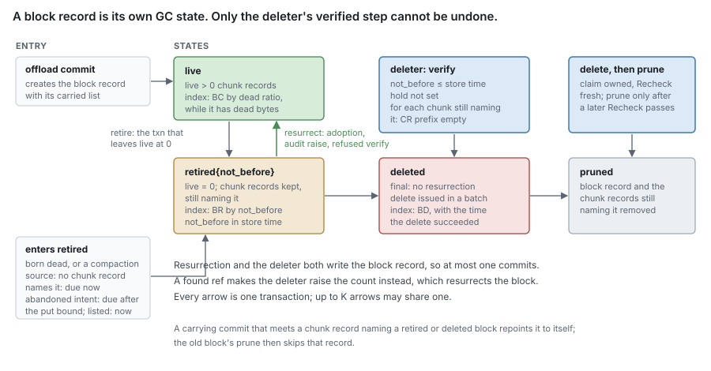
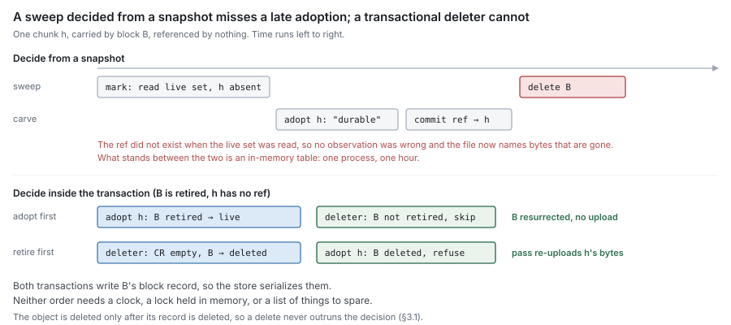
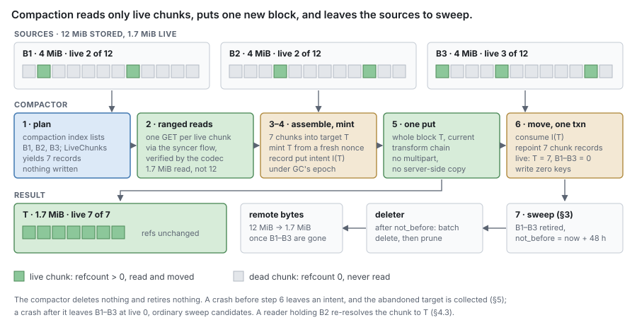

# RFC 9 — GC: retirement, trash, compaction and remote deletion

**Status:** draft.
**Audience:** anyone changing the deleter, the compactor, the audit or collection,
a metadata backend's block, chunk and reverse-ref records, or adding a way to
keep content alive.

This document specifies behaviour, not the current code. [Appendix A](#Appendix%20A%20%E2%80%94%20where%20the%20current%20code%20differs) lists
where the code differs.

---

## Start here

*Explanatory. The rules are in [§1](#1.%20Purpose) onward; where this section and a rule differ, the rule wins.*

### In plain words

GC (garbage collection) frees space in the bucket once no file and no snapshot needs an object.
It is the only part of DittoFS that can destroy the last copy of someone's data.
Think of an office shredder with a two-day out-tray.
A box of papers nobody uses goes into the tray, not the shredder.
After two days, someone checks the ledger once more, and shreds the box only if nobody still uses anything in it.
Unlike a real out-tray, waiting never makes shredding allowed; only the final check against the ledger does.
It also rewrites half-empty objects so their dead bytes can go too.
Reclaiming space comes second to never shredding a box someone still needs.

**The problem, with one example.** Single-node install N1, remote tier the S3
bucket `dfs-data`. Clients write to a fast local journal; in the background the
bytes are cut into **chunks** (~256 KiB, each named by the hash of its content),
packed into **blocks** (~4 MiB S3 objects, ~16 chunks each), and uploaded. The
metadata store records a **ref** for each use of a chunk by a file, and every
chunk keeps a count of its refs.

On the `builds` share, build01 runs `rm -rf out/` over NFS: 12,000 object
files, 3 GiB, spread over about 770 blocks.

1. **Refs drop.** Releasing the files drops their refs in batches. Each batch,
   in one metadata transaction, deletes the refs and their entries in the
   **reverse ref index** (one key per ref, listed by chunk hash) and lowers each
   chunk's count. When a chunk's count reaches zero, its block's count of live
   chunks goes down too.
2. **Retire.** About 760 blocks held only `out/` content; the transaction that
   takes each one's live count to zero marks it **retired**, with a not-before
   time 48 hours away. The object stays in S3. The other ~10 blocks still hold a
   chunk some live file uses, so they stay live with dead bytes inside.
3. **Wait out the trash.** For 48 hours a retired block can still be repaired:
   if the audit finds a count that was too low, raising it brings the block back
   to live with one record write.
4. **Verify, record, delete.** After 48 hours the **deleter** takes each due
   block and, for every chunk it holds, checks the reverse ref index: no ref may
   name the chunk. Only then does it mark the block `deleted` in metadata, and
   only after that does it send the batch delete to S3. The block's records are
   pruned later, once the bucket's settings have been rechecked.
5. **Compact.** A live block holding one 256 KiB live chunk and 15 dead ones
   still costs 4 MiB. The **compactor** copies live chunks into a fresh block and
   moves their records; the old block's count reaches zero, and it retires like
   any other.

What goes wrong without the rules. Suppose a defect in step 1 lowered a chunk's
count but left the ref behind, so a file still names the chunk. A delete
decided by counts alone removes the object, and that file's next read fails as
**Lost**: the content is gone and nothing can bring it back. Step 4's check
finds the ref, refuses the delete, raises the count and brings the block back
to live. The order in step 4 matters as well: deleting the object first and
crashing before the metadata write would leave records that name an object that
no longer exists. Had `builds` kept a snapshot, none of this would start: the
dropped refs move to history, still counted, and no block retires until the
snapshot is deleted.

```text
 build01: rm -rf out/      metadata store (one transaction per batch)
      │                    drop refs + reverse-index keys, lower counts
      ▼                                 │
 filesystem service ──────────────────► │ block's live count hits 0
                                        ▼
                     live ──retire──► retired (not before +48 h)
                      ▲                  │            │
                      └── count raised ──┘            │ deleter: reverse
                          (audit, refused delete)     │ index finds no ref
                                                      ▼
                                       deleted (recorded) ──► S3 delete
                                                      │       on dfs-data
                                                      ▼
                                         pruned, after a later Recheck
 compactor: copies live chunks out of mostly-dead blocks; the old ones retire
```

**The words you need.**

- **Ref** — one file's (or one snapshot's) use of one chunk at one offset; the
  only thing that keeps content alive ([RFC 0 glossary](rfc-0-data-lifecycle.md#Glossary)).
- **Reverse ref index** — one key per ref, ordered by chunk hash; the deleter
  reads it before every delete, and the counts are a cache of it
  ([§2.1](#2.1%20References%20are%20the%20only%20authority)).
- **Retired** — a block no ref reaches any more; its object waits in the trash
  until its not-before time ([§3.1](#3.1%20Retire%20the%20records%2C%20then%20delete%20the%20object)).
- **Trash** — the wait between retirement and deletion, 48 hours by default. It
  postpones a delete the refs already allow; it never allows one
  ([§3.7](#3.7%20Trash)).
- **Deleter** — moves a due retired block to `deleted` after checking the
  reverse index, then deletes its object ([§3.5](#3.5%20The%20deleter%20verifies%20before%20it%20deletes)).
- **Compactor** — rewrites the live chunks of mostly-dead or small blocks into
  new blocks; it deletes nothing itself ([§4](#4.%20Compactor)).
- **Put intent** — a record written before every upload naming the object about
  to be put, so an upload that never commits is still found and removed
  without listing the bucket ([§3.4](#3.4%20A%20retired%20key%20is%20not%20re-created%20underneath%20its%20delete)).

**What this RFC promises.**

- An object is deleted only after its block was marked `deleted` in a metadata
  transaction that found no ref, live, snapshot history or parked by a
  re-home, naming any chunk the block still holds.
- Nothing but refs keeps content alive or allows a delete: no pin list, no
  in-memory state, no lock. Time only postpones a delete.
- Metadata is written before the object is deleted, so a crash at any point
  leaves an object still named by a record, never a record naming a missing
  object.
- GC needs no pause in service, and two GC runners on the same blocks at once
  are as safe as one.
- Objects left by failed uploads are reclaimed through their put intents; a
  bucket listing deletes only where the namespace is proven to belong to this
  installation, and nothing's correctness depends on it.

**How the rest is organised.** [§1](#1.%20Purpose)–[§2](#2.%20What%20is%20safe%20to%20delete) say what GC owns and why refs are the only
authority. [§3](#3.%20A%20block%27s%20life) is a block's life — retire, trash, verify, delete, prune — and the
core of the RFC. [§4](#4.%20Compactor) is the compactor, [§5](#5.%20Unrecorded%20objects)
objects no record names, [§6](#6.%20Audit) the audit that keeps counts honest. [§7](#7.%20Bounds%2C%20records%20and%20scheduling) covers
scheduling, records and service-setting rechecks; [§8](#8.%20API%20surface)–[§10](#10.%20Observability) the API, invariants and
metrics; [§11](#11.%20Test%20plan%20and%20benchmarks) the tests. Appendix A lists where today's code differs.

### Scenarios

Each runs on node N1 with the bucket `dfs-data` and the default 48-hour trash.

**A restore needs a chunk just as the deleter reaches its block.**

1. alice's old `archive.pst` is deleted; dropping its refs takes chunk h, block K7's last live chunk, to zero; K7 retires for 48 hours ([§3.1](#3.1%20Retire%20the%20records%2C%20then%20delete%20the%20object), [§3.7](#3.7%20Trash)).
2. At 48 hours, a restore of a copy taken before the delete adopts h, meaning it adds a ref to h without uploading it ([§3.3](#3.3%20Adoption%20resurrects%20a%20retired%20block)).
3. At the same moment the deleter finds K7 due; both read K7's block record as `retired` ([§3.3](#3.3%20Adoption%20resurrects%20a%20retired%20block)).
4. Both write that one record, so the metadata store lets only one of them commit ([§3.3](#3.3%20Adoption%20resurrects%20a%20retired%20block)).
5. If the restore wins, K7 is live again, and the deleter's retry drops it from its batch ([§3.3](#3.3%20Adoption%20resurrects%20a%20retired%20block)).
6. If the deleter wins, K7 is `deleted`, and the restore fails and publishes nothing ([§3.3](#3.3%20Adoption%20resurrects%20a%20retired%20block)).

Outcome: no file ever ends up naming an object that is being deleted.

**N1 crashes between marking a block deleted and deleting its object.**

1. The deleter checks the reverse ref index, finds no ref to any chunk of K9, and marks K9 `deleted` in one transaction ([§3.5](#3.5%20The%20deleter%20verifies%20before%20it%20deletes)).
2. It sends the delete only once a check of the bucket's settings, started after that mark, has passed ([§3.1](#3.1%20Retire%20the%20records%2C%20then%20delete%20the%20object), [§3.7](#3.7%20Trash)).
3. N1 crashes before it records that the delete succeeded ([§3.1](#3.1%20Retire%20the%20records%2C%20then%20delete%20the%20object)).
4. On restart, GC resumes from its index of `deleted` blocks, with no scan of all block records ([§3.1](#3.1%20Retire%20the%20records%2C%20then%20delete%20the%20object), [§3.2](#3.2%20A%20retirement%20not%20yet%20deleted%20is%20durably%20recorded)).
5. It sends the delete again; if the bucket says the object is already gone, that counts as success ([§3.6](#3.6%20Failures%20resolve%20on%20their%20own)).
6. After a further recheck passes, K9's records are pruned ([§3.1](#3.1%20Retire%20the%20records%2C%20then%20delete%20the%20object)).

Outcome: a record always names the object until it is gone, so nothing leaks and nothing is lost.

**A slow read is in flight when the compactor moves its chunk.**

1. A read of `ODFC_alice.vhdx` resolves chunk h to block B2, which is mostly dead bytes ([§4.3](#4.3%20A%20reader%20can%20hold%20the%20old%20location)).
2. The compactor copies B2's live chunks into a new block T, then one transaction points h at T and retires B2 ([§4.2](#4.2%20Read%20verified%2C%20mint%2C%20put%2C%20then%20move)).
3. B2 waits out the trash like any retired block, so the read almost always still finds it ([§3.7](#3.7%20Trash), [§4.2](#4.2%20Read%20verified%2C%20mint%2C%20put%2C%20then%20move)).
4. A read that arrives after B2 is deleted is told "absent"; it looks h up again, finds T, and retries ([§4.3](#4.3%20A%20reader%20can%20hold%20the%20old%20location)).
5. It reports the data lost only if the same block name misses twice, or h has no record at all ([§4.3](#4.3%20A%20reader%20can%20hold%20the%20old%20location)).

Outcome: compaction never shows up as an error to a reader.

**The bucket refuses deletes for a day.**

1. `dfs-data` starts refusing or throttling delete requests ([§3.6](#3.6%20Failures%20resolve%20on%20their%20own)).
2. Blocks already marked `deleted` stay so; the scheduler backs off with jitter and lowers its rate for that store ([§3.6](#3.6%20Failures%20resolve%20on%20their%20own)).
3. Retirement keeps running, since it only writes metadata, so due blocks pile up as records ([§3.6](#3.6%20Failures%20resolve%20on%20their%20own)).
4. A backlog that does not drain is reported as a health condition, not only logged ([§3.6](#3.6%20Failures%20resolve%20on%20their%20own)).
5. When deletes work again, the deleter drains the backlog from its index keys, with no operator step ([§3.1](#3.1%20Retire%20the%20records%2C%20then%20delete%20the%20object), [§3.6](#3.6%20Failures%20resolve%20on%20their%20own)).

Outcome: space comes back late, and no data is lost while it waits.

## 1. Purpose

GC answers one question about the remote tier:

> **Which remote objects may be deleted, and when is deleting one safe?**

It is the only component in the set that destroys the last copy of content
([RFC 0 §8.3](rfc-0-data-lifecycle.md#8.3%20Sweep)). Every other failure in the system can lose a local copy, serve a
stale answer or stop accepting writes. A GC defect deletes data that a file still
names, and nothing downstream can recover it once the object is gone.

GC is one of three reclaimers. Each owns one kind of space, and none reclaims
another's:

| Space | Reclaimed by | When | Destroys |
| --- | --- | --- | --- |
| **Local journal space** | the journal's release and repack ([RFC 1 §7.1](rfc-1-journal.md#7.1%20Releasing%20storage), [§7.2](rfc-1-journal.md#7.2%20Repack)) | when the engine's `EvictionPolicy` and `CapacityGovernor` decide ([RFC 8 §10](rfc-8-engine.md#10.%20Local%20space)) | only local copies of content already offloaded ([RFC 8 §10.4](rfc-8-engine.md#10.4%20Nothing%20but%20dirty%20content%20makes%20an%20extent%20unevictable)) |
| **Metadata records** | removals, releases and snapshot deletion ([RFC 6 §6](rfc-6-block-metadata.md#6.%20Reference%20counting)) | when a file is truncated or released or a snapshot deleted, in batches of at most K keys (the key budget); the batch that leaves a block unreferenced also retires it ([§3.1](#3.1%20Retire%20the%20records%2C%20then%20delete%20the%20object)) | refs and counts; never an object |
| **Remote objects** | this RFC | once a block is retired, its trash delay has passed, and a check of the reverse ref index finds no ref to any chunk it still holds | the object |

GC runs five operations, all on the remote tier. None of them decides that a
block is dead: block metadata does that, in the transaction that drops its last
reference.

| Operation | What it destroys | Section |
| --- | --- | --- |
| **deleter** | a `retired` block past its `not_before`, after verifying that no ref names a chunk it holds | [§3](#3.%20A%20block%27s%20life) |
| **compactor** | nothing — it rewrites the live chunks of mostly dead or small blocks into new blocks; the move retires the sources | [§4](#4.%20Compactor) |
| **collection** | an object no record names, or one whose put intent was abandoned | [§5](#5.%20Unrecorded%20objects) |
| **audit** | nothing — it compares counts with the reverse ref index, raises what is low, and reports | [§6](#6.%20Audit) |
| **recheck** | nothing — it re-reads the store's settings and the claim, and gates every delete and prune | [§7.5](#7.5%20Service%20settings%20are%20rechecked%20on%20their%20own%20period) |

**From a dead block to a deleted object.** Nothing deletes a block record
directly, and no pass looks for dead blocks:

1. A file is released, truncated or superseded, or a snapshot is deleted
   ([RFC 7 §4.3](rfc-7-namespace-metadata.md#4.3%20Release%20is%20what%20block%20metadata%20sees)). Block metadata drops the refs in batches of at most K
   ([RFC 6 §6.2](rfc-6-block-metadata.md#6.2%20Truncation%20and%20deallocation)), deleting each ref's reverse index key with it.
2. Each dropped ref decrements its chunk's refcount in the same transaction. A
   refcount that reaches zero decrements the `live` of the block its chunk record
   names.
3. The transaction that leaves a block's `live` at zero **retires** it: the block
   record moves to `retired` with `not_before` = store time + the trash
   retention, and its retired index key is written ([§3.1](#3.1%20Retire%20the%20records%2C%20then%20delete%20the%20object)). Its chunk records
   stay, still naming it.
4. Until `not_before`, an adoption of one of its chunks **resurrects** it to
   `live` at the cost of one record write, not an upload ([§3.3](#3.3%20Adoption%20resurrects%20a%20retired%20block)).
5. After `not_before`, the **deleter** verifies that no ref names any chunk still
   recorded in the block ([§3.5](#3.5%20The%20deleter%20verifies%20before%20it%20deletes)), moves it to `deleted`, deletes the object in a
   batch, and prunes the block record and its chunk records once a later check
   of the service's settings has passed.



### 1.1 Non-goals

GC **MUST NOT**:

- recover local space. Eviction and reclamation are the journal's ([RFC 0 §8.1](rfc-0-data-lifecycle.md#8.1%20Evict),
  [RFC 0 §8.2](rfc-0-data-lifecycle.md#8.2%20Reclaim); [RFC 1](rfc-1-journal.md)). GC never reads, writes or unlinks a segment;
- decide what is referenced. Refs, counts and the reverse ref index are block
  metadata's ([RFC 6 §6](rfc-6-block-metadata.md#6.%20Reference%20counting)), and a file's release is the namespace's
  ([RFC 7 §4.3](rfc-7-namespace-metadata.md#4.3%20Release%20is%20what%20block%20metadata%20sees)). GC reads them; it keeps no liveness state of its own;
- keep content alive by any means other than its refs ([§2.1](#2.1%20References%20are%20the%20only%20authority));
- restate what a put, a read or a delete means. That is [RFC 4](rfc-4-remote-tier.md)'s ([RFC 4 §1.2](rfc-4-remote-tier.md#1.2%20A%20contract%2C%20not%20a%20component));
- name a block by any means other than [RFC 2 §4.2](rfc-2-carver.md#4.2%20A%20block), or frame, seal or parse an
  object ([RFC 4 §3](rfc-4-remote-tier.md#3.%20The%20block%20format));
- import another component in this set ([RFC 0 §1.2](rfc-0-data-lifecycle.md#1.2%20Component%20autonomy)).

### 1.2 Words this document uses

This component reclaims remote blocks. **Sweep** keeps its [RFC 0 §2.3](rfc-0-data-lifecycle.md#2.3%20Operations)
meaning — deleting a remote block nothing references — and is carried out here
by retirement and the deleter together; no component of that name remains.
**Mark** survives only as the audit of [§6](#6.%20Audit), which recomputes counts and never
permits a delete ([§2.4](#2.4%20A%20snapshot%20holds%20its%20blocks%20without%20a%20pin)).

**Retirement** is the state change `live` → `retired`, made by the transaction
that leaves a block's `live` at zero. **Resurrection** is `retired` → `live`,
made by any transaction that raises it again. **Deletion** is `retired` →
`deleted`, made only by the deleter. **Pruning** removes a `deleted` record once
its object is gone.

**Relocation** is [RFC 6 §7.3](rfc-6-block-metadata.md#7.3%20Relocation)'s word for the record change that moves chunks into
a new block. The **compactor** ([§4](#4.%20Compactor)) decides when to relocate and performs the
transfers.

**Trash** is the interval between a block's retirement and its deletion
([§3.7](#3.7%20Trash)). "Grace period" is not used: trash postpones a delete that the refs
already permit, and never permits one.

**Store time** is the metadata store's own clock for a transaction
([RFC 16 §4.1](rfc-16-metadata-store.md#4.1%20One%20small%20interface%20per%20backend)). Every time GC records or compares is store time.

## 2. What is safe to delete

### 2.1 References are the only authority

A block's object **MAY** be deleted only when no ref, live, history or parked
([RFC 6 §6.1](rfc-6-block-metadata.md#6.1%20A%20refcount%20is%20exactly%20its%20refs)), names a chunk whose record names that block, and only through the verified transition of
[§3.5](#3.5%20The%20deleter%20verifies%20before%20it%20deletes). Nothing else permits a delete, and nothing but refs prevents one.

Two structures state the refs, and both change in the transaction that changes a
ref ([RFC 6 §6.1](rfc-6-block-metadata.md#6.1%20A%20refcount%20is%20exactly%20its%20refs)):

- the **reverse ref index** `CR‖ns‖hash‖…`, one key per ref naming the hash. It
  is **authoritative**: the deleter's verification reads it, and the audit
  measures the counts against it;
- the **refcount** on the chunk record and `live` on the block record. They are
  a **cache** of the index, kept equal to it in the same transaction, because a
  count is what a transaction can test in O(1) to decide retirement and
  resurrection.

In particular, an implementation **MUST NOT** consult, in deciding whether a
delete is permitted:

- a hold set, a pin list, or an extra root for a snapshot, an open file or any
  other holder. Every holder of content holds counted references ([RFC 6 §6.5](rfc-6-block-metadata.md#6.5%20Who%20owns%20a%20ref);
  [RFC 7 §4.4](rfc-7-namespace-metadata.md#4.4%20There%20is%20no%20third%20holder));
- elapsed time. Elapsed time **MUST NOT** permit a delete, and **MUST NOT**
  substitute for a conditional transaction. It **MAY** postpone one: the trash
  of [§3.7](#3.7%20Trash) and the put-bound wait of [§5.2](#5.2%20Collection%20is%20housekeeping) do exactly that;
- any state held in process memory, a lock or a lease. Two deleters in two
  processes **MUST** be as safe as two in one.

**A gate record is read with a tracked `Get`.** Every namespace-wide gate GC
honours — the hold ([§6.4](#6.4%20A%20store-wide%20trip%20holds%20the%20deleter)) and the pause ([§7.5](#7.5%20Service%20settings%20are%20rechecked%20on%20their%20own%20period)) — is read inside the
transaction it gates with a tracked `Get`, never a `Guard`, which returns no
value, so a transaction whose snapshot already holds the gate would commit past
it ([RFC 16 §4.1](rfc-16-metadata-store.md#4.1%20One%20small%20interface%20per%20backend)). Writing the gate aborts every such transaction whose snapshot
predates it and that has not committed when the gate commits.

A second liveness mechanism fails open. Every path that decides liveness has to
remember it, the one that forgets deletes held content, and the audit reports
nothing wrong because by the counts nothing was.

> [!note] Prior art (non-normative)
> Most systems that delete shared content guard the delete with time, a trace,
> or both:
>
> - **Time as the guard.** Git prunes unreachable loose objects only once older than
>   `gc.pruneExpire`, so a concurrent writer's not-yet-referenced objects survive
>   ([git-gc](https://git-scm.com/docs/git-gc)). Delta Lake's `VACUUM` removes
>   unreferenced files only past a retention threshold, and warns that shortening it
>   can break concurrent readers and writers ([Delta utility](https://docs.delta.io/latest/delta-utility.html)).
>   Ceph RGW holds a deleted object's tail for a minimum wait before its garbage
>   collector removes it, so in-flight reads finish ([RGW config](https://docs.ceph.com/en/latest/radosgw/config-ref/)).
>   Kopia deletes unreferenced blobs only after safety margins sized for
>   concurrent snapshot writers ([Kopia maintenance](https://kopia.io/docs/advanced/maintenance/)).
> - **Trace as the guard.** restic `prune` builds the used set from every snapshot,
>   writes repacked packs and the new index, and deletes old packs only after
>   both, under an exclusive lock ([restic references](https://restic.readthedocs.io/en/latest/100_references.html)).
>   Guo and Efstathopoulos chose grouped mark-and-sweep over reference counts
>   because counts updated outside a transaction drift under crashes and lost
>   updates ([ATC '11](https://www.usenix.org/events/atc11/tech/final_files/GuoEfstathopoulos.pdf)).
>   Windows Server Data Deduplication pairs its regular garbage collection with a
>   periodic full collection that reclaims what the regular one misses
>   ([advanced settings](https://learn.microsoft.com/en-us/windows-server/storage/data-deduplication/advanced-settings)).
> - **Counts plus trash.** JuiceFS counts slice references, holds deleted files in a
>   trash for a configurable number of days, and offers a separate `gc` that
>   compares a bucket listing with metadata to find leaks
>   ([internals](https://juicefs.com/docs/community/internals/), [trash](https://juicefs.com/docs/community/security/trash/)).
>
> This RFC keeps refs as the sole authority because every ref, its reverse
> index key and its count change in one transaction ([RFC 6 §6.1](rfc-6-block-metadata.md#6.1%20A%20refcount%20is%20exactly%20its%20refs)), which
> removes the drift the ATC '11 authors measured; and it checks the count against
> the index before every delete, so a count that drifts anyway cannot delete
> anything ([§3.5](#3.5%20The%20deleter%20verifies%20before%20it%20deletes)). The adoption race that the time-guarded systems close with a
> grace window is closed here by transactions ([§3.3](#3.3%20Adoption%20resurrects%20a%20retired%20block)), which a stalled writer
> cannot outlast. From the others it takes a trash that postpones deletes
> ([§3.7](#3.7%20Trash)), a periodic full audit ([§6](#6.%20Audit)), and a listing backstop for leaks
> ([§5](#5.%20Unrecorded%20objects)) — none of which permits a delete.

### 2.2 Retirement is decided where the count reaches zero

A block is retired in the transaction that leaves its `live` at zero, and in no
other way. That transaction already writes the block record, to decrement
`live`, so retirement adds no record and no hot key to it. The transactions that
can leave `live` at zero are exactly:

- a ref drop — removal phase 2, a release, a snapshot's history drop, an offload
  commit's supersession — that takes the last nonzero refcount among the chunks
  naming the block to zero ([RFC 6 §6.1](rfc-6-block-metadata.md#6.1%20A%20refcount%20is%20exactly%20its%20refs));
- the commit that creates the block with `live` = 0: a **born-dead** block
  ([RFC 6 §4.1](rfc-6-block-metadata.md#4.1%20What%20one%20commit%20records));
- the relocation that moves a source's last live chunk out ([§4.2](#4.2%20Read%20verified%2C%20mint%2C%20put%2C%20then%20move));
- an audit lowering that takes `live` to zero ([§6.2](#6.2%20Corrections)).

A block therefore never rests in state `live` with `live` = 0 at a commit point,
and no pass has to find such blocks. A block can be born dead in three ways:

- two writers carry the same chunk list [*x*, *y*] and mint two names. *W1*
  commits *Ka* first, `live` = 2. *W2* commits *Kb*: both chunk records already
  name *Ka*, so *W2* adopts them, and *Kb*'s copies are dead weight;
- content that repeats one chunk puts it in two blocks in flight, and the second
  to commit adopts it;
- every ref a pass carried was dropped because its file was released or
  truncated while the pass was in flight.

Retirement is reversible and deletes nothing, so deciding it inside the
transaction needs no second check. What is irreversible — the move to `deleted`
— is decided later, inside its own transaction, against the reverse ref index
([§3.5](#3.5%20The%20deleter%20verifies%20before%20it%20deletes)).

### 2.3 The absence of a record proves nothing

A block with no record in this store is not thereby unreferenced ([RFC 6 §2.6](rfc-6-block-metadata.md#2.6%20The%20scope%20of%20a%20count)).
Another store, another process or another deployment writing into the same key
namespace can reference it. The deleter therefore acts only on blocks this store
records. Objects no store records are [§5](#5.%20Unrecorded%20objects)'s, and [§5](#5.%20Unrecorded%20objects)'s listing runs only where
the namespace is proven to belong to the stores it enumerated.

The namespace is fixed by the key scope of [RFC 2 §4.3](rfc-2-carver.md#4.3%20Key%20scope). A deployment **MUST**
meet [RFC 6 §2.6](rfc-6-block-metadata.md#2.6%20The%20scope%20of%20a%20count) — one keyspace partition per namespace — before any GC operation
runs. The shares of one namespace are one counting domain, their refs counted
in its one partition, and GC reads only that partition.



### 2.4 A snapshot holds its blocks without a pin

A snapshot needs no pin, hold list or extra root, because it already holds counted
refs; its snapshot hold keeps journal bytes until they are offloaded, never a block
([RFC 12 §2.4](rfc-12-snapshots.md#2.4%20A%20snapshot%20hold%20bridges%20dirty%20content%20to%20history)). When a live ref that a snapshot sees is superseded or released, it moves to
history in the same transaction instead of being dropped, and a history ref
counts exactly as a live one and has its own reverse index key ([RFC 6 §6.5](rfc-6-block-metadata.md#6.5%20Who%20owns%20a%20ref)).
So every chunk a live snapshot can read has refcount ≥ 1, the block its record
names has `live` > 0 and is never retired, and the deleter's verification would
refuse it even if it were. Deleting the snapshot drops the history refs no other
live snapshot sees; only then can their counts reach zero. A catalog backup is an
export of one snapshot's metadata ([RFC 26 §2.1](rfc-26-catalog-backups.md#2.1%20A%20backup%20is%20an%20export%20of%20one%20snapshot%27s%20metadata)), held by a use record on that
snapshot until it expires ([RFC 26 §2.2](rfc-26-catalog-backups.md#2.2%20A%20backup%20holds%20its%20snapshot)): the use record refuses the
snapshot's deletion, so the refs it sees keep every block the backup names
counted, and GC needs no second liveness mechanism for it. A copying backup
holds the snapshot the same way only while it copies ([RFC 26 §2.4.3](rfc-26-catalog-backups.md#2.4.3%20Writing%20one%2C%20step%20by%20step)); once
complete it holds no block of the namespace, because the blocks it names are
copies in its own block folder, which this GC never lists or deletes.

**Tracing is not the delete authority.** A mark reads the live set at one instant
and deletes at a later one; a ref committed in between names a chunk the mark did
not see. Making that safe needs a second mechanism for adoptions made after the
mark began, which [§2.1](#2.1%20References%20are%20the%20only%20authority) forbids. The trace survives as the audit ([§6](#6.%20Audit)), which
checks the counts and never deletes.

### 2.5 Composition and lifecycle

**One GC per node; a namespace is a context.** `node.New` ([RFC 23](rfc-23-control-plane.md)) builds
one `*gc.GC` from `Deps` ([§8](#8.%20API%20surface)) on every node, as it
builds one engine per node and a share is a storage binding there
([RFC 8 §2.3](rfc-8-engine.md#2.3%20One%20engine%20per%20node%3B%20a%20share%20is%20a%20storage%20binding)). The node adds and removes contexts ([RFC 23 §2.1](rfc-23-control-plane.md#2.1%20The%20node%20builds%20its%20components)): a
context is one namespace with a remote store, holding that namespace's `View`.
GC runs five sources — deleter, compactor, collector, auditor, recheck — on its
one scheduler instance, whose tenants are the (namespace, partition) pairs this
node leases ([§7.3](#7.3%20GC%20is%20one%20service%20per%20namespace%2C%20partitioned%20by%20prefix)). GC holds no state a restart needs: every source rebuilds
from its index keys and cursors.

![GC on one node. The node builds gc.New(Deps) and drives Start, Add, Remove, Drain and Close. Inside the GC, one context per namespace, added and removed by the node, holds that namespace's View: Blocks, Remote, Store and Keys. Five sources (deleter, compactor, collector, auditor, recheck) and a lease keeper run on GC's own work-scheduler instance, which every namespace shares. Below it sit the RFC 6 Blocks view over the shared metadata store, where every retirement, verification and gate happens; the RFC 4 remote store for direct deletes, listing and control objects, ref-counted per config; GC's RFC 3 syncer flow for compactor transfers and Recheck calls; RFC 5's keys read-back; and the node's clock, metrics and logger, and its health evaluator, which asks GC for its conditions. A lifecycle strip reads: New starts nothing, Start registers the sources and each Add acquires leases and rebuilds, Drain stops posting and abandons in-flight compactions, Close releases leases with their epochs kept and closes flows](img/rfc9-composition.svg)

| Component | Made of | Depends on | Calls | Injected how | Owned by | Lifecycle |
| --- | --- | --- | --- | --- | --- | --- |
| `*gc.GC`, one per node | namespace contexts, five sources, the lease keeper | everything below | `Blocks`, `Remote`, the syncer, `Keys` | `New(Deps)` | the composition root; the node drives it | `New` starts nothing; `Start` after the storage bindings; `Drain` and `Close` before they are joined |
| namespace context | a `View` and the partitions this node holds | `Blocks`, `Remote`, `Keys`, its store's flow | its `View` | `Add(ns, View)` | GC, one per namespace with a remote store | added when the namespace's records name a remote store; removed once its `NS‖ns` records are gone ([§7.6](#7.6%20A%20namespace%20no%20share%20names%20is%20drained) step 3), or at `Close` |
| deleter, compactor, collector, auditor, recheck | one scheduler source each | the context's `Blocks`, `Remote` and flow; `Clock` | `Blocks`, `Remote`, the flow | registered by `Start` | GC | run while a partition of the context is leased; `Recheck` by the holder of the first partition |
| lease keeper | acquire, renew at a third of the lease, release | `Blocks.Lease`, `Clock` | `Blocks.Lease` | internal | GC | acquires at `Add`, releases at `Remove` and `Close`, never lowering an epoch |
| `Blocks` | block metadata's transactions over the shared metadata store ([RFC 6](rfc-6-block-metadata.md), [RFC 16](rfc-16-metadata-store.md)) | — | — | `View.Blocks` | the root; shared process-wide | opened before GC starts, closed after it closes |
| `Remote` | the namespace's one remote store ([RFC 4 §4.1](rfc-4-remote-tier.md#4.1%20Interface)) | — | the remote service | `View.Remote` | the root, ref-counted per store configuration | never closed by GC |
| syncer flow | one background flow per namespace store ([RFC 3 §1.3](rfc-3-syncer.md#1.3%20Interface)) | `Deps.Syncer` | `Remote` | opened by GC through `OpenFlow` | GC; the syncer is shared | closed at `Remove` and `Close` |
| `Keys` | the transform layer's keys-object read-back ([RFC 5 Appendix B.2](rfc-5-transforms.md#B.2%20Keys)) | RFC 5's key lock | the keys object | `View.Keys` | the root | called once per `Recheck` |
| work scheduler | [RFC 8 §6.1.1](rfc-8-engine.md#6.1.1%20The%20shared%20work%20scheduler)'s library, GC's own instance | — | the sources | `Deps.Sched` | the root; shared by every context | started by `Start`, drained by `Drain` |
| clock, metrics, logger | the node's | — | — | `Deps` | the root, shared | — |
| health evaluator | the node's ([RFC 25 §8.2](rfc-25-observability.md#8.2%20The%20packages)) | — | `Conditions` on GC | nothing is injected: `*gc.GC` is a `health.Source` the node adds | the root | asks at each evaluation until the node removes GC |

The engine is not a dependency: GC reaches neither its storage bindings nor its
queue ([RFC 8 §10.5](rfc-8-engine.md#10.5%20GC%20is%20not%20scheduled%20here)).

**Start.** The node starts GC in build order: after the metadata store and
the engine, whose syncer GC's flows need, and before open state, identity and
`*vfs.Server` ([RFC 23 §2.2](rfc-23-control-plane.md#2.2%20Start%20and%20stop)). `New`
starts nothing and opens nothing. `Start` registers the sources. Contexts arrive
by `Add`. For each, GC acquires the partitions it can, posts `BD` and then `BR`
up to store time, and runs a first `Recheck`. No delete is issued until that
`Recheck` passes ([§7.5](#7.5%20Service%20settings%20are%20rechecked%20on%20their%20own%20period)), so GC's start needs no gate of its own beyond the claim check
the node runs first.

**Namespaces come and go while GC runs.** The node adds and removes contexts
([RFC 23 §2.1](rfc-23-control-plane.md#2.1%20The%20node%20builds%20its%20components)). A namespace whose drain deletes its `NS‖ns` records
([§7.6](#7.6%20A%20namespace%20no%20share%20names%20is%20drained) step 3) is removed. Its sources stop, and every transaction they still
have in flight is conditional on records that are gone, so a late one does
nothing. A share's removal changes nothing here: its refs drop through RFC 6, and
its blocks retire like any others.

**Drain.** The node drains GC in reverse build order: after the adapters, the
gateway and `Serve` stop, and before `*vfs.Server` and the engine stop. GC stops posting, lets each in-flight batch commit or
abort, and cancels remote deletes at the context's deadline. A cancelled delete
leaves its record `deleted`, and the next start resumes it. A compaction
cancelled after its intent abandons that intent at once ([§3.4](#3.4%20A%20retired%20key%20is%20not%20re-created%20underneath%20its%20delete)), and an
abandoned intent is final.

**Close.** Releases its leases without lowering their epochs, so that a
successor need not wait a lease out, and closes the flows it opened. It closes
nothing it was handed. A crash is a skipped `Close`, which is safe because holding
a lease is not a safety input ([§7.3](#7.3%20GC%20is%20one%20service%20per%20namespace%2C%20partitioned%20by%20prefix)).

> decision: GC is one per node, not one per namespace; a namespace is a context
> of it. The reason is §7.1's for one scheduler instance per process: the bounds
> are per process and fairness is between namespaces ([§7.1](#7.1%20GC%20bounds%20its%20own%20work)). Overturn
> this if a namespace needs isolation the scheduler's per-tenant weight cannot
> give.

### 2.6 Package layout

```text
internal/gc/
  gc.go          New(Deps), View, Start, Drain, Close, Add, Remove; namespace contexts (§2.5)
  deps.go        Blocks and its areas, Remote, Syncer, Flow, Keys (§8)
  lease.go       the lease keeper (§7.3)
  deleter.go     MarkDue → claim check → Delete → MarkGone → Prune (§3)
  compactor.go   plan, fetch, assemble, intend, put, relocate (§4.2)
  score.go       bucket and score (§4.4), placement (§4.5)
  collector.go   AbandonSuperseded, listing merge-join (§5)
  auditor.go     audit scheduling, trip (§6)
  recheck.go     settings, claim nonce, keys read-back, drift (§7.5)
  metrics.go     §10
  gctest/        in-memory Blocks, Remote, Syncer, Flow and Keys fakes
  arch_test.go   imports (§11.0)
```

One file per source. The transactional half lives in block metadata, so this
package holds no transaction code. Today's `pkg/block/gc` is deleted, not
refactored: Appendix A's D2, D5, D13 and D14 are its design, not its bugs.

## 3. A block's life

### 3.1 Retire the records, then delete the object

A block record carries its own GC state, and that state is the state machine
([RFC 6 §2.3](rfc-6-block-metadata.md#2.3%20Block)):

The state machine is [§1](#1.%20Purpose)'s figure (`img/rfc9-states.svg`).

| State | Meaning | Index key written with it | Left by |
| --- | --- | --- | --- |
| `live` | at least one chunk record naming it has a nonzero refcount | the **compaction index** key `BC‖ns‖b‖bucket‖name`, while it has dead bytes or is small ([§4.4](#4.4%20When%20to%20compact%20is%20policy)) | retirement |
| `retired` | `live` = 0; its chunk records still name it; the object waits until `not_before` | the **retired index** key `BR‖ns‖b‖not_before‖name`, where `b` is the block name's first byte | resurrection, or the deleter |
| `deleted` | the object is being deleted; nothing can resurrect it | the **deleted index** key `BD‖ns‖name`, whose value records when the delete succeeded | pruning |

Every transition is one transaction, and each writes the index key of the state
it enters and deletes the one of the state it leaves. Several transitions and
prunes **MAY** share one transaction, under the key budget K of
[RFC 6 §5.2](rfc-6-block-metadata.md#5.2%20Cost%20per%20commit%20is%20bounded%20by%20what%20changed), which counts keys, conflict ranges included, not blocks: a batch
stops before the next block whose keys — its own records and index keys, plus a
read, guard or delete for each hash it carries — would pass K. Each block's condition is evaluated on its own, and one
block's refusal does not fail the others.

1. **Retire** (live → retired). In the transaction that leaves `live` at zero
   ([§2.2](#2.2%20Retirement%20is%20decided%20where%20the%20count%20reaches%20zero)): set the state to `retired` and `not_before` to store time plus the
   trash retention, or to store time if **no chunk record names the block** and
   the transaction is not a relocation that emptied it ([§3.7](#3.7%20Trash)); delete its `BC` key; write its `BR` key. Chunk records are not
   touched: each still names the block, and a chunk is retired because the block
   its record names is.
2. **Resurrect** (retired → live). Any transaction that takes the refcount of a
   chunk whose record names a `retired` block from zero to nonzero also raises
   that block's `live` by one for each chunk record naming it whose count leaves
   zero in the transaction — a clone batch or an audit correction can raise
   several at once — sets its state to `live`, clears `not_before`, deletes its
   `BR` key, and writes its `BC` key ([§3.3](#3.3%20Adoption%20resurrects%20a%20retired%20block)).
3. **Mark deleted** (retired → deleted). The deleter reads its partition's range of
   the `BR` prefix ([§7.3](#7.3%20GC%20is%20one%20service%20per%20namespace%2C%20partitioned%20by%20prefix)), each name byte in `not_before` order up to store time and, per batch, in one transaction, moves
   each record still `retired` with `not_before` ≤ store time to `deleted` —
   only after the verification of [§3.5](#3.5%20The%20deleter%20verifies%20before%20it%20deletes) passes for it — and records the store time
   of the move in the record's `marked_at` ([RFC 6 §2.3](rfc-6-block-metadata.md#2.3%20Block)). The batch reads the
   namespace's `Recheck` record (`NS‖ns‖gc‖recheck`) with a tracked `Get`, which
   orders it against every `Recheck` (step 4).
4. **Delete** the objects through the remote store's multi-object delete
   ([RFC 4 §4.5](rfc-4-remote-tier.md#4.5%20Delete%20is%20batched%20and%20idempotent)), after reading the namespace claim and confirming that the last
   `Recheck` passed ([§7.5](#7.5%20Service%20settings%20are%20rechecked%20on%20their%20own%20period)), and only for a name whose move to `deleted` precedes
   the start of a `Recheck` that has since rewritten the claim with a fresh
   nonce ([§3.7](#3.7%20Trash)). The store splits the call as its service needs, and
   each name's result is its own; a name missing from the service's reply is a
   failure ([RFC 4 §4.5](rfc-4-remote-tier.md#4.5%20Delete%20is%20batched%20and%20idempotent)). For each success, one batched transaction records the
   store time of the success in the name's `BD` value. The deleter compares each
   `MarkedBlock.MarkedAt` with the `started` of the last passed `Recheck`, both
   read from block metadata (`State`). `started` is store time, stamped by the
   transaction that records the intended nonce, and the claim put follows that
   commit. A stamp is taken at a transaction's snapshot, not at its commit
   ([RFC 16 §4.1](rfc-16-metadata-store.md#4.1%20One%20small%20interface%20per%20backend)), so the times alone do not order the two: a mark stamped
   before `started` could commit after the put. The mark's tracked read of the
   `Recheck` record closes that. A mark whose snapshot precedes a `Recheck`'s
   commit, and which would commit after it, conflicts and aborts; so a mark
   committed after a `Recheck` read it, and its `MarkedAt` is at or above that
   `started` on one clock, or above `started` − σ across the nodes of a store
   without a timestamp oracle (σ of [RFC 0 §1.4](rfc-0-data-lifecycle.md#1.4%20The%20single-node%20profile)). A name is therefore deleted
   only when `MarkedAt` + σ < `started`, with σ zero where `Now` is one clock; a
   mark that committed first but within σ waits one more period. The record is
   written twice per period, so the conflict costs at most a retried batch
   or two per period.
5. **Prune.** A `deleted` record whose delete succeeded before the start of a
   later `Recheck` that passed is pruned, in batches: one transaction deletes
   the block record, conditional on state `deleted`, every chunk record in its
   carried list that still names it, and its `BD` key. `Prune` reads the
   `Recheck` record inside that transaction, with tracking, rather than taking
   a time from its caller. Waiting for the later
   `Recheck` is what lets a versioning drift be repaired by version ID
   ([§7.5](#7.5%20Service%20settings%20are%20rechecked%20on%20their%20own%20period)).

The order is not a preference. Recording first means a crash between the steps
leaves an object that a `retired` or `deleted` record still names, which the
deleter resumes. Deleting first means a crash, or a failed metadata write, leaves
records that name an object that no longer exists. Every read of those chunks then
fails, and every adoption of them succeeds, so new files acquire refs to content
that is gone. That is **Lost** for content that was offloaded.

`deleted` is final. Resurrection acts only on `retired`, and step 3 is
conditional on `retired`; both write the block record, so at most one commits. A
delete is issued only for a name whose record is already `deleted`.

**The block record carries its chunk list.** Written once at the commit that
creates the block, and never changed, it lists every chunk the block carries —
hash and body length — whether the block owns its record or carried a dead copy
([RFC 6 §2.3](rfc-6-block-metadata.md#2.3%20Block)). It is bounded by the format's chunk-count cap `N` ([RFC 2 §5](rfc-2-carver.md#5.%20The%20block%20assembler)),
so at most 36 KiB at `N` = 1,024. Verification, prune, the compactor's plan and the
audit's per-block check are point reads of those hashes, never a scan of chunk
records and never a remote read.

**Deletes go directly to the remote store**, not through the syncer ([RFC 3 §5](rfc-3-syncer.md#5.%20What%20belongs%20elsewhere)).
A delete is not a transfer: it **MUST NOT** occupy the syncer's pool or wait on
its fairness, and a store the syncer reports unhealthy only makes deletes fail,
which [§3.6](#3.6%20Failures%20resolve%20on%20their%20own) handles. The compactor's reads and puts are transfers and do go
through the syncer ([§4.2](#4.2%20Read%20verified%2C%20mint%2C%20put%2C%20then%20move)).

**Scheduling is the shared work scheduler's** ([RFC 8 §6.1.1](rfc-8-engine.md#6.1.1%20The%20shared%20work%20scheduler)). The deleter,
the compactor, the audit and collection are its sources. The scheduler batches,
retries with backoff and jitter, bounds concurrency and applies rate limits; each
source owns its durability, and GC's is the index keys. A restart resumes from
them — `BD` first, then `BR` up to store time — with no scan of block records.
The scheduler drops a post past its tenant's reservation of the total, a tenant being a
namespace (RFC 24 §5.1); each GC source
**MUST** then re-derive the dropped work from its index keys and cursors, so a
dropped item costs latency, never a deletion.

### 3.2 A retirement not yet deleted is durably recorded

A retired block keeps its block record until its object is gone: in state
`retired` through the trash, then `deleted` until the delete succeeds and a later
`Recheck` passes. Abandoning an intent and collection write a record in state
`retired` for their name ([§5.4](#5.4%20Age%20is%20not%20the%20guard)). A restart **MUST** resume every `deleted` record
and every `retired` one whose `not_before` has passed, and finds them through the
index keys.

This is what removes enumeration from GC's correctness. Without the record, a
crash between [§3.1](#3.1%20Retire%20the%20records%2C%20then%20delete%20the%20object)'s steps leaves an object that can only be found by listing the
store, and nothing's correctness may depend on a listing ([RFC 4 §4.6](rfc-4-remote-tier.md#4.6%20List%20is%20a%20complete%2C%20resumable%20walk)). With it,
the object is named by a record until the moment it is gone.

A `deleted` record gates no put or commit: a name it holds can never be put or
committed again ([§3.4](#3.4%20A%20retired%20key%20is%20not%20re-created%20underneath%20its%20delete)). A `retired` record gates only resurrection.

### 3.3 Adoption resurrects a retired block

> [!note] Only the offload path is deferred
> Dedup is off in the first release, so no offload commit adopts a chunk it did
> not carry ([RFC 6 §7.2](rfc-6-block-metadata.md#7.2%20Adoption%20is%20conditional%20on%20existence)); that one adoption path, and the cheap re-save it
> buys, return with dedup. **Everything else in this section is normative now.**
> A clone, a copying restore and a re-home's switch adopt chunks from refs or
> exported records that already exist, and each can meet a `retired` block: a
> clone batch after a removal on its source dropped the last ref, a re-home after
> the source namespace dropped its own, a restore of a copy taken before a
> release ([RFC 6 §7.2](rfc-6-block-metadata.md#7.2%20Adoption%20is%20conditional%20on%20existence), [RFC 27 §2.7](rfc-27-namespace-migration.md#2.7%20Moving%20one%20share%20out%20of%20a%20shared%20namespace)). Each resurrects the block, or fails
> where it is `deleted`, by the table below; an implementation that drops
> resurrection loses that content when the deleter reaches the block. Resurrection
> by a count correction — the audit's raise or the deleter's refused
> verification ([§3.5](#3.5%20The%20deleter%20verifies%20before%20it%20deletes), [§6.2](#6.2%20Corrections)) — is normative too.

Adoption is an offload commit, a clone or a restore referencing a chunk it did
not carry ([RFC 6 §7.2](rfc-6-block-metadata.md#7.2%20Adoption%20is%20conditional%20on%20existence)). It reads the chunk record and the block the record
names, and acts on that block's state:

| Block state | Adoption | Cost |
| --- | --- | --- |
| `live` | refcount +1; `live` +1 if the refcount left zero | one record each |
| `retired` | refcount 0→1; the block is resurrected: `live` raised by one for each of its chunk records whose count leaves zero in the transaction ([§3.1](#3.1%20Retire%20the%20records%2C%20then%20delete%20the%20object) step 2), state `live`, `BR` key deleted, `BC` key written | one record each, no upload |
| `deleted` | the adopting refs are refused: an offload re-offers them carrying the chunk ([RFC 8 §6.5](rfc-8-engine.md#6.5%20The%20dedup%20oracle)); a clone or re-home, which holds no bytes to carry, records the run as **Lost** in place of the ref, counted and logged as a backstop, and its batch commits; a restore fails and publishes nothing ([RFC 6 §7.2](rfc-6-block-metadata.md#7.2%20Adoption%20is%20conditional%20on%20existence), [§7.4](rfc-6-block-metadata.md#7.4%20Restore)) | one upload, or one run read as Lost |

A commit that **carries** a chunk whose record names a `retired` or `deleted`
block does not resurrect it: it repoints the chunk record to itself, as the
first home of fresh bytes. The old block stays retired, and its prune skips the
record because it no longer names it.

Once dedup returns, resurrection is also what makes content that dies and comes
back within the trash — an atomic save that writes a temporary file and renames
it over the old one, a rewrite in place, a copy made just after a delete — cost
a record write instead of an upload. Until then such a write carries its bytes,
and its commit repoints the chunk record to its own block.

**The race with the deleter is closed by transactions, not by time.** An
adoption and the deleter's transition both write the block record, so the store
serializes them ([RFC 16 §4.1](rfc-16-metadata-store.md#4.1%20One%20small%20interface%20per%20backend)): each reads the record and writes it, and of two
transactions writing one key at most one commits on a pre-state the other
changed. No statement-level condition, isolation level or lock is involved.

**Example: resurrection against the deleter.** Block *B* holds chunk *h*; the
file naming *h* was released at t = 0, so *B* is `retired` with `not_before` =
48 h. At t = 48 h a clone or restore adopts *h* — or, once deduplication is
added, a user saves the same content again and the dedup oracle finds it.

| t | Adopting commit *W* | Deleter *D* | Result |
| --- | --- | --- | --- |
| 48 h | adopter: *h* is at *B* | reads `BR`, finds *B* due | — |
| 48 h + 1 | reads `C‖h` → *B*, reads `B‖B` = `retired` | reads `B‖B` = `retired`, verifies `CR‖h` empty | both read the same pre-state |
| 48 h + 2 | commits: refcount(*h*) 0→1, *B* → `live` | tries to commit *B* → `deleted`: conflict on `B‖B`, aborts | *B* live; no delete issued |
| 48 h + 3 | — | retries: `B‖B` = `live`, drops *B* from the batch | — |

In the other order *D* commits first: *B* is `deleted`. *W*'s transaction
conflicts, retries, reads `B‖B` = `deleted`, and refuses its adopting ref to *h*.
*W*'s pass re-offers *h* carrying its bytes, which the journal still holds: the
extent was offered because it is **Dirty** ([RFC 0 §5.2](rfc-0-data-lifecycle.md#5.2%20Offload)), and nothing reports it
offloaded until a commit succeeds ([RFC 6 §4.3](rfc-6-block-metadata.md#4.3%20The%20commit%20is%20the%20report%27s%20return%20edge)). Losing the race costs one upload,
never a client-visible error.

### 3.4 A retired key is not re-created underneath its delete

> [!note] Normative in the first release
> The danger below — content coming back to a name GC has retired — is reached
> through adoption ([§3.3](#3.3%20Adoption%20resurrects%20a%20retired%20block)), which a clone, a restore and a re-home perform now,
> and through a put that lands late against its own abandonment (the examples
> below). Both happen with dedup off.

The danger this section rules out: GC deletes object *K*, and at the same moment,
or later, something puts a new object under the same name *K* and commits a block
record for it. The delete, landing late, would remove content a record names.

Block metadata rules it out by construction, not by a fence ([RFC 6 §7.6](rfc-6-block-metadata.md#7.6%20Put%20intents)):

- **A name is minted once, for one put attempt**, from a fresh nonce
  ([RFC 2 §4.2](rfc-2-carver.md#4.2%20A%20block)). No two attempts, and no two writers, ever put one name, and a
  retry within the attempt writes the same bytes.
- **Before any put** — an offload's or a compaction's — the writer durably records
  a **put intent** for the name: `Intent = {domain, id, epoch, node, nodeEpoch}`,
  where the domain is a shard or a GC partition, the id is that shard's or
  partition's ID, the epoch is the one the writer runs under, and, for a shard,
  the node and node epoch are those of the primary that wrote it. One transaction
  **MAY** record every intent of a pass.
- **The commit that creates the block record consumes the intent** in the same
  transaction, and fails if it is absent.

A name's state only moves forward:

    absent → intended → recorded (live ⇄ retired → deleted) | abandoned (retired → deleted)

GC deletes an object only when no block record not yet `deleted` and no intent
names it: its own record is `deleted`, and no other record holds the name.
Nothing can put or commit that name again.

**An intent is abandoned by reading its domain.** A shard intent is superseded
only once the shard record ([RFC 11 §2](rfc-11-ownership.md#2.%20Shards)) no longer names the (node, node epoch) it
was written under as the shard's primary — after a takeover, a handover, or a
primary that restarted and re-claimed its shard ([RFC 11 §8](rfc-11-ownership.md#8.%20Metadata%20consistency),
[RFC 6 §7.6](rfc-6-block-metadata.md#7.6%20Put%20intents)). A raise of the shard's epoch under a live primary — a replica
joining, a learner cleared — supersedes none: that primary's puts are still in
flight and commit under the new epoch once it has rewritten the file's fences.
A GC partition's intent is superseded when the lease partition's durable epoch
([§7.3](#7.3%20GC%20is%20one%20service%20per%20namespace%2C%20partitioned%20by%20prefix)) is greater than the intent's. Any intent is superseded when its
domain no longer exists. Supersession of a shard intent is a **(cluster)** rule ([RFC 0 §1.4](rfc-0-data-lifecycle.md#1.4%20The%20single-node%20profile)): on a
single node a restart need not raise any shard's epoch, and an intent waiting for
one leaks its object for good. There the node **MUST** abandon every intent
recorded under its own shards at every start, before its first offload
([RFC 6 §7.6](rfc-6-block-metadata.md#7.6%20Put%20intents)): no writer of the earlier process survives the restart, so none
of those intents can still be committed. A GC partition's intents are superseded
on one node as in a cluster, because every acquisition of a partition raises its
epoch, a restart included ([§7.3](#7.3%20GC%20is%20one%20service%20per%20namespace%2C%20partitioned%20by%20prefix)).

Abandonment is one transaction that guards the domain's epoch record,
reads and deletes the intent key, and writes the name's block record in state
`retired`, with an empty chunk list and `not_before` = store time + *D* × (1 + ρ) + σ,
where *D* is the longest put deadline a writer may use ([RFC 8 §6.3](rfc-8-engine.md#6.3%20The%20offload%20pipeline), O1) and ρ and σ
are [RFC 0 §1.4](rfc-0-data-lifecycle.md#1.4%20The%20single-node%20profile)'s clock bound: the writer measured *D* on its own clock.
A live writer that gives up an attempt abandons that intent itself, at once,
through the same transaction; the offload pipeline does so ([RFC 8 §6.3](rfc-8-engine.md#6.3%20The%20offload%20pipeline), O4),
and so does the compactor ([§4.2](#4.2%20Read%20verified%2C%20mint%2C%20put%2C%20then%20move)).

**A commit racing an abandonment (cluster).** *W*, the primary of shard *U* on
node A at node epoch 3, puts *K* under `I(K, U, 7, A, 3)` and stalls before its
commit; A's node lease lapses and node C takes *U* over: the shard record now
names C at node epoch 5, and the epoch becomes 8.

| t | *W* (A, node epoch 3) | GC | Result |
| --- | --- | --- | --- |
| 5 | — | reads `SH‖U`: primary (C, 5) ≠ (A, 3); deletes `I(K)`, writes `B(K)` = `retired` | *K* is final |
| 6 | commit reads `I(K)`: absent | — | commit fails; *W* re-offers under a new name |

In the other order, *W*'s commit consumes `I(K)` first and the abandonment finds
no intent and does nothing. Both transactions read and delete the intent key, so
they conflict and at most one commits ([RFC 6 §5.4](rfc-6-block-metadata.md#5.4%20Reads%20that%20gate%20a%20commit)). The commit also guards its
shard's fence, which the new primary wrote, so a stale commit fails on the fence
even before it reaches the intent.

**Example: an abandoned intent and a put that lands late.** The put deadline is
10 min, so *D* × (1 + ρ) + σ is 10 min 31 s.

| t | Event | State of *K* |
| --- | --- | --- |
| 0 | *W* records `I(K, U, 7, A, 3)` and starts a slow put | intended |
| 2 min | C takes *U* over from A; GC abandons `I(K)` | `retired`, `not_before` = 12 min 31 s, no chunks |
| 9 min | *W*'s put lands | object present, record `retired` |
| 12 min 31 s | the deleter verifies (nothing to check), marks `deleted`, deletes *K* | object gone |
| 14 min | a later `Recheck` passes; the record is pruned | gone |

Had the deleter deleted *K* at 2 min, the put landing at 9 min would have left
an object with neither intent nor record, found only by listing the whole store.
The wait postpones the delete past every put the writer could still have in
flight, so the listing is left with foreign objects and puts that outlived their
own deadline. Time here only postpones a delete that the missing intent already
permitted ([§2.1](#2.1%20References%20are%20the%20only%20authority)).

**A late delete.** The deleter's batch holding *K* times out and the process
restarts. The same content is written again and offloaded; the new attempt mints
*K′* ≠ *K*. The retried delete of *K* lands after *K′* is committed. It removes
*K* only.

So:

- a delete needs no fence;
- a delete that lands late — resumed after a crash, retried after a timeout —
  can reach no committed block;
- a writer whose commit fails for want of its intent re-offers its content, as
  any failed commit does; the object it put is already scheduled for deletion.

### 3.5 The deleter verifies before it deletes

Retirement trusts the counts, which is safe because it is reversible. The move
to `deleted` is not reversible, so the deleter checks the authority itself. In
the transaction that moves a block *B* to `deleted`, for each hash *h* in *B*'s
carried list:

1. read `C‖ns‖h`. If it is absent or names another block, *B*'s copy of *h* is
   dead weight: skip it;
2. otherwise guard `C‖ns‖h` and read the first key under the prefix
   `CR‖ns‖h‖`. It **MUST** be absent.

The guard on the chunk record, not a guard on the prefix, is what makes the check
sound: every transaction that adds a ref to *h* writes `C‖ns‖h`, to count it and
to change its stamp ([RFC 6 §2.2](rfc-6-block-metadata.md#2.2%20Chunk)), so a ref that commits after the deleter's
snapshot and before its commit aborts the deleter. The guard binds only the
deleter ([RFC 16 §4.1](rfc-16-metadata-store.md#4.1%20One%20small%20interface%20per%20backend)): a ref that commits *after* the deleter, from an older
snapshot, is not stopped by it. That order is closed by the block record, which
the deleter writes (`retired` → `deleted`) and which every ref to a chunk of a
retired block reads and writes, since such a ref is an adoption
([§3.3](#3.3%20Adoption%20resurrects%20a%20retired%20block)): the later of the two aborts on `B‖B`. The transaction also **MUST** read the
namespace's hold key `NS‖ns‖gc‖hold` with a tracked `Get` ([§2.1](#2.1%20References%20are%20the%20only%20authority)) and refuse while it is set ([§6.4](#6.4%20A%20store-wide%20trip%20holds%20the%20deleter)).

**A ref found is a count defect, and the block is resurrected.** If any prefix is
nonempty, the transaction does not mark *B* deleted. Instead it raises each
offending chunk's refcount to the number of reverse keys it read (at least one),
which takes *B*'s `live` off zero and so resurrects it, schedules a targeted
recount of each such hash ([§6.2](#6.2%20Corrections)), and counts a low-count mismatch for the trip
([§6.4](#6.4%20A%20store-wide%20trip%20holds%20the%20deleter)). A refusal is an alert: it means a count drifted low and would otherwise
have deleted referenced content.

**Example: a refusal.** A defect in some removal path decremented chunk *h*'s
refcount without deleting its ref from file *f*.

| t | Event | `C‖h` refcount | `CR‖h‖…` | `B` |
| --- | --- | --- | --- | --- |
| 0 | *f* refers to *h* in *B*; the defective path decrements | 1 → 0 | `CR‖h‖f‖0‖0` | `live` 1 → 0, `retired` |
| 48 h | the deleter reaches *B*: `C‖h` names *B*; `CR‖h‖` is not empty | 0 → 1 | unchanged | `retired` → `live` |
| 48 h | refusal counted; `gc_verify_refusals_total` +1; recount scheduled | 1 | — | `live` |

*f* reads back. Without the check, the count alone would have deleted *B* at
48 h, and the audit — whichever day it covered *h* — would have found a ref with
no content.

**What it costs.** One point read of `C‖h` per hash the block carries, and one
seek of a short prefix for each chunk the block still owns: for a 4 MiB block of
256 KiB chunks, sixteen of each, per delete. No remote read and no key material.

### 3.6 Failures resolve on their own

| Condition | Behaviour |
| --- | --- |
| Delete reports the object absent | Success. A delete is idempotent ([RFC 4 §4.5](rfc-4-remote-tier.md#4.5%20Delete%20is%20batched%20and%20idempotent)), and a deleter resuming after a crash will see this. |
| Some names in a batch fail, or are missing from the reply | Each name's result is its own: the successes are recorded, the failures stay `deleted` and are retried by the scheduler with backoff. |
| Delete refused or throttled | The records stay `deleted`; the scheduler backs off, with jitter, and lowers the rate for that store. |
| Remote tier unavailable | Retirements continue, `deleted` and due `retired` records accumulate, and nothing is lost. A backlog that does not drain **MUST** be reported as a health condition, not only logged ([RFC 0 §10.2](rfc-0-data-lifecycle.md#10.2%20No%20state%20requires%20intervention%20to%20leave)). |
| `Recheck` failing or stale, or the claim not naming this installation | No delete is issued and nothing is pruned; the records wait ([§7.5](#7.5%20Service%20settings%20are%20rechecked%20on%20their%20own%20period)). |
| Metadata unwritable | Nothing retires or moves to `deleted`, so nothing is deleted. |
| A conflict on a transition | Retried under I8: bounded by a deadline, not an attempt count, with randomised backoff ([RFC 0 §9.2](rfc-0-data-lifecycle.md#9.2%20Conflicts%20and%20their%20retries)). The retry re-reads the record; it **MUST NOT** re-propose a decision taken on the pre-conflict state. |
| The local clock differs from store time by more than the clock skew limit | The deleter stops and raises a health condition until it is back within the limit ([§3.7](#3.7%20Trash)). |
| Crash anywhere | Every step is either inside a transaction or recorded by a block state and its index key, so a restart resumes and does not re-decide. |

**Absent is success only because the record and the delete name one store.** A
block record lives under its namespace, a namespace has exactly one remote store
([RFC 13 §3](rfc-13-configuration.md#3.%20Scopes)), and the deleter deletes only through that store. So an object reported
absent is absent from the only place the record could name. A deployment where
one metadata store serves several remote stores **MUST** give each its own
namespace, and a GC pass **MUST** act only on its own namespace's records: a pass
that deletes a record's object through another store is told "absent", drops the
record, and leaks the real object for good.

> decision: an absent object is a successful delete because a namespace has
> exactly one remote store and the deleter deletes only through it. Overturn it
> the day a namespace may span two stores: absent then proves nothing, and the
> deleter must delete through the store the record names.

A failure in one block **MUST NOT** stop the deleter for others. No failure in
this table requires an operator to clear it.

### 3.7 Trash

Retirement sets `not_before` = store time + `gc.trash_retention` (default
**48 h**, [RFC 13](rfc-13-configuration.md)), and the deleter leaves the object until then. The trash serves
three purposes, none of which needs dedup:

- **resurrection by a racing adoption** ([§3.3](#3.3%20Adoption%20resurrects%20a%20retired%20block)): a clone, restore or re-home
  that references a chunk shortly after its last ref was dropped finds the
  block `retired`, not `deleted`, and completes instead of failing;
- **repair of a low count**: a count that drifted low while its refs and
  reverse keys stayed is raised by the audit or a targeted recount, and the
  block comes back with one record write ([§6.2](#6.2%20Corrections)). The deleter's verification
  refuses such a block anyway ([§3.5](#3.5%20The%20deleter%20verifies%20before%20it%20deletes)); the trash only makes the repair
  happen before the deleter is the one to find it;
- **recovery of the metadata store to an earlier state, for its live blocks.**
  A metadata store restored from its own backup or a replica up to one retention
  old still finds the object of every block that state records as `live`: such a
  block was at most retired since, and a retired block's object outlives the
  retention. Without the trash, such a recovery names objects already deleted,
  which is **Lost** for every file that read them. The trash does **not** keep
  that state's *retired* blocks: one retired before the state was captured may
  have passed its `not_before` and been deleted since.

**A recovered state settles its retired blocks before it serves.** Every open of
the metadata store at a state older than the one last served — a restore from a
backup or a replica, a recovery import ([RFC 26 §2.3](rfc-26-catalog-backups.md#2.3%20Restore)) — **MUST**, before any
client is served and before any adoption, clone, restore or GC pass runs, move
every `retired` block whose `not_before` is at or before store time to
`deleted`, in batched transactions through the `BR` index, without the
verification of [§3.5](#3.5%20The%20deleter%20verifies%20before%20it%20deletes): its object may already be gone, so it may not be
resurrected. The deleter then deletes each name (absent is success) and prunes
it as usual. Without this, a state captured at *t*₀ holding block *B* retired
with `not_before` *t*₀ + 1 h, restored at *t*₀ + 10 h, still shows *B*
`retired`; the deleter of the original timeline removed it at *t*₀ + 1 h, and a
clone adopting one of *B*'s chunks resurrects a block that no longer exists. A
retired block whose `not_before` is still ahead is left as it is: the original
timeline's deleter could not have reached it yet.

An older state is detected, not declared. The claim holds the nonce this
installation last wrote into it, and the metadata store records each nonce
before its put (`NS‖ns‖claim`, [RFC 16 §4.2](rfc-16-metadata-store.md#4.2%20Keys%3A%20per-file%2C%20per-share%2C%20content-addressed)). An open that finds the
claim naming this installation but carrying a nonce that is neither the
last one its store records writing nor the one it records intending to write
is running on a store restored from an image or a replica older than the state
last served, since every later claim put recorded its nonce first, and settles as above before it serves; one
that finds another installation's nonce fences itself as
[RFC 27 §2.1](rfc-27-namespace-migration.md#2.1%20One%20installation%20per%20namespace%2C%20proven%20by%20a%20claim) says.

The settle is a block-metadata operation ([RFC 6](rfc-6-block-metadata.md)), run by the start-time
claim check of [RFC 27 §2.1](rfc-27-namespace-migration.md#2.1%20One%20installation%20per%20namespace%2C%20proven%20by%20a%20claim) for each namespace whose claim carries a nonce this
store never recorded. That check runs before any storage binding serves or GC
starts ([RFC 23 §2.2](rfc-23-control-plane.md#2.2%20Start%20and%20stop) step 5).

**An object is deleted only after a claim rewrite later than its `deleted`
mark** ([§3.1](#3.1%20Retire%20the%20records%2C%20then%20delete%20the%20object) step 4). The nonce changes once per `Recheck`, so detection is
only as fine as one period: a state captured after the last rewrite carries the
claim's current nonce and is not detected as older. If the deleter could delete
a name marked within that period, such a state, restored, would still show the
name `retired`, no settling would run, and an adoption would resurrect a block
whose object is gone. Waiting for a rewrite
that started after the mark means every state that does not hold the name as
`deleted` predates a nonce the claim has since moved past, so its restore is
detected and settled. The cost is up to one `Recheck` period added to each
delete.

The trash does **not** catch a defect that dropped a ref together with its
reverse key while something still needed it: the count and the index then agree,
no check sees a mismatch, and nothing can recreate the ref. That defect is
caught only by the rules that keep the ref ([RFC 6 §6](rfc-6-block-metadata.md#6.%20Reference%20counting)) and by recovering
metadata within the retention, as above.

It is not a safety input — the refs and the conditional transactions are
([§2.1](#2.1%20References%20are%20the%20only%20authority)) — and a deployment that sets it to zero loses only these three.

> decision: the trash stays on by default at 48 h with dedup off. Its cost is
> churn × retention of remote space, about 2 % at 1 % daily churn; what it buys
> is that a metadata recovery up to two days old keeps every live block's
> object, and a clone racing a release loses nothing. Overturn it when the metadata store keeps point-in-time recovery
> of its own that GC can read — then deletes can wait on that instead — or when
> measured churn makes the space cost exceed what an operator would pay for that
> recovery window.

**Store time.** `not_before` is stamped from store time and compared with store
time inside the deleter's transaction ([RFC 16 §4.1](rfc-16-metadata-store.md#4.1%20One%20small%20interface%20per%20backend)), so no node's clock can
shorten the trash. The deleter still computes durations locally — the freshness
of the last `Recheck`, the put-bound wait — so it **MUST** refuse to run while
its local clock differs from store time by more than a fixed **clock skew
limit** (proposed: 1 min). It is a different quantity from [RFC 0 §1.4](rfc-0-data-lifecycle.md#1.4%20The%20single-node%20profile)'s clock
bound: that one stretches a wait on another clock's timeout; this one only
stops the deleter while its clock reads far from the store's.

> decision: the clock skew limit is a fixed constant, not a setting, and it
> enters no wait: abandonments and takeovers are sized by [RFC 0](rfc-0-data-lifecycle.md)'s clock bound
> alone, so the limit only stops a deleter whose clock is far enough off to make
> its local durations meaningless, and an installation whose clocks drift past
> it needs its time sync fixed rather than a looser limit. 1 min is unmeasured;
> change it if measured skew on supported hosts under ordinary time sync
> approaches it.

**Restoring is recounting.** There is no restore that rebuilds a block from its
header. A `retired` block comes back to `live` exactly when some chunk it still
owns gains a count: an adoption, the audit's correction of a low count
([§6.2](#6.2%20Corrections)), or the deleter's refused verification, which is that recount
([§3.5](#3.5%20The%20deleter%20verifies%20before%20it%20deletes)). A block whose chunks no ref names stays retired, because there is
nothing to restore it for. Every path is one metadata transaction, needs no remote
read and no key material, and conflicts with the deleter on the block record.

**What skips the trash.** A block that no chunk record names at retirement, and
that no relocation emptied, has nothing to resurrect and nothing a recovered
metadata store could name, so it is retired with `not_before` = store time:

- a born-dead block whose chunks were all adopted from earlier blocks;
- an object found only by listing ([§5.4](#5.4%20Age%20is%20not%20the%20guard)).

An abandoned intent's object waits only the put bound ([§3.4](#3.4%20A%20retired%20key%20is%20not%20re-created%20underneath%20its%20delete)). Without this rule a
dedup storm of *n* writers of the same content would hold *n* copies for the
whole retention. A **compaction source** does not skip the trash, although the
move left no chunk record naming it: a metadata store recovered to a state from
before the move still names the source for every moved chunk. So a compaction
holds its sources' space for one retention, reported as trash bytes
([§10](#10.%20Observability)), not counted against the space-amplification target ([§4.4](#4.4%20When%20to%20compact%20is%20policy)).

**What it costs.** Trash holds, at steady state, the bytes retired over one
retention period: about churn × retention. At 1% of stored bytes retired per day,
each day of retention costs about 1% of stored bytes in extra remote space and one
block record per retired block. The default 48 h costs about 2%.

## 4. Compactor



Retirement and the deleter reclaim blocks that are wholly dead; the compactor
rewrites for space. It is an optimisation: it is paced by the syncer's fair share,
may be turned off, and a namespace without it only holds more dead bytes.

### 4.1 A block that is mostly dead pins its dead bytes

A block is deleted only when every chunk it carries is unreferenced. A block with
one referenced chunk and forty dead ones keeps all forty-one on the remote tier
indefinitely. The compactor copies the referenced chunks into a new block so that
the old one reaches `live` = 0 and retires. It is also the only way a chunk is
re-encoded ([RFC 5 §5.2](rfc-5-transforms.md#5.2%20Relocation%20re-encodes)): there is no in-place re-encode.

The compactor destroys nothing. It **MUST NOT** delete an object, and **MUST NOT**
move a block to `deleted`. It moves chunk records and counts ([RFC 6 §7.3](rfc-6-block-metadata.md#7.3%20Relocation)), and the
move that empties a source retires it like any transaction that leaves `live` at
zero ([§2.2](#2.2%20Retirement%20is%20decided%20where%20the%20count%20reaches%20zero)).

### 4.2 Read verified, mint, put, then move

The compactor opens a syncer flow on the store ([RFC 3 §1.3](rfc-3-syncer.md#1.3%20Interface)). Its reads and puts
are transfers, so the pool's memory bound, retries and health refusal apply to
them ([RFC 3 §2.8](rfc-3-syncer.md#2.8%20An%20unhealthy%20store%20refuses%20work)), and they share the pool fairly with offload ([RFC 3 §2.9](rfc-3-syncer.md#2.9%20Workers%20are%20shared%20fairly%20across%20flows)).

**Transfers.** The compactor reads only live chunks, each by a ranged read of its
body at the position its chunk record gives ([RFC 4 §4.1](rfc-4-remote-tier.md#4.1%20Interface)), and writes each
target with one whole-block put. It uses no multipart upload and no server-side
copy: a block is small enough for one put ([RFC 4 §4.3](rfc-4-remote-tier.md#4.3%20Put%3A%20a%20whole%20block%2C%20checksummed%2C%20stored%20on%20success)), and a copy would carry
the source's encoding and header, which the target must not reuse. Dead bytes are
never read.

**Staging.** What the compactor holds between its reads and its put — the
chunks of the targets it is assembling — is GC's **relocation staging**, counted
in bytes. It draws on the process's one **staging budget**, which every copy
draws on too, with its memory part, its spill to `backups.spill_path` (a
bootstrap fact checked against every journal at start,
[RFC 13 §2.2](rfc-13-configuration.md#2.2%20A%20host%20holds%20only%20its%20bootstrap)) and its cap `backups.spill_max` stated once in
[RFC 3 §2.2](rfc-3-syncer.md#2.2%20The%20pool%20size%20is%20a%20memory%20bound); this section restates none of it. A relocation read is not
issued until its reservation is granted, and its put releases it. The spill is
cleared at every start: no compaction resumes from it, a crash re-plans (the
table below).

> ponytail: no compaction resumes from its spill; a crash re-plans and re-reads
> the live chunks. Resume from the spill when compaction re-reads show as a
> significant share of remote get traffic after restarts in the soak.

**Example.** Three 4 MiB blocks, *B1*, *B2* and *B3*, of twelve chunks each, hold
two, two and three live chunks: about 1.7 MiB live of 12 MiB stored.

1. **Plan.** The compactor takes *B1*–*B3* from the compaction index ranked by
   [§4.4](#4.4%20When%20to%20compact%20is%20policy), whose live bytes together fit one target. For each, `LiveChunks`
   reads the chunk records of the hashes in its carried list and yields the seven
   that name it with a nonzero refcount. Nothing is written; a crash here costs
   nothing.
2. **Read.** Seven ranged reads, one per live chunk, through the flow, which
   decodes each body and verifies each chunk ([RFC 4 §3.4](rfc-4-remote-tier.md#3.4%20Every%20read%20is%20verified%20by%20the%20codec)). The compactor
   **MUST NOT** parse a block or verify it itself. It reads 1.7 MiB, not 12. A
   chunk that fails verification is reported **corrupt**, naming its hash and
   block, and left where it is; the rest of the group moves.
3. **Assemble** the seven chunks into target *T* under [RFC 2 §5](rfc-2-carver.md#5.%20The%20block%20assembler): whole chunks
   only (P1), the target size (P2), and only the chunks whose bytes it carries
   (P3), placed by [§4.5](#4.5%20Where%20survivors%20are%20placed).
4. **Mint** *T*'s name by [RFC 2 §4.2](rfc-2-carver.md#4.2%20A%20block), from a fresh nonce, and record its put
   intent under the compactor's lease partition and epoch ([§3.4](#3.4%20A%20retired%20key%20is%20not%20re-created%20underneath%20its%20delete), [RFC 6 §7.6](rfc-6-block-metadata.md#7.6%20Put%20intents)). A
   nonce never equals a source's name, so no check against the sources is
   needed.
5. **Put** *T* in one put, encoded under the store's current transform chain
   ([RFC 5 §5.2](rfc-5-transforms.md#5.2%20Relocation%20re-encodes)). A retry within this attempt reuses the name and the plan. A
   compactor that gives the attempt up abandons its intent at once ([§3.4](#3.4%20A%20retired%20key%20is%20not%20re-created%20underneath%20its%20delete)).
6. **Move**, after the put is reported stored, in one transaction
   ([RFC 6 §7.3](rfc-6-block-metadata.md#7.3%20Relocation)) that consumes *T*'s intent and fails if it is absent, points each
   moved chunk record that still names a source at *T*, creates *T*'s block
   record with its carried list, and moves `live` from each source to *T* by the
   number of its moved chunk records whose refcount is nonzero, counted inside
   the transaction. Here `live`(T) = 7 and *B1*–*B3* reach 0, so the same
   transaction retires them into the trash ([§3.1](#3.1%20Retire%20the%20records%2C%20then%20delete%20the%20object), [§3.7](#3.7%20Trash)), where a
   metadata store recovered to a state from before the move still finds them.
7. **Delete.** The deleter takes *B1*–*B3* once due. Remote bytes fall from
   12 MiB to 1.7 MiB.

A reader that resolved a chunk to *B2* before step 6 still finds *B2* until it is
deleted, and after that re-resolves ([§4.3](#4.3%20A%20reader%20can%20hold%20the%20old%20location)).

**State machine.** A compaction's durable state is the put intent and the chunk
records; nothing else is written.

| Crash after | State | Outcome |
| --- | --- | --- |
| 1–3 | nothing written | no effect; the index still lists the sources |
| 4 | an intent, no object | a re-run mints a new name; the intent is abandoned when the partition's epoch moves on, which a restart does ([§7.3](#7.3%20GC%20is%20one%20service%20per%20namespace%2C%20partitioned%20by%20prefix)) |
| 5 | an intent and an object no record names | the same; the object is deleted through its abandoned intent ([§5](#5.%20Unrecorded%20objects)) |
| 6 | chunks moved, every source retired | ordinary `retired` blocks |

A chunk whose refcount is zero is not moved. Its record stays pointing at its
source until the source is pruned. If it is adopted in between, the source is
resurrected, and the next compaction moves it. That is a leak for one pass, not a
loss.

### 4.3 A reader can hold the old location

A reader that resolved a chunk to *B* before step 6 can issue its read after *B*
is deleted, and find the object absent. Refs name hashes ([RFC 6 §2.5](rfc-6-block-metadata.md#2.5%20Refs%20name%20hashes%2C%20never%20blocks)), so the
chunk is still reachable, at its new block, and can move again while a slow read
is in flight.

When the remote store reports a block absent, the read path **MUST** resolve the
chunk again and retry **while the resolved block name keeps changing**, bounded
by the read's deadline, and **MUST** report **Lost** only when the same block name
misses twice or no chunk record for the chunk exists ([RFC 8 §7.7](rfc-8-engine.md#7.7%20An%20absent%20object%20is%20re-resolved%20while%20its%20location%20moves)). A fixed retry
count turns two compactions in a row into a spurious error; retrying a name that
did not change turns a lost chunk into a hung read.

A ranged read that fails verification is **corrupt**: one name always holds the
same bytes ([RFC 5](rfc-5-transforms.md)).

Compaction is safe only while these rules hold.

### 4.4 When to compact is policy

Compaction is **on by default** and is driven by one namespace-wide target, not a
per-block threshold. **Space amplification** is the namespace's stored bytes in
`live` blocks over their referenced bytes (stored minus `dead`). While it exceeds
`gc.space_amp_target` ([RFC 13](rfc-13-configuration.md); proposed 1.25), the compactor picks the
candidates with the best **cost-benefit score**

    score(B) = dead(B) × age(B) ÷ max(size(B) − dead(B), one chunk)

— bytes reclaimed times how long the block has been cooling, over the live bytes
it must read and rewrite — and stops once the projected amplification is back
under the target. `age` is store time minus `dead_at`, the time `dead` last grew
([RFC 6 §2.3](rfc-6-block-metadata.md#2.3%20Block)): a block whose chunks are still dying is left to die further, and
a block that stopped changing long ago is worth rewriting even at a lower dead
fraction. A block whose `dead` grew within the last pass interval is not a
candidate. GC **MUST** measure bytes, not chunks, because chunk sizes vary
several-fold ([RFC 2 §3](rfc-2-carver.md#3.%20The%20boundary%20function)). A target of 0 turns compaction off, stated in the
namespace's configuration; such a namespace keeps every block with one live chunk
indefinitely.

> decision: the pass interval is a constant, not a setting: it sets only how soon
> a still-dying block becomes a candidate and how old an intent is before
> `gc_intents_stale` counts it, and neither changes what is safe. Its value is
> unmeasured; set it from the space-amplification benchmark ([§11.6](#11.6%20Benchmarks%2C%20scale%20and%20soak)).

> ponytail: the score takes age from the last increase of `dead`, one timestamp
> per block. Replace it with a decayed death rate when the space-amplification
> benchmark ([§11.6](#11.6%20Benchmarks%2C%20scale%20and%20soak)) shows blocks rewritten and then dying again within a period.

**Small blocks are candidates too.** A fully live block under a quarter of the
block target — left by fsync-driven offloads and small files — costs a block
record, a request per read and, on some services, a minimum billable size. It
is a candidate in its own bucket and merged into full targets with other small
blocks.

GC **MUST NOT** compact a block whose chunks are all referenced and which is not
small, with one exception: retiring material or a transform ([RFC 5 §5.3](rfc-5-transforms.md#5.3%20Retiring%20material%20or%20a%20transform%20needs%20a%20census))
compacts every block whose bodies use it, fully live or not. The target's minted
name ([§4.2](#4.2%20Read%20verified%2C%20mint%2C%20put%2C%20then%20move) step 4) differs from the source's even though its chunk list is
unchanged. Retiring material or a transform starts a resumable walk of `B‖ns‖`
per partition (cursor kind `retirement`, [§7.2](#7.2%20Every%20record%20GC%20stores%20names%20its%20reclamation)) that yields every block whose
census names it; its candidates come before the index's. Where the retiring set
is recorded is [RFC 5 §5.3](rfc-5-transforms.md#5.3%20Retiring%20material%20or%20a%20transform%20needs%20a%20census)'s.

**Finding candidates MUST NOT cost a scan of every block per pass.** A block's
dead bytes change only in a transaction that moves one of its chunks' refcounts
across zero, which already writes the block record. That transaction **MUST**
maintain `dead` and `dead_at`, and the **compaction index** key
`BC‖ns‖b‖bucket‖name`, where `b` is the block name's first byte and `bucket` is the block's dead-byte ratio in sixteenths
(1–15), or `small` for a fully live small block; a block with no dead bytes that
is not small has no key. The key does not depend on any setting, so changing the
target invalidates nothing. The compactor reads the buckets from the highest
down, scores the blocks it reads, and stops once the best remaining bucket
cannot beat what it holds; its cost is O(candidates read).

> decision: the small-block fraction (a quarter) and the bucket width
> (sixteenths) are fixed, not settings: neither changes what is safe, only which
> blocks are merged first, and the target already sets how much is rewritten.
> Neither was measured; revisit them if the space-amplification benchmark
> ([§11.6](#11.6%20Benchmarks%2C%20scale%20and%20soak)) shows small blocks left unmerged, or bucket reads dominating a pass.

**Bounds.** The compactor's transfers run on GC's syncer flow at its fair share
([§7.1](#7.1%20GC%20bounds%20its%20own%20work)), and it **MUST** yield to offload: under capacity pressure on any journal
feeding the store it pauses. It holds one target in memory per worker.

### 4.5 Where survivors are placed

Chunks that survive a compaction are likely to survive the next one; chunks that
only a snapshot holds die together when that snapshot is deleted. Mixing either
with young content makes the target compactable again soon. So the compactor
**SHOULD** place:

- **survivors in old targets.** A target written by a compaction has a
  `generation` one above its highest source, capped at 2 ([RFC 6 §2.3](rfc-6-block-metadata.md#2.3%20Block)); a
  group's live chunks go into targets of that generation, never mixed with
  content of a lower one;
- **history-only chunks by the snapshot that holds them.** A chunk whose every
  reverse key is a history ref is grouped with others whose `Died` is the same,
  so the target dies whole when that snapshot's history is dropped. `LiveChunks`
  yields `Died` per chunk: the newest `died` cut of its history refs, or zero
  when any live ref exists, read from the `CR` prefix block metadata already
  reads to count it.

Placement changes which chunks share a target, never whether a chunk moves or
what a move records.

> ponytail: history-only grouping uses one `Died` per chunk from `LiveChunks`.
> Group by the full set of holding cuts when the space-amplification benchmark
> shows targets of mixed snapshots compacted again within one retention.

### 4.6 What compaction races

| Concurrent operation | Why it is safe |
| --- | --- |
| Adoption of a moved chunk | Both transactions write that chunk's record, so they serialize. The adoption counts in whichever block the record names when it applies ([RFC 6 §7.3](rfc-6-block-metadata.md#7.3%20Relocation)). |
| Adoption of a dead chunk left in a retired source | The adoption resurrects the source ([§3.3](#3.3%20Adoption%20resurrects%20a%20retired%20block)); it is a live block with one live chunk, and a later compaction moves it. |
| The deleter on a source | A source is `live` until the move retires it; the deleter acts only on `retired` records past `not_before`, and verifies them. |
| Snapshot or restore | Refs name hashes, so a snapshot's refs survive the move. A restore takes locations from the live store, never from its copy ([RFC 6 §7.4](rfc-6-block-metadata.md#7.4%20Restore)). |
| A second compaction of the same sources | Each mints its own target and puts it. A chunk record the first already moved names another block, and the second leaves it alone; its target's `live` counts only what it moved, and a target that moved nothing is born dead ([§2.2](#2.2%20Retirement%20is%20decided%20where%20the%20count%20reaches%20zero)). |

## 5. Unrecorded objects

### 5.1 How they arise

An object no live block record names comes from one of:

- a put whose commit never ran — a crash, or a pass abandoned after the put
  ([RFC 6 §4.2](rfc-6-block-metadata.md#4.2%20Only%20after%20the%20block%20is%20stored)). Its intent still names it;
- a compaction that put and did not commit ([§4.2](#4.2%20Read%20verified%2C%20mint%2C%20put%2C%20then%20move)). Its intent still names it;
- a put that landed after its intent was abandoned and after the put-bound wait
  ([§3.4](#3.4%20A%20retired%20key%20is%20not%20re-created%20underneath%20its%20delete)): a writer that outlived its own deadline. Neither intent nor record names it;
- anything written into the namespace by a process this store does not know
  about.

A retirement does not produce one, because [§3.2](#3.2%20A%20retirement%20not%20yet%20deleted%20is%20durably%20recorded) keeps its record until the
delete completes. A re-offer after a restart mints new names, so it never
re-derives one of these ([RFC 8 §2.5](rfc-8-engine.md#2.5%20Start%20in%20order%2C%20stop%20in%20reverse%2C%20and%20join%20before%20closing)).

### 5.2 Collection is housekeeping

An unrecorded object is a leak of storage, not a threat to content: no record
names it, so no read reaches it. Collecting it is worth running but not required
for correctness ([RFC 4 §4.6](rfc-4-remote-tier.md#4.6%20List%20is%20a%20complete%2C%20resumable%20walk)). An implementation **MUST NOT** depend on
collection for correctness, and a deployment that never runs it **MUST** only
leak.

Collection has two sources:

- **Abandoned intents — the primary source.** An intent superseded under
  [§3.4](#3.4%20A%20retired%20key%20is%20not%20re-created%20underneath%20its%20delete) — its shard's primary no longer the (node, node epoch) that wrote it, its
  partition's epoch moved on, or its domain gone — names its object exactly. GC
  abandons it ([§3.4](#3.4%20A%20retired%20key%20is%20not%20re-created%20underneath%20its%20delete)): one transaction deletes the intent and writes the name's
  block record `retired`, due once the put-bound wait has passed, so that a put
  still in flight has landed before the delete. A live writer that gives up an
  attempt abandons its intent itself, so a long-lived writer leaves no intent for
  GC to wait on. This needs no listing and no proof of the namespace: the intent
  is this store's own record of the name.
- **A listing — a rare backstop** for the last two cases of [§5.1](#5.1%20How%20they%20arise), which no
  record names. It runs only under [§5.3](#5.3%20It%20runs%20only%20where%20the%20namespace%20is%20proven).

**The listing is a merge-join.** The store lists in ascending name order
([RFC 4 §4.6](rfc-4-remote-tier.md#4.6%20List%20is%20a%20complete%2C%20resumable%20walk)), and the `B‖ns‖` and `I‖ns‖` prefixes are in the same order, so the
backstop streams the three together and needs a transaction only for a listed
name found in neither: one sequential scan of each, not a point read per object.

### 5.3 It runs only where the namespace is proven

The listing backstop deletes an object because no record names it, which is
exactly the inference [§2.3](#2.3%20The%20absence%20of%20a%20record%20proves%20nothing) forbids unless every store that could name it has
been read. GC **MUST NOT** delete an object found only by listing unless:

- the deployment meets [RFC 6 §2.6](rfc-6-block-metadata.md#2.6%20The%20scope%20of%20a%20count) — one keyspace partition per namespace, and key
  derivation that includes the namespace ID — and GC can verify it from
  configuration, not assume it;
- the namespace claim names this installation as its holder ([RFC 27 §2.1](rfc-27-namespace-migration.md#2.1%20One%20installation%20per%20namespace%2C%20proven%20by%20a%20claim));
- the namespace's store was enumerated completely in this pass. A listing that
  failed or was skipped **MUST** stop the backstop for the whole namespace.

### 5.4 Age is not the guard

An object may be the put half of a commit still in flight. What protects it is
its intent, not its age:

- **An object named by an intent** is deleted only after the intent is abandoned,
  in a transaction that conflicts with the commit consuming it ([§3.4](#3.4%20A%20retired%20key%20is%20not%20re-created%20underneath%20its%20delete)). GC
  abandons only an intent superseded under [§3.4](#3.4%20A%20retired%20key%20is%20not%20re-created%20underneath%20its%20delete), or one of a draining namespace,
  which no share names and so has no live writer ([§7.6](#7.6%20A%20namespace%20no%20share%20names%20is%20drained)); a live writer's intent is
  never touched by GC, however old.
- **An object named by neither an intent nor a block record** is in the final
  state ([§3.4](#3.4%20A%20retired%20key%20is%20not%20re-created%20underneath%20its%20delete)): no put of its name can ever commit. The backstop writes its
  block record `retired`, with an empty chunk list and `not_before` = store
  time, in a transaction that finds neither record nor intent for the name; the
  deleter then deletes it.

> decision: a listed object's modification time is not consulted, not even as an
> efficiency filter: a put is always preceded by a durable intent, so an object
> found with neither intent nor record can never be committed, however long a
> stalled writer takes ([RFC 0 §10](rfc-0-data-lifecycle.md#10.%20Failure%20model)), and one whose commit is about to land is
> still named by its intent. Overturn it if any put path can ever skip its intent.

## 6. Audit

The counts are a cache of the reverse ref index ([§2.1](#2.1%20References%20are%20the%20only%20authority)); the audit keeps them
honest, and finds what the deleter's verification cannot. It is [RFC 6 §7.5](rfc-6-block-metadata.md#7.5%20Audit)'s
audit, run by GC.

**The walk is a merge, in hash order.** The chunk records `C‖ns‖hash` and the
reverse index `CR‖ns‖hash‖…` are both ordered by hash, so the audit streams the
two together over a range of hashes in bounded reads: for each hash, the number
of `CR` keys is the computed refcount, compared with the stored one. It needs no
consistent read of the whole store, no scratch rows, and memory bounded by one
hash's keys. A second walk, over `B‖ns‖`, reads each block's carried list and the
chunk records it names, and computes `live`, `dead` and the index keys. A third
walk, the **forward walk**, streams each share's refs and history refs in file
order, and the namespace's parked refs (`NS‖ns‖pk‖`, [RFC 27 §2.7](rfc-27-namespace-migration.md#2.7%20Moving%20one%20share%20out%20of%20a%20shared%20namespace)) as one
more range, and point-reads the `CR` key each one implies; it catches the one defect the
merge cannot see, a ref written without its reverse key, which would otherwise let
the deleter's verification pass over a referenced chunk. The streaming is
sequential; the point reads are its cost. A **full** pass point-reads every ref;
an **incremental** pass point-reads only the refs whose change sequence
([RFC 16 §4.1](rfc-16-metadata-store.md#4.1%20One%20small%20interface%20per%20backend)) is above the start
of the last completed pass, so every ref is checked by at least one pass that
began after the ref was last written. A scan returns no change sequence, so the
pass reads them with one `Versions` call per page of the refs it streams — one
batched read per page, not one per ref — and point-reads the `CR` key only for
refs above the start.

### 6.1 Coverage

The audit **MUST** cover every chunk record and every block record at least once
per `gc.audit.period` (proposal: 7 days), and every ref written since the last
completed forward pass within the same period, by an incremental pass. A full
forward pass **MUST** complete at least once per `gc.audit.forward_period`
(proposed: 90 days), and runs in place of that period's last incremental pass. Its rate is derived, not set: records
remaining over time remaining in the period, and a derived rate above the
scheduler's cap for the source **MUST** raise a health condition. It **MUST**
report the time since each hash range was last covered, and a range not covered
within the period **MUST** raise a health condition. A cursor per walk lets a
restarted walk resume its range ([§7.2](#7.2%20Every%20record%20GC%20stores%20names%20its%20reclamation)).

**The forward walk's reads are bounded by change, plus a long full pass.** Its
point reads per second are at most the refs written per second plus all refs
over `gc.audit.forward_period`. At 2 PB, with [RFC 16 §7.4](rfc-16-metadata-store.md#7.4%20Metadata%20footprint%20at%202%20PB)'s 8.6×10⁹ live and
2.6×10⁹ history refs, a full pass every week is 1.1×10¹⁰ reads, about 18,500
per second; with 1% of bytes rewritten a day the incremental passes read about
1.2×10⁹ refs a week (a new ref and a history move per rewritten chunk), about
2,000 per second, and the 90-day full pass about 1,450 per second more. The
block walk point-reads every chunk record a block carries: about 8.6×10⁹ reads
per pass at 2 PB, about 14,000 per second over the 7-day period.

> ponytail: the block walk runs every `gc.audit.period`. Running it at
> `gc.audit.forward_period` instead is a proposal, unmeasured: a wrong `live` or
> `dead` from it is a leak or a wasted compaction, never a delete, since the
> deleter's verification re-reads the chunk records and the reverse index
> ([§3.5](#3.5%20The%20deleter%20verifies%20before%20it%20deletes)). Take it, amending §6.1's coverage rule, G13 and [RFC 13](rfc-13-configuration.md), when the
> block walk shows in the audit's profile at scale.

> ponytail: the full pass still point-reads every ref, and the lowering it gates
> waits for a full pass that starts after the suspect count, so a count left
> high by a defect holds its block up to about two `gc.audit.forward_period`s —
> about 180 days at the 90-day period — not one. Upgrade to letting incremental passes gate lowering, once
> every path that deletes a `CR` key is shown to write or re-read its ref in the
> same transaction, when the full pass shows in a profile or held leaks show in
> the space-amplification benchmark.

Each walk checks:

| Check | Reads | A mismatch is |
| --- | --- | --- |
| refcount against the `CR` keys of the hash | the merge | low: a count defect, corrected at once; high: a leak, lowered by [§6.2](#6.2%20Corrections)'s path |
| chunk → block: the record names a block that is missing, or `deleted` while `CR` keys remain | one point read per chunk | **Lost** ([§6.3](#6.3%20A%20ref%20with%20no%20live%20chunk%20record%20is%20found%20by%20one%20read)) |
| `CR` keys for a hash with no chunk record | the merge | **Lost** ([§6.3](#6.3%20A%20ref%20with%20no%20live%20chunk%20record%20is%20found%20by%20one%20read)) |
| a history `CR` key visible to no live cut of its share | the share's `LiveCut` keys, read once per share per walk | an orphan history ref: dropped, with its key, in a transaction that reads the share's `LiveCut` records in its `(born, died]` with conflict tracking as a snapshot deletion's batch does ([RFC 6 §6.5](rfc-6-block-metadata.md#6.5%20Who%20owns%20a%20ref)), decrementing its chunk; reported |
| a live ref of a file with no `File` record and no release removal not done | the forward walk, one point read of the file's record per file | an orphan live ref: a release removal is recorded for the file, whose phase 2 drops it ([RFC 6 §6.4](rfc-6-block-metadata.md#6.4%20Delete)); reported |
| each block's `live` and `dead` against its chunk records | the block walk | corrected like a count |
| index keys against the block records | the block walk | an index mismatch, repaired in place ([§7.4](#7.4%20The%20index%20can%20be%20dropped%20and%20rebuilt)) |
| a ref or history ref with no `CR` key | the forward walk, one point read per ref it checks ([§6](#6.%20Audit)) | a **reverse-index defect**: the key is written in a transaction that re-reads the ref, the chunk's count is recounted, a block retired or `deleted` meanwhile is resurrected or reported **Lost**, and the defect is reported at `Error` |
| a `CR` key with no ref, history ref or parked ref behind it | the forward walk's share range, merged with the `CR` keys of that share; a parked ref's key is merged against the parked range, which keeps its count until its prune | a stale reverse key: deleted in a transaction that re-reads both, then the count is recounted |

### 6.2 Corrections

- **A correction writes max(current, computed).** A count found low is raised at
  once, in a transaction that re-reads the record and writes the maximum of its
  current value and the computed one; a count that rose since the walk read it is
  left alone. A raise that takes a refcount off zero resurrects the block its
  record names if that block is `retired` ([§3.1](#3.1%20Retire%20the%20records%2C%20then%20delete%20the%20object)). Raising a count that was right
  only leaks.
- **Lowering has one path, and it never trusts the reverse index alone.** A
  count is lowered only when two consecutive walks computed the same lower
  value, the correcting transaction finds the chunk record's `stamp` unchanged
  since before the second walk counted it ([RFC 6 §2.2](rfc-6-block-metadata.md#2.2%20Chunk)), **and a complete
  full forward walk of every share in the namespace ran between the two**: it
  started after the first walk recorded its value and finished before the second
  counted. Two walks of the index agree with each other when a ref was written
  without its key, and lowering to their count would retire a block that ref
  still reads; the forward walk is the one check that reads refs, and it writes
  any missing key ([§6.1](#6.1%20Coverage)), so the second walk then counts it. An incremental pass does not count: it skips a ref
  whose key a defect deleted after the ref was last written. A full pass
  already running when the first walk records its value does not count either: it is
  paced to end with its period, so one is almost always running, and it may
  have passed the ref before the missing key mattered. So `NS‖ns‖gc‖forward`
  holds two numbers, the last full pass **started** and the last full pass **completed**;
  a pass's first transaction raises `started`, and its last raises `completed`
  to its own number. The first walk records `NS‖ns‖gc‖suspect‖hash` = {computed,
  stamp, pass}, where pass is `started` + 1 — the number of the next pass to
  start — read in the same transaction, which guards `NS‖ns‖gc‖forward`, so a
  pass starting at that moment either is counted as already running or starts
  after the record. The second walk reads `NS‖ns‖gc‖forward` in the read that
  counts the hash, and lowers only if `completed` there is at least the
  suspect's pass, in a transaction that guards the suspect and the chunk record;
  otherwise it keeps the suspect, or deletes it if its count no longer agrees.
  No other transaction lowers a count on the audit's behalf.
- **Every correcting transaction maintains the dependents.** A refcount change
  that crosses zero changes the block's `live`, `dead` and `dead_at`, its
  compaction key, and its state — retiring it if `live` reaches zero, resurrecting
  it if `live` leaves zero — exactly as a ref change would ([RFC 6 §6.1](rfc-6-block-metadata.md#6.1%20A%20refcount%20is%20exactly%20its%20refs)).

A count underflow met by any transaction schedules a **targeted recount** of that
chunk ([RFC 6 §6.3](rfc-6-block-metadata.md#6.3%20Underflow%20is%20corruption%2C%20not%20a%20boundary)): the count of its `CR` prefix, O(refs of that hash), applied by
the same max rule. Nothing suspends retirement while it waits: the deleter's
verification already refuses any block a low count would expose ([§3.5](#3.5%20The%20deleter%20verifies%20before%20it%20deletes)).

### 6.3 A ref with no live chunk record is found by one read

A ref's hash is looked up in its chunk record, and the record's block in its
block record. Four outcomes:

| Chunk record | Its block | Meaning | Action |
| --- | --- | --- | --- |
| present | `live` | normal | — |
| present | `retired` | a count defect caught inside the trash | raise the count ([§6.2](#6.2%20Corrections)); the block is resurrected |
| present | `deleted` or absent | the content is gone | **Lost** |
| absent | — | the content is gone | **Lost** |

A **Lost** ref **MUST** be reported, naming the file and offset, and is a health
condition. There is no search: chunk records survive until prune, so a record
that still names a retired block is the whole search, and a record that is gone
means its block's object is gone too. The same lookup runs when a read reports a
chunk absent ([§4.3](#4.3%20A%20reader%20can%20hold%20the%20old%20location)), so a defect met by a reader inside the trash is repaired
without waiting for the audit.

**Dropping a Lost ref never wedges.** A removal, release or snapshot deletion
that drops a ref whose chunk record is absent drops the ref and its reverse key,
changes no count, and counts the drop in `gc_lost_refs_dropped_total`
([RFC 6 §6.3](rfc-6-block-metadata.md#6.3%20Underflow%20is%20corruption%2C%20not%20a%20boundary)). The file's content there was already lost; refusing to release it
would only add a stuck removal.

### 6.4 A store-wide trip holds the deleter

Suspending one block per mismatch is right for one defect. Many low counts in one
namespace mean a defect in a path, and every retirement that path made is
suspect. So when more than the **trip threshold** of low-count mismatches (a constant; proposal: 16)
— from the audit or from refused verifications — accumulate within one audit
period, GC **MUST** set the namespace's hold key `NS‖ns‖gc‖hold` and raise a
health condition. While the hold is set the deleter moves nothing to `deleted`
([§3.5](#3.5%20The%20deleter%20verifies%20before%20it%20deletes)); retirements and resurrections continue, and the trash grows. The hold
clears itself once a full audit period completes under the threshold, so no
operator action is needed to leave it ([RFC 0 §10.2](rfc-0-data-lifecycle.md#10.2%20No%20state%20requires%20intervention%20to%20leave)).

> decision: the trip threshold is a constant, not a setting: the only evidence
> that could set it, an audit run on a real store ([§12](#12.%20Open%20questions) item 3), is the same
> evidence that would change a constant, and a lower or higher value only holds
> the deleter sooner or later, never deletes. 16 is unmeasured.

The hold is a durable record; every deleter's transaction **MUST** read it with a tracked
`Get` ([§2.1](#2.1%20References%20are%20the%20only%20authority)), so two GC holders see the same hold. A deleter whose snapshot already
holds the hold reads it and refuses; one whose snapshot predates it and commits
after it aborts on the conflict. One that commits **before** the hold is ordered
before it and commits ([RFC 16 §4.1](rfc-16-metadata-store.md#4.1%20One%20small%20interface%20per%20backend)): the hold stops deletes decided after it,
not one already decided, and nothing in the trip assumes otherwise — the
mismatches that set it were counted from blocks the verification had already
refused, and every other block it passed was checked against its refs
([§3.5](#3.5%20The%20deleter%20verifies%20before%20it%20deletes)).

## 7. Bounds, records and scheduling

### 7.1 GC bounds its own work

GC schedules through the shared work scheduler ([RFC 8 §6.1.1](rfc-8-engine.md#6.1.1%20The%20shared%20work%20scheduler)), one instance
per process, with one source each for the deleter, the compactor, the audit and
collection of every lease partition it holds.

> decision: GC runs one scheduler instance per process, not one per lease
> partition, because the bounds below are per process and fairness is between
> namespaces: an instance per partition would multiply deletes in flight and
> pending entries by the partitions a node leases, and could not share one
> budget. Overturned if one namespace's partitions are shown starving
> another's under the shared instance's weights.

The scheduler supplies the bounds; GC **MUST** configure and state them:

- deletes in flight per process;
- the memory held for them;
- the compactor's share of the syncer, counted in encoded bytes;
- fairness between namespaces, so one namespace's deletion storm does not starve
  another's.

The compactor's transfers are bounded by the syncer as well: they run on GC's
flow ([§4.2](#4.2%20Read%20verified%2C%20mint%2C%20put%2C%20then%20move)), so the pool's memory bound applies, and fairness keeps compaction
from starving the offloads that make content evictable.

The memory a pass holds **MUST NOT** grow with the size of the store. A pass that
needs a set of every referenced hash, in memory or on disk, has become a mark
([§2.4](#2.4%20A%20snapshot%20holds%20its%20blocks%20without%20a%20pin)).

**Concurrency is bounded per conflict domain, not per namespace.** Deferred work
— removal phase 2 and snapshot history drops ([RFC 6 §6.2](rfc-6-block-metadata.md#6.2%20Truncation%20and%20deallocation)), intent abandonment,
the deleter's transitions and prunes, audit corrections — runs as
sub-transactions within the key budget K, counted in keys read with tracking,
guarded and written ([RFC 6 §5.2](rfc-6-block-metadata.md#5.2%20Cost%20per%20commit%20is%20bounded%20by%20what%20changed)). Two of them conflict only if they write a
common record, so:

- ref drops run in parallel across files, one in flight per file;
- the deleter, the compactor and the audit partition their work by name or hash
  prefix, one in flight per (namespace, source, prefix);
- each node spends at most a fixed budget of metadata transaction time per
  interval on deferred work, and yields the rest to client operations.

Popular chunks are the one record many files' drops share; their conflicts are
retried under I8 like any other. A user's quota is not what waits: usage drops
when the file is released, not when its chunks are.

> ponytail: per-file and per-prefix slots plus a node budget, with conflicts on
> hot chunk records left to retry. Add ordering of drops by chunk hash bucket when
> the deletion-storm benchmark ([§11.6](#11.6%20Benchmarks%2C%20scale%20and%20soak)) shows retries on popular chunks moving
> client latency past its bound.

### 7.2 Every record GC stores names its reclamation

I7 applies to GC's records as to any other ([RFC 0 §9.1](rfc-0-data-lifecycle.md#9.1%20Records%20and%20their%20reclamation)).

Every row is a key of [RFC 16 §4.2](rfc-16-metadata-store.md#4.2%20Keys%3A%20per-file%2C%20per-share%2C%20content-addressed), inside the namespace's partition; the
key column is that table's, repeated so a reader of this one need not switch.
**Derived** rows can be dropped and rebuilt from the authoritative ones
([§7.4](#7.4%20The%20index%20can%20be%20dropped%20and%20rebuilt)).

| Record | Key | Kind | Maximum size | Reclaimed by |
| --- | --- | --- | --- | --- |
| block record, any state ([§3.1](#3.1%20Retire%20the%20records%2C%20then%20delete%20the%20object)) | `B‖ns‖name` | authoritative | one per recorded block, with a carried list of at most `N` entries | pruning, after the object's successful delete and a later `Recheck` |
| chunk record ([RFC 6 §2.2](rfc-6-block-metadata.md#2.2%20Chunk)) | `C‖ns‖hash` | authoritative | one per hash | pruning of the block it names, or a repoint by a carrying commit |
| reverse ref index ([§2.1](#2.1%20References%20are%20the%20only%20authority)) | `CR‖ns‖hash‖share‖file‖offset‖died` | authoritative | one per live, history or parked ref ([RFC 6 §6.1](rfc-6-block-metadata.md#6.1%20A%20refcount%20is%20exactly%20its%20refs)) | the transaction that drops or moves its ref, or the parked-ref prune |
| put intent ([§3.4](#3.4%20A%20retired%20key%20is%20not%20re-created%20underneath%20its%20delete)) | `I‖ns‖name` | authoritative | one per put in flight, plus one per put abandoned since the last pass | the commit that consumes it, or its abandonment |
| retired index ([§3.1](#3.1%20Retire%20the%20records%2C%20then%20delete%20the%20object)) | `BR‖ns‖b‖not_before‖name`, `b` the name's first byte | derived | one per `retired` block | resurrection or the move to `deleted` |
| deleted index ([§3.1](#3.1%20Retire%20the%20records%2C%20then%20delete%20the%20object)) | `BD‖ns‖name` | derived | one per `deleted` block | pruning |
| compaction index ([§4.4](#4.4%20When%20to%20compact%20is%20policy)) | `BC‖ns‖b‖bucket‖name`, `b` the name's first byte | derived | one per `live` block with dead bytes, or small | the transaction that changes its bucket, or retirement |
| GC lease partition ([§7.3](#7.3%20GC%20is%20one%20service%20per%20namespace%2C%20partitioned%20by%20prefix)) | `NS‖ns‖gc‖lease‖partition` | authoritative | one per partition, a fixed count | overwritten by each holder; the epoch only grows |
| `Recheck` result ([§7.5](#7.5%20Service%20settings%20are%20rechecked%20on%20their%20own%20period)) | `NS‖ns‖gc‖recheck` | authoritative | one per namespace | overwritten by each `Recheck` |
| hold ([§6.4](#6.4%20A%20store-wide%20trip%20holds%20the%20deleter)) | `NS‖ns‖gc‖hold` | authoritative | one per namespace, listing its reasons | cleared when its last reason clears |
| lowering suspect ([§6.2](#6.2%20Corrections)) | `NS‖ns‖gc‖suspect‖hash` | authoritative | one per hash found high by the last walk | the next walk over its range, which lowers or deletes it; a walk runs every period, so its removal is guaranteed |
| forward pass ([§6.2](#6.2%20Corrections)) | `NS‖ns‖gc‖forward` | authoritative | one per namespace: the numbers of the last full forward walk started and the last completed over every share, and when; and the start change sequence of the last completed pass of either kind, which the next incremental pass compares against | overwritten as each pass starts and completes |
| walk cursor | `NS‖ns‖gc‖cursor‖walk‖partition` | derived | one per kind of walk (audit, block walk, index rebuild, `retirement`) per partition: the last key done | overwritten as the walk advances; deleted when it completes |

A record not in this table **MUST NOT** be added without a row. Where a pass
leaves state on disk, what removes it after a crash is part of the row, and "the
next pass" is an answer only if a pass is guaranteed to run.

### 7.3 GC is one service per namespace, partitioned by prefix

GC is a service of the remote namespace ([§2.3](#2.3%20The%20absence%20of%20a%20record%20proves%20nothing)), not a policy of any share's
engine: one namespace can hold the blocks of many shares, and GC covers all of
them. Its work is split into a fixed number of **partitions** by prefix — a partition
covers a range of block names for the deleter, collection and the compactor's
sources, and the same range of chunk hashes for the audit; names and hashes are
both uniform, so partitions are even. A partition is a contiguous range of
the block name's first byte (*P* ≤ 256), so the key layout does not depend on *P*.
The `BR` and `BC` keys lead with the name's first byte, so a holder reads only
its partition's range. The forward walk is not partitioned: the holder of the first
partition runs it, as it runs `Recheck`, with one cursor per share. `NS‖ns‖gc‖forward` keeps its
single started/completed pair. Each partition has a **lease**, a record in the
metadata store (`NS‖ns‖gc‖lease‖partition`), held by a node
([RFC 15](rfc-15-topology.md)) and spread across them; on one node every lease is local. Cadence,
the trash retention, the space target and the audit period are GC's own
configuration ([RFC 13](rfc-13-configuration.md)).

**Each lease carries a monotonic epoch**, raised by every acquisition, a
restart of the same holder included. The compactor's put intents carry their
partition and its epoch ([§3.4](#3.4%20A%20retired%20key%20is%20not%20re-created%20underneath%20its%20delete)), so a crashed compaction's intent is superseded as
soon as the partition is taken again, and a partition that no longer exists supersedes
all of its intents.

The lease is for efficiency, not safety. A holder can pause past its lease while
a successor runs, so GC **MUST** be correct with two holders of one partition at
once, from one process or two ([§2.1](#2.1%20References%20are%20the%20only%20authority)). Every decision GC makes is a conditional
transaction on a record; removing the lease **MUST NOT** make GC unsafe.

> decision: holding a partition lease is not a safety input. Two holders are safe because every GC
> step is a conditional transaction. The lease's epoch is an input, as the supersession test for
> compactor intents, and is safe because a commit consumes its intent atomically ([§3.4](#3.4%20A%20retired%20key%20is%20not%20re-created%20underneath%20its%20delete)).
> Overturn it if a GC step ever acts outside a transaction.

> ponytail: a fixed partition count per namespace, so a lease never splits.
> At 10⁴ namespaces × *P* partitions the lease records and renewals are
> 10⁴ × *P* / (*L*/3) writes per second — 8,000/s at *P* = 16, *L* = 60 s, where
> *P* = 16 is an assumption, not a decision ([§12](#12.%20Open%20questions) item 6). Make *P*
> per-namespace, sized from the namespace's block count, when renewals show in
> the metadata store's profile or one partition's deleter falls behind §11.6's target.

> decision: the lease duration *L* is a constant (proposal: 60 s, renewed at a
> third). It bounds only how long a crashed holder's partitions wait for a
> successor, which costs latency, never safety, because holding a lease is not a
> safety input. Shorten it if that wait shows in the backlog-drain benchmark.

GC **MUST NOT** require quiescence. Writes, offloads, clones, snapshots and
reads continue while it runs, and [§3.3](#3.3%20Adoption%20resurrects%20a%20retired%20block), [§3.4](#3.4%20A%20retired%20key%20is%20not%20re-created%20underneath%20its%20delete), [§3.5](#3.5%20The%20deleter%20verifies%20before%20it%20deletes) and [§4.6](#4.6%20What%20compaction%20races) are what make that
safe.

### 7.4 The index can be dropped and rebuilt

GC's records are of two kinds, and only one kind may be rebuilt freely:

| Kind | Records | Rebuilt from | Who may rebuild |
| --- | --- | --- | --- |
| **derived** | `BR`, `BD`, `BC`, walk cursors | the block records' state, `not_before`, delete time, `dead`, size and generation | the audit's block walk, in place; or an operator's rebuild |
| **authoritative, derivable** | `CR` | the forward refs, history refs and parked refs, which it mirrors | an operator's rebuild, with the deleter held |
| **authoritative** | block, chunk and intent records, the lease, `Recheck` result, hold and suspect rows | nothing | never dropped by GC |

**Derived keys are repaired where they are found.** The audit's block walk
compares each block record with its index keys and repairs a wrong key in a
transaction that guards the block record, so a concurrent transition either
commits first and is re-read, or conflicts. A key the walk finds for a block that
no longer needs it is deleted in the same way. The deleter and the compactor
re-read the block record before acting on any key, so a wrong key can cause a
wasted read, never an early delete: `not_before` is always read from the record,
never from the key.

**An operator's rebuild** drops the derived prefixes (`BR‖ns`, `BD‖ns`,
`BC‖ns`, and the walk cursors) and rewrites them in one resumable walk over
`B‖ns‖`, each batch in a transaction that guards the block records it reads. It
needs no pause: a transition committed during the rebuild writes the key the
rebuild would write, and the guard makes each batch see it. Its check mode runs
the same walk and writes nothing.

**The reverse index is authoritative even though it is derivable**, because the
deleter's verification trusts its absence: a missing `CR` key would let a
referenced block be deleted. So a `CR` rebuild — for a share whose index is
suspected damaged — **MUST** set the hold ([§6.4](#6.4%20A%20store-wide%20trip%20holds%20the%20deleter)) before it starts and keep it until it
completes. Block metadata's reverse rebuild sets the hold's `reverse` reason in its first
transaction and clears it in its last. A resumed rebuild finds it set, and RFC 23's operation
runner resumes it, so no crash leaves the hold set for good. The rebuild writes every missing key from a walk of the share's refs and
history before deleting any key without a ref, and each batch guards the refs'
file fences so a concurrent ref change serialises with it.

Both rebuilds are exposed through the management API ([RFC 23](rfc-23-control-plane.md)) and its
client, each with a check mode. A mismatch found by either, or by the audit,
increments `gc_index_mismatches_total` and emits an event naming the key.

### 7.5 Service settings are rechecked on their own period

Some service settings can drift after a store opens: versioning, object lock,
lifecycle rules ([RFC 4 §4.11](rfc-4-remote-tier.md#4.11%20A%20store%20checks%20its%20service%20before%20it%20opens)). GC runs `Recheck` on every store of the namespace on
a fixed short period (proposal: 5 min), independent of any other GC work, and
also reads the namespace claim ([RFC 27 §2.1](rfc-27-namespace-migration.md#2.1%20One%20installation%20per%20namespace%2C%20proven%20by%20a%20claim)). The holder of the first partition runs
it and records it through `RecordRecheck`, before the claim put and after it:
`NS‖ns‖gc‖recheck` = {started, finished, passed, drift}.

**`Recheck` is a sequence of small calls, not one.** Each setting is read by
its own call, and a version walk under the prefix runs one page per call
([RFC 4 §4.11](rfc-4-remote-tier.md#4.11%20A%20store%20checks%20its%20service%20before%20it%20opens)); GC runs each through the flow's small-call path ([RFC 3 §1.3](rfc-3-syncer.md#1.3%20Interface)),
so each is one bounded request and is retried on its own. A walk over many
versions then takes many bounded calls instead of one call that cannot finish
within the bound.

**Drift is a differing read, not an error.** A small call of a `Recheck` that
fails with a transient error — a throttle, a transient service error, a timeout — is retried as any
small call is ([RFC 3 §1.3](rfc-3-syncer.md#1.3%20Interface)), and a `Recheck` that still cannot read a setting records
`passed` false without `drift`. Drift is raised only by a read that returns a
setting differing from what the store requires, or after two consecutive
periods whose `Recheck` could not read ([RFC 4 §4.11](rfc-4-remote-tier.md#4.11%20A%20store%20checks%20its%20service%20before%20it%20opens)). A single unread period
only defers deletes and copies, since the deleter needs the last `Recheck` to
have passed (below); puts go on. Raised on any error, one transient refusal would make the namespace's put
direction unhealthy for a period, and a share at its journal limit would answer
no space meanwhile, for a cause that clears by itself.

**`Recheck` also brings the namespace's `keys` object up to date.** Each
`Recheck` then calls the namespace's `Keys.Repair` ([RFC 5 Appendix B.2](rfc-5-transforms.md#B.2%20Keys)), which
reads the `keys` object back and re-puts it under its own key lock when it lags.

**The claim is read before it is rewritten, and the nonce is recorded before it
is put.** Each `Recheck` that rewrites the claim with a fresh instance nonce
([RFC 27 §2.1](rfc-27-namespace-migration.md#2.1%20One%20installation%20per%20namespace%2C%20proven%20by%20a%20claim)) **MUST** first read the claim and compare its nonce with the last
nonce this installation recorded as written or intended; on a mismatch it
writes nothing, stops writing the namespace and issues no delete. It **MUST**
then record the nonce it is about to write as *intended*, durably in the
metadata store ([RFC 16 §4.2](rfc-16-metadata-store.md#4.2%20Keys%3A%20per-file%2C%20per-share%2C%20content-addressed)), before the put, and as *written* after it, so a
crash between the two still recognises its own nonce. Without the read first, a
restored stale image of the installation rewrites the claim with a nonce of its
own at its first `Recheck`, the original then reads a nonce it did not write and
stops, and the stale image's GC deletes the original's newer blocks: the copy
that should have stopped wins. With it, the stale image reads the original's
newer nonce, which its own older record does not hold, and stops first.

**Backup locations' folder stores are rechecked on the same period and by the
same drift rule**, by their folder record's holder, not by GC
([RFC 26 §2.4.1](rfc-26-catalog-backups.md#2.4.1%20Layout%20at%20the%20location), [RFC 4 §4.11](rfc-4-remote-tier.md#4.11%20A%20store%20checks%20its%20service%20before%20it%20opens)).

- **Before each batch of deletes**, the deleter reads the claim itself and reads
  the `Recheck` record, and issues the batch only if the claim names this
  installation as `owned` and the last `Recheck` passed and finished within two
  periods. On drift GC issues no delete and prunes nothing in that store, and
  raises the store's **drift condition** through the syncer's `SetDrift`
  ([RFC 3 §1.3](rfc-3-syncer.md#1.3%20Interface)): while it stands, the store's put direction is unhealthy and
  the syncer refuses puts to it; gets go on
  ([RFC 3 §2.8](rfc-3-syncer.md#2.8%20An%20unhealthy%20store%20refuses%20work)). A later `Recheck` that passes clears it
  ([RFC 4 §4.11](rfc-4-remote-tier.md#4.11%20A%20store%20checks%20its%20service%20before%20it%20opens)).
- **Every node applies the recorded result to its own syncer.** The syncer and
  its store registrations are per process, and only the first partition's
  holder runs `Recheck`. So GC on every node reads the namespace's `Recheck`
  record at `Add`, before it returns, and once per `Recheck` period after,
  and calls `SetDrift` on its own syncer from it: raised while the record holds
  `drift`, cleared once it holds a passed `Recheck`. No node repeats a remote
  check, a restarted node takes up the recorded state at `Add`, and a former
  holder clears as soon as its successor's pass is recorded. GC is thus its
  process's one `SetDrift` caller, acting on the record rather than on its own
  reads.
- **A paused namespace gets no relocation, delete or collection.** While the
  namespace's GC pause record exists — written by a move between installations
  ([RFC 27 §2.2](rfc-27-namespace-migration.md#2.2%20The%20move%2C%20step%20by%20step)) and kept across a restart — GC **MUST** read it before every
  pass and before every batch, and start neither. Each relocation commit, each
  move to `deleted` ([§3.1](#3.1%20Retire%20the%20records%2C%20then%20delete%20the%20object) step 3) and each listing retirement ([§5.4](#5.4%20Age%20is%20not%20the%20guard))
  **MUST** read it with a tracked `Get` ([§2.1](#2.1%20References%20are%20the%20only%20authority)) and refuse while it exists.
- **One already committed is not undone, and need not be.** The pause binds only
  the transactions that read it ([RFC 16 §4.1](rfc-16-metadata-store.md#4.1%20One%20small%20interface%20per%20backend)): a relocation or `MarkDue` that
  commits before the pause is ordered before it, and the pause's writer decides
  nothing from what that transaction wrote. Its records — the relocation's new
  refs, the name's `deleted` record — are in every snapshot taken after the
  pause, so the move's export carries them ([RFC 27 §2.2](rfc-27-namespace-migration.md#2.2%20The%20move%2C%20step%20by%20step)), and its delete is one
  of the deletes below.
- **That pause, not a clock, is what makes a cooperative move safe.** After the
  pause commits, the old installation can make no new `deleted` record and no
  new relocation. A delete it issues later — from a paused or slow process,
  however late — is for a name already `deleted` before the pause: no ref of the
  old installation named it then, the export carries it as `deleted`, and the new
  installation can neither adopt it ([RFC 6 §7.2](rfc-6-block-metadata.md#7.2%20Adoption%20is%20conditional%20on%20existence)) nor mint it again
  ([§3.4](#3.4%20A%20retired%20key%20is%20not%20re-created%20underneath%20its%20delete)). Objects the new installation puts carry names the old one never
  recorded, and the old one's listing backstop, gated by the pause, retires
  none of them. No step of this depends on how long a process was paused.
- **The GC process also fences itself (backstop).** It **MUST NOT** issue a
  delete more than *T* = two `Recheck` periods, by its own clock, after it
  *sent* its last read of the claim that named this installation `owned`,
  whatever batch it is in, so a slow read cannot stretch the window; a process
  paused or partitioned past that bound stops before its next delete rather
  than acting on a claim it can no longer see ([RFC 27 §2.1](rfc-27-namespace-migration.md#2.1%20One%20installation%20per%20namespace%2C%20proven%20by%20a%20claim)). It is the only
  guard where no pause was written: a claim taken over from an installation
  whose metadata store could not be reached. A clock that runs slow measures
  less than *T* while more passes, so the installation taking the claim over
  **MUST** wait *T* × (1 + ρ) + σ before it puts, adopts or
  deletes there, where ρ and σ are the clock-rate and clock-offset bounds of [RFC 0 §1.4](rfc-0-data-lifecycle.md#1.4%20The%20single-node%20profile) ([RFC 27 §2.1](rfc-27-namespace-migration.md#2.1%20One%20installation%20per%20namespace%2C%20proven%20by%20a%20claim)). A
  rate bound is a stretch of the wait, not an offset added to it: at 5 % on a
  10-minute *T*, the old fence may run until 10.5 minutes.

> decision: across installations the clock bound is kept only for a takeover
> that could not write the pause record. A cooperative move is made safe by the
> pause record, read by a tracked `Get` in every transaction that leads to a
> delete; a takeover has no such record to read, and the remote contract offers
> no delete conditioned on another object, so the claim check and its clock
> bound are all that remain. Overturn it if the remote store gains a delete
> conditional on the claim object's version, which would let every delete carry
> the claim it was decided under.

- **Retirement continues while paused.** It is decided where a count reaches
  zero ([§2.2](#2.2%20Retirement%20is%20decided%20where%20the%20count%20reaches%20zero)), and an adoption undoes it; only its delete waits.
- **Pruning waits for a later `Recheck`.** A `deleted` record is pruned only
  once a `Recheck` that started after its delete succeeded has passed
  ([§3.1](#3.1%20Retire%20the%20records%2C%20then%20delete%20the%20object)). Until then the record still names the object.
- **Versioning drift is repaired by version ID.** If a `Recheck` finds
  versioning on, every delete since the last good `Recheck` left a noncurrent
  version. Those names are exactly the `deleted` records not yet pruned, so GC
  deletes every version of each through the store's version delete
  ([RFC 4 §4.5](rfc-4-remote-tier.md#4.5%20Delete%20is%20batched%20and%20idempotent)) and prunes them only after that.
- **Recovery from a suspended setting.** A bucket whose versioning was turned on
  and then suspended cannot return to never-versioned. `Recheck` accepts it once
  the store's version walk under the prefix, run a page per small call as
  above, finds no version other than current ones ([RFC 4 §4.11](rfc-4-remote-tier.md#4.11%20A%20store%20checks%20its%20service%20before%20it%20opens)), which the repair above produces. GC then
  writes the proof as the store's control object of role `repair`
  ([RFC 4 §4.13](rfc-4-remote-tier.md#4.13%20Control%20objects)), and `Recheck` accepts the suspended store only while that
  object exists and is not empty. If a later `Recheck` reads versioning enabled
  again, GC overwrites the object with an empty one, so the proof is not trusted
  across a second suspension. Puts and deletes then resume without an operator.

A lifecycle rule that expires objects destroys content on the service's
schedule, which no check can prevent; the short period bounds how long puts
continue into such a store once it drifts.

> decision: the `Recheck` period is fixed, not a setting, because *T*, a
> takeover's wait and the drift window are all derived from it, and a longer one
> only widens them. 5 min is unmeasured: one `Recheck` costs a few service
> reads per store, so it can shrink if the per-store cost at 10⁴ namespaces
> allows, and should grow only if that cost is measured to matter. At 10⁴
> namespaces one `Recheck` per store per period is about 33 claim puts per
> second installation-wide, plus each profile's setting reads.

### 7.6 A namespace no share names is drained

A namespace is deleted only when nothing can name its blocks again: no share's
`Namespaces` names it, no parked ref does ([RFC 27 §2.7](rfc-27-namespace-migration.md#2.7%20Moving%20one%20share%20out%20of%20a%20shared%20namespace)), no backup record
of the namespace that is neither `expired` nor `lost` names it ([RFC 26 §2.2](rfc-26-catalog-backups.md#2.2%20A%20backup%20holds%20its%20snapshot)), and no folder record of the namespace
(`NS‖ns‖bk‖`, [RFC 26 §2.4.1](rfc-26-catalog-backups.md#2.4.1%20Layout%20at%20the%20location)) holds a non-empty census or a nonzero count of
the blocks in its mark set — in a plaintext namespace the census names no
material, so it is empty while retained copies still list blocks, and the
count is what keeps the folder, and so the namespace's claim and folder records,
until a sweep has removed them. This is the one drain gate: RFC 16's step 7, RFC 26 and
RFC 27 cite it rather than restate it. A complete copying
backup has released its use record; its backup record and its folder record are
what say it still needs the namespace's keys, claim and sweep. The check reads each of
these with tracking — the parked refs, use records, backup records
(`NS‖ns‖backup‖`) and folder records by `GuardRange` — and writes the drain
mark `NS‖ns‖drain`. A share creation, clone
or restore into a namespace reads that mark with tracking and is refused while it
exists.

The check runs in the transaction that removes the last thing it reads:

- a share's removal, in the transaction that deletes its state record and its
  last shard record, so no crash between them leaves the check unrun
  ([RFC 16 §2.3.2](rfc-16-metadata-store.md#2.3.2%20Removing%20a%20share), step 6);
- a re-home's finish, for the namespace the share left, which also deletes the
  use records of the share's pre-re-home catalog backups ([RFC 27 §2.7](rfc-27-namespace-migration.md#2.7%20Moving%20one%20share%20out%20of%20a%20shared%20namespace));
- every transaction that marks a backup record `expired` or `lost`, whatever
  its kind and whether or not it still holds a use record — a backup whose use
  record a re-home's finish already deleted reaches `expired` with nothing else
  to run the check;
- a catalog backup's expiry, which deletes its use record; an operator's
  statement that a location is lost (`LocationLost`), whose batches, after the
  location's lost mark, mark its backups `lost`, delete their use records and
  empty the census and block count of every folder record at that location
  ([RFC 26 §2](rfc-26-catalog-backups.md#2.%20Catalog%20backups)) — the batch that empties a namespace's last such folder
  record or deletes its last use record runs the check, and a folder record at a
  lost location pins no drain; and a folder sweep's
  settle, which empties a folder record's census or its count of marked blocks ([RFC 26 §2.4.4](rfc-26-catalog-backups.md#2.4.4%20Expiry%20and%20the%20sweep));
- the parked-ref prune ([RFC 27 §2.7](rfc-27-namespace-migration.md#2.7%20Moving%20one%20share%20out%20of%20a%20shared%20namespace));
- the deletion of a retired share's last detached snapshot ([RFC 12 §2.8](rfc-12-snapshots.md#2.8%20Deleting));
- a folder sweep's settle in **any** namespace that removes the last listing of
  this namespace's material — a drain stopped at step 2 by another
  namespace's folder re-runs step 2 here, not at the next restart.

A namespace any of them still names stays as it is until the one that removes
the last runs the check. Then:

1. GC runs as always: every ref is gone, so every count reaches zero, every
   block retires and the deleter deletes it after its verification
   ([§3.5](#3.5%20The%20deleter%20verifies%20before%20it%20deletes)). Nothing is deleted by listing or by prefix: draining
   is ordinary collection with nothing left alive.
2. Once no block record remains, trash has been emptied ([§3.7](#3.7%20Trash)) and the
   namespace's put-intent prefix `I‖ns‖` is empty, the namespace's keys are
   destroyed through the census rule of
   [RFC 5 §5.3](rfc-5-transforms.md#5.3%20Retiring%20material%20or%20a%20transform%20needs%20a%20census). Its own census and folder censuses are empty by then, but
   a copying backup taken during a re-home out of this namespace copied its
   blocks, still sealed under this namespace's keys, into the other namespace's
   folder ([RFC 26 §2.4.1](rfc-26-catalog-backups.md#2.4.1%20Layout%20at%20the%20location)). So a key that a folder record of any namespace
   lists, or that a retained export names, stops the drain here rather than
   being destroyed, and the sweep that removes the last such listing runs this
   step again. The check is **one check before any `Remove`**, decided once
   and applied to all of the namespace's keys or to none — data key, chunk-ID
   key, chunking key, export key, each retiring or retired one
   ([RFC 5 §5.3](rfc-5-transforms.md#5.3%20Retiring%20material%20or%20a%20transform%20needs%20a%20census), [RFC 5 B.3](rfc-5-transforms.md#B.3%20Rotation)). It is not one
   transaction: it reads every namespace's folder census in batches within K,
   and every retained export's material list as the backup records
   ([RFC 26 §2.2](rfc-26-catalog-backups.md#2.2%20A%20backup%20holds%20its%20snapshot)) record it, never by reading a backup location.

   **The drain mark carries a check token.** The check first rewrites the mark
   with a fresh token. Every copy transaction that adds a census entry for this
   namespace's material, in any namespace's folder record, reads the mark with
   tracking and, while it exists, writes a new token into it in the same
   transaction ([RFC 26 §2.4.3](rfc-26-catalog-backups.md#2.4.3%20Writing%20one%2C%20step%20by%20step)). The transaction that removes the keys reads
   the mark with tracking, proceeds only if it still holds the token its own
   check wrote, and rewrites the mark. Both commit orders are then caught: a
   census entry committed at any point after the check began — before the
   removal transaction started, or while it runs — has replaced the token, so
   the removal finds another value, or conflicts, removes nothing and the check
   runs again; a removal that commits first has written the mark a later copy
   transaction read, so that copy aborts and finds the material gone. A mark
   with no value would catch neither: a census entry committed before the
   removal transaction's snapshot is no conflict for it ([RFC 16 §4.1](rfc-16-metadata-store.md#4.1%20One%20small%20interface%20per%20backend)), and a
   removal that only reads the mark writes nothing a copy read. If any entry or
   export names any key, it removes none. Checked one key at a time,
   a step that stops at the data key has already destroyed the chunk-ID and
   chunking keys, which no census lists, and the other namespace's retained
   backups can then be neither verified nor restored.
   Put intents are waited for because a share removed mid-re-home leaves
   objects named only by intents; the drain abandons them at once rather than
   waiting for their epoch to be superseded — a namespace no share names has no
   live writer, so this is the one abandonment [§5.4](#5.4%20Age%20is%20not%20the%20guard)'s rule allows besides
   supersession ([RFC 6 §7.6](rfc-6-block-metadata.md#7.6%20Put%20intents)), and the abandonment's
   deleter still holds the claim, which step 3 deletes only after.
3. The claim and the other control objects are deleted, then every
   `NS‖ns` record, last of all the drain mark.

A drain that stops resumes from the drain mark.

> decision: destroying a drained namespace's keys deletes the installation's key records
> and every unwrapped copy it holds ([RFC 5 §5.3](rfc-5-transforms.md#5.3%20Retiring%20material%20or%20a%20transform%20needs%20a%20census)). It is not crypto-shredding:
> the same keys, wrapped under a master key, stay in every export and
> location `keys` object that was ever written, an immutable location keeps
> them under its lock, and any holder of that master key can unwrap them and
> read whatever ciphertext survives. The drain makes the namespace's bytes
> deleted, not unreadable. Make deleted data unreadable only through a `shred`
> disposition ([RFC 16 §2.3.2](rfc-16-metadata-store.md#2.3.2%20Removing%20a%20share)) that also destroys the master key wrapping the
> namespace's keys, which needs that master key to wrap nothing else.

## 8. API surface

Signatures are indicative; the obligations above are normative. GC declares an
interface for each component it calls, named for the need and holding exactly the
methods it calls ([RFC 0 §1.2](rfc-0-data-lifecycle.md#1.2%20Component%20autonomy)); the composition root passes each component's
concrete type ([§2.5](#2.5%20Composition%20and%20lifecycle)).

```go
package gc // internal/gc

// Deps is everything GC is built from (§2.5). The composition root fills it;
// the node then drives Start, Add, Remove, Drain and Close (RFC 23 §2.2).
type Deps struct {
	Sched    *sched.Scheduler           // RFC 8 §6.1.1: GC's own instance, one per process
	Syncer   Syncer                     // RFC 3 §1.3, through the root's adapter
	Settings func(NamespaceID) Settings // live namespace gc.* settings (RFC 13 App. B), read at each pass
	Clock    Clock                      // the package's own subset of RFC 8 §2.1's Clock
	Metrics  *metrics.Registry
	Logger   *slog.Logger
}

type Settings struct {
	TrashRetention time.Duration // §3.7, default 48 h
	SpaceAmpTarget float64       // §4.4, 0 turns compaction off
	AuditPeriod    time.Duration // §6.1
	ForwardPeriod  time.Duration // §6.1
}

// View is one namespace's dependencies, handed by the node at Add.
type View struct {
	Blocks Blocks  // RFC 6 §10.1 satisfies it, scoped to the namespace's partition
	Remote Remote  // the namespace's one remote store (§3.6), ref-counted per config by the root
	Store  StoreID // that store's syncer registration, for OpenFlow and SetDrift
	Keys   Keys    // RFC 5 Appendix B.2: the keys-object read-back each Recheck runs
}

// New validates d, refusing a nil field by name, and starts nothing.
func New(d Deps) (*GC, error)

func (g *GC) Start(ctx context.Context) error // registers the sources; no delete before a passed Recheck
func (g *GC) Drain(ctx context.Context) error // stops posting; in-flight batches commit or abort
func (g *GC) Close() error                    // releases leases (epochs kept), closes its flows; closes nothing it was handed

// Conditions makes *GC a health.Source (RFC 25 §8.2): §10's conditions, derived
// from current evidence at each call. The node adds GC to the health evaluator;
// a removed namespace's conditions leave with its context.
func (g *GC) Conditions(dst []health.Condition) []health.Condition

// Add and Remove are the node's (RFC 23 §2.1): a namespace with a remote store is
// a context, as a share is a storage binding in the engine (RFC 8 §2.3).
func (g *GC) Add(ctx context.Context, ns NamespaceID, v View) error
func (g *GC) Remove(ctx context.Context, ns NamespaceID) error

// Blocks is what GC needs from block metadata. Retirement, resurrection, the §3.5
// verification and the hold and pause gates live inside its transactions; none is a call.
type Blocks interface {
	deleterBlocks
	compactorBlocks
	collectorBlocks
	auditorBlocks
	namespaceBlocks
}

type deleterBlocks interface {
	// MarkDue moves to deleted, one K-bounded transaction per yielded result, each
	// retired block of part whose not_before (read from the record) is at or before
	// store time and whose §3.5 verification passes; a refused block is resurrected
	// and listed in Refused. Each transaction reads the Recheck record with a tracked
	// Get (§3.1 step 3). The caller may stop between results, so nothing accumulates.
	// ErrHeld or ErrPaused (read with a tracked Get) ends the sequence.
	MarkDue(ctx context.Context, part Partition) iter.Seq2[MarkResult, error]
	Marked(ctx context.Context, part Partition) iter.Seq2[MarkedBlock, error]
	MarkGone(ctx context.Context, names []BlockName) error // one batch: each name's delete succeeded
	// Prune removes deleted records whose success precedes the started time of the
	// last passed Recheck, that record read with tracking in the same transaction.
	Prune(ctx context.Context, part Partition) error
}

type compactorBlocks interface {
	// CompactionCandidates yields first the blocks the retirement walk finds naming
	// retiring material (RFC 5 §5.3, resumable by cursor), then the index, highest bucket first.
	CompactionCandidates(ctx context.Context, part Partition) iter.Seq2[Candidate, error]
	LiveChunks(ctx context.Context, b BlockName) iter.Seq2[ChunkLoc, error] // carries Died (§4.5)
	Intend(ctx context.Context, intents []Intent) error
	Relocate(ctx context.Context, srcs []BlockName, dst NewBlock) error
	Abandon(ctx context.Context, names []BlockName) error // a writer giving up, or a draining namespace
}

type collectorBlocks interface {
	AbandonSuperseded(ctx context.Context, part Partition) error            // §3.4
	Names(ctx context.Context, after BlockName) iter.Seq2[NameState, error] // §5.2 merge-join
	RetireUnrecorded(ctx context.Context, names []BlockName) []error        // §5.4
}

type auditorBlocks interface {
	Audit(ctx context.Context, part Partition) iter.Seq2[Mismatch, error]
	Recount(ctx context.Context, h Hash) error  // targeted recount by the max rule (§6.2)
	SetHold(ctx context.Context, on bool) error // the §6.4 trip reason only
}

type namespaceBlocks interface {
	// Lease acquires or renews (on) or releases (!on) part's lease; acquisition
	// raises the epoch, release never lowers it (§7.3).
	Lease(ctx context.Context, part Partition, on bool) (epoch uint64, held bool, err error)
	State(ctx context.Context) (NamespaceState, error) // one snapshot
	// RecordRecheck is called twice per pass: before the claim put, recording the
	// intended nonce and stamping started in store time; after it, recording the
	// written nonce and the result (§7.5).
	RecordRecheck(ctx context.Context, r RecheckRecord) error
}

type MarkResult struct{ Deleted, Refused []BlockName } // one transaction's, at most K names

type MarkedBlock struct {
	Name     BlockName
	MarkedAt time.Time // store time of the move to deleted (§3.1 step 3)
	GoneAt   time.Time // store time the delete succeeded; zero if not yet
}

type NamespaceState struct {
	StoreTime time.Time
	Paused    bool          // §7.5
	Held      bool          // §6.4, any reason
	Draining  bool          // §7.6
	Recheck   RecheckRecord // last: started (store time), finished, passed, drift
	Nonce     NonceRecord   // last written and intended claim nonce (§7.5)
}

// Remote is the part of RFC 4 §4.1's Store GC calls; deletes and listing go direct (§3.1).
type Remote interface {
	Delete(ctx context.Context, names []BlockName) []error
	DeleteVersions(ctx context.Context, names []BlockName) []error
	List(ctx context.Context, after BlockName, n int) (page []Info, next BlockName, done bool, err error)
	Settings() []Setting
	RecheckSetting(ctx context.Context, s Setting) (drifted bool, err error)
	VersionsPage(ctx context.Context, after VersionMarker, n int) (noncurrent int, next VersionMarker, err error)
	GetControl(ctx context.Context, r Role) (body []byte, v Version, err error) // claim, repair
	PutControl(ctx context.Context, r Role, body []byte) error
}

// Syncer is RFC 3's syncer as GC uses it; the root adapts *syncer.Flow to Flow.
type Syncer interface {
	OpenFlow(store StoreID, background bool) (Flow, error) // GC opens one per namespace it holds a partition of
	SetDrift(store StoreID, err error)                      // GC is the process's one caller, from the Recheck record (§7.5)
}

type Flow interface {
	Fetch(ctx context.Context, name BlockName, want []ChunkRange) iter.Seq2[Chunk, error]
	Upload(ctx context.Context, name BlockName, size int64, src func() iter.Seq2[Chunk, error]) (Stored, error)
	Small(ctx context.Context, d Direction, call func(context.Context) error) error // each Recheck call
	Close() error
}

// Keys is the transform layer's keys-object read-back, run under its own key lock.
type Keys interface {
	Repair(ctx context.Context) error
}
```

The node adds a namespace's context when its records name a remote store, and
removes it once its `NS‖ns` records are gone ([§7.6](#7.6%20A%20namespace%20no%20share%20names%20is%20drained) step 3). The two index
rebuilds are block-metadata operations that [RFC 23](rfc-23-control-plane.md)'s operation runner calls
directly. GC is not on that path ([§7.4](#7.4%20The%20index%20can%20be%20dropped%20and%20rebuilt)).

The batch-level errors `ErrHeld` and `ErrPaused` are declared in RFC 6's `var`
block ([RFC 6 §10.1](rfc-6-block-metadata.md#10.1%20Interface)); `ErrReferenced` stays for the per-block refusal, which
`MarkResult.Refused` reports. Not due is a skip, not an error. The partition
count, the lease duration, the `Recheck` period, the clock skew limit, the pass
interval and the trip threshold are constants of the implementation, not
settings, each with its `decision:` where it is set.

## 9. Invariants

| # | Invariant |
| --- | --- |
| G1 | A remote object is deleted only once its block record is `deleted`, reached from `retired` after `not_before` by a transaction that found, for every chunk whose record names the block, no reverse ref key. |
| G2 | Nothing but refs keeps content alive or permits a delete: no hold list, no state in process memory, no lease. Elapsed time only postpones a permitted delete. |
| G3 | An object is deleted only when no block record not yet `deleted` and no intent names it, which is final: every name is minted once, every put follows a durable intent, and a commit creates a block record only by consuming that intent. |
| G4 | A block is `retired` exactly when its `live` is zero, from the transaction that took it there; it is resurrected by any transaction that raises it, and only while `retired`, with `live` raised by every chunk record whose count left zero. Resurrection by a clone, a restore, a re-home or a count correction binds the first release; only the offload commit's adoption waits for dedup. |
| G5 | The compactor deletes nothing. It moves chunk records and counts; retirement follows from the move, and only the deleter deletes. |
| G6 | A block GC writes is named like any other: minted once from a fresh nonce, with an intent carrying its partition and epoch recorded before the put. |
| G7 | Collection takes abandoned intents first; its listing backstop deletes only objects with neither intent nor record, only in a namespace whose claim names this installation and whose store was enumerated completely; correctness never depends on either. |
| G8 | A conflict is retried under I8, and a failed delete never loses its `deleted` record. |
| G9 | Every record GC stores has a named reclamation path at its maximum size. |
| G10 | Deferred work is bounded per conflict domain: one sub-transaction in flight per file, per (namespace, source, prefix), within a per-node transaction-time budget. |
| G11 | Every time GC stores or compares is store time; the deleter does not run while its clock is outside the clock skew limit. |
| G12 | Derived index keys are functions of block records, and repairing or rebuilding them changes no block record and deletes nothing early. The reverse index is authoritative, and is rebuilt only under the hold. |
| G13 | The audit covers every chunk and block record within its period; it corrects by the maximum, lowers only by two agreeing walks with an unchanged stamp and a full forward walk that started after the first walk recorded its value and completed before the second counted, reports a ref with no live chunk record as Lost, and drops orphan refs through the paths that drop any ref. |
| G14 | No delete batch is issued, and no `deleted` record is pruned, unless the claim names this installation and a `Recheck` passed recently enough; a prune waits for a `Recheck` that began after its delete. A `Recheck` reads the claim before rewriting it and records its nonce before the put. |
| G15 | On a single node, every start abandons the put intents of the node's own shards before its first offload. |
| G16 | No move to `deleted`, relocation or listing retirement commits after a namespace's GC pause record; a cooperative move between installations depends on no clock. A compaction source waits the full trash retention. |
| G17 | A metadata store opened at a state older than the one last served moves every retired block past its `not_before` to `deleted` before it serves or runs any adoption or GC pass. |
| G18 | Holding a GC lease is not a safety input. Its epoch only supersedes intents. |

## 10. Observability

Metric names are shown without the deployment's prefix.

Every metric is labelled by namespace. Per-block outcomes are metrics, not log
lines. GC's scheduler instance also exports the scheduler library's series
([RFC 8 §14](rfc-8-engine.md#14.%20Observability)) — entries, the oldest due, runs in flight and overdue, drops and
expiries — labelled by `source` (`gc_deleter`, `gc_compactor`, `gc_audit`,
`gc_collect`) and tenant namespace, so a stalled GC source is seen as one.

| Answers | Metric | Type |
| --- | --- | --- |
| retirements, labelled `cause` = `drop`, `born_dead`, `compaction`, `audit`, `abandoned` or `listed` | `gc_retirements_total` | counter |
| resurrections, labelled `cause` = `adoption`, `audit` or `verify` | `gc_resurrections_total` | counter |
| verifications that found a ref; any nonzero value is an alert | `gc_verify_refusals_total` | counter |
| blocks and bytes in the trash | `gc_trash_blocks`, `gc_trash_bytes` | gauge |
| blocks due or `deleted` and not yet pruned, and the age past `not_before` of the oldest | `gc_pending_deletions`, `gc_pending_deletion_oldest_seconds` | gauge |
| delete results per name, labelled `result` = `ok` or the error of [RFC 4 §4.8](rfc-4-remote-tier.md#4.8%20Errors%20are%20a%20closed%20set) | `gc_deletes_total` | counter |
| compactions, labelled `reason` = `space`, `small` or `retirement` and `result` = `moved`, `born_dead`, `corrupt` or `no_intent` | `gc_compactions_total` | counter |
| encoded bytes the compactor read or wrote, labelled `direction` = `read` or `write` | `gc_compacted_bytes_total` | counter |
| space amplification: stored bytes of live blocks over their referenced bytes | `gc_space_amplification_ratio` | gauge |
| audit mismatches, labelled `kind` (the rows of [§6.1](#6.1%20Coverage)) and `direction` = `high`, `low` or `lost`. Any `low` or `lost` is an alert | `gc_audit_mismatches_total` | counter |
| refs dropped whose chunk record was absent | `gc_lost_refs_dropped_total` | counter |
| time since the namespace's least recently audited hash range was audited, one series per namespace; each range's age is read through the management API | `gc_audit_coverage_age_seconds` | gauge |
| index keys missing, extra or in the wrong state, labelled `cause` = `audit` or `check` | `gc_index_mismatches_total` | counter |
| collection outcomes, labelled `cause` = `intent` or `listing` and `result` = `retired` or `refused` | `gc_collection_total` | counter |
| put intents older than one pass interval; one that only grows means abandonment stopped | `gc_intents_stale` | gauge |
| pass duration, labelled `op` = `delete`, `compact`, `collect`, `audit` or `recheck` | `gc_pass_seconds` | histogram |
| time since the namespace's last passed `Recheck` | `gc_recheck_age_seconds` | gauge |
| lease partitions this node holds | `gc_partitions_held` | gauge |

`gc_verify_refusals_total`, `gc_audit_mismatches_total` with `direction` = `low`
or `lost`, and `gc_lost_refs_dropped_total` are exported at zero from start, so an
alert on any nonzero value has a series to watch ([RFC 25 §2.3](rfc-25-observability.md#2.3%20Types)).

**Spans.** Each pass opens a root span named `gc.delete`, `gc.compact`,
`gc.collect`, `gc.audit` or `gc.recheck`, with the namespace, partition, batch size
and outcome as attributes; its log lines carry `component=gc` and the pass's
trace ID.

**Health conditions.** GC reports these as a `health.Source`
([RFC 25 §8.2](rfc-25-observability.md#8.2%20The%20packages)): the evaluator asks for them at each evaluation, and a
condition GC no longer returns is cleared. Each is registered in
[RFC 25 §3.9](rfc-25-observability.md#3.9%20The%20condition%20registry).

| Condition | Scope | Raised when | Cleared when |
| --- | --- | --- | --- |
| `gc_hold` | namespace | the hold has any reason: a §6.4 trip or a reverse rebuild ([§7.4](#7.4%20The%20index%20can%20be%20dropped%20and%20rebuilt)) | its last reason clears |
| `gc_deletion_backlog` | namespace | the due and `deleted` count is nonzero and has not decreased over six `Recheck` periods (proposal, unmeasured) ([§3.6](#3.6%20Failures%20resolve%20on%20their%20own)) | it decreases or reaches zero |
| `gc_clock_skew` | node | the local clock differs from store time by more than the clock skew limit ([§3.7](#3.7%20Trash)); a distinct quantity from [RFC 0 §1.4](rfc-0-data-lifecycle.md#1.4%20The%20single-node%20profile)'s clock bound | it is back within the limit |
| `gc_audit_behind` | namespace | a hash range was not covered within its period, or the derived rate is above the scheduler's cap ([§6.1](#6.1%20Coverage)) | every range is covered within its period and the rate is under the cap |
| `gc_lost_refs` | namespace | derived: any Lost ref is recorded and not yet dropped ([§6.3](#6.3%20A%20ref%20with%20no%20live%20chunk%20record%20is%20found%20by%20one%20read)); it pages | the last such ref is dropped; never by an operator's acknowledgement |

Logs: a verification refusal, a low count or a Lost ref logs the block or file at
`Error`. The hold, a deletion backlog that stops draining and a clock outside the
clock skew limit each raise a health condition and log once at `Warn` on entry and on exit.
A collection refused because a store was not enumerated logs that store at `Warn`.
Taking or losing a lease partition and a rebuild log at `Info`.

## 11. Test plan and benchmarks

The set's test rules apply ([Test tiers](rfc-index.md#Test%20tiers)). Every check
runs against every metadata backend, and every Group A check runs against a
remote backend that can fail a delete after performing it ([RFC 4 §7.1](rfc-4-remote-tier.md#7.1%20Conformance%20suite)).

### 11.0 Where the checks live

GC's safety is in block metadata's transactions, so Group A's rows on `MarkDue`,
adoption, `Relocate`, `Abandon` and the gates are `Blocks` conformance cases in
RFC 6's store suite (`pkg/metadata/storetest`), run against every backend. GC's
own package tests its sources over `gctest`'s in-memory fakes ([§2.6](#2.6%20Package%20layout)).
`arch_test.go` asserts that GC imports no component of the set ([RFC 0 §1.2](rfc-0-data-lifecycle.md#1.2%20Component%20autonomy)).

### 11.1 Group A — adversarial interleavings

Each row **MUST** assert that the interleaving it names happened, by a hook in
the implementation, not by timing.

| Requirement | Check |
| --- | --- |
| [§3.3](#3.3%20Adoption%20resurrects%20a%20retired%20block) resurrection against the deleter | Interleave an adopting clone batch, restore batch and re-home switch — and, once dedup returns, an adopting offload commit — with `MarkDue` on one retired block, at every step boundary, in both orders. Assert either the block is `live` with the new ref and no delete is issued, or the block is `deleted`, the adopting ref is refused, and the clone or restore fails and is undone (an offload re-offer uploads the chunk). Assert no ref ever names a chunk whose object is gone. |
| [§3.3](#3.3%20Adoption%20resurrects%20a%20retired%20block) serialisation | Make the adoption's and the deleter's reads of the block record untracked, with neither writing it. Assert the check fails, so the rig can see the race it guards. |
| [§3.3](#3.3%20Adoption%20resurrects%20a%20retired%20block) resurrection counts every chunk | Release a file so its block retires, then clone a file naming two of the block's chunks in one batch. Assert the block's `live` is 2 and that dropping one of the two refs leaves it `live`. |
| [§3.5](#3.5%20The%20deleter%20verifies%20before%20it%20deletes) verification | Decrement a refcount without dropping its ref, let the block retire, run the deleter. Assert it refuses, resurrects the block, raises the count and counts the refusal. Commit a ref to a chunk of a due block while `MarkDue` is in flight, the ref committing first and then the `MarkDue` committing first, both from snapshots taken before either commit; assert in each order that the later one aborts — on the chunk-record guard in the first, on `B‖B` in the second. |
| [§3.4](#3.4%20A%20retired%20key%20is%20not%20re-created%20underneath%20its%20delete) intents | For each writer (an offload, a compaction) and each abandoner (shard primary changed, partition epoch moved on, domain deleted, the writer itself), run the intent write, the put, the abandonment, the delete and the commit in every order. Assert no `live` block record ever names a deleted object and a commit whose intent was abandoned fails. |
| [§3.4](#3.4%20A%20retired%20key%20is%20not%20re-created%20underneath%20its%20delete) late put | Abandon an intent while its put is in flight and land the put before the put-bound wait ends. Assert the object is deleted with no listing. Land it after the delete; assert only the backstop finds it. |
| [§3.4](#3.4%20A%20retired%20key%20is%20not%20re-created%20underneath%20its%20delete) epoch domain | Run offload intents under a shard at epoch 41 while the GC partition is at epoch 50. Assert no offload intent is abandoned. Raise the shard's epoch under its live primary (a replica joins): assert none is abandoned; take the shard over on another node: assert all are. Restart a compactor on the same partition; assert its earlier intents are abandoned. |
| [§3.4](#3.4%20A%20retired%20key%20is%20not%20re-created%20underneath%20its%20delete) single-node restart | On one node, record offload intents, kill the process mid-put and restart it with no shard epoch raised. Assert every intent of the node's shards is abandoned before the first offload and each object is deleted after the put bound. A design that waits for the shard's epoch leaks them. |
| [§2.1](#2.1%20References%20are%20the%20only%20authority) two holders | Run two deleters and two compactors on one partition from two processes that both believe they hold the lease, with adopting offloads in a third. Assert no referenced block is deleted. |
| [§2.1](#2.1%20References%20are%20the%20only%20authority) time never permits | Set the retention to zero and stall an adopting commit past it. Assert the adoption resurrects or is refused; the clock changes only when the object goes. Skew a deleter's clock past the bound; assert it stops. |
| [§7.5](#7.5%20Service%20settings%20are%20rechecked%20on%20their%20own%20period) drift | Turn versioning on between two deletes. Assert the next batch waits for `Recheck`, the noncurrent versions of the deleted names are deleted by version ID, nothing is pruned before, and puts and deletes resume after, with no operator action. Change the claim to another installation; assert no further delete. |
| [§7.5](#7.5%20Service%20settings%20are%20rechecked%20on%20their%20own%20period) move without a clock | Hold a deleter's batch between its read of the claim and its `MarkDue`; write the GC pause record; release the batch with its clock frozen so the self-fence never fires. Assert `MarkDue` aborts on the pause, no delete is issued for any name not `deleted` before the pause, and a listing pass after the pause retires nothing. |
| [§2.1](#2.1%20References%20are%20the%20only%20authority) gates in both commit orders | Table-driven over each gate and the transactions it gates — the hold: `MarkDue`; the pause: `MarkDue`, a relocation commit (`Relocate`) and a listing retirement (`RetireUnrecorded`). For each, from a snapshot taken before the gate is written, commit the transaction (a) after the gate and (b) before it; then (c) begin one after the gate commits. Assert (a) aborts and its retry refuses; (b) commits — with its verification intact for the hold, and for the pause with its records in the `move-base` export and its delete only for a name `deleted` before the pause, which the new installation neither adopts nor mints; (c) reads the gate and refuses. Replace the tracked `Get` with a `Guard`: assert (c) commits, so the rig can see the gap. |
| [§7.5](#7.5%20Service%20settings%20are%20rechecked%20on%20their%20own%20period) stale image | Copy an installation's disks, let the original run several `Recheck` periods and commit new blocks, then start the stale copy on a platform that reports no machine-generation change. Assert the copy's first `Recheck` reads the claim, finds a nonce its records do not hold, writes nothing and deletes nothing, while the original keeps serving. Kill the original between recording an intended nonce and its put, restart it: assert it accepts its own nonce. A `Recheck` that rewrites before reading lets the copy win and delete the original's blocks. |
| [§7.5](#7.5%20Service%20settings%20are%20rechecked%20on%20their%20own%20period) folder store drift | Turn versioning on at a backup location's folder store mid-run. Assert the next copy and the next sweep wait for a `Recheck` and the store's drift condition is raised; restore the setting, assert both resume. A build that checks the folder store only when it registers copies into the drifted store. |
| [§7.5](#7.5%20Service%20settings%20are%20rechecked%20on%20their%20own%20period) slow clock | Run the old installation's GC with its clock 5 % slow, partition it from the claim and take the claim over. Assert its last delete precedes the new installation's first put, adoption or delete. A wait of *T* plus an offset, with no rate stretch, overlaps them. |
| [§3.7](#3.7%20Trash) metadata recovery within the trash | Snapshot the metadata store; then release files, compact blocks and run the deleter for less than one retention; restore the metadata store from the snapshot. Assert every ref resolves and reads, including those whose blocks were compaction sources. Let compaction sources skip the trash; assert the check fails. |
| [§3.7](#3.7%20Trash) recovered retired blocks | Release a file so block *B* retires; snapshot the metadata store; let *B*'s `not_before` pass and the deleter remove it; restore the snapshot. Assert that before the first client call or adoption *B* is `deleted`, and that a clone naming one of *B*'s chunks is refused rather than resurrecting *B*. Leave a block retired whose `not_before` is still ahead: assert it stays `retired`. A recovery that serves the restored state as found resurrects a block with no object. |
| [§3.1](#3.1%20Retire%20the%20records%2C%20then%20delete%20the%20object) mark against `Recheck` | From a snapshot taken before a `Recheck` records its intended nonce, commit a `MarkDue` batch (a) after that record and the claim put, and (b) before the record. Assert (a) aborts and its retry stamps `MarkedAt` at or above `started`, so no delete is issued for its names before a later `Recheck`; (b) commits and its names are deleted once that `Recheck` passes. Repeat (a) on a backend without a timestamp oracle with the marking node's clock σ behind the `Recheck` holder's; assert no delete before a later `Recheck`. Make the mark's read of the record untracked: assert (a) commits and the check fails. |
| [§7.5](#7.5%20Service%20settings%20are%20rechecked%20on%20their%20own%20period) drift on every node | On two nodes, let node A hold the first partition and record a `Recheck` with drift. Assert node B's syncer refuses uploads to the store within one period, and at once after a restart's `Add`. Move the lease to B and record a passed `Recheck`; assert both syncers clear and A issued no remote check after the handoff. |
| [§3.7](#3.7%20Trash) restore within one `Recheck` period | Snapshot the metadata store just after a claim rewrite; retire block *B* with zero retention and let the deleter mark it `deleted`; restore the snapshot before the next claim rewrite. Assert the deleter issued no delete for *B* before a `Recheck` that started after the mark rewrote the claim, and that the restored store either still finds *B*'s object or is detected as older and settles *B*. |
| [§7.6](#7.6%20A%20namespace%20no%20share%20names%20is%20drained) census added during the key check | Start the drain's key check, let it read past folder record *F*, then commit a copy batch adding a census entry for the draining namespace's material to *F*, (a) before the key-removing transaction starts and (b) while it runs; then (c) commit the removal first and a copy batch after it. Assert in (a) and (b) the removal finds another token or conflicts, removes no key, and the re-run check finds the entry; in (c) the copy batch aborts. A mark with no token fails (a); a removal that does not rewrite the mark fails (c). Repeat in a plaintext namespace with a retained copying backup: assert the claim and folder records stay until a sweep removes its blocks. |
| [§4.2](#4.2%20Read%20verified%2C%20mint%2C%20put%2C%20then%20move) staging bound | Compact into a store whose puts stall while a copying backup to another folder runs. Assert the two together stay within the one staging budget, memory plus spill never pass `backups.spill_max` and reads wait there, neither starving the other, spill lies under `backups.spill_path` and is empty after a restart; with no spill path, assert nothing spills. |
| [§3.1](#3.1%20Retire%20the%20records%2C%20then%20delete%20the%20object) reply | Return a multi-delete reply that omits one requested name. Assert that name stays `deleted` and is retried. |
| [§5.3](#5.3%20It%20runs%20only%20where%20the%20namespace%20is%20proven) namespace | Point two stores at one bucket and prefix, run collection from one. Assert it refuses. |
| [§6.2](#6.2%20Corrections) raise never lowers | Let a count rise between the walk's read and its correction. Assert the correction leaves it. Change a ref under the first of two lowering walks; assert no lowering. |
| [§6.2](#6.2%20Corrections) a running pass does not count | Write a ref without its reverse key and raise its chunk's count by one. Start a full forward pass and let it pass the ref's file; then run the first index walk, which records the suspect; let that pass complete; run the second walk. Assert no lowering, and that a pass started after the suspect, once complete, writes the key. A rule that waits only for the last completed pass number lowers the count and retires a block the ref still reads. |
| [§6.2](#6.2%20Corrections) lowering needs the forward walk | Write a ref without its reverse key and raise its chunk's count by one. Run two index walks with no forward walk between them; assert no lowering. Delete the key of a second ref written before the last completed pass, so no incremental pass reads it, and run two index walks with only an incremental pass between them; assert no lowering. Let a full forward walk complete; assert it writes the key, and the second walk then finds the count right and lowers nothing. A lowering on two index walks alone retires a block the ref still reads. |
| [§6.1](#6.1%20Coverage) orphan refs | Leave a history ref no live cut sees, and a live ref of a file with no `File` record and no removal. Run the audit. Assert the history ref is dropped and counted down, the live ref dropped by a release removal, and both reported. |
| [§2.5](#2.5%20Composition%20and%20lifecycle) lifecycle | `New` with every `Deps` field: assert no goroutine and no flow open. `Add` a namespace: assert no delete is issued before its first `Recheck` passes. `Drain` during a delete batch: assert the records stay `deleted` and the next `Start` and `Add` delete them. `Drain` mid-compaction after the intent: assert the intent is abandoned. `Close`: assert the leases are released with their epochs unchanged and a second node acquires at once, raising them. |
| [§2.5](#2.5%20Composition%20and%20lifecycle) namespace churn | Drain a namespace while its deleter has a batch in flight, then `Remove` it; assert the batch commits nothing after `NS‖ns` is gone and GC holds no lease, flow or source for it. `Add` a namespace while others run; assert its sources start without a restart. |
| [§3.1](#3.1%20Retire%20the%20records%2C%20then%20delete%20the%20object) scheduler drop | Drop every posted GC item at random with probability ½; assert every due block is still deleted within its source's bound, re-derived from its index keys and cursors. |

### 11.2 Group B — model-based, with crashes

A reference model holds, per namespace, every ref — live, history and parked — and reverse key, every chunk's
refcount and block, every block's `live`, `dead`, state and carried list, every
intent, and the set of objects in the store. A driver generates random sequences
of writes, overwrites, truncates, releases, clones, snapshot cuts and deletions,
re-home parks and parked-ref prunes,
offload commits including adoptions, carried repeats and born-dead blocks,
deleter drains, compactions, collections, audits, index rebuilds, lease changes,
`Recheck` drift and clock advances, and applies each to the system and the model.
At every transition the implementation exposes a crash hook; the driver kills the
process at a random one, restarts it, and continues.

| Invariant, checked after every step | Check |
| --- | --- |
| no loss | Every ref, live, history or parked, resolves to a chunk record whose block's object exists and returns the ref's bytes. |
| no leak | After the sequence ends and a full drain past the retention, the store holds exactly the objects of `live` blocks, and no `retired` or `deleted` record, intent or suspect row remains. |
| counts equal the index | Every refcount equals its `CR` keys, one per live, history and parked ref; every `live` equals its nonzero chunk records; every `dead` equals its dead bytes. |
| index equals derivation | The `BR`, `BD` and `BC` keys equal those computed from the block records. |
| state machine | Every block record's state changed only along `live` → `retired` → `deleted`, or `retired` → `live`, and is `retired` exactly when its `live` is zero. |

The crash hooks cover, at least: each transition of [§3.1](#3.1%20Retire%20the%20records%2C%20then%20delete%20the%20object) and between the delete
call and the record of its success; each step of [§4.2](#4.2%20Read%20verified%2C%20mint%2C%20put%2C%20then%20move); abandonment, before and
after; each batch of both rebuilds; and a failing metadata write that leaves the
process running. Shrink every failing sequence to a minimal one and keep it as a
regression case.

### 11.3 Group C — store faults

The emulator of [RFC 4 §7.1](rfc-4-remote-tier.md#7.1%20Conformance%20suite) injects each fault while the Group B driver runs.

| Fault | Assert |
| --- | --- |
| a multi-object delete that fails some names and omits others | the successes are recorded, the rest stay `deleted` and are retried until they succeed |
| throttling on every delete for a period | the scheduler backs off with jitter, no name is lost, the backlog drains after |
| a delete that succeeds but whose reply is lost | the retry reports absent, which is success; the record is pruned once |
| two namespaces on two remote stores sharing one metadata store, each holding the same content, one file deleted in each in turn | each pass deletes only through its own store; the other store's objects, records and chunk records are untouched; each namespace uploaded its own copy (the dedup oracle never answers across namespaces) |
| a listing that lags recent puts and deletes | the backstop retires nothing a record or intent names; a lagged object is collected on a later pass |
| versioning, object lock or a lifecycle rule that drifts mid-drain | no delete is issued until a `Recheck` passes; versions are purged; nothing is pruned early |
| a ranged read returning the wrong bytes during compaction | verification fails, the chunk is reported corrupt, the rest of the group moves |

### 11.4 Group D — cost and leaks

| Requirement | Check |
| --- | --- |
| [§2.2](#2.2%20Retirement%20is%20decided%20where%20the%20count%20reaches%20zero) no scan | Grow the store with no garbage and run every GC source. Assert records read per pass do not grow with the store. |
| [§2.2](#2.2%20Retirement%20is%20decided%20where%20the%20count%20reaches%20zero) born dead | Through the real carver, not hand-built records: write content that repeats one chunk, write one file from two writers, release a file while its pass is in flight. Delete everything. Assert every block is deleted and remote bytes return to zero, and that fully adopted blocks skip the trash. |
| [§3.3](#3.3%20Adoption%20resurrects%20a%20retired%20block) atomic save (deferred with dedup; not in the first-release gate) | Save a file by writing a temporary copy and renaming it over the original, 1,000 times. Assert uploads equal the changed chunks, not the file, and resurrections count the rest. |
| [§5.2](#5.2%20Collection%20is%20housekeeping) intents collect crashes | Crash offloads and compactions after their puts, many times, with listing disabled. Assert every orphan is deleted from its abandoned intent. |
| [§3.6](#3.6%20Failures%20resolve%20on%20their%20own) no intervention | Fail every delete until the backlog is reported, then restore the remote; trip the hold, then let a clean period pass. Assert both clear with no operator action. |
| [§4.4](#4.4%20When%20to%20compact%20is%20policy) default | With default configuration, churn files until amplification passes the target. Assert it returns under the target with no configuration change, and small blocks are merged. |
| [§6.1](#6.1%20Coverage) forward reads | Grow the refs tenfold at a fixed write rate and run incremental passes. Assert point reads per pass track refs written since the last pass, not refs stored, and that every ref written is read; shorten `gc.audit.forward_period` below what the cap allows and assert the health condition. |
| [§6.1](#6.1%20Coverage) coverage | Run the audit on a store sized so one period covers it. Assert every record is covered and the gauge says so; shorten the period below what the cap allows and assert the health condition. |
| [§7.1](#7.1%20GC%20bounds%20its%20own%20work) deletion storm | Delete a snapshot of a heavily rewritten share and release a 10⁷-ref file while clients run. Assert client p99 latency stays within the budget's bound and the drops still finish. |
| [§7.2](#7.2%20Every%20record%20GC%20stores%20names%20its%20reclamation) I7 | Run many passes with retirements, resurrections, compactions and failed deletes. Assert each record kind stays within its row. |

### 11.5 What must not stand in

- **A single-process rig MUST NOT stand in for [§2.1](#2.1%20References%20are%20the%20only%20authority).** A guard held in memory
  passes every check run in the process that holds it.
- **Hand-built records MUST NOT be the only input to a GC check.** Synthetic
  records encode the author's model of what the carver produces; a leak that
  exists only for repeated or all-zero content, or only when two blocks race,
  passes every such check. At least one check per group carves real content.
- **A crash-only rig MUST NOT stand in for [§3.1](#3.1%20Retire%20the%20records%2C%20then%20delete%20the%20object)'s order.** The ordering defect
  needs a write that fails and a process that keeps running.
- **A run in which the race never interleaves MUST NOT stand in for Group A.** It
  passes with no guard at all.
- **Neither the trash nor the verification MUST stand in for a correct count.**
  Group A and B run with the retention at zero, and once with verification
  disabled to show the counts alone hold.

### 11.6 Benchmarks, scale and soak

Run on the reference box ([Test tiers](rfc-index.md#Test%20tiers)), against a
local emulator of the remote service and the reference metadata backend, except
where a row names the scale tier. Rows marked `report` gate nothing; every other
row fails the run.

| Benchmark | Measures | Target |
| --- | --- | --- |
| Deleter throughput | objects verified, deleted and pruned per second, remote batches of 1,000 names over K-bounded `MarkDue` transactions | ≥ 1,000/s per partition, reporting transactions per second |
| Verification cost | reads per delete, against chunks per block | ≤ 2 per carried chunk |
| GC cost against store size | records read per pass, fixed garbage, 10⁵ to 10⁸ recorded blocks | flat within 10% |
| Backlog drain | time to empty 10⁶ due deletions after the remote returns | ≤ 10⁶ / deleter throughput, with no operator action |
| Pass memory | peak memory, 10⁵ to 10⁸ recorded blocks | flat within 10% |
| Deletion storm | client p99 while 10⁶ files are released and their blocks deleted, against the same load idle | within 20% of idle |
| Resurrection (deferred with dedup; not in the first-release gate) | uploads saved per 10⁶ commits of an atomic-save workload | report |
| Compaction under load | offload MB/s and client p99 with the compactor at its share, against neither running | within 10% of offload's fair share; p99 within 20% |
| Space amplification | stored over referenced bytes under a churn workload, per target, and bytes rewritten to hold it | report; feeds [§12](#12.%20Open%20questions) item 1 |
| Audit coverage at scale | projected time to merge 2 PB's chunk records and reverse keys at measured throughput | ≤ `gc.audit.period` |
| Audit coverage at scale: block walk | projected time to point-read 2 PB's carried chunk records (about 8.6×10⁹) at measured throughput | ≤ `gc.audit.period` |
| Partition scaling | deleter and audit throughput with 1, 4 and 16 nodes | ≥ 0.7 × linear at 16 nodes (proposal, unmeasured) |
| Index rebuild | seconds per 10⁶ block records | report |
| Soak | 72 h of mixed writes, releases, snapshots, compaction and audit, with Group B's invariants checked hourly and Group C's faults on | zero invariant failures; memory and backlog flat |

### 11.7 Fuzz targets

| Target | Property |
| --- | --- |
| listing merge-join ([§5.2](#5.2%20Collection%20is%20housekeeping)) | for random interleaved `List`, `B‖` and `I‖` streams, no name present in `B` or `I` is ever passed to `RetireUnrecorded` |
| bucket and score ([§4.4](#4.4%20When%20to%20compact%20is%20policy)) | the bucket is monotone in dead ratio, `small` only for fully live blocks under a quarter of the target; the score never divides by zero |
| `Recheck` drift rules ([§7.5](#7.5%20Service%20settings%20are%20rechecked%20on%20their%20own%20period)) | over random sequences of read, transient and drifted results, drift is raised only on a drifted read or two unread periods in a row |

## 12. Open questions

1. **The default space-amplification target** ([§4.4](#4.4%20When%20to%20compact%20is%20policy)). 1.25 is proposed; what
   settles it is the amplification of a churning workload under each target
   against the bytes each rewrites.
2. **The forward walk's cost — settled** ([§6.1](#6.1%20Coverage)). A weekly full pass was 1.1×10¹⁰
   point reads at 2 PB, about 18,500 per second. Incremental passes read refs
   changed since the last pass, about 2,000 per second at 1% daily churn, and a
   full pass runs every `gc.audit.forward_period`; 90 days, about 1,450 per
   second, is proposed and wants confirming against how long a leaked count may
   hold its block.
3. **The trip threshold** ([§6.4](#6.4%20A%20store-wide%20trip%20holds%20the%20deleter)). A trip threshold of 16 low counts per period is proposed; it wants a
   decision once the audit has run on a real store.
4. *Withdrawn: a namespace has exactly one remote store ([§3.6](#3.6%20Failures%20resolve%20on%20their%20own)); the key scope is
   [RFC 2 §4.3](rfc-2-carver.md#4.3%20Key%20scope)'s to settle. The number is kept for citations.*
5. **Trash retention per namespace or per store** ([§3.7](#3.7%20Trash)). 48 h is proposed for
   every namespace; whether a namespace on a costly store wants less, traded
   against the metadata-recovery window it buys, waits for measured churn.
6. **The partition count** ([§7.3](#7.3%20GC%20is%20one%20service%20per%20namespace%2C%20partitioned%20by%20prefix)). A fixed count per namespace is proposed; how many
   follows from the deleter and audit throughput per node at 10⁴ namespaces.
7. *Withdrawn: settled in [§3.3](#3.3%20Adoption%20resurrects%20a%20retired%20block). The number is kept for citations.*
---

## Appendix A — where the current code differs

Descriptive, for the refactor. D1–D4 can delete content a file names; the
migration is not scheduled here, and a difference **MUST NOT** be closed by
amending the requirement.

| # | This document says | The code today |
| --- | --- | --- |
| D1 | Record, then delete ([§3.1](#3.1%20Retire%20the%20records%2C%20then%20delete%20the%20object)) | deletes the object first, then the block record and the durable marker in separate steps; one transient metadata error leaves records naming a deleted object, which later adoptions reference. Data loss |
| D2 | No state in memory, no time ([§2.1](#2.1%20References%20are%20the%20only%20authority), [§3.3](#3.3%20Adoption%20resurrects%20a%20retired%20block)) | adoptions after the mark are protected by a process-wide in-memory table, for one hour only |
| D3 | Holders are counted ([§2.4](#2.4%20A%20snapshot%20holds%20its%20blocks%20without%20a%20pin)) | a snapshot is held only once its manifest exists, written after the backup it summarises; a sweep in between can delete its content |
| D4 | Proven namespace ([§5.3](#5.3%20It%20runs%20only%20where%20the%20namespace%20is%20proven)) | orphan reclaim deletes any object no record under one remote configuration names, once older than a grace window; a second server on the same bucket and prefix loses its objects |
| D5 | Refs are the authority ([§2.1](#2.1%20References%20are%20the%20only%20authority)) | liveness is decided by a mark over every ref; snapshots and open-unlinked files are extra roots |
| D6 | Retirement inside the count's transaction ([§2.2](#2.2%20Retirement%20is%20decided%20where%20the%20count%20reaches%20zero)) | the count is read, decided on and decremented in separate steps under a process-local lock |
| D7 | Underflow fails ([RFC 6 §6.3](rfc-6-block-metadata.md#6.3%20Underflow%20is%20corruption%2C%20not%20a%20boundary)) | the `live` decrement clamps at zero, and the last-chunk path relies on it |
| D8 | Block states and index keys ([§3.2](#3.2%20A%20retirement%20not%20yet%20deleted%20is%20durably%20recorded)) | no block state and no index; an object left by a crash is found only by listing |
| D9 | Intents, not age, guard collection ([§5.4](#5.4%20Age%20is%20not%20the%20guard)) | orphan reclaim is guarded only by age; no intent is recorded before a put |
| D10 | The compactor deletes nothing ([§4.1](#4.1%20A%20block%20that%20is%20mostly%20dead%20pins%20its%20dead%20bytes)) | relocation deletes the old object and its record itself |
| D11 | Mint a name with its nonce in the header, and record its intent ([§4.2](#4.2%20Read%20verified%2C%20mint%2C%20put%2C%20then%20move)) | relocation generates a random name, carries no nonce in the header and records nothing before the put |
| D12 | Ranged reads of live chunks through a flow, verified by the codec ([§4.2](#4.2%20Read%20verified%2C%20mint%2C%20put%2C%20then%20move)) | relocation fetches whole objects directly, verifies them and parses the format itself |
| D13 | No lock or lease is a safety input ([§7.3](#7.3%20GC%20is%20one%20service%20per%20namespace%2C%20partitioned%20by%20prefix)) | the run lock and the per-remote lock are process-local; multi-server operation is unsafe |
| D14 | Declared, not asserted ([§8](#8.%20API%20surface)) | GC imports the metadata layer, takes the remote store's full interface, and finds its dependencies by type assertion |
| D15 | One namespace, one store ([§3.6](#3.6%20Failures%20resolve%20on%20their%20own)) | durable markers and block records carry no remote, so shares on several remotes behind one metadata store see each other's records: a pass for the wrong remote deletes an absent object as success and drops the record, and the durability check answers for content another remote holds. An interim one-byte probe of the pass's own remote avoids the leak; the fix is namespace-scoped records |
| D16 | I8 ([§3.6](#3.6%20Failures%20resolve%20on%20their%20own)) | the `live` retry is bounded by an attempt count, with jitter derived from the attempt number |
| D17 | Every block at `live` zero retires ([§2.2](#2.2%20Retirement%20is%20decided%20where%20the%20count%20reaches%20zero)) | the carver can pack one hash into several blocks in flight; the chunk locator is written last-wins and sweep decrements only the block it names, so the other blocks keep a nonzero count with no locator. Only an operator-run reconcile finds them. Leak |
| D18 | Reclamation is reported ([§10](#10.%20Observability)) | a hash held by the in-memory adoption guard is skipped silently; a pass reports nothing swept and no reason |
| D19 | The audit merges counts with a reverse index ([§6](#6.%20Audit)) | no reverse index; the audit checks only that every ref has a chunk record |
| D20 | Concurrency per conflict domain ([§7.1](#7.1%20GC%20bounds%20its%20own%20work)) | no bound; a pass runs until done |
| D21 | Trash with resurrection ([§3.7](#3.7%20Trash)) | none; a retired object is deleted in the same pass, and a later write of the same content uploads again |
| D22 | Verify before delete ([§3.5](#3.5%20The%20deleter%20verifies%20before%20it%20deletes)) | none; the count alone decides |
| D23 | Space-amplification target and cost-benefit ranking ([§4.4](#4.4%20When%20to%20compact%20is%20policy)) | relocation is run by an operator, per block |
| D24 | `Recheck` on its own period, gating deletes and prunes ([§7.5](#7.5%20Service%20settings%20are%20rechecked%20on%20their%20own%20period)) | bucket settings are checked only when the store opens |
| D25 | One GC per node, built from `Deps`, with `Start`, `Drain` and `Close`, and a context per namespace added by the node ([§2.5](#2.5%20Composition%20and%20lifecycle)) | `CollectGarbage` (`pkg/block/gc/gc.go`) is a free function the runtime calls per remote with an options struct; there is no lifecycle, and jobs live in an in-memory registry |
| D26 | Settings read live per namespace at each pass ([§8](#8.%20API%20surface)) | `GCConfig` (`pkg/config/config.go`) is read once at start |
