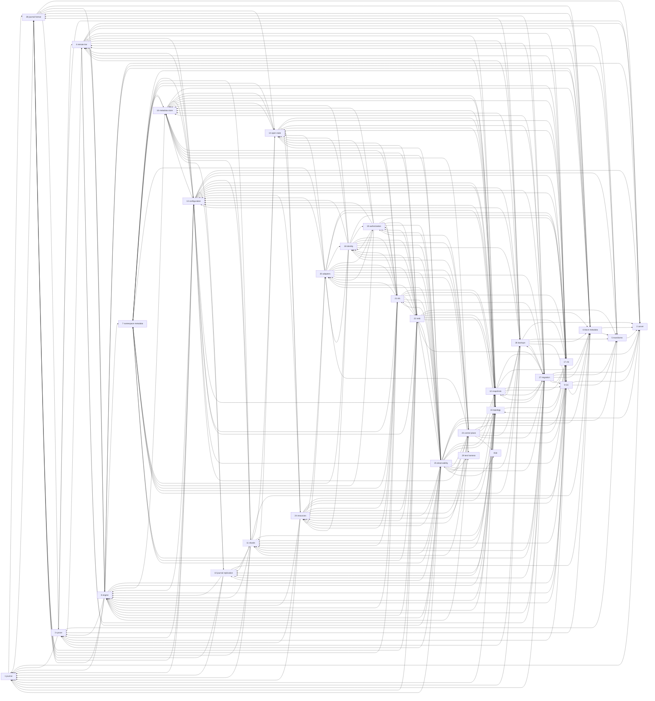

---
tags:
  - rfc-index
aliases:
  - RFCs
  - DittoFS RFCs
---

# DittoFS RFCs

The specification of DittoFS, from the bytes a client writes to the objects in the remote tier,
and the layers around them. [RFC 0](rfc-0-data-lifecycle.md) is the root: it defines the terms ([Glossary](rfc-0-data-lifecycle.md#Glossary)),
the residency function and the invariants every other RFC inherits. Start there. The table
groups the rest by part; what each RFC builds on is the [Dependencies](#Dependencies) graph, not
the table's order.

| RFC | Component | Status | Owns |
| --- | --- | --- | --- |
| **Foundations** | | | |
| [RFC 0](rfc-0-data-lifecycle.md) | data lifecycle | draft | terms, data model, residency, invariants, failure model |
| **Content**, in write-path order | | | |
| [RFC 1](rfc-1-journal.md) | journal | draft | local bytes, one journal per device: the model and interface, placement, durability, capacity, reclamation, concurrency |
| [RFC 28](rfc-28-journal-format.md) | journal format | draft | the journal's files: the `format` file, segments, records and catalog byte layouts, segments or staging files by benchmark, recovery after a crash |
| [RFC 2](rfc-2-carver.md) | carver | draft | bytes → chunks → blocks: boundaries, identity, packing |
| [RFC 3](rfc-3-syncer.md) | syncer | draft | transferring blocks to and from the remote tier |
| [RFC 4](rfc-4-remote-tier.md) | remote tier | draft | object format and backend contract |
| [RFC 5](rfc-5-transforms.md) | transforms | draft | compression, encryption, threat model |
| **Metadata** | | | |
| [RFC 6](rfc-6-block-metadata.md) | block metadata | draft | FileData, holes, refs, chunks, blocks, refcounts |
| [RFC 16](rfc-16-metadata-store.md) | metadata store | draft | the entity model and its Go package, the rules that keep it honest, interfaces by consumer and how they are assembled, control-plane and identity entities, the KV contract, key layout, codecs, counters, store format; testing, benchmarks and observability of the store |
| [RFC 7](rfc-7-namespace-metadata.md) | namespace metadata | draft | files, directories, handles, permissions, what keeps a file alive |
| [RFC 14](rfc-14-open-state.md) | open state and locks | draft | client leases, opens and deny modes, byte-range locks and lock waiters, caching grants (delegations, oplocks, leases) and their budget, watches, SMB durable and persistent opens, delete on close, open-unlinked files, NFSv4.0 owner sequences and unconfirmed clients, NLM/NSM restart, grace and per-shard reclaim, conflicts across protocols; pNFS layouts reserved |
| **Composition** | | | |
| [RFC 17](rfc-17-vfs.md) | filesystem service (VFS) | draft | the one protocol-neutral API adapters call: operations, callbacks, errors, what stays in adapters; orchestration at one primary, quota enforcement by in-memory reservation, soft-quota and access-audit event hooks |
| [RFC 8](rfc-8-engine.md) | engine | draft | the content data path: one concrete engine over journal, carver, syncer and block metadata — its interface, composition, lifecycle and policy |
| [RFC 9](rfc-9-gc.md) | GC | draft | retirement and resurrection, trash, verified remote deletion, compaction policy, audit against the reverse ref index |
| **Cluster**, deferred past the first release ([RFC 0 §1.4](rfc-0-data-lifecycle.md#1.4%20The%20single-node%20profile)) | | | |
| [RFC 10](rfc-10-journal-replication.md) | journal replication | deferred | a primary and its replicas, fencing, seal, joining learners, catch-up, reads |
| [RFC 11](rfc-11-ownership.md) | shards | deferred | shards (a share by default, subtree and automatic per-child shards; per-file and range shards deferred), the primary of each, node leases, handover, batched moves, cross-shard operations, failover, forwarding |
| [RFC 15](rfc-15-topology.md) | topology and roles | deferred | one node type that runs everything, `node.New`'s build order, the gateway forwarding to the primary and the server deciding, one primary per shard, the route envelope, pNFS metadata and data servers |
| **Data management** | | | |
| [RFC 12](rfc-12-snapshots.md) | snapshots and clones | draft | snapshots (a per-share cut number plus counted history refs; read-only, writable clones, scheduled with retention, subtree snapshots); a snapshot's deletion honours the use records [RFC 26](rfc-26-catalog-backups.md) defines |
| [RFC 26](rfc-26-catalog-backups.md) | catalog backups | draft | catalog and copying backups, backup locations, the use records that hold a snapshot while it is read, restore to a new share, recovery import, the export format and staged import |
| [RFC 27](rfc-27-namespace-migration.md) | namespace migration | draft | the namespace claim, moving a namespace between installations on one bucket, GC across installations, re-homing a share into a namespace of its own |
| **Configuration** | | | |
| [RFC 13](rfc-13-configuration.md) | configuration | draft | what is a setting and what is fixed, scopes, which settings bind content, validation, change, secrets |
| **Security** | | | |
| [RFC 18](rfc-18-identity.md) | identity and authentication | draft | principals and their stable IDs, the authentication interface and flavours, identity mapping in both directions and owner strings, directory integration and its cache, squashing, groups and share-grant resolution, identity cache keys |
| [RFC 19](rfc-19-authorization.md) | authorization | draft | one ACL model: entries, principals, rights, flags; the order of a decision, share ceiling, maximum allowed, audit selection; mode↔ACL functions and inheritance; the shared translation to security descriptors and NFSv4 ACLs |
| **Protocols** | | | |
| [RFC 20](rfc-20-adapters.md) | adapter model | draft | what an adapter may hold and import, the adapter and sidecar interfaces, the common lifecycle, live settings, health and probes, the dispatch pipeline, one auth package for both protocols, reaching a share, codecs, NFS over TLS, connection concurrency, metrics and spans, boundary tests and wire tests against reference servers |
| [RFC 21](rfc-21-nfs.md) | NFS | draft, rebased | decisions the NFS standards leave open; rebased on this set, its stable-write, grace and error rules following RFC 8, RFC 14 and RFC 17 |
| [RFC 22](rfc-22-smb.md) | SMB | draft, rebased | decisions the SMB standards leave open; rebased beside RFC 21 |
| **Operations** | | | |
| [RFC 23](rfc-23-control-plane.md) | control plane | draft | the node that builds its components and applies records; resource lifecycles, shares above all; the management API — concurrency, idempotency, long-running operations, errors, versioning; API accounts, roles, tokens and the bootstrap administrator; the management audit; the CLI as an API client |
| [RFC 24](rfc-24-resources.md) | resources and concurrency | draft | the node memory budget: one process memory limit divided into fixed pools with floors and ceiling rules, request and reply buffer classes and where they are charged, fairness across clients and shares, the queue inventory and backpressure chain, goroutine, CPU and file-descriptor bounds |
| [RFC 25](rfc-25-observability.md) | observability | draft | metric naming, units, labels and cardinality; the condition registry and health derivation; liveness and readiness; the access, quota, logon and admin event streams' delivery, retention, export and access; logs; tracing; alerting |
| **Testing** | | | |
| [RFC 29](rfc-29-test-harness.md) | test harness | reviewed | the `dt` runner, the suite registry, fixtures, tiers, grading against known failures, the result format and how red is reported |
| [RFC 30](rfc-30-kubernetes.md) | deployment on Kubernetes | draft | the operator's cluster resource with protocol and storage pools, tiers mapped to Deployment and StatefulSet, storage identity on its volume, drain before removal, autoscaling the protocol pool and operator-paced storage, service or floating-IP addressing |

RFC 26 and RFC 27 were split out of RFC 12. They sit with it under data management but are numbered after the
planned RFC 18–25, whose numbers were already reserved, so the numbering is out of order there. RFC 28 was split out of RFC 1 the same way and sits
with it under content.

RFC 29 was written for the repository's test tooling before it joined the set, so it keeps
its own layout: it has no `## Start here`, and it names the tools and files it is about,
which the naming convention below allows only of an appendix elsewhere. It builds on no
other RFC, RFC 0 included, so it is `reviewed` while the storage RFCs are still `draft`.

## Dependencies

Generated from every RFC's `depends_on` frontmatter; regenerate it whenever one
changes, never edit it by hand. An arrow reads "builds on". Every RFC builds on
RFC 0; those edges are left out. A deferred RFC is drawn dashed. Two RFCs that
build on each other form a cycle, listed under the graph: they are reviewed
together, and neither is marked reviewed before the other.

Cycles: RFC 1 ↔ RFC 28, RFC 3 ↔ RFC 4, RFC 4 ↔ RFC 5, RFC 4 ↔ RFC 6, RFC 4 ↔ RFC 8, RFC 4 ↔ RFC 9, RFC 4 ↔ RFC 12, RFC 4 ↔ RFC 13, RFC 4 ↔ RFC 26, RFC 4 ↔ RFC 27, RFC 6 ↔ RFC 28, RFC 7 ↔ RFC 16, RFC 8 ↔ RFC 9, RFC 8 ↔ RFC 15, RFC 8 ↔ RFC 28, RFC 10 ↔ RFC 11, RFC 11 ↔ RFC 14, RFC 11 ↔ RFC 15, RFC 12 ↔ RFC 13, RFC 12 ↔ RFC 26, RFC 12 ↔ RFC 27, RFC 13 ↔ RFC 16, RFC 13 ↔ RFC 26, RFC 13 ↔ RFC 27, RFC 14 ↔ RFC 15, RFC 14 ↔ RFC 16, RFC 14 ↔ RFC 17, RFC 15 ↔ RFC 16, RFC 15 ↔ RFC 17, RFC 18 ↔ RFC 19, RFC 18 ↔ RFC 20, RFC 18 ↔ RFC 21, RFC 18 ↔ RFC 22, RFC 19 ↔ RFC 20, RFC 19 ↔ RFC 21, RFC 19 ↔ RFC 22, RFC 20 ↔ RFC 21, RFC 20 ↔ RFC 22, RFC 20 ↔ RFC 23, RFC 20 ↔ RFC 24, RFC 20 ↔ RFC 25, RFC 21 ↔ RFC 22, RFC 21 ↔ RFC 24, RFC 22 ↔ RFC 24, RFC 23 ↔ RFC 25, RFC 26 ↔ RFC 27.

## Conventions

The key words **MUST**, **MUST NOT**, **SHOULD**, **SHOULD NOT** and **MAY** in
every RFC of this set are to be interpreted as in RFC 2119.

- Each RFC's frontmatter carries its status and what it builds on
  (`depends_on`), and the table and graph above are generated from it. The body
  repeats only the status, in the one **Status:** line under its title, which
  **MUST** match the frontmatter and adds only where its open questions are; it
  never repeats `depends_on`.
- **Status** is one of: `planned` (no text yet); `draft` (rules still moving);
  `reviewed` (an external review's findings are closed in the normative text);
  `frozen` (reviewed, and a change to it is made only together with every RFC
  that cites the changed rule); `deferred` (not built in the first release; its
  rules bind only once a second node can serve a share,
  [RFC 0 §1.4](rfc-0-data-lifecycle.md#1.4%20The%20single-node%20profile)). An RFC is never marked `reviewed` or `frozen` while an RFC
  it builds on is `draft`: a reviewed rule resting on a moving one is not
  reviewed. The pairwise cycles under the graph join into one strongly
  connected component, RFC 1 to RFC 17 together with RFC 26 to RFC 28, with the deferred RFC 10, 11 and 15
  inside it, so that component is reviewed as one: none of its members is marked
  `reviewed` before all of its non-deferred members are. A deferred member holds
  the review back only through the rules a first-release RFC cites from it; one
  cited only by **(cluster)** rules is reviewed with the cluster. RFC 18, 19
  and 23 to 25, together with RFC 20 to RFC 22, cite each other and so form the
  second component; that is intended — RFC 20 states the shape both adapters
  share, each adapter states where it meets the other, and identity,
  authorization, the control plane, resources and observability each state
  what the adapters hand them and take from them — and its members are
  reviewed together, after the storage component they build on and never
  before it. The storage
  RFCs name the protocol RFCs only in text, never as a link, so that no edge
  runs from the storage component into this one.
- A rule that binds only in a cluster is marked **(cluster)** where it is
  stated, and links the single-node profile.
- Normative text names no product, package or file. Products appear only in
  appendices labelled as a profile, an example, prior art, a measurement or
  where the current code differs.
- **Every RFC opens with `## Start here`**, written for a reader who knows
  neither the codebase nor the problem: what the component is for, the problem
  shown through one worked example, one drawing, the few terms needed, what it
  promises, and how the rest is organised. It is explanatory; the numbered
  sections hold the rules, and where the two differ the rule wins. Examples
  across RFCs use one cast — the `profiles` share of per-user profile
  containers over SMB, the `builds` share over NFS, users alice and bob — so a
  story started in one RFC continues in the next.
- Code appears in normative sections only as interface sketches — signatures,
  types and the names of calls, in most RFCs of the set (RFC 1, 7, 8, 14 and 16
  most of all). A
  sketch is indicative: the obligations stated around it are normative, its
  identifiers and package names are not, and an implementation may name and
  shape them differently.
- A number inside a **MUST** is either a fixed value or a setting's default, and
  [RFC 13 Appendix B](rfc-13-configuration.md#Appendix%20B%20%E2%80%94%20the%20settings) lists which, each proposed row naming the measurement that
  settles it. A number in a rule that RFC 13 does not list is a proposal and a
  defect against that RFC, closed by adding the row.
- `ponytail:` notes mark a deliberately simple design and name what would justify
  replacing it; `decision:` notes mark a deliberately narrow rule and name what
  would overturn it.

## Test tiers

**The harness owns tiers, suites and grading.** [The test-harness RFC](rfc-29-test-harness.md) is
the one owner of when tests run, which suites exist, the fixtures they run
against, and how a run is graded — its tiers ([§4.3](rfc-29-test-harness.md#4.3%20Tiers)), its
registry, fixtures and grading. This index states what a storage RFC's checks
are and what must not stand in for them, and what the storage RFCs need from the
harness ([below](#What%20the%20storage%20RFCs%20need%20from%20the%20harness)); it keeps
no tier or suite table of its own. Every RFC's test plan follows the rules here
and the harness's; an RFC states only what is specific to its component. Where
an RFC names a tier — per change, after merge, daily — it means the harness's
tier that runs on every pull request, after every merge, and nightly.

**What conformance is.** An implementation conforms when every **MUST** in its
RFC holds. Each RFC's named checks are not that definition: they are evidence
for the requirements that fail *silently*, where nothing errors and no test goes
red by accident. Passing them is necessary, not sufficient.

**How a check is validated.**

- Test at the consumer of a value, not its producer: a test beside the producer
  passes while the value is dropped downstream.
- Revert the code and watch the check fail on its own assertion. A check that has
  never failed is unverified; a build error is not a failure.
- Where the defect and the correct behaviour look alike at the point they happen
  (zeros instead of a fetch, a bit set too early), assert on the observation
  that tells them apart.

**What must not stand in.**

- A substitute that cannot exhibit a failure is not evidence of its absence: a
  sink whose writes always succeed, or an in-memory backend, is never the only
  backend under test for a check about durability, cost or crashes.
- The remote tier under test is a local emulator of the remote service, and at
  least one real service on a schedule.
- A harness that constructs a component differently from production is never the
  only path under test.
- Records built by hand are never the only input to a component whose input
  another component produces in production. A hand-built fixture encodes its
  author's model of the producer; the leak that exists only for repeated or
  all-zero content, or only when two producers race, passes every such check.
  Fixtures include repeated and all-zero content.
- A cache between the check and the thing checked is disabled or bypassed, and
  the check asserts that the thing was reached: a "cold" read served from a
  client's page cache proves nothing about the remote fetch it was written for.

**A check that did not run is a failure.** Every tier knows how many checks it
was meant to run and fails when it ran fewer: a filter that matches nothing, a
package no job includes, a check gated on an environment variable nothing sets,
or a skip because a service was absent all report green otherwise. A skip is
reported with its reason, and a check skipped in every tier is deleted or moved
to a tier that runs it. A check that timed out or was aborted is a failure,
never a skip. A known-failure list names checks, not outcomes: an entry excuses
one named check, and a check that fails in a way it does not name still fails
the tier.

**Model tests.** A rule whose failure needs an interleaving — work split into
batches, a race between two writers, a crash between two steps — is checked by a
model-based test that drives random sequences against a reference and compares
after every step. A model that applies each step atomically cannot see these
failures. The model tests the set specifies:

| RFC | Model test | Drives |
| --- | --- | --- |
| [RFC 1 §9.1](rfc-1-journal.md#9.1%20Kinds%20of%20test) | the journal | writes, fills, offloads, releases, truncates, deallocates, deletes, settles, repack, crash and reopen |
| [RFC 6 §11.1](rfc-6-block-metadata.md#11.1%20Group%20A%20%E2%80%94%20wrong%20content%2C%20lost%20content) | block metadata | commits, truncates, deallocates, clones, snapshots and their deletion, with removal batches interleaved; a removal must mask what it has not yet dropped, and a count must never fall below its refs. It must also drive overwrite records and their pruning against offloads in flight |
| [RFC 9 §11.2](rfc-9-gc.md#11.2%20Group%20B%20%E2%80%94%20model-based%2C%20with%20crashes) | GC | retirement, resurrection, deletion and compaction, with crashes |
| [RFC 16 §6.2](rfc-16-metadata-store.md#6.2%20Model-based%20and%20property%20tests) | the metadata store | transactions, conflicts and the KV contract |
| [RFC 10](rfc-10-journal-replication.md) **(cluster)** | replication | its invariants as properties of a cluster model |
| [RFC 11 §14](rfc-11-ownership.md#14.%20Test%20plan%20and%20benchmarks) **(cluster)** | shards | handover, batched moves, cross-shard operations and failover, on RFC 10's simulator |
| [RFC 12 §5](rfc-12-snapshots.md#5.%20Test%20plan%20and%20benchmarks), [RFC 26 §6](rfc-26-catalog-backups.md#6.%20Test%20plan%20and%20benchmarks), [RFC 27 §5](rfc-27-namespace-migration.md#5.%20Test%20plan%20and%20benchmarks) | snapshots, backups and moves | cuts, holds, clones, backups and moves with crashes between their steps |

An RFC that adds a batched or racing rule adds it to its model test, or names
the counted check that stands in for it.

No timed check runs per change: a shared runner's device changes between runs,
so a timing gate either fails on noise or is set so wide it misses the
regressions that matter. Each RFC states the regressions it catches by counting
instead.

**Recording results.** Every benchmark result is recorded in absolute numbers,
with the commit, the box (CPU, memory, device and the device's own raw figures
for the run), the operating system and filesystem with its mount options, and
each row's concurrency. One named **reference box** carries the series over
time, so a change between two commits reads as a change in the code and not in
the hardware; results from other boxes are compared only with themselves. A
target is stated against something measured on the same box (the filesystem,
the hash, the link), so it holds on any hardware.

**A proposed target is replaced once, by measurement.** A benchmark target or a
setting's default an RFC marks proposed is a starting value, and the two settle
differently. A **benchmark target** is replaced by the first run on the
reference box with the measured value plus headroom, stated beside the result.
A **setting's default** — a set-point such as the chunking Target or a space
amplification target — takes the value its RFC 13 row's settling measurement
selects (a sweep, a trace, a per-service or per-client-OS run), wherever that
measurement runs; it has no headroom and no miss. A proposed benchmark target that first run misses is a design finding
against the RFC that states it, not a number to relax: the design is changed, or
the target is withdrawn with its reason recorded, before the measured value
becomes the baseline. Every RFC's proposed targets follow this rule, and its
decision notes cite it rather than restating one of their own.

**The reference box.** The reference box is the pair of machines set aside for
the benchmark series. Before any decision that depends on numbers, three
measurements **MUST** be recorded there:

1. **Raw stage costs**: hash, compression, encryption, journal append with its
   fsync, and remote put and get at rising concurrency, the last measured with
   the sizing tool of [RFC 3 §2.11](rfc-3-syncer.md#2.11%20Pool%20sizes%20are%20measured%20once%2C%20by%20a%20tool).
2. **The dedup ratio** on a real customer corpus.
3. **The journal-shape benchmark** on three workloads: many small files, each
   closed by a COMMIT; one large sequential stream; random in-place overwrites
   inside a large file behind one long-lived handle. The gate is one-sided:
   shape B, staging files, is adopted only if it is no more than 5% worse than
   shape A, segments, on each gate measure — COMMIT latency, small-file
   throughput, recovery time after a crash with the journal full, and space
   amplification (bytes on the device over bytes held) — at the median and at
   p99, on every workload. Better on some and more than 5% worse on any one keeps
   A ([RFC 28 §2.6](rfc-28-journal-format.md#2.6%20Segments%20or%20staging%20files%2C%20chosen%20by%20benchmark)).

**A regression is tracked, and explained.** Performance is tracked, not gated,
as the harness has it. A row more than 10% worse on a measured path, against
the last recorded result on the reference box, needs a recorded decision —
fixed, or accepted with its reason beside the result — before the next result
on that path becomes its baseline.

## Test harness

Each RFC builds the seam its own component needs; this section owns what they
share, so a check that crosses components runs against one composition rather
than a private one per RFC.

1. **One clock and one fault interface.** Every component that reads time —
   the journal, the engine, the syncer, GC, the snapshot cut, leases — takes it
   from one clock interface (now, timers, and, under test, advance and skew).
   Every fault seam consults one fault interface: fail, delay, drop, tear or
   reorder a named operation, on a seeded schedule read from that clock. The
   interfaces' signatures are [RFC 8](rfc-8-engine.md#2.%20Composition)'s, which composes the node, and every
   component declares the methods it uses in its own package, in standard-library
   types, so the node's one clock and the seeded fault satisfy each as they are;
   none defines a private clock. The
   seams are the journal's storage seam ([RFC 1 §1.3](rfc-1-journal.md#1.3%20It%20is%20testable%20on%20its%20own)), the fake store
   ([RFC 3 §1.4](rfc-3-syncer.md#1.4%20It%20is%20testable%20on%20its%20own)), the fault transport under a real store client
   ([RFC 4 §7.2](rfc-4-remote-tier.md#7.2%20Fault%20transport)) and the fault-injecting store wrappers
   ([RFC 16 §6.4](rfc-16-metadata-store.md#6.4%20Faults%20and%20crashes)). A seam with a private clock cannot take part in a
   check that skews time across components, such as RFC 0's clock made 5% fast.
2. **One composed single-node harness.** The production composition root
   ([RFC 8 §2](rfc-8-engine.md#2.%20Composition), which a first-release node follows without the deferred
   [RFC 23 §2.1](rfc-23-control-plane.md#2.1%20The%20node%20builds%20its%20components)) builds the node, with the journal's
   storage seam, the fault-injecting metadata store and the fault transport put
   in place of the device, the store and the network, and nothing else swapped.
   Every first-release check that crosses components runs on it:
   [RFC 0 §1.4](rfc-0-data-lifecycle.md#1.4%20The%20single-node%20profile)'s checks (an erroring store, the self-fence threshold, a lost
   metadata store, a clock 5% fast), [RFC 8 §15](rfc-8-engine.md#15.%20Conformance) and [RFC 17 §8](rfc-17-vfs.md#8.%20Conformance).
   RFC 0 states its checks and owns no suite, so [RFC 8 §15](rfc-8-engine.md#15.%20Conformance), which composes
   the node, carries them.
3. **A seeded simulator, deferred.** The only seeded deterministic simulator is
   RFC 10's, deferred with it. When it is built it gains a single-node mode, so
   the cluster and the single node share one scenario format, and
   the scenarios of [RFC 12 §5](rfc-12-snapshots.md#5.%20Test%20plan%20and%20benchmarks), [RFC 26 §6](rfc-26-catalog-backups.md#6.%20Test%20plan%20and%20benchmarks) and
   [RFC 27 §5](rfc-27-namespace-migration.md#5.%20Test%20plan%20and%20benchmarks) move onto it. Until then the composed harness,
   driven from seeds, stands in.
4. **The protocol suites are the harness's**, with their tiers and fixtures
   ([the test-harness RFC](rfc-29-test-harness.md)). The protocol RFCs (RFC 21 and RFC 22) own
   which tests each suite must pass and each suite's known-failure list, every
   entry naming the decision that makes it fail. A protocol check that tests a
   single-node rule runs on one node, even where a cluster row tests the same
   rule across a failover: a row mixing the two is split, so a single-node rule
   — a restart's grace and its reboot tests included — never loses its only wire
   check to the deferred cluster.

## What the storage RFCs need from the harness

Each is a requirement the storage RFCs' checks rest on, with its reason. Where
the harness does not yet meet one, the check that needs it is not evidence
until it does.

1. **A failing seeded model test keeps and replays its seed; it is never retried
   into green or quarantined.** A model test that finds a rare interleaving
   finds it once; a rerun draws another seed and passes, so a retry or a
   quarantine files the bug as flakiness and loses the only input that shows it.
2. **Performance is tracked, and a regression past 10% needs a recorded
   decision.** The harness's "tracked, not gated" stands; the decision —
   fixed, or accepted with its reason beside the result — is what keeps a slow
   drift from becoming the baseline unnoticed ([Test tiers](#Test%20tiers)).
3. **An xfstests suite.** [RFC 21](rfc-21-nfs.md) relies on it for the
   filesystem semantics no protocol suite covers.
4. **NFSv3 mounted with locks for the lock rows.** A `nolock` mount answers
   every lock locally, so a lock row run on it tests the client, not the server.
5. **Fixtures use only settings the RFCs define.** No lease setting —
   the client lease is not a setting ([RFC 14 §4.1](rfc-14-open-state.md#4.1%20A%20client%20lease)) — no squash
   `root_to_admin`, since a share squashes none, root or all
   ([RFC 16 §2.3](rfc-16-metadata-store.md#2.3%20Server-wide%20and%20control-plane%20entities)), no switch that turns delegations off, since the server
   offers no write grant where one would hide a POSIX semantic
   ([RFC 14 §5.4](rfc-14-open-state.md#5.4%20How%20a%20grant%20is%20obtained%2C%20and%20where%20it%20pays)), and no SMB encryption mode `preferred`, since encryption
   is a share's flag (RFC 22 §5.1), so a suite that needs both encrypted and
   plain traffic gets an encrypting share beside a plain one: a fixture with a
   setting the server does not have tests a server that does not exist. Until
   the server drops a setting, a fixture keeps it, and changes with the server
   in the same pull request.
6. **A known failure that passes fails the run.** The protocol RFCs' lists pass
   when exactly those checks fail; an entry that no longer fails is a list that
   no longer names the server's behaviour, and must be removed with the fix.

## Reference workloads

*Non-normative.* The workloads below are what the benchmarks and capacity
targets are sized against. They describe deployments, not requirements; an RFC
that cites one states the property it derives from it.

**Per-user profile containers on an SMB share.** The first enterprise
deployment stores each user's profile as a virtual disk inside one file (a
profile-container product such as FSLogix). Per user:

- one container file, about 10.5 GB on the share in steady state for a 5 GB
  mailbox (to be confirmed), presented to Windows as a 30 GB logical disk —
  the product's default cap, which can be grown;
- one read/write handle on it, held open for the whole desktop session;
- a small metadata file (under 1 MB), read at sign-in and at sign-out and then
  released, with no handle held.

What follows from it:

- Few large files, written by random in-place overwrites behind a long-lived
  handle — not many small files closed after each write.
- Sign-in storms: many users open their containers at once, each a cold read of
  the container's header and its hot blocks. The journal must hold the active
  users' working sets.
- SMB durable handles and leases matter, because the handle outlives network
  blips and the session lasts hours.
- 30 GB per file is the test size; larger files are a stretch target.
- Many users, and many shares.
- At sign-out the product may compact the container, ending in one truncate
  that drops gigabytes (30 GB to 24 GB in one test). The truncate returns at
  once; the dropped tail is left for GC.

**Read-mostly ingestion for a retrieval and indexing pipeline.** A pipeline
reads a share of documents to build a search or embedding index, and rereads
what changed. On one install: about 7,000 files totalling 1.1 GB, read at about
67 MB/s cold and 122 MB/s warm.

- Many small files, read whole, mostly once per pass: cold-read latency per file
  and pre-warm decide the pass time, not write throughput.
- A read that returned zeros instead of failing would poison the index with no
  error anywhere downstream. The reader cannot tell, so **Lost** must fail the
  read ([RFC 0 §9](rfc-0-data-lifecycle.md#9.%20Invariants), I1).
- Open question: whether a share-wide change feed, so the pipeline reads only
  what changed without walking the tree, is in scope — beyond per-directory
  watches ([RFC 14 §2.5](rfc-14-open-state.md#2.5%20Watch)).

## Reading them in Obsidian

- Every `RFC N §x.y` is a link to that section. Hover for a preview; the backlinks pane shows
  every place that cites the section you are reading.
- Each RFC carries properties (`rfc`, `component`, `status`, `depends_on`), and
  [rfcs.base](rfcs.base) tabulates them.
- The Google Docs copies are generated from these files; comment in either place.
